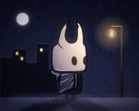
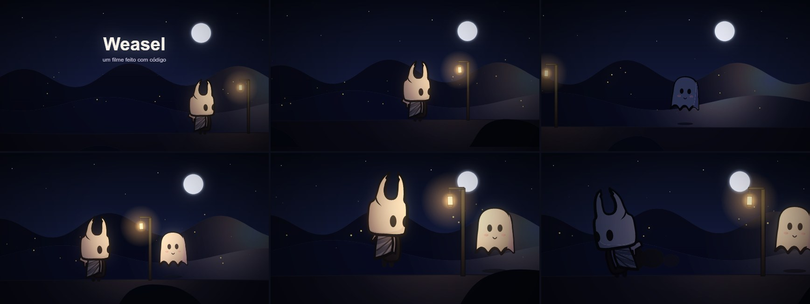
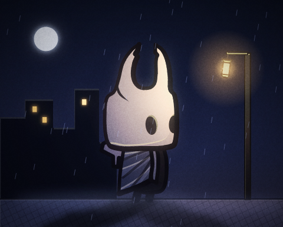
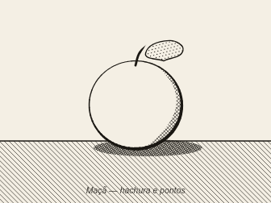

# Weasel — desenho por código

Weasel é um editor web onde você **escreve uma pequena linguagem de desenho e vê a imagem sendo pintada ao vivo**. A linguagem tem formas, curvas, camadas, recortes, gradientes, hachuras, texto, componentes reutilizáveis, variáveis, esqueleto com molas, tecido que balança, braços e pernas com IK, animação com morph e eventos, **luzes que mudam a cor dos personagens, sombras projetadas, partículas e efeitos** (brilho, desfoque, rastro, bloom). Tudo exporta em **PNG, JPG, SVG, GIF animado, sprite sheet e SpriteFrames do Godot**, e filmes saem em **vídeo** (MP4, ProRes, WebM) ou sequência de PNG, tanto no navegador quanto pela **linha de comando**.

A ideia veio do vídeo [*Claude simplesmente clonou Hollow Knight em menos de uma hora*](https://www.youtube.com/watch?v=X2cFbpQCZec&t=517s) (trecho de 8:37 a 8:42), que mostra uma ferramenta assim desenhando o Cavaleiro. O vídeo não documenta a linguagem: ela foi reconstruída a partir dos quadros. As capturas e a transcrição do código que aparece na tela estão em [`referencia/`](referencia/).

| Do vídeo | Feito no Weasel |
|---|---|
|  |   |



## Jogo e filme

O Weasel atende a dois usos, sem um atrapalhar o outro:

- **Jogo** (Godot, plataforma, top-down…): cada personagem é um arquivo `.weasel` com desenho, ossos e animações (`stand`, `jump`, `dash`…), exportado em sprite sheet ou SpriteFrames do Godot.
- **Filme** (animação longa para o YouTube): um arquivo com `film` coloca esses **mesmos arquivos** em cena como atores, divide o tempo em planos (`shot`), diz o que muda e quando (`at`) e para onde a câmera olha, com profundidade (paralaxe). Sai em vídeo ou sequência de PNG; som, vozes e montagem ficam com o editor de vídeo.

Corrigiu o personagem? A correção vale para o jogo e para o filme. Tudo o que é de filme está em instruções novas, e os [testes de regressão](#testes) (`npm test`) conferem que os desenhos e as exportações de jogo continuam idênticos.



## Como rodar

O editor web não precisa de instalação nem de compilação: é HTML, CSS e JavaScript puro, sem dependências.

**Opção 1 — abrir o arquivo direto.** Dê dois cliques em `index.html` (Chrome, Edge ou Firefox).

**Opção 2 — servidor local** (útil se o navegador bloquear algo em `file://`). Na pasta do projeto:

```bash
python -m http.server 5317
```

Depois abra <http://localhost:5317>.

Os arquivos ficam salvos automaticamente no navegador (localStorage). **Abrir…** aceita vários `.weasel` de uma vez, **Salvar** baixa o arquivo atual e **Baixar todos** junta todos num `.zip`.

## Linha de comando

A mesma linguagem roda no terminal, com o mesmo leitor e o mesmo desenho do editor web (os arquivos de `js/` são compartilhados), então a imagem sai igual. Precisa de [Node.js](https://nodejs.org) 18 ou mais novo. Instale a dependência de desenho uma vez, na pasta do projeto:

```bash
npm install
```

Depois:

```bash
node cli/weasel.js exemplos/cavaleiro.weasel
```

Isso gera `cavaleiro.png`. Também funciona `npm run weasel -- <argumentos>`, e `npm link` instala o comando `weasel` no sistema.

A entrada pode ser um arquivo, um texto direto (`-e`, com `;` separando as linhas) ou a entrada padrão (`-`):

```bash
node cli/weasel.js -e "canvas 200 200; ellipse sol 100,100 60 c=#ffb000 ink=4" -o sol.png
```

```bash
cat desenho.weasel | node cli/weasel.js - -o desenho.png
```

O formato sai da extensão de `-o` (`.png`, `.jpg`, `.gif`, `.svg`, `.tres`, `.zip`; num filme também `.mp4`, `.mov`, `.webm`, `.mkv`) ou de `-f`:

| Quero… | Comando |
|---|---|
| PNG da pose parada | `node cli/weasel.js exemplos/cavaleiro.weasel -o cavaleiro.png` |
| JPG de um quadro, em 2× e recortado | `node cli/weasel.js exemplos/cavaleiro.weasel -a jump --frame 11 -s 2 --trim -o pulo.jpg` |
| Um PNG por quadro | `node cli/weasel.js exemplos/cavaleiro.weasel -a jump --frames -o quadros/pulo.png` |
| SVG vetorial | `node cli/weasel.js exemplos/coruja.weasel -o coruja.svg` |
| GIF de uma animação | `node cli/weasel.js exemplos/cavaleiro.weasel -a jump --trim -t -o pulo.gif` |
| GIF da pintura passo a passo | `node cli/weasel.js exemplos/cavaleiro.weasel -f build -o pintura.gif` |
| Sprite sheet (PNG + JSON) | `node cli/weasel.js exemplos/cavaleiro.weasel -f sheet -a all -s 0.5 --trim -t -o sprites.png` |
| SpriteFrames do Godot (PNG + .tres) | `node cli/weasel.js exemplos/coruja.weasel -f godot -a all --trim -t -o godot/coruja.tres` |
| Todas as variantes de cor | `node cli/weasel.js exemplos/coruja.weasel -o coruja.png --variant all` |
| Exportar de novo a cada mudança | `node cli/weasel.js exemplos/coruja.weasel -a pia -o coruja.gif --watch` |
| Só verificar o código | `node cli/weasel.js meu.weasel --check` |
| Ver camadas, componentes, ossos, animações e eventos | `node cli/weasel.js meu.weasel --info` |

Outras opções: `-q` (qualidade do JPG), `--layout grid|rows`, `--cols`, `--padding`, `--speed` (velocidade da pintura), `--dither` (GIF com pontilhado, menos faixas em brilhos e degradês), `--guides` (inclui camadas `guide`), `--quiet`. A lista completa sai com `--help`. Com `--watch`, mudanças nos arquivos de `include` também disparam a exportação.

### Filmes na linha de comando

| Quero… | Comando |
|---|---|
| Vídeo MP4 (H.264) do filme todo | `node cli/weasel.js exemplos/filme.weasel -o filme.mp4` |
| ProRes para o editor de vídeo, um arquivo por plano | `node cli/weasel.js exemplos/filme.weasel -o render/filme.mov --shots` |
| ProRes 4444 com fundo transparente | `node cli/weasel.js titulo.weasel -o titulo.mov -t` |
| Prévia rápida em meia resolução | `node cli/weasel.js exemplos/filme.weasel -o previa.mp4 -s 0.5` |
| Só um plano, ou só um trecho | `--shot pulo` · `--from 10s --to 20s` (também `48f`, `1m30s` ou `00:01:12`) |
| Sequência de PNG | `node cli/weasel.js exemplos/filme.weasel --frames -o quadros/q.png` |
| Um quadro (capa, miniatura) | `node cli/weasel.js exemplos/filme.weasel -o capa.png --time 4s` |
| Planos, tempos e atores | `node cli/weasel.js exemplos/filme.weasel --info` |

Vídeo precisa do [ffmpeg](https://ffmpeg.org) instalado (no Windows: `winget install ffmpeg`; ou `--ffmpeg <caminho>`). Os quadros são renderizados em paralelo (`-j`, padrão: núcleos − 1, até 8) e entram no ffmpeg em ordem; o vídeo sai idêntico ao render numa thread só. MP4 sai em H.264 BT.709 (qualidade `--crf`, padrão 18), `.mov` em ProRes 422 HQ (ou 4444 com `-t`), o que os editores de vídeo abrem com mais facilidade, e `.webm` em VP9. A sequência de imagens leva o número do quadro do filme no nome (`q_00264.png`), então um trecho exportado depois se encaixa no lugar certo.

Erros aparecem como num compilador, com arquivo, linha e coluna:

```
ruim.weasel:3:22: erro: cor desconhecida "nada"
  3 | ellipse a 100,100 40 c=nada bone=x
    |                      ^^^^^^
weasel: 1 erro(s); nada foi exportado (use --force para exportar ignorando as linhas com erro).
```

Com erros, nada é exportado e o código de saída é 1 (`--force` exporta ignorando as linhas com erro, como o editor faz). Opções erradas saem com 2. Avisos não impedem a exportação.

## A interface

| Área | O que faz |
|---|---|
| **Arquivos** (acima do código) | Troca de arquivo, cria, renomeia e exclui. `include` encontra os outros arquivos da lista pelo nome. |
| **Editor** (esquerda) | Código com cores, números de linha, erros na margem e sugestões enquanto você digita. A barra de baixo mostra os erros (clique para ver a lista) e o que está sob o cursor. |
| **Desenho** (direita) | Redesenha a cada tecla. Roda do mouse aproxima, arrastar o fundo move a vista, **Ajustar** enquadra de novo. |
| **Guias / Pontos / Ossos / Papel vegetal / variante** | Mostram as camadas `guide` e as luzes (ícone e alcance), os pontos da linha atual, o esqueleto (ossos com mola ou movimento sozinho em amarelo), os quadros vizinhos da animação e escolhem a variante de cores. |
| **Player** (embaixo) | Escolhe a animação, toca/pausa, avança quadro a quadro e muda a velocidade. Quadros com `event` aparecem com ⚑. Num filme, escolhe o filme inteiro ou um plano e mostra o tempo (min:seg:quadro), o plano e o tempo dentro dele. |
| **Câmera** (filmes) | Ligada, mostra o que a câmera filma, como vai sair no vídeo. Desligada, mostra o mundo inteiro como foi desenhado, com a moldura tracejada do quadro parado e a moldura laranja da câmera naquele momento. |
| **Pintar** | Repete a pintura traço a traço, com o pincel laranja, como no vídeo. |
| **Exportar** | PNG, JPG, GIF animado, SVG, sprite sheet ou Godot, com prévia; uma variante ou todas. Num filme: quadro atual, GIF, vídeo WebM ou sequência PNG. |
| **Referência** | A referência completa da linguagem, dentro do app (F1). |

Editando pelo desenho e pelo teclado:

- Com o cursor numa linha, os pontos dela aparecem no desenho; o ponto sob o cursor fica **laranja**.
- **Arraste** um ponto para movê-lo (o código é atualizado). Funciona na "pose parada", também dentro de componentes (o código recebe as coordenadas do componente). Pontos cinza vêm de `{contas}` e não arrastam.
- **Duplo clique** num ponto liga/desliga o canto vivo (`!`). Alças de curva (`~dx,dy`) aparecem em azul e também arrastam.
- **Ctrl+clique** no desenho escreve a coordenada na posição do cursor.
- **Alt+arrastar** sobre um número no código muda o valor (Shift deixa 10× mais rápido). **Alt+clique** numa cor `#hex` abre o seletor de cor.
- Sugestões de comandos, atributos, cores, ossos, camadas, componentes e propriedades aparecem enquanto você digita; **Ctrl+Espaço** abre na hora, **Enter** ou **Tab** aceitam.
- Com o cursor numa linha `key` ou `event`, o player pula para aquele quadro; numa linha `at` ou `shot` de um filme, pula para aquele momento. A posição dos atores e a de cada `at … .pos=` aparecem como alças que arrastam, nas duas vistas (as coordenadas do mundo são calculadas de volta pela câmera).

Atalhos: `Ctrl+Z` / `Ctrl+Y` desfazer/refazer, `Ctrl+/` comentar, `Ctrl+D` duplicar linha, `Ctrl+S` salvar, `Ctrl+E` exportar, `Espaço` tocar/pausar e `←` `→` quadro anterior/próximo (com o foco fora do editor).

## A linguagem

Uma instrução por linha:

```
comando nome atributo=valor ... : x,y x,y x,y!
```

- `#` começa um comentário.
- Depois do `:` vêm os pontos. Pontos comuns formam **curvas suaves**; `x,y!` é um **canto vivo**; `x,y~dx,dy` fixa a **alça da curva** naquele ponto (relativa ao ponto; a do outro lado é espelhada).
- Cores: `#rgb`, `#rrggbb`, `#rrggbbaa`, um nome da `palette`, um `gradient` ou `none`. Espessuras: número ou nome numérico da `palette`.
- Qualquer número pode ser uma conta entre chaves: `{cx+20}`, `{r*1.6}`, `{sin(30)*r}`.

Exemplo mínimo:

```
canvas 480 360 bg=#f4efe6 light=-0.6,-0.8
palette ink=#1d1b26 line=6 ball=#ff6b4a

layer bola
ellipse b 240,180 60 c=ball ink=line weight=0.3
layer brilho clip=b
ellipse reflexo 218,156 22,14 rot=-30 c=#ffc2ad
```

### Configuração

| Instrução | Para quê |
|---|---|
| `canvas L A bg= light=x,y` | Tamanho, fundo (cor, gradiente ou `none` = transparente) e direção da luz (engrossa o contorno do lado da sombra). |
| `finish game\|flat inner= pixel= bloom= vignette= grain= posterize=` | `flat` tira os contornos; `inner` é a opacidade dos traços dentro de camadas com `clip`; `pixel=4` deixa pixelado; `bloom` faz o claro vazar em brilho; `vignette` escurece as bordas; `grain` põe granulado; `posterize=palette` (ou um número de níveis) reduz às cores da palette. |
| `palette nome=valor ...` | Cores e espessuras com nome. `ink` é a cor padrão dos contornos. |
| `pattern nome hatch\|dots [cross] c= bg= gap= w= r= angle=` | Preenchimento de hachura (linhas paralelas; `cross` cruza) ou de pontos, para usar em `c=` de formas fechadas. O padrão acompanha a forma quando ela se mexe. |
| `let nome=valor ...` | Variáveis para as contas: `let cx=400 r={cx/8}`. Funções: `sin`, `cos`, `tan` (em graus), `atan2`, `sqrt`, `abs`, `min`, `max`, `round`, `floor`, `ceil`, `pow`, `lerp`, `clamp`; constante `pi`. |
| `gradient nome linear x1,y1 x2,y2 [box] : cores` | Gradiente linear. Cores com posição opcional: `: #fff@0 #889@1`, ou só `: pena penad`. Com `box`, as coordenadas vão de 0 a 1 dentro de cada forma que usa o gradiente. |
| `gradient nome radial cx,cy r [fx,fy] [box] : cores` | Gradiente circular, com foco opcional. Use o nome em `c=`, `inkc=` ou `bg=`. Os gradientes seguem os ossos da forma. |
| `variant nome chave=valor ...` | Outra versão das cores: troca valores da `palette` (inimigos recoloridos, dia/noite...). |
| `include "arquivo.weasel"` | Usa outro arquivo: palette, componentes, ossos. No terminal, o caminho é relativo ao arquivo que inclui. |
| `unity unit= root=x,y collider=l,a,dx,dy` | Pixels por unidade, ponto raiz e colisor para a Unity (vão no JSON da sprite sheet). |

### Camadas e formas

| Instrução | Para quê |
|---|---|
| `layer nome [guide] [hidden] clip= cut= only= opacity= blend=` | Camada. `guide` só aparece no editor; `clip=` recorta por dentro de uma forma ou camada; `cut=` recorta por fora; `only=` limita a certas animações. |
| `shape nome c= ink= inkc= weight= inkon= smooth= : pontos` | Forma fechada. `inkon=camada` desenha o contorno em outra camada (por cima de outras coisas). |
| `stroke nome w= c= taper=a,b cap= : pontos` | Traço aberto, com pontas afinando (`taper`). |
| `stroke nome limb=w1,w2 hip=x,y on=osso foot=chão,x bend=` | Perna com IK: a raiz segue o osso, o pé fica na `line` chamada *chão*; dobra ao agachar e pendura no pulo. |
| `stroke nome limb=w1,w2 hip=x,y on=osso target=mão` | Braço com IK: a ponta vai atrás do osso *mão* (anime a mão com `key`). |
| `line nome c= w= dash=a,b : pontos` | Linha reta (boa para guias). |
| `ellipse nome cx,cy rx,ry rot=` | Elipse ou círculo. |
| `rect nome x,y l,a r= rot=` | Retângulo com cantos arredondados. |
| `text nome x,y "texto" size= font= align= rot= [bold] [italic]` | Texto; `ink=` contorna as letras. |

Todas as formas aceitam `bone=`, `cloth=`, `opacity=`, `cut=forma` (abre um buraco com o formato de outra forma, com contorno) e a opção `hidden` (a forma não aparece, mas serve de molde para `clip`, `cut` e morph).

**Espelho:** `shape asaD mirror=asaE@400` copia a forma *asaE* refletida na linha x=400 (`@y300` reflete na horizontal; sem `@`, usa o meio do canvas). O que for escrito na linha substitui o da original — por exemplo, `bone=asaD`.

### Componentes

```
def estrela cor=#fff6d8
shape s c=cor : 0,-9! 2,-2 9,0! 2,2 0,9! -2,2 -9,0! -2,-2
end

use estrela 60,58
use estrela 300,40 scale=0.8 rot=15 cor=#ffe7a3
use estrela 452,206 flip=x
```

| Instrução | Para quê |
|---|---|
| `def nome param=padrão ...` … `end` | Define um desenho reutilizável, com coordenadas em volta de 0,0. Parâmetros numéricos viram variáveis (`{param}`) e espessuras; os outros, cores. Todo parâmetro precisa de um valor padrão. |
| `use nome x,y scale= rot= flip=x\|y\|xy bone= cloth= opacity= param=valor` | Desenha o componente na camada atual. As formas de dentro seguem o `bone=` do use. Um componente pode usar outro. |

### Esqueleto e animação

| Instrução | Para quê |
|---|---|
| `bone nome parent= pivot=x,y` | Osso. Formas com `bone=nome` seguem o osso. |
| `bone ... sway=graus,s bob=px,s jitter=px` | Movimento sem keys: balanço, sobe-e-desce e tremor. O período se ajusta para o loop fechar. |
| `bone ... spring=0.4` | Mola: o osso gira atrasado quando o pai se mexe (orelhas, antenas, cabelo, a espada do Cavaleiro). |
| `cloth nome pivot=x,y tension= drag= swing=` | Tecido: os pontos longe do pivô balançam atrasados quando o osso se move. |
| `anim nome frames= fps= [once]` | Começa uma animação. |
| `key quadro osso=dx,dy,rot,sx,sy ... ease=` | Pose dos ossos naquele quadro; o resto é interpolado (`smooth`, `linear`, `in`, `out`, `back`, `step`). |
| `key quadro forma.prop=valor` | Anima uma forma: `opacity`, `c`, `inkc` (cores se misturam), `w`, `ink`, `show` (1/0) e `shape` (morph para outra forma com o mesmo número de pontos). Camadas: `camada.opacity` e `camada.show`. |
| `event quadro nome` | Marca um evento (passo, som, golpe). Aparece no player e vai no JSON da sprite sheet. |

```
bone bola pivot=240,300            # pivô na base: a bola amassa contra o chão

anim quica frames=24 fps=24
key 0  bola=0,0,0,1.25,0.78 ease=out
key 12 bola=0,-170,0,1,1 ease=in
key 24 bola=0,0,0,1.25,0.78
event 0 quique
```

Piscar com morph — a forma `fechado` não aparece, só serve de molde:

```
ellipse olho 100,100 17,28 c=ink
ellipse fechado 100,104 17,3 c=ink hidden

anim parado frames=24 fps=12
key 16 olho.shape=olho
key 18 olho.shape=fechado
key 20 olho.shape=olho
```

### Luz

```
ambient c=#5866a0 power=0.5                                   # luz geral: noite azulada
light lampiao point 644,194 c=#ffb860 power=1.7 radius=560 glow=110 flicker=0.12 rim=5 bone=lanterna
light lanterna spot 120,80 aim=60 cone=30 c=#ffffff
light lua dir -0.45,-0.85 c=#9fb4ff power=0.22
rect vidro 634,177 20,34 c=#ffe2a8 emit=#ffb860,1.4          # brilha e não recebe luz
```

| Instrução | Para quê |
|---|---|
| `ambient c= power=` | Luz geral da cena. Sem `ambient`, vale branco × 0.6 quando há luzes. |
| `light nome point x,y c= power= radius= glow= flicker= rim= bone=` | Lâmpada. Ilumina e tinge o que está perto; `glow` desenha o halo, `flicker` faz tremular, `rim` põe um fio de luz na borda das formas (na cor da luz), `bone=` faz a luz andar com um osso. |
| `light nome spot x,y aim= cone= ...` | Lanterna/holofote: só ilumina dentro do cone (`aim` em graus: 0 = direita, 90 = para baixo). |
| `light nome dir dx,dy c= power=` | Sol/lua: luz que vem de uma direção, igual em tudo. |
| `emit=cor[,força]` (em qualquer forma) | A forma brilha e não recebe luz: olhos, janelas, vidro da lâmpada, fagulhas. |

Com luz na cena, **toda camada é iluminada**, a não ser as marcadas com `unlit` (céu, interface, efeitos). Cada forma fica com a cor da luz que chega nela, mais clara do lado da luz e mais escura do outro. **Tudo é recalculado a cada quadro**: se o personagem anda até a lâmpada, ou se a lâmpada balança num osso, a cor e a sombra mudam junto. As luzes também animam com `key` (`lampiao.power`, `radius`, `c`, `glow`, `aim`, `cone`).

### Efeitos de camada

| Atributo da camada | Efeito |
|---|---|
| `blur=px` | Desfoque (neblina, fundo fora de foco). |
| `glow=cor,raio[,força]` | Brilho em volta de tudo da camada. |
| `shadow=cor,dx,dy,desfoque` | Sombra deslocada. |
| `tint=cor,quanto` `brightness=` `saturate=` `contrast=` `hue=` | Tingir, brilho, saturação, contraste e girar o matiz. |
| `trail=quadros,queda[,cor]` | Rastro de movimento: os quadros anteriores aparecem cada vez mais fracos. |
| `cast=chão[,opacidade[,desfoque]]` `from=camadas` | Sombra projetada no chão (uma `line`), inclinada para longe de cada luz. `from=` usa a silhueta de outras camadas — útil para dar sombra a um personagem que vem de um `include`. |
| `rim=cor[,largura]` `shade=` | Fio de luz na borda virada para a luz; `shade` controla o claro/escuro (padrão 0.5). |
| `lit` / `unlit` | Recebe ou não a luz. |

Os efeitos animam com `key`: `neblina.blur=8`, `aura.glow=40`, `fantasma.tint=0.5`...

### Partículas

```
emitter fagulha 380,90 rate=25 life=1.2 speed=60 spread=120 angle=-90 gravity=-20 drag=0.5 c=#ffd27a,#ff600000 size=5,0 shape=soft emit=#ffb054,0.6
emitter gotas 400,-30 rate=70 life=1.1 speed=640 angle=100 spread=4 area=1000,0 c=#a8b8ff60 size=4 shape=streak
```

`rate` (por segundo) ou `burst` (uma rajada a cada volta), `life`, `speed`, `angle` (−90 = para cima), `spread`, `gravity`, `wind`, `drag`, `size=início,fim`, `c=cor_início,cor_fim`, `shape` (dot, soft, square, streak, star), `area` (espalha a origem), `seed` e `bone=` (a origem anda com o osso). O sorteio é fixo, então a animação fecha o loop certinho e a exportação sai igual toda vez.

### Filme

Um arquivo com `film` é um filme. Personagens e cenários continuam sendo arquivos comuns (os mesmos do jogo): o filme só os coloca em cena e diz o que muda com o tempo.

```
film fps=24
canvas 1920 1080 bg=ceu                       # tamanho do quadro e fundo
ambient c=#5866a0 power=0.5
light lampiao point 2000,566 c=#ffb860 power=1.6 radius=720   # ilumina os atores também

actor cenario "cenario.weasel" 0,0
actor heroi "cavaleiro.weasel" 1720,900 scale=0.9 anim=stand
actor fantasma "fantasma.weasel" 3400,880 origin=240,350 anim=flutua hide=ceu

shot encontro dur=5s
camera follow=fantasma offset=-260,-300 lag=0.5 zoom=1.15
at 4.2s fantasma.pos=2200,880 ease=out

shot pulo dur=4.5s
camera 1800,690 zoom=1.6
at 0.4s heroi.anim=jump
at 2s heroi.anim=stand
at 2.6s heroi.anim=dash heroi.flip=x heroi.pos=1720,900
at 3.2s heroi.pos=1050,900 ease=out
at 3.4s camera.fade=0
at 4.5s camera.fade=1 ease=linear
```

| Instrução | Para quê |
|---|---|
| `film fps= dur=` | Marca o arquivo como filme. `canvas L A bg=` é o tamanho do quadro (padrão 1920 × 1080) e o fundo. `dur=` só vale sem `shot`. |
| `actor nome "arquivo.weasel" x,y scale= rot= flip= depth= anim= speed= opacity= origin= variant= hide= [screen] [bg] [hidden] [unlit] [front]` | Põe outro arquivo em cena. `anim=` é a animação que começa tocando, `hide=` esconde camadas do arquivo (o céu que só faz sentido no jogo), `hidden` começa invisível, `bg` desenha o fundo do arquivo. Declarado antes do primeiro `shot`, vale para todos os planos. |
| `shot nome dur=` | Um plano. Os planos tocam em sequência; atores, `camera` e `at` abaixo dele valem só para ele, e cada plano começa com tudo como foi declarado. |
| `camera x,y zoom= rot= shake= follow= offset= lag= fade= fadec=` | Para onde a câmera olha (o centro do quadro). `follow=ator` segue um ator (mais `offset=`), `lag=` (segundos) faz a câmera chegar atrasada e macia, `shake=` treme (px), `fade=1` escurece tudo (`fadec=` muda a cor). |
| `at tempo alvo.prop=valor … ease=` | Muda algo num momento do plano. Ator: `pos`, `x`, `y`, `scale`, `rot`, `opacity`, `depth`, `flip`, `show`, `anim`, `speed`, `variant`. Câmera: `pos`, `x`, `y`, `zoom`, `rot`, `shake`, `follow`, `offset`, `lag`, `fade`, `fadec`. Luzes do filme: `power`, `radius`, `c`, `glow`, `aim`, `cone`. Camadas do filme: `opacity`, `show` e os efeitos. |
| `scene "arquivo.weasel"` | Acrescenta, nesse ponto da sequência, os planos de outro arquivo de filme. |
| `layer … depth= [screen] [front]` | Profundidade da camada (em qualquer arquivo; só vale num filme). `only=` no arquivo do filme também aceita nomes de plano. |

- **Tempo:** `2s`, `1.5` (segundos), `500ms`, `48f` (quadros do filme), `1m30s`; `at +1s` conta a partir do `at` anterior. O tempo do `at` conta do começo do plano.
- **Como o `at` muda as coisas:** o valor declarado no `actor` ou na `camera` vale como um `at 0s`; de um `at` para o seguinte a mudança é gradual, e o `ease=` diz como ela **chega** naquele `at` (padrão `smooth`; `linear` para andar em velocidade constante; `step` troca de uma vez). Para algo ficar parado e só depois andar, repita a posição num `at` anterior. `anim`, `flip`, `show`, `follow`, `speed` e `variant` trocam de uma vez. Trocar `anim` sempre recomeça a animação do quadro 0; animações com loop repetem até a próxima troca.
- **Animação no tempo do filme:** cada ator toca a animação no fps dela (um ciclo de 12 fps num filme de 24 fps fica "em dois", como no desenho animado). Sem animação, partículas, `sway`, `bob`, `jitter` e `flicker` andam com o relógio do filme.
- **Profundidade:** `depth=1` é o plano da ação. Com `depth=2` (no ator ou na camada) a coisa está duas vezes mais longe: quando a câmera anda ou dá zoom, ela anda e cresce menos; `depth=0.5` está perto da câmera e passa mais rápido. Na câmera parada (centro do quadro, zoom 1) tudo fica exatamente como foi desenhado, então dá para compor a cena sem pensar na paralaxe. `screen` prende na tela (títulos, legendas) e `front` põe a camada na frente dos atores da mesma profundidade (a moita na frente do personagem).
- **Luz:** `light` e `ambient` do arquivo do filme iluminam o cenário e todos os atores — o lampião esquenta a cor do personagem quando ele chega perto. As luzes do próprio ator continuam valendo para ele; `unlit` no ator ignora a luz do filme.
- **Onde o ator fica:** `x,y` é onde vai o `root=` do `unity` do arquivo (o ponto entre os pés, o mesmo do jogo); sem `unity`, o canto 0,0 do desenho. `origin=` escolhe outro ponto.
- **Filmes longos:** um arquivo por cena (`cena01.weasel`, `cena02.weasel`…, cada um com seus planos), um arquivo principal que só junta as cenas com `scene`, e personagens e cenários em arquivos próprios, compartilhados com o jogo. Exporte o filme todo (os planos saem na ordem, com o mesmo código de tempo do player) ou cada plano com `--shots`, e monte com o som no editor de vídeo.

## Exportar

| Formato | O que sai |
|---|---|
| **PNG** | O quadro da tela, com fundo transparente opcional. |
| **JPG** | O quadro da tela, com qualidade ajustável. |
| **SVG** | O quadro da tela em vetor, com gradientes, recortes e texto. Abre no navegador, no Inkscape ou no Figma. |
| **GIF animado** | Uma animação (no fps dela) ou a **pintura passo a passo**. Paleta de até 256 cores; a transparência do GIF é de 1 bit. A opção **pontilhado** troca as faixas de cor de brilhos e degradês por um padrão fino. |
| **Sprite sheet** | Um `.zip` com todos os quadros num PNG e um `.json` no formato do TexturePacker/Phaser (`frames`, `animations`, `meta.frameTags`), com os eventos de cada quadro e o pivô e os pixels por unidade da Unity quando houver `unity`. Arranjo em grade ou uma linha por animação. |
| **Godot** | A folha (.png) e um `SpriteFrames` do Godot 4 (.tres) com as animações, o fps e o loop. Deixe os dois na mesma pasta do projeto e use o .tres num `AnimatedSprite2D`. |
| **Vídeo** (filme) | WebM (VP9) gravado pelo próprio navegador, sem som, do filme inteiro ou de um plano. MP4, ProRes e filmes longos saem pela linha de comando. |
| **Sequência PNG** (filme) | Um `.zip` com um PNG por quadro, numerado pelo quadro do filme. |

Num filme, PNG e JPG exportam o quadro que está no player; GIF, vídeo e sequência exportam o filme inteiro ou um plano e só são gerados ao clicar (fechar a janela cancela).

Todos aceitam escala (25% a 400%) e **recortar ao desenho**: o recorte cobre todos os quadros da animação, então os quadros ficam alinhados. Com variantes, dá para exportar uma ou todas de uma vez (num `.zip`).

| Padrão | `variant neve` | `variant fogo` |
|---|---|---|
|  |  |  |

## Exemplos incluídos

- **Cavaleiro (do vídeo)**: a reconstrução do desenho, com as mesmas linhas-guia e camadas, e as animações `stand` (com piscada), `jump` e `dash`. A espada balança com mola.
- **Coruja**: mostra os recursos novos — `let`, componentes com parâmetros, `mirror`, gradientes `box`, morph do bico e das pálpebras, texto que aparece no pio, eventos, `sway`, molas nos tufos e duas variantes de cor.
- **Noite**: o Cavaleiro (por `include`) numa rua à noite. A lanterna balança num osso e a luz dela vai junto, mudando a cor dele e a sombra no chão; tem chuva, mariposas que brilham, neblina com desfoque, janelas acesas, calçada em hachura e bloom/vinheta/granulado.
- **Gravura**: maçã em estilo nanquim, só com hachura, hachura cruzada e pontos.
- **Primeiros passos (fantasma)**: comentado, bom para aprender a sintaxe.
- **Bola quicando**: squash & stretch com um osso só, com rastro de movimento.
- **Filme**: três planos com o Cavaleiro e o fantasma — os arquivos do jogo, sem mudar nada — num cenário de morros em camadas de profundidade: letreiro que aparece e some, câmera descendo da lua com paralaxe, câmera seguindo o fantasma com atraso, o lampião do cenário iluminando os dois, tranco da câmera no pouso do pulo e fade no fim.
- **Cenário**: o cenário do filme, um desenho comum em camadas com `depth` (lua, serra, morros, chão, poste, vaga-lumes e moitas na frente).

| Noite | Gravura |
|---|---|
|  |  |

Os mesmos exemplos estão em [`exemplos/`](exemplos/) como arquivos `.weasel`.

## Testes

`npm test` renderiza todos os exemplos e compara com as referências guardadas em [`test/ref/`](test/ref/): a pose, cada variante, um quadro do meio de cada animação, a sprite sheet de todas as animações com o JSON, o `.tres` do Godot, o SVG, a ordem da pintura, o resumo do `--info` e o codificador de GIF. No filme, confere a linha do tempo de 6 em 6 quadros (onde está cada ator, que quadro da animação toca, para onde a câmera olha) e alguns quadros prontos.

As referências dos desenhos foram gravadas antes de o filme existir, então o teste mostra que os desenhos e as exportações de jogo continuam iguais. Quando algo muda, o teste diz o que foi e grava a saída nova em `test/out/`, com uma imagem dos pixels diferentes em vermelho. Se a mudança foi de propósito, `npm run test:update` regrava as referências; `node test/regress.js coruja` roda só os casos com esse nome.

A comparação tolera diferenças mínimas de antialiasing, para os testes passarem em outras máquinas; `node test/regress.js --strict` exige pixels idênticos. As referências foram geradas no Windows; em outro sistema, textos podem sair um pouco diferentes por causa das fontes.

## Estrutura do projeto

```
index.html          página, painel de referência e janela de exportação
css/style.css       visual (tema escuro, como no vídeo)
js/geom.js          matrizes, curvas suaves, traço de espessura variável, cores
js/lang.js          leitura da linguagem: linhas → modelo, com contas, componentes, include e mensagens de erro
js/scene.js         ossos, molas, tecido, membros IK, morph, gradientes, luz, sombras, partículas, hachura,
                    efeitos de camada, acabamentos, desenho por camadas, pintura passo a passo
js/film.js          filme: planos em sequência, atores, at, câmera com profundidade, luz do filme nos atores
js/webm.js          vídeo no navegador (WebCodecs) e o arquivo .webm
js/svg.js           exportação em SVG
js/editor.js        editor com cores, sugestões, Alt+arrastar números, seletor de cor e desfazer
js/gif.js           codificador de GIF animado (median cut + LZW)
js/zip.js           .zip simples para a sprite sheet
js/export.js        PNG, JPG, GIF, SVG, sprite sheet, Godot, vídeo e a janela de exportação
js/examples.js      exemplos do menu
js/app.js           a interface: arquivos, editor, desenho ao vivo, arrastar pontos, player
cli/weasel.js       linha de comando (usa os mesmos arquivos de js/)
cli/runtime.js      carrega os arquivos de js/ no Node (para a linha de comando e os testes)
cli/video.js        filme na linha de comando: ffmpeg, sequência, GIF, render em paralelo
cli/film-worker.js  thread que renderiza quadros de um filme
test/regress.js     testes de regressão; test/ref/ guarda as referências
exemplos/           os exemplos do menu como arquivos .weasel
docs/               imagens deste README, geradas pela linha de comando
referencia/         capturas do vídeo e transcrição do código mostrado
```

## Limitações

- O vídeo mostra a linguagem por poucos segundos e corta as linhas compridas. A sintaxe (`layer`, `shape`, `stroke`, `ellipse`, `line`, `bone`, `cloth`, `palette`, `clip=`, `inkon=`, `limb=`, `x,y!`...) segue o vídeo, mas o significado de alguns atributos foi deduzido (`weight`, `inner`, `limb`, `foot`), e o resto da linguagem foi criado aqui.
- A linha de comando precisa do `npm install` (a biblioteca `@napi-rs/canvas` desenha fora do navegador); o editor web não precisa de nada.
- No navegador, `include` só encontra arquivos que estão na lista de arquivos do editor (abra-os com **Abrir…**).
- O `.tres` do Godot aponta para a folha pelo nome do arquivo, então os dois precisam ficar na mesma pasta.
- A luz é 2D: não há volume de verdade nem sombra de uma forma sobre outra; o "lado claro/escuro" vem de um degradê orientado para a luz em cada forma. A sombra projetada é a silhueta achatada no chão.
- No SVG, a luz vira uma cor por forma (mais o degradê do lado iluminado) em vez do mapa de luz contínuo; efeitos viram filtros do SVG (programas como o Inkscape podem mostrar alguns de forma diferente). O SVG ignora `pixel=` e `posterize=`.
- Desfoque e ajustes de cor usam `ctx.filter` do navegador. Onde ele não existe, o desfoque vira uma aproximação (diminui e aumenta a imagem) e os ajustes de cor são ignorados.
- Texto usa as fontes instaladas: o resultado pode variar de uma máquina para outra.
- Granulado e pontilhado deixam GIFs bem maiores (ruído não comprime).
- Os arquivos de `exemplos/` são cópias dos exemplos embutidos em `js/examples.js` (que ficam no código para o editor funcionar abrindo o `index.html` direto).
- O GIF tem no máximo 256 cores e transparência de 1 bit (as bordas ficam serrilhadas em fundo transparente).
- Filme não tem som: trilha, vozes e efeitos sonoros entram no editor de vídeo (ainda sem sincronia labial nem legendas).
- Vídeo no navegador sai só em WebM (VP9 ou VP8, sem som nem transparência) e precisa do WebCodecs (Chrome, Edge, Firefox recente). Para filmes longos, MP4 e ProRes, use a linha de comando, que precisa do ffmpeg.
- A luz do filme ilumina os atores, mas a sombra projetada (`cast`) continua dentro de cada arquivo: o chão do cenário não recebe a sombra de um ator.
- Cada camada é desenhada inteira numa profundidade: para partes de um mesmo desenho ficarem em profundidades diferentes, separe-as em camadas.
