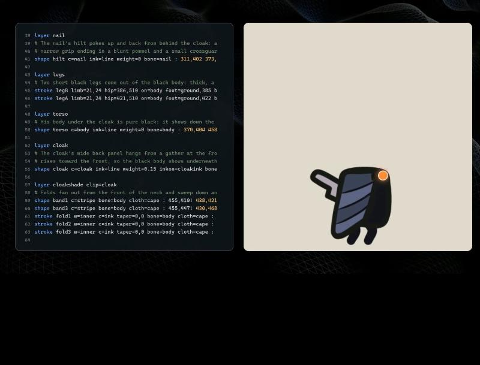
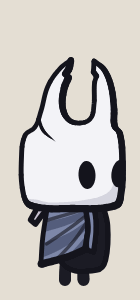
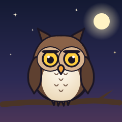
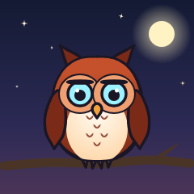

# Weasel — desenho por código

Weasel é um editor web onde você **escreve uma pequena linguagem de desenho e vê a imagem sendo pintada ao vivo**. A linguagem tem formas, curvas, camadas, recortes, gradientes, texto, componentes reutilizáveis, variáveis, esqueleto com molas, tecido que balança, braços e pernas com IK e animação com morph e eventos. Tudo exporta em **PNG, JPG, SVG, GIF animado, sprite sheet e SpriteFrames do Godot**, tanto no navegador quanto pela **linha de comando**.

A ideia veio do vídeo [*Claude simplesmente clonou Hollow Knight em menos de uma hora*](https://www.youtube.com/watch?v=X2cFbpQCZec&t=517s) (trecho de 8:37 a 8:42), que mostra uma ferramenta assim desenhando o Cavaleiro. O vídeo não documenta a linguagem: ela foi reconstruída a partir dos quadros. As capturas e a transcrição do código que aparece na tela estão em [`referencia/`](referencia/).

| Do vídeo | Feito no Weasel |
|---|---|
|  |   |

## Como rodar

O editor web não precisa de instalação nem de compilação: é HTML, CSS e JavaScript puro, sem dependências.

**Opção 1 — abrir o arquivo direto.** Dê dois cliques em `index.html` (Chrome, Edge ou Firefox).

**Opção 2 — servidor local** (útil se o navegador bloquear algo em `file://`). Na pasta do projeto:

```bash
python -m http.server 5317
```

Depois abra <http://localhost:5317>.

Os arquivos ficam salvos automaticamente no navegador (localStorage). **Abrir…** aceita vários `.weasel` de uma vez, **Salvar** baixa o arquivo atual e **Baixar todos** junta todos num `.zip`.

## Linha de comando

A mesma linguagem roda no terminal, com o mesmo leitor e o mesmo desenho do editor web (os arquivos de `js/` são compartilhados), então a imagem sai igual. Precisa de [Node.js](https://nodejs.org) 18 ou mais novo. Instale a dependência de desenho uma vez, na pasta do projeto:

```bash
npm install
```

Depois:

```bash
node cli/weasel.js exemplos/cavaleiro.weasel
```

Isso gera `cavaleiro.png`. Também funciona `npm run weasel -- <argumentos>`, e `npm link` instala o comando `weasel` no sistema.

A entrada pode ser um arquivo, um texto direto (`-e`, com `;` separando as linhas) ou a entrada padrão (`-`):

```bash
node cli/weasel.js -e "canvas 200 200; ellipse sol 100,100 60 c=#ffb000 ink=4" -o sol.png
```

```bash
cat desenho.weasel | node cli/weasel.js - -o desenho.png
```

O formato sai da extensão de `-o` (`.png`, `.jpg`, `.gif`, `.svg`, `.tres`, `.zip`) ou de `-f`:

| Quero… | Comando |
|---|---|
| PNG da pose parada | `node cli/weasel.js exemplos/cavaleiro.weasel -o cavaleiro.png` |
| JPG de um quadro, em 2× e recortado | `node cli/weasel.js exemplos/cavaleiro.weasel -a jump --frame 11 -s 2 --trim -o pulo.jpg` |
| Um PNG por quadro | `node cli/weasel.js exemplos/cavaleiro.weasel -a jump --frames -o quadros/pulo.png` |
| SVG vetorial | `node cli/weasel.js exemplos/coruja.weasel -o coruja.svg` |
| GIF de uma animação | `node cli/weasel.js exemplos/cavaleiro.weasel -a jump --trim -t -o pulo.gif` |
| GIF da pintura passo a passo | `node cli/weasel.js exemplos/cavaleiro.weasel -f build -o pintura.gif` |
| Sprite sheet (PNG + JSON) | `node cli/weasel.js exemplos/cavaleiro.weasel -f sheet -a all -s 0.5 --trim -t -o sprites.png` |
| SpriteFrames do Godot (PNG + .tres) | `node cli/weasel.js exemplos/coruja.weasel -f godot -a all --trim -t -o godot/coruja.tres` |
| Todas as variantes de cor | `node cli/weasel.js exemplos/coruja.weasel -o coruja.png --variant all` |
| Exportar de novo a cada mudança | `node cli/weasel.js exemplos/coruja.weasel -a pia -o coruja.gif --watch` |
| Só verificar o código | `node cli/weasel.js meu.weasel --check` |
| Ver camadas, componentes, ossos, animações e eventos | `node cli/weasel.js meu.weasel --info` |

Outras opções: `-q` (qualidade do JPG), `--layout grid|rows`, `--cols`, `--padding`, `--speed` (velocidade da pintura), `--guides` (inclui camadas `guide`), `--quiet`. A lista completa sai com `--help`. Com `--watch`, mudanças nos arquivos de `include` também disparam a exportação.

Erros aparecem como num compilador, com arquivo, linha e coluna:

```
ruim.weasel:3:22: erro: cor desconhecida "nada"
  3 | ellipse a 100,100 40 c=nada bone=x
    |                      ^^^^^^
weasel: 1 erro(s); nada foi exportado (use --force para exportar ignorando as linhas com erro).
```

Com erros, nada é exportado e o código de saída é 1 (`--force` exporta ignorando as linhas com erro, como o editor faz). Opções erradas saem com 2. Avisos não impedem a exportação.

## A interface

| Área | O que faz |
|---|---|
| **Arquivos** (acima do código) | Troca de arquivo, cria, renomeia e exclui. `include` encontra os outros arquivos da lista pelo nome. |
| **Editor** (esquerda) | Código com cores, números de linha, erros na margem e sugestões enquanto você digita. A barra de baixo mostra os erros (clique para ver a lista) e o que está sob o cursor. |
| **Desenho** (direita) | Redesenha a cada tecla. Roda do mouse aproxima, arrastar o fundo move a vista, **Ajustar** enquadra de novo. |
| **Guias / Pontos / Ossos / Papel vegetal / variante** | Mostram as camadas `guide`, os pontos da linha atual, o esqueleto (ossos com mola ou movimento sozinho em amarelo), os quadros vizinhos da animação e escolhem a variante de cores. |
| **Player** (embaixo) | Escolhe a animação, toca/pausa, avança quadro a quadro e muda a velocidade. Quadros com `event` aparecem com ⚑. |
| **Pintar** | Repete a pintura traço a traço, com o pincel laranja, como no vídeo. |
| **Exportar** | PNG, JPG, GIF animado, SVG, sprite sheet ou Godot, com prévia; uma variante ou todas. |
| **Referência** | A referência completa da linguagem, dentro do app (F1). |

Editando pelo desenho e pelo teclado:

- Com o cursor numa linha, os pontos dela aparecem no desenho; o ponto sob o cursor fica **laranja**.
- **Arraste** um ponto para movê-lo (o código é atualizado). Funciona na "pose parada", também dentro de componentes (o código recebe as coordenadas do componente). Pontos cinza vêm de `{contas}` e não arrastam.
- **Duplo clique** num ponto liga/desliga o canto vivo (`!`). Alças de curva (`~dx,dy`) aparecem em azul e também arrastam.
- **Ctrl+clique** no desenho escreve a coordenada na posição do cursor.
- **Alt+arrastar** sobre um número no código muda o valor (Shift deixa 10× mais rápido). **Alt+clique** numa cor `#hex` abre o seletor de cor.
- Sugestões de comandos, atributos, cores, ossos, camadas, componentes e propriedades aparecem enquanto você digita; **Ctrl+Espaço** abre na hora, **Enter** ou **Tab** aceitam.
- Com o cursor numa linha `key` ou `event`, o player pula para aquele quadro.

Atalhos: `Ctrl+Z` / `Ctrl+Y` desfazer/refazer, `Ctrl+/` comentar, `Ctrl+D` duplicar linha, `Ctrl+S` salvar, `Ctrl+E` exportar, `Espaço` tocar/pausar e `←` `→` quadro anterior/próximo (com o foco fora do editor).

## A linguagem

Uma instrução por linha:

```
comando nome atributo=valor ... : x,y x,y x,y!
```

- `#` começa um comentário.
- Depois do `:` vêm os pontos. Pontos comuns formam **curvas suaves**; `x,y!` é um **canto vivo**; `x,y~dx,dy` fixa a **alça da curva** naquele ponto (relativa ao ponto; a do outro lado é espelhada).
- Cores: `#rgb`, `#rrggbb`, `#rrggbbaa`, um nome da `palette`, um `gradient` ou `none`. Espessuras: número ou nome numérico da `palette`.
- Qualquer número pode ser uma conta entre chaves: `{cx+20}`, `{r*1.6}`, `{sin(30)*r}`.

Exemplo mínimo:

```
canvas 480 360 bg=#f4efe6 light=-0.6,-0.8
palette ink=#1d1b26 line=6 ball=#ff6b4a

layer bola
ellipse b 240,180 60 c=ball ink=line weight=0.3
layer brilho clip=b
ellipse reflexo 218,156 22,14 rot=-30 c=#ffc2ad
```

### Configuração

| Instrução | Para quê |
|---|---|
| `canvas L A bg= light=x,y` | Tamanho, fundo (cor, gradiente ou `none` = transparente) e direção da luz (engrossa o contorno do lado da sombra). |
| `finish game\|flat inner= pixel=` | `flat` tira os contornos; `inner` é a opacidade dos traços dentro de camadas com `clip`; `pixel=4` deixa pixelado. |
| `palette nome=valor ...` | Cores e espessuras com nome. `ink` é a cor padrão dos contornos. |
| `let nome=valor ...` | Variáveis para as contas: `let cx=400 r={cx/8}`. Funções: `sin`, `cos`, `tan` (em graus), `atan2`, `sqrt`, `abs`, `min`, `max`, `round`, `floor`, `ceil`, `pow`, `lerp`, `clamp`; constante `pi`. |
| `gradient nome linear x1,y1 x2,y2 [box] : cores` | Gradiente linear. Cores com posição opcional: `: #fff@0 #889@1`, ou só `: pena penad`. Com `box`, as coordenadas vão de 0 a 1 dentro de cada forma que usa o gradiente. |
| `gradient nome radial cx,cy r [fx,fy] [box] : cores` | Gradiente circular, com foco opcional. Use o nome em `c=`, `inkc=` ou `bg=`. Os gradientes seguem os ossos da forma. |
| `variant nome chave=valor ...` | Outra versão das cores: troca valores da `palette` (inimigos recoloridos, dia/noite...). |
| `include "arquivo.weasel"` | Usa outro arquivo: palette, componentes, ossos. No terminal, o caminho é relativo ao arquivo que inclui. |
| `unity unit= root=x,y collider=l,a,dx,dy` | Pixels por unidade, ponto raiz e colisor para a Unity (vão no JSON da sprite sheet). |

### Camadas e formas

| Instrução | Para quê |
|---|---|
| `layer nome [guide] [hidden] clip= cut= only= opacity= blend=` | Camada. `guide` só aparece no editor; `clip=` recorta por dentro de uma forma ou camada; `cut=` recorta por fora; `only=` limita a certas animações. |
| `shape nome c= ink= inkc= weight= inkon= smooth= : pontos` | Forma fechada. `inkon=camada` desenha o contorno em outra camada (por cima de outras coisas). |
| `stroke nome w= c= taper=a,b cap= : pontos` | Traço aberto, com pontas afinando (`taper`). |
| `stroke nome limb=w1,w2 hip=x,y on=osso foot=chão,x bend=` | Perna com IK: a raiz segue o osso, o pé fica na `line` chamada *chão*; dobra ao agachar e pendura no pulo. |
| `stroke nome limb=w1,w2 hip=x,y on=osso target=mão` | Braço com IK: a ponta vai atrás do osso *mão* (anime a mão com `key`). |
| `line nome c= w= dash=a,b : pontos` | Linha reta (boa para guias). |
| `ellipse nome cx,cy rx,ry rot=` | Elipse ou círculo. |
| `rect nome x,y l,a r= rot=` | Retângulo com cantos arredondados. |
| `text nome x,y "texto" size= font= align= rot= [bold] [italic]` | Texto; `ink=` contorna as letras. |

Todas as formas aceitam `bone=`, `cloth=`, `opacity=`, `cut=forma` (abre um buraco com o formato de outra forma, com contorno) e a opção `hidden` (a forma não aparece, mas serve de molde para `clip`, `cut` e morph).

**Espelho:** `shape asaD mirror=asaE@400` copia a forma *asaE* refletida na linha x=400 (`@y300` reflete na horizontal; sem `@`, usa o meio do canvas). O que for escrito na linha substitui o da original — por exemplo, `bone=asaD`.

### Componentes

```
def estrela cor=#fff6d8
shape s c=cor : 0,-9! 2,-2 9,0! 2,2 0,9! -2,2 -9,0! -2,-2
end

use estrela 60,58
use estrela 300,40 scale=0.8 rot=15 cor=#ffe7a3
use estrela 452,206 flip=x
```

| Instrução | Para quê |
|---|---|
| `def nome param=padrão ...` … `end` | Define um desenho reutilizável, com coordenadas em volta de 0,0. Parâmetros numéricos viram variáveis (`{param}`) e espessuras; os outros, cores. Todo parâmetro precisa de um valor padrão. |
| `use nome x,y scale= rot= flip=x\|y\|xy bone= cloth= opacity= param=valor` | Desenha o componente na camada atual. As formas de dentro seguem o `bone=` do use. Um componente pode usar outro. |

### Esqueleto e animação

| Instrução | Para quê |
|---|---|
| `bone nome parent= pivot=x,y` | Osso. Formas com `bone=nome` seguem o osso. |
| `bone ... sway=graus,s bob=px,s jitter=px` | Movimento sem keys: balanço, sobe-e-desce e tremor. O período se ajusta para o loop fechar. |
| `bone ... spring=0.4` | Mola: o osso gira atrasado quando o pai se mexe (orelhas, antenas, cabelo, a espada do Cavaleiro). |
| `cloth nome pivot=x,y tension= drag= swing=` | Tecido: os pontos longe do pivô balançam atrasados quando o osso se move. |
| `anim nome frames= fps= [once]` | Começa uma animação. |
| `key quadro osso=dx,dy,rot,sx,sy ... ease=` | Pose dos ossos naquele quadro; o resto é interpolado (`smooth`, `linear`, `in`, `out`, `back`, `step`). |
| `key quadro forma.prop=valor` | Anima uma forma: `opacity`, `c`, `inkc` (cores se misturam), `w`, `ink`, `show` (1/0) e `shape` (morph para outra forma com o mesmo número de pontos). Camadas: `camada.opacity` e `camada.show`. |
| `event quadro nome` | Marca um evento (passo, som, golpe). Aparece no player e vai no JSON da sprite sheet. |

```
bone bola pivot=240,300            # pivô na base: a bola amassa contra o chão

anim quica frames=24 fps=24
key 0  bola=0,0,0,1.25,0.78 ease=out
key 12 bola=0,-170,0,1,1 ease=in
key 24 bola=0,0,0,1.25,0.78
event 0 quique
```

Piscar com morph — a forma `fechado` não aparece, só serve de molde:

```
ellipse olho 100,100 17,28 c=ink
ellipse fechado 100,104 17,3 c=ink hidden

anim parado frames=24 fps=12
key 16 olho.shape=olho
key 18 olho.shape=fechado
key 20 olho.shape=olho
```

## Exportar

| Formato | O que sai |
|---|---|
| **PNG** | O quadro da tela, com fundo transparente opcional. |
| **JPG** | O quadro da tela, com qualidade ajustável. |
| **SVG** | O quadro da tela em vetor, com gradientes, recortes e texto. Abre no navegador, no Inkscape ou no Figma. |
| **GIF animado** | Uma animação (no fps dela) ou a **pintura passo a passo**. Paleta de até 256 cores; a transparência do GIF é de 1 bit. |
| **Sprite sheet** | Um `.zip` com todos os quadros num PNG e um `.json` no formato do TexturePacker/Phaser (`frames`, `animations`, `meta.frameTags`), com os eventos de cada quadro e o pivô e os pixels por unidade da Unity quando houver `unity`. Arranjo em grade ou uma linha por animação. |
| **Godot** | A folha (.png) e um `SpriteFrames` do Godot 4 (.tres) com as animações, o fps e o loop. Deixe os dois na mesma pasta do projeto e use o .tres num `AnimatedSprite2D`. |

Todos aceitam escala (25% a 400%) e **recortar ao desenho**: o recorte cobre todos os quadros da animação, então os quadros ficam alinhados. Com variantes, dá para exportar uma ou todas de uma vez (num `.zip`).

| Padrão | `variant neve` | `variant fogo` |
|---|---|---|
|  |  |  |

## Exemplos incluídos

- **Cavaleiro (do vídeo)**: a reconstrução do desenho, com as mesmas linhas-guia e camadas, e as animações `stand` (com piscada), `jump` e `dash`. A espada balança com mola.
- **Coruja**: mostra os recursos novos — `let`, componentes com parâmetros, `mirror`, gradientes `box`, morph do bico e das pálpebras, texto que aparece no pio, eventos, `sway`, molas nos tufos e duas variantes de cor.
- **Primeiros passos (fantasma)**: comentado, bom para aprender a sintaxe.
- **Bola quicando**: squash & stretch com um osso só.

Os mesmos exemplos estão em [`exemplos/`](exemplos/) como arquivos `.weasel`.

## Estrutura do projeto

```
index.html          página, painel de referência e janela de exportação
css/style.css       visual (tema escuro, como no vídeo)
js/geom.js          matrizes, curvas suaves, traço de espessura variável, cores
js/lang.js          leitura da linguagem: linhas → modelo, com contas, componentes, include e mensagens de erro
js/scene.js         ossos, molas, tecido, membros IK, morph, gradientes, desenho por camadas, pintura passo a passo
js/svg.js           exportação em SVG
js/editor.js        editor com cores, sugestões, Alt+arrastar números, seletor de cor e desfazer
js/gif.js           codificador de GIF animado (median cut + LZW)
js/zip.js           .zip simples para a sprite sheet
js/export.js        PNG, JPG, GIF, SVG, sprite sheet, Godot e a janela de exportação
js/examples.js      exemplos do menu
js/app.js           a interface: arquivos, editor, desenho ao vivo, arrastar pontos, player
cli/weasel.js       linha de comando (usa os mesmos arquivos de js/)
exemplos/           os exemplos do menu como arquivos .weasel
docs/               imagens deste README, geradas pela linha de comando
referencia/         capturas do vídeo e transcrição do código mostrado
```

## Limitações

- O vídeo mostra a linguagem por poucos segundos e corta as linhas compridas. A sintaxe (`layer`, `shape`, `stroke`, `ellipse`, `line`, `bone`, `cloth`, `palette`, `clip=`, `inkon=`, `limb=`, `x,y!`...) segue o vídeo, mas o significado de alguns atributos foi deduzido (`weight`, `inner`, `limb`, `foot`), e o resto da linguagem foi criado aqui.
- A linha de comando precisa do `npm install` (a biblioteca `@napi-rs/canvas` desenha fora do navegador); o editor web não precisa de nada.
- No navegador, `include` só encontra arquivos que estão na lista de arquivos do editor (abra-os com **Abrir…**).
- O `.tres` do Godot aponta para a folha pelo nome do arquivo, então os dois precisam ficar na mesma pasta.
- O SVG ignora o acabamento `pixel=`. Texto usa as fontes instaladas: o resultado pode variar de uma máquina para outra.
- Os arquivos de `exemplos/` são cópias dos exemplos embutidos em `js/examples.js` (que ficam no código para o editor funcionar abrindo o `index.html` direto).
- O GIF tem no máximo 256 cores e transparência de 1 bit (as bordas ficam serrilhadas em fundo transparente).
