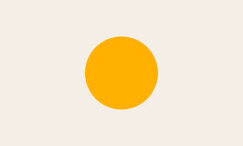
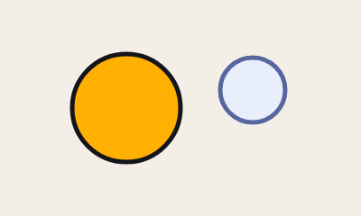
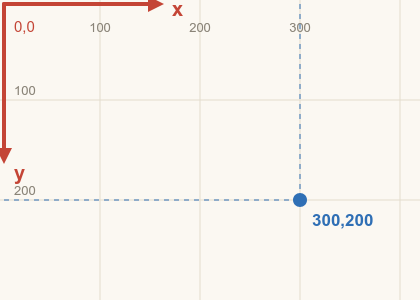
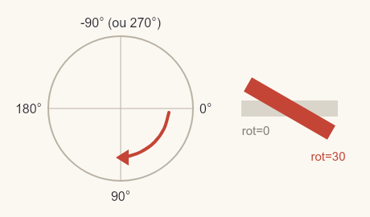
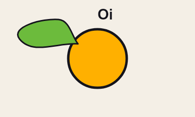
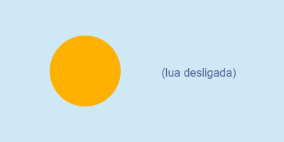
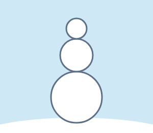

# 1. Primeiros passos

[← Índice](README.md) · [Próximo: Formas →](02-formas.md)

## A ideia

No Weasel você **descreve o desenho em texto**, uma instrução por linha, e o programa pinta. Não há pincel nem mouse: um círculo é uma linha dizendo "círculo, aqui, deste tamanho, desta cor". A vantagem é que tudo fica exato e fácil de mudar. Trocar uma cor, mover um olho ou animar um braço é mudar um número.

Três regras explicam quase tudo:

1. **Cada linha é uma instrução.** A primeira palavra diz o que fazer (`canvas`, `ellipse`, `shape`…).
2. **As linhas são pintadas de cima para baixo.** O que vem depois fica por cima do que veio antes, como camadas de tinta. (Há poucas exceções; estão no [capítulo 4](04-camadas.md#a-ordem-de-pintura).)
3. **Tudo é número.** Posições, tamanhos, espessuras e cores são valores que você escreve. Por isso dá para mexer neles depois, até com animação.

## O primeiro desenho

<!-- gerar: img/01_sol.png -->
```weasel
canvas 400 240 bg=#f4efe6
ellipse sol 200,120 60 c=#ffb000
```



Linha por linha:

- `canvas 400 240 bg=#f4efe6`: a folha tem 400 pixels de largura e 240 de altura, com fundo bege (`bg` vem de *background*, fundo).
- `ellipse sol 200,120 60 c=#ffb000`: uma elipse chamada `sol`, com o centro em x=200 e y=120, raio 60 e cor laranja (`c` = cor).

**Experimente:** troque o raio `60` por `100` (o sol cresce e quase encosta em cima e embaixo) e o `200,120` por `100,120` (ele anda para a esquerda).

Agora com um contorno e um segundo círculo:

<!-- gerar: img/01_sol_lua.png -->
```weasel
canvas 400 240 bg=#f4efe6
ellipse sol 140,120 60 c=#ffb000 ink=5
ellipse lua 280,100 36 c=#e9eefc ink=5 inkc=#5866a0
```



- `ink=5` desenha um **contorno** de 5 pixels. Sem `ink=`, a forma fica sem contorno.
- `inkc=` é a cor do contorno. Sem ela, o contorno sai na cor de tinta padrão (quase preto).
- A lua foi escrita depois do sol, então, se os dois se encostassem, ela ficaria por cima.

**Experimente:** troque `ink=5` por `ink=15` no sol, e o centro da lua por `200,100`, para ver a lua passar por cima do sol.

## As coordenadas: onde fica cada ponto

Todo lugar no desenho é um par `x,y`:

- **x** conta da esquerda para a direita;
- **y** conta **de cima para baixo**: quanto maior o y, mais para baixo;
- o ponto `0,0` é o **canto de cima, à esquerda**.

<!-- gerar: img/01_coordenadas.png -->
```weasel
canvas 420 300 bg=#fbf8f2
palette ink=#2b2a33 grade=#e3dccd eixo=#c44536 azul=#2f6fb5

layer grade
line v1 c=grade : 100,0 100,300
line v2 c=grade : 200,0 200,300
line v3 c=grade : 300,0 300,300
line v4 c=grade : 400,0 400,300
line h1 c=grade : 0,100 420,100
line h2 c=grade : 0,200 420,200
text n100 100,32 "100" size=13 align=center c=#8a8478
text n200 200,32 "200" size=13 align=center c=#8a8478
text n300 300,32 "300" size=13 align=center c=#8a8478
text m100 14,95 "100" size=13 c=#8a8478
text m200 14,195 "200" size=13 c=#8a8478

layer eixos
stroke ex c=eixo w=4 : 4,4 150,4
shape px c=eixo : 164,4! 148,-4! 148,12!
text tx 172,16 "x" size=20 c=eixo bold
stroke ey c=eixo w=4 : 4,4 4,150
shape py c=eixo : 4,164! -4,148! 12,148!
text ty 14,180 "y" size=20 c=eixo bold
text origem 14,32 "0,0" size=15 c=eixo

layer ponto
line gx c=azul dash=5,5 : 300,4 300,200
line gy c=azul dash=5,5 : 4,200 300,200
ellipse p 300,200 7 c=azul
text tp 312,226 "300,200" size=17 c=azul bold
```



O ponto azul está em `300,200`: 300 pixels para a direita e 200 para baixo, contando do canto. Escreva sempre **sem espaço** entre os dois números: `300,200` é um ponto; `300, 200` são duas palavras e dá erro.

> **Dica do editor:** com o cursor numa linha, os pontos dela aparecem no desenho e dá para arrastá-los (o número no código muda junto). **Ctrl+clique** no desenho escreve a coordenada daquele lugar onde está o cursor de texto. É o jeito mais fácil de descobrir "que número é aquele ponto". No [capítulo 2](02-formas.md) aparecem as outras alças: o tamanho das formas, os cantos redondos, as curvas e como mover uma forma inteira de uma vez.

### Ângulos: para onde algo aponta

Um ângulo diz **quanto uma coisa gira** ou **para onde ela aponta**. O número é em **graus**: uma volta inteira tem 360.

Ângulos seguem a mesma lógica da tela: **0° aponta para a direita e o sentido positivo é o horário** (90° aponta para baixo). Isso vale para `rot=`, para os ossos e para as luzes.

<!-- gerar: img/01_angulos.png -->
```weasel
canvas 460 270 bg=#fbf8f2
palette ink=#2b2a33 cinza=#b9b2a4 eixo=#c44536

# o "relógio" dos ângulos: centro em 150,135
ellipse roda 150,135 90 c=none ink=2 inkc=cinza
line a0 c=cinza : 150,135 240,135
line a90 c=cinza : 150,135 150,225
line a180 c=cinza : 150,135 60,135
line a270 c=cinza : 150,135 150,45
text t0 248,141 "0°" size=16
text t90 150,250 "90°" size=16 align=center
text t180 52,141 "180°" size=16 align=right
text t270 150,34 "-90° (ou 270°)" size=16 align=center

# a seta do sentido positivo: de 0° para 90°
stroke volta w=4 c=eixo : 210,140 204,160 192,177 175,189 158,195
shape ponta c=eixo : 144,196! 160,186! 160,206!

# um retângulo sem giro (cinza) e com rot=30 (vermelho)
rect antes 300,125 120,20 c=cinza opacity=0.5
rect depois 300,125 120,20 rot=30 c=eixo
text l0 318,168 "rot=0" size=15 align=center c=#8a8478
text l30 408,200 "rot=30" size=15 align=center c=eixo
```



O código desse desenho usa coisas dos próximos capítulos; por enquanto, olhe só para a imagem. Repare:

- No círculo da esquerda: 0° fica à direita, 90° embaixo, 180° à esquerda e -90° (o mesmo que 270°) em cima.
- A seta vermelha mostra o sentido positivo: de 0° para 90°, como os ponteiros de um relógio.
- À direita está o mesmo retângulo duas vezes: cinza sem giro, vermelho com `rot=30`. Ele girou 30 graus no sentido horário, e a ponta da direita **desceu**.
- Um número negativo gira para o outro lado: `rot=-30` faria a ponta da direita **subir**.

**Experimente:** na última parte do código, troque `rot=30` por `rot=90` (o retângulo fica em pé) e depois por `rot=-30`.

## A anatomia de uma linha

Toda instrução tem o mesmo formato:

```
comando  nome   valores      atributo=valor …   opções   :  pontos
ellipse  sol    200,120 60   c=#ffb000 ink=5
shape    folha               c=#6cbb3c ink=3             :  40,80 120,40 160,90!
text     titulo 200,40 "Oi"  size=30            bold
```

| Parte | O que é | Exemplo |
|---|---|---|
| **comando** | A primeira palavra: o que fazer. Sempre em minúsculas. | `ellipse`, `shape`, `layer`, `bone`, `key` |
| **nome** | Como você chama a coisa, para usá-la depois (recortar, animar, espelhar). Começa com letra; depois letras, números, `_` ou `-`. Maiúsculas e minúsculas são diferentes (`olho` ≠ `Olho`). | `sol`, `olhoE`, `perna_tras` |
| **valores** | Números na ordem que o comando espera, como centro e raio. | `200,120 60` |
| **atributos** | `nome=valor`, em qualquer ordem. Sem espaço em volta do `=`. | `c=#ffb000 ink=5 rot=30` |
| **opções** | Palavras soltas que ligam algo. | `hidden`, `bold`, `guide`, `once` |
| **pontos** | Depois do `:`, a lista de pontos `x,y` separados por espaço. Só nas formas que têm pontos (`shape`, `stroke`, `line`). | `: 40,80 120,40 160,90!` |

As três linhas de exemplo da tabela já são um desenho de verdade. Falta só o `canvas`:

<!-- gerar: img/01_anatomia.png -->
```weasel
canvas 400 240 bg=#f4efe6
ellipse  sol    200,120 60   c=#ffb000 ink=5
shape    folha               c=#6cbb3c ink=3             :  40,80 120,40 160,90!
text     titulo 200,40 "Oi"  size=30            bold
```



Linha por linha:

- `ellipse sol 200,120 60 c=#ffb000 ink=5`: o **comando** `ellipse`, o **nome** `sol`, dois **valores** (o centro `200,120` e o raio `60`) e dois **atributos** (a cor e o contorno).
- `shape folha c=#6cbb3c ink=3 : 40,80 120,40 160,90!`: comando, nome, atributos e, depois do `:`, três **pontos**. O `!` faz uma ponta no último ponto (explicado no [capítulo 2](02-formas.md)).
- `text titulo 200,40 "Oi" size=30 bold`: comando, nome, dois valores (onde o texto fica e o texto, entre aspas), um atributo (`size=30`, o tamanho da letra em pixels) e uma **opção** (`bold`, negrito).
- A folha foi escrita depois do sol, então fica **por cima** dele (a regra 2 do começo do capítulo).
- Os espaços a mais só alinham as colunas para ficar fácil de ler. Um espaço ou vários dá no mesmo.

Mais três regras de escrita:

- `#` começa um **comentário**: o resto da linha é ignorado. Vale no começo da linha ou depois de um espaço. Uma cor como `#ffb000` não é comentário, porque vem grudada no `=`.
- Linhas em branco não fazem nada; use-as para separar partes do desenho.
- Texto vai entre aspas: `"Olá, mundo"`.

### Comentários: recados e linhas desligadas

Um comentário serve para duas coisas: deixar um **recado** no código (para você mesmo, daqui a um mês) e **desligar** uma linha sem apagá-la.

<!-- gerar: img/01_comentarios.png -->
```weasel
# Um céu com sol (e uma lua desligada)
canvas 400 200 bg=#cfe8f5

ellipse sol 120,100 50 c=#ffb000   # o sol fica à esquerda
# ellipse lua 280,100 40 c=#e9eefc

text aviso 280,108 "(lua desligada)" size=16 align=center c=#5866a0
```



Repare:

- A primeira linha é só um recado: ela começa com `#`, e o Weasel pula.
- Na linha do sol, tudo depois de `   #` é ignorado. A cor `#ffb000` continua valendo, porque vem grudada no `=`.
- A lua não aparece: a linha dela começa com `#`. A linha continua no arquivo, pronta para voltar.
- A linha em branco depois do `canvas` não faz nada; só separa as partes.

**Experimente:** apague o `#` do começo da linha da lua. Ela aparece por cima do texto (apague o texto também).

> **Cuidado com o `#` grudado.** Num comentário no fim da linha, deixe um espaço depois do `#` (`# olho esquerdo`). Se o que vem grudado no `#` parece um código de cor (só números e as letras de `a` a `f`, como `#cafe` ou `#bad`), o Weasel lê aquilo como uma cor, e não como comentário.

### Contas: `{ … }`

Às vezes um número depende de outros. Em vez de fazer a conta de cabeça, escreva a **conta entre chaves**: o Weasel calcula e usa o resultado. Serve, por exemplo, para pôr uma coisa exatamente em cima da outra.

<!-- gerar: img/01_contas.png -->
```weasel
canvas 300 260 bg=#cfe8f5
ellipse chao 150,280 220,50 c=#ffffff

ellipse baixo 150,190 50 c=#ffffff ink=3 inkc=#5c7088
ellipse meio 150,{190-50-32} 32 c=#ffffff ink=3 inkc=#5c7088
ellipse cabeca 150,{190-50-32-32-20} 20 c=#ffffff ink=3 inkc=#5c7088
```



As três bolas se encostam sem nenhuma conta feita à mão:

- `baixo` tem o centro em y=190 e raio 50. O topo dela fica em 190 − 50 = 140.
- `meio` tem raio 32. O centro dela fica 32 pixels acima desse topo: `{190-50-32}`, que dá 108.
- `cabeca` tem raio 20 e fica em cima do meio: `{190-50-32-32-20}`, que dá 56.
- Dentro das chaves valem `+`, `-`, `*` (vezes), `/` (dividido) e parênteses: `{(100+20)*2}` dá 240.
- Não ponha espaço fora das chaves: `150,{190-50}` é um ponto; `150, {190-50}` dá erro.

**Experimente:** mude o raio de `baixo` de 50 para 60. O `50` aparece uma vez em cada linha das bolas; troque nas três e veja as bolas de cima subirem juntas.

Repetir o mesmo número em vários lugares cansa. O [capítulo 5](05-componentes.md#contas---e-let) mostra o `let`, que dá um nome a um número para usar nas contas, e as funções que valem dentro das chaves.

## Quando algo dá errado

O Weasel avisa com a linha e a coluna do problema. No editor, a linha ganha uma marca na margem e a barra de baixo mostra a mensagem. Na linha de comando, sai uma mensagem para cada problema.

Este arquivo tem três erros de propósito. Salve como `erros.weasel`:

```
canvas 400 240 bg=#f4efe6
ellipse sol 200, 120 60 c=#ffb000
elipse lua 300,60 20 c=#dddddd
ellipse nuvem 100,60 30 c=amarelo
```

Rode `node cli/weasel.js erros.weasel`. A resposta é esta:

```
erros.weasel:2:13: erro: esperado o centro no formato x,y
  2 | ellipse sol 200, 120 60 c=#ffb000
    |             ^^^^
erros.weasel:3:1: erro: instrução desconhecida "elipse"
  3 | elipse lua 300,60 20 c=#dddddd
    | ^^^^^^
erros.weasel:4:25: erro: cor desconhecida "amarelo"
  4 | ellipse nuvem 100,60 30 c=amarelo
    |                         ^^^^^^^^^
weasel: 3 erro(s); nada foi exportado (use --force para exportar ignorando as linhas com erro).
```

Como ler cada mensagem:

- `erros.weasel:2:13` quer dizer: no arquivo `erros.weasel`, na **linha 2**, na **coluna 13** (a 13ª letra da linha, contando os espaços).
- Depois vem o tipo (`erro` ou `aviso`) e o que aconteceu.
- Embaixo aparece a própria linha, e os `^^^^` apontam o pedaço com problema.

Os três erros mais comuns estão aí: um espaço no meio do ponto (`200, 120`), um comando escrito errado (`elipse`) e uma cor que não existe (`amarelo`). Nomes de cor em inglês do CSS funcionam (`red`, `gold`, `tomato`); em português, não.

- No **editor**, o resto do desenho continua aparecendo, para você não perder a vista enquanto digita. A linha com erro é pulada, ou é desenhada só com a parte que deu para entender.
- Na **linha de comando**, com erro nada é exportado. Com `--force`, ela exporta o que deu para entender, como o editor. Neste exemplo, a `lua` some (o comando não existe), a `nuvem` some (ela não tem cor nem contorno) e o `sol` vai parar no canto `0,0`, porque o centro dele não foi entendido.

### Avisos

Um **aviso** é mais leve que um erro: o desenho sai mesmo assim. Mas quase sempre ele aponta um engano. Este arquivo tem dois:

```
canvas 400 240 bg=#f4efe6
ellipse sol 200,120 60 cor=#ffb000
text oi 200,220 "Oi" align=centro
```

Salvo como `avisos.weasel`, a linha de comando responde:

```
avisos.weasel:2:24: aviso: atributo desconhecido "cor" em ellipse
  2 | ellipse sol 200,120 60 cor=#ffb000
    |                        ^^^^^^^^^^^
avisos.weasel:3:22: aviso: align= aceita left, center ou right
  3 | text oi 200,220 "Oi" align=centro
    |                      ^^^^^^^^^^^^
salvo avisos.png  400×240 · 5 KB
```

O arquivo foi salvo, mas saiu errado:

- `cor=` não existe (o certo é `c=`). O Weasel ignorou o atributo, e o sol saiu na cor de tinta, **quase preto**.
- `align=` só entende `left`, `center` ou `right` (em inglês). Com `centro`, o texto ficou alinhado à esquerda, o padrão.

Outros avisos comuns: um número fora do limite (`opacity=2` vira 1, porque a opacidade vai de 0 a 1) e uma `key` depois do fim da animação. Quando aparecer um aviso, leia: ele quase sempre explica por que o desenho não ficou como você esperava.

## Como rodar os exemplos deste guia

**No editor web:** abra o `index.html`, crie um arquivo novo na barra de arquivos (acima do código), cole o exemplo e veja o desenho à direita. Exemplos com `anim` tocam no player, embaixo do desenho.

**Na linha de comando** (precisa do Node.js e de um `npm install` na pasta do projeto):

```bash
node cli/weasel.js meu_desenho.weasel
```

Isso gera `meu_desenho.png`. Com o sol e a lua do começo do capítulo salvos como `sol.weasel`, a resposta é o nome do arquivo salvo, o tamanho em pixels e o peso:

```
salvo sol.png  400×240 · 9 KB
```

Para uma animação em GIF:

```bash
node cli/weasel.js meu_desenho.weasel -a nome_da_animacao -o anima.gif
```

Outras opções que ajudam desde o começo (a lista completa está na [referência](12-referencia.md#linha-de-comando) e em `node cli/weasel.js --help`):

| Comando | O que faz | O que responde |
|---|---|---|
| `node cli/weasel.js sol.weasel --check` | só procura erros, sem exportar nada | `sem erros.` (ou a lista de erros e `3 erro(s).`; só com avisos, `sem erros (só avisos).`) |
| `node cli/weasel.js sol.weasel -o sol_grande.png -s 2` | `-o` escolhe o nome do arquivo; `-s 2` exporta com o dobro do tamanho | `salvo sol_grande.png  800×480 · 19 KB` |
| `node cli/weasel.js -e "canvas 200 100;ellipse sol 100,50 40 c=#ffb000"` | desenha o código escrito no próprio comando, sem criar arquivo; `;` separa as linhas | `salvo desenho.png  200×100 · 2 KB` |

E `--info` mostra um resumo do que o arquivo tem:

```bash
node cli/weasel.js sol.weasel --info
```

```
canvas   400 × 240, fundo #f4efe6
camadas  1
  base             2 item(ns)
formas   2
animações nenhuma
```

O sol e a lua ficaram numa camada chamada `base`, criada sozinha porque o arquivo não tem nenhuma linha `layer` (as camadas são o assunto do [capítulo 4](04-camadas.md)).

[← Índice](README.md) · [Próximo: Formas →](02-formas.md)
