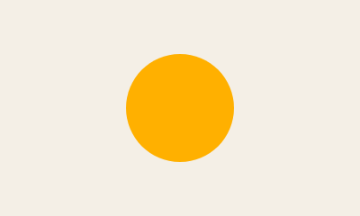
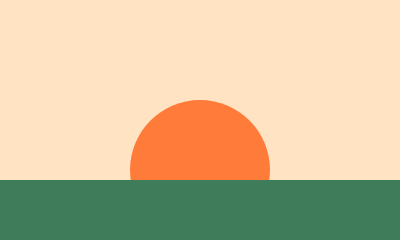
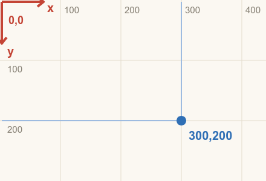
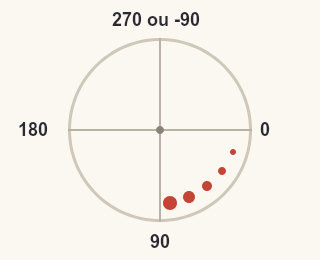
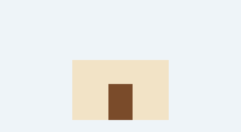
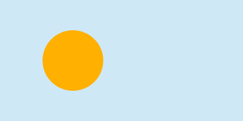
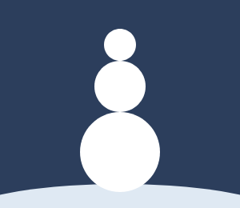
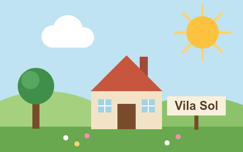

# 1. Primeiros passos

[Índice](README.md) · [Próximo: Formas →](02-formas.md)

Este capítulo é para quem nunca escreveu um desenho em código. Você vai rodar o primeiro desenho, entender onde fica cada ponto da folha, ler uma linha do Weasel parte por parte e descobrir o que fazer quando algo dá errado. Não precisa saber nada antes.

## A ideia

No Weasel, você não pinta: você **escreve**. Cada linha do arquivo desenha uma coisa. Um círculo é uma linha que diz onde ele fica, de que tamanho e de que cor.

```
ellipse sol 200,120 60 c=#ffb000
```

O editor também tem ferramentas de mouse (elipse, caneta, pincel…). Elas só escrevem essas linhas por você. O desenho é sempre o texto.

Três regras explicam quase tudo:

1. **Cada linha é uma instrução.** A primeira palavra diz o que fazer: `canvas` (a folha), `ellipse` (círculo), `rect` (retângulo)…
2. **As linhas são pintadas de cima para baixo.** O que vem depois fica por cima do que veio antes, como tinta sobre tinta. O [capítulo 4](04-camadas.md#a-ordem-de-pintura) mostra a ordem completa e as poucas exceções.
3. **Tudo está escrito.** Posição, tamanho, grossura e cor são valores no texto. Para mudar o desenho, mude o valor.

## Como rodar um desenho

### No editor

1. Abra o editor. Pode ser o site <https://brlebtag.github.io/Weasel/> ou o arquivo `index.html` do projeto, com dois cliques. O [README](../../README.md#como-rodar) mostra as outras formas de abrir.
2. Crie um arquivo novo: **Arquivo › Novo**, ou o botão de folha com **+**, acima do código.
3. O arquivo novo já vem com um desenho de exemplo. Apague tudo (**Ctrl+A** e **Delete**) e cole o exemplo do guia (**Ctrl+V**).
4. O desenho aparece à direita e muda enquanto você digita.

Os arquivos ficam guardados no próprio navegador. Você não perde nada ao fechar a página.

### Na linha de comando

A linha de comando faz a mesma coisa sem abrir o editor: lê um arquivo `.weasel` e salva a imagem. Ela precisa do [Node.js](https://nodejs.org) 18 ou mais novo e de um `npm install` na pasta do projeto, uma vez só. Se você nunca usou um terminal, o [capítulo 21](21-linha-de-comando.md#o-terminal) explica tudo desde o começo.

Salve o exemplo como `teste.weasel` e rode:

```bash
node cli/weasel.js teste.weasel
```

A resposta diz o nome da imagem, o tamanho em pixels e o peso do arquivo:

```
salvo teste.png  400×240 · 9 KB
```

Para escolher o nome da imagem, use `-o`: `node cli/weasel.js teste.weasel -o sol.png`. O capítulo 21 tem todas as opções.

## O primeiro desenho

<!-- gerar: img/01_sol.png -->
```weasel
canvas 400 240 bg=#f4efe6
ellipse sol 200,120 60 c=#ffb000
```



Linha por linha:

- `canvas 400 240 bg=#f4efe6`: a folha tem 400 pixels de largura e 240 de altura. O `bg=` é a cor do fundo (*background*), aqui um bege.
- `ellipse sol 200,120 60 c=#ffb000`: um círculo chamado `sol`. O centro fica em `200,120`, o raio é `60` e a cor (`c=`) é laranja.
- As cores escritas com `#` e seis letras são o assunto do [capítulo 3](03-cores.md). Por enquanto, copie as dos exemplos.

**Experimente:** troque o raio `60` por `100`. O sol cresce e quase encosta em cima e embaixo. Depois troque o `200,120` por `100,120`: ele anda para a esquerda.

Agora com duas formas. O sol se põe atrás do chão:

<!-- gerar: img/01_por_do_sol.png -->
```weasel
canvas 400 240 bg=#ffe3c2
ellipse sol 200,170 70 c=#ff7b3a
rect chao 0,180 400,60 c=#3f7d5a
```



- `rect chao 0,180 400,60`: um retângulo. O canto de cima, à esquerda, fica em `0,180`; ele tem 400 de largura e 60 de altura.
- O chão vem **depois** do sol no arquivo. Por isso ele fica por cima e esconde a parte de baixo do sol.

**Experimente:** troque as duas últimas linhas de lugar. Agora o sol vem depois e cobre o chão.

## As coordenadas: onde fica cada ponto

Todo lugar da folha é um par de números `x,y`:

- **x** conta da esquerda para a direita;
- **y** conta **de cima para baixo**: quanto maior o `y`, mais para baixo;
- o ponto `0,0` é o **canto de cima, à esquerda**.



O ponto azul está em `300,200`: 300 pixels para a direita e 200 para baixo, contando a partir do canto.

<details>
<summary>O código desta imagem (usa linhas e textos, do capítulo 2)</summary>

<!-- gerar: img/01_coordenadas.png -->
```weasel
canvas 440 300 bg=#fbf8f2
# a grade: uma linha a cada 100 pixels
line v100 c=#e3dccd : 100,0 100,300
line v200 c=#e3dccd : 200,0 200,300
line v300 c=#e3dccd : 300,0 300,300
line v400 c=#e3dccd : 400,0 400,300
line h100 c=#e3dccd : 0,100 440,100
line h200 c=#e3dccd : 0,200 440,200
text n100 106,22 "100" size=15 c=#8a8478
text n200 206,22 "200" size=15 c=#8a8478
text n300 306,22 "300" size=15 c=#8a8478
text n400 406,22 "400" size=15 c=#8a8478
text m100 12,120 "100" size=15 c=#8a8478
text m200 12,220 "200" size=15 c=#8a8478
# o eixo x, para a direita, e o eixo y, para baixo
line ex w=4 c=#c44536 : 3,3 70,3
line px w=4 c=#c44536 : 62,-5 72,3 62,11
line ey w=4 c=#c44536 : 3,3 3,70
line py w=4 c=#c44536 : -5,62 3,72 11,62
text tx 78,20 "x" size=20 c=#c44536 bold
text ty 12,92 "y" size=20 c=#c44536 bold
text origem 14,40 "0,0" size=18 c=#c44536 bold
# o ponto 300,200 e o caminho até ele
line ax w=2 c=#9dbbe0 : 3,200 300,200
line ay w=2 c=#9dbbe0 : 300,3 300,200
ellipse p 300,200 8 c=#2f6fb5
text tp 312,232 "300,200" size=20 c=#2f6fb5 bold
```

</details>

Escreva um ponto sempre **sem espaço**: `300,200` é um ponto; `300, 200` são duas palavras, e dá erro.

No editor, **Ctrl+clique** num lugar do desenho escreve a coordenada dele no código, onde está o cursor. É o jeito mais fácil de descobrir o número de um lugar ([capítulo 22](22-editor.md#coordenadas-e-pontos)).

### O tamanho da folha: `canvas`

```
canvas largura altura [bg=cor]
```

A linha `canvas` vem no começo do arquivo e diz o tamanho da folha, de 1 a 4096 pixels em cada lado. Sem a linha `canvas`, a folha tem 800 por 600, com fundo branco.

O que passa da borda da folha é cortado. Aqui, a lua está em `400,60`, mas a folha só tem 240 de largura:

<!-- gerar: img/01_folha.png -->
```weasel
canvas 240 120 bg=#1d2140
ellipse lua 400,60 30 c=#f4f1de
ellipse estrela1 60,34 3 c=#ffffff
ellipse estrela2 150,80 2 c=#ffffff
ellipse estrela3 200,30 3 c=#ffffff
```


**Experimente:** troque `canvas 240 120` por `canvas 460 120`. A folha fica mais larga, e a lua aparece à direita.

| Opção | O que faz | Valores | Se não escrever |
|---|---|---|---|
| a largura e a altura | o tamanho da folha | de 1 a 4096 cada, em pixels | sem a linha `canvas`, 800 por 600 |
| `bg=` | a cor do fundo | uma cor; `none` deixa sem fundo | branco |

A ficha completa, com o `light=` (a direção da luz, do capítulo 3), está na [referência do `canvas`](19-referencia.md#canvas).

**Cuidado:** com `bg=none`, o editor mostra um xadrez no lugar do fundo, mas a imagem exportada sai com fundo branco. Para o fundo sair transparente na linha de comando, use `-t` ([capítulo 21](21-linha-de-comando.md)).

## Os ângulos: `rot=`

Um ângulo diz quanto uma coisa gira, em **graus**. Uma volta inteira tem 360. Como o `y` cresce para baixo, os ângulos giram no sentido do relógio:

- 0 aponta para a direita;
- 90 aponta para baixo;
- 180 aponta para a esquerda;
- 270 (ou -90) aponta para cima.



<details>
<summary>O código desta imagem (usa linhas e textos, do capítulo 2)</summary>

<!-- gerar: img/01_angulos.png -->
```weasel
canvas 320 260 bg=#fbf8f2
# o círculo: um disco cinza e, por cima, um disco da cor do fundo
ellipse aro 160,130 92 c=#cfc7b8
ellipse dentro 160,130 89 c=#fbf8f2
# as quatro direções, a partir do centro
line d0 w=2 c=#b9b2a4 : 160,130 252,130
line d90 w=2 c=#b9b2a4 : 160,130 160,222
line d180 w=2 c=#b9b2a4 : 160,130 68,130
line d270 w=2 c=#b9b2a4 : 160,130 160,38
ellipse centro 160,130 4 c=#8a8478
# os números
text t0 260,136 "0" size=18 c=#2b2a33 bold
text t90 150,248 "90" size=18 c=#2b2a33 bold
text t180 18,136 "180" size=18 c=#2b2a33 bold
text t270 112,26 "270 ou -90" size=18 c=#2b2a33 bold
# o sentido positivo: bolinhas que crescem de 0 até 90
ellipse s1 233,152 3 c=#c44536
ellipse s2 222,171 4 c=#c44536
ellipse s3 207,186 5 c=#c44536
ellipse s4 189,197 6 c=#c44536
ellipse s5 170,203 7 c=#c44536
```

</details>

O `rot=` gira uma forma em volta do meio dela:

<!-- gerar: img/01_giro.png -->
```weasel
canvas 420 160 bg=#fbf8f2
rect deitado 30,70 100,20 c=#b9b2a4
rect desce 160,70 100,20 rot=30 c=#c44536
rect sobe 290,70 100,20 rot=-30 c=#2f6fb5
```


- `rot=30` gira 30 graus no sentido do relógio: a ponta da direita **desce**.
- `rot=-30`, com o número negativo, gira para o outro lado: a ponta da direita **sobe**.

**Experimente:** troque `rot=30` por `rot=90`. A barra vermelha fica em pé.

## O formato de uma linha

Quase toda linha tem as mesmas partes. Nem toda linha tem todas:

```
comando   nome     números          opções
ellipse   janela   200,70 18        c=#9fd3e6 hidden
rect      porta    180,140 40,60    c=#7a4b2a
```

| Parte | O que é | Exemplo |
|---|---|---|
| **comando** | a primeira palavra: o que fazer. Sempre em minúsculas | `canvas`, `ellipse`, `rect` |
| **nome** | como você chama a coisa, para usá-la depois | `sol`, `porta`, `olho_esq` |
| **números** | os valores que o comando espera, na ordem dele: pontos (`x,y`), tamanhos, raios | `200,70 18` |
| **opções** | `nome=valor`, como `c=#ffb000`, ou uma palavra solta, como `hidden` | `c=#9fd3e6 hidden` |

<!-- gerar: img/01_anatomia.png -->
```weasel
canvas 400 220 bg=#eef4f8
rect parede 120,100 160,100 c=#f2e3c6
rect porta 180,140 40,60 c=#7a4b2a
ellipse janela 200,70 18 c=#9fd3e6 hidden
```



- `rect parede 120,100 160,100 c=#f2e3c6`: o comando `rect`, o nome `parede`, dois números (o canto `120,100` e o tamanho `160,100`) e uma opção, a cor.
- `ellipse janela … hidden`: a palavra solta `hidden` esconde a forma. A janela continua no arquivo, mas não é pintada.

**Experimente:** apague o `hidden`. A janela redonda aparece em cima da parede.

### O nome

- O nome é **opcional** nas formas: `ellipse 200,120 60 c=#ffb000` também desenha. Mas sem nome não dá para mexer na forma depois (recortar, animar, mudar num filme).
- Use letras **sem acento**, números, `_` e `-`, começando com uma letra ou `_`. `cabeça` dá erro: escreva `cabeca`.
- Maiúsculas e minúsculas são diferentes: `olho` e `Olho` são dois nomes.
- Duas formas podem ter o mesmo nome. Tudo o que usa o nome vale para as duas.

A lista completa das regras está em [Nomes](19-referencia.md#nomes), na referência.

### As opções

- **`nome=valor`**, sem espaço em volta do `=`: `c=#ffb000`, `rot=30`.
- **Palavras soltas**, sem `=`: `hidden` (escondida). Cada comando tem as suas.
- As opções podem vir **em qualquer ordem**, e até antes dos números: `ellipse c=#ffb000 sol 100,50 40` desenha o mesmo que `ellipse sol 100,50 40 c=#ffb000`. Só a ordem dos números importa.
- Espaços a mais não mudam nada. Um espaço ou vários: tanto faz.
- Uma linha em branco também não muda nada. Use-a para separar as partes do desenho.

## Comentários

Tudo o que vem depois de um `#` com espaço antes é um **comentário**: o Weasel pula. Um comentário serve para deixar um recado no código e para desligar uma linha sem apagá-la.

<!-- gerar: img/01_comentarios.png -->
```weasel
# Um céu com sol e uma lua desligada
canvas 400 200 bg=#cfe8f5

ellipse sol 120,100 50 c=#ffb000   # o sol fica à esquerda
# ellipse lua 280,100 40 c=#e9eefc
```



- A primeira linha é só um recado.
- Na linha do sol, o `# o sol fica à esquerda` é ignorado. A cor `#ffb000` vale, porque vem grudada no `=`.
- A linha da lua começa com `#`: está desligada. Ela continua no arquivo, pronta para voltar.

**Experimente:** apague o `#` do começo da linha da lua. Ela aparece à direita.

**Cuidado:** escreva sempre `# ` com um espaço depois. Sem o espaço, um comentário como `#cafe` ou `#bad` parece uma cor, e o Weasel não o lê como comentário.

## Contas: `{…}`

Um número pode ser uma conta, escrita entre chaves. O Weasel calcula e usa o resultado. Assim, uma bola fica encostada na outra sem conta de cabeça:

<!-- gerar: img/01_contas.png -->
```weasel
canvas 300 260 bg=#2c3e5c
ellipse chao 150,280 220,50 c=#dfe9f3
ellipse baixo 150,190 50 c=#ffffff
ellipse meio 150,{190-50-32} 32 c=#ffffff
ellipse cabeca 150,{190-50-32-32-20} 20 c=#ffffff
```



- `baixo` tem o centro em `y` 190 e o raio 50. O topo dela fica em 190 − 50 = 140.
- `meio` tem o raio 32. O centro dela fica 32 acima desse topo: `{190-50-32}` dá 108.
- `cabeca` tem o raio 20 e fica em cima do meio: `{190-50-32-32-20}` dá 56.
- Dentro das chaves valem `+`, `-`, `*` (vezes), `/` (dividido) e parênteses: `{(100+20)*2}` dá 240. Espaço dentro das chaves pode: `{190 - 50}`.
- Fora das chaves, nada de espaço: `150,{190-50}` é um ponto; `150, {190-50}` dá erro.

**Experimente:** troque o raio de `baixo` por 60 e o `50` das outras duas linhas por `60`. As bolas de cima sobem juntas.

As contas têm muito mais: nomes para números (`let`), repetições e sorteios, no [capítulo 5](05-contas.md). As funções que cabem nas chaves estão no [capítulo 20](20-funcoes.md).

## Quando algo dá errado

Quando uma linha tem problema, o Weasel diz onde e o que é. Há dois tipos de problema:

- um **erro**: o Weasel não entendeu a linha;
- um **aviso**: ele entendeu, mas algo parece engano.

**No editor**, o botão no canto de baixo, à esquerda, diz "sem erros" ou quantos erros e avisos há. Clique nele para ver a lista, e clique numa linha da lista para ir até o problema no código. Enquanto você digita, o resto do desenho continua aparecendo.

**Na linha de comando**, sai uma mensagem para cada problema.

### Erros

Este arquivo tem quatro erros de propósito:

```
canvas 400 240 bg=#f4efe6
ellipse sol 200, 120 60 c=#ffb000
elipse lua 300,60 20 c=#dddddd
ellipse nuvem 100,60 30 c=amarelo
rect chaminé 40,150 30,60 c=#a14a37
```

Salvo como `erros.weasel`, a linha de comando responde:

```
erros.weasel:2:13: erro: esperado o centro no formato x,y
  2 | ellipse sol 200, 120 60 c=#ffb000
    |             ^^^^
erros.weasel:2:22: aviso: valor solto "60" (atributos usam nome=valor)
  2 | ellipse sol 200, 120 60 c=#ffb000
    |                      ^^
erros.weasel:3:1: erro: instrução desconhecida "elipse"
  3 | elipse lua 300,60 20 c=#dddddd
    | ^^^^^^
erros.weasel:4:25: erro: cor desconhecida "amarelo"
  4 | ellipse nuvem 100,60 30 c=amarelo
    |                         ^^^^^^^^^
erros.weasel:5:6: erro: esperado o canto no formato x,y
  5 | rect chaminé 40,150 30,60 c=#a14a37
    |      ^^^^^^^
erros.weasel:5:21: aviso: valor solto "30,60" (atributos usam nome=valor)
  5 | rect chaminé 40,150 30,60 c=#a14a37
    |                     ^^^^^
weasel: 4 erro(s); nada foi exportado (use --force para exportar ignorando as linhas com erro).
```

Como ler uma mensagem:

- `erros.weasel:2:13` quer dizer: no arquivo `erros.weasel`, na **linha 2**, na **coluna 13** (a 13ª letra da linha, contando os espaços).
- Depois vem o tipo (`erro` ou `aviso`) e o que aconteceu.
- Embaixo aparece a própria linha, e os `^^^^` apontam o pedaço com problema.

Os quatro erros mais comuns estão aí:

- **Um espaço no meio do ponto** (`200, 120`). O Weasel não acha o centro. Ele lê o `120` como o raio, e o `60` sobra (o aviso "valor solto" logo abaixo).
- **Um comando escrito errado** (`elipse`). Os comandos são em inglês: `ellipse`.
- **Uma cor que não existe** (`amarelo`). Os nomes de cor são em inglês (`gold`, `tomato`), como no [capítulo 3](03-cores.md).
- **Um nome com acento** (`chaminé`). O Weasel não o reconhece como nome e procura o canto do retângulo ali. Escreva `chamine`.

Com um erro, a linha de comando não salva nada. Com `--force`, ela salva o que deu para entender. Neste exemplo, sai só o sol, grande e no canto: o centro dele não foi entendido.

### Avisos

Um aviso é mais leve: a imagem sai mesmo assim. Mas quase sempre ele explica por que o desenho não ficou como você queria.

```
canvas 400 240 bg=#f4efe6
ellipse sol 200,120 60 cor=#ffb000
rect casa 150,150 100,80 c=#c44536 c=#2f6fb5
ellipse lua 320,60 30 c=#dddddd escondida
```

Salvo como `avisos.weasel`:

```
avisos.weasel:2:24: aviso: atributo desconhecido "cor" em ellipse
  2 | ellipse sol 200,120 60 cor=#ffb000
    |                        ^^^^^^^^^^^
avisos.weasel:3:36: aviso: atributo repetido "c"
  3 | rect casa 150,150 100,80 c=#c44536 c=#2f6fb5
    |                                    ^^^^^^^^^
avisos.weasel:4:33: aviso: valor solto "escondida" (atributos usam nome=valor)
  4 | ellipse lua 320,60 30 c=#dddddd escondida
    |                                 ^^^^^^^^^
salvo avisos.png  400×240 · 4 KB
```

A imagem foi salva, mas saiu errada:

- `cor=` não existe; o certo é `c=`. Sem cor, o sol saiu **quase preto**.
- O `c=` aparece duas vezes na casa. Vale o último: ela saiu azul, não vermelha.
- `escondida` não é uma palavra do Weasel; o certo é `hidden`. A lua apareceu.

Um número fora da faixa também avisa. Por exemplo, a transparência vai de 0 a 1: com `2`, ela avisa e usa 1.

Para só procurar problemas, sem salvar a imagem, use `--check`:

```bash
node cli/weasel.js avisos.weasel --check
```

A resposta termina com `sem erros.`, `sem erros (só avisos).` ou o número de erros. Os problemas mais comuns, com a solução de cada um, estão no [capítulo 24](24-problemas.md).

## Juntando tudo

Uma vila num dia de sol, só com `canvas`, `ellipse`, `rect`, `rot=`, comentários e a ordem das linhas:

<!-- gerar: img/01_vila_sol.png -->
```weasel
# Vila Sol: uma casa no campo, num dia de céu limpo
canvas 480 300 bg=#bfe3f2

# o sol: quatro raios girados e o círculo por cima deles
rect raio1 344,62 112,5 c=#ffd46b
rect raio2 344,62 112,5 rot=90 c=#ffd46b
rect raio3 344,62 112,5 rot=45 c=#ffd46b
rect raio4 344,62 112,5 rot=-45 c=#ffd46b
ellipse sol 400,64 32 c=#ffc23d

# uma nuvem: três círculos e um retângulo
ellipse nuvem1 104,72 22 c=#ffffff
ellipse nuvem2 134,60 30 c=#ffffff
ellipse nuvem3 166,74 20 c=#ffffff
rect nuvem4 104,74 62,20 c=#ffffff

# as colinas: círculos enormes, com o centro bem abaixo da folha
ellipse colina1 90,400 220 c=#a5d17f
ellipse colina2 390,430 240 c=#8cc26a
rect chao 0,250 480,50 c=#6aa84f

# a árvore: o tronco e a copa por cima
rect tronco 64,180 14,74 c=#7a4b2a
ellipse copa1 71,170 36 c=#3f8f4a
ellipse copa2 60,158 18 c=#57a85e

# a casa: a chaminé, o telhado (um quadrado girado) e a parede por cima dele
rect chamine 276,112 16,50 c=#a14a37
rect telhado 200,130 100,100 rot=45 c=#c8553d
rect parede 180,180 140,75 c=#f2e3c6
rect porta 232,205 36,50 c=#7a4b2a
rect janela1 194,196 26,26 c=#9fd3e6
rect janela2 280,196 26,26 c=#9fd3e6
rect cruz1 206,196 2,26 c=#ffffff
rect cruz2 194,208 26,2 c=#ffffff
rect cruz3 292,196 2,26 c=#ffffff
rect cruz4 280,208 26,2 c=#ffffff

# flores no chão
ellipse flor1 130,272 5 c=#ffffff
ellipse flor2 152,284 5 c=#ffd46b
ellipse flor3 172,268 5 c=#f28fb0
ellipse flor4 330,282 5 c=#ffffff
ellipse flor5 352,270 5 c=#f28fb0

# a placa com o nome
rect poste 384,222 8,34 c=#7a4b2a
rect placa 330,190 116,38 c=#f7f0dc
text nome 345,217 "Vila Sol" c=#5a3a22 bold
```



Como cada parte funciona:

- **O sol:** os raios são quatro retângulos iguais, com o mesmo meio. Cada um tem um `rot=` diferente. O círculo vem depois e cobre o meio deles.
- **As colinas** são círculos enormes, com o centro abaixo da folha. Só o topo aparece; o resto é cortado pela borda.
- **O telhado** é um quadrado girado 45 graus. A parede vem depois e cobre a metade de baixo dele, e sobra um triângulo.
- **A chaminé** vem antes do telhado, então fica atrás dele.
- **As janelas** têm uma cruz feita de dois retângulos finos, de 2 pixels.
- **A placa** usa uma linha `text`, que escreve um texto. Ela é do [capítulo 2](02-formas.md).

**Experimente:** faça a noite cair. Troque o fundo por `bg=#23284a`, a cor do sol por `#f4f1de` e as das janelas por `#ffd46b`. Depois ponha um `#` com espaço no começo das quatro linhas dos raios.

## Resumo

- Cada linha desenha uma coisa, e o que vem depois fica por cima.
- O `x` cresce para a direita, o `y` para baixo, e o `0,0` é o canto de cima, à esquerda.
- O `canvas` diz o tamanho da folha (de 1 a 4096) e o fundo; o `rot=` gira no sentido do relógio, em graus.
- Uma linha tem o comando, o nome (opcional, sem acento), os números e as opções, em qualquer ordem.
- `# ` começa um comentário, e `{…}` faz uma conta.
- Um erro diz a linha e a coluna; um aviso salva a imagem, mas quase sempre aponta um engano.

[Índice](README.md) · [Próximo: Formas →](02-formas.md)
