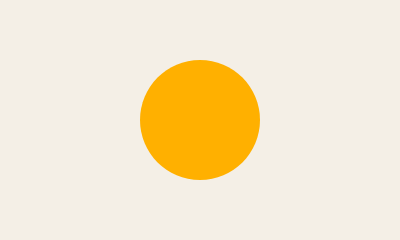
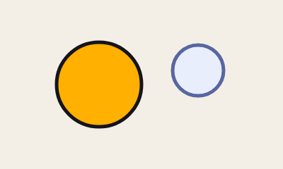
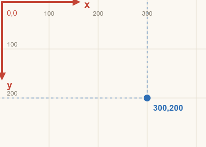

# 1. Primeiros passos

[← Índice](README.md) · [Próximo: Formas →](02-formas.md)

## A ideia

No Weasel você **descreve o desenho em texto**, uma instrução por linha, e o programa pinta. Não há pincel nem mouse: um círculo é uma linha dizendo "círculo, aqui, deste tamanho, desta cor". A vantagem é que tudo fica exato e fácil de mudar. Trocar uma cor, mover um olho ou animar um braço é mudar um número.

Três regras explicam quase tudo:

1. **Cada linha é uma instrução.** A primeira palavra diz o que fazer (`canvas`, `ellipse`, `shape`…).
2. **As linhas são pintadas de cima para baixo.** O que vem depois fica por cima do que veio antes, como camadas de tinta. (Há poucas exceções; estão no [capítulo 4](04-camadas.md#a-ordem-de-pintura).)
3. **Tudo é número.** Posições, tamanhos, espessuras e cores são valores que você escreve. Por isso dá para mexer neles depois, até com animação.

## O primeiro desenho

<!-- gerar: img/01_sol.png -->
```weasel
canvas 400 240 bg=#f4efe6
ellipse sol 200,120 60 c=#ffb000
```



Linha por linha:

- `canvas 400 240 bg=#f4efe6`: a folha tem 400 pixels de largura e 240 de altura, com fundo bege (`bg` vem de *background*, fundo).
- `ellipse sol 200,120 60 c=#ffb000`: uma elipse chamada `sol`, com o centro em x=200 e y=120, raio 60 e cor laranja (`c` = cor).

Agora com um contorno e um segundo círculo:

<!-- gerar: img/01_sol_lua.png -->
```weasel
canvas 400 240 bg=#f4efe6
ellipse sol 140,120 60 c=#ffb000 ink=5
ellipse lua 280,100 36 c=#e9eefc ink=5 inkc=#5866a0
```



- `ink=5` desenha um **contorno** de 5 pixels. Sem `ink=`, a forma fica sem contorno.
- `inkc=` é a cor do contorno. Sem ela, o contorno sai na cor de tinta padrão (quase preto).

## As coordenadas: onde fica cada ponto

Todo lugar no desenho é um par `x,y`:

- **x** conta da esquerda para a direita;
- **y** conta **de cima para baixo**: quanto maior o y, mais para baixo;
- o ponto `0,0` é o **canto de cima, à esquerda**.

<!-- gerar: img/01_coordenadas.png -->
```weasel
canvas 420 300 bg=#fbf8f2
palette ink=#2b2a33 grade=#e3dccd eixo=#c44536 azul=#2f6fb5

layer grade
line v1 c=grade : 100,0 100,300
line v2 c=grade : 200,0 200,300
line v3 c=grade : 300,0 300,300
line v4 c=grade : 400,0 400,300
line h1 c=grade : 0,100 420,100
line h2 c=grade : 0,200 420,200
text n100 100,32 "100" size=13 align=center c=#8a8478
text n200 200,32 "200" size=13 align=center c=#8a8478
text n300 300,32 "300" size=13 align=center c=#8a8478
text m100 14,95 "100" size=13 c=#8a8478
text m200 14,195 "200" size=13 c=#8a8478

layer eixos
stroke ex c=eixo w=4 : 4,4 150,4
shape px c=eixo : 164,4! 148,-4! 148,12!
text tx 172,16 "x" size=20 c=eixo bold
stroke ey c=eixo w=4 : 4,4 4,150
shape py c=eixo : 4,164! -4,148! 12,148!
text ty 14,180 "y" size=20 c=eixo bold
text origem 14,32 "0,0" size=15 c=eixo

layer ponto
line gx c=azul dash=5,5 : 300,4 300,200
line gy c=azul dash=5,5 : 4,200 300,200
ellipse p 300,200 7 c=azul
text tp 312,226 "300,200" size=17 c=azul bold
```



O ponto azul está em `300,200`: 300 pixels para a direita e 200 para baixo, contando do canto. Escreva sempre **sem espaço** entre os dois números: `300,200` é um ponto; `300, 200` são duas palavras e dá erro.

Ângulos seguem a mesma lógica da tela: **0° aponta para a direita e o sentido positivo é o horário** (90° aponta para baixo). Isso vale para `rot=`, para os ossos e para as luzes.

> **Dica do editor:** com o cursor numa linha, os pontos dela aparecem no desenho e dá para arrastá-los (o número no código muda junto). **Ctrl+clique** no desenho escreve a coordenada daquele lugar onde está o cursor de texto. É o jeito mais fácil de descobrir "que número é aquele ponto".

## A anatomia de uma linha

Toda instrução tem o mesmo formato:

```
comando  nome   valores      atributo=valor …   opções   :  pontos
ellipse  sol    200,120 60   c=#ffb000 ink=5
shape    folha               c=#6cbb3c ink=3             :  40,80 120,40 160,90!
text     titulo 200,40 "Oi"  size=30            bold
```

| Parte | O que é | Exemplo |
|---|---|---|
| **comando** | A primeira palavra: o que fazer. Sempre em minúsculas. | `ellipse`, `shape`, `layer`, `bone`, `key` |
| **nome** | Como você chama a coisa, para usá-la depois (recortar, animar, espelhar). Começa com letra; depois letras, números, `_` ou `-`. Maiúsculas e minúsculas são diferentes (`olho` ≠ `Olho`). | `sol`, `olhoE`, `perna_tras` |
| **valores** | Números na ordem que o comando espera, como centro e raio. | `200,120 60` |
| **atributos** | `nome=valor`, em qualquer ordem. Sem espaço em volta do `=`. | `c=#ffb000 ink=5 rot=30` |
| **opções** | Palavras soltas que ligam algo. | `hidden`, `bold`, `guide`, `once` |
| **pontos** | Depois do `:`, a lista de pontos `x,y` separados por espaço. Só nas formas que têm pontos (`shape`, `stroke`, `line`). | `: 40,80 120,40 160,90!` |

Mais três regras de escrita:

- `#` começa um **comentário**: o resto da linha é ignorado. Vale no começo da linha ou depois de um espaço. Uma cor como `#ffb000` não é comentário, porque vem grudada no `=`.
- Linhas em branco não fazem nada; use-as para separar partes do desenho.
- Texto vai entre aspas: `"Olá, mundo"`.

```
# isto é um comentário
ellipse sol 200,120 60 c=#ffb000   # isto também; a cor não é comentário
```

## Quando algo dá errado

O Weasel avisa com a linha e a coluna do problema. No editor, a linha ganha uma marca na margem e a barra de baixo mostra a mensagem. Na linha de comando sai assim:

```
<stdin>:2:13: erro: esperado o centro no formato x,y
  2 | ellipse sol 200, 120 60 c=#ffb000
    |             ^^^^
<stdin>:3:1: erro: instrução desconhecida "elipse"
  3 | elipse lua 300,60 20 c=#ddd
    | ^^^^^^
<stdin>:4:22: erro: cor desconhecida "amarelo"
  4 | ellipse b 100,100 30 c=amarelo
    |                      ^^^^^^^^^
```

Os três erros mais comuns estão aí: um espaço no meio do ponto (`200, 120`), um comando escrito errado (`elipse`) e uma cor que não existe (`amarelo`). Nomes de cor em inglês do CSS funcionam (`red`, `gold`, `tomato`); em português, não.

- No **editor**, a linha com erro é ignorada e o resto continua sendo desenhado, para você não perder a vista enquanto digita.
- Na **linha de comando**, com erro nada é exportado (a não ser com `--force`).
- **Avisos** (atributo desconhecido, quadro depois do fim da animação…) não impedem nada, mas quase sempre indicam um engano.

## Como rodar os exemplos deste guia

**No editor web:** abra o `index.html`, crie um arquivo novo na barra de arquivos (acima do código), cole o exemplo e veja o desenho à direita. Exemplos com `anim` tocam no player, embaixo do desenho.

**Na linha de comando** (precisa do Node.js e de um `npm install` na pasta do projeto):

```bash
node cli/weasel.js meu_desenho.weasel
```

Isso gera `meu_desenho.png`. Para uma animação em GIF:

```bash
node cli/weasel.js meu_desenho.weasel -a nome_da_animacao -o anima.gif
```

Para só procurar erros, sem exportar nada:

```bash
node cli/weasel.js meu_desenho.weasel --check
```

[← Índice](README.md) · [Próximo: Formas →](02-formas.md)
