# 2. Formas

[← Primeiros passos](01-primeiros-passos.md) · [Índice](README.md) · [Próximo: Cores e contorno →](03-cores.md)

Este capítulo mostra as formas do Weasel, uma de cada vez, e termina com a placa de um café. Você já precisa saber o que o [capítulo 1](01-primeiros-passos.md) ensina: o `canvas`, as coordenadas (o `y` cresce para baixo), o `rot=` e o formato de uma linha.

| Comando | Desenha |
|---|---|
| `ellipse` | um círculo ou uma elipse |
| `rect` | um retângulo, com ou sem cantos redondos |
| `line` | linhas retas, ligando pontos |
| `shape` | uma forma livre, fechada, com curvas que passam pelos pontos |
| `stroke` | um traço aberto, como uma pincelada |
| `text` | um texto |

Três delas são **fechadas**: `ellipse`, `rect` e `shape` têm um lado de dentro, que a cor preenche. A `line` e o `stroke` são só o risco; o `text` são as letras. Há ainda o `ref`, que põe uma imagem por baixo para você copiar, e as partículas (`emitter`), do [capítulo 11](11-efeitos.md#partículas).

As cores aparecem como `c=#rrggbb` em todos os exemplos. Elas são o assunto do [capítulo 3](03-cores.md); por enquanto, copie.

## Círculo e elipse: `ellipse`

```
ellipse nome cx,cy raio
ellipse nome cx,cy raioX,raioY
```

Para um círculo, diga onde fica o centro e qual é o raio:

<!-- gerar: img/02_circulo.png -->
```weasel
canvas 300 200 bg=#f4efe6
ellipse bola 150,100 60 c=#ff6b4a
```

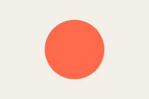

- `bola` é o nome.
- `150,100` é o centro: 150 para a direita e 100 para baixo.
- `60` é o raio, a distância do centro até a borda. O círculo fica com 120 de largura.

Com dois raios, o círculo vira uma elipse. O primeiro raio é o da largura; o segundo, o da altura:

<!-- gerar: img/02_elipses.png -->
```weasel
canvas 440 200 bg=#f4efe6
ellipse circulo 80,100 54 c=#ff6b4a
ellipse deitada 220,100 64,38 c=#4a90d9
ellipse girada 360,100 64,30 rot=30 c=#6cbb3c
```

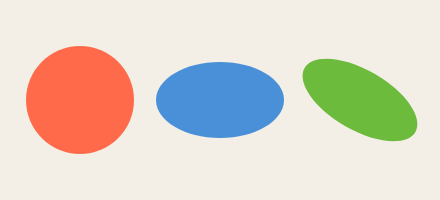

- `64,38`: 64 para cada lado na largura e 38 na altura. A elipse fica deitada.
- `rot=30` gira a elipse 30 graus em volta do centro, no sentido do relógio.

**Experimente:** troque `rot=30` por `rot=90`. A elipse verde fica em pé. Num círculo, o `rot=` não muda nada.

| Opção | O que faz | Valores | Se não escrever |
|---|---|---|---|
| o centro `cx,cy` | onde fica o meio | dois números, em pixels | obrigatório |
| o raio | do centro até a borda; com dois números, o da largura e o da altura | um ou dois números, em pixels | obrigatório |
| `rot=` | gira em volta do centro | qualquer número, em graus | 0 |
| `c=` | a cor de dentro | uma cor | quase preto |

A lista completa está na [referência do `ellipse`](19-referencia.md#ellipse). No editor, a ferramenta **Elipse** (L) escreve esta linha para você ([capítulo 22](22-editor.md#elipse-e-retângulo)).

## Retângulo: `rect`

```
rect nome x,y largura,altura
```

<!-- gerar: img/02_retangulos.png -->
```weasel
canvas 440 200 bg=#f4efe6
rect quadrado 30,50 100,100 c=#ffb000
rect cartao 170,60 120,80 c=#ff6b4a
rect girado 330,60 80,80 rot=20 c=#4a90d9
# o pontinho marca o canto 30,50 do primeiro
ellipse canto 30,50 5 c=#c44536
```

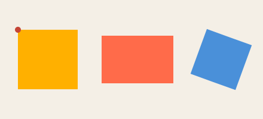

- `30,50` é o **canto de cima, à esquerda** (o pontinho vermelho), e não o centro.
- `100,100` é o tamanho: a largura e depois a altura.
- O `rot=` gira em volta do **meio** do retângulo.

**Experimente:** troque o tamanho do primeiro por `100,40`. Ele fica baixinho, e o canto de cima não sai do lugar.

### Cantos redondos: `r=`

O `r=` é o raio dos cantos, em pixels. Os quatro retângulos abaixo têm o mesmo tamanho, 100 por 60; só o `r=` muda:

<!-- gerar: img/02_cantos.png -->
```weasel
canvas 480 120 bg=#f4efe6
rect r0 20,30 100,60 c=#ffb000
rect r10 135,30 100,60 r=10 c=#ffb000
rect r30 250,30 100,60 r=30 c=#ffb000
rect r99 365,30 100,60 r=99 c=#ffb000
```

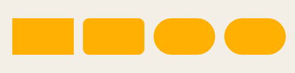

Da esquerda para a direita:

- sem `r=`, os cantos são vivos;
- `r=10` arredonda só a pontinha de cada canto;
- `r=30` arredonda até o meio da altura (30 é a metade de 60): os lados viram meios círculos, e o retângulo vira uma cápsula;
- `r=99` sai igual ao `r=30`. O canto nunca passa da metade do lado menor.

**Experimente:** num quadrado de `100,100`, use `r=50`. Ele vira um círculo.

| Opção | O que faz | Valores | Se não escrever |
|---|---|---|---|
| o canto `x,y` | o canto de cima, à esquerda | dois números, em pixels | obrigatório |
| o tamanho `largura,altura` | a largura e a altura | dois números, em pixels | obrigatório |
| `r=` | o raio dos cantos redondos | 0 ou mais, em pixels (no máximo, a metade do lado menor) | 0, cantos vivos |
| `rot=` | gira em volta do meio | qualquer número, em graus | 0 |

A lista completa está na [referência do `rect`](19-referencia.md#rect). No editor, a ferramenta **Retângulo** (M) escreve esta linha ([capítulo 22](22-editor.md#elipse-e-retângulo)).

Um tamanho negativo desenha o retângulo para o outro lado do canto (para a esquerda ou para cima), com os mesmos cantos redondos do `r=`.

## Linha reta: `line`

```
line nome : ponto ponto ponto …
```

A `line` liga pontos com retas. Os pontos vêm depois de um `:`, separados por espaço. Ela serve para chão, cercas, réguas, raios e setas.

<!-- gerar: img/02_linhas.png -->
```weasel
canvas 440 160 bg=#f4efe6
line chao w=3 : 20,130 420,130
line serra w=3 c=#4a90d9 : 20,90 80,40 140,90 200,40 260,90
line esquina w=6 c=#c44536 : 290,40 420,40 420,110
```

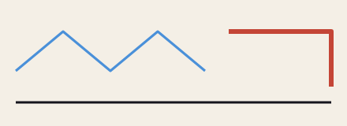

- `chao` tem dois pontos: é uma reta só, de `20,130` a `420,130`.
- `serra` tem cinco pontos: quatro retas, uma depois da outra.
- `w=` é a grossura, em pixels. Sem `w=`, a linha tem 1 pixel.
- As pontas da `line` são sempre retas, cortadas no ponto.

**Experimente:** acrescente o ponto `290,110` no fim da linha `esquina`. Ela vira um "U" de cabeça para baixo.

### Tracejado: `dash=`

O `dash=` corta a linha em pedaços. Os números são comprimentos em pixels, alternando **traço** e **vão**:

<!-- gerar: img/02_tracejado.png -->
```weasel
canvas 320 240 bg=#f4efe6
line l1 w=3 : 20,30 300,30
line l2 w=3 dash=10 : 20,75 300,75
line l3 w=3 dash=20,6 : 20,120 300,120
line l4 w=3 dash=2,6 : 20,165 300,165
line l5 w=3 dash=16,5,3,5 : 20,210 300,210
```

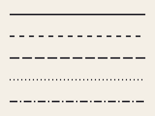

De cima para baixo:

- sem `dash=`, a linha é contínua;
- `dash=10`: um número só vale para os dois, traço de 10 e vão de 10;
- `dash=20,6`: traço comprido e vão curto;
- `dash=2,6`: traços tão curtos que parecem pontos;
- `dash=16,5,3,5`: traço de 16, vão de 5, traço de 3, vão de 5, e repete. É o "traço e ponto".

**Experimente:** troque `w=3` por `w=8` na linha pontilhada. Cada ponto vira um tracinho em pé: o traço tem 2 de comprimento e 8 de grossura. Para quadradinhos, use `dash=8,6`.

| Opção | O que faz | Valores | Se não escrever |
|---|---|---|---|
| os pontos (depois do `:`) | por onde a linha passa | 2 ou mais pontos | obrigatório |
| `w=` | a grossura | 0 ou mais, em pixels | 1 |
| `dash=` | o tracejado: traço, vão, traço, vão… | de 1 a 8 números, em pixels; `dash=0` desliga | contínua |
| `c=` | a cor da linha | uma cor | quase preto |

A lista completa está na [referência da `line`](19-referencia.md#line). No editor, a ferramenta **Linha** (`\`) escreve esta linha ([capítulo 22](22-editor.md#linha-caneta-e-lápis)).

## Formas livres com pontos: `shape`

```
shape nome : ponto ponto ponto …
```

O `shape` também liga uma lista de pontos, mas com **curvas**, e fecha a volta: o último ponto se liga ao primeiro. Cada ponto pode ser de dois tipos:

- **liso** (`x,y`): a curva passa por ele fazendo uma volta suave;
- **canto** (`x,y!`): com `!` no fim, a linha muda de direção de uma vez.

Os três desenhos abaixo usam os **mesmos quatro pontos**, só deslocados para o lado. Os pontinhos vermelhos marcam os pontos:

<!-- gerar: img/02_pontos.png -->
```weasel
canvas 440 200 bg=#f4efe6
shape liso c=#4a90d9 : 80,30 130,100 80,170 30,100
shape cantos c=#ffb000 : 220,30! 270,100! 220,170! 170,100!
shape gota c=#6cbb3c : 360,30! 410,100 360,170 310,100

# os pontos de cada forma
ellipse a1 80,30 4 c=#c44536
ellipse a2 130,100 4 c=#c44536
ellipse a3 80,170 4 c=#c44536
ellipse a4 30,100 4 c=#c44536
ellipse b1 220,30 4 c=#c44536
ellipse b2 270,100 4 c=#c44536
ellipse b3 220,170 4 c=#c44536
ellipse b4 170,100 4 c=#c44536
ellipse c1 360,30 4 c=#c44536
ellipse c2 410,100 4 c=#c44536
ellipse c3 360,170 4 c=#c44536
ellipse c4 310,100 4 c=#c44536
```

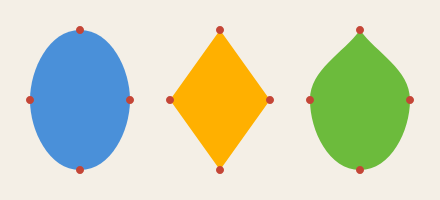

1. **Todos lisos:** vira um círculo.
2. **Todos com `!`:** vira um losango.
3. **Só o de cima com `!`:** vira uma gota, com a ponta em cima e o resto redondo.

**Experimente:** na gota, ponha `!` também no ponto de baixo (`360,170!`). Ela vira um limão, com duas pontas.

A curva lisa é calculada a partir dos vizinhos de cada ponto: você só diz **por onde** a linha passa. Para desenhar algo novo, marque poucos pontos no contorno, veja o resultado e vá acrescentando. O `shape` precisa de pelo menos 3 pontos.

### Quanto a curva arredonda: `smooth=`

O `smooth=` muda o quanto as voltas lisas estufam, de 0 a 2. Os três têm os mesmos cinco pontos lisos:

<!-- gerar: img/02_smooth.png -->
```weasel
canvas 440 180 bg=#f4efe6
shape s0 smooth=0 c=#ff6b4a : 80,30 130,80 110,150 50,150 30,80
shape s1 smooth=1 c=#ffb000 : 220,30 270,80 250,150 190,150 170,80
shape s2 smooth=2 c=#6cbb3c : 360,30 410,80 390,150 330,150 310,80
```

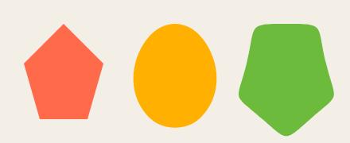

- `smooth=0`: as voltas viram cantos, e sobra um pentágono.
- `smooth=1`: o arredondado normal. É o que vale sem `smooth=`.
- `smooth=2`: as voltas estufam o dobro, e a forma fica quase redonda.
- Os pontos com `!` continuam cantos, qualquer que seja o `smooth=`.

**Experimente:** no do meio, troque `smooth=1` por `smooth=0.5`. Fica entre o pentágono e o arredondado.

| Opção | O que faz | Valores | Se não escrever |
|---|---|---|---|
| os pontos (depois do `:`) | o contorno da forma | 3 ou mais: `x,y` (liso), `x,y!` (canto) e as alças, mais abaixo | obrigatório |
| `smooth=` | quanto os pontos lisos arredondam | de 0 a 2 | 1 |
| `c=` | a cor de dentro | uma cor | quase preto |

A lista completa está na [referência do `shape`](19-referencia.md#shape). No editor, a **Caneta** (P) e a **Curvatura** escrevem um `shape` ponto a ponto ([capítulo 22](22-editor.md#linha-caneta-e-lápis)).

**Cuidado:** o `shape` não tem `rot=` (aviso). Para girar, mude os pontos; no editor, a alça de giro faz essa conta por você.

## Traço aberto: `stroke`

```
stroke nome : ponto ponto …
```

O `stroke` liga os pontos com as mesmas curvas do `shape`, mas **não fecha a volta**: é uma pincelada. Serve para fios, bigodes, cabelos, sobrancelhas e rachaduras. Ele aceita os mesmos pontos (lisos e com `!`) e o `smooth=`, e precisa de pelo menos 2 pontos.

<!-- gerar: img/02_tracos.png -->
```weasel
canvas 440 200 bg=#f4efe6
stroke onda w=8 c=#4a90d9 : 30,60 130,30 230,70 330,30 410,50
stroke raio w=8 c=#ffb000 : 30,170 110,110! 170,160! 250,100! 330,150! 410,100
```

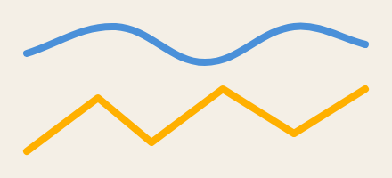

- `w=` é a grossura do traço, em pixels. Sem `w=`, 4.
- Na onda, todos os pontos são lisos. No raio, os do meio têm `!` e viram cantos. O primeiro e o último não precisam: a ponta de um traço já é uma ponta.

**Experimente:** acrescente `smooth=0.5` na onda. As voltas ficam mais apertadas.

### Pontas: `cap=`

O `cap=` escolhe o formato das duas pontas. Ele só aparece em traços grossos. As linhas tracejadas passam pelo primeiro e pelo último ponto de cada traço:

<!-- gerar: img/02_pontas.png -->
```weasel
canvas 400 200 bg=#f4efe6
stroke redonda w=24 : 100,40 300,40
stroke reta w=24 cap=butt : 100,100 300,100
stroke quadrada w=24 cap=square : 100,160 300,160
# as linhas vêm depois, para ficar por cima dos traços
line e1 w=2 c=#4a90d9 dash=4,4 : 100,10 100,190
line e2 w=2 c=#4a90d9 dash=4,4 : 300,10 300,190
```

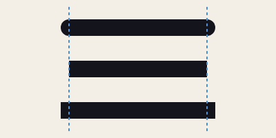

- `cap=round` (o padrão): a ponta é redonda e passa do ponto metade da grossura (aqui, 12).
- `cap=butt`: a ponta é reta e termina **exatamente** no ponto.
- `cap=square`: a ponta é reta, mas passa do ponto metade da grossura, como a redonda.

**Experimente:** troque `w=24` por `w=4` nos três. A diferença quase some.

### Afinar as pontas: `taper=`

O `taper=começo,fim` afina o traço nas pontas, como uma pincelada. Cada número vai de 0 a 1 e diz **quanto do comprimento** afina: `0` é nada, `0.3` é 30% do traço, `1` é o traço inteiro.

<!-- gerar: img/02_taper.png -->
```weasel
canvas 360 250 bg=#f4efe6
stroke t00 w=14 : 30,40 140,30 260,50 330,40
stroke t10 w=14 taper=1,0 : 30,95 140,85 260,105 330,95
stroke t03 w=14 taper=0,0.3 : 30,150 140,140 260,160 330,150
stroke t11 w=14 taper=1,1 : 30,205 140,195 260,215 330,205
```

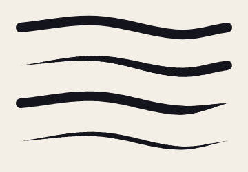

De cima para baixo:

- sem `taper=`, a grossura é igual do começo ao fim;
- `taper=1,0`: o começo afina ao longo do traço inteiro. Ele nasce fino e só chega à grossura toda no fim;
- `taper=0,0.3`: só os últimos 30% afinam, como um rabo;
- `taper=1,1`: afina dos dois lados ao longo do traço inteiro. O meio fica com a metade da grossura.

**Experimente:** troque `taper=1,1` por `taper=0.5,0.5`. O meio volta a ter a grossura toda.

| Opção | O que faz | Valores | Se não escrever |
|---|---|---|---|
| os pontos (depois do `:`) | o caminho do traço | 2 ou mais, lisos ou com `!` | obrigatório |
| `w=` | a grossura | 0 ou mais, em pixels | 4 |
| `cap=` | o formato das pontas | `round`, `butt` ou `square` | `round` |
| `taper=começo,fim` | afina as pontas | dois números, de 0 a 1 | 0,0 (não afina) |
| `smooth=` | quanto os pontos lisos arredondam | de 0 a 2 | 1 |
| `c=` | a cor do traço | uma cor | quase preto |

O `stroke` também vira um braço ou uma perna que dobra sozinho, com `hip=` e `limb=` ([capítulo 8](08-ossos.md#pernas-e-braços-com-ik)). A lista completa está na [referência do `stroke`](19-referencia.md#stroke). No editor, o **Lápis** (N) e o **Pincel** (B) escrevem um `stroke` à mão livre ([capítulo 22](22-editor.md#linha-caneta-e-lápis)).

**Cuidado:**
- O `taper=` precisa dos dois números: `taper=0.5` dá erro.
- Com `taper=`, as pontas saem sempre redondas: o `cap=` não vale (aviso).

## Curvas sob medida: alças

Às vezes a curva automática não faz a volta que você quer. Uma **alça** diz para onde a curva aponta quando passa pelo ponto, como nos programas de desenho. Ela vale no `shape` e no `stroke`.

```
x,y~dx,dy
```

- A curva passa em `x,y` indo na direção `dx,dy`, contada a partir do ponto.
- A alça vale para os dois lados: a curva chega pelo lado de `-dx,-dy` e sai pelo lado de `dx,dy`.
- Quanto **maior** a alça, mais tempo a curva segue aquela direção.

Os dois morros abaixo têm os mesmos três pontos. O da direita tem uma alça deitada no topo, desenhada em vermelho:

<!-- gerar: img/02_alca.png -->
```weasel
canvas 440 200 bg=#f4efe6
stroke auto w=6 : 30,170 120,50 210,170
stroke alca w=6 : 230,170 320,50~80,0 410,170
# a alça: de 80 para trás até 80 para a frente do ponto
line braco c=#c44536 w=2 : 240,50 400,50
ellipse p1 240,50 5 c=#c44536
ellipse p2 400,50 5 c=#c44536
```

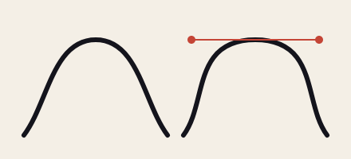

A alça `~80,0` faz a curva passar pelo topo indo reto para a direita, e o morro fica com o alto largo.

O **tamanho** da alça muda o formato da volta:

<!-- gerar: img/02_alca_tamanho.png -->
```weasel
canvas 500 180 bg=#f4efe6
stroke a w=5 : 20,160 80,50~20,0 140,160
stroke b w=5 : 170,160 240,50~50,0 310,160
stroke c w=5 : 330,160 400,50~90,0 470,160
line la c=#c44536 w=2 : 60,50 100,50
line lb c=#c44536 w=2 : 190,50 290,50
line lc c=#c44536 w=2 : 310,50 490,50
```

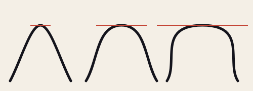

- `~20,0`: a alça é curta. A curva logo esquece a direção, e o topo fica quase pontudo.
- `~50,0`: o topo fica redondo e largo.
- `~90,0`: a curva corre deitada por muito tempo e depois cai de uma vez. O morro parece um "n".

**Experimente:** troque `~50,0` por `~50,30`. A alça fica inclinada para baixo, e o topo do morro fica torto.

### Uma alça para cada lado

Para a curva chegar de um jeito e sair de outro, escreva **duas** alças:

```
x,y~ax,ay~bx,by
```

- A curva **chega** ao ponto andando na direção `ax,ay` e **sai** na direção `bx,by`.
- Na mesma direção, com tamanhos diferentes, o ponto continua liso, mas a volta fica mais longa de um lado.
- Em direções diferentes, o ponto vira uma **ponta curva**, como a de cima de um coração.

<!-- gerar: img/02_alca_quebrada.png -->
```weasel
canvas 440 200 bg=#f4efe6
stroke liso w=6 : 30,170 120,50~30,0~90,0 210,170
shape coracao c=#e05050 : 320,170! 270,95~0,-40 320,80~15,40~15,-40 370,95~0,40
# as alças do topo do morro e da ponta do coração
line l1 c=#c44536 w=2 : 90,50 210,50
line l2 c=#c44536 w=2 : 305,40 320,80 335,40
```

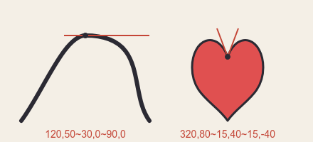

- No morro, as duas alças estão na mesma reta, então o topo continua liso. Mas a de saída é três vezes mais longa: o topo se estende para a direita antes de a curva cair.
- No coração, a curva chega à ponta de cima descendo (`15,40`) e sai subindo (`15,-40`).

**Experimente:** no morro, troque `~30,0~90,0` por `~90,0~30,0`. A volta longa passa para o outro lado.

**Cuidado:**
- Um ponto não pode ter alça e `!` ao mesmo tempo (erro).
- O `smooth=` não muda os pontos com alça: com `smooth=0`, eles continuam curvos.

No editor, as alças se puxam com o mouse ([capítulo 22](22-editor.md#pontos-e-alças)).

## Texto: `text`

```
text nome x,y "o texto"
```

<!-- gerar: img/02_texto.png -->
```weasel
canvas 440 200 bg=#f4efe6
# a linha tracejada passa pelo x dos três textos
line eixo c=#4a90d9 dash=4,4 : 220,10 220,190
text esq 220,50 "align=left" size=24
text meio 220,110 "align=center" size=24 align=center bold
text dir 220,170 "align=right" size=24 align=right italic c=#c44536
ellipse a1 220,50 4 c=#4a90d9
ellipse a2 220,110 4 c=#4a90d9
ellipse a3 220,170 4 c=#4a90d9
```

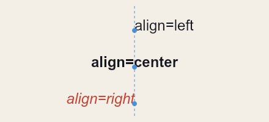

- `x,y` é o **ponto de apoio** (os pontos azuis). As letras "sentam" na altura `y`.
- O `align=` diz se o texto começa no `x` (`left`, o padrão), fica centrado nele (`center`) ou termina nele (`right`).
- `bold` deixa as letras em negrito, e `italic` as inclina.
- O texto vai entre aspas duplas, numa linha só. Não dá para pôr uma aspa dentro dele.

**Experimente:** troque o `220` dos três textos por `300`. Os três andam juntos para a direita.

### Fonte e tamanho: `font=` e `size=`

<!-- gerar: img/02_fontes.png -->
```weasel
canvas 460 230 bg=#f4efe6
text f1 20,45 "sans-serif (o padrão)" size=26
text f2 20,90 "Georgia" size=26 font=Georgia
text f3 20,135 "Courier New" size=26 font="Courier New"
text s1 20,205 "size=12" size=12
text s2 110,205 "size=24" size=24
text s3 250,205 "size=40" size=40
```

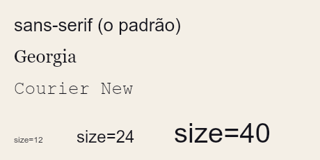

- `font=` escolhe a fonte pelo nome. Um nome com espaço vai entre aspas: `font="Courier New"`. Sem `font=`, a fonte é `sans-serif`, a simples do sistema.
- A fonte precisa estar **instalada** no computador. Se não estiver, o texto sai na fonte padrão, sem aviso. Por isso o mesmo arquivo pode sair um pouco diferente em outra máquina.
- `size=` é o tamanho da fonte, em pixels, de 1 a 2000. Não é a altura da letra: as maiúsculas ficam com uns 70% disso. Sem `size=`, 24.

**Experimente:** troque `Georgia` por `"Comic Sans MS"` ou `Impact`, que vêm no Windows.

### Girar o texto

O `rot=` gira o texto em volta do ponto de apoio (os pontinhos escuros):

<!-- gerar: img/02_texto_giro.png -->
```weasel
canvas 440 180 bg=#f4efe6
text sobe 60,130 "rot=-15" size=30 bold rot=-15 c=#4a90d9
text desce 260,60 "rot=20" size=30 bold rot=20 c=#c44536
ellipse p1 60,130 4 c=#2b2a33
ellipse p2 260,60 4 c=#2b2a33
```

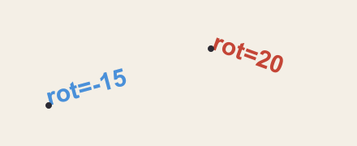

Como em toda forma, o número positivo gira no sentido do relógio. Com `align=left`, o fim do texto desce; com o negativo, sobe.

| Opção | O que faz | Valores | Se não escrever |
|---|---|---|---|
| o ponto `x,y` | onde o texto se apoia | dois números, em pixels | obrigatório |
| o texto | as letras | entre aspas duplas, numa linha só | obrigatório |
| `size=` | o tamanho da fonte | de 1 a 2000, em pixels | 24 |
| `font=` | a fonte | o nome de uma fonte instalada | `sans-serif` |
| `align=` | que parte do texto fica no `x` | `left`, `center` ou `right` | `left` |
| `rot=` | gira em volta do ponto de apoio | qualquer número, em graus | 0 |
| `bold` | negrito | — | desligado |
| `italic` | itálico | — | desligado |
| `c=` | a cor das letras | uma cor | quase preto |

O texto também pode ter contorno, como as formas fechadas ([capítulo 3](03-cores.md)). A lista completa está na [referência do `text`](19-referencia.md#text). No editor, a ferramenta **Texto** (T) escreve esta linha, e um duplo clique nas letras troca o texto ([capítulo 22](22-editor.md#texto)).

## Desenhar por cima de uma imagem: `ref`

Para copiar um rascunho, uma foto ou um personagem que já existe, ponha a imagem **por baixo**, como guia, e desenhe as formas por cima dela, como num papel vegetal.

```
ref nome "imagem.png" x,y
```

<!-- gerar: img/02_ref.png -s 0.5 --refs -->
```weasel
canvas 512 512 bg=#ffffff
ref modelo "../docs/logo.png" 0,0 opacity=0.35 lock
shape cara c=#b8733a : 256,112 314,122 356,160 368,218 354,280 320,340 286,388 256,404 226,388 192,340 158,280 144,218 156,160 198,122
ellipse olhoE 212,222 18,23 rot=-12 c=#1c1f2b
ellipse olhoD 300,222 18,23 rot=12 c=#1c1f2b
```

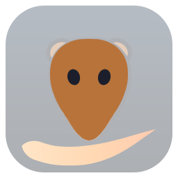

- A doninha clarinha é a **imagem guia**: o logo do Weasel, com `opacity=0.35` (35% visível). A cabeça e os olhos por cima são as formas que copiam o contorno dela.
- A imagem guia **nunca sai na exportação**. Ela aparece no editor e, na linha de comando, só com `--refs`.
- O caminho da imagem conta a partir da pasta do arquivo `.weasel`. Este exemplo está na pasta `exemplos/`, e o logo, em `docs/`.
- No editor, a imagem precisa ser aberta antes: **Janela › Referências › Adicionar imagem…**, ou arraste o arquivo para a janela ([capítulo 22](22-editor.md#referências)).

### Por baixo ou por cima: `front`

Na hora de conferir se o traço bateu com o original, `front` põe a imagem **por cima** das formas:

<!-- gerar: img/02_ref_front.png --refs -->
```weasel
canvas 440 220 bg=#ffffff
ref atras "../docs/logo.png" 20,20 scale=0.35 opacity=0.6
ref nafrente "../docs/logo.png" 240,20 scale=0.35 opacity=0.6 front
rect quadro1 40,50 140,120 c=#ffb000
rect quadro2 260,50 140,120 c=#ffb000
text t1 110,212 "por baixo" size=14 align=center
text t2 330,212 "front (por cima)" size=14 align=center
```

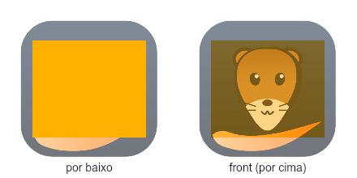

- `scale=0.35` deixa o logo com 35% do tamanho.
- À esquerda, sem `front`, o retângulo tapa a imagem guia. À direita, com `front`, a doninha aparece por cima.

**Experimente:** acrescente `rot=20` à segunda linha `ref`. A imagem gira 20 graus em volta do próprio centro.

| Opção | O que faz | Valores | Se não escrever |
|---|---|---|---|
| a imagem | o arquivo | entre aspas: PNG, JPG, GIF, WebP ou SVG | obrigatório |
| o canto `x,y` | o canto de cima, à esquerda | dois números, em pixels | `0,0` |
| `scale=` | o tamanho: 1 é o tamanho da imagem | de 0.001 a 100 | 1 |
| `rot=` | gira em volta do centro da imagem | qualquer número, em graus | 0 |
| `opacity=` | a transparência | de 0 (invisível) a 1 (inteira) | 0.5 |
| `front` | por cima das formas | — | por baixo |
| `lock` | no editor, a imagem não se arrasta | — | solta |
| `hidden` | esconde a imagem, que continua no arquivo | — | aparece |

Uma imagem guia diferente para cada animação usa `only=` e `frames=` ([capítulo 9](09-animacao.md#uma-imagem-guia-para-cada-movimento)). A lista completa está na [referência do `ref`](19-referencia.md#ref).

Quando terminar de copiar, apague a linha `ref` ou ponha `hidden` nela.

## Traçar uma imagem

Em vez de copiar a imagem à mão, a linha de comando pode **traçá-la**: a imagem vira um arquivo `.weasel` com as formas, as cores e os degradês dela. Funciona melhor com *vector art*: cores chapadas, contornos, ícones, personagens, cenários desenhados.

```bash
node cli/weasel.js docs/logo.png -o exemplos/logo_tracado.weasel
```

A resposta conta o que saiu:

```
24 regiões (3 degradês, 0 semitransparentes), 25 formas, 532 pontos, 14 cores · 0,7 s
salvo exemplos/logo_tracado.weasel  traçado de imagem · 8 KB
```

No editor, o menu **Objeto › Traçado de imagem…** faz o mesmo com uma imagem guia: o traçado entra no desenho, numa camada nova, em cima da imagem ([capítulo 22](22-editor.md#traçado-de-imagem)).

O arquivo que sai é um desenho como outro qualquer: abre no editor, exporta em qualquer formato e pode entrar em outro desenho com `include` ([capítulo 19](19-referencia.md#include)):

<!-- gerar: img/02_tracado.png -->
```weasel
include "logo_tracado.weasel"
```

| A imagem (`docs/logo.png`) | O traçado (`exemplos/logo_tracado.weasel`) |
|---|---|
|  |  |

O começo do arquivo:

```
# logo.png: traçado de imagem do Weasel 1.70.0.
# 24 regiões, da maior para a menor; 1 unidade = 1 px da imagem (512×512).
# opções: as padrão
# a imagem original está na linha ref: tire o hidden para comparar.

canvas 512 512 bg=none
ref original "../docs/logo.png" hidden
palette color1=#1c1f2b color2=#fbeedd color3=#b8733a color4=#3a2024 …

gradient gradient1 linear 258.1,19.5 258.3,492.5 : #283b4f@0.064 #26374a@0.179 …
shape c=gradient1 : 116.78,16.50 384.50,16 400.50,17.11 408.50,18.79 …
```

- O **comentário** no topo diz de que imagem veio, o tamanho e as opções, para dar para traçar de novo.
- O `canvas` tem o tamanho da imagem, com fundo transparente. Uma unidade é um pixel da imagem.
- A imagem fica numa **`ref` escondida**. Tire o `hidden` para ver a imagem por baixo do traçado e comparar.
- As **cores** ficam na `palette`: `color1`, `color2`… Trocar uma cor ali troca em todo o desenho ([capítulo 3](03-cores.md#cores-com-nome-palette)). Os degradês são `gradient1`, `gradient2`… ([capítulo 3](03-cores.md#gradientes-gradient)).
- Os **buracos** (o meio de um anel) são formas escondidas, `_hole1`, `_hole2`…, usadas com `cut=` ([capítulo 4](04-camadas.md#recortar-por-fora-cut)).
- As partes **semitransparentes** (uma sombra, um brilho) saem com a cor `#rrggbbaa` ([capítulo 3](03-cores.md)).

A ordem das linhas é a **ordem de pintura**: as partes semitransparentes primeiro, depois da maior para a menor. Cada forma continua uns pixels **por baixo** das que vêm depois. É isso que evita uma fresta entre duas cores; não "limpe" essas sobras.

| Opção | O que faz | Valores | Padrão |
|---|---|---|---|
| `-o` | o arquivo novo | um nome terminado em `.weasel` | `imagem.weasel`, ao lado da imagem |
| `--colors` | quantas cores procurar na imagem; menos cores, menos formas | de 2 a 256 | 48 |
| `--tol` | quanto a curva pode se afastar da borda da imagem; maior, menos pontos | de 0.05 a 20 pixels | 0.5 |

As outras opções estão no [capítulo 21](21-linha-de-comando.md#traçar-uma-imagem).

O traçado tem limites:

- Sai **uma figura parada, numa camada só**, sem ossos. Para animar, o desenho precisa ser cortado em peças, uma por osso ([capítulo 8](08-ossos.md)), à mão.
- Uma **foto**, um JPEG com muitos artefatos ou uma imagem cheia de detalhes vira milhares de formas e um arquivo grande (um retrato de 1633×2000 deu 3.665 formas e 833 KB). Reduza a imagem com `-s 0.5`, ou use `--colors` menor e `--tol` maior.
- Um **traço mais fino que um pixel** sai um pouco mais claro e mais largo. E uma linha fina que cruza uma sombra semitransparente sai quebrada.

## O que vale em toda forma

Algumas opções valem em todas as formas:

- **O nome.** É opcional, mas sem ele não dá para recortar, animar nem mudar a forma num filme. Duas formas podem ter o mesmo nome: tudo o que usa o nome vale para as duas.
- **`c=`**, a cor. Sem `c=`, a forma sai quase preta: é a cor de tinta, que o [capítulo 3](03-cores.md) mostra como trocar.
- **`hidden`**: a forma não é pintada, mas continua existindo. Uma forma escondida ainda serve para recortar outras ([capítulo 4](04-camadas.md)).

O `rot=` **não** vale em todas. A `ellipse`, o `rect` e o `text` têm `rot=`. O `shape`, o `stroke` e a `line` não têm: nelas, cada ponto já diz onde fica, e girar é escrever outros pontos.

As outras opções das formas aparecem nos próximos capítulos:

| Opções | O que fazem | Onde |
|---|---|---|
| `ink=`, `inkc=`, `weight=`, `opacity=` | o contorno e a transparência | [capítulo 3](03-cores.md) |
| `cut=`, `inkon=` | buracos e o contorno em outra camada | [capítulo 4](04-camadas.md) |
| `mirror=` | uma cópia espelhada de outra forma | [capítulo 6](06-componentes.md#espelho-de-uma-forma-mirror) |
| `bone=`, `bones=`, `cloth=` | a forma segue ossos ou balança como pano | [capítulo 8](08-ossos.md) |
| `emit=` | a forma brilha | [capítulo 11](10-luz.md#coisas-que-brilham-emit) |
| `z=`, `yaw=`, `pitch=`, `thick=`, `back=`, `billboard` | profundidade e giro em 3D | [capítulo 14](14-profundidade.md) |

Todas, com as faixas e os padrões, estão em [Opções de todas as formas](19-referencia.md#opções-de-todas-as-formas), na referência.

## Juntando tudo

A placa de um café, pendurada num prego. Usa todas as formas do capítulo:

<!-- gerar: img/02_placa.png -->
```weasel
canvas 480 340 bg=#264653

# o prego e a corda (uma line de três pontos)
line corda c=#e9d8a6 w=3 : 100,120 240,40 380,120
ellipse prego 240,40 7 c=#adb5bd

# a placa: uma sombra escura e a madeira por cima, com cantos redondos
rect sombra 66,126 360,180 r=24 c=#1d3640
rect placa 60,118 360,180 r=24 c=#e9c46a
# a costura tracejada, um pouco para dentro da borda
line costura c=#fff3d6 w=2 dash=10,6 : 74,132 406,132 406,284 74,284 74,132

# a doninha: as orelhas vêm antes, para a cabeça ficar por cima delas
ellipse orelhaE 104,160 17 c=#9c6644
ellipse dentroE 104,160 9 c=#e5989b
ellipse orelhaD 186,160 17 c=#9c6644
ellipse dentroD 186,160 9 c=#e5989b
# a cabeça: só pontos lisos, com alças no alto (achatado) e no queixo (estreito)
shape cabeca c=#9c6644 : 145,148~42,0 198,205 145,278~-14,0 92,205
# o queixo claro: cantos (!) nos lados e no meio, bochechas lisas
shape queixo c=#fff3d6 : 98,238! 122,226 145,232! 168,226 192,238! 145,272~-12,0
ellipse olhoE 124,198 8,9 c=#1b1b1e
ellipse olhoD 166,198 8,9 c=#1b1b1e
ellipse brilhoE 126,195 2.5 c=#ffffff
ellipse brilhoD 168,195 2.5 c=#ffffff
ellipse nariz 145,234 7,5 c=#3d2b1f
stroke boca c=#3d2b1f w=2.5 : 135,245 140,250 145,246! 150,250 155,245
# os bigodes afinam até sumir na ponta
stroke bigode1 c=#3d2b1f w=2 taper=0,1 : 120,240 96,234 72,237
stroke bigode2 c=#3d2b1f w=2 taper=0,1 : 120,246 96,248 74,256
stroke bigode3 c=#3d2b1f w=2 taper=0,1 : 170,240 194,234 218,237
stroke bigode4 c=#3d2b1f w=2 taper=0,1 : 170,246 194,248 216,256

# o nome do café
text nome 312,200 "Café" size=50 font=Georgia bold align=center c=#3d2b1f
text sobrenome 312,236 "da Doninha" size=24 font=Georgia italic align=center c=#6b4226

# a etiqueta torta no canto: o retângulo e o texto giram juntos
rect etiqueta 318,272 104,36 r=8 rot=-6 c=#e76f51
text aberto 370,297 "aberto!" size=18 bold align=center rot=-6 c=#fff3d6
```

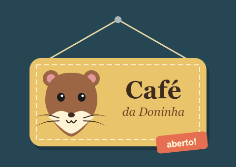

Como cada parte funciona:

- **A corda** é uma `line` de três pontos: sobe da placa até o prego e desce do outro lado.
- **A sombra** é o mesmo retângulo da placa, mais escuro, um pouco para a direita e para baixo. Ela vem antes, então fica atrás.
- **A costura** é uma `line` tracejada que volta ao primeiro ponto e fecha o retângulo.
- **A cabeça** tem só quatro pontos lisos. A alça `~42,0` no alto deixa a testa larga; a `~-14,0` embaixo deixa o queixo estreito.
- **O queixo claro** mistura cantos e pontos lisos: os cantos fazem as bochechas, e a alça arredonda a ponta de baixo.
- **Os bigodes** são `stroke` com `taper=0,1`: afinam até sumir na ponta.
- **A etiqueta** é um `rect` e um `text` com o mesmo `rot=-6`. O texto está centrado no meio do retângulo, então os dois giram juntos.

**Experimente:** troque o `rot=-6` da etiqueta e do texto por `rot=6`. A etiqueta tomba para o outro lado.

## Resumo

- `ellipse` (centro e raio) e `rect` (canto, tamanho e `r=`) são as formas prontas; as duas têm `rot=`.
- `line`, `shape` e `stroke` ligam pontos escritos depois do `:`. A `line` faz retas; o `shape` fecha uma forma com curvas; o `stroke` é um traço aberto.
- Um ponto é liso (`x,y`), canto (`x,y!`) ou tem alça (`x,y~dx,dy`, ou duas alças).
- O traço tem grossura (`w=`), pontas (`cap=`) e afina (`taper=`); a linha tem tracejado (`dash=`).
- O `text` escreve entre aspas, com `size=`, `font=`, `align=`, `bold` e `italic`.
- O `ref` põe uma imagem guia por baixo, que nunca sai na exportação.

[← Primeiros passos](01-primeiros-passos.md) · [Índice](README.md) · [Próximo: Cores e contorno →](03-cores.md)
