# 2. Formas

[← Primeiros passos](01-primeiros-passos.md) · [Índice](README.md) · [Próximo: Cores e estilos →](03-cores.md)

O Weasel tem sete tipos de forma:

| Comando | Desenha | Fechada? |
|---|---|---|
| `ellipse` | elipse ou círculo | sim |
| `rect` | retângulo, com ou sem cantos arredondados | sim |
| `shape` | qualquer forma, ligando pontos com curvas | sim |
| `stroke` | traço aberto (como uma pincelada), com curvas | não |
| `line` | linha reta entre pontos | não |
| `text` | texto | — |
| `emitter` | partículas (fagulhas, chuva) — veja o [capítulo 8](08-luz-efeitos.md#partículas) | — |

**Fechada** quer dizer que tem lado de dentro: pode ser preenchida (`c=`), ter contorno (`ink=`) e servir de molde para recortes. Traço e linha só têm a cor da própria linha.

> Nos exemplos deste capítulo, os pontinhos vermelhos e as anotações ficam numa camada `guide`. Uma camada `guide` aparece no editor (com o botão **Guias** ligado) e não sai na exportação; ela está aí só para mostrar onde ficam os pontos. As camadas são explicadas no [capítulo 4](04-camadas.md).

## Elipse e círculo

```
ellipse nome cx,cy raio
ellipse nome cx,cy raioX,raioY rot=graus
```

<!-- gerar: img/02_elipses.png -->
```weasel
canvas 440 200 bg=#f4efe6
palette ink=#2b2a33
ellipse circulo 80,100 54 c=#ff6b4a ink=4
ellipse oval 220,100 64,38 c=#4a90d9 ink=4
ellipse girada 360,100 64,30 rot=30 c=#6cbb3c ink=4
```

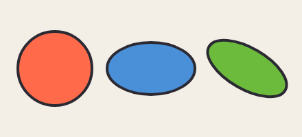

- `cx,cy` é o **centro**.
- Um raio só (`54`) dá um círculo. Dois raios (`64,38`) dão uma elipse: o primeiro é o raio na horizontal, o segundo na vertical. Os raios são em pixels.
- `rot=30` gira 30° em volta do centro, no sentido horário.

**Experimente:** troque `rot=30` por `rot=90`: a elipse verde fica em pé. Num círculo, `rot=` não muda nada.

> **Dica do editor:** ponha o cursor na linha de uma elipse. Além da bolinha do centro (arraste para mudar o `cx,cy`), aparecem **quadradinhos** na borda, ligados ao centro por uma linha tracejada. Arraste um quadradinho para mudar o tamanho:
>
> - num **círculo** há um só, e ele muda o raio;
> - numa **elipse** há dois: o da direita muda o primeiro raio (o da largura) e o de baixo, o segundo (o da altura). Segure **Shift** para mudar os dois juntos, sem deformar a elipse;
> - os quadradinhos giram junto com o `rot=`, então ficam sempre na ponta de cada raio.

## Retângulo

```
rect nome x,y largura,altura r=raio_do_canto rot=graus
```

<!-- gerar: img/02_retangulos.png --guides -->
```weasel
canvas 440 200 bg=#f4efe6
palette ink=#2b2a33
rect quadrado 30,50 100,100 c=#ffb000 ink=4
rect arredondado 170,50 100,100 r=24 c=#ff6b4a ink=4
rect girado 320,60 80,80 r=8 rot=20 c=#4a90d9 ink=4

layer anotacao guide
ellipse canto 30,50 5 c=#c44536
text tc 36,40 "30,50" size=13 c=#c44536
```

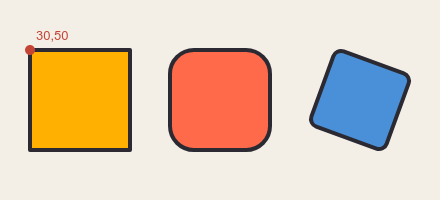

- `x,y` é o **canto de cima, à esquerda** (o ponto vermelho), e não o centro.
- `largura,altura` é o tamanho.
- `r=` arredonda os cantos.
- `rot=` gira em volta do centro do retângulo.

> **Dica do editor:** com o cursor na linha de um `rect`, a bolinha do canto de cima move o retângulo, e o **quadradinho** do canto de baixo, à direita, muda a `largura,altura`. Segure **Shift** ao arrastar o quadradinho para manter a proporção (um quadrado continua quadrado).

### Cantos redondos: `r=`

`r=` é o **raio do canto**, em pixels: o tamanho da curva que entra no lugar de cada canto vivo. Serve para botões, placas, janelas e dentes. Os quatro retângulos abaixo têm o mesmo tamanho (100 de largura, 60 de altura); só o `r=` muda:

<!-- gerar: img/02_cantos.png -->
```weasel
canvas 480 150 bg=#f4efe6
palette ink=#2b2a33
rect r0 20,30 100,60 c=#ffb000 ink=4
rect r10 135,30 100,60 r=10 c=#ffb000 ink=4
rect r30 250,30 100,60 r=30 c=#ffb000 ink=4
rect r99 365,30 100,60 r=99 c=#ffb000 ink=4
text t0 70,125 "sem r=" size=14 align=center
text t10 185,125 "r=10" size=14 align=center
text t30 300,125 "r=30" size=14 align=center
text t99 415,125 "r=99" size=14 align=center
```

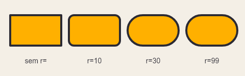

Repare:

- Sem `r=` (é o mesmo que `r=0`), os cantos são vivos.
- `r=10` arredonda só a pontinha de cada canto.
- `r=30` arredonda até o meio da altura (30 é metade de 60): as laterais viram meios círculos, e o retângulo vira uma **cápsula**.
- O canto nunca passa da metade do lado menor. Com `r=99`, valeu 30, e o resultado é igual ao de `r=30`.

**Experimente:** num quadrado (`100,100`), use `r=50`. Ele vira um círculo.

> **Dica do editor:** o `r=` também se arrasta. Com o cursor na linha do `rect`, um **losango azul** fica na borda de cima, perto do canto. Arraste-o para a direita e o canto arredonda (o `r=` muda no código). Volte com ele até o canto e o `r=` vira 0. Se a linha ainda não tem `r=`, o losango fica colado no canto, e arrastar escreve o `r=` para você.

## Formas livres com pontos: `shape`

`shape` liga uma lista de pontos e fecha a volta (o último ponto se liga ao primeiro). O mais importante do Weasel está aqui:

- um ponto comum (`x,y`) é **liso**: a curva passa por ele fazendo uma volta suave;
- um ponto com `!` no fim (`x,y!`) é um **canto vivo**: a linha muda de direção de uma vez.

Os três desenhos abaixo usam os **mesmos quatro pontos** (só deslocados para o lado):

<!-- gerar: img/02_pontos.png --guides -->
```weasel
canvas 440 200 bg=#f4efe6
palette ink=#2b2a33

shape liso c=#4a90d9 ink=4 : 80,30 130,100 80,170 30,100
shape cantos c=#ffb000 ink=4 : 220,30! 270,100! 220,170! 170,100!
shape gota c=#6cbb3c ink=4 : 360,30! 410,100 360,170 310,100

layer pontos guide
ellipse a1 80,30 4 c=#c44536
ellipse a2 130,100 4 c=#c44536
ellipse a3 80,170 4 c=#c44536
ellipse a4 30,100 4 c=#c44536
ellipse b1 220,30 4 c=#c44536
ellipse b2 270,100 4 c=#c44536
ellipse b3 220,170 4 c=#c44536
ellipse b4 170,100 4 c=#c44536
ellipse c1 360,30 4 c=#c44536
ellipse c2 410,100 4 c=#c44536
ellipse c3 360,170 4 c=#c44536
ellipse c4 310,100 4 c=#c44536
```

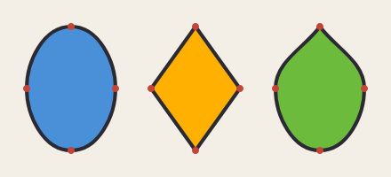

1. **Todos lisos:** vira um círculo.
2. **Todos com `!`:** vira um losango.
3. **Só o de cima com `!`:** vira uma gota, com a ponta em cima e o resto redondo.

**Experimente:** na gota, ponha `!` também no ponto de baixo (`360,170!`). Ela vira um limão, com duas pontas.

A curva lisa é calculada sozinha a partir dos vizinhos de cada ponto: você só diz **por onde** a linha passa. Para desenhar algo novo, pense nos pontos principais do contorno, comece com poucos, veja o resultado e vá acrescentando. Uma forma precisa de pelo menos 3 pontos.

> **Dica do editor:** com o cursor na linha do `shape`, os pontos aparecem no desenho.
>
> - **Arrastar** um ponto muda o número dele no código.
> - **Duplo clique** num ponto liga e desliga o `!`.
> - Para mover a **forma inteira**, arraste o **✥** (a bolinha com quatro setas no meio dos pontos), ou segure **Shift** e arraste qualquer ponto. Todos os pontos andam juntos, e os `!` e as alças vão junto. É o jeito fácil de copiar uma forma: duplique a linha (**Ctrl+D**), troque o nome e arraste a cópia para outro lugar.

### Quanto a curva arredonda: `smooth=`

`smooth=` muda o quanto as curvas lisas "estufam", de 0 a 2 (padrão 1). Com `0`, todos os pontos viram cantos (um polígono).

<!-- gerar: img/02_smooth.png -->
```weasel
canvas 440 200 bg=#f4efe6
palette ink=#2b2a33
shape s0 smooth=0 c=#ff6b4a ink=4 : 80,30 130,80 110,150 50,150 30,80
shape s1 smooth=1 c=#ffb000 ink=4 : 220,30 270,80 250,150 190,150 170,80
shape s2 smooth=2 c=#6cbb3c ink=4 : 360,30 410,80 390,150 330,150 310,80
text t0 80,192 "smooth=0" size=14 align=center
text t1 220,192 "smooth=1" size=14 align=center
text t2 360,192 "smooth=2" size=14 align=center
```

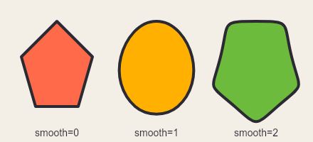

Os três têm os mesmos cinco pontos lisos. O número não tem unidade: é **quanto** arredondar, e vale para a forma inteira.

- `smooth=0`: as voltas viram cantos, e sobra um pentágono.
- `smooth=1` (o padrão): o arredondado normal.
- `smooth=2`: as voltas estufam o dobro, e a forma fica cheia, quase redonda.
- Pontos com `!` continuam sendo cantos, qualquer que seja o `smooth=`.

**Experimente:** no do meio, troque `smooth=1` por `smooth=0.5`. Fica no meio do caminho entre o pentágono e o arredondado.

### Alça da curva: `x,y~dx,dy`

Às vezes a curva automática não faz a volta que você quer. Uma **alça** diz para onde a curva aponta ao passar pelo ponto, como nos programas de desenho vetorial:

- `x,y~dx,dy`: a curva passa em `x,y` indo na direção `dx,dy` (relativa ao ponto);
- a alça vale para os dois lados: a curva chega pelo lado oposto (`-dx,-dy`) e sai pelo lado de `dx,dy`;
- quanto **maior** a alça, mais tempo a curva segue aquela direção (mais "achatada" fica a volta).

<!-- gerar: img/02_alca.png --guides -->
```weasel
canvas 440 200 bg=#f4efe6
palette ink=#2b2a33
stroke auto w=6 : 30,170 120,50 210,170
stroke alca w=6 : 230,170 320,50~80,0 410,170

layer alca guide
line braco c=#c44536 w=2 : 240,50 400,50
ellipse p1 240,50 5 c=#c44536
ellipse p2 400,50 5 c=#c44536
ellipse meio 320,50 4 c=#2b2a33
text t1 120,194 "automático" size=14 align=center c=#8a8478
text t2 320,194 "320,50~80,0" size=14 align=center c=#c44536
```

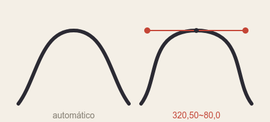

À direita, `320,50~80,0` faz a curva passar pelo topo indo reto para a direita (a alça vermelha vai de 80 para trás até 80 para a frente), e o morro fica com o alto largo. Use alças só onde a curva automática não bastar. Um ponto com alça não pode ter `!` ao mesmo tempo.

O **tamanho** da alça muda o formato da volta. Os três morros abaixo têm a mesma alça deitada no topo, cada vez mais comprida:

<!-- gerar: img/02_alca_tamanho.png --guides -->
```weasel
canvas 500 190 bg=#f4efe6
palette ink=#2b2a33
stroke a w=5 : 20,160 80,50~20,0 140,160
stroke b w=5 : 170,160 240,50~50,0 310,160
stroke c w=5 : 330,160 400,50~90,0 470,160

layer alcas guide
line la c=#c44536 w=2 : 60,50 100,50
line lb c=#c44536 w=2 : 190,50 290,50
line lc c=#c44536 w=2 : 310,50 490,50
text ta 80,184 "~20,0" size=14 align=center c=#c44536
text tb 240,184 "~50,0" size=14 align=center c=#c44536
text tc 400,184 "~90,0" size=14 align=center c=#c44536
```

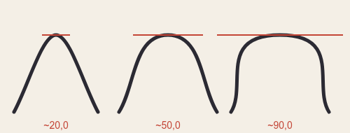

Repare:

- Os números da alça são em pixels: `~20,0` vai 20 pixels para a direita (e, do outro lado, 20 para a esquerda). As linhas vermelhas mostram a alça inteira.
- `~20,0`: alça curta. A curva logo esquece a direção, e o topo fica quase pontudo.
- `~50,0`: o topo fica redondo e largo.
- `~90,0`: a curva corre deitada por muito tempo e depois cai de uma vez. O morro parece um "n".

**Experimente:** troque `~50,0` por `~50,30`. A alça fica inclinada (30 pixels para baixo), e a curva passa pelo topo já descendo para a direita: o morro fica torto.

> **Dica do editor:** a alça também se puxa com o mouse.
>
> - Segure **Alt** e arraste um ponto: uma alça sai dele e segue o mouse, e o `~dx,dy` é escrito no código. Num ponto com `!`, o `!` sai, porque um ponto não pode ser canto e ter alça ao mesmo tempo.
> - Uma alça que já existe aparece como um **losango azul** na ponta de uma linha. Arraste o losango para mudar a direção e o tamanho.
> - Para tirar a alça, solte o losango em cima do próprio ponto, ou dê **duplo clique** no ponto. A curva volta a ser automática.

## Traço aberto: `stroke`

`stroke` liga os pontos com as mesmas curvas lisas do `shape`, mas **não fecha a volta** nem tem lado de dentro: é uma pincelada. Serve para fios, bigodes, cabelos, sobrancelhas, rachaduras e pernas finas.

```
stroke nome w=espessura c=cor taper=início,fim cap=round|butt|square : pontos
```

<!-- gerar: img/02_tracos.png -->
```weasel
canvas 440 260 bg=#f4efe6
palette ink=#2b2a33
stroke comum w=12 : 40,40 160,60 280,30 400,50
stroke reto w=12 cap=butt : 40,100 160,120 280,90 400,110
stroke pincel w=16 taper=0,1 : 40,160 160,180 280,150 400,170
stroke folha w=16 taper=0.5,0.5 : 40,220 160,240 280,210 400,230
```

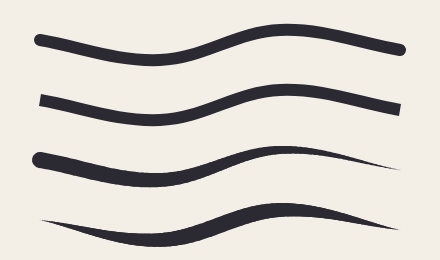

De cima para baixo:

1. **Ponta redonda**, o padrão (`cap=round`).
2. **Ponta reta** (`cap=butt`). Com `cap=square`, a ponta é reta e passa um pouco do último ponto.
3. **`taper=0,1`** afina o traço ao longo de 100% do comprimento até o fim, como uma pincelada.
4. **`taper=0.5,0.5`** afina na primeira metade e na última, grosso no meio.

O `taper` vai de 0 a 1 e conta a fração do comprimento que afina: o primeiro número é o começo do traço e o segundo, o fim. O traço tem cor `c=` (padrão: a cor de tinta) e espessura `w=` em pixels (padrão 4). Ele precisa de pelo menos 2 pontos, e `!` faz canto vivo também aqui.

As próximas três partes olham cada coisa de perto, uma de cada vez: as pontas, o afinamento e os cantos.

### Pontas: `cap=`

`cap=` escolhe o formato das duas pontas do traço. Ele só aparece de verdade em traços grossos, por isso o exemplo usa `w=24`:

<!-- gerar: img/02_pontas.png --guides -->
```weasel
canvas 440 210 bg=#f4efe6
palette ink=#2b2a33
stroke redonda w=24 : 100,40 300,40
stroke reta w=24 cap=butt : 100,100 300,100
stroke quadrada w=24 cap=square : 100,160 300,160
text t1 330,46 "cap=round" size=14
text t2 330,106 "cap=butt" size=14
text t3 330,166 "cap=square" size=14

layer marcas guide
line e1 c=#4a90d9 dash=4,4 : 100,10 100,190
line e2 c=#4a90d9 dash=4,4 : 300,10 300,190
ellipse p1 100,40 4 c=#c44536
ellipse p2 300,40 4 c=#c44536
ellipse p3 100,100 4 c=#c44536
ellipse p4 300,100 4 c=#c44536
ellipse p5 100,160 4 c=#c44536
ellipse p6 300,160 4 c=#c44536
```

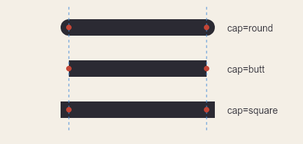

Repare:

- Os pontinhos vermelhos são o primeiro e o último ponto de cada traço. As linhas azuis tracejadas passam por eles.
- `cap=round` (o padrão): a ponta é redonda e passa do ponto metade da espessura (aqui, 12 pixels, metade de `w=24`).
- `cap=butt`: a ponta é reta e termina **exatamente** no ponto.
- `cap=square`: a ponta é reta, mas passa do ponto metade da espessura, como a redonda.

**Experimente:** troque `w=24` por `w=4` nos três. A diferença quase some: `cap=` importa nos traços grossos.

### Afinar as pontas: `taper=`

`taper=início,fim` afina o traço nas pontas, como uma pincelada. Cada número vai de 0 a 1 e diz **quanto do comprimento** afina: `0` é nada, `0.3` é 30% do traço, `1` é o traço inteiro.

<!-- gerar: img/02_taper.png -->
```weasel
canvas 440 250 bg=#f4efe6
palette ink=#2b2a33
stroke t00 w=14 : 30,40 140,30 260,50 330,40
stroke t10 w=14 taper=1,0 : 30,95 140,85 260,105 330,95
stroke t03 w=14 taper=0,0.3 : 30,150 140,140 260,160 330,150
stroke t11 w=14 taper=1,1 : 30,205 140,195 260,215 330,205
text l00 350,46 "sem taper=" size=14
text l10 350,101 "taper=1,0" size=14
text l03 350,156 "taper=0,0.3" size=14
text l11 350,211 "taper=1,1" size=14
```

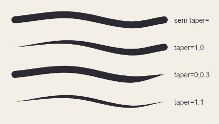

Repare:

- `taper=1,0`: o começo afina ao longo do traço inteiro. O traço nasce fino e só chega à espessura toda no fim.
- `taper=0,0.3`: só os últimos 30% afinam. Parece um rabo.
- `taper=1,1`: afina dos dois lados ao longo do traço inteiro. O meio fica com só metade da espessura, e as pontas, finíssimas.
- Com `taper=`, a ponta que não afina sai sempre redonda: o `cap=` não vale.

**Experimente:** troque `taper=1,1` por `taper=0.5,0.5` (como no quarto traço do exemplo anterior): o meio volta a ter a espessura toda.

### Cantos e curvas no traço

O traço usa os mesmos tipos de ponto do `shape` (liso, `!` e alça) e também aceita `smooth=`. Os três traços abaixo têm o mesmo zigue-zague de quatro pontos:

<!-- gerar: img/02_traco_cantos.png -->
```weasel
canvas 500 170 bg=#f4efe6
palette ink=#2b2a33
stroke liso w=6 : 20,130 65,40 110,130 155,40
stroke cantos w=6 : 180,130 225,40! 270,130! 315,40
stroke menos w=6 smooth=0.5 : 340,130 385,40 430,130 475,40
text t1 88,160 "lisos" size=14 align=center
text t2 248,160 "com !" size=14 align=center
text t3 408,160 "smooth=0.5" size=14 align=center
```

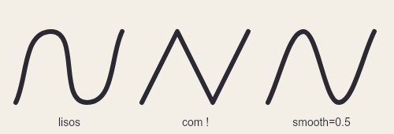

Repare:

- **lisos:** o traço faz ondas redondas.
- **com `!`** nos dois pontos do meio: vira um zigue-zague de linhas retas. O primeiro e o último ponto não precisam de `!`: a ponta de um traço já é uma ponta.
- **`smooth=0.5`:** as ondas ficam mais apertadas que no liso (o padrão é `smooth=1`).

**Experimente:** use `smooth=0` no terceiro traço. Ele fica igual ao do meio, todo em retas.

> **Dica do editor:** no traço, os pontos se editam como no `shape`. Arraste o **✥** do meio (ou **Shift** + um ponto) para mover o traço inteiro. Use **Alt** + um ponto para puxar uma alça, e **duplo clique** para pôr ou tirar o `!`.

## Linha reta: `line`

`line` liga os pontos com **retas**, sem curva. É boa para guias, chão, réguas e desenhos técnicos. `dash=traço,vão` faz tracejado.

<!-- gerar: img/02_linhas.png -->
```weasel
canvas 440 160 bg=#f4efe6
palette ink=#2b2a33
line chao w=3 : 20,130 420,130
line serra w=3 c=#4a90d9 : 20,90 80,40 140,90 200,40 260,90
line tracejada w=2 dash=10,6 c=#c44536 : 290,40 420,40 420,110
```

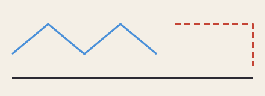

A espessura padrão da `line` é 1 (pixel); a cor padrão é a de tinta. A `line` também é o "chão" das pernas com IK ([capítulo 6](06-ossos.md#pernas-e-braços-com-ik)) e da sombra projetada ([capítulo 8](08-luz-efeitos.md#sombra-projetada-no-chão)).

Diferente do `stroke`, a `line` não faz curvas (com ou sem `!`, as voltas são cantos) e as pontas são sempre retas, cortadas no ponto.

### Tracejado: `dash=`

`dash=` corta a linha em pedaços. Serve para guias, caminhos pontilhados, costuras e marcas de recorte. Os números são comprimentos em pixels, alternando **traço** e **vão**:

<!-- gerar: img/02_tracejado.png -->
```weasel
canvas 440 230 bg=#f4efe6
palette ink=#2b2a33
line l1 w=3 : 20,30 300,30
line l2 w=3 dash=10 : 20,75 300,75
line l3 w=3 dash=20,6 : 20,120 300,120
line l4 w=3 dash=2,6 : 20,165 300,165
line l5 w=3 dash=16,5,3,5 : 20,210 300,210
text t1 320,36 "sem dash=" size=14
text t2 320,81 "dash=10" size=14
text t3 320,126 "dash=20,6" size=14
text t4 320,171 "dash=2,6" size=14
text t5 320,216 "dash=16,5,3,5" size=14
```

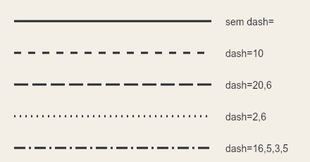

Repare:

- `dash=10`: um número só vale para os dois: traço de 10, vão de 10.
- `dash=20,6`: traço comprido (20) e vão curto (6).
- `dash=2,6`: traços tão curtos que parecem pontos.
- `dash=16,5,3,5`: com quatro números, o desenho é traço de 16, vão de 5, traço de 3, vão de 5, e repete. É o "traço e ponto". Cabem até 8 números.
- `dash=` só existe na `line`. O `stroke` não tem tracejado.

**Experimente:** troque `w=3` por `w=8` na linha pontilhada. Os pontos viram quadradinhos, porque a ponta da `line` é reta.

## Texto

```
text nome x,y "o texto" size=tamanho font=fonte align=left|center|right rot=graus bold italic
```

<!-- gerar: img/02_texto.png --guides -->
```weasel
canvas 440 220 bg=#f4efe6
palette ink=#2b2a33
text esq 220,50 "align=left" size=24
text meio 220,110 "align=center" size=24 align=center bold
text dir 220,170 "align=right" size=24 align=right italic c=#c44536
text titulo 330,200 "Olá!" size=34 bold c=#ffd34d ink=3 rot=-8

layer ancora guide
line eixo c=#4a90d9 dash=4,4 : 220,10 220,190
ellipse a1 220,50 4 c=#4a90d9
ellipse a2 220,110 4 c=#4a90d9
ellipse a3 220,170 4 c=#4a90d9
```

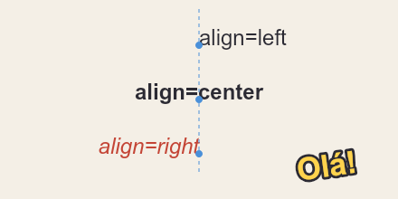

- `x,y` é o **ponto de apoio** (os pontos azuis): as letras "sentam" na altura `y` (a linha de base), e `align=` diz se o texto começa (`left`, o padrão), fica centrado (`center`) ou termina (`right`) no `x`.
- `size=` é a altura da letra em pixels (padrão 24). `font=` escolhe a fonte pelo nome (padrão `sans-serif`; aceita `serif`, `monospace` ou o nome de uma fonte instalada, entre aspas se tiver espaço: `font="Comic Sans MS"`).
- `c=` é a cor das letras e `ink=` faz um contorno em volta delas (com a cor `inkc=`).
- Texto usa as fontes do computador: o mesmo arquivo pode sair um pouco diferente em outra máquina.

### Fonte e tamanho: `font=` e `size=`

`font=` escolhe o **desenho das letras** pelo nome da fonte, e `size=` o **tamanho**, em pixels.

<!-- gerar: img/02_fontes.png -->
```weasel
canvas 460 230 bg=#f4efe6
palette ink=#2b2a33
text f1 20,45 "sans-serif (o padrão)" size=26
text f2 20,90 "Georgia" size=26 font=Georgia
text f3 20,135 "Courier New" size=26 font="Courier New"
text s1 20,205 "size=12" size=12
text s2 110,205 "size=24" size=24
text s3 250,205 "size=40" size=40
```

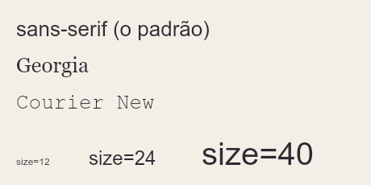

Repare:

- Na primeira linha não há `font=`, então a fonte é `sans-serif`: a fonte simples, sem enfeites, do sistema.
- `font=Georgia` usa a fonte Georgia, com serifa (os "pezinhos" nas letras). Um nome com espaço vai entre aspas: `font="Courier New"`.
- O nome precisa ser de uma fonte **instalada** no computador. Se ela não existir, o texto sai na fonte padrão, sem aviso.
- `size=12`, `24` e `40`: quanto maior o número, maiores as letras. O padrão é 24.
- Existem também os nomes genéricos `serif` (alguma fonte com serifa) e `monospace` (todas as letras com a mesma largura). No editor eles funcionam; na linha de comando, podem sair iguais à `sans-serif`, como aconteceu no computador que gerou estas imagens. Por isso o exemplo usa nomes de fontes.

**Experimente:** troque `Georgia` por `"Comic Sans MS"` ou `Impact`, que vêm no Windows.

### Contorno e giro do texto

O texto também tem contorno (`ink=` e `inkc=`), que ajuda a ler sobre um fundo colorido e deixa títulos com cara de desenho animado. E `rot=` gira o texto.

<!-- gerar: img/02_texto_contorno.png --guides -->
```weasel
canvas 460 200 bg=#f4efe6
palette ink=#2b2a33
text a 20,70 "Oi" size=56 bold c=#ffd34d
text b 130,70 "Oi" size=56 bold c=#ffd34d ink=3
text c 240,70 "Oi" size=56 bold c=#ffd34d ink=3 inkc=#c44536
text d 350,70 "Oi" size=56 bold c=none ink=2
text la 50,100 "só c=" size=13 align=center
text lb 160,100 "ink=3" size=13 align=center
text lc 270,100 "inkc=#c44536" size=13 align=center
text ld 380,100 "c=none ink=2" size=13 align=center
text giro 120,180 "rot=-15" size=28 bold rot=-15 c=#4a90d9
text giro2 300,150 "rot=20" size=28 bold rot=20 c=#c44536

layer apoio guide
ellipse p1 120,180 4 c=#2b2a33
ellipse p2 300,150 4 c=#2b2a33
```

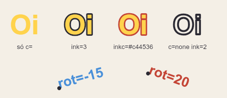

Repare:

- `ink=3` desenha um contorno de 3 pixels **em volta** das letras. Diferente das formas, o contorno do texto fica todo do lado de fora: as letras não afinam.
- `inkc=` troca a cor do contorno (o padrão é a cor de tinta).
- `c=none ink=2`: sem preenchimento, sobra só o contorno, e as letras ficam vazadas.
- `rot=` gira o texto em volta do **ponto de apoio** (os pontinhos escuros), em graus. Negativo gira para cima; positivo, para baixo.

**Experimente:** no primeiro "Oi", acrescente `ink=8 inkc=#ffffff`: um contorno branco e grosso, como nos adesivos.

## Contorno: `ink`, `inkc` e `weight`

Formas fechadas (`shape`, `ellipse`, `rect`) têm dois "pincéis": o **preenchimento** (`c=`) e o **contorno** (`ink=`, a espessura, e `inkc=`, a cor).

| Você escreve | Resultado |
|---|---|
| nem `c=` nem `ink=` | preenchida com a cor de tinta (quase preto), sem contorno |
| só `c=` | preenchida com a cor, **sem contorno** |
| só `ink=` | **só o contorno**, vazada por dentro |
| `c=` e `ink=` | preenchida e com contorno |

<!-- gerar: img/02_contorno.png -->
```weasel
canvas 440 150 bg=#f4efe6
palette ink=#2b2a33
ellipse nada 60,70 40
ellipse soC 160,70 40 c=#ffb000
ellipse soInk 260,70 40 ink=5
ellipse ambos 360,70 40 c=#ffb000 ink=5
text t1 60,140 "nada" size=14 align=center
text t2 160,140 "c=" size=14 align=center
text t3 260,140 "ink=" size=14 align=center
text t4 360,140 "c= e ink=" size=14 align=center
```

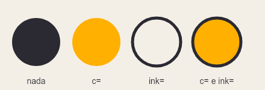

O contorno é desenhado **centrado na borda**: metade dele fica para fora e metade para dentro da forma. Dá para ver isso com um contorno bem grosso e meio transparente:

<!-- gerar: img/02_contorno_meio.png --guides -->
```weasel
canvas 440 190 bg=#f4efe6
palette ink=#2b2a33
ellipse fino 110,90 60 c=#ffb000 ink=4 inkc=#4a90d9
ellipse grosso 320,90 60 c=#ffb000 ink=24 inkc=#4a90d980
text t1 110,180 "ink=4" size=14 align=center
text t2 320,180 "ink=24" size=14 align=center

layer borda guide
ellipse b1 110,90 60 c=none ink=1.5 inkc=#c44536
ellipse b2 320,90 60 c=none ink=1.5 inkc=#c44536
```

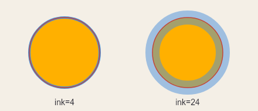

Repare:

- A linha vermelha fina é a borda de verdade dos dois círculos (raio 60). Ela está numa camada `guide`, só para mostrar.
- Com `ink=4`, quase não se nota: são 2 pixels para fora e 2 para dentro.
- Com `ink=24`, a borda vermelha passa **no meio** do contorno: 12 pixels para fora, 12 para dentro. O azul do contorno tem `80` no fim da cor (meio transparente; veja o [capítulo 3](03-cores.md#escrevendo-uma-cor)), por isso a metade de dentro aparece misturada com o laranja.
- Por isso um contorno grosso deixa a forma maior por fora e esconde um pouco do preenchimento por dentro.

**Experimente:** tire o `80` do fim da cor (`inkc=#4a90d9`). O contorno fica sólido e cobre a borda do laranja.

### Contorno só por fora

Para o contorno não esconder nada do preenchimento, mande-o para uma camada que é pintada **antes** da forma, com `inkon=camada`. O preenchimento vem depois e cobre a metade de dentro do contorno; sobra só a de fora.

<!-- gerar: img/02_contorno_fora.png --guides -->
```weasel
canvas 440 190 bg=#f4efe6
palette ink=#2b2a33

layer atras

layer bolas
ellipse normal 110,90 60 c=#ffb000 ink=24 inkc=#4a90d9
ellipse soFora 320,90 60 c=#ffb000 ink=24 inkc=#4a90d9 inkon=atras
text t1 110,180 "normal" size=14 align=center
text t2 320,180 "inkon=atras" size=14 align=center

layer borda guide
ellipse b1 110,90 60 c=none ink=1.5 inkc=#c44536
ellipse b2 320,90 60 c=none ink=1.5 inkc=#c44536
```

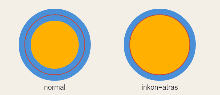

Repare:

- `inkon=atras` manda o contorno de `soFora` para a camada `atras`. Ela vem antes de `bolas` no arquivo, então é pintada primeiro, e o laranja cobre a metade de dentro do contorno. A camada `atras` está vazia no código: ela só recebe esse contorno.
- À direita, o laranja vai inteiro até a borda vermelha. À esquerda, o azul cobre 12 pixels da borda do laranja.
- Só a metade de fora aparece: com `ink=24`, o contorno de fora tem 12 pixels. Para ter um contorno de 12 pixels só por fora, escreva o dobro, `ink=24`.
- A camada que recebe o contorno precisa vir **antes** da camada da forma. Se vier depois, o contorno é pintado por cima, inteiro (é o que o [capítulo 4](04-camadas.md#o-contorno-por-cima-inkon) faz para ele não ser coberto por sombras).
- No `text` não precisa disso: com preenchimento, o contorno das letras já fica só por fora.

**Experimente:** no `soFora`, mude `ink=24` para `ink=12`. O contorno de fora fica com 6 pixels.

### Contorno que engrossa no lado da sombra: `weight=`

No desenho à mão, o contorno costuma ser mais grosso do lado oposto à luz. `weight=` faz isso, de 0 (contorno igual em volta toda) até 3. O lado da luz vem do `light=` do `canvas`: um par `x,y` que **aponta para onde a luz está**. O padrão `light=-0.6,-0.8` é uma luz em cima, à esquerda.

<!-- gerar: img/02_weight.png -->
```weasel
canvas 440 170 bg=#f4efe6 light=-0.6,-0.8
palette ink=#2b2a33
ellipse w0 80,80 50 c=#ffb000 ink=6
ellipse w1 220,80 50 c=#ffb000 ink=6 weight=0.3
ellipse w2 360,80 50 c=#ffb000 ink=6 weight=0.7
text t0 80,160 "weight=0" size=14 align=center
text t1 220,160 "weight=0.3" size=14 align=center
text t2 360,160 "weight=0.7" size=14 align=center
```

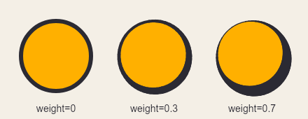

O `light=` do `canvas` só afeta essa espessura do contorno. Luz de verdade, que muda as cores, é a do [capítulo 8](08-luz-efeitos.md).

Mudando a luz de lugar, o lado grosso muda junto. Em `light=x,y`, o primeiro número aponta para a direita (positivo) ou para a esquerda (negativo), e o segundo para baixo (positivo) ou para cima (negativo). Aqui, `light=1,0` põe a luz bem à direita:

<!-- gerar: img/02_weight_luz.png -->
```weasel
canvas 440 180 bg=#f4efe6 light=1,0
palette ink=#2b2a33
ellipse bola 80,80 50 c=#ffb000 ink=6 weight=0.8
rect caixa 170,35 100,90 r=10 c=#4a90d9 ink=6 weight=0.8
shape gota c=#6cbb3c ink=6 weight=0.8 : 360,25! 410,100 360,135 310,100
text luz 220,166 "light=1,0: a luz vem da direita →" size=14 align=center c=#c44536
```

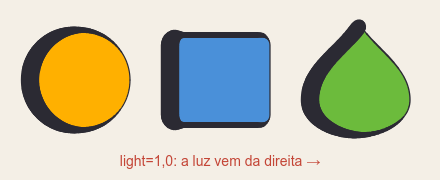

Repare:

- Agora o lado grosso é o da **esquerda**, longe da luz. Do lado direito, virado para a luz, o contorno quase some.
- `weight=` funciona igual em `ellipse`, `rect` e `shape`.
- O `light=` é um só para o desenho inteiro.

**Experimente:** troque para `light=0,1` (a luz embaixo). O lado grosso passa para cima.

> **Dica do editor:** o `light=` não tem um ponto para arrastar, porque não é um lugar no desenho: é uma direção. No lugar do ponto, ele tem uma **seta**. Ponha o cursor na linha do `canvas`: uma seta amarela sai do centro do quadro e aponta para a luz, com um sol na ponta. Arraste o sol em volta e veja o lado grosso dos contornos girar junto; o `light=` muda no código a cada movimento. Segure **Shift** para girar de 15 em 15 graus (fica fácil acertar `0,-1`, a luz bem em cima). Se a linha do `canvas` ainda não tem `light=`, a seta mostra o padrão (`-0.6,-0.8`), e arrastar escreve o `light=` para você. A barra de baixo do editor diz, em palavras, de que lado a luz vem.

Há ainda `inkon=camada`, que pinta o contorno de uma forma numa **outra camada**, por cima de tudo. Ele resolve um problema que só aparece com camadas e recortes; o exemplo está no [capítulo 4](04-camadas.md#o-contorno-por-cima-inkon).

## Desenhar por cima de uma imagem: `ref`

Para copiar um rascunho, uma foto ou um personagem que já existe, ponha a imagem **por baixo**, como guia, e desenhe as formas por cima dela, como num papel vegetal:

<!-- gerar: img/02_ref.png -s 0.5 --refs -->
```weasel
canvas 512 512 bg=#ffffff
palette ink=#1c1f2b line=10 pelo=#b8733a
ref modelo "../docs/logo.png" 0,0 opacity=0.35 lock

layer cabeca
shape cara c=pelo ink=line : 256,112 314,122 356,160 368,218 354,280 320,340 286,388 256,404 226,388 192,340 158,280 144,218 156,160 198,122
ellipse olhoE 212,222 18,23 rot=-12 c=ink
ellipse olhoD 300,222 18,23 rot=12 c=ink
```

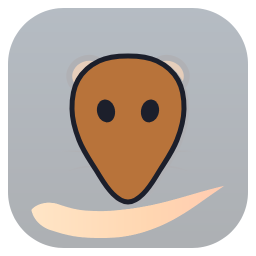

A doninha clarinha é a **imagem guia**; a cabeça e os olhos por cima são as formas, que copiam o contorno dela. A imagem guia **nunca sai na exportação**: PNG, GIF, SVG, sprite sheet e Godot só têm as formas. Ela aparece no editor e na linha de comando com `--refs` (a imagem acima foi feita assim).

```
ref nome "imagem.png" x,y scale= rot= opacity= [lock] [hidden] [front]
```

| Parte | O que faz |
|---|---|
| `"imagem.png"` | A imagem: PNG, JPG, GIF, WebP ou SVG. Na linha de comando, o caminho é relativo ao arquivo `.weasel` (o exemplo usa o logo do projeto, visto da pasta `exemplos/`). |
| `x,y` | Onde fica o canto de cima à esquerda da imagem (padrão `0,0`). |
| `scale=` | Tamanho: `0.5` é metade (padrão `1`, um pixel da imagem por unidade do desenho). |
| `rot=` | Giro em graus, em volta do centro da imagem (padrão `0`). |
| `opacity=` | De 0 a 1 (padrão `0.5`): clarinha o bastante para ver as suas formas por cima. |
| `lock` | Travada: no editor, não sai do lugar quando você arrasta por cima dela. |
| `hidden` | Escondida, sem tirar a linha do arquivo. |
| `front` | Por cima das formas, em vez de por baixo (para conferir o traço). |

**No editor**, o botão **Imagens**, acima do desenho, abre o painel das imagens guia:

- **Adicionar imagem…** escolhe um arquivo do computador e escreve a linha `ref`, com a imagem cabendo no desenho. A imagem fica guardada **neste navegador** (como os sons dos filmes); o código só tem o nome dela.
- Em cada imagem guia: a caixa liga e desliga (`hidden`), o controle muda a opacidade (`opacity=`) e o cadeado trava (`lock`). Clicar no nome leva à linha dela no código. **mostrar** esconde todas de uma vez, sem mexer no código.
- No desenho, uma imagem **solta** (sem `lock`) tem uma moldura tracejada: arraste por dentro para mover e pelo quadradinho do canto para mudar o tamanho. O Weasel reescreve o `x,y` e o `scale=` (Ctrl+Z desfaz). Uma imagem travada não se mexe: arrastar por cima dela move a vista.
- Se o código tem um `ref` com uma imagem que este navegador ainda não guardou, o painel mostra **abrir …** ao lado dele.

Quando terminar de copiar, apague a linha `ref` ou deixe `hidden`. Para usar uma imagem diferente em cada animação, veja o [capítulo 7](07-animacao.md#uma-imagem-guia-para-cada-movimento).

### Por baixo ou por cima: `front`

Enquanto você copia, a imagem guia fica **por baixo** das formas. Na hora de conferir se o traço bateu com o original, `front` põe a imagem **por cima**:

<!-- gerar: img/02_ref_front.png --refs -->
```weasel
canvas 440 220 bg=#ffffff
palette ink=#2b2a33
ref atras "../docs/logo.png" 20,20 scale=0.35 opacity=0.6
ref nafrente "../docs/logo.png" 240,20 scale=0.35 opacity=0.6 front
rect quadro1 40,50 140,120 c=#ffb000
rect quadro2 260,50 140,120 c=#ffb000
text t1 110,212 "padrão (por baixo)" size=14 align=center
text t2 330,212 "front (por cima)" size=14 align=center
```

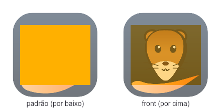

Repare:

- As duas linhas `ref` usam o mesmo logo, com `scale=0.35` (35% do tamanho: o logo tem 512 pixels de lado, então fica com uns 180) e `opacity=0.6` (60% visível).
- À esquerda, sem `front`, o retângulo laranja tapa a imagem guia. Só a borda dela aparece.
- À direita, com `front`, a imagem guia fica por cima do retângulo, e a doninha aparece.
- Como sempre, nada disso sai na exportação: esta imagem foi feita com `--refs`.

**Experimente:** acrescente `rot=20` à segunda linha `ref`. A imagem gira 20 graus em volta do próprio centro.

## Opções que toda forma aceita

| Atributo | O que faz |
|---|---|
| `opacity=0.5` | Transparência, de 0 (invisível) a 1 (sólida). |
| `hidden` | A forma **não aparece**, mas continua existindo: serve de molde para recortes (`clip`, `cut`) e para morph. Veja os capítulos [4](04-camadas.md) e [7](07-animacao.md#morph-uma-forma-vira-outra). |
| `bone=osso` | A forma segue um osso ([capítulo 6](06-ossos.md)). |
| `cloth=tecido` | A forma balança como pano ([capítulo 6](06-ossos.md#tecido-cloth)). |
| `cut=forma` | Abre um buraco com o formato de outra forma ([capítulo 4](04-camadas.md#buraco-numa-forma-cut-na-forma)). |
| `mirror=forma@x` | Copia outra forma espelhada ([capítulo 5](05-componentes.md#espelho-mirror)). |
| `emit=cor` | A forma brilha ([capítulo 8](08-luz-efeitos.md#coisas-que-brilham-emit)). |
| `bones=a,b,…` | A forma dobra, seguindo vários ossos ([capítulo 6](06-ossos.md#formas-que-dobram-bones)). |
| `z=` `yaw=` `pitch=` | Profundidade e giro em 3D ([capítulo 11](11-profundidade.md)). |

Cada linha da tabela tem um exemplo no capítulo indicado. As duas primeiras, que valem para qualquer desenho, estão logo abaixo.

### Transparência: `opacity=`

`opacity=` deixa a forma inteira transparente: o preenchimento e o contorno juntos. O número vai de `0` (invisível) a `1` (sólida, o padrão); `0.6` quer dizer 60% visível.

<!-- gerar: img/02_opacidade.png -->
```weasel
canvas 440 170 bg=#f4efe6
palette ink=#2b2a33
rect faixa 20,62 400,36 c=ink
ellipse o1 80,80 46 c=#4a90d9 ink=4
ellipse o2 220,80 46 c=#4a90d9 ink=4 opacity=0.6
ellipse o3 360,80 46 c=#4a90d9 ink=4 opacity=0.25
text t1 80,158 "sem opacity=" size=14 align=center
text t2 220,158 "opacity=0.6" size=14 align=center
text t3 360,158 "opacity=0.25" size=14 align=center
```

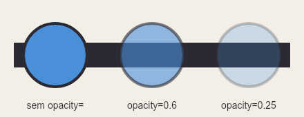

Repare:

- A faixa escura passa **atrás** dos três círculos. Quanto menor o número, mais dela aparece através do círculo.
- O contorno também fica transparente, junto com o azul.
- Para deixar transparente só o preenchimento, use uma cor com transparência, como `c=#4a90d980` ([capítulo 3](03-cores.md#escrevendo-uma-cor)).

**Experimente:** use `opacity=0`. O círculo some, mas continua existindo (no [capítulo 7](07-animacao.md) dá para animar a opacidade e fazê-lo aparecer aos poucos).

### Escondida, mas existe: `hidden`

`hidden` é uma **opção** (uma palavra solta, sem `=`) que esconde a forma: ela não é pintada, mas continua no desenho. Serve para formas que são só um **molde**: o formato de um buraco, de um recorte ou de um morph.

<!-- gerar: img/02_escondida.png -->
```weasel
canvas 440 200 bg=#f4efe6
palette ink=#2b2a33
rect faixa 20,82 400,36 c=#c44536

ellipse rosca1 110,100 70 c=#e0a050 ink=5 cut=furo1
ellipse furo1 110,100 26 c=#4a90d9

ellipse rosca2 330,100 70 c=#e0a050 ink=5 cut=furo2
ellipse furo2 330,100 26 hidden

text t1 110,192 "furo1 sem hidden" size=14 align=center
text t2 330,192 "furo2 com hidden" size=14 align=center
```

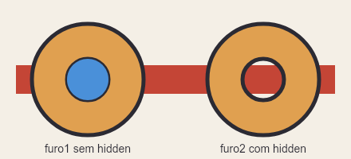

Repare:

- As duas roscas usam `cut=` para abrir um buraco com o formato de outra forma: `cut=furo1` e `cut=furo2`. O buraco é de verdade: a faixa vermelha, que está atrás, aparece por ele.
- À esquerda, `furo1` não tem `hidden`. Ele é pintado como qualquer forma e tampa o buraco com um círculo azul.
- À direita, `furo2` tem `hidden`. Ele não aparece; só empresta o formato. O buraco fica vazio.

**Experimente:** apague o `c=#4a90d9` de `furo1` e escreva `hidden` no lugar. As duas roscas ficam iguais.

[← Primeiros passos](01-primeiros-passos.md) · [Índice](README.md) · [Próximo: Cores e estilos →](03-cores.md)
