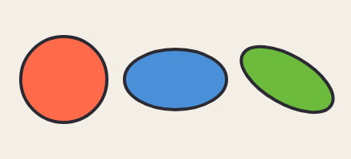
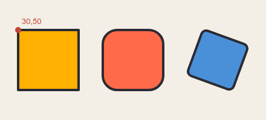
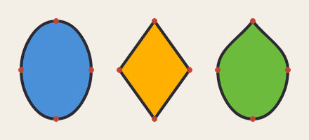
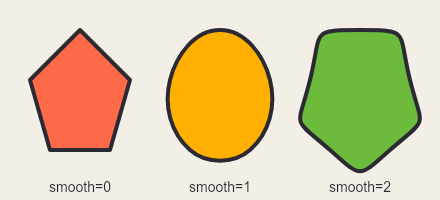
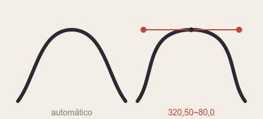
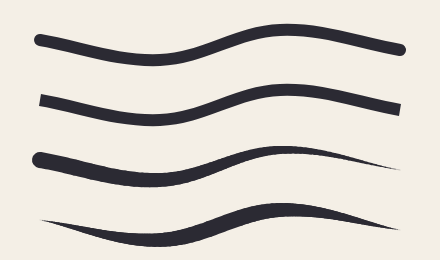
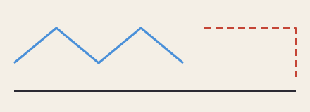
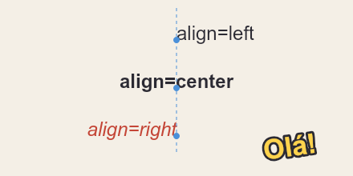
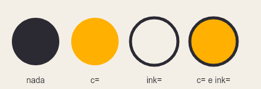
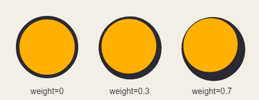

# 2. Formas

[← Primeiros passos](01-primeiros-passos.md) · [Índice](README.md) · [Próximo: Cores e estilos →](03-cores.md)

O Weasel tem sete tipos de forma:

| Comando | Desenha | Fechada? |
|---|---|---|
| `ellipse` | elipse ou círculo | sim |
| `rect` | retângulo, com ou sem cantos arredondados | sim |
| `shape` | qualquer forma, ligando pontos com curvas | sim |
| `stroke` | traço aberto (como uma pincelada), com curvas | não |
| `line` | linha reta entre pontos | não |
| `text` | texto | — |
| `emitter` | partículas (fagulhas, chuva) — veja o [capítulo 8](08-luz-efeitos.md#partículas) | — |

**Fechada** quer dizer que tem lado de dentro: pode ser preenchida (`c=`), ter contorno (`ink=`) e servir de molde para recortes. Traço e linha só têm a cor da própria linha.

> Nos exemplos deste capítulo, os pontinhos vermelhos e as anotações ficam numa camada `guide`. Uma camada `guide` aparece no editor (com o botão **Guias** ligado) e não sai na exportação; ela está aí só para mostrar onde ficam os pontos. As camadas são explicadas no [capítulo 4](04-camadas.md).

## Elipse e círculo

```
ellipse nome cx,cy raio
ellipse nome cx,cy raioX,raioY rot=graus
```

<!-- gerar: img/02_elipses.png -->
```weasel
canvas 440 200 bg=#f4efe6
palette ink=#2b2a33
ellipse circulo 80,100 54 c=#ff6b4a ink=4
ellipse oval 220,100 64,38 c=#4a90d9 ink=4
ellipse girada 360,100 64,30 rot=30 c=#6cbb3c ink=4
```



- `cx,cy` é o **centro**.
- Um raio só (`54`) dá um círculo. Dois raios (`64,38`) dão uma elipse: o primeiro é o raio na horizontal, o segundo na vertical.
- `rot=30` gira 30° em volta do centro, no sentido horário.

## Retângulo

```
rect nome x,y largura,altura r=raio_do_canto rot=graus
```

<!-- gerar: img/02_retangulos.png --guides -->
```weasel
canvas 440 200 bg=#f4efe6
palette ink=#2b2a33
rect quadrado 30,50 100,100 c=#ffb000 ink=4
rect arredondado 170,50 100,100 r=24 c=#ff6b4a ink=4
rect girado 320,60 80,80 r=8 rot=20 c=#4a90d9 ink=4

layer anotacao guide
ellipse canto 30,50 5 c=#c44536
text tc 36,40 "30,50" size=13 c=#c44536
```



- `x,y` é o **canto de cima, à esquerda** (o ponto vermelho), e não o centro.
- `largura,altura` é o tamanho.
- `r=` arredonda os cantos.
- `rot=` gira em volta do centro do retângulo.

## Formas livres com pontos: `shape`

`shape` liga uma lista de pontos e fecha a volta (o último ponto se liga ao primeiro). O mais importante do Weasel está aqui:

- um ponto comum (`x,y`) é **liso**: a curva passa por ele fazendo uma volta suave;
- um ponto com `!` no fim (`x,y!`) é um **canto vivo**: a linha muda de direção de uma vez.

Os três desenhos abaixo usam os **mesmos quatro pontos** (só deslocados para o lado):

<!-- gerar: img/02_pontos.png --guides -->
```weasel
canvas 440 200 bg=#f4efe6
palette ink=#2b2a33

shape liso c=#4a90d9 ink=4 : 80,30 130,100 80,170 30,100
shape cantos c=#ffb000 ink=4 : 220,30! 270,100! 220,170! 170,100!
shape gota c=#6cbb3c ink=4 : 360,30! 410,100 360,170 310,100

layer pontos guide
ellipse a1 80,30 4 c=#c44536
ellipse a2 130,100 4 c=#c44536
ellipse a3 80,170 4 c=#c44536
ellipse a4 30,100 4 c=#c44536
ellipse b1 220,30 4 c=#c44536
ellipse b2 270,100 4 c=#c44536
ellipse b3 220,170 4 c=#c44536
ellipse b4 170,100 4 c=#c44536
ellipse c1 360,30 4 c=#c44536
ellipse c2 410,100 4 c=#c44536
ellipse c3 360,170 4 c=#c44536
ellipse c4 310,100 4 c=#c44536
```



1. **Todos lisos:** vira um círculo.
2. **Todos com `!`:** vira um losango.
3. **Só o de cima com `!`:** vira uma gota, com a ponta em cima e o resto redondo.

A curva lisa é calculada sozinha a partir dos vizinhos de cada ponto: você só diz **por onde** a linha passa. Para desenhar algo novo, pense nos pontos principais do contorno, comece com poucos, veja o resultado e vá acrescentando. Uma forma precisa de pelo menos 3 pontos.

> No editor, **duplo clique** num ponto liga e desliga o `!`, e **arrastar** um ponto muda o número no código.

### Quanto a curva arredonda: `smooth=`

`smooth=` muda o quanto as curvas lisas "estufam", de 0 a 2 (padrão 1). Com `0`, todos os pontos viram cantos (um polígono).

<!-- gerar: img/02_smooth.png -->
```weasel
canvas 440 200 bg=#f4efe6
palette ink=#2b2a33
shape s0 smooth=0 c=#ff6b4a ink=4 : 80,30 130,80 110,150 50,150 30,80
shape s1 smooth=1 c=#ffb000 ink=4 : 220,30 270,80 250,150 190,150 170,80
shape s2 smooth=2 c=#6cbb3c ink=4 : 360,30 410,80 390,150 330,150 310,80
text t0 80,192 "smooth=0" size=14 align=center
text t1 220,192 "smooth=1" size=14 align=center
text t2 360,192 "smooth=2" size=14 align=center
```



### Alça da curva: `x,y~dx,dy`

Às vezes a curva automática não faz a volta que você quer. Uma **alça** diz para onde a curva aponta ao passar pelo ponto, como nos programas de desenho vetorial:

- `x,y~dx,dy`: a curva passa em `x,y` indo na direção `dx,dy` (relativa ao ponto);
- a alça vale para os dois lados: a curva chega pelo lado oposto (`-dx,-dy`) e sai pelo lado de `dx,dy`;
- quanto **maior** a alça, mais tempo a curva segue aquela direção (mais "achatada" fica a volta).

<!-- gerar: img/02_alca.png --guides -->
```weasel
canvas 440 200 bg=#f4efe6
palette ink=#2b2a33
stroke auto w=6 : 30,170 120,50 210,170
stroke alca w=6 : 230,170 320,50~80,0 410,170

layer alca guide
line braco c=#c44536 w=2 : 240,50 400,50
ellipse p1 240,50 5 c=#c44536
ellipse p2 400,50 5 c=#c44536
ellipse meio 320,50 4 c=#2b2a33
text t1 120,194 "automático" size=14 align=center c=#8a8478
text t2 320,194 "320,50~80,0" size=14 align=center c=#c44536
```



À direita, `320,50~80,0` faz a curva passar pelo topo indo reto para a direita (a alça vermelha vai de 80 para trás até 80 para a frente), e o morro fica com o alto largo. Use alças só onde a curva automática não bastar. Um ponto com alça não pode ter `!` ao mesmo tempo.

## Traço aberto: `stroke`

`stroke` liga os pontos com as mesmas curvas lisas do `shape`, mas **não fecha a volta** nem tem lado de dentro: é uma pincelada. Serve para fios, bigodes, cabelos, sobrancelhas, rachaduras e pernas finas.

```
stroke nome w=espessura c=cor taper=início,fim cap=round|butt|square : pontos
```

<!-- gerar: img/02_tracos.png -->
```weasel
canvas 440 260 bg=#f4efe6
palette ink=#2b2a33
stroke comum w=12 : 40,40 160,60 280,30 400,50
stroke reto w=12 cap=butt : 40,100 160,120 280,90 400,110
stroke pincel w=16 taper=0,1 : 40,160 160,180 280,150 400,170
stroke folha w=16 taper=0.5,0.5 : 40,220 160,240 280,210 400,230
```



De cima para baixo:

1. **Ponta redonda**, o padrão (`cap=round`).
2. **Ponta reta** (`cap=butt`). Com `cap=square`, a ponta é reta e passa um pouco do último ponto.
3. **`taper=0,1`** afina o traço ao longo de 100% do comprimento até o fim, como uma pincelada.
4. **`taper=0.5,0.5`** afina na primeira metade e na última, grosso no meio.

O `taper` vai de 0 a 1 e conta a fração do comprimento que afina: o primeiro número é o começo do traço e o segundo, o fim. O traço tem cor `c=` (padrão: a cor de tinta) e espessura `w=` (padrão 4). Ele precisa de pelo menos 2 pontos, e `!` faz canto vivo também aqui.

## Linha reta: `line`

`line` liga os pontos com **retas**, sem curva. É boa para guias, chão, réguas e desenhos técnicos. `dash=traço,vão` faz tracejado.

<!-- gerar: img/02_linhas.png -->
```weasel
canvas 440 160 bg=#f4efe6
palette ink=#2b2a33
line chao w=3 : 20,130 420,130
line serra w=3 c=#4a90d9 : 20,90 80,40 140,90 200,40 260,90
line tracejada w=2 dash=10,6 c=#c44536 : 290,40 420,40 420,110
```



A espessura padrão da `line` é 1; a cor padrão é a de tinta. A `line` também é o "chão" das pernas com IK ([capítulo 6](06-ossos.md#pernas-e-braços-com-ik)) e da sombra projetada ([capítulo 8](08-luz-efeitos.md#sombra-projetada-no-chão)).

## Texto

```
text nome x,y "o texto" size=tamanho font=fonte align=left|center|right rot=graus bold italic
```

<!-- gerar: img/02_texto.png --guides -->
```weasel
canvas 440 220 bg=#f4efe6
palette ink=#2b2a33
text esq 220,50 "align=left" size=24
text meio 220,110 "align=center" size=24 align=center bold
text dir 220,170 "align=right" size=24 align=right italic c=#c44536
text titulo 330,200 "Olá!" size=34 bold c=#ffd34d ink=3 rot=-8

layer ancora guide
line eixo c=#4a90d9 dash=4,4 : 220,10 220,190
ellipse a1 220,50 4 c=#4a90d9
ellipse a2 220,110 4 c=#4a90d9
ellipse a3 220,170 4 c=#4a90d9
```



- `x,y` é o **ponto de apoio** (os pontos azuis): as letras "sentam" na altura `y` (a linha de base), e `align=` diz se o texto começa (`left`, o padrão), fica centrado (`center`) ou termina (`right`) no `x`.
- `size=` é a altura da letra em pixels (padrão 24). `font=` escolhe a fonte pelo nome (padrão `sans-serif`; aceita `serif`, `monospace` ou o nome de uma fonte instalada, entre aspas se tiver espaço: `font="Comic Sans MS"`).
- `c=` é a cor das letras e `ink=` faz um contorno em volta delas (com a cor `inkc=`).
- Texto usa as fontes do computador: o mesmo arquivo pode sair um pouco diferente em outra máquina.

## Contorno: `ink`, `inkc` e `weight`

Formas fechadas (`shape`, `ellipse`, `rect`) têm dois "pincéis": o **preenchimento** (`c=`) e o **contorno** (`ink=`, a espessura, e `inkc=`, a cor).

| Você escreve | Resultado |
|---|---|
| nem `c=` nem `ink=` | preenchida com a cor de tinta (quase preto), sem contorno |
| só `c=` | preenchida com a cor, **sem contorno** |
| só `ink=` | **só o contorno**, vazada por dentro |
| `c=` e `ink=` | preenchida e com contorno |

<!-- gerar: img/02_contorno.png -->
```weasel
canvas 440 150 bg=#f4efe6
palette ink=#2b2a33
ellipse nada 60,70 40
ellipse soC 160,70 40 c=#ffb000
ellipse soInk 260,70 40 ink=5
ellipse ambos 360,70 40 c=#ffb000 ink=5
text t1 60,140 "nada" size=14 align=center
text t2 160,140 "c=" size=14 align=center
text t3 260,140 "ink=" size=14 align=center
text t4 360,140 "c= e ink=" size=14 align=center
```



O contorno é desenhado **centrado na borda**: metade dele fica para fora e metade para dentro da forma.

### Contorno que engrossa no lado da sombra: `weight=`

No desenho à mão, o contorno costuma ser mais grosso do lado oposto à luz. `weight=` faz isso, de 0 (contorno igual em volta toda) até 3. O lado da luz vem do `light=` do `canvas`: um par `x,y` que **aponta para onde a luz está**. O padrão `light=-0.6,-0.8` é uma luz em cima, à esquerda.

<!-- gerar: img/02_weight.png -->
```weasel
canvas 440 170 bg=#f4efe6 light=-0.6,-0.8
palette ink=#2b2a33
ellipse w0 80,80 50 c=#ffb000 ink=6
ellipse w1 220,80 50 c=#ffb000 ink=6 weight=0.3
ellipse w2 360,80 50 c=#ffb000 ink=6 weight=0.7
text t0 80,160 "weight=0" size=14 align=center
text t1 220,160 "weight=0.3" size=14 align=center
text t2 360,160 "weight=0.7" size=14 align=center
```



O `light=` do `canvas` só afeta essa espessura do contorno. Luz de verdade, que muda as cores, é a do [capítulo 8](08-luz-efeitos.md).

## Opções que toda forma aceita

| Atributo | O que faz |
|---|---|
| `opacity=0.5` | Transparência, de 0 (invisível) a 1 (sólida). |
| `hidden` | A forma **não aparece**, mas continua existindo: serve de molde para recortes (`clip`, `cut`) e para morph. Veja os capítulos [4](04-camadas.md) e [7](07-animacao.md#morph-uma-forma-vira-outra). |
| `bone=osso` | A forma segue um osso ([capítulo 6](06-ossos.md)). |
| `cloth=tecido` | A forma balança como pano ([capítulo 6](06-ossos.md#tecido-cloth)). |
| `cut=forma` | Abre um buraco com o formato de outra forma ([capítulo 4](04-camadas.md#buraco-numa-forma-cut-na-forma)). |
| `mirror=forma@x` | Copia outra forma espelhada ([capítulo 5](05-componentes.md#espelho-mirror)). |
| `emit=cor` | A forma brilha ([capítulo 8](08-luz-efeitos.md#coisas-que-brilham-emit)). |

[← Primeiros passos](01-primeiros-passos.md) · [Índice](README.md) · [Próximo: Cores e estilos →](03-cores.md)
