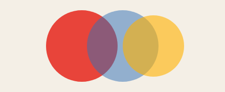
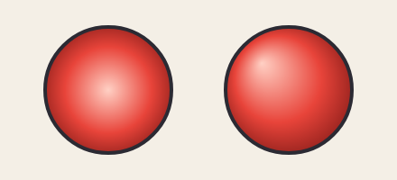
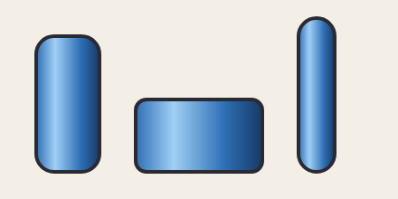
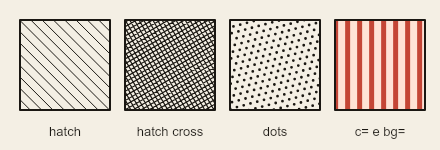

# 3. Cores e estilos

[← Formas](02-formas.md) · [Índice](README.md) · [Próximo: Camadas →](04-camadas.md)

## Escrevendo uma cor

Em qualquer lugar que pede cor (`c=`, `inkc=`, `bg=`…) vale:

| Forma | Exemplo | Observação |
|---|---|---|
| `#rgb` | `#f80` | curta: cada letra vale dobrada (`#f80` = `#ff8800`) |
| `#rrggbb` | `#ff8800` | a mais comum |
| `#rrggbbaa` | `#ff880080` | os dois últimos dígitos são a **transparência** (`00` invisível, `80` metade, `ff` sólida) |
| nome da `palette` | `pele` | veja abaixo |
| nome de um `gradient` ou `pattern` | `ceu` | veja abaixo |
| nome de cor do CSS | `tomato`, `gold` | em inglês |
| `none` | `c=none` | sem cor (sem preenchimento; com `ink=`, fica só o contorno) |

<!-- gerar: img/03_transparencia.png -->
```weasel
canvas 440 180 bg=#f4efe6
ellipse vermelha 160,90 70 c=#e8443a
ellipse azul 240,90 70 c=#2f6fb580
ellipse amarela 300,90 60 c=#ffb00099
```



O azul tem `80` no fim (metade transparente) e o amarelo `99` (60% sólido): dá para ver o que está atrás. A transparência de uma forma inteira, com contorno e tudo, também pode ser dada com `opacity=0.5`.

## A palette: cores com nome

Escrever `#c4512b` em dez lugares é ruim de ler e pior de mudar. A `palette` dá **nomes** às cores (e às espessuras):

```
palette pele=#f1d9b5 cabelo=#5e4030 line=6
```

Depois, em vez do código, usa-se o nome: `c=pele`, `ink=line`. Mudou a cor na `palette`, mudou em todo o desenho.

<!-- gerar: img/03_casa.png -->
<!-- gerar: img/03_casa_noite.png --variant noite -->
```weasel
canvas 400 260 bg=ceu
palette ink=#2b2a33 line=5 fino=3
palette ceu=#bfe3f5 parede=#f1d9b5 telhado=#c4512b porta=#7a4a2c janela=#e8f4fb grama=#7cc56a

rect chao 0,222 400,40 c=grama
rect parede 110,120 180,110 c=parede ink=line
shape telhado c=telhado ink=line : 90,124! 200,50! 310,124!
rect porta 180,160 44,70 r=6 c=porta ink=line
rect janela1 128,140 36,36 c=janela ink=fino
rect janela2 238,140 36,36 c=janela ink=fino

variant noite ceu=#1b2140 grama=#2f5a3a parede=#a99a8a janela=#ffd56b
```

| Padrão | Com `--variant noite` |
|---|---|
|  |  |

Repare:

- Uma `palette` pode ter **cores e números**. Os números são espessuras: `ink=line` usa o 5 de `line`, e `ink=fino` usa o 3.
- Pode haver várias linhas `palette`; elas se somam.
- Um nome da `palette` pode valer outro nome: `palette sombra=cabelo` copia a cor de `cabelo`.
- O fundo também aceita nome: `bg=ceu`.

### Nomes que já existem

Todo desenho começa com esta `palette`, que você pode mudar:

| Nome | Valor | Para quê |
|---|---|---|
| `ink` | `#14141c` | A **cor de tinta**: a cor padrão dos contornos, dos traços, das linhas e do texto. Mude com `palette ink=#…`. |
| `line` | `8` | espessura de contorno grosso |
| `inner` | `5` | espessura de traços de dentro (rugas, dobras) |
| `edge` | `3` | espessura fina |

### Variantes: outra versão das cores

A última linha do exemplo é uma **variante**:

```
variant noite ceu=#1b2140 grama=#2f5a3a parede=#a99a8a janela=#ffd56b
```

Ela não muda nada sozinha: diz "na versão `noite`, troque estas cores da `palette`". Serve para inimigos recoloridos, dia e noite, times de cores, roupas. A variante só alcança o que usa o nome: uma cor escrita direto, como `#c4512b`, não muda. Por isso é bom dar nome a toda cor que você talvez queira trocar.

- **No editor:** o seletor de variante fica na barra da vista do desenho.
- **Na linha de comando:** `--variant noite` exporta essa versão; `--variant all` exporta todas de uma vez (com o nome da variante no fim do arquivo).

## Gradientes

Um gradiente é uma cor que muda aos poucos. Primeiro ele é declarado com um nome; depois o nome é usado como cor.

### Linear

```
gradient nome linear x1,y1 x2,y2 : cor1 cor2 cor3…
```

As cores mudam ao longo da linha que vai de `x1,y1` até `x2,y2`. Depois do `:` vêm as cores. Cada uma pode ter a posição na linha, de 0 a 1, com `@` (`#fff@0.3`); sem `@`, elas se espalham por igual.

<!-- gerar: img/03_gradientes.png -->
```weasel
canvas 440 240 bg=ceu
gradient ceu linear 0,0 0,240 : #1b2a5c #e86f4a@0.7 #ffcf7a
gradient brilho radial 220,196 80 : #fff6c8 #ffd27a@0.4 #ff9a4a00

ellipse halo 220,196 80 c=brilho
ellipse sol 220,196 34 c=#fff1b8
shape morro c=#2a1f3d : 0,206 120,176 240,200 360,170 440,192! 440,240! 0,240!
```


- `ceu` vai de `0,0` até `0,240`: de cima para baixo, azul → laranja (a 70% da altura) → amarelo.
- As coordenadas do gradiente linear são as do **canvas**: o céu do fundo e uma forma pequena pintada com `ceu` pegam o mesmo trecho de cor.

### Radial

```
gradient nome radial cx,cy raio [fx,fy] : cores
```

As cores mudam do centro `cx,cy` para fora, até o `raio`. O halo do sol acima é radial: amarelo claro no meio, laranja e, na borda, laranja com transparência `00` (some suavemente).

O ponto `fx,fy` opcional é o **foco**: de onde a primeira cor sai. Com o foco fora do centro, uma bola parece iluminada de lado:

<!-- gerar: img/03_radial.png -->
```weasel
canvas 440 200 bg=#f4efe6
palette ink=#2b2a33
gradient centrado radial 120,100 80 : #ffd0c4 #e8443a@0.6 #8c1e1a
gradient focado radial 320,100 80 290,70 : #ffd0c4 #e8443a@0.6 #8c1e1a
ellipse a 120,100 70 c=centrado ink=4
ellipse b 320,100 70 c=focado ink=4
```



### `box`: um gradiente que se ajusta a cada forma

Com a opção `box`, as coordenadas do gradiente deixam de ser pixels: vão de **0 a 1 dentro de cada forma** que o usa. `0,0` é o canto de cima à esquerda da forma, `1,1` o de baixo à direita. Assim o mesmo gradiente serve para formas de tamanhos e lugares diferentes:

<!-- gerar: img/03_box.png -->
```weasel
canvas 440 220 bg=#f4efe6
palette ink=#2b2a33
gradient vidro linear 0,0 1,0 box : #2f6fb5 #9fd0f5@0.3 #2f6fb5@0.7 #173a66
rect garrafa 40,40 70,150 r=20 c=vidro ink=4
rect pote 150,110 140,80 r=12 c=vidro ink=4
rect tubo 330,20 40,170 r=20 c=vidro ink=4
```



`0,0 1,0` vai da esquerda para a direita de cada forma, e o brilho cai sempre a 30% da largura. Sem `box`, as três pegariam pedaços diferentes de um gradiente só, preso ao canvas.

- No radial com `box`, o raio também é relativo: `radial 0.5,0.3 0.75 box` é um círculo centrado a 50% da largura e 30% da altura, com raio de 75% do tamanho médio da forma.
- As cores do gradiente podem ser nomes da `palette`: `: pena@0.15 penad@1`. Uma variante que troca `pena` troca o gradiente também.
- Gradiente vale em `c=`, `inkc=` e `bg=`. Numa forma presa a um osso, ele anda junto com ela.

## Hachura e pontos: `pattern`

Para estilo de gravura ou nanquim, uma forma pode ser preenchida com **linhas paralelas** ou **pontos**:

```
pattern nome hatch [cross] angle=graus gap=espaço w=espessura c=cor bg=fundo
pattern nome dots gap=espaço r=raio c=cor bg=fundo
```

<!-- gerar: img/03_padroes.png -->
```weasel
canvas 440 150 bg=#f4efe4
palette ink=#1a1712
pattern leve hatch angle=45 gap=8 w=1
pattern escura hatch angle=-30 gap=4 w=1.2 cross
pattern pontos dots gap=7 r=1.4
pattern listras hatch angle=90 gap=12 w=5 c=#c44536 bg=#ffe2d6

rect r1 20,20 90,90 c=leve ink=2
rect r2 125,20 90,90 c=escura ink=2
rect r3 230,20 90,90 c=pontos ink=2
rect r4 335,20 90,90 c=listras ink=2
text t1 65,136 "hatch" size=13 align=center
text t2 170,136 "hatch cross" size=13 align=center
text t3 275,136 "dots" size=13 align=center
text t4 380,136 "c= e bg=" size=13 align=center
```



| Atributo | Padrão | O que faz |
|---|---|---|
| `hatch` / `dots` | `hatch` | linhas ou pontos |
| `cross` | — | cruza a hachura com outra a 90° |
| `angle=` | 45 | inclinação das linhas, em graus |
| `gap=` | 6 | distância entre as linhas (ou entre os pontos) |
| `w=` | 1.2 | espessura das linhas |
| `r=` | 1.4 | raio dos pontos |
| `c=` | cor de tinta | cor das linhas ou dos pontos |
| `bg=` | nenhum | cor de fundo por baixo do padrão |

O padrão vale só em `c=` de formas fechadas (não no fundo do canvas) e acompanha a forma quando ela se mexe. Hachuras mais juntas ou cruzadas parecem mais escuras: é assim que a gravura faz sombra. O exemplo [`exemplos/gravura.weasel`](../../exemplos/gravura.weasel) desenha uma maçã só com isso.

[← Formas](02-formas.md) · [Índice](README.md) · [Próximo: Camadas →](04-camadas.md)
