# 3. Cores e contorno

[← Formas](02-formas.md) · [Índice](README.md) · [Próximo: Camadas →](04-camadas.md)

Neste capítulo você aprende a escrever as cores de vários jeitos, a dar um contorno às formas, a deixar uma forma transparente, a dar nomes às cores com a `palette` e a pintar com gradientes e texturas. Você já precisa saber o que os capítulos [1](01-primeiros-passos.md) e [2](02-formas.md) ensinam: o `canvas`, as formas e o `c=`.

## Escrevendo uma cor

Até aqui, as cores foram sempre `c=#rrggbb`. Uma cor pode ser escrita destes jeitos:

```
#rgb         #f80
#rrggbb      #ff8800
#rrggbbaa    #ff880080
#rgba        #f808
um nome      tomato
none
```

Todos valem no `c=` das formas, no `bg=` do `canvas` e no `inkc=`, a cor do contorno (mais abaixo).

**O código `#`.** Um código de cor tem três pares de dígitos. O primeiro par diz quanto vai de **vermelho**; o segundo, de **verde**; o terceiro, de **azul**. Cada par vai de `00` (nada) a `ff` (o máximo). Os dígitos vão de `0` a `9` e continuam de `a` a `f`: o `a` vem depois do `9`, e o `f` é o maior.

| Código | Vermelho | Verde | Azul | A cor |
|---|---|---|---|---|
| `#ff0000` | máximo | nada | nada | vermelho |
| `#ffff00` | máximo | máximo | nada | amarelo |
| `#ff8800` | máximo | metade | nada | laranja |
| `#808080` | metade | metade | metade | cinza |
| `#000000` | nada | nada | nada | preto |
| `#ffffff` | máximo | máximo | máximo | branco |

Não precisa decorar: no editor, um seletor de cores escreve o código para você ([capítulo 22](22-editor.md#seletor-de-cor)).

Os mesmos tons, escritos de cada jeito:

<!-- gerar: img/03_jeitos_cor.png -->
```weasel
canvas 500 160 bg=#f4efe6
# uma faixa escura atrás dos retângulos, para ver a transparência
rect faixa 0,46 500,24 c=#2b2a33
rect a 20,20 60,80 c=#f80
rect b 100,20 60,80 c=#ff8800
rect c 180,20 60,80 c=#ff880080
rect d 260,20 60,80 c=tomato
rect e 340,20 60,80 c=gold
rect f 420,20 60,80 c=none
text ta 50,130 "#f80" size=14 align=center
text tb 130,130 "#ff8800" size=14 align=center
text tc 210,130 "#ff880080" size=14 align=center
text td 290,130 "tomato" size=14 align=center
text te 370,130 "gold" size=14 align=center
text tf 450,130 "none" size=14 align=center
```

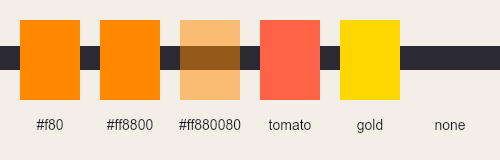

- `#f80` e `#ff8800` são a **mesma cor**. Na forma curta, cada dígito se repete: `#f80` vira `#ff8800`.
- `#ff880080` é o mesmo laranja com um quarto par no fim, a **transparência**. `00` é invisível, `80` é mais ou menos a metade, e `ff` é a cor inteira. Por isso a faixa aparece através dele. A forma curta também tem: `#f808` é `#ff880088`.
- `tomato` e `gold` são cores com nome, em inglês. São os nomes de cor das páginas da web (a lista do CSS): `red`, `skyblue`, `wheat`, `crimson`…
- `none` é **nenhuma cor**. O retângulo existe, mas não pinta nada: só se vê a faixa. `transparent` faz o mesmo.

**Experimente:** troque `#ff880080` por `#ff880020`. O laranja fica bem mais fraco, e a faixa aparece quase inteira.

### Transparência na cor

A transparência deixa ver o que está **atrás** da forma. Serve para vidro, água, sombras, brilhos e fantasmas. Aqui, três círculos, um por cima do outro:

<!-- gerar: img/03_transparencia.png -->
```weasel
canvas 440 180 bg=#f4efe6
ellipse vermelha 160,90 70 c=#e8443a
ellipse azul 240,90 70 c=#2f6fb580
ellipse amarela 300,90 60 c=#ffb00099
```

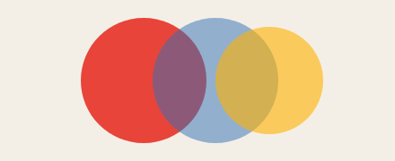

- O vermelho não tem o quarto par: é sólido.
- O azul termina em `80`: dá para ver o vermelho através dele.
- O amarelo termina em `99`, um pouco mais sólido que a metade. Ele deixa ver os dois de baixo.

**Experimente:** troque o `80` do azul por `ff`. O azul fica sólido e esconde o pedaço do vermelho que está atrás dele.

**Cuidado:**
- `rgb(…)` e `hsl(…)` não valem: dão o erro `cor desconhecida "rgb(255,0,0)"`. Um nome errado também dá esse erro (`tomatoo`).
- Maiúsculas valem: `#F80`, `Tomato`.
- Alguns comandos dos próximos capítulos só aceitam o código `#`: a textura deste capítulo, as luzes e os efeitos das camadas. Para uma cor mudar aos poucos numa animação ([capítulo 9](09-animacao.md)), ela também precisa ser `#`. Na dúvida, prefira o código.

## O contorno: `ink=` e `inkc=`

```
forma … ink=grossura inkc=cor
```

As formas fechadas (`ellipse`, `rect` e `shape`) têm duas partes: o **preenchimento**, a cor de dentro (`c=`), e o **contorno**, a linha em volta da borda. `ink=` é a grossura do contorno, em pixels. `inkc=` é a cor dele.

<!-- gerar: img/03_contorno.png -->
```weasel
canvas 440 150 bg=#f4efe6
ellipse nada 60,65 40
ellipse so_c 160,65 40 c=#ffb000
ellipse so_ink 260,65 40 ink=6 inkc=#2f6fb5
ellipse as_duas 360,65 40 c=#ffb000 ink=6 inkc=#2f6fb5
text t1 60,135 "nada" size=14 align=center
text t2 160,135 "c=" size=14 align=center
text t3 260,135 "ink= inkc=" size=14 align=center
text t4 360,135 "c= ink= inkc=" size=14 align=center
```

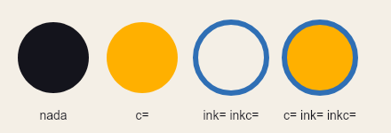

| Você escreve | A forma fica |
|---|---|
| nem `c=` nem `ink=` | pintada inteira de quase preto (`#14141c`), sem contorno |
| só `c=` | com a cor, **sem contorno** |
| só `ink=` | **vazia**: só o contorno aparece |
| `c=` e `ink=` | com a cor e com o contorno |

- `ink=6` desenha um contorno de 6 pixels de grossura. Sem `ink=`, a forma não tem contorno: é o mesmo que `ink=0`.
- `inkc=#2f6fb5` pinta o contorno de azul. Sem `inkc=`, ele sai quase preto (`#14141c`), a **cor da tinta**. A `palette`, mais abaixo, troca essa cor no desenho todo.
- Com `ink=` e sem `c=`, a forma fica vazia. Para ter as duas partes, escreva as duas.

**Experimente:** no `so_ink`, acrescente `c=#ffffff`. O círculo ganha um preenchimento branco.

No editor, as duas caixinhas de cor no pé da barra de ferramentas escrevem o `c=`, o `inkc=` e o `ink=` das formas que você desenha ([capítulo 22](22-editor.md#caixinhas-de-cor)).

### Metade para dentro, metade para fora

O contorno é desenhado **em cima da borda**: metade da grossura fica para fora da forma, e metade para dentro. Um contorno grosso e meio transparente mostra isso:

<!-- gerar: img/03_contorno_meio.png -->
```weasel
canvas 440 190 bg=#f4efe6
ellipse fino 110,90 60 c=#ffb000 ink=4 inkc=#2f6fb5
ellipse grosso 320,90 60 c=#ffb000 ink=24 inkc=#2f6fb580
# a borda de verdade dos dois círculos (raio 60), numa linha vermelha fina
ellipse borda1 110,90 60 c=none ink=1.5 inkc=#c44536
ellipse borda2 320,90 60 c=none ink=1.5 inkc=#c44536
text t1 110,180 "ink=4" size=14 align=center
text t2 320,180 "ink=24" size=14 align=center
```

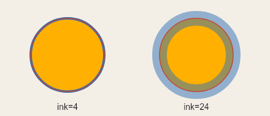

- As duas últimas elipses são só a linha vermelha da borda: `c=none` e um contorno fino.
- Com `ink=4`, quase não se nota: são 2 pixels para fora e 2 para dentro.
- Com `ink=24`, a linha vermelha passa **no meio** do contorno: 12 pixels para fora e 12 para dentro. O azul termina em `80`, e por isso a metade de dentro mistura com o laranja.
- Um contorno grosso deixa a forma maior por fora e cobre um pouco do preenchimento por dentro.

**Experimente:** tire o `80` do azul (`inkc=#2f6fb5`). O contorno fica sólido e cobre a borda do laranja.

### O contorno no texto

O `text` também aceita `ink=` e `inkc=`. Nele, o contorno fica todo **por fora** das letras: elas não afinam.

<!-- gerar: img/03_texto_contorno.png -->
```weasel
canvas 460 130 bg=#f4efe6
text a 20,70 "Oi" size=56 bold c=#ffd34d
text b 130,70 "Oi" size=56 bold c=#ffd34d ink=3
text c 240,70 "Oi" size=56 bold c=#ffd34d ink=3 inkc=#c44536
text d 350,70 "Oi" size=56 bold c=none ink=2
text la 50,110 "só c=" size=13 align=center
text lb 160,110 "ink=3" size=13 align=center
text lc 270,110 "inkc=#c44536" size=13 align=center
text ld 380,110 "c=none ink=2" size=13 align=center
```

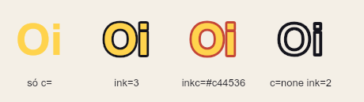

- `ink=3` desenha 3 pixels de contorno em volta das letras, todos do lado de fora.
- `inkc=` troca a cor do contorno, como nas formas.
- Com `c=none`, sobra só o contorno, e as letras ficam vazias. Sem preenchimento, o contorno aparece inteiro: o dobro da grossura (aqui, 4 pixels), metade para dentro das letras.

**Experimente:** no primeiro "Oi", acrescente `ink=8 inkc=#ffffff`. Fica um contorno branco e grosso, como num adesivo.

### Contorno só por fora

Numa forma, para o contorno não cobrir nada do preenchimento, escreva a forma **duas vezes**. A primeira tem o contorno. A segunda, logo depois, é igual, mas sem `ink=`: ela é pintada por cima e cobre a metade de dentro do contorno. Sobra só a metade de fora.

<!-- gerar: img/03_contorno_fora.png -->
```weasel
canvas 440 190 bg=#f4efe6
# à esquerda, uma forma só: o contorno cobre a borda do laranja
ellipse normal 110,90 60 c=#ffb000 ink=24 inkc=#2f6fb5
# à direita, duas formas iguais: a de trás tem o contorno; a da frente, só o laranja
ellipse tras 330,90 60 c=#ffb000 ink=24 inkc=#2f6fb5
ellipse frente 330,90 60 c=#ffb000
# a borda de verdade, em vermelho
ellipse borda1 110,90 60 c=none ink=1.5 inkc=#c44536
ellipse borda2 330,90 60 c=none ink=1.5 inkc=#c44536
text t1 110,180 "uma forma" size=14 align=center
text t2 330,180 "duas formas" size=14 align=center
```

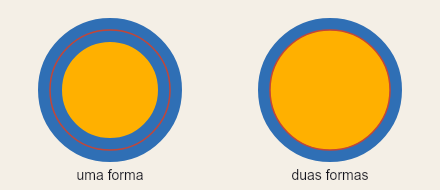

- À esquerda, o azul cobre 12 pixels da borda do laranja.
- À direita, `frente` cobre a metade de dentro do contorno de `tras`. O laranja vai inteiro até a linha vermelha.
- Só a metade de fora aparece. Para um contorno de 12 pixels por fora, escreva o dobro: `ink=24`.
- No `text` com preenchimento, não precisa disso: o contorno já fica só por fora.

**Experimente:** no `tras`, mude `ink=24` para `ink=12`. O contorno de fora fica com 6 pixels.

No [capítulo 4](04-camadas.md), o `inkon=` faz o mesmo sem repetir a forma: ele manda o contorno para outra camada.

### Contorno que engrossa no lado da sombra: `weight=`

No desenho à mão, o contorno costuma ser mais grosso do lado oposto à luz. O `weight=` faz isso, de 0 a 3. A luz vem do `light=` do `canvas`.

```
canvas largura altura light=x,y
forma … ink=grossura weight=número
```

<!-- gerar: img/03_weight.png -->
```weasel
canvas 440 170 bg=#f4efe6 light=-0.6,-0.8
ellipse w0 80,75 50 c=#ffb000 ink=5
ellipse w1 220,75 50 c=#ffb000 ink=5 weight=0.5
ellipse w2 360,75 50 c=#ffb000 ink=5 weight=1
text t0 80,160 "weight=0" size=14 align=center
text t1 220,160 "weight=0.5" size=14 align=center
text t2 360,160 "weight=1" size=14 align=center
```

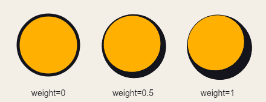

- `light=-0.6,-0.8` diz **para onde a luz está**, a partir do meio. O primeiro número é a esquerda (negativo) ou a direita (positivo); o segundo é em cima (negativo) ou embaixo (positivo). Aqui, a luz está em cima, à esquerda. Se não escrever, é este mesmo valor.
- Só a direção conta: `light=-6,-8` dá o mesmo. E `light=0,0` deixa o contorno igual em toda a volta.
- `weight=0` (o padrão): o contorno é igual em toda a volta.
- `weight=0.5`: o lado da sombra fica com mais que o dobro da grossura, e o lado da luz afina.
- `weight=1`: o lado da sombra fica 3,6 vezes mais grosso, e o lado da luz quase some. Até 3, o lado da sombra continua engrossando.
- O `light=` é um só para o desenho inteiro. Todas as formas com `weight=` engrossam do mesmo lado.

**Experimente:** no `canvas`, troque para `light=1,0` (a luz bem à direita). O lado grosso passa para a esquerda nos três círculos.

O `light=` não muda as cores: a luz que ilumina o desenho é a do [capítulo 10](10-luz.md). Alguns estilos de arte do [capítulo 13](13-estilos.md) também usam a direção do `light=`.

### Opções do contorno

| Opção | O que faz | Valores | Se não escrever |
|---|---|---|---|
| `c=` | a cor de dentro | uma cor ou `none` (vazia) | quase preto; vazia, se houver `ink=` |
| `ink=` | a grossura do contorno, em pixels: metade para dentro e metade para fora da borda (no `text`, só por fora) | 0 ou mais; `none` vale 0 | 0 (sem contorno) |
| `inkc=` | a cor do contorno | uma cor | quase preto, a cor da tinta |
| `weight=` | engrossa o contorno do lado oposto à luz | de 0 a 3 | 0 (igual em toda a volta) |
| `light=` (no `canvas`) | para onde a luz está, para o `weight=` | dois números, `x,y`; só a direção conta | `-0.6,-0.8` (em cima, à esquerda) |

O `ink=`, o `inkc=` e o `weight=` valem no `ellipse`, no `rect` e no `shape`; o `text` aceita o `ink=` e o `inkc=`. A lista completa está nas [opções de todas as formas](19-referencia.md#opções-de-todas-as-formas) e no [`canvas`](19-referencia.md#canvas).

**Cuidado:**
- O `stroke` e a `line` não têm contorno: neles, a grossura é o `w=` e a cor é o `c=`. Um `ink=` num `stroke` dá o aviso `atributo desconhecido "ink" em stroke`.
- O `weight=` não vale no `text` (aviso `atributo desconhecido`).
- Um `weight=` fora de 0 a 3 dá o aviso `weight= deve ficar entre 0 e 3`, e o Weasel usa o limite. Um `ink=` negativo vira 0, com um aviso.

## A transparência da forma: `opacity=`

```
forma … opacity=número
```

`opacity=` deixa a forma inteira transparente: o preenchimento e o contorno juntos. Vai de 0 (invisível) a 1 (inteira). Se não escrever, 1. Vale em todas as formas, também no `stroke`, na `line` e no `text`.

<!-- gerar: img/03_opacity.png -->
```weasel
canvas 440 170 bg=#f4efe6
rect faixa 20,62 400,36 c=#2b2a33
ellipse o1 80,80 46 c=#4a90d9 ink=4
ellipse o2 220,80 46 c=#4a90d9 ink=4 opacity=0.6
ellipse o3 360,80 46 c=#4a90d9 ink=4 opacity=0.25
text t1 80,158 "sem opacity=" size=14 align=center
text t2 220,158 "opacity=0.6" size=14 align=center
text t3 360,158 "opacity=0.25" size=14 align=center
```

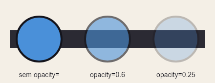

- A faixa escura passa **atrás** dos três círculos. Quanto menor o número, mais dela aparece.
- `0.6` quer dizer 60% visível. Com `0.25`, o círculo quase some.
- O contorno fica transparente junto com o azul.

**Experimente:** use `opacity=0` no primeiro círculo. Ele some, mas continua no desenho (no [capítulo 9](09-animacao.md), dá para animar a `opacity=` e fazê-lo aparecer aos poucos).

### Cor transparente ou forma transparente

A transparência na cor (`#rrggbbaa`) e o `opacity=` parecem iguais, mas não são. Na cor, só **aquela cor** fica transparente. O `opacity=` vale para a **forma inteira**.

<!-- gerar: img/03_cor_ou_opacity.png -->
```weasel
canvas 440 200 bg=#f4efe6
rect faixa 20,72 400,36 c=#c44536
ellipse cor 110,90 60 c=#4a90d980 ink=10
ellipse forma 330,90 60 c=#4a90d9 ink=10 opacity=0.5
text t1 110,184 "c=#4a90d980" size=14 align=center
text t2 330,184 "opacity=0.5" size=14 align=center
```

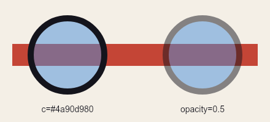

- À esquerda, `c=#4a90d980`: o preenchimento é meio transparente, e a faixa aparece através dele. O contorno (`ink=10`, quase preto) continua inteiro.
- À direita, `opacity=0.5`: a forma inteira fica meio transparente, o azul **e** o contorno. A faixa aparece através dos dois.
- O contorno e o preenchimento ficam transparentes juntos, como uma peça só: por baixo do contorno não aparece o azul, só a faixa.

**Experimente:** à esquerda, acrescente `inkc=#14141c80`. Agora o contorno também fica transparente. O quanto, você escolhe separado do preenchimento.

**Cuidado:** um número fora de 0 a 1 dá o aviso `opacity= deve ficar entre 0 e 1`, e o Weasel usa o limite.

## Cores com nome: `palette`

Escrever `#c4512b` em dez lugares é ruim de ler e pior de mudar. A `palette` dá um **nome** a cada cor. Depois, você usa o nome no lugar do código: `c=telhado`.

```
palette nome=valor nome=valor …
```

<!-- gerar: img/03_palette_casa.png -->
```weasel
canvas 400 260 bg=ceu
palette ceu=#bfe3f5 parede=#f1d9b5 telhado=#c4512b porta=#7a4a2c janela=#e8f4fb grama=#7cc56a
palette grosso=5 fino=3

rect chao 0,222 400,40 c=grama
rect parede 110,120 180,110 c=parede ink=grosso
shape telhado c=telhado ink=grosso : 90,124! 200,50! 310,124!
rect porta 180,160 44,70 r=6 c=porta ink=grosso
rect janela1 128,140 36,36 c=janela ink=fino
rect janela2 238,140 36,36 c=janela ink=fino
```

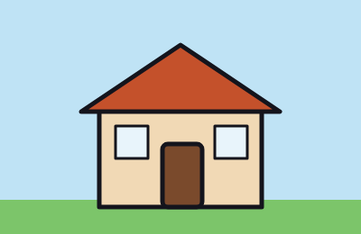

- A primeira `palette` dá nome a seis cores. `c=parede` pinta com `#f1d9b5`.
- A segunda guarda **números**. Um número na `palette` é uma grossura: `ink=grosso` vale `ink=5`, e `ink=fino` vale `ink=3`.
- Pode haver várias linhas `palette`: elas se somam.
- O fundo também aceita um nome: `bg=ceu`. O `canvas` vem antes da `palette`, e funciona: um nome pode ser **usado** em qualquer lugar do arquivo.
- Um nome segue a regra dos nomes das formas: começa com uma letra ou `_`, sem acento.

**Experimente:** na `palette`, troque `janela=#e8f4fb` por `janela=#ffd56b`. As duas janelas ficam amarelas de uma vez, como se a luz da casa acendesse. Depois troque `grosso=5` por `grosso=8`: a parede, o telhado e a porta ganham um contorno mais grosso.

No editor, o painel **Amostras** mostra as cores e os números da `palette` e pinta a forma escolhida com um clique ([capítulo 22](22-editor.md#amostras)).

### A cor da tinta e os nomes prontos

Quatro nomes já existem em todo desenho, mesmo sem nenhuma linha `palette`. É como se todo arquivo começasse com esta linha:

```
palette ink=#14141c line=8 inner=5 edge=3
```

| Nome | Valor | O que é |
|---|---|---|
| `ink` | `#14141c` (quase preto) | uma **cor**: a cor da tinta |
| `line` | `8` | um **número**: uma grossura de contorno grosso, para a borda de fora de um personagem |
| `inner` | `5` | um número: uma grossura média, para os detalhes de dentro |
| `edge` | `3` | um número: uma grossura fina |

A **cor da tinta** (`ink`) é a cor de tudo o que não diz a própria cor: o contorno sem `inkc=`; o `stroke`, a `line` e o `text` sem `c=`; e a forma fechada sem `c=` e sem `ink=`. Ela também serve como qualquer outra cor: `c=ink`.

Já `line`, `inner` e `edge` só valem onde você escreve o nome. Uma forma sem `ink=` continua sem contorno.

> **`ink` tem dois sentidos.** Na `palette`, `ink` é a **cor da tinta**: `palette ink=#2b2a33`. Numa forma, `ink=` é a **grossura do contorno**: `ink=4`. A cor do contorno é o `inkc=`. Por isso `ink=line` (a grossura vale 8) e `c=ink` (a cor é a da tinta) aparecem juntos sem problema.

Este desenho não tem nenhuma `palette` e usa os quatro nomes:

<!-- gerar: img/03_nomes_prontos.png -->
```weasel
canvas 480 210 bg=#f4efe6

ellipse grosso 90,90 55 c=#ffd23f ink=line
ellipse medio 240,90 55 c=#ffd23f ink=inner
ellipse fino 390,90 55 c=#ffd23f ink=edge
ellipse olhoE 222,72 6,9 c=ink
ellipse olhoD 258,72 6,9 c=ink
stroke boca w=edge : 215,100 240,118 265,100

text t1 90,190 "ink=line" size=20 align=center
text t2 240,190 "ink=inner" size=20 align=center
text t3 390,190 "ink=edge" size=20 align=center
```

Agora o mesmo desenho, com uma linha a mais no começo, que muda três dos nomes:

<!-- gerar: img/03_nomes_mudados.png -->
```weasel
canvas 480 210 bg=#f4efe6
palette ink=#8a3b12 line=14 edge=1

ellipse grosso 90,90 55 c=#ffd23f ink=line
ellipse medio 240,90 55 c=#ffd23f ink=inner
ellipse fino 390,90 55 c=#ffd23f ink=edge
ellipse olhoE 222,72 6,9 c=ink
ellipse olhoD 258,72 6,9 c=ink
stroke boca w=edge : 215,100 240,118 265,100

text t1 90,190 "ink=line" size=20 align=center
text t2 240,190 "ink=inner" size=20 align=center
text t3 390,190 "ink=edge" size=20 align=center
```

| Sem `palette` | Com `palette ink=#8a3b12 line=14 edge=1` |
|---|---|
| 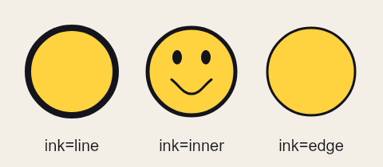 | 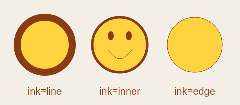 |

- Os contornos, os olhos, a boca e os textos ficaram marrons: todos usam a cor da tinta.
- O primeiro contorno engrossou (`line` foi de 8 para 14). O último e a boca afinaram (`edge` foi de 3 para 1). O do meio não mudou: `inner` continua 5.

É por isso que vale escrever `ink=line` em vez de `ink=8`. Se o contorno ficar grosso demais, você muda um número só.

**Experimente:** na linha `palette`, acrescente `inner=9`. Só o contorno do meio engrossa.

### Um nome que copia outro: `sombra=cabelo`

Às vezes duas partes têm a mesma cor, mas você quer dar a cada uma um nome que diz para que ela serve. A sobrancelha tem a cor do cabelo: `palette sobrancelha=cabelo` cria o nome `sobrancelha` com a cor de `cabelo`.

<!-- gerar: img/03_copia.png -->
```weasel
canvas 240 200 bg=#cfe8f5
palette ink=#2b2a33 line=4
palette pele=wheat cabelo=#5e4030
palette sobrancelha=cabelo

ellipse cabeca 120,110 60 c=pele ink=line
shape franja c=cabelo ink=line : 62,96 70,58 120,44 170,58 178,96! 150,72 120,80 90,72!
stroke sobrE w=6 c=sobrancelha : 88,98 98,92 110,96
stroke sobrD w=6 c=sobrancelha : 130,96 142,92 152,98
ellipse olhoE 100,112 5,7 c=ink
ellipse olhoD 140,112 5,7 c=ink
stroke boca w=3 : 104,140 120,148 136,140
```

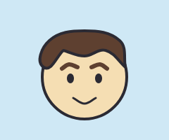

- `pele=wheat`: um nome da `palette` também pode guardar um nome de cor em inglês.
- `sobrancelha=cabelo` copia a cor de `cabelo`. As sobrancelhas usam `c=sobrancelha`.
- A boca não tem `c=`: ela sai com a cor da tinta, `#2b2a33`.

**Experimente:** troque `cabelo=#5e4030` por `cabelo=#c4512b`. A franja e as sobrancelhas ficam ruivas juntas. Depois escreva `sobrancelha=#2b2a33`, no lugar de `sobrancelha=cabelo`: só as sobrancelhas mudam. É para isso que serve o nome próprio.

A cópia precisa vir **depois** do nome copiado: numa linha `palette` de baixo, ou mais à direita na mesma linha (`palette cabelo=#5e4030 sobrancelha=cabelo`). Com a ordem trocada, o Weasel ainda não conhece `cabelo`:

```
palette sobrancelha=cabelo
palette cabelo=#5e4030
```

```
teste.weasel:2:9: erro: valor inválido "cabelo" (use #cor, número ou outro nome da palette)
```

Só a cópia dentro da `palette` depende da ordem. Usar o nome numa forma (`c=sobrancelha`) vale em qualquer lugar do arquivo. As outras regras de ordem estão em [a ordem das linhas](19-referencia.md#a-ordem-das-linhas).

### Opções da `palette`

| Opção | O que faz | Valores | Se não escrever |
|---|---|---|---|
| `nome=valor` | dá um nome a uma cor ou a um número | uma cor `#`, um nome de cor em inglês, um número (uma grossura) ou outro nome da `palette` (copia) | — |
| `ink=` | a cor da tinta | uma cor | `#14141c` (quase preto) |
| `line=` `inner=` `edge=` | grossuras prontas | números | 8, 5 e 3 |

A ficha completa está na [referência da `palette`](19-referencia.md#palette).

**Cuidado:**
- A `palette` não aceita `none`, um gradiente nem uma textura: dá o erro `valor inválido`.
- Um nome que guarda um número não vale como cor, e um que guarda uma cor não vale como grossura: `c=grosso` dá o erro `"grosso" na palette é número, não cor`.
- O mesmo nome duas vezes: vale o último, no arquivo todo.
- Um nome de cor em inglês (`pele=wheat`) não vale onde só cabe o código `#` (a textura, as luzes, os efeitos das camadas).

## Gradientes: `gradient`

Um gradiente é uma cor que muda aos poucos para outra. Primeiro, você cria o gradiente e dá um nome a ele. Depois, usa o nome como cor: `c=ceu` ou `bg=ceu`.

```
gradient nome linear x1,y1 x2,y2 [box] : cor cor …
gradient nome radial cx,cy raio [fx,fy] [box] : cor cor …
```

<!-- gerar: img/03_ceu.png -->
```weasel
canvas 440 220 bg=ceu
gradient ceu linear 0,0 0,220 : #1b2a5c #e86f4a #ffcf7a
ellipse sol 220,196 34 c=#fff1b8
shape morro c=#2a1f3d : 0,190 120,160 240,184 360,154 440,176! 440,220! 0,220!
```


- `gradient ceu` cria o gradiente com o nome `ceu`.
- `linear 0,0 0,220`: as cores mudam ao longo da linha que vai de `0,0` até `0,220`, de cima para baixo.
- Depois do `:` vêm as cores, em ordem: azul-escuro, laranja e amarelo.
- `bg=ceu` pinta o fundo inteiro com o gradiente.

**Experimente:** acrescente uma quarta cor no fim, `#ffffff`. A parte de baixo do céu fica quase branca.

### A direção do gradiente

Os dois pontos do `linear` formam uma **linha**. A primeira cor fica no começo dela, a última no fim, e a cor muda ao longo dela. Mudando os pontos, muda a direção:

<!-- gerar: img/03_gradiente_direcao.png -->
```weasel
canvas 440 200 bg=#f4efe6
palette ink=#2b2a33 azul=#2f6fb5 amarelo=#ffd34d vermelho=#c44536
gradient deitado linear 20,80 140,80 : azul amarelo
gradient empe linear 220,20 220,140 : azul amarelo
gradient torto linear 300,20 420,140 : azul amarelo
rect a 20,20 120,120 c=deitado
rect b 160,20 120,120 c=empe
rect c 300,20 120,120 c=torto
# a linha de cada gradiente, em vermelho; a bolinha marca o primeiro ponto
line la c=vermelho w=2 : 20,80 140,80
ellipse pa 20,80 5 c=vermelho
line lb c=vermelho w=2 : 220,20 220,140
ellipse pb 220,20 5 c=vermelho
line lc c=vermelho w=2 : 300,20 420,140
ellipse pc 300,20 5 c=vermelho
text ta 80,170 "20,80 140,80" size=14 align=center
text tb 220,170 "220,20 220,140" size=14 align=center
text tc 360,170 "300,20 420,140" size=14 align=center
```

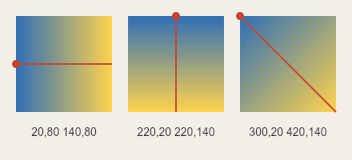

- As cores do gradiente podem ser nomes da `palette`: `azul` e `amarelo`.
- `20,80 140,80`: os dois pontos na mesma altura. A cor muda da esquerda para a direita.
- `220,20 220,140`: os dois no mesmo `x`. A cor muda de cima para baixo.
- `300,20 420,140`: do canto de cima à esquerda até o de baixo à direita, na diagonal.
- Os pontos são medidos no `canvas`, como as formas. Por isso cada quadrado precisa do seu gradiente, com os pontos em cima dele. Antes do primeiro ponto, fica a primeira cor; depois do último, a última.

**Experimente:** troque a ordem dos pontos de `deitado` (`140,80 20,80`). O azul passa para a direita.

### Onde cada cor fica: `cor@posição`

Sem `@`, as cores se espalham por igual ao longo da linha. Com `@`, você diz **onde** cada cor fica: `0` é o começo da linha, `1` é o fim, `0.5` é o meio.

<!-- gerar: img/03_paradas.png -->
```weasel
canvas 440 200 bg=#f4efe6
palette ink=#2b2a33 azul=#2f6fb5 amarelo=#ffd34d branco=#ffffff
gradient g1 linear 20,0 220,0 : azul amarelo
gradient g2 linear 20,0 220,0 : azul@0.4 amarelo@0.6
gradient g3 linear 20,0 220,0 : azul@0.5 amarelo@0.5
gradient g4 linear 20,0 220,0 : azul branco@0.2 amarelo
rect a 20,20 200,30 c=g1
rect b 20,65 200,30 c=g2
rect c 20,110 200,30 c=g3
rect d 20,155 200,30 c=g4
text ta 235,41 "azul amarelo" size=14
text tb 235,86 "azul@0.4 amarelo@0.6" size=14
text tc 235,131 "azul@0.5 amarelo@0.5" size=14
text td 235,176 "azul branco@0.2 amarelo" size=14
```

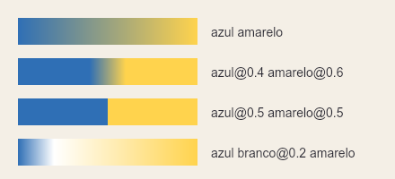

- `azul amarelo`: o azul fica em 0 e o amarelo em 1. A mistura ocupa a faixa toda.
- `azul@0.4 amarelo@0.6`: antes de 40%, tudo azul; depois de 60%, tudo amarelo. A mistura só acontece no meio.
- `azul@0.5 amarelo@0.5`: as duas cores no mesmo lugar. Não sobra espaço para misturar, e a faixa fica dividida em duas cores, sem mistura.
- `azul branco@0.2 amarelo`: o branco fica a 20% da linha. O azul, sem `@`, fica no começo, e o amarelo no fim.

**Experimente:** na última faixa, troque `branco@0.2` por `branco@0.8`. O branco anda para perto do amarelo.

### Do centro para fora: `radial`

No `radial`, as cores mudam do centro `cx,cy` para fora, até o `raio`. O ponto `fx,fy`, se você escrever, é o **foco**: o lugar de onde sai a primeira cor. Com o foco fora do centro, uma bola parece iluminada de lado.

<!-- gerar: img/03_radial.png -->
```weasel
canvas 440 200 bg=#f4efe6
palette ink=#2b2a33
gradient centrado radial 120,100 80 : #ffd0c4 #e8443a@0.6 #8c1e1a
gradient focado radial 320,100 80 290,70 : #ffd0c4 #e8443a@0.6 #8c1e1a
ellipse a 120,100 70 c=centrado ink=4
ellipse b 320,100 70 c=focado ink=4
```

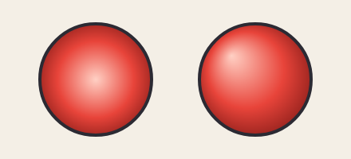

- Os dois gradientes têm o centro no meio da bola e raio `80`, um pouco maior que a bola (70). O vermelho mais escuro só aparece bem na borda.
- `focado` tem o foco em `290,70`: 30 pixels à esquerda e 30 acima do centro. A cor clara sai dali, como o reflexo de uma luz.

**Experimente:** mude o foco para `350,130`. O reflexo vai para baixo, à direita.

### Um gradiente para cada forma: `box`

Sem `box`, os pontos do gradiente são pixels do `canvas`. Com `box`, eles vão de **0 a 1 dentro de cada forma** que usa o gradiente: `0,0` é o canto de cima à esquerda da forma, e `1,1` o de baixo à direita. Assim, o mesmo gradiente serve para formas de tamanhos e lugares diferentes.

<!-- gerar: img/03_box.png -->
```weasel
canvas 440 220 bg=#f4efe6
palette ink=#2b2a33
gradient vidro linear 0,0 1,0 box : #2f6fb5 #9fd0f5@0.3 #2f6fb5@0.7 #173a66
rect garrafa 40,40 70,150 r=20 c=vidro ink=4
rect pote 150,110 140,80 r=12 c=vidro ink=4
rect tubo 330,20 40,170 r=20 c=vidro ink=4
```

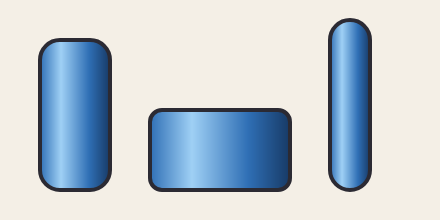

`0,0 1,0` vai da esquerda para a direita de **cada** forma, e o brilho cai sempre a 30% da largura. Sem `box`, as três pegariam pedaços diferentes de um gradiente só, preso ao `canvas`.

No `radial`, o `box` também vale. O raio passa a ser medido no tamanho médio da forma (a média entre a largura e a altura): num círculo, o raio `0.5` chega exatamente na borda.

<!-- gerar: img/03_radial_box.png -->
```weasel
canvas 440 200 bg=#f4efe6
palette ink=#2b2a33
gradient bola radial 0.5,0.5 0.5 0.35,0.3 box : #ffd0c4 #e8443a@0.5 #8c1e1a
ellipse grande 100,100 80 c=bola ink=4
ellipse media 250,120 50 c=bola ink=4
ellipse pequena 360,140 26 c=bola ink=4
ellipse oval 380,60 46,26 c=bola ink=4
```

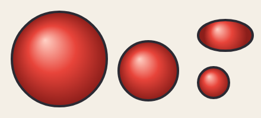

- `0.5,0.5` é o centro, no meio de cada forma.
- O foco `0.35,0.3` fica a 35% da largura e 30% da altura: o brilho sai de cima, à esquerda, em todas.
- Na oval, o brilho também fica no lugar certo: as posições acompanham a largura e a altura da forma.

**Experimente:** troque o foco por `0.65,0.3`. A luz passa para cima, à direita, em todas as bolas de uma vez.

### No contorno, no traço e no texto

Um gradiente vale no `c=` das formas, do `stroke`, da `line` e do `text`, no `inkc=` e no `bg=` do `canvas`.

<!-- gerar: img/03_grad_onde.png -->
```weasel
canvas 440 220 bg=#f4efe6
gradient arco linear 20,0 420,0 : #e8443a #ffb000 #6cbb3c #2f6fb5 #8e44ad
ellipse bola 80,80 50 c=#ffffff ink=10 inkc=arco
stroke onda w=10 c=arco : 160,110 220,50 280,110 340,50 410,100
text nome 220,190 "Weasel" size=48 bold align=center c=arco
```

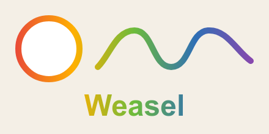

- O gradiente `arco` vai da esquerda (`x=20`, vermelho) até a direita (`x=420`, roxo).
- Cada coisa pega as cores que estão **no lugar dela**: o círculo, à esquerda, pega o vermelho e o laranja; a onda, o meio e a direita.
- No texto, cada letra pega a cor do lugar onde está.

**Experimente:** acrescente `box` ao gradiente (`linear 0,0 1,0 box`). Agora cada coisa tem o arco-íris inteiro, de ponta a ponta.

### Com cores da palette

Com nomes da `palette` nas cores do gradiente, você troca as cores num lugar só, e o gradiente acompanha.

<!-- gerar: img/03_grad_palette.png -->
```weasel
canvas 260 180 bg=#f4efe6
palette ink=#2b2a33 claro=#ffe08a escuro=#e07b00
gradient corpo radial 0.35,0.3 0.7 box : claro escuro

shape peixe c=corpo ink=4 : 30,90 90,40 170,60 200,90! 240,50! 230,90! 240,130! 200,90! 170,120 90,140
ellipse olho 75,80 7 c=ink
```

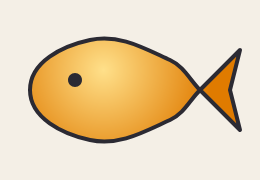

- O gradiente `corpo` usa os nomes `claro` e `escuro`.
- O peixe usa `c=corpo`. A cor dele vem da `palette`, passando pelo gradiente.

**Experimente:** na `palette`, troque para `claro=#bfe3ff escuro=#2f6fb5`. O peixe inteiro fica azul, com o brilho no mesmo lugar. No [capítulo 6](06-componentes.md#variantes-variant), as variantes usam isso para fazer o mesmo desenho em várias cores.

### Opções do `gradient`

| Opção | O que faz | Valores | Se não escrever |
|---|---|---|---|
| `linear x1,y1 x2,y2` | as cores mudam ao longo da linha entre os dois pontos | dois pontos `x,y` | um tipo é obrigatório |
| `radial cx,cy raio` | as cores mudam do centro até o raio | o centro, um raio maior que 0 | um tipo é obrigatório |
| `fx,fy` (no `radial`) | o foco, de onde sai a primeira cor | um ponto `x,y` | o centro |
| `box` | as medidas vão de 0 a 1 dentro de cada forma | — | medidas em pixels, no `canvas` |
| as cores, depois do `:` | as cores, em ordem | uma cor ou mais | obrigatório |
| `@posição` (em cada cor) | onde a cor fica na linha | de 0 a 1 | espalhadas por igual |

A ficha completa está na [referência do `gradient`](19-referencia.md#gradient).

No editor, a ferramenta **Degradê** (G) cria um gradiente quando você arrasta por cima de uma forma, e um painel muda as cores e as posições com o mouse ([capítulo 22](22-editor.md#degradê)).

**Cuidado:**
- Posições fora de 0 a 1, ou fora de ordem, são corrigidas, com um aviso: `#fff@1.5` vale 1.
- Um gradiente não vale onde só cabe o código `#` (a textura, as luzes, os efeitos das camadas): dá o erro `aqui só vale cor simples`.
- Um gradiente com o mesmo nome de uma cor da `palette` dá aviso, e vale a cor.
- Num componente ([capítulo 6](06-componentes.md)), os pontos sem `box` são medidos no componente, e o gradiente anda junto com cada cópia.

## Textura: `pattern`

Uma **textura** preenche uma forma com **linhas paralelas** (uma hachura) ou com **pontos**. Serve para o jeito de gravura ou de nanquim, para sombras, tecidos e madeira. Como o gradiente, ela ganha um nome e depois é usada como cor: `c=leve`.

```
pattern nome hatch [cross] [angle=graus] [gap=distância] [w=grossura] [c=cor] [bg=fundo]
pattern nome dots [angle=graus] [gap=distância] [r=raio] [c=cor] [bg=fundo]
```

<!-- gerar: img/03_padroes.png -->
```weasel
canvas 440 150 bg=#f4efe4
palette ink=#1a1712
pattern leve hatch angle=45 gap=8 w=1
pattern escura hatch angle=-30 gap=4 w=1.2 cross
pattern pontos dots gap=7 r=1.4
pattern listras hatch angle=90 gap=12 w=5 c=#c44536 bg=#ffe2d6

rect r1 20,20 90,90 c=leve ink=2
rect r2 125,20 90,90 c=escura ink=2
rect r3 230,20 90,90 c=pontos ink=2
rect r4 335,20 90,90 c=listras ink=2
text t1 65,136 "hatch" size=13 align=center
text t2 170,136 "hatch cross" size=13 align=center
text t3 275,136 "dots" size=13 align=center
text t4 380,136 "c= e bg=" size=13 align=center
```

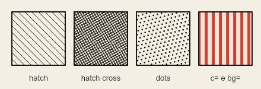

- `hatch` faz linhas. `cross` cruza as linhas com outras, a 90 graus.
- `dots` faz pontos.
- Sem `c=`, as linhas e os pontos saem com a cor da tinta (aqui, `#1a1712`). `c=` troca essa cor.
- Sem `bg=`, o que está atrás aparece entre as linhas. `bg=` pinta um fundo por baixo delas.
- Hachuras mais juntas ou cruzadas parecem mais escuras. É assim que a gravura faz sombra.

**Experimente:** no quadrado `listras`, troque `angle=90` por `angle=0`. As listras ficam deitadas.

### Inclinação das linhas: `angle=`

`angle=` é a direção das linhas, em graus. 0 é deitado; números maiores giram as linhas no sentido do relógio. Se não escrever, 45.

<!-- gerar: img/03_hachura_angulo.png -->
```weasel
canvas 440 150 bg=#f4efe6
palette ink=#1a1712
pattern a0 hatch angle=0
pattern a45 hatch angle=45
pattern a90 hatch angle=90
pattern am45 hatch angle=-45
rect r1 20,20 90,90 c=a0 ink=2
rect r2 125,20 90,90 c=a45 ink=2
rect r3 230,20 90,90 c=a90 ink=2
rect r4 335,20 90,90 c=am45 ink=2
text t1 65,136 "angle=0" size=14 align=center
text t2 170,136 "angle=45" size=14 align=center
text t3 275,136 "angle=90" size=14 align=center
text t4 380,136 "angle=-45" size=14 align=center
```

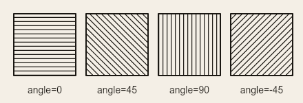

- `angle=0`: linhas deitadas. `angle=90`: linhas em pé.
- `angle=45`: as linhas **descem** para a direita, porque no Weasel o `y` cresce para baixo.
- `angle=-45`: as linhas **sobem** para a direita.

**Experimente:** troque `angle=45` por `angle=20`. As linhas ficam quase deitadas.

### Distância e grossura: `gap=` e `w=`

`gap=` é a distância entre uma linha e a próxima, em pixels: de 1.5 a 500 (se não escrever, 6). `w=` é a grossura de cada linha, em pixels: de 0.1 a 50 (se não escrever, 1.2). Os dois juntos decidem o quanto a hachura parece escura.

<!-- gerar: img/03_hachura_gap_w.png -->
```weasel
canvas 340 280 bg=#f4efe6
palette ink=#1a1712
pattern g4 hatch gap=4
pattern g8 hatch gap=8
pattern g16 hatch gap=16
pattern w05 hatch gap=10 w=0.5
pattern w2 hatch gap=10 w=2
pattern w5 hatch gap=10 w=5
rect a 20,20 90,90 c=g4 ink=2
rect b 125,20 90,90 c=g8 ink=2
rect c 230,20 90,90 c=g16 ink=2
rect d 20,155 90,90 c=w05 ink=2
rect e 125,155 90,90 c=w2 ink=2
rect f 230,155 90,90 c=w5 ink=2
text ta 65,134 "gap=4" size=14 align=center
text tb 170,134 "gap=8" size=14 align=center
text tc 275,134 "gap=16" size=14 align=center
text td 65,269 "w=0.5" size=14 align=center
text te 170,269 "w=2" size=14 align=center
text tf 275,269 "w=5" size=14 align=center
```

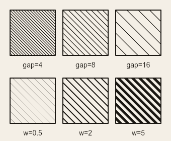

- Em cima, só o `gap=` muda. Linhas juntas (`gap=4`) parecem um cinza escuro; separadas (`gap=16`), um cinza bem claro.
- Embaixo, a distância é sempre 10, e só o `w=` muda. Com `w=5`, metade do quadrado fica preta: parece uma listra.
- Para uma sombra que escurece aos poucos, use o mesmo `angle=` e diminua o `gap=` (ou aumente o `w=`) de uma forma para a outra.

**Experimente:** no `g16`, acrescente `cross`. A hachura cruzada fica com cara de tela de janela.

### Pontos: `dots`, `r=` e `gap=`

Com `dots`, a textura é de **pontos**. `r=` é o raio de cada ponto, em pixels: de 0.1 a 50 (se não escrever, 1.4). `gap=` é a distância entre eles, como na hachura.

<!-- gerar: img/03_pontos.png -->
```weasel
canvas 340 280 bg=#f4efe6
palette ink=#1a1712
pattern r1 dots gap=10 r=1
pattern r2 dots gap=10 r=2.5
pattern r4 dots gap=10 r=4
pattern g5 dots gap=5 r=1.4
pattern g9 dots gap=9 r=1.4
pattern g16 dots gap=16 r=1.4
rect a 20,20 90,90 c=r1 ink=2
rect b 125,20 90,90 c=r2 ink=2
rect c 230,20 90,90 c=r4 ink=2
rect d 20,155 90,90 c=g5 ink=2
rect e 125,155 90,90 c=g9 ink=2
rect f 230,155 90,90 c=g16 ink=2
text ta 65,134 "r=1" size=14 align=center
text tb 170,134 "r=2.5" size=14 align=center
text tc 275,134 "r=4" size=14 align=center
text td 65,269 "gap=5" size=14 align=center
text te 170,269 "gap=9" size=14 align=center
text tf 275,269 "gap=16" size=14 align=center
```

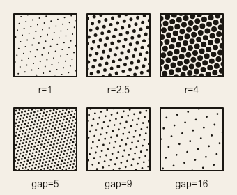

- Em cima, a distância é a mesma (10), e os pontos crescem. Com `r=4`, eles quase se encostam: o ponto tem 8 de largura, e a distância é 10.
- Embaixo, os pontos têm o mesmo tamanho, e só a distância muda.
- Os pontos ficam em fileiras desencontradas, como numa colmeia. As fileiras seguem o `angle=` (se não escrever, 45).

**Experimente:** na linha `pattern r4`, acrescente `c=#c44536 bg=#ffe2d6`. O quadrado fica com pontos vermelhos num fundo rosa.

### Opções do `pattern`

| Opção | O que faz | Valores | Se não escrever |
|---|---|---|---|
| `hatch` ou `dots` | linhas ou pontos | — | `hatch` |
| `cross` | cruza as linhas com outras, a 90 graus (só no `hatch`) | — | linhas de uma direção só |
| `angle=` | a inclinação das linhas, ou das fileiras de pontos | graus, qualquer número | 45 |
| `gap=` | a distância entre as linhas, ou entre os pontos | de 1.5 a 500, em pixels | 6 |
| `w=` | a grossura das linhas (só no `hatch`) | de 0.1 a 50, em pixels | 1.2 |
| `r=` | o raio dos pontos (só no `dots`) | de 0.1 a 50, em pixels | 1.4 |
| `c=` | a cor das linhas ou dos pontos | uma cor `#` | a cor da tinta |
| `bg=` | um fundo por baixo | uma cor `#` | sem fundo |

A ficha completa está na [referência do `pattern`](19-referencia.md#pattern).

**Cuidado:**
- A textura só preenche formas fechadas (`ellipse`, `rect`, `shape`), no `c=`. No `stroke`, na `line`, no `text` e no `inkc=`, o Weasel avisa e pinta só a cor das linhas. No `bg=` do `canvas`, é erro.
- O `c=` e o `bg=` da textura só aceitam o código `#` (ou um nome da `palette` que guarde um código). Com um nome em inglês, como `tomato`, o Weasel avisa (`use uma cor #hex aqui ("tomato")`), e as linhas saem na cor da tinta.
- Um `gap=`, `w=` ou `r=` fora da faixa dá aviso, e o Weasel usa o limite.

## Juntando tudo

Uma natureza-morta: uma maçã e duas cerejas num pano de bolinhas, em cima de uma mesa de madeira. Todas as cores têm nome, os volumes são gradientes, a sombra e os veios da madeira são texturas, e o contorno engrossa do lado oposto à luz.

<!-- gerar: img/03_natureza_morta.png -->
```weasel
canvas 480 360 bg=parede light=-0.7,-0.7

# as cores e as grossuras
palette ink=#3b2316 line=5
palette parede_alta=#fff3dc parede_baixa=#f2c48d madeira=#c27a45 madeira_esc=#8a4d26
palette maca_clara=#ffc2a8 maca=#e0342b maca_esc=#8e1414 cabo=#5a3a22
palette folha=#8fcf55 folha_esc=#2f7a2a veia=folha_esc

# os gradientes: a parede, o tampo da mesa, as frutas e a folha
gradient parede linear 0,0 0,260 : parede_alta parede_baixa
gradient tampo linear 0,260 0,360 : madeira madeira_esc
gradient fruta radial 0.5,0.5 0.6 0.32,0.28 box : maca_clara maca@0.45 maca_esc
gradient verde linear 0,0 1,1 box : folha folha_esc

# as texturas: os veios da madeira, a sombra e o pano
pattern veios hatch angle=0 gap=9 w=1.5 c=#6b3a1c
pattern sombra hatch cross angle=-30 gap=5 w=1 c=#3b2316
pattern bolinhas dots angle=0 gap=16 r=3.5 c=#fff6ea bg=#c94b3c

# a mesa: o gradiente e, por cima, os veios meio transparentes
rect mesa 0,260 480,100 c=tampo
rect madeira_veios 0,260 480,100 c=veios opacity=0.3

# o pano e as sombras das frutas
shape pano c=bolinhas ink=3 : 90,282! 400,270! 450,338! 50,348!
ellipse sombra_maca 262,300 104,20 c=sombra opacity=0.7
ellipse sombra_cerejas 392,312 44,10 c=sombra opacity=0.7

# a maçã
shape maca c=fruta ink=line weight=0.8 : 240,142 285,122 330,138 354,184 346,240 316,284 276,300 240,292 204,300 164,284 134,240 126,184 150,138 195,122
ellipse brilho 184,176 13,24 rot=25 c=#ffffff99
stroke cabo w=7 c=cabo : 240,146 236,122 246,98
shape folha c=verde ink=3 weight=0.5 : 244,114! 266,84 310,80! 288,108
stroke veia w=2 c=veia : 248,112 306,82

# as cerejas usam o mesmo gradiente da maçã
stroke cabos w=3 c=cabo : 372,292 386,236 404,206
stroke cabos w=3 c=cabo : 410,296 400,240 404,206
ellipse cereja1 372,296 20 c=fruta ink=4 weight=0.8
ellipse cereja2 412,300 20 c=fruta ink=4 weight=0.8
```

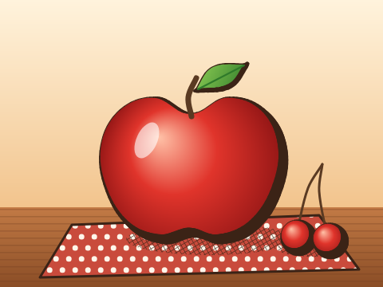

- **As cores:** a `palette` guarda todas. `veia=folha_esc` copia a cor escura da folha, e `ink=#3b2316` faz a cor da tinta ser um marrom-escuro: todos os contornos saem dessa cor.
- **A parede e a mesa:** dois gradientes `linear`, de cima para baixo. Os veios são uma hachura deitada, num retângulo por cima do tampo com `opacity=0.3`.
- **As frutas:** um gradiente `radial` com `box` serve para a maçã e para as duas cerejas. O foco em cima, à esquerda, combina com a luz do `canvas`.
- **O brilho:** uma elipse branca com transparência na cor (`#ffffff99`).
- **As sombras:** uma hachura cruzada, com `opacity=0.7`, embaixo de cada fruta.
- **O contorno:** `light=-0.7,-0.7` põe a luz em cima, à esquerda, e o `weight=` engrossa o contorno embaixo, à direita.

**Experimente:** troque `maca=#e0342b maca_esc=#8e1414` por `maca=#8fcf55 maca_esc=#3f7a1a`. A maçã e as cerejas ficam verdes de uma vez. Depois mude o `light=` para `0.7,-0.7`: o contorno grosso passa para o lado esquerdo.

## Resumo

- Uma cor pode ser `#rgb`, `#rrggbb`, `#rrggbbaa` (com transparência no fim), um nome em inglês (`tomato`) ou `none`.
- `ink=` é a grossura do contorno, metade para dentro e metade para fora da borda; `inkc=` é a cor dele. Com `ink=` e sem `c=`, a forma fica vazia. O `weight=` engrossa o contorno do lado oposto ao `light=` do `canvas`.
- `opacity=` deixa a forma inteira transparente, de 0 a 1. A transparência na cor vale só para aquela cor.
- A `palette` dá nome às cores e às grossuras. Na `palette`, `ink` é a cor da tinta; numa forma, `ink=` é a grossura do contorno.
- `gradient` faz cores que mudam aos poucos, ao longo de uma linha (`linear`) ou do centro para fora (`radial`); com `box`, ele se ajusta a cada forma.
- `pattern` faz texturas de linhas (`hatch`) ou de pontos (`dots`) para preencher as formas fechadas.

[← Formas](02-formas.md) · [Índice](README.md) · [Próximo: Camadas →](04-camadas.md)
