# 3. Cores e estilos

[← Formas](02-formas.md) · [Índice](README.md) · [Próximo: Camadas →](04-camadas.md)

## Escrevendo uma cor

Em qualquer lugar que pede cor (`c=`, `inkc=`, `bg=`…) vale:

| Forma | Exemplo | Observação |
|---|---|---|
| `#rgb` | `#f80` | curta: cada letra vale dobrada (`#f80` = `#ff8800`) |
| `#rrggbb` | `#ff8800` | a mais comum |
| `#rrggbbaa` | `#ff880080` | os dois últimos dígitos são a **transparência** (`00` invisível, `80` metade, `ff` sólida) |
| `#rgba` | `#f808` | a curta com transparência: `#f808` = `#ff880088` |
| nome da `palette` | `pele` | veja abaixo |
| nome de um `gradient` ou `pattern` | `ceu` | veja abaixo |
| nome de cor do CSS | `tomato`, `gold` | em inglês |
| `none` | `c=none` | sem cor (sem preenchimento; com `ink=`, fica só o contorno). `transparent` é o mesmo |

Os códigos `#` são números em hexadecimal: cada par de dígitos, de `00` (nada) a `ff` (o máximo), diz quanto vai de **vermelho**, **verde** e **azul**. `#ff8800` é vermelho no máximo, verde pela metade e nada de azul: laranja. Não precisa decorar: no editor, **Alt+clique** em cima de um código de cor abre um seletor de cores, e o código muda sozinho quando você escolhe.

Os mesmos tons, escritos de cada jeito:

<!-- gerar: img/03_jeitos.png -->
```weasel
canvas 500 150 bg=#f4efe6
palette ink=#2b2a33
rect faixa 0,30 500,20 c=#2b2a33
rect a 20,20 60,80 c=#f80 ink=2
rect b 100,20 60,80 c=#ff8800 ink=2
rect c 180,20 60,80 c=#f808 ink=2
rect d 260,20 60,80 c=tomato ink=2
rect e 340,20 60,80 c=gold ink=2
rect f 420,20 60,80 c=none ink=2
text ta 50,124 "#f80" size=14 align=center
text tb 130,124 "#ff8800" size=14 align=center
text tc 210,124 "#f808" size=14 align=center
text td 290,124 "tomato" size=14 align=center
text te 370,124 "gold" size=14 align=center
text tf 450,124 "none" size=14 align=center
```

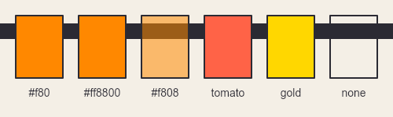

Repare:

- `#f80` e `#ff8800` são **a mesma cor**: na forma curta, cada dígito vale dobrado.
- `#f808` é o mesmo laranja com transparência `88` (um pouco mais da metade): a faixa escura aparece através dele.
- `tomato` e `gold` são nomes do CSS, a lista de cores com nome da web (em inglês).
- `none` não pinta nada por dentro: com `ink=2`, sobra só o contorno, e a faixa aparece inteira.

> Os nomes do CSS valem nas formas, no texto, no fundo e nos gradientes. Em `pattern`, nas luzes, nas partículas e nos efeitos de camada, o Weasel pede uma cor `#hex` (ou um nome da `palette` que seja `#hex`) e avisa se receber um nome do CSS. Para **animar** uma cor aos poucos ([capítulo 7](07-animacao.md)), use `#hex` também: com nomes do CSS, a cor troca de uma vez no fim, sem passar pelas cores do meio.

### Transparência

A transparência deixa ver o que está **atrás** da forma. Serve para vidro, água, sombras, brilhos e fantasmas. Aqui, três círculos uns por cima dos outros:

<!-- gerar: img/03_transparencia.png -->
```weasel
canvas 440 180 bg=#f4efe6
ellipse vermelha 160,90 70 c=#e8443a
ellipse azul 240,90 70 c=#2f6fb580
ellipse amarela 300,90 60 c=#ffb00099
```

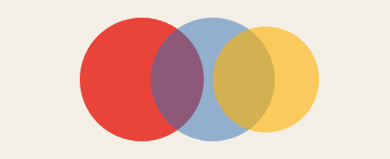

O azul tem `80` no fim (metade transparente) e o amarelo `99` (60% sólido): dá para ver o que está atrás. A transparência de uma forma inteira, com contorno e tudo, também pode ser dada com `opacity=0.5`.

As duas parecem iguais, mas não são. A transparência na cor vale **só para aquela cor**; o `opacity=` vale **para a forma inteira**:

<!-- gerar: img/03_alfa_opacity.png -->
```weasel
canvas 440 200 bg=#f4efe6
palette ink=#2b2a33
rect faixa 20,72 400,36 c=#c44536
ellipse alfa 110,90 60 c=#4a90d980 ink=8
ellipse opac 330,90 60 c=#4a90d9 ink=8 opacity=0.5
text t1 110,184 "c=#4a90d980" size=14 align=center
text t2 330,184 "opacity=0.5" size=14 align=center
```

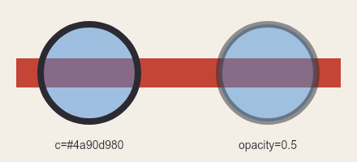

- À esquerda, `c=#4a90d980`: o azul é meio transparente, mas o contorno (`ink=8`, na cor de tinta) continua sólido.
- À direita, `opacity=0.5`: o azul **e** o contorno ficam meio transparentes.

**Experimente:** à esquerda, acrescente `inkc=#2b2a3380`. Agora o contorno também tem transparência, só que escolhida à parte da do preenchimento.

## A palette: cores com nome

Escrever `#c4512b` em dez lugares é ruim de ler e pior de mudar. A `palette` dá **nomes** às cores (e às espessuras):

```
palette pele=#f1d9b5 cabelo=#5e4030 line=6
```

Depois, em vez do código, usa-se o nome: `c=pele`, `ink=line`. Mudou a cor na `palette`, mudou em todo o desenho.

<!-- gerar: img/03_casa.png -->
<!-- gerar: img/03_casa_noite.png --variant noite -->
```weasel
canvas 400 260 bg=ceu
palette ink=#2b2a33 line=5 fino=3
palette ceu=#bfe3f5 parede=#f1d9b5 telhado=#c4512b porta=#7a4a2c janela=#e8f4fb grama=#7cc56a

rect chao 0,222 400,40 c=grama
rect parede 110,120 180,110 c=parede ink=line
shape telhado c=telhado ink=line : 90,124! 200,50! 310,124!
rect porta 180,160 44,70 r=6 c=porta ink=line
rect janela1 128,140 36,36 c=janela ink=fino
rect janela2 238,140 36,36 c=janela ink=fino

variant noite ceu=#1b2140 grama=#2f5a3a parede=#a99a8a janela=#ffd56b
```

| Padrão | Com `--variant noite` |
|---|---|
|  |  |

Repare:

- Uma `palette` pode ter **cores e números**. Os números são espessuras: `ink=line` usa o 5 de `line`, e `ink=fino` usa o 3.
- Pode haver várias linhas `palette`; elas se somam.
- Um nome da `palette` pode valer outro nome: `palette sombra=cabelo` copia a cor de `cabelo` (com um exemplo [mais abaixo](#um-nome-que-copia-outro-sombracabelo)).
- O fundo também aceita nome: `bg=ceu`.

### Nomes que já existem

Quatro nomes vêm prontos em todo desenho, mesmo sem nenhuma linha `palette`. É como se todo arquivo começasse com esta linha escondida:

```
palette ink=#14141c line=8 inner=5 edge=3
```

| Nome | Valor | O que é |
|---|---|---|
| `ink` | `#14141c` (quase preto) | uma **cor**: a cor de tinta |
| `line` | `8` | um **número**: espessura de contorno grosso (o de fora do personagem) |
| `inner` | `5` | um número: espessura média (rugas, dobras, detalhes de dentro) |
| `edge` | `3` | um número: espessura fina |

Eles funcionam de jeitos diferentes:

- **`ink` é usada sozinha.** Quando você não diz a cor, o Weasel usa a cor de tinta: no contorno de quem tem `ink=`, nos `stroke`, `line` e `text` sem `c=`, e numa forma fechada sem `c=` nem `ink=`, que sai pintada inteira dessa cor. O nome também serve como qualquer outra cor: `c=ink`.
- **`line`, `inner` e `edge` só valem onde você escreve o nome.** Eles são números com nome, prontos para usar em `ink=` e `w=`. Uma forma sem `ink=` continua sem contorno, e um `stroke` sem `w=` continua com 4.

Este exemplo não tem nenhuma `palette` e usa os quatro:

<!-- gerar: img/03_nomes_prontos.png -->
```weasel
canvas 480 210 bg=#f4efe6

ellipse grosso 90,90 55 c=#ffd23f ink=line
ellipse medio 240,90 55 c=#ffd23f ink=inner
ellipse fino 390,90 55 c=#ffd23f ink=edge
ellipse olhoE 222,72 6,9 c=ink
ellipse olhoD 258,72 6,9 c=ink
stroke boca w=edge : 215,100 240,118 265,100

text t1 90,190 "ink=line" size=20 align=center
text t2 240,190 "ink=inner" size=20 align=center
text t3 390,190 "ink=edge" size=20 align=center
```

- Os três círculos têm contorno de 8, 5 e 3 pixels, todos na cor de tinta, porque nenhum tem `inkc=`.
- Os olhos usam `c=ink` como cor de preenchimento. A boca (`w=edge`, 3 pixels) e os textos não têm `c=`, então também saem na cor de tinta.

**Mudar um nome muda o desenho inteiro.** Escreva os mesmos nomes numa `palette`, e o valor novo vale em todo lugar que usa o nome. Mesmo desenho, com uma linha a mais no começo:

<!-- gerar: img/03_nomes_mudados.png -->
```weasel
canvas 480 210 bg=#f4efe6
palette ink=#8a3b12 line=14 edge=1

ellipse grosso 90,90 55 c=#ffd23f ink=line
ellipse medio 240,90 55 c=#ffd23f ink=inner
ellipse fino 390,90 55 c=#ffd23f ink=edge
ellipse olhoE 222,72 6,9 c=ink
ellipse olhoD 258,72 6,9 c=ink
stroke boca w=edge : 215,100 240,118 265,100

text t1 90,190 "ink=line" size=20 align=center
text t2 240,190 "ink=inner" size=20 align=center
text t3 390,190 "ink=edge" size=20 align=center
```

| Sem `palette` | Com `palette ink=#8a3b12 line=14 edge=1` |
|---|---|
| 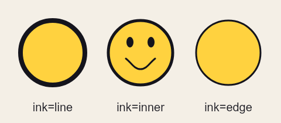 | 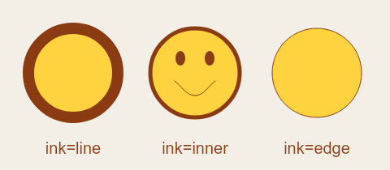 |

- Tudo que estava quase preto ficou marrom: contornos, olhos, boca e textos.
- O primeiro círculo engrossou (`line` foi de 8 para 14). O último afinou, e a boca também, porque os dois usam `edge`, que foi de 3 para 1. O contorno do meio não mudou, porque `inner` continua 5.

É por isso que vale escrever `ink=line` em vez de `ink=8`. Se o contorno ficar grosso demais, você muda um número só (`palette line=6`), em vez de procurar cada `8` do desenho. Você também pode criar os seus próprios nomes de espessura, como o `fino=3` da casa; estes quatro só já vêm prontos.

> Cuidado com o nome repetido: o `inner` da `palette` é uma **espessura** (um número de pixels), e o `inner=` do `finish` é a **opacidade** (de 0 a 1) dos traços que ficam dentro de camadas com `clip`. O [capítulo 4](04-camadas.md#os-dois-inner) mostra os dois lado a lado.

### Variantes: outra versão das cores

A última linha do exemplo é uma **variante**:

```
variant noite ceu=#1b2140 grama=#2f5a3a parede=#a99a8a janela=#ffd56b
```

Ela não muda nada sozinha: diz "na versão `noite`, troque estas cores da `palette`". Serve para inimigos recoloridos, dia e noite, times de cores, roupas. A variante só alcança o que usa o nome: uma cor escrita direto, como `#c4512b`, não muda. Por isso é bom dar nome a toda cor que você talvez queira trocar.

- **No editor:** o seletor de variante fica na barra da vista do desenho.
- **Na linha de comando:** `--variant noite` exporta essa versão; `--variant all` exporta todas de uma vez (com o nome da variante no fim do arquivo).

Com a casa salva como `casa.weasel`, a linha de comando responde assim:

```
$ node cli/weasel.js casa.weasel --variant all
salvo casa.png  400×260 · 6 KB
salvo casa_noite.png  400×260 · 5 KB

$ node cli/weasel.js casa.weasel --variant noite
salvo casa.png  400×260 · 5 KB

$ node cli/weasel.js casa.weasel --variant dia
weasel: variante "dia" não existe (tem: noite)
```

Repare que `--variant noite` sozinho salva com o nome de sempre (`casa.png`), por cima da versão padrão. Para guardar as duas, use `--variant all` ou escolha o nome: `--variant noite -o casa_noite.png`. E `--info` lista as variantes que o arquivo tem (`variantes noite`).

### Um nome que copia outro: `sombra=cabelo`

Às vezes duas partes têm a mesma cor, mas você quer dar a cada uma o nome do **uso**: a sobrancelha tem a cor do cabelo. `palette sobrancelha=cabelo` cria o nome `sobrancelha` com a cor que `cabelo` tem naquela hora.

<!-- gerar: img/03_apelido.png -->
<!-- gerar: img/03_apelido_ruivo.png --variant ruivo -->
```weasel
canvas 240 200 bg=#cfe8f5
palette ink=#2b2a33 line=4
palette pele=wheat cabelo=#5e4030
palette sobrancelha=cabelo

ellipse cabeca 120,110 60 c=pele ink=line
shape franja c=cabelo ink=line : 62,96 70,58 120,44 170,58 178,96! 150,72 120,80 90,72!
stroke sobrE w=6 c=sobrancelha : 88,98 98,92 110,96
stroke sobrD w=6 c=sobrancelha : 130,96 142,92 152,98
ellipse olhoE 100,112 5,7 c=ink
ellipse olhoD 140,112 5,7 c=ink
stroke boca w=3 : 104,140 120,148 136,140

variant ruivo cabelo=#c4512b
```

| Padrão | Com `--variant ruivo` |
|---|---|
|  |  |

Repare:

- `pele=wheat`: um nome da `palette` também pode receber um nome de cor do CSS.
- `sobrancelha=cabelo` vem **depois** de `cabelo` (aqui, na linha de baixo; na mesma linha, mais à direita, também vale). O nome copiado precisa já existir: escrito antes, dá o erro `valor inválido "cabelo"`.
- Na versão `ruivo`, o cabelo mudou e as sobrancelhas **não**. `sobrancelha=cabelo` copiou a cor castanha na hora em que a `palette` foi lida; a variante troca só o nome que ela cita.

**Experimente:** escreva `variant ruivo cabelo=#c4512b sobrancelha=#c4512b`. Agora a variante troca os dois, e as sobrancelhas acompanham o cabelo.

### Variantes que trocam peças: `show=` e `hide=`

Além das cores, uma variante pode **esconder** e **mostrar** partes do desenho. É o que os jogos chamam de *skin*: o mesmo personagem com peças trocadas (outra arma, um chapéu, sem o elmo).

<!-- gerar: img/03_pecas.png -->
<!-- gerar: img/03_pecas_mago.png --variant mago -->
<!-- gerar: img/03_pecas_sem_elmo.png --variant sem_elmo -->
```weasel
canvas 200 160 bg=#cfe8f5
palette ink=#2b2a33 line=4 pele=#ffb36b

layer boneco
ellipse cabeca 100,76 34 c=pele ink=line
ellipse olhoE 88,72 4,6 c=ink
ellipse olhoD 112,72 4,6 c=ink
rect elmo 66,36 68,22 r=8 c=#9aa6b2 ink=line
shape chapeu c=#6a4bc4 ink=line hidden : 100,4! 130,50! 70,50!

layer espada
rect lamina 142,50 8,72 c=#d9dde3 ink=line
rect guarda 132,114 28,8 r=3 c=#c58a4c ink=line

layer cajado hidden
stroke vara w=6 c=#8a5a2b : 148,42 152,146
ellipse gema 148,36 9 c=#7ae0ff ink=line

variant mago pele=#ffd9a0 hide=elmo,espada show=chapeu,cajado
variant sem_elmo hide=elmo
```

| Padrão | `--variant mago` | `--variant sem_elmo` |
|---|---|---|
| 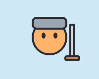 | 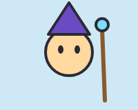 | 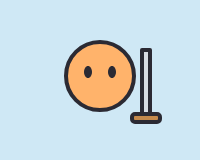 |

- `hide=` esconde formas ou camadas inteiras nessa versão. A espada é uma camada com duas formas, então `hide=espada` some com a lâmina e com a guarda.
- `show=` mostra o que está escondido no código com `hidden`: o chapéu (uma forma) e o cajado (uma camada `hidden`).
- O nome vale para todas as formas com aquele nome, também dentro de componentes.
- A mesma variante pode trocar cores e peças, como `mago`, que também clareia a pele.
- O que some continua servindo de molde para `clip` e `cut`, como qualquer forma `hidden`.
- Num filme, `at 3s heroi.variant=mago` troca as peças no meio da cena ([capítulo 10](10-filme.md#mudanças-no-tempo-at)).

## Gradientes

Um gradiente é uma cor que muda aos poucos. Primeiro ele é declarado com um nome; depois o nome é usado como cor.

### Linear

```
gradient nome linear x1,y1 x2,y2 : cor1 cor2 cor3…
```

As cores mudam ao longo da linha que vai de `x1,y1` até `x2,y2`. Depois do `:` vêm as cores. Cada uma pode ter a posição na linha, de 0 a 1, com `@` (`#fff@0.3`); sem `@`, elas se espalham por igual.

<!-- gerar: img/03_gradientes.png -->
```weasel
canvas 440 240 bg=ceu
gradient ceu linear 0,0 0,240 : #1b2a5c #e86f4a@0.7 #ffcf7a
gradient brilho radial 220,196 80 : #fff6c8 #ffd27a@0.4 #ff9a4a00

ellipse halo 220,196 80 c=brilho
ellipse sol 220,196 34 c=#fff1b8
shape morro c=#2a1f3d : 0,206 120,176 240,200 360,170 440,192! 440,240! 0,240!
```


- `ceu` vai de `0,0` até `0,240`: de cima para baixo, azul → laranja (a 70% da altura) → amarelo.
- `bg=ceu` pinta o **fundo** inteiro com o gradiente. O `canvas` vem antes do `gradient` no código, e mesmo assim funciona: o Weasel lê todos os gradientes antes de decidir a cor do fundo.
- As coordenadas do gradiente linear são as do **canvas**: o céu do fundo e uma forma pequena pintada com `ceu` pegam o mesmo trecho de cor.

### A direção do gradiente linear

Os dois pontos do `linear` formam uma **linha**: a primeira cor fica no começo dela, a última no fim, e a cor muda ao longo dela. Mudando os pontos, muda a direção:

<!-- gerar: img/03_direcao.png --guides -->
```weasel
canvas 440 200 bg=#f4efe6
palette ink=#2b2a33 azul=#2f6fb5 amarelo=#ffd34d
gradient deitado linear 20,80 140,80 : azul amarelo
gradient empe linear 220,20 220,140 : azul amarelo
gradient torto linear 300,20 420,140 : azul amarelo
rect a 20,20 120,120 c=deitado
rect b 160,20 120,120 c=empe
rect c 300,20 120,120 c=torto
text ta 80,170 "20,80 140,80" size=14 align=center
text tb 220,170 "220,20 220,140" size=14 align=center
text tc 360,170 "300,20 420,140" size=14 align=center

layer setas guide
line la c=#c44536 w=2 : 20,80 140,80
ellipse pa 20,80 5 c=#c44536
line lb c=#c44536 w=2 : 220,20 220,140
ellipse pb 220,20 5 c=#c44536
line lc c=#c44536 w=2 : 300,20 420,140
ellipse pc 300,20 5 c=#c44536
```

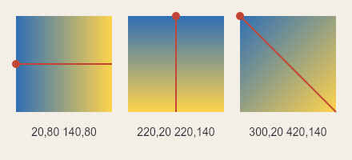

Repare:

- A linha vermelha (numa camada `guide`) liga os dois pontos de cada gradiente. A bolinha marca o primeiro ponto, onde fica o azul.
- `20,80 140,80`: os dois pontos na mesma altura, então a cor muda da esquerda para a direita.
- `220,20 220,140`: os dois no mesmo x, então a cor muda de cima para baixo.
- `300,20 420,140`: do canto de cima à esquerda até o de baixo à direita, na diagonal.
- Os pontos são do canvas. Por isso cada quadrado tem o seu gradiente, com os pontos em cima dele.

**Experimente:** troque a ordem dos pontos de `deitado` (`140,80 20,80`). O azul passa para a direita.

### Onde cada cor fica: `cor@posição`

Sem `@`, as cores se espalham por igual ao longo da linha. Com `@`, você diz **onde** cada cor fica: `0` é o começo da linha, `1` é o fim, `0.5` é o meio.

<!-- gerar: img/03_paradas.png -->
```weasel
canvas 440 200 bg=#f4efe6
palette ink=#2b2a33 azul=#2f6fb5 amarelo=#ffd34d branco=#ffffff
gradient g1 linear 20,0 220,0 : azul amarelo
gradient g2 linear 20,0 220,0 : azul@0.4 amarelo@0.6
gradient g3 linear 20,0 220,0 : azul@0.5 amarelo@0.5
gradient g4 linear 20,0 220,0 : azul branco@0.2 amarelo
rect a 20,20 200,30 c=g1
rect b 20,65 200,30 c=g2
rect c 20,110 200,30 c=g3
rect d 20,155 200,30 c=g4
text ta 235,41 "azul amarelo" size=14
text tb 235,86 "azul@0.4 amarelo@0.6" size=14
text tc 235,131 "azul@0.5 amarelo@0.5" size=14
text td 235,176 "azul branco@0.2 amarelo" size=14
```

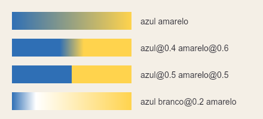

Repare:

- `azul amarelo`: sem `@`, o azul fica em 0 e o amarelo em 1. A mistura ocupa a faixa toda.
- `azul@0.4 amarelo@0.6`: antes de 40%, tudo azul; depois de 60%, tudo amarelo. A mistura só acontece no meio.
- `azul@0.5 amarelo@0.5`: as duas cores no mesmo lugar. Não sobra espaço para misturar, e a faixa fica **cortada** em duas cores. É assim que se faz uma listra dura.
- `azul branco@0.2 amarelo`: o branco fica a 20% da linha; o azul (sem `@`) fica no começo, e o amarelo, no fim.

**Experimente:** na última faixa, troque `branco@0.2` por `branco@0.8`. O branco anda para perto do amarelo.

### Radial

```
gradient nome radial cx,cy raio [fx,fy] : cores
```

As cores mudam do centro `cx,cy` para fora, até o `raio`. O halo do sol acima é radial: amarelo claro no meio, laranja e, na borda, laranja com transparência `00` (some suavemente).

O ponto `fx,fy` opcional é o **foco**: de onde a primeira cor sai. Com o foco fora do centro, uma bola parece iluminada de lado:

<!-- gerar: img/03_radial.png -->
```weasel
canvas 440 200 bg=#f4efe6
palette ink=#2b2a33
gradient centrado radial 120,100 80 : #ffd0c4 #e8443a@0.6 #8c1e1a
gradient focado radial 320,100 80 290,70 : #ffd0c4 #e8443a@0.6 #8c1e1a
ellipse a 120,100 70 c=centrado ink=4
ellipse b 320,100 70 c=focado ink=4
```

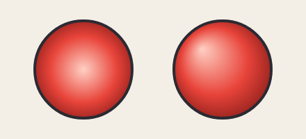

- Os dois gradientes têm o centro no meio da bola e raio `80` (em pixels), um pouco maior que a bola (70): o vermelho mais escuro só aparece bem na borda.
- `focado` tem o foco em `290,70`: 30 pixels à esquerda e 30 acima do centro. A cor clara sai dali, como o reflexo de uma luz em cima, à esquerda.

**Experimente:** mude o foco para `350,130`. O reflexo vai para baixo, à direita, como se a luz viesse do chão.

### `box`: um gradiente que se ajusta a cada forma

Com a opção `box`, as coordenadas do gradiente deixam de ser pixels: vão de **0 a 1 dentro de cada forma** que o usa. `0,0` é o canto de cima à esquerda da forma, `1,1` o de baixo à direita. Assim o mesmo gradiente serve para formas de tamanhos e lugares diferentes:

<!-- gerar: img/03_box.png -->
```weasel
canvas 440 220 bg=#f4efe6
palette ink=#2b2a33
gradient vidro linear 0,0 1,0 box : #2f6fb5 #9fd0f5@0.3 #2f6fb5@0.7 #173a66
rect garrafa 40,40 70,150 r=20 c=vidro ink=4
rect pote 150,110 140,80 r=12 c=vidro ink=4
rect tubo 330,20 40,170 r=20 c=vidro ink=4
```

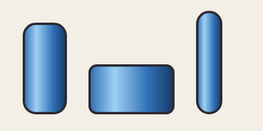

`0,0 1,0` vai da esquerda para a direita de cada forma, e o brilho cai sempre a 30% da largura. Sem `box`, as três pegariam pedaços diferentes de um gradiente só, preso ao canvas.

- No radial com `box`, o raio também é relativo: `radial 0.5,0.3 0.75 box` é um círculo centrado a 50% da largura e 30% da altura, com raio de 75% do tamanho médio da forma (exemplo logo abaixo).
- As cores do gradiente podem ser nomes da `palette`: `: pena@0.15 penad@1`. Uma variante que troca `pena` troca o gradiente também (exemplo mais abaixo).
- Gradiente vale em `c=`, `inkc=` e `bg=` (e também no `c=` de traços e textos). Numa forma presa a um osso, ele anda junto com ela.

### Radial com `box`: o mesmo brilho em bolas diferentes

O `box` serve também para o radial. É o jeito de dar o mesmo brilho a várias bolas (olhos, frutas, bolhas) sem escrever um gradiente para cada uma:

<!-- gerar: img/03_radial_box.png -->
```weasel
canvas 440 200 bg=#f4efe6
palette ink=#2b2a33
gradient bola radial 0.5,0.5 0.5 0.35,0.3 box : #ffd0c4 #e8443a@0.5 #8c1e1a
ellipse grande 100,100 80 c=bola ink=4
ellipse media 250,120 50 c=bola ink=4
ellipse pequena 360,140 26 c=bola ink=4
ellipse oval 380,60 46,26 c=bola ink=4
```

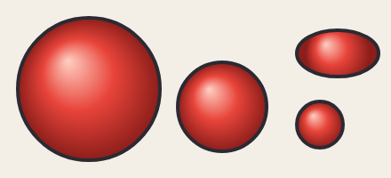

Repare:

- `0.5,0.5` é o centro, no meio de cada forma.
- O raio `0.5` é metade do **tamanho médio** da forma (a média entre a largura e a altura). Num círculo, isso dá exatamente o raio dele: a última cor chega na borda.
- O foco `0.35,0.3` fica a 35% da largura e 30% da altura: o brilho sai de cima, à esquerda, em todas.
- Na oval, o brilho também fica no lugar certo: as posições acompanham a largura e a altura da forma.

**Experimente:** troque o foco por `0.65,0.3`. A luz passa para cima, à direita, em todas as bolas de uma vez.

### Gradiente no contorno, no traço e no texto

Um gradiente serve em qualquer lugar que pede cor: no preenchimento (`c=`), no contorno (`inkc=`), nos traços e no texto.

<!-- gerar: img/03_grad_onde.png -->
```weasel
canvas 440 220 bg=#f4efe6
gradient arco linear 20,0 420,0 : #e8443a #ffb000 #6cbb3c #2f6fb5 #8e44ad
ellipse bola 80,80 50 c=#ffffff ink=10 inkc=arco
stroke onda w=10 c=arco : 160,110 220,50 280,110 340,50 410,100
text nome 220,190 "Weasel" size=48 bold align=center c=arco
```

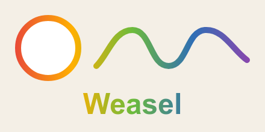

Repare:

- O gradiente `arco` vai da esquerda (`x=20`, vermelho) até a direita (`x=420`, roxo), em coordenadas do canvas.
- Cada coisa pega o trecho de cores que está **no lugar dela**: o círculo, que fica à esquerda, pega o vermelho e o laranja; a onda, o meio e a direita.
- No texto, cada letra pega a cor do lugar onde está.

**Experimente:** acrescente `box` ao gradiente (`linear 0,0 1,0 box`). Agora cada coisa tem o arco-íris inteiro, de ponta a ponta.

### Gradiente com cores da palette

As cores de um gradiente podem ser nomes da `palette`. Assim, uma variante que troca as cores troca o gradiente também:

<!-- gerar: img/03_grad_variante.png -->
<!-- gerar: img/03_grad_variante_azul.png --variant azul -->
```weasel
canvas 260 180 bg=#f4efe6
palette ink=#2b2a33 claro=#ffe08a escuro=#e07b00
gradient corpo radial 0.35,0.3 0.7 box : claro escuro

shape peixe c=corpo ink=4 : 30,90 90,40 170,60 200,90! 240,50! 230,90! 240,130! 200,90! 170,120 90,140
ellipse olho 75,80 7 c=ink

variant azul claro=#bfe3ff escuro=#2f6fb5
```

| Padrão | Com `--variant azul` |
|---|---|
| 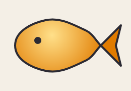 | 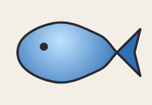 |

Repare:

- O gradiente `corpo` usa `claro` e `escuro`, nomes da `palette`.
- A variante `azul` troca esses dois nomes, e o peixe inteiro muda de cor, com o brilho no mesmo lugar.
- Se o gradiente usasse códigos direto (`#ffe08a`), a variante não alcançaria o peixe.

**Experimente:** acrescente a linha `variant verde claro=#d8f5b0 escuro=#3a8a2a` e exporte com `--variant verde` (ou escolha `verde` no seletor de variante do editor).

### Editando no painel do gradiente

No editor, você não precisa escrever as posições e as cores à mão. Com o cursor numa linha `gradient`, ou numa forma pintada com um gradiente (`c=` ou `inkc=`), abre o painel do gradiente, no canto de cima à esquerda do desenho:

- A **barra** mostra o gradiente. Cada cor é uma **marca** embaixo dela: arraste a marca para mudar a posição (com **Shift**, de 0.05 em 0.05). Ela pode passar por outra, e a ordem na linha acompanha.
- **Clique na barra** para pôr uma cor nova ali, já com a cor que estava naquele ponto. **Botão direito** numa marca tira a cor (ou o botão **Tirar**).
- Embaixo ficam a cor, a opacidade e a posição da marca escolhida. No campo de texto vale também um nome da `palette` (**Enter** grava). Mudar a cor ou a opacidade de um nome da palette troca o nome por um `#hex`.
- Em cima, `linear`/`radial` troca o tipo, e `box` liga e desliga o 0 a 1. Ligar ou desligar `box` faz a conta na primeira forma que usa o gradiente (ou na forma da linha do cursor), e ela continua igual.
- No desenho, a linha do gradiente aparece tracejada, com uma bolinha de cada cor. No linear, as alças são o começo e o fim (com **Shift**, a direção anda de 45 em 45 graus); no radial, o centro, o raio e o foco. Com `box`, um retângulo tracejado mostra a forma onde o 0 e o 1 caem.

Arrastar uma marca ou uma alça é um **Ctrl+Z** só. Quando você mexe nas posições, todas passam a ficar escritas na linha (menos o `@0` da primeira e o `@1` da última, que já são o padrão). Assim nenhuma cor muda de lugar sozinha.

## Hachura e pontos: `pattern`

Para estilo de gravura ou nanquim, uma forma pode ser preenchida com **linhas paralelas** ou **pontos**:

```
pattern nome hatch [cross] angle=graus gap=espaço w=espessura c=cor bg=fundo
pattern nome dots gap=espaço r=raio c=cor bg=fundo
```

<!-- gerar: img/03_padroes.png -->
```weasel
canvas 440 150 bg=#f4efe4
palette ink=#1a1712
pattern leve hatch angle=45 gap=8 w=1
pattern escura hatch angle=-30 gap=4 w=1.2 cross
pattern pontos dots gap=7 r=1.4
pattern listras hatch angle=90 gap=12 w=5 c=#c44536 bg=#ffe2d6

rect r1 20,20 90,90 c=leve ink=2
rect r2 125,20 90,90 c=escura ink=2
rect r3 230,20 90,90 c=pontos ink=2
rect r4 335,20 90,90 c=listras ink=2
text t1 65,136 "hatch" size=13 align=center
text t2 170,136 "hatch cross" size=13 align=center
text t3 275,136 "dots" size=13 align=center
text t4 380,136 "c= e bg=" size=13 align=center
```

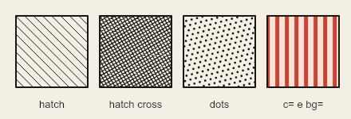

| Atributo | Padrão | O que faz |
|---|---|---|
| `hatch` / `dots` | `hatch` | linhas ou pontos |
| `cross` | — | cruza a hachura com outra a 90° |
| `angle=` | 45 | inclinação das linhas, em graus |
| `gap=` | 6 | distância entre as linhas (ou entre os pontos) |
| `w=` | 1.2 | espessura das linhas |
| `r=` | 1.4 | raio dos pontos |
| `c=` | cor de tinta | cor das linhas ou dos pontos |
| `bg=` | nenhum | cor de fundo por baixo do padrão |

O padrão vale só em `c=` de formas fechadas (não no fundo do canvas) e acompanha a forma quando ela se mexe. Hachuras mais juntas ou cruzadas parecem mais escuras: é assim que a gravura faz sombra. O exemplo [`exemplos/gravura.weasel`](../../exemplos/gravura.weasel) desenha uma maçã só com isso.

O `c=` e o `bg=` do `pattern` só aceitam cor simples: `#hex` ou um nome da `palette` que seja `#hex` (com um nome do CSS, como `tomato`, o Weasel avisa e não usa a cor). As próximas três partes mexem num número de cada vez.

### Inclinação das linhas: `angle=`

`angle=` é a direção das linhas, em graus, do mesmo jeito que os outros ângulos do Weasel: 0 é deitado, e o sentido positivo é o horário.

<!-- gerar: img/03_hachura_angulo.png -->
```weasel
canvas 440 150 bg=#f4efe6
palette ink=#1a1712
pattern a0 hatch angle=0
pattern a45 hatch angle=45
pattern a90 hatch angle=90
pattern am45 hatch angle=-45
rect r1 20,20 90,90 c=a0 ink=2
rect r2 125,20 90,90 c=a45 ink=2
rect r3 230,20 90,90 c=a90 ink=2
rect r4 335,20 90,90 c=am45 ink=2
text t1 65,136 "angle=0" size=14 align=center
text t2 170,136 "angle=45" size=14 align=center
text t3 275,136 "angle=90" size=14 align=center
text t4 380,136 "angle=-45" size=14 align=center
```

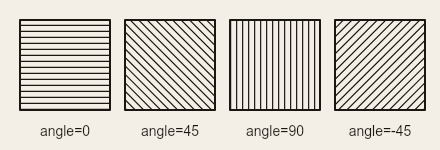

Repare:

- `angle=0`: linhas deitadas. `angle=90`: linhas em pé.
- `angle=45` (o padrão): as linhas **descem** para a direita, porque no Weasel o y cresce para baixo.
- `angle=-45`: as linhas **sobem** para a direita.

### Distância e espessura: `gap=` e `w=`

`gap=` é a distância entre uma linha e a próxima, em pixels. `w=` é a espessura de cada linha, em pixels. Os dois juntos decidem o quanto a hachura parece escura.

<!-- gerar: img/03_hachura_gap_w.png -->
```weasel
canvas 340 280 bg=#f4efe6
palette ink=#1a1712
pattern g4 hatch gap=4
pattern g8 hatch gap=8
pattern g16 hatch gap=16
pattern w05 hatch gap=10 w=0.5
pattern w2 hatch gap=10 w=2
pattern w5 hatch gap=10 w=5
rect a 20,20 90,90 c=g4 ink=2
rect b 125,20 90,90 c=g8 ink=2
rect c 230,20 90,90 c=g16 ink=2
rect d 20,155 90,90 c=w05 ink=2
rect e 125,155 90,90 c=w2 ink=2
rect f 230,155 90,90 c=w5 ink=2
text ta 65,134 "gap=4" size=14 align=center
text tb 170,134 "gap=8" size=14 align=center
text tc 275,134 "gap=16" size=14 align=center
text td 65,269 "w=0.5" size=14 align=center
text te 170,269 "w=2" size=14 align=center
text tf 275,269 "w=5" size=14 align=center
```

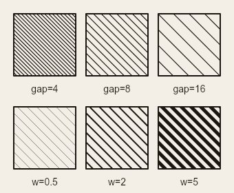

Repare:

- Em cima, só o `gap=` muda (a espessura é a padrão, 1.2). Linhas juntas (`gap=4`) parecem um cinza escuro; separadas (`gap=16`), um cinza bem claro.
- Embaixo, a distância é sempre 10 e só o `w=` muda. Com `w=5`, metade do quadrado fica preta: parece uma listra.
- Para uma sombra que escurece aos poucos, use o mesmo `angle=` e diminua o `gap=` (ou aumente o `w=`) de uma forma para a outra.

### Pontos: `dots` com `r=` e `gap=`

Com `dots`, o padrão é de **pontos** em vez de linhas. `r=` é o raio de cada ponto, e `gap=` a distância entre eles, os dois em pixels.

<!-- gerar: img/03_pontos.png -->
```weasel
canvas 340 280 bg=#f4efe6
palette ink=#1a1712
pattern r1 dots gap=10 r=1
pattern r2 dots gap=10 r=2.5
pattern r4 dots gap=10 r=4
pattern g5 dots gap=5 r=1.4
pattern g9 dots gap=9 r=1.4
pattern g16 dots gap=16 r=1.4
rect a 20,20 90,90 c=r1 ink=2
rect b 125,20 90,90 c=r2 ink=2
rect c 230,20 90,90 c=r4 ink=2
rect d 20,155 90,90 c=g5 ink=2
rect e 125,155 90,90 c=g9 ink=2
rect f 230,155 90,90 c=g16 ink=2
text ta 65,134 "r=1" size=14 align=center
text tb 170,134 "r=2.5" size=14 align=center
text tc 275,134 "r=4" size=14 align=center
text td 65,269 "gap=5" size=14 align=center
text te 170,269 "gap=9" size=14 align=center
text tf 275,269 "gap=16" size=14 align=center
```

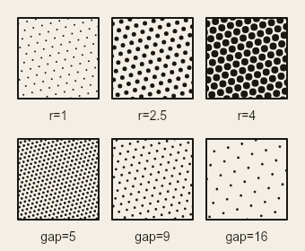

Repare:

- Em cima, a distância é a mesma (10) e os pontos crescem. Com `r=4`, os pontos quase se encostam (o diâmetro, 8, chega perto da distância, 10).
- Embaixo, os pontos são do mesmo tamanho (`r=1.4`, o padrão) e só a distância muda.
- Os pontos ficam em fileiras desencontradas, como numa colmeia, e as fileiras seguem o `angle=` (padrão 45).

**Experimente:** na linha `pattern r4`, acrescente `c=#c44536 bg=#ffe2d6`. O quadrado de `r=4` fica com pontos vermelhos num fundo rosa.

[← Formas](02-formas.md) · [Índice](README.md) · [Próximo: Camadas →](04-camadas.md)
