# 4. Camadas

[← Cores e contorno](03-cores.md) · [Índice](README.md) · [Próximo: Contas e repetição →](05-componentes.md)

Uma camada junta formas com um nome. Com ela, você aplica uma coisa a todas as formas do grupo de uma vez: uma transparência, um jeito de misturar as cores, um recorte. Neste capítulo você aprende a abrir camadas, a ordem em que o Weasel pinta, a deixar uma camada transparente, a recortar uma camada pelo formato de outra forma e a abrir buracos. Você só precisa dos capítulos 1 a 3.

## O que é uma camada: `layer`

```
layer nome
layer nome opções…
```

`layer nome` abre uma camada. As formas escritas abaixo dela entram nela, até a próxima linha `layer`:

<!-- gerar: img/04_camadas.png -->
```weasel
canvas 400 220 bg=#bfe3f5
palette ink=#2b2a33 line=5

# antes do primeiro layer: cai na camada automática "base"
rect chao 0,170 400,50 c=#7cc56a

layer ceu
ellipse sol 330,60 32 c=#ffd34d
ellipse nuvem 90,60 40,18 c=#ffffff

layer personagem
ellipse corpo 170,128 46 c=#ff6b4a ink=line
ellipse olho 186,116 7 c=ink
```

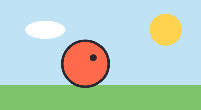

Linha por linha:

- O chão vem **antes** do primeiro `layer`. Formas assim caem numa camada automática chamada `base`.
- `layer ceu` abre a camada `ceu`. O sol e a nuvem entram nela.
- `layer personagem` fecha a `ceu` e abre outra. O corpo e o olho entram na `personagem`.
- O desenho fica igual ao de um arquivo sem nenhuma linha `layer`. A camada não muda quem fica na frente: isso é a [ordem de pintura](#a-ordem-de-pintura), logo abaixo.

O nome da camada segue a regra dos nomes das formas: letras sem acento, números, `_` e `-`, começando com uma letra ou `_`.

Para ver em que camada cada forma caiu, salve o exemplo como `teste.weasel` e peça um resumo com `--info`:

```bash
node cli/weasel.js teste.weasel --info
```

```
canvas   400 × 220, fundo #bfe3f5
camadas  3
  base             1 item(ns)
  ceu              2 item(ns)
  personagem       2 item(ns)
formas   5
animações nenhuma
```

As camadas aparecem na ordem em que são pintadas, com o número de formas de cada uma. A `base` está lá, com o chão, mesmo sem nenhuma linha `layer base`.

No editor, o painel **Camadas** mostra esta mesma lista, em árvore, e deixa criar, renomear, esconder e arrastar camadas ([capítulo 22](22-editor.md#painel-camadas)).

**Experimente:** troque a linha `layer ceu` por `layer fundo`. Nada muda na imagem, e o `--info` passa a mostrar a camada `fundo` com o sol e a nuvem.

**Cuidado:**
- Uma camada não pode ser aberta de novo mais adiante. Se você acrescentar estas linhas no fim do arquivo, depois de uma linha em branco, para pôr mais uma nuvem no céu:

  ```
  layer ceu
  ellipse nuvem2 250,40 30,14 c=#ffffff
  ```

  o Weasel mostra um erro na linha do segundo `layer ceu`:

  ```
  teste.weasel:15:7: erro: camada "ceu" já existe
    15 | layer ceu
       |       ^^^
  1 erro(s).
  ```

  Para pôr mais uma forma numa camada, escreva a linha junto com as outras dela, antes da próxima linha `layer`.
- Uma palavra solta que não é opção da camada dá aviso, com a lista das que existem: `layer ceu escondida` avisa `opção desconhecida "escondida"`.

## A ordem de pintura

O Weasel lê o arquivo inteiro primeiro e só depois pinta, nesta ordem:

1. as camadas, na ordem em que aparecem no arquivo (a `base` primeiro);
2. dentro de cada camada, as formas na ordem das linhas.

Como uma camada não pode ser aberta de novo, dá o mesmo que ler o arquivo de cima para baixo: **o que vem depois fica por cima**.

<!-- gerar: img/04_ordem_pintura.png -->
```weasel
canvas 460 240 bg=#f4efe6
palette ink=#2b2a33 line=6

ellipse um 90,96 62 c=#ff6b4a ink=line
text n1 58,92 "1" size=28 align=center bold
ellipse dois 160,96 62 c=#4a9eff ink=line
text n2 192,92 "2" size=28 align=center bold
ellipse tres 125,156 62 c=#7bd36b ink=line
text n3 125,196 "3" size=28 align=center bold

layer mesa
rect cartao 270,40 150,150 r=12 c=#ffffff ink=line
text n4 345,125 "4" size=28 align=center bold
ellipse selo 410,50 34 c=#ffd34d ink=line
text n5 410,60 "5" size=28 align=center bold
```

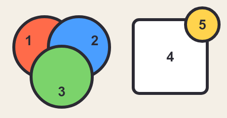

Os números mostram a ordem em que cada forma foi pintada:

- O verde (3) cobre o vermelho e o azul, porque veio depois deles.
- O cartão (4) e o selo (5) estão na camada `mesa`, que vem depois da `base`. Por isso ficam por cima de tudo o que veio antes.
- O selo vem depois do cartão, na mesma camada, e cobre o canto dele.

Só as linhas que desenham entram nessa ordem: `ellipse`, `rect`, `shape`, `stroke`, `line` e `text`. As outras (`canvas`, `palette`, `gradient`, `pattern`) não pintam nada, e o lugar delas não muda quem fica na frente.

No editor, **Ctrl+]** e **Ctrl+[** levam a forma escolhida para cima ou para baixo: o editor muda a linha de lugar por você ([capítulo 22](22-editor.md#organizar)).

**Experimente:** leve a linha `ellipse selo 410,50 34 …` (e o texto `n5` logo abaixo dela) para logo depois do `text n3`, antes do `layer mesa`. O selo passa para a camada `base`, é pintado antes do cartão, e o cartão cobre quase todo ele: só a parte que passa da borda do cartão continua aparecendo.

Algumas coisas mudam essa ordem, e aparecem mais adiante:
- o `inkon=`, que pinta o contorno de uma forma junto com outra camada ([mais abaixo](#o-contorno-por-cima-inkon));
- numa animação, o `above=` e o `below=`, que trocam quem fica na frente ([capítulo 9](07-animacao.md#trocar-quem-fica-na-frente-above-e-below));
- num filme, a distância de cada camada (`depth=`) ([capítulo 17](10-filme.md#profundidade-e-paralaxe)).

## Transparência da camada: `opacity=`

```
layer nome opacity=número
```

`opacity=` deixa a camada inteira transparente com uma linha só. O número vai de 0 (invisível) a 1 (normal, o padrão).

<!-- gerar: img/04_opacity.png -->
```weasel
canvas 420 220 bg=#f4efe6
palette ink=#2b2a33
pattern tabuas hatch angle=0 gap=22 w=4 c=#c9a27e bg=#e9d6bf

rect parede 0,0 420,180 c=tabuas

layer normal
shape fantasma1 c=#ffffff : 70,40 110,80 110,150! 90,140! 70,150! 50,140! 30,150! 30,80
ellipse olho1 58,80 6,9 c=ink
ellipse olho2 82,80 6,9 c=ink

layer meio opacity=0.6
shape fantasma2 c=#ffffff : 210,40 250,80 250,150! 230,140! 210,150! 190,140! 170,150! 170,80
ellipse olho3 198,80 6,9 c=ink
ellipse olho4 222,80 6,9 c=ink

layer quase opacity=0.25
shape fantasma3 c=#ffffff : 350,40 390,80 390,150! 370,140! 350,150! 330,140! 310,150! 310,80
ellipse olho5 338,80 6,9 c=ink
ellipse olho6 362,80 6,9 c=ink

layer rotulos
text t1 70,206 "sem opacity" size=15 align=center
text t2 210,206 "opacity=0.6" size=15 align=center
text t3 350,206 "opacity=0.25" size=15 align=center
```

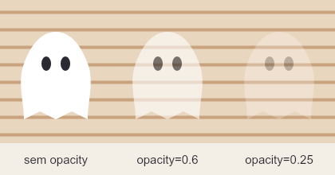

- Os três fantasmas são o mesmo desenho, cada um na sua camada. Só muda o `opacity=` da linha `layer`.
- Com `opacity=0.6`, o fantasma fica 60% visível: as tábuas aparecem através dele.
- Com `opacity=0.25`, sobra só um quarto: o fantasma quase sumiu.
- A camada fica transparente **de uma vez**, como uma folha só. Os olhos deixam ver as tábuas, mas não o branco do fantasma por baixo deles.
- A transparência da camada se multiplica pela de cada forma: uma forma com `opacity=0.5` numa camada com `opacity=0.5` fica com 0,25 (0,5 × 0,5).

**Experimente:** mude `opacity=0.25` para `opacity=0`. O terceiro fantasma desaparece de vez.

**Cuidado:** um `opacity=` fora de 0 a 1 dá o aviso `opacity= deve ficar entre 0 e 1`, e o Weasel usa o limite.

## Misturar com o que está embaixo: `blend=`

```
layer nome blend=modo
```

Normalmente, uma camada **cobre** o que está embaixo dela. Com `blend=`, a cor da camada faz uma conta com a cor de baixo. É assim que se pinta uma sombra que só escurece, um brilho que só clareia, ou se dá cor a um desenho cinza.

Os oito quadrados laranja abaixo são iguais. Cada um está numa camada com um `blend=` diferente, e todos passam por cima de três faixas: branca, azul e escura.

<!-- gerar: img/04_blend.png -->
```weasel
canvas 640 250 bg=#ffffff
palette ink=#2b2a33 laranja=#ff8a3d

# o fundo: três faixas (branca, azul e escura)
rect azul 0,80 640,60 c=#4a9eff
rect escura 0,140 640,60 c=#1f2340

layer m1
rect q1 12,30 56,160 r=6 c=laranja
layer m2 blend=multiply
rect q2 92,30 56,160 r=6 c=laranja
layer m3 blend=screen
rect q3 172,30 56,160 r=6 c=laranja
layer m4 blend=overlay
rect q4 252,30 56,160 r=6 c=laranja
layer m5 blend=darken
rect q5 332,30 56,160 r=6 c=laranja
layer m6 blend=lighten
rect q6 412,30 56,160 r=6 c=laranja
layer m7 blend=difference
rect q7 492,30 56,160 r=6 c=laranja
layer m8 blend=color
rect q8 572,30 56,160 r=6 c=laranja

layer rotulos
text t1 40,226 "normal" size=13 align=center
text t2 120,226 "multiply" size=13 align=center
text t3 200,226 "screen" size=13 align=center
text t4 280,226 "overlay" size=13 align=center
text t5 360,226 "darken" size=13 align=center
text t6 440,226 "lighten" size=13 align=center
text t7 520,226 "difference" size=13 align=center
text t8 600,226 "color" size=13 align=center
```

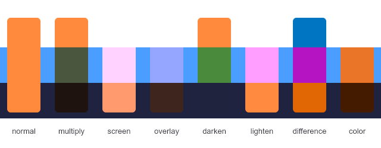

Olhe cada quadrado de cima para baixo, passando pelas três faixas:

| Modo | O que faz | Bom para |
|---|---|---|
| `normal` | cobre (o padrão) | quase tudo |
| `multiply` | **só escurece**: no branco, fica a cor da camada; no escuro, fica escuro | sombras |
| `screen` | **só clareia**: no branco, continua branco; no escuro, aparece a cor da camada | brilhos e luz |
| `overlay` | escurece o que é escuro e clareia o que é claro | texturas, luz e sombra juntas |
| `darken` | fica a mais escura das duas cores | sombras com cor |
| `lighten` | fica a mais clara das duas cores | brilhos com cor |
| `difference` | tira uma cor da outra: no branco, vira a cor "ao contrário" | conferir se duas coisas estão alinhadas |
| `color` | pega o tom da camada e a claridade de baixo | colorir um desenho feito em cinza |

Existem mais oito: `color-dodge`, `color-burn`, `hard-light`, `soft-light`, `exclusion`, `hue`, `saturation` e `luminosity`. Os nomes são os mesmos dos programas de desenho. O jeito mais fácil de conhecer cada um é trocar o nome num destes quadrados e olhar.

**Experimente:** troque `blend=color` por `blend=luminosity`. É o contrário do `color`: o quadrado fica com o tom da faixa de baixo e a claridade do laranja.

**Cuidado:**
- Assim como o `opacity=`, o `blend=` vale para a camada inteira de uma vez. Duas formas da mesma camada `blend=multiply` que se cruzam não escurecem uma à outra: só o que está embaixo da camada escurece.
- O nome vai em minúsculas. Um nome que não existe, ou com maiúscula, é erro: `blend=Multiply` dá `blend desconhecido "Multiply"`.

## Recortar por dentro: `clip=`

```
layer nome clip=forma
layer nome clip=camada
```

Com `clip=`, a camada só aparece **dentro** da forma indicada. É o jeito de pintar sombra, brilho, manchas e listras sem desenhar cada uma no formato exato do corpo: você desenha grande, e o recorte apara.

<!-- gerar: img/04_clip.png -->
```weasel
canvas 440 220 bg=#f4efe6
palette ink=#2b2a33 line=8 bola=#ff6b4a sombra=#c8402c brilho=#ffc2ad

layer bolas
ellipse semClip 110,110 80 c=bola ink=line
ellipse comClip 330,110 80 c=bola ink=line

layer vazando
ellipse s1 150,150 90 c=sombra opacity=0.8
ellipse b1 80,80 26,16 rot=-30 c=brilho

layer aparado clip=comClip
ellipse s2 370,150 90 c=sombra opacity=0.8
ellipse b2 300,80 26,16 rot=-30 c=brilho
```

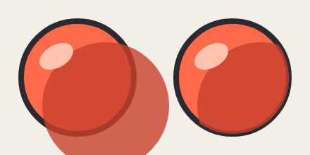

- A sombra é uma elipse grande, deslocada para baixo e para a direita, com `opacity=0.8`. O brilho é uma elipse pequena, girada 30 graus para trás.
- À esquerda, na camada `vazando`, os dois passam da borda da bola.
- À direita, a camada `aparado` tem `clip=comClip`. A sombra e o brilho ficam exatamente dentro da bola `comClip`.
- A forma que recorta pode estar antes ou depois da camada no arquivo. Mas, para a camada recortada ficar **por cima** da bola, ela precisa vir depois.

**Experimente:** apague o `clip=comClip` da linha `layer aparado`. A bola da direita fica igual à da esquerda, com a sombra vazando.

### Recortar com uma camada inteira

Às vezes, quem recorta não é uma forma só: um corpo de vários gomos, uma cabeça com orelhas. Para isso, o `clip=` também aceita o nome de uma **camada**. Aí todas as formas fechadas dela recortam juntas.

<!-- gerar: img/04_clip_camada.png -->
```weasel
canvas 460 210 bg=#f4efe6
palette ink=#2b2a33 verde=#8ad46a sombra=#4f9a45

# lagarta da esquerda: os gomos têm nomes diferentes
layer corpoE
ellipse g1 50,110 32 c=verde
ellipse g2 98,102 34 c=verde
ellipse g3 148,106 32 c=verde
ellipse g4 194,96 36 c=verde

layer sombraE clip=corpoE
ellipse s1 120,160 130,46 c=sombra

# lagarta da direita: todos os gomos se chamam gomo
layer corpoD
ellipse gomo 270,110 32 c=verde
ellipse gomo 318,102 34 c=verde
ellipse gomo 368,106 32 c=verde
ellipse gomo 414,96 36 c=verde

layer sombraD clip=gomo
ellipse s2 340,160 130,46 c=sombra

layer rosto
ellipse olhoE 206,86 6 c=ink
ellipse olhoD 426,86 6 c=ink
text t1 122,196 "clip=corpoE" size=16 align=center
text t2 342,196 "clip=gomo" size=16 align=center
```

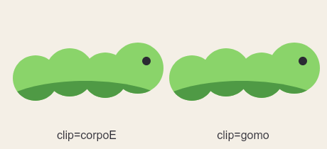

- A sombra de cada lagarta é **uma elipse só**, larga, embaixo. O recorte apara essa elipse no formato dos quatro gomos de uma vez.
- À esquerda, `clip=corpoE` usa a **camada** `corpoE`: valem todas as formas fechadas dela.
- À direita, os quatro gomos têm o **mesmo nome**, `gomo`, e `clip=gomo` usa os quatro. O resultado é o mesmo. A diferença é que os gomos poderiam dividir a camada com outras formas: só os que se chamam `gomo` contam.
- Quando um nome é de uma forma e também de uma camada, vale a forma.

**Experimente:** à esquerda, troque `clip=corpoE` por `clip=g4`. A sombra só aparece no último gomo, a cabeça.

| Opção | O que faz | Valores | Se não escrever |
|---|---|---|---|
| `clip=` | a camada só aparece dentro da forma que recorta | **um** nome: de forma fechada (`ellipse`, `rect`, `shape`) ou de camada | sem recorte |

**Cuidado:**
- O `clip=` aceita um nome só. Para recortar com várias formas, ponha todas numa camada ou dê o mesmo nome a elas. `clip=a,b` é erro: `clip: "a,b" não é forma nem camada`.
- Um `stroke` ou uma `line` não servem para recortar: eles não têm lado de dentro. O Weasel avisa que é um traço aberto, e a camada some.
- O recorte segue a linha da borda, que fica no meio do contorno. A camada recortada só cobre a metade de **dentro** do contorno. Para cobrir o contorno inteiro, recorte com uma forma escondida (`hidden`) um pouco maior: o tamanho da forma mais metade do contorno.

### O contorno por cima: `inkon=`

```
forma … ink=grossura inkon=camada
```

Repare na bola da direita do [primeiro exemplo de `clip=`](#recortar-por-dentro-clip): a sombra cobriu a metade de dentro do contorno, que ficou mais fino embaixo. É que o contorno é pintado junto com a forma, e a camada recortada vem depois, por cima dele.

`inkon=camada` resolve isso. O **preenchimento** fica onde está, e o **contorno** é pintado junto com outra camada, que você põe por último.

<!-- gerar: img/04_inkon.png -->
```weasel
canvas 440 220 bg=#f4efe6
palette ink=#2b2a33 line=10 bola=#ff6b4a reflexo=#ffe2c2

layer bolas
ellipse semInkon 110,110 80 c=bola ink=line
ellipse comInkon 330,110 80 c=bola ink=line inkon=contorno

layer reflexo1 clip=semInkon
ellipse r1 160,160 70 c=reflexo

layer reflexo2 clip=comInkon
ellipse r2 380,160 70 c=reflexo

layer contorno
```

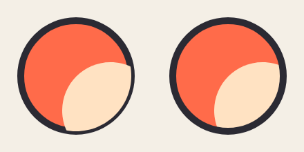

- À esquerda, sem `inkon=`, o reflexo claro cobre a metade de dentro do contorno.
- À direita, o contorno de `comInkon` vai para a camada `contorno`, a última, e fica inteiro.
- A camada `contorno` não tem nenhuma forma: ela só recebe o contorno de `comInkon`.
- O exemplo `exemplos/cavaleiro.weasel` faz isso na capa e na máscara do cavaleiro.

**Experimente:** na `palette`, troque `line=10` por `line=4`. A diferença entre as duas bolas fica pequena, mas ainda está lá.

| Opção | O que faz | Valores | Se não escrever |
|---|---|---|---|
| `inkon=` | pinta o contorno da forma junto com outra camada | o nome de uma camada | o contorno fica com a forma |

**Cuidado:**
- O `inkon=` vale só no `ellipse`, no `rect` e no `shape`, e só com contorno. Sem `ink=`, o Weasel avisa: `inkon= só faz sentido com ink=`.
- A camada do `inkon=` precisa existir no arquivo, mesmo vazia. Senão é erro: `camada "contorno" não existe`.
- Com a camada do `inkon=` **antes** da forma, o contorno fica só por fora: o preenchimento cobre a metade de dentro. É outro jeito de fazer o contorno só por fora do [capítulo 3](03-cores.md#contorno-só-por-fora).

## Recortar por fora: `cut=`

```
layer nome cut=forma
layer nome cut=camada
forma … cut=forma
forma … cut=forma1,forma2,…
```

O `cut=` é o contrário do `clip=`: a camada aparece em todo lugar, **menos** dentro da forma que recorta. Serve para abrir janelas, portas e buracos. Ele vale na camada e também numa forma.

<!-- gerar: img/04_cut.png -->
```weasel
canvas 440 200 bg=#bfe3f5
palette ink=#2b2a33
pattern listra hatch angle=90 gap=14 w=7 c=#c44536 bg=#f4efe6

ellipse janela 120,100 56 hidden
layer parede cut=janela
rect tinta 20,20 200,160 c=listra

layer rosquinha
ellipse rosca 330,100 76 c=#e0a050 ink=6 cut=furo
ellipse furo 330,100 28 hidden
```

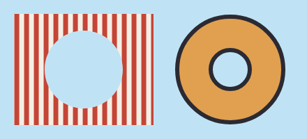

- À esquerda, a camada `parede` tem `cut=janela`. Pelo buraco aparece o fundo azul do `canvas`.
- À direita, o `cut=furo` está na **forma** `rosca`. O buraco tem o formato de `furo`, e o contorno da rosca passa também em volta dele. Na camada, o buraco sai sem contorno.
- As formas que recortam, `janela` e `furo`, têm `hidden`: não são pintados, só emprestam o formato (o `hidden` é do [capítulo 2](02-formas.md)).

**Experimente:** apague o `hidden` da linha `ellipse furo`. O furo passa a ser pintado, na cor da tinta (a `ink` da `palette`), e tapa o buraco.

### Vários buracos e mordidas

Numa forma, o `cut=` aceita vários nomes, separados por vírgula: `cut=f1,f2,f3`. E o buraco pode passar da borda da forma: aí ele vira uma **mordida**.

<!-- gerar: img/04_buracos.png -->
```weasel
canvas 440 210 bg=#cfe8f5
palette ink=#2b2a33 line=5

# um queijo com três furos
rect queijo 30,50 180,110 r=8 c=#ffd34d ink=line cut=f1,f2,f3
ellipse f1 75,90 18 hidden
ellipse f2 150,125 22 hidden
ellipse f3 178,78 10 hidden

# um biscoito mordido: o buraco passa da borda
ellipse biscoito 330,105 72 c=#d9a066 ink=line cut=mordida
ellipse mordida 395,50 42 hidden
ellipse gota1 300,90 7 c=#5a3a22
ellipse gota2 335,140 7 c=#5a3a22
ellipse gota3 290,130 6 c=#5a3a22

text t1 120,196 "cut=f1,f2,f3" size=16 align=center
text t2 330,196 "cut=mordida" size=16 align=center
```

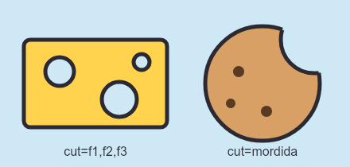

- Cada furo do queijo ganhou contorno.
- A `mordida` fica metade dentro, metade fora do biscoito. Só a parte de dentro vira buraco, e o contorno acompanha a curva da mordida.

**Experimente:** mude o raio da mordida de `42` para `70`. A mordida leva um pedaço grande do biscoito, com contorno e tudo.

### Furos com o mesmo nome e furos que se cruzam

Os furos também podem ter **o mesmo nome**: `cut=furo` abre um buraco em cada forma chamada `furo`. E dois furos que se cruzam viram **um buraco só**, com um contorno só.

<!-- gerar: img/04_furos_juntos.png -->
```weasel
canvas 440 200 bg=#cfe8f5
palette ink=#2b2a33 line=5

# quatro furos com o mesmo nome
rect queijo 20,40 190,110 r=8 c=#ffd34d ink=line cut=furo
ellipse furo 60,75 14 hidden
ellipse furo 100,118 18 hidden
ellipse furo 145,70 11 hidden
ellipse furo 178,115 14 hidden

# dois furos que se cruzam: um buraco só, em forma de óculos
ellipse bolacha 330,95 70 c=#d9a066 ink=line cut=olho1,olho2
ellipse olho1 310,95 28 hidden
ellipse olho2 350,95 28 hidden

text t1 115,186 "cut=furo" size=16 align=center
text t2 330,186 "cut=olho1,olho2" size=16 align=center
```

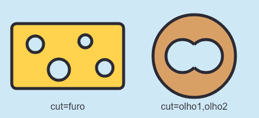

- As quatro elipses se chamam `furo`, e `cut=furo` abre as quatro. É assim que um `repeat` faz dezenas de furos de uma vez ([capítulo 5](05-componentes.md)): todas as cópias têm o mesmo nome.
- `olho1` e `olho2` se cruzam no meio. O pedaço em comum também fica vazio, e o contorno segue a borda do buraco inteiro, sem riscar o meio.

**Experimente:** mude o raio de `olho1` e `olho2` de `28` para `40`. O buraco passa da borda da bolacha, como a mordida do biscoito.

### Recortar com uma forma que tem buraco

Uma forma com buraco também pode recortar uma camada, no `clip=` e no `cut=`. O buraco continua buraco:

<!-- gerar: img/04_molde_buraco.png -->
```weasel
canvas 440 200 bg=#f4efe6
palette ink=#2b2a33 line=5

# a calda fica só em cima da massa: não entra no buraco
layer massa
ellipse rosca 110,100 75 c=#e0a050 ink=line cut=miolo inkon=contorno
ellipse miolo 110,100 28 hidden
layer calda clip=rosca
rect cobertura 20,20 180,70 c=#d1477a

# a toalha some atrás da rosca, mas aparece pelo buraco dela
layer massa2
ellipse rosca2 330,100 75 c=#e0a050 ink=line cut=miolo2
ellipse miolo2 330,100 28 hidden
layer toalha cut=massa2
rect pano 230,80 200,40 c=#3a78c2

layer contorno
```

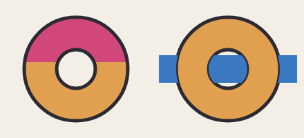

- `clip=rosca`: a calda aparece só onde a rosca tem massa. O buraco do meio fica sem calda.
- `cut=massa2`: a toalha some onde está a rosca, mas aparece pelo buraco, como se passasse por trás dela.
- `miolo2` está na camada `massa2`, mas não recorta a toalha: ele é o buraco. Por isso a toalha aparece por ele.
- `inkon=contorno` põe o contorno da primeira rosca por cima da calda.

**Experimente:** apague o `cut=miolo` da primeira rosca. Ela fica inteira, e a calda passa a cobrir o meio também.

| Opção | O que faz | Valores | Se não escrever |
|---|---|---|---|
| `cut=` na camada | a camada some dentro da forma que recorta | **um** nome: de forma fechada ou de camada | sem buraco |
| `cut=` na forma | abre buracos com contorno | um ou mais nomes de formas fechadas, separados por vírgula | sem buraco |

**Cuidado:**
- Numa forma, o `cut=` só aceita nomes de **formas**. O nome de uma camada é erro: `cut: forma "m" não existe`.
- A forma que recorta precisa ser fechada (`ellipse`, `rect` ou `shape`). Com um `stroke`, é erro: `cut: "b" precisa ser uma forma fechada`.
- O `cut=` abre buracos só no `ellipse`, no `rect` e no `shape`. No `stroke`, na `line` e no `text`, ele é aceito, mas não faz nada.

## Camadas que não saem na imagem: `hidden` e `guide`

```
layer nome hidden
layer nome guide
```

### Camada escondida: `hidden`

Uma camada `hidden` não é pintada, mas as formas dela continuam existindo. Ela guarda formas que só emprestam o formato para um `clip=` ou um `cut=`.

<!-- gerar: img/04_hidden.png -->
```weasel
canvas 400 260 bg=#1d2140
palette ink=#2b2a33 line=5

# 1. o que fica atrás da parede: a luz de dentro da casa
layer dentro
rect luz 60,90 280,150 c=#ffd56b

# 2. a parede, com buracos no formato das formas da camada janelas
layer parede cut=janelas
rect frente 60,90 280,150 c=#b5835a ink=line
shape telhado c=#7a3b2c ink=line : 40,94! 200,20! 360,94!

# 3. as formas que recortam: a camada não é pintada, só empresta o formato
layer janelas hidden
rect j1 90,120 60,50 r=4 c=none ink=4
rect j2 250,120 60,50 r=4 c=none ink=4
rect porta 175,160 50,80 r=4 c=none ink=4
```

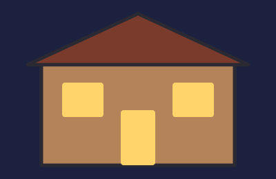

- A parede é um retângulo inteiro. Os buracos vêm de `cut=janelas`, o nome de uma **camada**: valem as três formas dela juntas.
- A camada `janelas` tem `hidden`. As três formas não são pintadas, só servem para recortar.
- Pelos buracos aparece o que foi pintado antes da parede: a camada `dentro`, amarela.
- As três formas têm `c=none ink=4`. Escondidos, isso não muda nada. No **Experimente**, você vê para que serve.

**Experimente:** apague o `hidden` da linha `layer janelas`. As três formas passam a ser pintadas: sem preenchimento e com contorno de 4 pixels, elas viram a moldura das janelas e da porta.

### Camada de construção: `guide`

Uma camada `guide` guarda as **linhas de ajuda** que você usa para desenhar (o meio do rosto, a altura dos olhos, a linha do chão) e que não saem na imagem final.

<!-- gerar: img/04_guide.png -->
<!-- gerar: img/04_guide_on.png --guides -->
```weasel
canvas 300 220 bg=#f4efe6
palette ink=#2b2a33 line=5

layer rosto
ellipse cara 150,110 80 c=#ffd34d ink=line
ellipse olhoE 122,95 8,12 c=ink
ellipse olhoD 178,95 8,12 c=ink
stroke boca w=5 : 115,135 150,155 185,135

# linhas de construção: só no editor e com --guides
layer construcao guide
line meio w=1 c=#c44536 dash=6,4 : 150,8 150,212
line olhos w=1 c=#c44536 dash=6,4 : 40,95 260,95
text nota 156,206 "meio: x=150" size=13 c=#c44536
```

| Exportado normalmente | Com `--guides` |
|---|---|
|  | 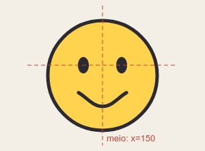 |

- A camada `construcao` tem `guide`. As duas linhas tracejadas e a anotação ficam nela.
- Na exportação normal (à esquerda), a camada some.
- Com `--guides` na linha de comando (à direita), ela aparece:

  ```bash
  node cli/weasel.js teste.weasel --guides
  ```

- No editor, quem decide é o menu **Exibir › Guias** ([capítulo 22](22-editor.md#guias)).
- Uma camada `guide` nunca recebe luz, mesmo numa cena iluminada (a luz é do [capítulo 10](08-luz-efeitos.md)).

**Experimente:** troque `guide` por `hidden`. As linhas somem também com `--guides`: a camada `hidden` nunca é pintada.

## Travar no editor: `lock`

```
layer nome lock
forma … lock
```

O `lock` **trava**: no editor, o desenho não deixa escolher nem arrastar as formas, e o clique passa para o que está embaixo. A imagem não muda. No código, você continua podendo editar a linha.

- Numa camada (`layer fundo lock`), trava todas as formas dela. É bom para o cenário, que você não quer arrastar sem querer.
- Numa forma, trava só ela.
- No editor, **Ctrl+2** trava a escolha e **Ctrl+Alt+2** destrava tudo, menos as camadas. O cadeado do painel Camadas põe e tira o `lock` ([capítulo 22](22-editor.md#travar-e-agrupar)).

Para juntar formas e mexer nelas de uma vez, existe o `group` ([capítulo 6](05-componentes.md#grupos-group)).

## Todas as opções da camada

| Opção | O que faz | Valores | Se não escrever |
|---|---|---|---|
| `opacity=` | transparência da camada inteira | de 0 (invisível) a 1 | 1 |
| `blend=` | como a camada se mistura com o que está embaixo | `normal`, `multiply`, `screen`, `overlay`, `darken`, `lighten`, `color-dodge`, `color-burn`, `hard-light`, `soft-light`, `difference`, `exclusion`, `hue`, `saturation`, `color`, `luminosity` | `normal` |
| `clip=` | a camada só aparece dentro da forma que recorta | um nome de forma fechada ou de camada | sem recorte |
| `cut=` | a camada some dentro da forma que recorta | um nome de forma fechada ou de camada | sem buraco |
| `hidden` | a camada não é pintada; as formas dela continuam recortando | palavra solta | pintada |
| `guide` | só aparece no editor (com **Exibir › Guias**) e com `--guides` | palavra solta | sempre aparece |
| `lock` | trava as formas no editor; a imagem não muda | palavra solta | destravada |

A camada tem outras opções, que aparecem mais adiante:
- `only=`: a camada só aparece em certas animações ([capítulo 9](07-animacao.md#camadas-que-só-aparecem-em-certas-animações-only));
- `unlit` e `shade=`: a luz na camada ([capítulo 10](08-luz-efeitos.md));
- `blur=`, `glow=`, `shadow=`, `tint=`, `brightness=`, `saturate=`, `contrast=`, `hue=`, `trail=`, `cast=`, `rim=`: os efeitos ([capítulo 11](08-luz-efeitos.md#efeitos-de-camada));
- `yaw=`, `pitch=`, `persp=`, `pivot=`, `floor`, `horizon=`, `iso`, `zsort`: a profundidade 2.5D ([capítulo 14](11-profundidade.md));
- `depth=`, `screen`, `front`: a distância num filme ([capítulo 17](10-filme.md#profundidade-e-paralaxe)).

A lista completa está na [referência do `layer`](19-referencia.md#layer).

## Juntando tudo

Uma poção mágica na mesa, numa noite de lua. A parede tem um buraco no formato da janela, e a poção só aparece dentro do vidro:

<!-- gerar: img/04_pocao.png -->
```weasel
canvas 480 360 bg=#1f2a55
palette ink=#2b2a33 line=5 madeira=#8a5a3a vidro=#dff1ff66 pocao=#8b4fd8 bolha=#c9a6ff
pattern papel hatch angle=90 gap=26 w=10 c=#e4d2b4 bg=#efe2c9

# o céu da noite: aparece pelo buraco da janela
ellipse lua 150,80 22 c=#fff4c2
ellipse estrela1 90,70 3 c=#ffffff
ellipse estrela2 190,130 2 c=#ffffff
ellipse estrela3 110,150 2 c=#ffffff

# a parede tem um buraco no formato da janela
layer parede cut=janela
rect fundo 0,0 480,300 c=papel

layer recortes hidden
rect janela 60,40 170,150 r=6

layer moldura
rect aro 60,40 170,150 r=6 c=none ink=10 inkc=madeira
rect travessa 141,40 8,150 c=madeira
rect peitoril 48,190 194,14 r=4 c=madeira ink=3

layer mesa
rect tampo 0,290 480,70 c=madeira ink=line
ellipse sombraMesa 330,298 70,8 c=#00000033

# o frasco: vidro claro, um pouco transparente
layer frasco
shape vidro c=vidro ink=line inkon=contorno : 312,112! 348,112! 348,172 382,196 394,236 376,280 330,296 284,280 266,236 278,196 312,172

# a poção só aparece dentro do vidro
layer liquido clip=vidro
shape onda c=pocao : 250,226! 290,216 330,226 370,216 410,226! 410,310! 250,310!
ellipse b1 310,262 7 c=bolha
ellipse b2 344,246 5 c=bolha
ellipse b3 326,284 4 c=bolha

# uma sombra que só escurece e um brilho que só clareia
layer sombra clip=vidro blend=multiply
ellipse s 376,262 70 c=#b9a6d9

layer brilho clip=vidro blend=screen opacity=0.8
ellipse reflexo 296,214 10,30 rot=20 c=#ffffff

layer contorno

layer rolha
rect tampa 314,96 32,22 r=4 c=#c08a55 ink=line
```


- **O céu:** a lua e as estrelas estão na camada `base`, por trás de tudo. O fundo azul é o `bg=` do `canvas`.
- **A janela:** a camada `parede` tem `cut=janela`, e a `janela` mora numa camada `hidden`. A moldura é um `rect` no mesmo lugar, só com contorno.
- **O vidro:** um `shape` com uma cor transparente (`#dff1ff66`): a parede aparece através dele.
- **A poção:** a camada `liquido` tem `clip=vidro`. A onda e as bolhas podem passar da borda à vontade: o recorte apara no formato do frasco.
- **Sombra e brilho:** duas camadas recortadas pelo mesmo vidro. A `sombra` usa `blend=multiply` e só escurece. O `brilho` usa `blend=screen` com `opacity=0.8` e só clareia.
- **O contorno:** o `inkon=contorno` leva o contorno do vidro para depois da poção, da sombra e do brilho, e ele fica inteiro.
- **A rolha:** a última camada, por cima de tudo.

**Experimente:** apague o `inkon=contorno` do vidro. O contorno fica mais fino onde a poção, a sombra e o brilho passam por cima dele.

## Resumo

- `layer nome` abre uma camada; as formas antes do primeiro `layer` ficam na camada `base`. Uma camada não pode ser aberta de novo.
- O Weasel pinta as camadas na ordem do arquivo e, dentro de cada uma, as formas na ordem das linhas: o que vem depois fica por cima.
- `opacity=` e `blend=` valem para a camada inteira de uma vez.
- `clip=` mostra a camada só dentro de outra forma; `cut=` abre um buraco nela. Numa forma, `cut=` abre buracos com contorno.
- `inkon=` pinta o contorno de uma forma junto com outra camada, para ele ficar por cima.
- `hidden` não pinta a camada (as formas dela continuam recortando), `guide` só aparece no editor e com `--guides`, e `lock` trava as formas no editor.

[← Cores e contorno](03-cores.md) · [Índice](README.md) · [Próximo: Contas e repetição →](05-componentes.md)
