# 4. Camadas, recortes e acabamento

[← Cores e estilos](03-cores.md) · [Índice](README.md) · [Próximo: Contas, componentes e arquivos →](05-componentes.md)

## O que é uma camada

Uma **camada** é um grupo de formas com nome. Ela serve para dar ao grupo inteiro alguma coisa de uma vez só: um recorte, uma transparência, um efeito.

`layer nome` abre uma camada. Tudo o que vem abaixo dela entra nela, até a próxima linha `layer`:

<!-- gerar: img/04_camadas.png -->
```weasel
canvas 400 220 bg=#bfe3f5
palette ink=#2b2a33 line=5

# antes do primeiro layer: cai na camada automática "base"
rect chao 0,170 400,50 c=#7cc56a

layer ceu
ellipse sol 330,60 32 c=#ffd34d
ellipse nuvem 90,60 40,18 c=#ffffff

layer personagem
ellipse corpo 170,128 46 c=#ff6b4a ink=line
ellipse olho 186,116 7 c=ink
```

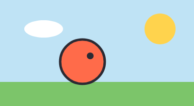

Repare:

- `layer ceu` abre a camada `ceu`. O sol e a nuvem entram nela, porque vêm logo abaixo.
- `layer personagem` fecha a `ceu` e abre outra. O corpo e o olho entram na `personagem`.
- O chão foi escrito **antes** do primeiro `layer`. Formas assim caem numa camada automática chamada `base`.
- O desenho sai igual ao que sairia sem nenhuma linha `layer`: as camadas não mudam quem fica na frente (veja [a ordem de pintura](#a-ordem-de-pintura), logo abaixo).

Para conferir em que camada cada coisa caiu, salve o exemplo como `teste.weasel` e peça um resumo com `--info`:

```bash
node cli/weasel.js teste.weasel --info
```

```
canvas   400 × 220, fundo #bfe3f5
camadas  3
  base             1 item(ns)
  ceu              2 item(ns)
  personagem       2 item(ns)
formas   5
animações nenhuma
```

A lista mostra as camadas na ordem em que são pintadas e quantas formas (itens) cada uma tem. A `base` está lá, com o chão, mesmo sem nenhuma linha `layer base`. (O `fundo #bfe3f5` da primeira linha é a cor de fundo do `canvas`, não uma camada.)

Uma camada **não pode ser aberta de novo** mais adiante. Se você acrescentar estas linhas no fim do arquivo, para pôr mais uma nuvem no céu:

```
layer ceu
ellipse nuvem2 250,40 30,14 c=#ffffff
```

o Weasel reclama (a linha 15 é a do segundo `layer ceu`):

```
teste.weasel:15:7: erro: camada "ceu" já existe
  15 | layer ceu
     |       ^^^
1 erro(s).
```

Para pôr mais uma forma numa camada, escreva a linha dentro dela, lá em cima.

Então para que servem as camadas? Para dar a um grupo de formas algo que vale para o grupo todo: **recorte** (`clip`, `cut`), **transparência**, **efeitos** (desfoque, brilho, sombra…), aparecer **só em certas animações** (`only=`), **luz** (`unlit`) e **profundidade** num filme (`depth=`). E para organizar: cada linha `layer` funciona como um título de seção no código. No editor, com o cursor numa forma, a barra de baixo diz em que camada ela está (`ellipse iris na camada olhos`), e os nomes das camadas aparecem nas sugestões de `clip=`, `cut=`, `inkon=` e `hide=`. Não há um painel com a lista das camadas: a lista é o próprio código.

## A ordem de pintura

O Weasel não pinta enquanto lê. Ele lê o arquivo **inteiro** primeiro, monta o desenho e só então pinta, nesta ordem:

1. as camadas, na ordem em que aparecem no arquivo (a `base` primeiro);
2. dentro de cada camada, as formas na ordem das linhas.

Como uma camada não pode ser aberta de novo, isso dá o mesmo que ler o arquivo de cima para baixo: **o que vem depois fica por cima**.

<!-- gerar: img/04_ordem.png -->
```weasel
canvas 460 240 bg=#f4efe6
palette ink=#2b2a33 line=6

# o def está no começo, mas não pinta nada aqui:
# o selo só é pintado na linha do use, a última do arquivo
def selo
ellipse fundo 0,0 34 c=#ffd34d ink=line
text n 0,10 "5" size=28 align=center bold
end

ellipse um 90,96 62 c=#ff6b4a ink=line
text n1 58,92 "1" size=28 align=center bold
ellipse dois 160,96 62 c=#4a9eff ink=line
text n2 192,92 "2" size=28 align=center bold
ellipse tres 125,156 62 c=#7bd36b ink=line
text n3 125,196 "3" size=28 align=center bold

rect cartao 270,40 150,150 r=12 c=#ffffff ink=line
text n4 345,125 "4" size=28 align=center bold

use selo 410,50
```

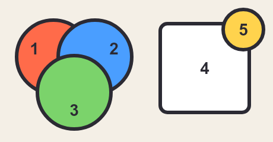

Os números mostram a ordem em que cada coisa foi pintada. O verde (3) cobre o vermelho e o azul porque veio depois deles. O selo (5) é o mais curioso: o `def` dele está no começo do arquivo, mas um `def` sozinho não pinta nada (os componentes são o assunto do [capítulo 5](05-componentes.md#componentes-def-e-use)). O selo só é pintado na linha do `use`, a última, e por isso fica por cima do cartão.

**Experimente:** mova a linha `use selo 410,50` para logo depois do `end`. Agora o selo é pintado antes do cartão, e o cartão cobre quase todo ele: só a pontinha que passa da borda continua aparecendo.

### Linhas que não pintam

Só as linhas que desenham entram nessa fila: `shape`, `ellipse`, `rect`, `stroke`, `line`, `text`, `use` e os emissores de partículas (`emitter`). As outras (`canvas`, `palette`, `let`, `bone`, `light`, `anim`, `key`, `box`…) não mudam quem fica na frente, seja qual for a posição delas no arquivo. É por isso que um `let` vale no arquivo inteiro e as `key` podem vir fora de ordem: tudo é lido antes de qualquer coisa ser pintada.

### As exceções

Algumas coisas não são pintadas na linha em que estão escritas:

| O quê | Onde é pintado |
|---|---|
| `use` | na linha do `use`, não na do `def` (o selo acima) |
| `include "arquivo"` | o arquivo inteiro entra na linha do `include`: o que vem antes fica atrás dele, o que vem depois fica na frente ([capítulo 5](05-componentes.md#vários-arquivos-include)) |
| `mirror=` | a cópia espelhada é pintada na linha dela, não na da forma original ([capítulo 5](05-componentes.md#espelho-mirror)) |
| `inkon=camada` | o preenchimento fica na camada da forma, mas o **contorno** é pintado junto com a outra camada ([mais abaixo](#o-contorno-por-cima-inkon)) |
| `cast=` (sombra no chão) | no lugar da camada que tem o `cast=`, logo **antes** das formas dela, para a sombra ficar por baixo ([capítulo 8](08-luz-efeitos.md#sombra-projetada-no-chão)) |
| o halo das lâmpadas (`light … glow=`) | depois de todas as camadas, por cima do desenho inteiro ([capítulo 8](08-luz-efeitos.md#os-três-tipos-de-luz-e-o-ambiente)) |
| `key … forma.above=outra` (ou `below=`) | numa animação, a partir daquele quadro, logo depois (ou antes) da outra forma ou camada ([mais abaixo](#trocar-quem-fica-na-frente-durante-uma-animação-above-e-below)) |
| atores e camadas num filme | pela distância: o mais longe (`depth=` maior) primeiro, `front` na frente dos outros da mesma distância e `screen` por cima de tudo. Só quando a distância empata vale a ordem do arquivo ([capítulo 10](10-filme.md#profundidade-e-paralaxe)) |

### Trocar quem fica na frente durante uma animação: `above=` e `below=`

Uma animação também pode mudar a ordem de pintura. `key quadro forma.above=outra` faz a forma ser pintada logo **depois** da outra (na frente dela) a partir daquele quadro, e `below=` faz ela ser pintada logo **antes** (atrás). É assim que uma bola dá a volta num poste, um braço passa atrás do corpo ou uma espada gira em volta do personagem:

<!-- gerar: img/04_volta.gif -a volta -->
```weasel
canvas 320 200 bg=#f4efe6
palette ink=#2b2a33 line=5 bola=#ff6b4a madeira=#a8794f

bone bola pivot=160,110

ellipse bola 160,110 28 c=bola ink=line bone=bola
rect poste 154,16 12,176 r=4 c=madeira ink=line

anim volta frames=24 fps=12
key 0 bola=-110,0,0,1,1 bola.below=poste
key 6 bola=0,-18,0,0.85,0.85
key 12 bola=110,0,0,1,1 bola.above=poste
key 18 bola=0,18,0,1.15,1.15
key 24 bola=-110,0,0,1,1 bola.below=poste
```

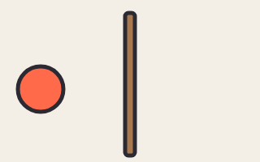

Os ossos e as `key` são explicados com calma nos capítulos [6](06-ossos.md) e [7](07-animacao.md). Para ler este exemplo, basta saber:

- `anim volta frames=24 fps=12` é uma animação de 24 quadros, tocados a 12 por segundo: a volta dura 2 segundos.
- `key 0 bola=-110,0,0,1,1` diz onde o osso `bola` está no quadro 0: 110 pixels para a esquerda (`-110`), 0 pixels para baixo, girado 0 graus, com escala 1 na largura e 1 na altura (o tamanho normal).

Agora, a ordem de pintura:

- Na ida (quadros 0 a 12), `bola.below=poste` põe a bola atrás do poste. Na volta (quadros 12 a 24), `bola.above=poste` põe na frente.
- A troca é **de uma vez**, como o `show`, e vale até a próxima `key` que mude a ordem da bola. Por isso ela fica nos quadros 0 e 12, quando a bola está longe do poste e ninguém vê o salto.
- Na ida a bola sobe e encolhe um pouco (escala `0.85`), e na volta desce e cresce (`1.15`): isso dá a impressão de longe e perto.
- As duas formas precisam estar na **mesma camada**. Para mudar uma camada inteira de lugar, use os nomes das camadas: `key 8 bracoD.above=corpo`.
- `none` volta para a ordem do arquivo: `key 20 bola.above=none`.
- Na pose parada, sem animação, vale a ordem do arquivo.

**Experimente:** na `key 0`, troque `bola.below=poste` por `bola.above=poste`. A bola passa a ficar na frente do poste a volta inteira.

## Recortar por dentro: `clip=`

`layer nome clip=forma` faz a camada só aparecer **dentro** da forma indicada. É o jeito de pintar sombra, brilho, manchas e listras sem ter que desenhar cada uma no formato exato do corpo: você desenha grande e o recorte apara.

<!-- gerar: img/04_clip.png -->
```weasel
canvas 440 220 bg=#f4efe6
palette ink=#2b2a33 line=8 bola=#ff6b4a sombra=#c8402c brilho=#ffc2ad

layer bolas
ellipse semClip 110,110 80 c=bola ink=line
ellipse comClip 330,110 80 c=bola ink=line

layer vazando
ellipse s1 150,150 90 c=sombra opacity=0.8
ellipse b1 80,80 26,16 rot=-30 c=brilho

layer aparado clip=comClip
ellipse s2 370,150 90 c=sombra opacity=0.8
ellipse b2 300,80 26,16 rot=-30 c=brilho
```

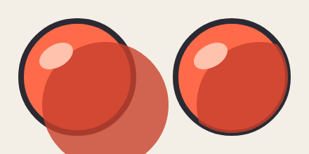

A sombra é só uma elipse grande deslocada para baixo e para a direita (`opacity=0.8`: 80% opaca, de 0 a 1). O brilho é uma elipse pequena girada 30 graus para trás (`rot=-30`). À esquerda os dois vazam; à direita, com `clip=comClip`, ficam exatamente dentro da bola.

- `clip=` aceita o nome de uma **forma fechada** (`shape`, `ellipse`, `rect`) ou de uma **camada** (veja [logo abaixo](#recortar-com-uma-camada-inteira)).
- Um `stroke` ou uma `line` não servem de molde: eles não têm lado de dentro, e a camada inteira sumiria. O Weasel avisa quando isso acontece.
- O recorte acompanha a forma quando ela se mexe com um osso.

**Experimente:** apague o `clip=comClip` da linha `layer aparado`. A bola da direita fica igual à da esquerda, com a sombra vazando.

### Recortar com uma camada inteira

Às vezes o molde não é uma forma só: um corpo feito de vários gomos, uma cabeça com orelhas. Para isso, `clip=` também aceita o nome de uma **camada**. O molde passa a ser o formato de todas as formas fechadas dela, juntas.

<!-- gerar: img/04_clip_camada.png -->
```weasel
canvas 460 210 bg=#f4efe6
palette ink=#2b2a33 verde=#8ad46a sombra=#4f9a45

# lagarta da esquerda: os gomos têm nomes diferentes
layer corpoE
ellipse g1 50,110 32 c=verde
ellipse g2 98,102 34 c=verde
ellipse g3 148,106 32 c=verde
ellipse g4 194,96 36 c=verde

layer sombraE clip=corpoE
ellipse s1 120,160 130,46 c=sombra

# lagarta da direita: todos os gomos se chamam gomo
layer corpoD
ellipse gomo 270,110 32 c=verde
ellipse gomo 318,102 34 c=verde
ellipse gomo 368,106 32 c=verde
ellipse gomo 414,96 36 c=verde

layer sombraD clip=gomo
ellipse s2 340,160 130,46 c=sombra

layer rosto
ellipse olhoE 206,86 6 c=ink
ellipse olhoD 426,86 6 c=ink
text t1 122,196 "clip=corpoE" size=16 align=center
text t2 342,196 "clip=gomo" size=16 align=center
```

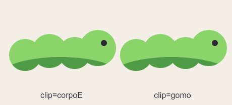

Repare:

- A sombra de cada lagarta é **uma elipse só**, larga, embaixo. O recorte apara essa elipse no formato dos quatro gomos de uma vez.
- À esquerda, `clip=corpoE` usa a **camada** `corpoE`: valem todas as formas fechadas dela.
- À direita, os quatro gomos têm o **mesmo nome**, `gomo`. Aí `clip=gomo` usa todos eles. Dá o mesmo resultado, e os gomos poderiam até dividir a camada com outras formas: só os que se chamam `gomo` contam.
- No editor, o **Ctrl+D** dá um nome novo à cópia (`gomo_1`). Para ela entrar no grupo, apague o `_1`.
- Quando um nome é ao mesmo tempo de uma forma e de uma camada, vale a forma.

**Experimente:** à esquerda, troque `clip=corpoE` por `clip=g4`. A sombra só aparece no último gomo, a cabeça.

### O contorno por cima: `inkon=`

Repare na bola da direita do [primeiro exemplo de `clip=`](#recortar-por-dentro-clip): a sombra cobriu a metade de dentro do contorno, que ficou mais fino do lado de baixo. O contorno é pintado junto com a forma, e a camada recortada vem depois, por cima dele.

`inkon=camada` resolve isso: o **preenchimento** fica onde está, mas o **contorno** é pintado em outra camada, que você põe por último.

<!-- gerar: img/04_inkon.png -->
```weasel
canvas 440 220 bg=#f4efe6
palette ink=#2b2a33 line=10 bola=#ff6b4a reflexo=#ffe2c2

layer bolas
ellipse semInkon 110,110 80 c=bola ink=line
ellipse comInkon 330,110 80 c=bola ink=line inkon=contorno

layer reflexo1 clip=semInkon
ellipse r1 160,160 70 c=reflexo

layer reflexo2 clip=comInkon
ellipse r2 380,160 70 c=reflexo

layer contorno
```


À esquerda, sem `inkon`, o reflexo claro come a metade de dentro do contorno. À direita, o contorno de `comInkon` vai para a camada `contorno`, pintada por último, e fica inteiro. A camada `contorno` está vazia no código: ela só recebe o contorno de `comInkon`. É a técnica do Cavaleiro de exemplo: o corpo, a capa e a máscara mandam o contorno para camadas por cima das sombras e dos olhos.

- `inkon=` só vale em formas fechadas com contorno (`ink=` maior que 0). Sem `ink=`, o Weasel avisa que não faz sentido.
- A camada de `inkon=` precisa existir no arquivo, mesmo vazia.
- Com a camada de `inkon=` **antes** da forma, o contorno fica só por fora: o preenchimento cobre a metade de dentro. Veja o [capítulo 2](02-formas.md#contorno-só-por-fora).

**Experimente:** com `line=10`, o contorno tem 10 pixels de largura e a diferença é fácil de ver. Mude para `line=4`: a perda fica pequena, mas ainda está lá.

## Recortar por fora: `cut=`

`cut=` é o contrário do `clip=`: a camada aparece em todo lugar, **menos** dentro da forma. Serve para abrir janelas, portas e buracos.

<!-- gerar: img/04_cut.png -->
```weasel
canvas 440 200 bg=#bfe3f5
palette ink=#2b2a33
pattern listra hatch angle=90 gap=14 w=7 c=#c44536 bg=#f4efe6

ellipse janela 120,100 56 hidden
layer parede cut=janela
rect tinta 20,20 200,160 c=listra

layer rosquinha
ellipse rosca 330,100 76 c=#e0a050 ink=6 cut=furo
ellipse furo 330,100 28 hidden
```

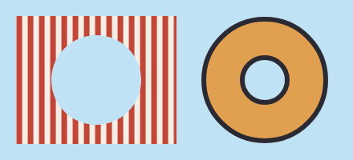

A parede é um retângulo com o padrão de listras `listra` (os padrões são do [capítulo 3](03-cores.md)). Pelo buraco da janela aparece o fundo azul do canvas.

### Buraco numa forma: `cut=` na forma

O `cut=` também vai **numa forma**, como na rosca da direita: `cut=furo` abre um buraco com o formato de `furo`, e o contorno da forma **contorna o buraco também**. Na camada (à esquerda), o buraco sai sem contorno.

Nos dois casos, a forma que serve de molde (`janela`, `furo`) tem a opção `hidden`: ela não aparece, só empresta o formato.

### Vários buracos e mordidas

Uma forma pode ter vários buracos: escreva os nomes separados por vírgula, `cut=f1,f2,f3`. E o buraco pode passar da borda da forma: aí ele vira uma **mordida**.

<!-- gerar: img/04_buracos.png -->
```weasel
canvas 440 210 bg=#cfe8f5
palette ink=#2b2a33 line=5

# um queijo com três furos
rect queijo 30,50 180,110 r=8 c=#ffd34d ink=line cut=f1,f2,f3
ellipse f1 75,90 18 hidden
ellipse f2 150,125 22 hidden
ellipse f3 178,78 10 hidden

# um biscoito mordido: o buraco passa da borda
ellipse biscoito 330,105 72 c=#d9a066 ink=line cut=mordida
ellipse mordida 395,50 42 hidden
ellipse gota1 300,90 7 c=#5a3a22
ellipse gota2 335,140 7 c=#5a3a22
ellipse gota3 290,130 6 c=#5a3a22

text t1 120,196 "cut=f1,f2,f3" size=16 align=center
text t2 330,196 "cut=mordida" size=16 align=center
```

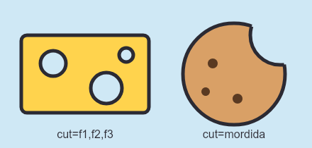

Repare:

- Cada furo do queijo ganhou contorno, como o da rosca.
- A `mordida` é um círculo que fica metade dentro, metade fora do biscoito. Só a parte de dentro vira buraco, e o contorno acompanha a curva da mordida.
- O molde precisa ser uma forma **fechada** (`shape`, `ellipse` ou `rect`).

**Experimente:** mude o raio da mordida de `42` para `70`. A mordida fica enorme e leva um pedaço grande do biscoito, com contorno e tudo.

### Furos com o mesmo nome e furos que se cruzam

Os furos também podem ter **o mesmo nome**: `cut=furo` abre um buraco em cada forma chamada `furo`. E dois furos podem se cruzar: eles viram **um buraco só**, com um contorno só.

<!-- gerar: img/04_furos_juntos.png -->
```weasel
canvas 440 200 bg=#cfe8f5
palette ink=#2b2a33 line=5

# quatro furos com o mesmo nome
rect queijo 20,40 190,110 r=8 c=#ffd34d ink=line cut=furo
ellipse furo 60,75 14 hidden
ellipse furo 100,118 18 hidden
ellipse furo 145,70 11 hidden
ellipse furo 178,115 14 hidden

# dois furos que se cruzam: um buraco só, em forma de óculos
ellipse bolacha 330,95 70 c=#d9a066 ink=line cut=olho1,olho2
ellipse olho1 310,95 28 hidden
ellipse olho2 350,95 28 hidden

text t1 115,186 "cut=furo" size=16 align=center
text t2 330,186 "cut=olho1,olho2" size=16 align=center
```

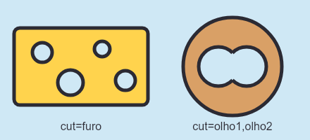

Repare:

- As quatro elipses se chamam `furo`, e `cut=furo` abre as quatro. É assim que um [`repeat`](05-componentes.md#repetir-repeat) faz dezenas de furos de uma vez: todas as cópias têm o mesmo nome.
- `olho1` e `olho2` se cruzam no meio. O pedaço em comum também fica vazio, e o contorno segue a borda do buraco inteiro, sem riscar o meio.
- Dentro de um componente (`def`), `cut=furo` usa os furos da mesma cópia: cada uso do componente tem os seus.

**Experimente:** mude o raio de `olho1` e `olho2` de `28` para `40`. O buraco cresce e passa da borda da bolacha, como a mordida do biscoito.

### Molde com buraco

Uma forma com buraco também pode ser o molde de um `clip=` ou de um `cut=` de camada. O buraco continua buraco:

<!-- gerar: img/04_molde_buraco.png -->
```weasel
canvas 440 200 bg=#f4efe6
palette ink=#2b2a33 line=5

# a calda fica só em cima da massa: não entra no buraco
layer massa
ellipse rosca 110,100 75 c=#e0a050 ink=line cut=miolo inkon=contorno
ellipse miolo 110,100 28 hidden
layer calda clip=rosca
rect cobertura 20,20 180,70 c=#d1477a

# a toalha some atrás da rosca, mas aparece pelo buraco dela
layer massa2
ellipse rosca2 330,100 75 c=#e0a050 ink=line cut=miolo2
ellipse miolo2 330,100 28 hidden
layer toalha cut=massa2
rect pano 230,80 200,40 c=#3a78c2

layer contorno
```

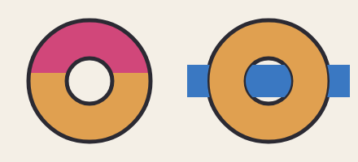

Repare:

- `clip=rosca`: a calda aparece só onde a rosca tem massa. O buraco do meio (`cut=miolo`) fica sem calda.
- `cut=massa2`: a toalha some onde está a rosca, mas aparece pelo buraco, como se passasse por trás dela.
- `miolo2` está na camada `massa2`, mas ele é o molde de um buraco: só empresta o formato e não tapa o buraco.
- `inkon=contorno` põe o contorno da primeira rosca por cima da calda, como no [exemplo do `inkon=`](#o-contorno-por-cima-inkon).

**Experimente:** apague o `cut=miolo` da primeira rosca. Ela fica inteira, e a calda passa a cobrir o meio também.

## Outras opções de camada

```
layer nome [guide] [hidden] [unlit] opacity= blend= only= clip= cut= …
```

| Opção | O que faz |
|---|---|
| `guide` | Camada de **construção**: aparece no editor com o botão **Guias** ligado e na linha de comando com `--guides`, mas não sai na exportação. Use para linhas de referência, eixos, o chão ([exemplo](#camada-de-construção-guide)). |
| `hidden` | A camada não é pintada. As formas dela continuam valendo como molde de `clip` e `cut` ([exemplo](#camada-escondida-hidden)). |
| `opacity=0.5` | Transparência da camada inteira, de 0 (invisível) a 1 (normal, o padrão) ([exemplo](#transparência-da-camada-opacity)). |
| `blend=multiply` | Como a camada se mistura com o que está embaixo: `multiply` escurece (bom para sombras), `screen` clareia (brilhos), `overlay`, `soft-light`, `color-dodge`… (os modos de mistura do Photoshop e do CSS) ([exemplo](#misturar-com-o-que-está-embaixo-blend)). |
| `only=anim1,anim2` | A camada só aparece nessas animações. O nome `pose` vale para a pose parada ([exemplo](#só-em-certas-animações-only)). |
| `unlit` | Não recebe a luz da cena: fica com as cores do desenho, mesmo no escuro ([capítulo 8](08-luz-efeitos.md)). `lit` também é aceito, mas é o padrão: não muda nada. |
| `blur=` `glow=` `shadow=` `tint=` `trail=` `cast=` `rim=` … | Efeitos da camada inteira ([capítulo 8](08-luz-efeitos.md#efeitos-de-camada)). |
| `depth=` `screen` `front` | Profundidade num filme ([capítulo 10](10-filme.md#profundidade-e-paralaxe)). |

### Camada de construção: `guide`

Uma camada `guide` guarda as **linhas de ajuda** que você usa para desenhar (o meio do rosto, a altura dos olhos, a linha do chão) e que não devem sair na imagem final.

<!-- gerar: img/04_guide.png -->
<!-- gerar: img/04_guide_on.png --guides -->
```weasel
canvas 300 220 bg=#f4efe6
palette ink=#2b2a33 line=5

layer rosto
ellipse cara 150,110 80 c=#ffd34d ink=line
ellipse olhoE 122,95 8,12 c=ink
ellipse olhoD 178,95 8,12 c=ink
stroke boca w=5 : 115,135 150,155 185,135

# linhas de construção: só no editor e com --guides
layer construcao guide
line meio w=1 c=#c44536 dash=6,4 : 150,8 150,212
line olhos w=1 c=#c44536 dash=6,4 : 40,95 260,95
text nota 156,206 "meio: x=150" size=13 c=#c44536
```

| Exportado normalmente | Com `--guides` |
|---|---|
|  | 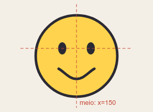 |

Repare:

- A camada `construcao` tem a opção `guide`. As duas linhas tracejadas e a anotação ficam nela.
- Na exportação normal (à esquerda), a camada some. Com `--guides` na linha de comando (à direita), ela aparece. No editor, quem decide é o botão **Guias**.
- `dash=6,4` é o tracejado: 6 pixels de traço, 4 de vão.
- Uma camada `guide` nunca recebe luz, mesmo numa cena iluminada.

Para exportar com as guias:

```bash
node cli/weasel.js teste.weasel --guides
```

### Camada escondida: `hidden`

Uma camada `hidden` não é pintada, mas as formas dela continuam existindo. Serve para guardar **moldes**: formas que só emprestam o formato para um `clip=` ou um `cut=` de outra camada.

<!-- gerar: img/04_hidden.png -->
```weasel
canvas 400 260 bg=#1d2140
palette ink=#2b2a33 line=5

# 1. o que fica atrás da parede: a luz de dentro da casa
layer dentro
rect luz 60,90 280,150 c=#ffd56b

# 2. a parede, com buracos no formato das formas da camada janelas
layer parede cut=janelas
rect frente 60,90 280,150 c=#b5835a ink=line
shape telhado c=#7a3b2c ink=line : 40,94! 200,20! 360,94!

# 3. os moldes: a camada não é pintada, só empresta o formato
layer janelas hidden
rect j1 90,120 60,50 r=4 c=none ink=4
rect j2 250,120 60,50 r=4 c=none ink=4
rect porta 175,160 50,80 r=4 c=none ink=4
```

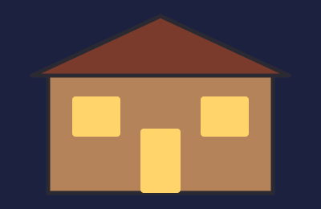

Repare:

- A parede é um retângulo inteiro. Os buracos vêm de `cut=janelas`: o nome é de uma **camada**, então valem as três formas dela juntas.
- A camada `janelas` tem `hidden`: as três formas não são pintadas, só servem de molde.
- Pelos buracos aparece o que foi pintado antes da parede: a camada `dentro`, amarela.
- `c=none ink=4` nos moldes não muda nada enquanto a camada está escondida. Eles estão aí para o "Experimente".

**Experimente:** apague o `hidden` da linha `layer janelas`. Os moldes passam a ser pintados também: sem preenchimento (`c=none`) e com contorno de 4 pixels, eles viram a moldura das janelas e da porta.

### Transparência da camada: `opacity=`

`opacity=` deixa a camada inteira transparente com uma linha só, em vez de pôr `opacity=` em cada forma. O número vai de 0 (invisível) a 1 (normal, o padrão).

<!-- gerar: img/04_opacity.png -->
```weasel
canvas 420 220 bg=#f4efe6
palette ink=#2b2a33
pattern tabuas hatch angle=0 gap=22 w=4 c=#c9a27e bg=#e9d6bf

rect parede 0,0 420,180 c=tabuas

layer normal
shape fantasma1 c=#ffffff : 70,40 110,80 110,150! 90,140! 70,150! 50,140! 30,150! 30,80
ellipse olho1 58,80 6,9 c=ink
ellipse olho2 82,80 6,9 c=ink

layer meio opacity=0.6
shape fantasma2 c=#ffffff : 210,40 250,80 250,150! 230,140! 210,150! 190,140! 170,150! 170,80
ellipse olho3 198,80 6,9 c=ink
ellipse olho4 222,80 6,9 c=ink

layer quase opacity=0.25
shape fantasma3 c=#ffffff : 350,40 390,80 390,150! 370,140! 350,150! 330,140! 310,150! 310,80
ellipse olho5 338,80 6,9 c=ink
ellipse olho6 362,80 6,9 c=ink

layer rotulos
text t1 70,206 "sem opacity" size=15 align=center
text t2 210,206 "opacity=0.6" size=15 align=center
text t3 350,206 "opacity=0.25" size=15 align=center
```

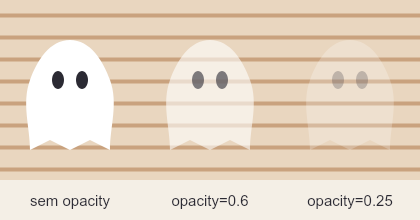

Repare:

- Os três fantasmas são o mesmo desenho, cada um na sua camada. O que muda é o `opacity=` da linha `layer`.
- Com `opacity=0.6`, o fantasma e os olhos ficam 60% visíveis: as tábuas aparecem através deles.
- Com `opacity=0.25`, sobra só um quarto: o fantasma quase sumiu.
- A transparência da camada se multiplica com a de cada forma: uma forma com `opacity=0.5` numa camada com `opacity=0.5` fica com `0.25` (0,5 × 0,5).
- Numa animação, `key 12 meio.opacity=0` faz a camada inteira sumir aos poucos ([capítulo 7](07-animacao.md)).

**Experimente:** mude `opacity=0.25` para `opacity=0`. O terceiro fantasma desaparece de vez.

### Misturar com o que está embaixo: `blend=`

Normalmente, uma camada **cobre** o que está embaixo dela. `blend=` muda isso: em vez de cobrir, a cor da camada faz uma **conta** com a cor de baixo. É assim que se pinta sombra que só escurece, brilho que só clareia, ou se dá cor a um desenho cinza.

Neste exemplo, os oito quadrados laranja são iguais. Cada um está numa camada com um `blend=` diferente, e todos passam por cima de três faixas: branca, azul e escura.

<!-- gerar: img/04_blend.png -->
```weasel
canvas 640 250 bg=#ffffff
palette ink=#2b2a33 laranja=#ff8a3d

# o fundo: três faixas (branca, azul e escura)
rect azul 0,80 640,60 c=#4a9eff
rect escura 0,140 640,60 c=#1f2340

layer m1
rect q1 12,30 56,160 r=6 c=laranja
layer m2 blend=multiply
rect q2 92,30 56,160 r=6 c=laranja
layer m3 blend=screen
rect q3 172,30 56,160 r=6 c=laranja
layer m4 blend=overlay
rect q4 252,30 56,160 r=6 c=laranja
layer m5 blend=darken
rect q5 332,30 56,160 r=6 c=laranja
layer m6 blend=lighten
rect q6 412,30 56,160 r=6 c=laranja
layer m7 blend=difference
rect q7 492,30 56,160 r=6 c=laranja
layer m8 blend=color
rect q8 572,30 56,160 r=6 c=laranja

layer rotulos
text t1 40,226 "normal" size=13 align=center
text t2 120,226 "multiply" size=13 align=center
text t3 200,226 "screen" size=13 align=center
text t4 280,226 "overlay" size=13 align=center
text t5 360,226 "darken" size=13 align=center
text t6 440,226 "lighten" size=13 align=center
text t7 520,226 "difference" size=13 align=center
text t8 600,226 "color" size=13 align=center
```

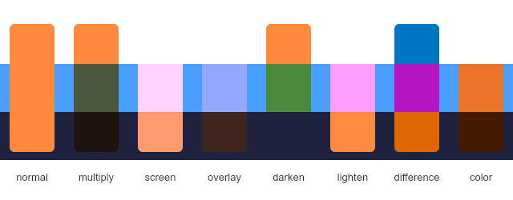

Olhe cada quadrado de cima para baixo, passando pelas três faixas:

| Modo | O que faz | Bom para |
|---|---|---|
| `normal` | cobre (o padrão) | quase tudo |
| `multiply` | multiplica as cores: **só escurece**. No branco, fica a cor da camada; no escuro, fica escuro | sombras |
| `screen` | o contrário: **só clareia**. No branco continua branco; no escuro, aparece a cor da camada | brilhos e luz |
| `overlay` | escurece o que é escuro e clareia o que é claro (mais contraste) | texturas, luz e sombra juntas |
| `darken` | fica a mais escura das duas cores | sombras com cor |
| `lighten` | fica a mais clara das duas cores | brilhos com cor |
| `difference` | subtrai uma cor da outra: no branco, vira a cor "inversa" | efeitos estranhos, conferir se duas coisas estão alinhadas |
| `color` | pega a cor (o tom) da camada e a claridade de baixo | colorir um desenho feito em cinza |

Os outros modos são `color-dodge`, `color-burn`, `hard-light`, `soft-light`, `exclusion`, `hue`, `saturation` e `luminosity`. São os mesmos do Photoshop e do CSS; o jeito mais fácil de conhecer é trocar o nome num destes quadrados e olhar.

**Experimente:** troque `blend=color` por `blend=luminosity`. É o contrário do `color`: o quadrado fica com o tom da faixa de baixo e a claridade do laranja.

### Só em certas animações: `only=`

Um personagem costuma ter partes que só existem em alguns momentos: a poeira de um pulo, o rastro de um golpe, um balão de fala. `only=` faz a camada aparecer **só nas animações** que você nomear.

<!-- gerar: img/04_only_pose.png -->
<!-- gerar: img/04_only_pula.png -a pula --frame 6 -->
```weasel
canvas 300 220 bg=#cfe8f5
palette ink=#2b2a33 line=5

bone corpo pivot=150,150

rect chao 0,190 300,30 c=#7cc56a

layer bicho
ellipse corpo 150,150 40 c=#ff6b4a ink=line bone=corpo
ellipse olho 164,140 6 c=ink bone=corpo

# só na pose parada (sem animação)
layer placa only=pose
text p 150,40 "parado" size=22 align=center bold

# só na animação pula
layer poeira only=pula
ellipse p1 104,192 18,7 c=#d9c9a8
ellipse p2 196,192 18,7 c=#d9c9a8
text t 150,40 "pulando" size=22 align=center bold

anim pula frames=12 fps=12
key 0 corpo=0,0
key 6 corpo=0,-50
key 12 corpo=0,0
```

| A pose parada | O quadro 6 da animação `pula` |
|---|---|
| 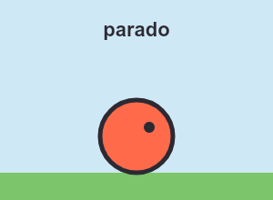 | 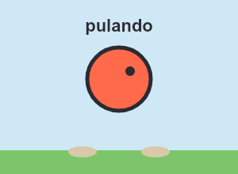 |

Repare:

- A camada `placa` tem `only=pose`. `pose` é o nome da **pose parada**, o desenho sem nenhuma animação tocando. Ela aparece à esquerda e some no pulo.
- A camada `poeira` tem `only=pula`: só aparece enquanto a animação `pula` toca.
- `key 6 corpo=0,-50` sobe o osso `corpo` 50 pixels no quadro 6 (y negativo é para cima). Por isso a bola está no alto à direita.
- Para mais de uma animação, separe os nomes com vírgula: `only=pose,pula,corre`.
- Um nome que não é de nenhuma animação dá aviso.

A imagem da direita veio da linha de comando, escolhendo a animação e o quadro:

```bash
node cli/weasel.js teste.weasel -a pula --frame 6 -o pulo.png
```

O [capítulo 7](07-animacao.md#camadas-que-só-aparecem-em-certas-animações-only) mostra o `only=` num personagem de jogo.

## Acabamento: `finish`

`finish` muda o estilo do desenho **inteiro** de uma vez. A linha `finish` pode ficar em qualquer lugar do arquivo (o costume é logo depois do `canvas`):

```
finish game|flat inner= pixel= posterize= bloom= vignette= grain=
```

| | `game` (padrão) | `finish flat` | `pixel=4` | `posterize=4` |
|---|---|---|---|---|
| |  |  | 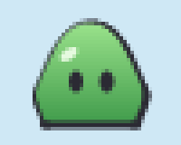 | 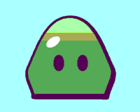 |

<details>
<summary>Código dos quatro</summary>

<!-- gerar: img/04_finish_game.png -->
```weasel
canvas 200 160 bg=#cfe8f5
palette ink=#2b2a33 line=5
gradient verde linear 0,0 0,1 box : #9be38c #3f9a4a
shape corpo c=verde ink=line weight=0.3 : 100,24 160,96 152,138! 48,138! 40,96
ellipse olhoE 84,90 8,12 c=ink
ellipse olhoD 118,90 8,12 c=ink
ellipse brilho 76,60 11,6 rot=-35 c=#e6fadf
```

<!-- gerar: img/04_finish_flat.png -->
```weasel
canvas 200 160 bg=#cfe8f5
finish flat
palette ink=#2b2a33 line=5
gradient verde linear 0,0 0,1 box : #9be38c #3f9a4a
shape corpo c=verde ink=line weight=0.3 : 100,24 160,96 152,138! 48,138! 40,96
ellipse olhoE 84,90 8,12 c=ink
ellipse olhoD 118,90 8,12 c=ink
ellipse brilho 76,60 11,6 rot=-35 c=#e6fadf
```

<!-- gerar: img/04_finish_pixel.png -->
```weasel
canvas 200 160 bg=#cfe8f5
finish game pixel=4
palette ink=#2b2a33 line=5
gradient verde linear 0,0 0,1 box : #9be38c #3f9a4a
shape corpo c=verde ink=line weight=0.3 : 100,24 160,96 152,138! 48,138! 40,96
ellipse olhoE 84,90 8,12 c=ink
ellipse olhoD 118,90 8,12 c=ink
ellipse brilho 76,60 11,6 rot=-35 c=#e6fadf
```

<!-- gerar: img/04_finish_posterize.png -->
```weasel
canvas 200 160 bg=#cfe8f5
finish game posterize=4
palette ink=#2b2a33 line=5
gradient verde linear 0,0 0,1 box : #9be38c #3f9a4a
shape corpo c=verde ink=line weight=0.3 : 100,24 160,96 152,138! 48,138! 40,96
ellipse olhoE 84,90 8,12 c=ink
ellipse olhoD 118,90 8,12 c=ink
ellipse brilho 76,60 11,6 rot=-35 c=#e6fadf
```

</details>

Os quatro códigos são iguais, menos a linha `finish`. Repare:

- `game` é o padrão: com ou sem a linha `finish game`, os contornos (`ink=`) são desenhados.
- `flat` tira **todos** os contornos de uma vez, para um visual de recorte de papel. Os olhos continuam, porque são preenchimento (`c=ink`), não contorno.
- `pixel=4` desenha a imagem 4 vezes menor e depois aumenta sem suavizar: cada "pixel" vira um bloco de 4×4.
- `posterize=4` deixa só 4 níveis em cada canal de cor (vermelho, verde e azul). O degradê suave da gosma vira faixas.

| Atributo | O que faz |
|---|---|
| `game` / `flat` | `game` desenha os contornos (`ink=`); `flat` tira todos, para um visual de recorte de papel. |
| `inner=0.6` | Opacidade dos **traços** (`stroke`) dentro de camadas com `clip`, de 0 a 1 (padrão 1). Deixa penas, rugas e dobras mais suaves que o contorno de fora ([os dois `inner`](#os-dois-inner)). |
| `pixel=4` | Desenha em blocos de 4×4 pixels (pixel art), de 1 a 32 (padrão 1, sem blocos). |
| `posterize=4` | Reduz cada canal de cor a 4 níveis (de 2 a 64). `posterize=palette` reduz às cores da `palette` ([exemplo](#só-as-cores-da-palette-posterizepalette)). |
| `bloom=` `vignette=` `grain=` | Brilho que vaza do claro, bordas escurecidas e granulado de filme, de 0 a 3 (padrão 0) ([exemplo](#acabamentos-de-cinema-bloom-vignette-e-grain)). |

**Experimente:** no código do `pixel=4`, mude para `pixel=8`. Os blocos dobram de tamanho, e os olhos viram poucos quadradinhos.

### Só as cores da palette: `posterize=palette`

Com `posterize=palette`, cada ponto da imagem vira a cor **mais parecida** entre as cores da sua `palette`. Serve para garantir que o desenho inteiro use só as cores escolhidas, como numa pixel art de poucas cores.

<!-- gerar: img/04_finish_palette.png -->
```weasel
canvas 200 160 bg=#cfe8f5
finish game posterize=palette
palette ink=#2b2a33 line=5 ceu=#cfe8f5 claro=#9be38c escuro=#3f9a4a brilho=#e6fadf
gradient verde linear 0,0 0,1 box : claro escuro
shape corpo c=verde ink=line weight=0.3 : 100,24 160,96 152,138! 48,138! 40,96
ellipse olhoE 84,90 8,12 c=ink
ellipse olhoD 118,90 8,12 c=ink
ellipse brilho 76,60 11,6 rot=-35 c=brilho
```

| Sem `posterize` | `posterize=palette` |
|---|---|
|  |  |

Repare:

- A `palette` tem cinco cores: `ink`, `ceu`, `claro`, `escuro` e `brilho`. Os números (`line=5`) não contam.
- O degradê ia do `claro` ao `escuro`, passando por vários verdes do meio. Com `posterize=palette`, cada verde do meio virou o `claro` ou o `escuro`, o que estiver mais perto.
- Liste na `palette` todas as cores que você quer na imagem. Uma cor que não está lá vira a parecida mais próxima, que pode ser bem diferente.

**Experimente:** acrescente `meio=#6dbe6a` na linha `palette`. O degradê ganha uma terceira faixa, verde média.

### Acabamentos de cinema: `bloom=`, `vignette=` e `grain=`

Estes três imitam o que acontece numa câmera de verdade. Eles valem para a **imagem pronta**, então ficam bem em cenas inteiras (cenários, filmes) e quase não aparecem num personagem sozinho num fundo claro.

| Sem nada | `bloom=1.5` | `vignette=1` | `grain=0.15` |
|---|---|---|---|
| 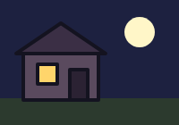 | 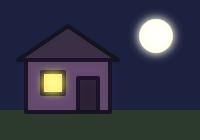 | 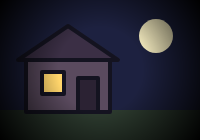 | 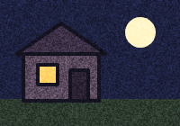 |

<details>
<summary>Código dos quatro</summary>

<!-- gerar: img/04_finish_noite.png -->
```weasel
canvas 200 140 bg=#1d2140
palette ink=#141320 line=4
rect chao 0,110 200,30 c=#2c3a2e
ellipse lua 156,36 17 c=#fff6c8
rect casa 26,58 84,54 c=#5a4a5e ink=line
shape telhado c=#3b2f45 ink=line : 18,60! 68,26! 118,60!
rect janela 42,72 22,22 c=#ffd56b ink=line
rect porta 78,78 20,34 c=#2b2233 ink=line
```

<!-- gerar: img/04_finish_bloom.png -->
```weasel
canvas 200 140 bg=#1d2140
finish game bloom=1.5
palette ink=#141320 line=4
rect chao 0,110 200,30 c=#2c3a2e
ellipse lua 156,36 17 c=#fff6c8
rect casa 26,58 84,54 c=#5a4a5e ink=line
shape telhado c=#3b2f45 ink=line : 18,60! 68,26! 118,60!
rect janela 42,72 22,22 c=#ffd56b ink=line
rect porta 78,78 20,34 c=#2b2233 ink=line
```

<!-- gerar: img/04_finish_vignette.png -->
```weasel
canvas 200 140 bg=#1d2140
finish game vignette=1
palette ink=#141320 line=4
rect chao 0,110 200,30 c=#2c3a2e
ellipse lua 156,36 17 c=#fff6c8
rect casa 26,58 84,54 c=#5a4a5e ink=line
shape telhado c=#3b2f45 ink=line : 18,60! 68,26! 118,60!
rect janela 42,72 22,22 c=#ffd56b ink=line
rect porta 78,78 20,34 c=#2b2233 ink=line
```

<!-- gerar: img/04_finish_grain.png -->
```weasel
canvas 200 140 bg=#1d2140
finish game grain=0.15
palette ink=#141320 line=4
rect chao 0,110 200,30 c=#2c3a2e
ellipse lua 156,36 17 c=#fff6c8
rect casa 26,58 84,54 c=#5a4a5e ink=line
shape telhado c=#3b2f45 ink=line : 18,60! 68,26! 118,60!
rect janela 42,72 22,22 c=#ffd56b ink=line
rect porta 78,78 20,34 c=#2b2233 ink=line
```

</details>

| Atributo | O que faz | Valores |
|---|---|---|
| `bloom=` | o que é muito claro (a lua, a janela) "vaza" num brilho suave em volta | de 0 a 3; 1 já é bem visível, e cada número a mais soma mais uma camada de brilho |
| `vignette=` | escurece as bordas e os cantos, e leva o olho para o meio | de 0 a 1: em 1, os cantos ficam pretos (acima de 1 não escurece mais) |
| `grain=` | granulado de filme, um chuvisco fino por cima de tudo | pouco basta: `0.03` é sutil, `0.15` é forte (acima de uns 0.35 não aumenta mais) |

Os três podem ir juntos na mesma linha: `finish game bloom=0.5 vignette=0.6 grain=0.03`. O [capítulo 8](08-luz-efeitos.md#acabamentos-de-cinema) usa assim numa fogueira animada.

> O granulado é ruído, e ruído não comprime: um GIF ou PNG com `grain=` fica bem maior.

**Experimente:** no código do `bloom`, mude a cor da lua para `c=#8a7a4a`, um amarelo apagado. O brilho em volta dela some: o `bloom` só pega o que é bem claro. A janela, que continua clara, continua brilhando.

### Os dois `inner`

A palavra `inner` aparece em **dois lugares** do Weasel, com sentidos diferentes. Os dois cuidam da mesma coisa, os traços **de dentro** do personagem (penas, rugas, dobras de roupa), por isso têm o mesmo nome. Mas um diz a **espessura** desses traços, e o outro diz **o quanto eles aparecem**.

| Nome | Onde se escreve | O que é | Exemplo |
|---|---|---|---|
| `inner` da `palette` | como valor de `w=` ou `ink=` (e, para mudar o número, numa linha `palette`) | um **número com nome**: uma espessura em pixels. Já vem pronto, valendo 5 | `stroke pena w=inner : …` |
| `inner=` do `finish` | só na linha `finish` | uma **opacidade**, de 0 (invisível) a 1 (normal). Padrão 1. Vale só para os `stroke` de camadas com `clip=` | `finish game inner=0.4` |

**O `inner` da palette** foi apresentado no [capítulo 3](03-cores.md#nomes-que-já-existem): é um número pronto, como `line` e `edge`. Escrever `w=inner` é o mesmo que escrever `w=5`, com a vantagem de poder trocar o 5 de todos os traços numa linha só.

**O `inner=` do finish** deixa mais claros os traços que ficam **dentro** de uma forma recortada, para que pareçam um detalhe e não briguem com o contorno de fora.

Os dois exemplos abaixo desenham o mesmo passarinho. O primeiro gera duas imagens: a normal e a variante `fino`, que troca o `inner` da palette. O segundo só acrescenta a linha `finish game inner=0.4`.

<!-- gerar: img/04_inner_padrao.png -->
<!-- gerar: img/04_inner_fino.png --variant fino -->
```weasel
canvas 240 220 bg=#f4efe6
palette ink=#2b2a33 line=8
variant fino inner=2

layer corpo
ellipse bola 120,116 80 c=#ffb347 ink=line

# as penas: traços de dentro, numa camada recortada pela bola
layer penas clip=bola
stroke asa w=inner : 70,98 64,124 76,144 102,152
stroke p1 w=inner : 92,164 104,174 116,164
stroke p2 w=inner : 116,164 128,174 140,164
stroke p3 w=inner : 104,184 116,194 128,184

# o rosto e o topete: numa camada sem clip
layer rosto
stroke topete w=inner : 112,38 118,16 134,10
ellipse olhoE 102,100 7,10 c=ink
ellipse olhoD 142,100 7,10 c=ink
shape bico c=#e8743b ink=4 : 112,118! 132,118! 122,132!
```

<!-- gerar: img/04_inner_04.png -->
```weasel
canvas 240 220 bg=#f4efe6
finish game inner=0.4
palette ink=#2b2a33 line=8

layer corpo
ellipse bola 120,116 80 c=#ffb347 ink=line

layer penas clip=bola
stroke asa w=inner : 70,98 64,124 76,144 102,152
stroke p1 w=inner : 92,164 104,174 116,164
stroke p2 w=inner : 116,164 128,174 140,164
stroke p3 w=inner : 104,184 116,194 128,184

layer rosto
stroke topete w=inner : 112,38 118,16 134,10
ellipse olhoE 102,100 7,10 c=ink
ellipse olhoD 142,100 7,10 c=ink
shape bico c=#e8743b ink=4 : 112,118! 132,118! 122,132!
```

| Padrão | `--variant fino` (`inner=2` na palette) | `finish game inner=0.4` |
|---|---|---|
|  |  | 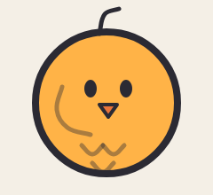 |

Repare:

- **No meio**, a variante troca o **número** `inner` da palette de 5 para 2. Todos os traços com `w=inner` afinam juntos: a asa, as penas **e** o topete. Nenhum fica mais claro.
- **À direita**, `finish game inner=0.4` não mexe na espessura: a asa e as penas continuam com 5 pixels, mas aparecem só 40%. O topete **não muda**, porque está na camada `rosto`, que não tem `clip=`.
- O contorno da bola (`ink=line`) e o bico não mudam em nenhuma das três.

O Cavaleiro de exemplo ([`cavaleiro.weasel`](../../exemplos/cavaleiro.weasel)) usa os dois juntos: `palette … inner=7` deixa os traços de dentro com 7 pixels, e `finish game inner=0.6` deixa as dobras da capa, que estão na camada `cloakshade clip=cloak`, com 60%.

#### O que o `inner=` do finish deixa mais claro

Para não restar dúvida, este exemplo põe lado a lado as mesmas três coisas, com a mesma espessura (`inner`, da palette), numa camada **sem** recorte e numa camada **com** `clip=`:

<!-- gerar: img/04_inner_juntos.png -->
```weasel
canvas 460 250 bg=#f4efe6
finish game inner=0.3
palette ink=#2b2a33 line=4 inner=8

layer papeis
rect papelE 20,40 200,195 r=10 c=#ffffff ink=line
rect papelD 240,40 200,195 r=10 c=#ffffff ink=line

# à esquerda: camada sem clip
layer livre
stroke tracoE w=inner : 50,80 190,80
line linhaE w=inner : 50,125 190,125
ellipse bolaE 120,175 20 c=#ffd34d ink=inner

# à direita: a mesma coisa, numa camada com clip
layer recortada clip=papelD
stroke tracoD w=inner : 270,80 410,80
line linhaD w=inner : 270,125 410,125
ellipse bolaD 340,175 20 c=#ffd34d ink=inner

layer rotulos
text t1 120,28 "camada sem clip" size=15 align=center
text t2 340,28 "camada com clip=" size=15 align=center
text s 120,100 "stroke" size=12 align=center
text l 120,145 "line" size=12 align=center
text s2 340,100 "stroke" size=12 align=center
text l2 340,145 "line" size=12 align=center
text c 120,220 "contorno (ink=)" size=12 align=center
text c2 340,220 "contorno (ink=)" size=12 align=center
```

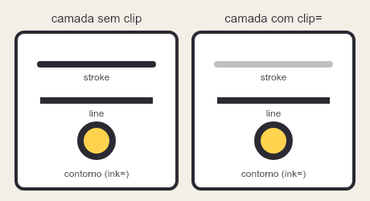

Repare:

- Os seis desenhos usam a mesma espessura: `w=inner` ou `ink=inner`, que nesta palette vale 8 pixels.
- Só **um** ficou claro: o `stroke` da direita, que é um `stroke` **e** está numa camada com `clip=`.
- A `line` da direita está na mesma camada recortada, mas não muda. O contorno da bolinha também não.

Resumindo, `finish inner=` só vale para:

- `stroke` (traços). Não vale para `line`, `text`, preenchimentos, nem para o contorno das formas (`ink=`);
- em camadas com `clip=`. Uma camada só com `cut=` não conta;
- e não vale para braços e pernas com IK (`stroke … limb=`, do [capítulo 6](06-ossos.md)).

A opacidade do `finish` se multiplica com a do próprio traço: um `stroke` com `opacity=0.5` numa camada com `clip=` e `finish inner=0.4` aparece só 20% (0,5 × 0,4).

**Experimente:** mude `inner=0.3` para `inner=0` na linha `finish`. O traço da direita some de vez, e todo o resto fica igual.

[← Cores e estilos](03-cores.md) · [Índice](README.md) · [Próximo: Contas, componentes e arquivos →](05-componentes.md)
