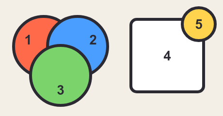
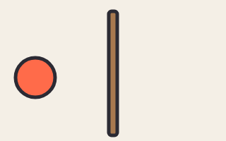
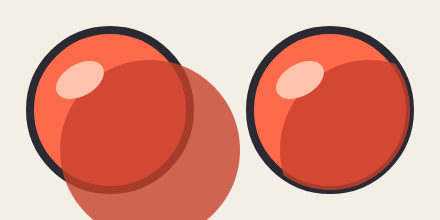
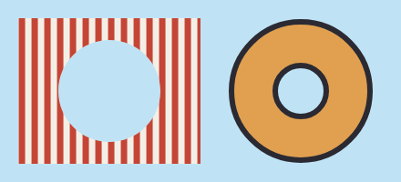
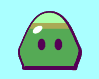

# 4. Camadas, recortes e acabamento

[← Cores e estilos](03-cores.md) · [Índice](README.md) · [Próximo: Contas, componentes e arquivos →](05-componentes.md)

## O que é uma camada

`layer nome` abre uma camada. Tudo o que vem abaixo dela entra nela, até a próxima linha `layer`:

```
layer fundo
rect ceu 0,0 400,200 c=#bfe3f5
ellipse sol 320,60 30 c=#ffd34d

layer personagem
shape corpo … 
ellipse olho … 
```

Duas coisas importantes:

- **As camadas não mudam a ordem de pintura.** Elas são pintadas na ordem em que aparecem, e cada uma pinta suas formas na ordem das linhas, então o resultado é o mesmo do arquivo lido de cima para baixo ([a ordem completa, com as exceções](#a-ordem-de-pintura)). Uma camada não pode ser aberta de novo mais adiante (dá erro "camada já existe").
- Formas escritas **antes** do primeiro `layer` caem numa camada automática chamada `base`, pintada primeiro.

Então para que servem? Para dar a um grupo de formas algo que vale para o grupo todo: **recorte** (`clip`, `cut`), **transparência**, **efeitos** (desfoque, brilho, sombra…), aparecer **só em certas animações** (`only=`), **luz** (`unlit`) e **profundidade** num filme (`depth=`). E para organizar: no editor, os nomes das camadas ajudam a achar as coisas.

## A ordem de pintura

O Weasel não pinta enquanto lê. Ele lê o arquivo **inteiro** primeiro, monta o desenho e só então pinta, nesta ordem:

1. as camadas, na ordem em que aparecem no arquivo (a `base` primeiro);
2. dentro de cada camada, as formas na ordem das linhas.

Como uma camada não pode ser aberta de novo, isso dá o mesmo que ler o arquivo de cima para baixo: **o que vem depois fica por cima**.

<!-- gerar: img/04_ordem.png -->
```weasel
canvas 460 240 bg=#f4efe6
palette ink=#2b2a33 line=6

# o def está no começo, mas não pinta nada aqui:
# o selo só é pintado na linha do use, a última do arquivo
def selo
ellipse fundo 0,0 34 c=#ffd34d ink=line
text n 0,10 "5" size=28 align=center bold
end

ellipse um 90,96 62 c=#ff6b4a ink=line
text n1 58,92 "1" size=28 align=center bold
ellipse dois 160,96 62 c=#4a9eff ink=line
text n2 192,92 "2" size=28 align=center bold
ellipse tres 125,156 62 c=#7bd36b ink=line
text n3 125,196 "3" size=28 align=center bold

rect cartao 270,40 150,150 r=12 c=#ffffff ink=line
text n4 345,125 "4" size=28 align=center bold

use selo 410,50
```



Os números mostram a ordem em que cada coisa foi pintada. O verde (3) cobre o vermelho e o azul porque veio depois deles. O selo (5) é o mais curioso: o `def` dele está no começo do arquivo, mas um `def` sozinho não pinta nada. O selo só é pintado na linha do `use`, a última, e por isso fica por cima do cartão.

### Linhas que não pintam

Só as linhas que desenham entram nessa fila: `shape`, `ellipse`, `rect`, `stroke`, `line`, `text`, `use` e os emissores de partículas (`emitter`). As outras (`canvas`, `palette`, `let`, `bone`, `light`, `anim`, `key`, `box`…) não mudam quem fica na frente, seja qual for a posição delas no arquivo. É por isso que um `let` vale no arquivo inteiro e as `key` podem vir fora de ordem: tudo é lido antes de qualquer coisa ser pintada.

### As exceções

Algumas coisas não são pintadas na linha em que estão escritas:

| O quê | Onde é pintado |
|---|---|
| `use` | na linha do `use`, não na do `def` (o selo acima) |
| `include "arquivo"` | o arquivo inteiro entra na linha do `include`: o que vem antes fica atrás dele, o que vem depois fica na frente ([capítulo 5](05-componentes.md#vários-arquivos-include)) |
| `mirror=` | a cópia espelhada é pintada na linha dela, não na da forma original ([capítulo 5](05-componentes.md#espelho-mirror)) |
| `inkon=camada` | o preenchimento fica na camada da forma, mas o **contorno** é pintado junto com a outra camada ([mais abaixo](#o-contorno-por-cima-inkon)) |
| `cast=` (sombra no chão) | no lugar da camada que tem o `cast=`, logo **antes** das formas dela, para a sombra ficar por baixo ([capítulo 8](08-luz-efeitos.md#sombra-projetada-no-chão)) |
| o halo das lâmpadas (`light … glow=`) | depois de todas as camadas, por cima do desenho inteiro ([capítulo 8](08-luz-efeitos.md#os-três-tipos-de-luz-e-o-ambiente)) |
| atores e camadas num filme | pela distância: o mais longe (`depth=` maior) primeiro, `front` na frente dos outros da mesma distância e `screen` por cima de tudo. Só quando a distância empata vale a ordem do arquivo ([capítulo 10](10-filme.md#profundidade-e-paralaxe)) |

### Trocar quem fica na frente durante uma animação

Uma animação não muda a ordem de pintura: ela move, gira, estica, troca cores e liga e desliga formas, mas não troca a posição das linhas. Quando algo precisa passar **por trás** e depois **pela frente** de outra coisa (uma bola dando a volta num poste, um braço que passa atrás do corpo), faça **duas cópias**: uma escrita antes e outra depois, presas ao mesmo osso, e deixe só uma ligada de cada vez com `.show`:

<!-- gerar: img/04_volta.gif -a volta -->
```weasel
canvas 320 200 bg=#f4efe6
palette ink=#2b2a33 line=5 bola=#ff6b4a madeira=#a8794f

bone bola pivot=160,110

# a cópia de trás vem antes do poste…
ellipse atras 160,110 28 c=bola ink=line bone=bola
rect poste 154,16 12,176 r=4 c=madeira ink=line
# …e a da frente, depois dele
ellipse frente 160,110 28 c=bola ink=line bone=bola

anim volta frames=24 fps=12
key 0 bola=-110,0,0,1,1 atras.show=1 frente.show=0
key 6 bola=0,-18,0,0.85,0.85
key 12 bola=110,0,0,1,1 atras.show=0 frente.show=1
key 18 bola=0,18,0,1.15,1.15
key 24 bola=-110,0,0,1,1 atras.show=1 frente.show=0
```



- `atras` é escrita antes do poste e `frente` depois dele. As duas seguem o osso `bola`, então estão sempre no mesmo lugar.
- Na ida (quadros 0 a 12) só `atras` está ligada, e o poste a cobre. Na volta (quadros 12 a 24) só `frente` está ligada, e ela cobre o poste.
- A troca acontece nos quadros 0 e 12, quando a bola está longe do poste, para ninguém ver o salto.
- Na ida a bola sobe e encolhe um pouco (`0.85`), e na volta desce e cresce (`1.15`): isso dá a impressão de longe e perto.

## Recortar por dentro: `clip=`

`layer nome clip=forma` faz a camada só aparecer **dentro** da forma indicada. É o jeito de pintar sombra, brilho, manchas e listras sem ter que desenhar cada uma no formato exato do corpo: você desenha grande e o recorte apara.

<!-- gerar: img/04_clip.png -->
```weasel
canvas 440 220 bg=#f4efe6
palette ink=#2b2a33 line=8 bola=#ff6b4a sombra=#c8402c brilho=#ffc2ad

layer bolas
ellipse semClip 110,110 80 c=bola ink=line
ellipse comClip 330,110 80 c=bola ink=line

layer vazando
ellipse s1 150,150 90 c=sombra opacity=0.8
ellipse b1 80,80 26,16 rot=-30 c=brilho

layer aparado clip=comClip
ellipse s2 370,150 90 c=sombra opacity=0.8
ellipse b2 300,80 26,16 rot=-30 c=brilho
```



A sombra é só uma elipse grande deslocada. À esquerda ela vaza; à direita, com `clip=comClip`, fica exatamente dentro da bola.

- `clip=` aceita o nome de uma **forma fechada** ou de uma **camada** (aí vale o formato de todas as formas fechadas daquela camada juntas).
- Se várias formas têm o mesmo nome, o recorte usa todas.
- O recorte acompanha a forma quando ela se mexe com um osso.

### O contorno por cima: `inkon=`

Repare na bola da direita: a sombra cobriu a metade de dentro do contorno, que ficou mais fino do lado de baixo. O contorno é pintado junto com a forma, e a camada recortada vem depois, por cima dele.

`inkon=camada` resolve isso: o **preenchimento** fica onde está, mas o **contorno** é pintado em outra camada, que você põe por último.

<!-- gerar: img/04_inkon.png -->
```weasel
canvas 440 220 bg=#f4efe6
palette ink=#2b2a33 line=10 bola=#ff6b4a reflexo=#ffe2c2

layer bolas
ellipse semInkon 110,110 80 c=bola ink=line
ellipse comInkon 330,110 80 c=bola ink=line inkon=contorno

layer reflexo1 clip=semInkon
ellipse r1 160,160 70 c=reflexo

layer reflexo2 clip=comInkon
ellipse r2 380,160 70 c=reflexo

layer contorno
```


À esquerda, sem `inkon`, o reflexo claro come a metade de dentro do contorno. À direita, o contorno de `comInkon` vai para a camada `contorno`, pintada por último, e fica inteiro. A camada `contorno` está vazia no código: ela só recebe o contorno de `comInkon`. É a técnica do Cavaleiro de exemplo: o corpo, a capa e a máscara mandam o contorno para camadas por cima das sombras e dos olhos.

## Recortar por fora: `cut=`

`cut=` é o contrário do `clip=`: a camada aparece em todo lugar, **menos** dentro da forma.

<!-- gerar: img/04_cut.png -->
```weasel
canvas 440 200 bg=#bfe3f5
palette ink=#2b2a33
pattern listra hatch angle=90 gap=14 w=7 c=#c44536 bg=#f4efe6

ellipse janela 120,100 56 hidden
layer parede cut=janela
rect tinta 20,20 200,160 c=listra

layer rosquinha
ellipse rosca 330,100 76 c=#e0a050 ink=6 cut=furo
ellipse furo 330,100 28 hidden
```



### Buraco numa forma: `cut=` na forma

O `cut=` também vai **numa forma**, como na rosca da direita: `cut=furo` abre um buraco com o formato de `furo`, e o contorno da forma **contorna o buraco também**. Na camada (à esquerda), o buraco sai sem contorno.

Nos dois casos, a forma que serve de molde (`janela`, `furo`) tem a opção `hidden`: ela não aparece, só empresta o formato. Uma forma pode ter vários buracos: `cut=furo1,furo2`.

## Outras opções de camada

```
layer nome [guide] [hidden] [unlit] opacity= blend= only= clip= cut= …
```

| Opção | O que faz |
|---|---|
| `guide` | Camada de **construção**: aparece no editor com o botão **Guias** ligado e na linha de comando com `--guides`, mas não sai na exportação. Use para linhas de referência, eixos, o chão. |
| `hidden` | A camada não é pintada. As formas dela continuam valendo como molde de `clip` e `cut`. |
| `opacity=0.5` | Transparência da camada inteira. |
| `blend=multiply` | Como a camada se mistura com o que está embaixo: `multiply` escurece (bom para sombras), `screen` clareia (brilhos), `overlay`, `soft-light`, `color-dodge`… (os modos de mistura do Photoshop e do CSS). |
| `only=anim1,anim2` | A camada só aparece nessas animações. O nome `pose` vale para a pose parada. Veja o [capítulo 7](07-animacao.md#camadas-que-só-aparecem-em-certas-animações-only). |
| `lit` / `unlit` | Recebe ou não a luz da cena ([capítulo 8](08-luz-efeitos.md)). |
| `blur=` `glow=` `shadow=` `tint=` `trail=` `cast=` `rim=` … | Efeitos da camada inteira ([capítulo 8](08-luz-efeitos.md#efeitos-de-camada)). |
| `depth=` `screen` `front` | Profundidade num filme ([capítulo 10](10-filme.md#profundidade-e-paralaxe)). |

## Acabamento: `finish`

`finish` muda o estilo do desenho inteiro:

```
finish game|flat inner= pixel= posterize= bloom= vignette= grain=
```

| | `game` (padrão) | `finish flat` | `pixel=4` | `posterize=4` |
|---|---|---|---|---|
| |  |  |  |  |

<details>
<summary>Código dos quatro</summary>

<!-- gerar: img/04_finish_game.png -->
```weasel
canvas 200 160 bg=#cfe8f5
palette ink=#2b2a33 line=5
gradient verde linear 0,0 0,1 box : #9be38c #3f9a4a
shape corpo c=verde ink=line weight=0.3 : 100,24 160,96 152,138! 48,138! 40,96
ellipse olhoE 84,90 8,12 c=ink
ellipse olhoD 118,90 8,12 c=ink
ellipse brilho 76,60 11,6 rot=-35 c=#e6fadf
```

<!-- gerar: img/04_finish_flat.png -->
```weasel
canvas 200 160 bg=#cfe8f5
finish flat
palette ink=#2b2a33 line=5
gradient verde linear 0,0 0,1 box : #9be38c #3f9a4a
shape corpo c=verde ink=line weight=0.3 : 100,24 160,96 152,138! 48,138! 40,96
ellipse olhoE 84,90 8,12 c=ink
ellipse olhoD 118,90 8,12 c=ink
ellipse brilho 76,60 11,6 rot=-35 c=#e6fadf
```

<!-- gerar: img/04_finish_pixel.png -->
```weasel
canvas 200 160 bg=#cfe8f5
finish game pixel=4
palette ink=#2b2a33 line=5
gradient verde linear 0,0 0,1 box : #9be38c #3f9a4a
shape corpo c=verde ink=line weight=0.3 : 100,24 160,96 152,138! 48,138! 40,96
ellipse olhoE 84,90 8,12 c=ink
ellipse olhoD 118,90 8,12 c=ink
ellipse brilho 76,60 11,6 rot=-35 c=#e6fadf
```

<!-- gerar: img/04_finish_posterize.png -->
```weasel
canvas 200 160 bg=#cfe8f5
finish game posterize=4
palette ink=#2b2a33 line=5
gradient verde linear 0,0 0,1 box : #9be38c #3f9a4a
shape corpo c=verde ink=line weight=0.3 : 100,24 160,96 152,138! 48,138! 40,96
ellipse olhoE 84,90 8,12 c=ink
ellipse olhoD 118,90 8,12 c=ink
ellipse brilho 76,60 11,6 rot=-35 c=#e6fadf
```

</details>

| Atributo | O que faz |
|---|---|
| `game` / `flat` | `game` desenha os contornos (`ink=`); `flat` tira todos, para um visual de recorte de papel. |
| `inner=0.6` | Opacidade dos **traços** (`stroke`) dentro de camadas com `clip`, de 0 a 1 (padrão 1). Deixa penas, rugas e dobras mais suaves que o contorno de fora. |
| `pixel=4` | Desenha em blocos de 4×4 pixels (pixel art), de 1 a 32. |
| `posterize=4` | Reduz cada canal de cor a 4 níveis (de 2 a 64). `posterize=palette` reduz às cores da `palette`. |
| `bloom=` `vignette=` `grain=` | Brilho que vaza do claro, bordas escurecidas e granulado de filme, de 0 a 3. Ficam bem em cenas com luz: veja o [capítulo 8](08-luz-efeitos.md#acabamentos-de-cinema). |

> Não confunda o `inner=` do `finish` (uma opacidade, de 0 a 1) com o `inner` da `palette` (uma espessura com nome, padrão 5).

[← Cores e estilos](03-cores.md) · [Índice](README.md) · [Próximo: Contas, componentes e arquivos →](05-componentes.md)
