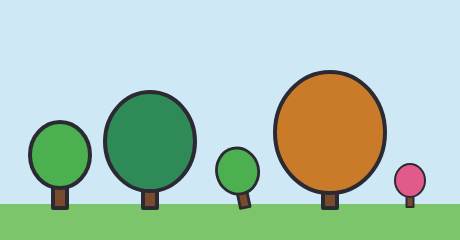

# 5. Contas, componentes e arquivos

[← Camadas](04-camadas.md) · [Índice](README.md) · [Próximo: Ossos →](06-ossos.md)

Este capítulo é sobre **não se repetir**: fazer contas em vez de escrever números soltos, desenhar uma coisa uma vez e usar várias (`def`/`use`), espelhar o lado esquerdo para fazer o direito (`mirror=`) e dividir o trabalho em arquivos (`include`).

## Contas: `{ … }` e `let`

Qualquer número pode ser trocado por uma **conta entre chaves**: `{200+40}`, `{r*1.5}`. E `let` cria **variáveis** para usar nessas contas:

<!-- gerar: img/05_let.png -->
```weasel
canvas 400 240 bg=#f4efe6
palette ink=#2b2a33 line=5
let cx=200 cy=120 r=80 olho={r*0.14}

ellipse cara {cx},{cy} {r} c=#ffd34d ink=line
ellipse olhoE {cx-r*0.35},{cy-r*0.2} {olho},{olho*1.4} c=ink
ellipse olhoD {cx+r*0.35},{cy-r*0.2} {olho},{olho*1.4} c=ink
stroke boca w=line : {cx-r*0.45},{cy+r*0.25} {cx},{cy+r*0.5} {cx+r*0.45},{cy+r*0.25}
```


Tudo na carinha depende de `cx`, `cy` e `r`. Mude `r=80` para `r=50` e ela inteira diminui, com os olhos e a boca no lugar certo. Mude `cx` e ela anda.

- `let` aceita várias variáveis na mesma linha, e uma pode usar as anteriores (`olho={r*0.14}`).
- As linhas `let` são lidas **antes de todo o resto**, então a variável vale no arquivo inteiro, mesmo acima do `let`.
- Dentro das chaves vale: `+ - * /`, `%` (resto), `^` (potência), parênteses e números com ponto (`0.5`).
- Num ponto, cada número pode ter sua conta: `{cx-20},{cy}`. Não ponha espaço fora das chaves.

| Função | O que faz | Exemplo |
|---|---|---|
| `sin(g)` `cos(g)` `tan(g)` | trigonometria, com o ângulo **em graus** | `{cx+cos(45)*r}` |
| `atan2(y,x)` | o ângulo (em graus) de uma direção | `{atan2(1,1)}` = 45 |
| `sqrt(v)` `pow(a,b)` `abs(v)` | raiz, potência, valor absoluto | `{sqrt(2)*r}` |
| `min(a,b,…)` `max(a,b,…)` | menor e maior | `{max(4,r/10)}` |
| `round(v)` `floor(v)` `ceil(v)` | arredondar, para baixo, para cima | `{round(r/3)}` |
| `lerp(a,b,t)` | o valor a `t` do caminho entre `a` e `b` | `{lerp(100,300,0.25)}` = 150 |
| `clamp(v,a,b)` | prende `v` entre `a` e `b` | `{clamp(r,10,50)}` |
| `pi` | 3,14159… | `{2*pi*r}` |

> No editor, pontos que vêm de contas aparecem em **cinza** e não podem ser arrastados (o editor não sabe reescrever a conta). Para ajustar, mude a variável, ou use **Alt+arrastar** em cima do número no código.

## Componentes: `def` e `use`

Um **componente** é um desenho com nome que você usa quantas vezes quiser, em lugares, tamanhos e cores diferentes:

<!-- gerar: img/05_componentes.png -->
```weasel
canvas 460 240 bg=#cfe8f5
palette ink=#2b2a33 line=4 tronco=#7a4a2c

def arvore copa=#4caf50 alto=60
rect tronco -7,-28 14,30 c=tronco ink=line
ellipse folhas 0,{-24-alto*0.45} {alto*0.5},{alto*0.55} c=copa ink=line
end

rect chao 0,204 460,40 c=#7cc56a
use arvore 60,206
use arvore 150,206 alto=90 copa=#2e8b57
use arvore 245,206 scale=0.7 rot=-12
use arvore 330,206 alto=110 copa=#c97b2a
use arvore 410,206 scale=0.5 copa=#e05a8a
```



**Definindo** (`def nome parâmetros` … `end`):

- As linhas entre `def` e `end` são o desenho. Elas **não aparecem sozinhas**: só quando alguém usa o componente.
- O desenho é feito **em volta de `0,0`**. Esse ponto é a "alça" do componente: no `use`, ele vai para a posição pedida. Na árvore, `0,0` é a base do tronco.
- Os **parâmetros** (`copa=#4caf50 alto=60`) são os valores que cada uso pode mudar. Todo parâmetro precisa de um valor padrão.
  - Parâmetro com **número** vira variável para as contas (`{alto*0.45}`) e também pode ser espessura (`ink=alto`).
  - Parâmetro com **cor** vira um nome de cor (`c=copa`).
- Dentro de um `def` só valem formas e outros `use` (não dá para pôr `layer`, `bone` ou `anim` lá dentro).

**Usando** (`use nome x,y …`):

| Atributo | O que faz |
|---|---|
| `x,y` | onde o `0,0` do componente vai parar |
| `scale=0.7` ou `scale=1,0.5` | tamanho (um número só, ou largura e altura separadas) |
| `rot=-12` | gira em volta do `0,0` do componente |
| `flip=x` | espelha na horizontal (`y` na vertical, `xy` nos dois) |
| `copa=#…` `alto=90` | troca os parâmetros |
| `bone=` `cloth=` `opacity=` | valem para tudo o que está dentro |

O componente é desenhado na camada em que o `use` está, e um componente pode usar outros. O exemplo [`coruja.weasel`](../../exemplos/coruja.weasel) tem componentes para as estrelas do céu, os olhos (usados duas vezes, um com `flip=x`) e as penas da barriga.

> As formas de dentro do componente mantêm o nome em cada uso. Se uma `key` anima `folhas.c`, todas as árvores mudam juntas.

## Espelho: `mirror=`

Muita coisa é simétrica: asas, orelhas, olhos, pernas. Desenhe um lado e espelhe o outro:

<!-- gerar: img/05_mirror.png -->
```weasel
canvas 400 240 bg=#f4efe6
palette ink=#2b2a33 line=4

shape asaE c=#ff9a4a ink=line : 194,110 130,34 52,56 64,128! 130,148 192,128
shape asaD mirror=asaE@200
shape baixoE c=#ffd34d ink=line : 194,132 140,160 112,212! 160,206 194,152
shape baixoD mirror=baixoE@200 c=#ff6b4a
ellipse corpo 200,132 9,62 c=ink
stroke antena w=3 : 196,74 184,44 168,34
stroke antena2 mirror=antena@200
```


- `mirror=asaE@200` copia a forma `asaE` refletida na **linha vertical x=200** (o meio da borboleta).
- `@y300` reflete na **linha horizontal** y=300 (de cima para baixo).
- Sem `@`, reflete no meio do canvas.
- A cópia herda tudo da original (cor, contorno, osso…), mas o que você escrever na linha vale por cima: `baixoD` ficou vermelha com `c=#ff6b4a`. É comum trocar o osso: `shape asaD mirror=asaE@200 bone=asaD`.
- O espelho é do mesmo tipo da original (um `stroke` espelha um `stroke`), e os pontos vêm dela (não escreva `:` e pontos na linha do espelho).

## Vários arquivos: `include`

`include "arquivo.weasel"` funciona como se o outro arquivo fosse **colado naquela linha**. Serve para dividir um trabalho grande: a `palette` e os componentes num arquivo, cada personagem no seu, o cenário em outro.

Este exemplo põe o Cavaleiro de [`exemplos/cavaleiro.weasel`](../../exemplos/cavaleiro.weasel) num cenário novo, sem mudar nada no arquivo dele:

<!-- gerar: img/05_include.png -s 0.5 -->
```weasel
# o cenário vem antes do include, então fica atrás do Cavaleiro
layer cenario
rect grama 0,556 800,84 c=#6aa357
ellipse sol 660,120 50 c=#ffd34d
ellipse nuvem1 180,140 70,26 c=#ffffff
ellipse nuvem2 240,124 50,30 c=#ffffff

include "cavaleiro.weasel"

# depois do include, para valer por cima do canvas de lá
canvas 800 640 bg=#cfe3f0
```


- O caminho é **relativo ao arquivo que inclui**. Na linha de comando, `include "personagens/heroi.weasel"` procura na pasta `personagens` ao lado do seu arquivo.
- No **editor web**, o arquivo incluído precisa estar na lista de arquivos (abra-o com **Abrir…**); ele é achado pelo nome.
- Como o arquivo entra naquela linha, a ordem importa: o que vem antes fica atrás, o que vem depois fica na frente. E o que é "único" (como o `canvas`) vale o último escrito.
- Um erro dentro do arquivo incluído aparece na linha do `include`, com o nome do arquivo e a linha de lá.
- O exemplo [`noite.weasel`](../../exemplos/noite.weasel) faz isso em grande: a rua, a chuva e a lanterna em volta do mesmo Cavaleiro.

Para pôr personagens de outros arquivos num **filme**, o caminho é outro (`actor`), que mantém cada personagem separado, com as animações dele: veja o [capítulo 10](10-filme.md).

[← Camadas](04-camadas.md) · [Índice](README.md) · [Próximo: Ossos →](06-ossos.md)
