# 5. Contas, componentes e arquivos

[← Camadas](04-camadas.md) · [Índice](README.md) · [Próximo: Ossos →](06-ossos.md)

Este capítulo é sobre **não se repetir**: fazer contas em vez de escrever números soltos, repetir uma linha muitas vezes (`repeat`), desenhar uma coisa uma vez e usar várias (`def`/`use`), espelhar o lado esquerdo para fazer o direito (`mirror=`) e dividir o trabalho em arquivos (`include`).

## Contas: `{ … }` e `let`

Uma conta serve para o Weasel calcular um número por você, em vez de você calcular de cabeça e escrever o resultado. Qualquer número pode ser trocado por uma **conta entre chaves**: `{200+40}`, `{r*1.5}`. E `let` cria **variáveis**, nomes que guardam um número para usar nessas contas:

<!-- gerar: img/05_let.png -->
```weasel
canvas 400 240 bg=#f4efe6
palette ink=#2b2a33 line=5
let cx=200 cy=120 r=80 olho={r*0.14}

ellipse cara {cx},{cy} {r} c=#ffd34d ink=line
ellipse olhoE {cx-r*0.35},{cy-r*0.2} {olho},{olho*1.4} c=ink
ellipse olhoD {cx+r*0.35},{cy-r*0.2} {olho},{olho*1.4} c=ink
stroke boca w=line : {cx-r*0.45},{cy+r*0.25} {cx},{cy+r*0.5} {cx+r*0.45},{cy+r*0.25}
```

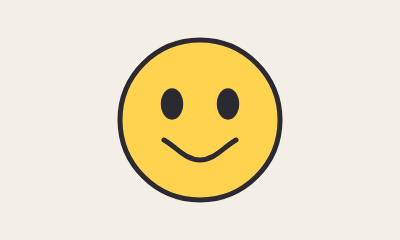

Linha por linha:

- `let cx=200 cy=120 r=80` cria três variáveis: o meio da carinha (`cx`, `cy`, em pixels) e o raio (`r`). `olho={r*0.14}` cria uma quarta, calculada a partir de `r`: 80 × 0,14 = 11,2 pixels.
- `ellipse cara {cx},{cy} {r}`: o círculo amarelo, no meio (200,120), com raio 80.
- `{cx-r*0.35}`: o olho esquerdo fica 35% do raio à esquerda do meio (200 − 28 = 172). O direito usa `+` e fica do outro lado.
- `{olho},{olho*1.4}`: os olhos são elipses, 40% mais altas que largas.
- A boca é um traço de três pontos: os cantos e o meio, mais embaixo (`{cy+r*0.5}`).

Tudo na carinha depende de `cx`, `cy` e `r`. Mude `r=80` para `r=50` e ela inteira diminui, com os olhos e a boca no lugar certo. Mude `cx` e ela anda.

- `let` aceita várias variáveis na mesma linha, e uma pode usar outra (`olho={r*0.14}`). A outra pode vir antes ou depois: `let a={b*2}` em cima de `let b=10` dá `a` = 20, com ou sem `repeat` no arquivo.
- As linhas `let` são lidas **antes de todo o resto**, então a variável vale no arquivo inteiro, mesmo acima do `let`.
- Num ponto, cada número pode ter sua conta: `{cx-20},{cy}`. Dentro das chaves, espaço pode (`{cx - 20}`); fora delas, não (`{cx}, {cy}` quebra o ponto em dois).
- O nome de uma variável começa com letra; depois, letras sem acento, números ou `_`: `r`, `olho`, `altura_porta`.

**Experimente:** mude `let cx=200 cy=120 r=80` para `let cx=120 cy=120 r=50`. A carinha diminui e vai para a esquerda, inteira.

### O que vale dentro das chaves

As quatro operações, com parênteses, mais duas: `%` (o **resto** de uma divisão) e `^` (**potência**). E as comparações, que dão 1 ou 0, e a escolha `c ? a : b`. Estes são resultados de verdade do Weasel, com `r=80` e `cx=200`:

| Conta | Dá | Por quê |
|---|---|---|
| `{200+40}` | 240 | soma |
| `{r*1.5}` | 120 | 80 × 1,5 |
| `{10/4}` | 2.5 | a divisão dá número com vírgula (que no Weasel se escreve com ponto) |
| `{2+3*4}` | 14 | vezes e dividido vêm antes de mais e menos |
| `{(2+3)*4}` | 20 | os parênteses vêm primeiro |
| `{7%3}` | 1 | 7 dividido por 3 dá 2 e **sobra 1**. Com número negativo, o resto também sai negativo (`{-7%3}` dá −1); para o resto que nunca sai negativo, use [`mod`](#o-resto-que-não-fica-negativo-mod) |
| `{2^3}` | 8 | 2 × 2 × 2. Cuidado: `{-2^2}` dá −4 (a potência vem antes do sinal) |
| `{cx-20}` | 180 | variável do `let` |
| `{r>50}` | 1 | comparação: dá 1 quando é verdade e 0 quando não é ([mais abaixo](#comparar-e-escolher)) |
| `{r==50}` | 0 | `==` (dois iguais) pergunta se é igual; `!=`, se é diferente |
| `{r>50 ? 10 : 20}` | 10 | escolhe: se a conta antes do `?` não dá 0, vale o número antes do `:`; se dá 0, o de depois |

E estas **funções** (os exemplos de cada uma estão em [As funções, uma por uma](#as-funções-uma-por-uma), depois do `repeat`, porque com ele fica fácil ver vários valores lado a lado):

| Função | O que faz | Exemplo |
|---|---|---|
| `sin(g)` `cos(g)` `tan(g)` | trigonometria, com o ângulo **em graus** | `{cx+cos(45)*r}` |
| `atan2(y,x)` | o ângulo (em graus) de uma direção | `{atan2(1,1)}` = 45 |
| `dist(x1,y1,x2,y2)` | a distância em linha reta entre dois pontos | `{dist(0,0,30,40)}` = 50 |
| `sqrt(v)` `pow(a,b)` `abs(v)` | raiz, potência, valor absoluto | `{sqrt(2)*r}` |
| `min(a,b,…)` `max(a,b,…)` | menor e maior | `{max(4,r/10)}` |
| `round(v)` `floor(v)` `ceil(v)` | arredondar, para baixo, para cima | `{round(r/3)}` |
| `mod(x,n)` | o resto da divisão que nunca sai negativo | `{mod(-3,12)}` = 9 |
| `lerp(a,b,t)` | o valor a `t` do caminho entre `a` e `b` | `{lerp(100,300,0.25)}` = 150 |
| `smoothstep(a,b,x)` | vai de 0 a 1, com começo e fim suaves, enquanto `x` anda de `a` até `b` | `{smoothstep(10,20,15)}` = 0.5 |
| `clamp(v,a,b)` | prende `v` entre `a` e `b` | `{clamp(r,10,50)}` |
| `rand(x)` `rand(x,a,b)` | um número "sorteado" de 0 a 1 (ou de `a` a `b`), sempre o mesmo para o mesmo `x` | `{rand(i,-4,4)}` |
| `pi` | 3,14159… | `{2*pi*r}` |

Uma conta que não dá número é erro. A raiz de um número negativo, por exemplo. Com este `teste.weasel`:

```
canvas 300 200
let r=40
ellipse bola 150,100 {sqrt(-r)}
```

a linha de comando (`node cli/weasel.js teste.weasel --check`) responde:

```
teste.weasel:3:22: erro: {sqrt(-r)}: o resultado não é um número
  3 | ellipse bola 150,100 {sqrt(-r)}
    |                      ^^^^^^^^^^
teste.weasel:3:22: erro: use: ellipse nome cx,cy rx,ry (ou um raio só)
  3 | ellipse bola 150,100 {sqrt(-r)}
    |                      ^^^^^^^^^^
2 erro(s).
```

O primeiro erro diz qual conta falhou. O segundo é consequência dele: sem o número, a elipse ficou sem raio.

> No editor, pontos que vêm de contas aparecem em **cinza** e não podem ser arrastados (o editor não sabe reescrever a conta). Para ajustar, mude a variável, ou use **Alt+arrastar** em cima do número no código.

## Repetir: `repeat`

`repeat` serve para desenhar muitas coisas parecidas (grama, cercas, estrelas, ladrilhos) escrevendo uma linha só. `repeat i 0..29` repete as linhas até o `end`, com a variável `i` valendo 0, 1, 2… até 29 nas contas:

<!-- gerar: img/05_repeat.png -->
```weasel
canvas 400 200 bg=#cfe8f5
palette ink=#2b2a33 line=3
let n=30

rect chao 0,160 400,40 c=#7cc56a
repeat i 0..{n-1}
stroke capim w=3 c=#4f9a3e : {i*13+6},170 {i*13+4+rand(i,-4,4)},{150-rand(i+50)*25}
end

repeat j 0..4
ellipse estrela {40+j*80},{40+rand(j*7)*30} {6+rand(j)*6} c=#ffd34d ink=line
end

repeat k 1..3
repeat m 1..2
rect bloco {k*90+m*20},100 16,16 c=#c58a4c ink=line
end
end
```

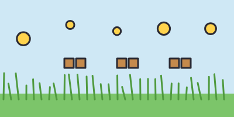

Linha por linha, o capim:

- `repeat i 0..{n-1}` repete 30 vezes (`n` é 30, do `let`), com `i` de 0 a 29.
- O pé de cada capim fica em `x = i*13+6`: cada um 13 pixels à direita do anterior.
- A ponta fica um pouco para o lado, de −4 a 4 pixels (`rand(i,-4,4)`), e numa altura sorteada (`150-rand(i+50)*25`, entre 125 e 150).

E as regras:

- `repeat i 0..29` repete 30 vezes. Os limites podem ser contas: `0..{n-1}`, com `n` de um `let`. De trás para a frente também vale: `repeat i 9..0`.
- `rand(i)` dá um número entre 0 e 1 que parece sorteado, mas é **sempre o mesmo** para o mesmo `i`: o desenho sai igual toda vez. `rand(i,-4,4)` sorteia entre -4 e 4. Para dois sorteios diferentes do mesmo `i`, mude a conta: `rand(i)` e `rand(i+50)`.
- Um `repeat` pode ficar dentro de outro, como os blocos do exemplo ([mais sobre isso abaixo](#um-repeat-dentro-do-outro)).
- As formas repetidas têm o mesmo nome (`capim`): uma `key capim.c=…` muda todas juntas.
- No editor, os pontos de uma linha repetida aparecem em cinza e não arrastam (mexer neles mudaria todas as cópias).
- O máximo é 1000 voltas por `repeat`.

**Experimente:** mude `let n=30` para `let n=15`. Só a metade esquerda do chão fica com capim.

### Sorteios que se repetem: `rand()`

`rand()` serve para dar um ar natural, bagunçado, a coisas repetidas, sem que o desenho mude cada vez que você exporta.

<!-- gerar: img/05_rand.png -->
```weasel
canvas 400 200 bg=#1d2140
let n=40

# 40 estrelas: posição e tamanho sorteados
repeat i 0..{n-1}
ellipse estrela {rand(i,10,390)},{rand(i+100,10,110)} {rand(i+200,1,3)} c=#fff6c8
end

# 10 prédios: a altura sorteada aparece duas vezes na linha
repeat j 0..9
rect predio {j*40+2},{rand(j+300,80,140)} 36,{170-rand(j+300,80,140)} c=#3b3550
end
rect chao 0,170 400,30 c=#2c3a2e
```

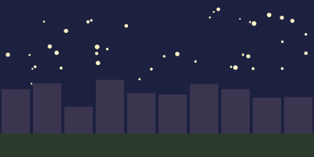

Repare:

- `rand(i,10,390)` sorteia um número de 10 a 390: a posição x da estrela, em pixels.
- Para x, y e tamanho, o sorteio é diferente porque a conta é diferente: `rand(i,…)`, `rand(i+100,…)` e `rand(i+200,…)`. Com `rand(i,…)` nos três, as estrelas sairiam todas numa linha diagonal, cada uma maior que a anterior.
- Nos prédios, `rand(j+300,80,140)` aparece **duas vezes**: uma para o topo do prédio e outra para a altura. Como é o mesmo sorteio, dá o mesmo número, e o pé de todos os prédios fica certinho em y=170.
- O sorteio depende só do número que vai dentro de `rand(…)`. Exporte de novo, abra no editor, mande para outra pessoa: o céu sai igual.

**Experimente:** troque `i+100` por `i+500`. As estrelas mudam de altura, porque é outro sorteio, mas continuam sempre no mesmo lugar a cada exportação.

### Um `repeat` dentro do outro

Com dois `repeat`, um dentro do outro, dá para fazer **grades**: linhas e colunas.

<!-- gerar: img/05_xadrez.png -->
```weasel
canvas 280 280 bg=#f4efe6
palette ink=#2b2a33 line=4

rect tabuleiro 20,20 240,240 c=#f1d9b5
repeat lin 0..5
repeat col 0..5
rect casa {20+col*40},{20+lin*40} 40,40 c=#7a4a2c opacity={(lin+col)%2}
end
end
rect borda 20,20 240,240 c=none ink=line
```

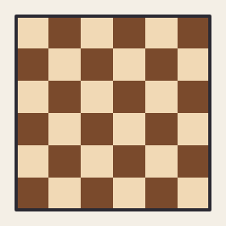

Repare:

- O `repeat col` de dentro roda **inteiro** para cada valor de `lin`: são 6 × 6 = 36 casas.
- Cada `repeat` precisa do seu `end`. O primeiro `end` fecha o de dentro (`col`); o segundo fecha o de fora (`lin`).
- Cada casa tem 40 pixels de lado: a coluna vai para a direita (`col*40`) e a linha vai para baixo (`lin*40`).
- `(lin+col)%2` é o resto de dividir por 2: dá 0, 1, 0, 1… alternando. Como `opacity=0` é invisível e `opacity=1` é sólida, as casas escuras aparecem uma sim, uma não. Na linha seguinte, `lin` aumenta 1 e a alternância começa trocada.
- A `borda` vem depois do `repeat`, para o contorno ficar por cima das casas.

**Experimente:** troque `{(lin+col)%2}` por `{lin%2}`. Agora a cor só depende da linha: o tabuleiro vira listras, uma linha inteira clara, outra escura.

### De trás para a frente

`repeat i 4..0` conta para trás: 4, 3, 2, 1, 0. Como o que é pintado depois fica por cima ([capítulo 4](04-camadas.md#a-ordem-de-pintura)), a ordem muda quem cobre quem:

<!-- gerar: img/05_repeat_volta.png -->
```weasel
canvas 460 230 bg=#f4efe6
palette ink=#2b2a33 line=4

repeat i 0..4
ellipse bolaA {60+i*60},70 45 c=#ffd34d ink=line
end
repeat i 4..0
ellipse bolaB {60+i*60},170 45 c=#4a9eff ink=line
end

text t1 440,78 "0..4" size=20 align=right bold
text t2 440,178 "4..0" size=20 align=right bold
```

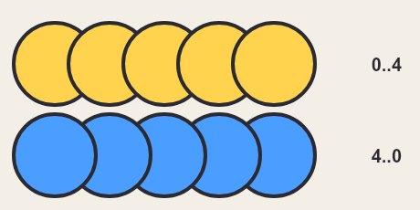

- Em cima (`0..4`), a bola da esquerda é pintada primeiro e a da direita por último: cada bola cobre a vizinha da esquerda.
- Embaixo (`4..0`), é o contrário: a bola da direita é pintada primeiro, e cada uma cobre a vizinha da direita.
- Os dois `repeat` usam o mesmo nome, `i`. Pode: um termina antes de o outro começar.

## As funções, uma por uma

Cada exemplo abaixo mostra uma função (ou um grupo pequeno delas) trabalhando. Os textos dentro das imagens são só etiquetas: o Weasel não escreve o resultado de uma conta num `text`.

### Ângulos: `sin` e `cos`

`sin` e `cos` servem para pôr coisas **em volta de um círculo**: marcas de relógio, pétalas, raios de uma roda. Para um ângulo `a` e uma distância `r`, o ponto fica em `{cx+cos(a)*r},{cy+sin(a)*r}`.

<!-- gerar: img/05_seno.png -->
```weasel
canvas 300 300 bg=#f4efe6
palette ink=#2b2a33 line=6
let cx=150 cy=150 r=100

ellipse mostrador {cx},{cy} 125 c=#ffffff ink=line
repeat h 0..11
ellipse marca {cx+cos(h*30)*r},{cy+sin(h*30)*r} 6 c=ink
end

# os ponteiros de 3 horas: o pequeno no ângulo 0, o grande no -90
stroke horas w=8 : {cx},{cy} {cx+cos(0)*55},{cy+sin(0)*55}
stroke minutos w=5 : {cx},{cy} {cx+cos(-90)*82},{cy+sin(-90)*82}

text a0 {cx+cos(0)*r-22},{cy+sin(0)*r+28} "0°" size=15 c=#c44536
text a90 {cx+cos(90)*r+10},{cy+sin(90)*r-6} "90°" size=15 c=#c44536
text a180 {cx+cos(180)*r+8},{cy+sin(180)*r+24} "180°" size=15 c=#c44536
text am90 {cx+cos(-90)*r+10},{cy+sin(-90)*r+18} "-90°" size=15 c=#c44536
```

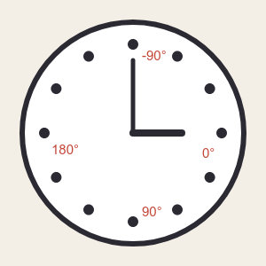

Repare:

- O ângulo é em **graus**. O 0 aponta para a **direita**, e os ângulos crescem no sentido do relógio: 90 é **para baixo** (porque no Weasel o y cresce para baixo), 180 é para a esquerda, e −90 (ou 270) é para cima.
- `cos(a)*r` diz quanto andar na horizontal, e `sin(a)*r` quanto andar na vertical, para chegar a `r` pixels do meio naquela direção.
- As 12 marcas estão a 30 graus uma da outra (360 ÷ 12 = 30): `h*30` dá 0, 30, 60… 330.
- O ponteiro das horas vai na direção 0 (para a direita, as 3 horas). O dos minutos vai na −90 (para cima, o 12).

**Experimente:** no ponteiro das horas, troque os dois `0` por `30`. Ele passa a apontar para as 4 horas.

### Para onde aponta: `atan2`

`atan2` faz o caminho contrário: em vez de ir de um ângulo para um ponto, ele descobre o **ângulo de uma direção**. Serve para fazer uma coisa olhar ou apontar para outra. Atenção à ordem: `atan2(y,x)`, primeiro o quanto se anda na vertical, depois na horizontal.

<!-- gerar: img/05_atan2.png -->
```weasel
canvas 360 220 bg=#cfe8f5
palette ink=#2b2a33 line=5
# onde está a mosca
let mx=300 my=50
# o meio do olho esquerdo; o direito fica dx pixels à direita
let ex=100 ey=130 dx=90
# o ângulo de cada olho até a mosca
let aE={atan2(my-ey,mx-ex)} aD={atan2(my-ey,mx-ex-dx)}

ellipse olhoE {ex},{ey} 38 c=#ffffff ink=line
ellipse olhoD {ex+dx},{ey} 38 c=#ffffff ink=line
ellipse pupilaE {ex+cos(aE)*20},{ey+sin(aE)*20} 13 c=ink
ellipse pupilaD {ex+dx+cos(aD)*20},{ey+sin(aD)*20} 13 c=ink

ellipse asa1 {mx-7},{my-9} 9,5 rot=-30 c=#ffffff
ellipse asa2 {mx+7},{my-9} 9,5 rot=30 c=#ffffff
ellipse mosca {mx},{my} 7 c=ink
```

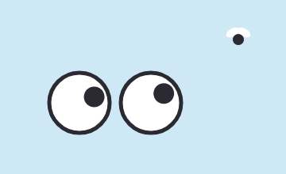

Repare:

- Do olho esquerdo até a mosca, anda-se `mx-ex` na horizontal (200 pixels) e `my-ey` na vertical (−80, para cima). `atan2(-80,200)` dá o ângulo dessa direção: uns −22 graus.
- Com o ângulo na mão, a pupila vai 20 pixels naquela direção com `cos` e `sin`, como no relógio.
- Cada olho calcula o seu ângulo, porque cada um vê a mosca de um lugar diferente.

**Experimente:** mude `let mx=300 my=50` para `let mx=40 my=200`. A mosca vai para baixo, à esquerda, e os dois olhos se viram para ela sozinhos.

### Distância: `dist`

`dist(x1,y1,x2,y2)` mede a **distância em linha reta** entre dois pontos: o primeiro em `x1,y1`, o segundo em `x2,y2`. Serve para saber o tamanho de uma corda, até onde uma coisa alcança, ou para pôr uma coisa a uma distância certa de outra.

<!-- gerar: img/05_dist.png -->
```weasel
canvas 420 280 bg=#cfe8a8
palette ink=#2b2a33 line=4
# a estaca e a cabra
let ex=170 ey=140 cx=270 cy=190
# o comprimento da corda: da estaca até a cabra
let corda={dist(ex,ey,cx,cy)}

# até onde a cabra alcança: um círculo com o raio da corda
ellipse alcance {ex},{ey} {corda} c=#b8dc8e ink=2

stroke corda w=3 c=#8a6a3a : {ex},{ey} {cx},{cy}
ellipse estaca {ex},{ey} 7 c=#6b4a2a
ellipse cabra {cx},{cy} 18,13 c=#ffffff ink=line
ellipse cabeca {cx+18},{cy-10} 9 c=#ffffff ink=line
text t {ex},{ey-22} "corda = 112 pixels" size=15 align=center
```

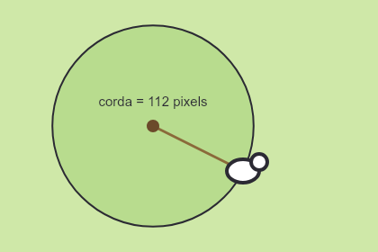

Repare:

- Da estaca até a cabra, anda-se 100 pixels na horizontal (`cx-ex`) e 50 na vertical (`cy-ey`). O `dist` junta os dois: √(100² + 50²), uns 111,8 pixels. É o comprimento da corda.
- O círculo usa esse número como raio. Ele mostra todos os lugares onde a cabra chega com a corda esticada.
- É a mesma conta que `sqrt((cx-ex)^2+(cy-ey)^2)`, só que mais curta de escrever. A ordem dos pontos não importa: `dist(cx,cy,ex,ey)` dá o mesmo número.
- O Weasel faz essa mesma conta para medir o comprimento de um braço com IK ([capítulo 6](06-ossos.md#até-onde-o-braço-alcança)).

**Experimente:** mude `cx=270 cy=190` para `cx=230 cy=60`. A cabra vai para cima e o círculo encolhe: a corda agora tem 100 pixels (60 na horizontal e 80 na vertical). A etiqueta continua dizendo 112, porque ela é só um texto.

### Inclinação: `tan`

`tan` diz **quanto uma rampa sobe** para cada pixel que ela anda. Uma rampa de `base` pixels com o ângulo `a` tem altura `base*tan(a)`.

<!-- gerar: img/05_tan.png -->
```weasel
canvas 420 210 bg=#f4efe6
palette ink=#2b2a33 line=4
let base=110 chao=170

shape r15 c=#ffd34d ink=line : 20,{chao}! {20+base},{chao}! {20+base},{chao-base*tan(15)}!
shape r30 c=#ff9a4a ink=line : 155,{chao}! {155+base},{chao}! {155+base},{chao-base*tan(30)}!
shape r45 c=#ff6b4a ink=line : 290,{chao}! {290+base},{chao}! {290+base},{chao-base*tan(45)}!

text t1 75,196 "15°" size=15 align=center
text t2 210,196 "30°" size=15 align=center
text t3 345,196 "45°" size=15 align=center
```

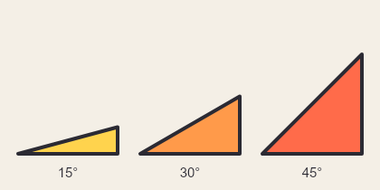

Repare:

- As três rampas têm a mesma base, 110 pixels. Só o ângulo muda.
- Cada rampa é um triângulo de três cantos (`!`): o pé da esquerda, o pé da direita e o topo, que fica `base*tan(ângulo)` pixels acima do chão (por isso o `chao-…`: subir é diminuir o y).
- Com 45 graus, `tan(45)` é 1: a altura fica igual à base, 110 pixels.

### Potência, raiz e valor absoluto: `^`, `pow`, `sqrt` e `abs`

Estas funções mudam **o jeito de crescer** de um número. Cada fileira de barras abaixo usa o mesmo `i`, de 1 a 9, numa conta diferente:

<!-- gerar: img/05_potencia.png -->
```weasel
canvas 480 340 bg=#f4efe6
palette ink=#2b2a33

repeat i 1..9
rect a {150+i*32},{80-i*7} 24,{i*7} c=#4a9eff
rect b {150+i*32},{160-i^2*0.8} 24,{i^2*0.8} c=#ff6b4a
rect c {150+i*32},{240-sqrt(i)*21} 24,{sqrt(i)*21} c=#7cc56a
rect d {150+i*32},{320-abs(i-5)*14} 24,{abs(i-5)*14} c=#c58a4c
end

text ta 20,76 "i*7" size=16
text tb 20,156 "i^2*0.8" size=16
text tc 20,236 "sqrt(i)*21" size=16
text td 20,316 "abs(i-5)*14" size=16
```

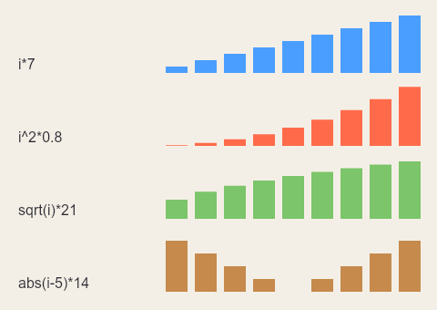

Cada barra tem o pé numa linha (y = 80, 160, 240 e 320) e sobe a altura da conta. Por isso o y do topo é `80-altura`: subir é diminuir o y.

- **Azul**, `i*7`: cresce sempre o mesmo tanto, 7 pixels por barra.
- **Vermelha**, `i^2` (ou `pow(i,2)`, que é a mesma coisa): começa devagar e acelera. A barra 9 tem 81 vezes a altura da barra 1 (o `*0.8` só encolhe tudo para caber).
- **Verde**, `sqrt(i)`, a raiz quadrada: o contrário, cresce rápido no começo e cada vez mais devagar.
- **Marrom**, `abs(i-5)`: `abs` tira o sinal de menos (`abs(-3)` é 3). Como `i-5` vai de −4 a 4, a altura desce até zero no meio e volta a subir: um V.

**Experimente:** na linha `rect b`, troque os dois `i^2*0.8` por `pow(i,3)*0.09` (o mesmo que `i^3*0.09`). A barra vermelha começa ainda mais baixa e sobe ainda mais de repente no fim.

### Limites: `min`, `max` e `clamp`

Estas três servem para **não deixar um número passar de um limite**: um olho que não sai da órbita, uma barra que não passa do teto.

<!-- gerar: img/05_limites.png -->
```weasel
canvas 480 340 bg=#f4efe6
palette ink=#2b2a33

repeat i 1..9
rect a {150+i*32},{80-i*7} 24,{i*7} c=#4a9eff
rect b {150+i*32},{160-min(i*7,35)} 24,{min(i*7,35)} c=#ff6b4a
rect c {150+i*32},{240-max(i*7,35)} 24,{max(i*7,35)} c=#7cc56a
rect d {150+i*32},{320-clamp(i*7,21,49)} 24,{clamp(i*7,21,49)} c=#c58a4c
end

# os limites, tracejados
line teto w=2 c=#c44536 dash=5,4 : 176,125 470,125
line piso w=2 c=#c44536 dash=5,4 : 176,205 470,205
line piso2 w=2 c=#c44536 dash=5,4 : 176,299 470,299
line teto2 w=2 c=#c44536 dash=5,4 : 176,271 470,271

text ta 20,76 "i*7" size=16
text tb 20,156 "min(i*7,35)" size=16
text tc 20,236 "max(i*7,35)" size=16
text td 20,316 "clamp(i*7,21,49)" size=16
```

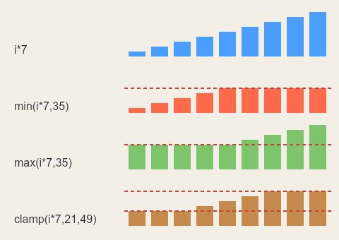

Repare:

- **Azul**, `i*7`: sem limite, de 7 a 63 pixels.
- **Vermelha**, `min(i*7,35)`: fica com o **menor** dos dois números. Enquanto `i*7` é menor que 35, vale ele; depois, vale 35. É um **teto**.
- **Verde**, `max(i*7,35)`: fica com o **maior**. Nunca menos que 35: é um **piso**.
- **Marrom**, `clamp(i*7,21,49)`: piso e teto juntos. O número fica preso entre 21 e 49.
- `min` e `max` aceitam mais de dois números: `{min(a,b,c)}` dá o menor dos três.

### Arredondar: `round`, `floor` e `ceil`

Estas três tiram a parte quebrada de um número. Servem para encaixar coisas numa grade, ou para fazer degraus. Cada bolinha colorida abaixo sobe conforme `i/4` arredondado; as bolinhas cinzas pequenas mostram `i/4` sem arredondar:

<!-- gerar: img/05_arredondar.png -->
```weasel
canvas 460 290 bg=#f4efe6
palette ink=#2b2a33

repeat i 0..12
ellipse sem1 {150+i*24},{80-i/4*20} 3 c=#b8b2a8
ellipse a {150+i*24},{80-floor(i/4)*20} 7 c=#4a9eff
ellipse sem2 {150+i*24},{175-i/4*20} 3 c=#b8b2a8
ellipse b {150+i*24},{175-round(i/4)*20} 7 c=#ff6b4a
ellipse sem3 {150+i*24},{270-i/4*20} 3 c=#b8b2a8
ellipse c {150+i*24},{270-ceil(i/4)*20} 7 c=#7cc56a
end

text ta 20,76 "floor(i/4)" size=16
text tb 20,171 "round(i/4)" size=16
text tc 20,266 "ceil(i/4)" size=16
```

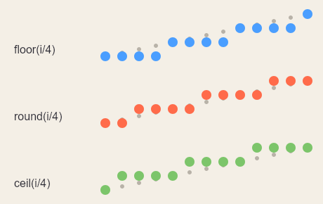

`i/4` vale 0, 0.25, 0.5, 0.75, 1, 1.25… As bolinhas cinzas sobem aos pouquinhos, em rampa. As coloridas sobem em degraus:

- **Azul**, `floor`: arredonda **para baixo**. 0.75 vira 0; só no 1 sobe. O degrau vem no `i=4`, `8` e `12`.
- **Vermelha**, `round`: arredonda para o **mais perto**. 0.5 já vira 1, então o degrau vem antes, no `i=2`, `6` e `10`.
- **Verde**, `ceil`: arredonda **para cima**. Qualquer pedacinho já sobe: 0.25 vira 1, e o degrau vem logo no `i=1`.

### Resto da divisão: `%` e grades com um `repeat` só

O `%` (resto) junto com o `floor` faz uma grade de linhas e colunas com **um `repeat` só**, contando os ladrilhos um a um, como se lê um livro:

<!-- gerar: img/05_grade.png -->
```weasel
canvas 340 220 bg=#f4efe6
palette ink=#2b2a33
let colunas=5

repeat i 0..14
rect ladrilho {20+(i%colunas)*62},{20+floor(i/colunas)*62} 54,54 r=8 c=#4a9eff ink=3 opacity={0.15+i*0.06}
end
```

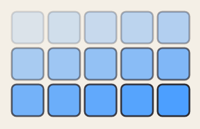

Repare:

- `i%colunas` é a **coluna**: o resto de dividir por 5 dá 0, 1, 2, 3, 4, e volta para 0, 1, 2…
- `floor(i/colunas)` é a **linha**: 0 para os cinco primeiros, 1 para os cinco seguintes, 2 para os últimos.
- Cada ladrilho tem 54 pixels e anda 62: sobram 8 pixels de vão.
- A opacidade cresce com `i` (de 0.15 até quase 1) só para mostrar a ordem: o primeiro ladrilho é o mais claro, e o último, o mais forte.

**Experimente:** mude `repeat i 0..14` para `repeat i 0..11`. São 12 ladrilhos: duas linhas cheias e uma com só dois.

### O resto que não fica negativo: `mod`

O `%` segue o sinal do número: `{-7%3}` dá −1. Isso atrapalha quando a conta pode ficar negativa, como `(i-3)%12` com o `i` começando do 0. O `mod(x,n)` dá o resto **sempre de 0 até n** (sem chegar no n). Com o `i` indo de −8 a 9, as duas fileiras sobem em degraus de 0 a 3, como os dentes de uma serra:

<!-- gerar: img/05_mod.png -->
```weasel
canvas 470 310 bg=#f4efe6
palette ink=#2b2a33
line zero w=2 c=#b8b2a8 dash=5,5 : 230,10 230,300
line base1 w=1 c=#d2cabd : 30,120 450,120
line base2 w=1 c=#d2cabd : 30,290 450,290

repeat i -8..9
ellipse resto {230+i*24},{120-(i%4)*18} 7 c=#ff6b4a
ellipse sempre {230+i*24},{290-mod(i,4)*18} 7 c=#4a9eff
end

text t1 12,28 "i%4" size=16
text t2 12,205 "mod(i,4)" size=16
```

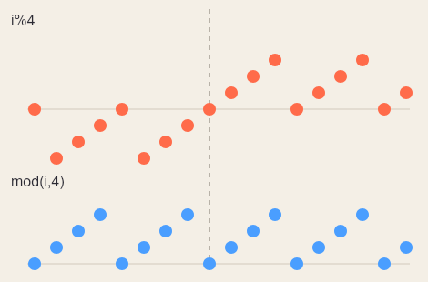

Repare:

- À direita da linha tracejada (o `i=0`), as duas fileiras são iguais: 0, 1, 2, 3, 0, 1, 2, 3…
- À esquerda, o `%` dá −1, −2, −3, 0, −1…: os dentes da serra vermelha descem, abaixo da linha de base.
- O `mod` continua a mesma serra: da esquerda para a direita, 0, 1, 2, 3, 0, 1… dos dois lados do zero.
- O `%` não mudou: o que já estava escrito com ele dá o mesmo resultado de antes.

**Experimente:** troque `mod(i,4)` por `mod(i,3)`. Os dentes ficam com três degraus.

### No meio do caminho: `lerp`

`lerp(a,b,t)` serve para achar um valor **entre** dois outros. Com `t=0`, dá `a`; com `t=1`, dá `b`; com `t=0.5`, dá o meio. Com ele, dá para espalhar coisas num caminho e fazer elas mudarem aos poucos.

<!-- gerar: img/05_lerp.png -->
```weasel
canvas 420 230 bg=#f4efe6
palette ink=#2b2a33
let ax=40 ay=180 bx=380 by=50

line trilho w=2 c=#b8b2a8 dash=6,5 : {ax},{ay} {bx},{by}
repeat k 0..8
ellipse passo {lerp(ax,bx,k/8)},{lerp(ay,by,k/8)} {lerp(6,22,k/8)} c=#ff6b4a opacity={lerp(0.25,1,k/8)}
end

text tA {ax},{ay+36} "t=0" size=15 align=center
text tM {lerp(ax,bx,0.5)+30},{lerp(ay,by,0.5)+34} "t=0.5" size=15 align=center
text tB {bx},{by-30} "t=1" size=15 align=center
```

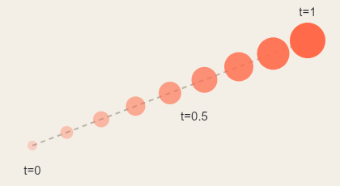

Repare:

- `k/8` vai de 0 a 1 em 9 passos: 0, 0.125, 0.25… 1. É o `t` de todas as contas.
- O mesmo `t` é usado em quatro `lerp`: para x (de 40 a 380), para y (de 180 a 50), para o raio (de 6 a 22 pixels) e para a opacidade (de 0.25 a 1).
- Por isso as bolinhas andam em linha reta de A até B, crescendo e ficando mais fortes juntas.

**Experimente:** troque `lerp(6,22,k/8)` por `lerp(22,6,k/8)`. Agora as bolinhas encolhem enquanto sobem.

### Começo e fim suaves: `smoothstep`

`smoothstep(a,b,x)` vai de 0 a 1 enquanto `x` anda de `a` até `b`, como o `k/8` do `lerp`. A diferença é o jeito: ele sai devagar, acelera no meio e chega devagar. Antes de `a`, dá 0; depois de `b`, dá 1. Aqui estão as 11 posições de uma bolinha, uma por quadro:

<!-- gerar: img/05_smoothstep.png -->
```weasel
canvas 440 200 bg=#f4efe6
palette ink=#2b2a33

line trilho1 w=2 c=#b8b2a8 dash=6,5 : 40,70 400,70
line trilho2 w=2 c=#b8b2a8 dash=6,5 : 40,160 400,160
repeat k 0..10
ellipse reta {lerp(40,400,k/10)},70 9 c=#ff6b4a opacity={lerp(0.3,1,k/10)}
ellipse suave {lerp(40,400,smoothstep(0,10,k))},160 9 c=#4a9eff opacity={lerp(0.3,1,k/10)}
end

text t1 40,40 "k/10" size=16
text t2 40,130 "smoothstep(0,10,k)" size=16
```

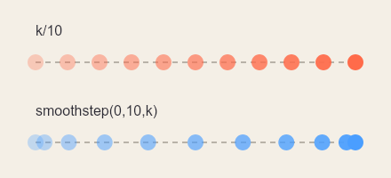

Repare:

- Em cima, com `k/10`, a bolinha anda o mesmo tanto a cada quadro. Ela começa e para de repente.
- Embaixo, com `smoothstep(0,10,k)`, as posições ficam juntas nas pontas e espaçadas no meio: a bolinha sai devagar, corre no meio e chega devagar.
- `smoothstep(10,20,i)` fica em 0 até o 10, sobe até o 20 e fica em 1 depois dele. Com `a` maior que `b` (`smoothstep(20,10,i)`), vai de 1 a 0.

**Experimente:** troque `smoothstep(0,10,k)` por `smoothstep(3,7,k)`. As quatro primeiras bolinhas ficam paradas no começo, e as quatro últimas, no fim.

### Comparar e escolher

Uma comparação (`<`, `<=`, `>`, `>=`, `==` ou `!=`) dá **1** quando é verdade e **0** quando não é. O `? :` escolhe entre dois números: `{c ? a : b}` dá `a` se o `c` não é 0, e `b` se é 0. Com eles, dá para ligar uma coisa a partir de um número, ou fazer uma a cada tantas diferente das outras:

<!-- gerar: img/05_comparar.png -->
```weasel
canvas 440 150 bg=#2b2a33
palette ink=#14141c
let acesas=7

rect fio 20,38 400,4 c=#5a5866
repeat i 0..11
line cabo w=2 c=#5a5866 : {35+i*34},40 {35+i*34},{80-(i%3==0 ? 13 : 9)}
ellipse brilho {35+i*34},80 {i%3==0 ? 26 : 18} c=#ffd34d opacity={i<acesas ? 0.25 : 0}
ellipse lampada {35+i*34},80 {i%3==0 ? 13 : 9} c=#5a5866 ink=2
ellipse luz {35+i*34},80 {i%3==0 ? 13 : 9} c=#ffd34d opacity={i<acesas}
end
```

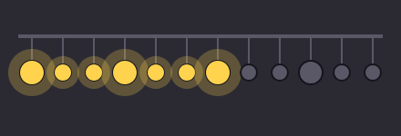

Repare:

- `i<acesas` dá 1 nas sete primeiras (`i` de 0 a 6) e 0 nas outras. Como opacidade, acende a luz das sete.
- `i%3==0 ? 13 : 9`: quando o resto de `i` por 3 é 0 (`i` é 0, 3, 6 ou 9), a lâmpada tem raio 13; nas outras, 9.
- O brilho em volta usa o `? :` para escolher a opacidade: 0.25 nas acesas e 0 nas apagadas.

| Conta | Dá 1 quando |
|---|---|
| `a<b` `a<=b` | `a` é menor que `b` (ou igual, no `<=`) |
| `a>b` `a>=b` | `a` é maior que `b` (ou igual, no `>=`) |
| `a==b` | `a` é igual a `b` (dois sinais de igual: um sozinho é erro) |
| `a!=b` | `a` é diferente de `b` |

E as regras:

- As comparações vêm **depois** das outras contas: `{i+1<5}` é `(i+1)<5`. O `? :` vem por último: `{i<6 ? 0 : 30}`.
- Um `? :` pode ficar dentro de outro: `{i<4 ? 10 : i<8 ? 20 : 30}` dá 10, 20 ou 30.
- Para juntar duas condições, use contas: **e** é multiplicar (`{(i>2)*(i<8)}` dá 1 só de 3 a 7); **ou** é o `max` (`{max(i<2,i>9)}`); **não** é `1-` (`{1-(i<5)}`).

**Experimente:** mude `let acesas=7` para `let acesas=12`. Todas acendem.

### `pi`

`pi` vale 3,14159…, a conta que liga o raio de um círculo ao tamanho da volta dele: uma volta inteira mede `2*pi*r`. Serve para rodas que rolam e para coisas espalhadas em volta de um círculo.

<!-- gerar: img/05_pi.png -->
```weasel
canvas 440 210 bg=#f4efe6
palette ink=#2b2a33 line=4
let r=40 x0=60 chao=140

line solo w=3 : 0,{chao} 440,{chao}
ellipse roda1 {x0},{chao-r} {r} c=#ffd34d ink=line
ellipse marca1 {x0},{chao-8} 5 c=#c44536
ellipse roda2 {x0+2*pi*r},{chao-r} {r} c=#ffd34d ink=line
ellipse marca2 {x0+2*pi*r},{chao-8} 5 c=#c44536

rect fita {x0},{chao+12} {2*pi*r},12 c=#4a9eff
text t {x0+pi*r},{chao+50} "2*pi*r = 251 pixels" size=16 align=center
```

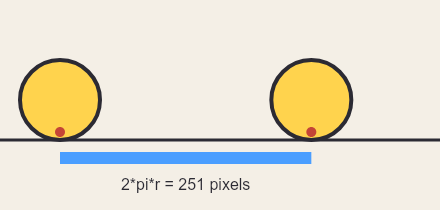

A roda tem raio 40. Se ela rolar uma volta inteira, o ponto vermelho, que estava encostado no chão, encosta de novo depois de andar `2*pi*40` = 251 pixels. A fita azul tem exatamente esse comprimento: é a borda da roda "desenrolada".

**Experimente:** mude `r=40` para `r=20`. A roda fica com metade do tamanho, e a fita também: metade do raio, metade da volta.

## Componentes: `def` e `use`

Um **componente** é um desenho com nome que você usa quantas vezes quiser, em lugares, tamanhos e cores diferentes:

<!-- gerar: img/05_componentes.png -->
```weasel
canvas 460 240 bg=#cfe8f5
palette ink=#2b2a33 line=4 tronco=#7a4a2c

def arvore copa=#4caf50 alto=60
rect tronco -7,-28 14,30 c=tronco ink=line
ellipse folhas 0,{-24-alto*0.45} {alto*0.5},{alto*0.55} c=copa ink=line
end

rect chao 0,204 460,40 c=#7cc56a
use arvore 60,206
use arvore 150,206 alto=90 copa=#2e8b57
use arvore 245,206 scale=0.7 rot=-12
use arvore 330,206 alto=110 copa=#c97b2a
use arvore 410,206 scale=0.5 copa=#e05a8a
```

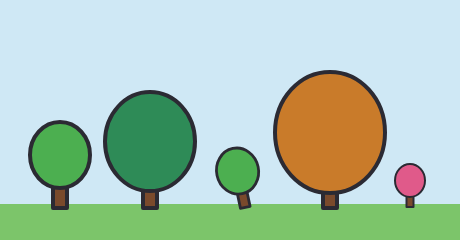

**Definindo** (`def nome parâmetros` … `end`):

- As linhas entre `def` e `end` são o desenho. Elas **não aparecem sozinhas**: só quando alguém usa o componente. No editor, a [prévia](#ver-um-componente-sozinho-a-prévia) mostra o componente sozinho enquanto o cursor está nele.
- O desenho é feito **em volta de `0,0`**. Esse ponto é a "alça" do componente: no `use`, ele vai para a posição pedida. Na árvore, `0,0` é a base do tronco.
- Os **parâmetros** (`copa=#4caf50 alto=60`) são os valores que cada uso pode mudar. Todo parâmetro precisa de um valor padrão.
  - Parâmetro com **número** vira variável para as contas (`{alto*0.45}`) e também pode ser espessura (`ink=alto`).
  - Parâmetro com **cor** vira um nome de cor (`c=copa`).
- Dentro de um `def` só valem formas e outros `use` (não dá para pôr `layer`, `bone` ou `anim` lá dentro).

**Usando** (`use nome x,y …`):

| Atributo | O que faz |
|---|---|
| `x,y` | onde o `0,0` do componente vai parar |
| `scale=0.7` ou `scale=1,0.5` | tamanho (um número só, ou largura e altura separadas) ([exemplo](#tamanho-e-giro-scale-e-rot)) |
| `rot=-12` | gira em volta do `0,0` do componente, em graus ([exemplo](#tamanho-e-giro-scale-e-rot)) |
| `flip=x` | espelha na horizontal (`y` na vertical, `xy` nos dois) ([exemplo](#espelhar-flip)) |
| `copa=#…` `alto=90` | troca os parâmetros ([exemplo](#parâmetros-números-e-cores)) |
| `opacity=` | transparência de tudo o que está dentro, de 0 a 1 ([exemplo](#transparência-opacity)) |
| `bone=` `cloth=` | prende tudo o que está dentro a um osso ou tecido ([capítulo 6](06-ossos.md)) |
| `z=` `[billboard]` | profundidade e "sempre de frente", no 2.5D ([capítulo 11](11-profundidade.md)) |

O componente é desenhado na camada em que o `use` está, e um componente pode usar outros. O exemplo [`coruja.weasel`](../../exemplos/coruja.weasel) tem componentes para as estrelas do céu, os olhos (usados duas vezes, um com `flip=x`) e as penas da barriga.

> As formas de dentro do componente mantêm o nome em cada uso. Se uma `key` anima `folhas.c`, todas as árvores mudam juntas.

**Experimente:** acrescente `use arvore 200,206 alto=40` no fim. Aparece uma árvore baixinha, de copa redonda, entre a segunda e a terceira.

### Parâmetros: números e cores

Um parâmetro serve para cada uso do componente sair um pouco diferente. O Weasel olha o **valor padrão** escrito no `def` para saber o tipo: número ou cor.

<!-- gerar: img/05_parametros.png -->
```weasel
canvas 440 160 bg=#f4efe6
palette ink=#2b2a33 vermelho=#e0533d
gradient ceu linear 0,0 0,1 box : #bfe3f5 #3a78c2

def botao cor=#4a9eff borda=4
ellipse aro 0,0 34 c=cor ink=borda
ellipse brilho -12,-12 9,5 rot=-35 c=#ffffff opacity=0.7
end

use botao 60,64
use botao 165,64 borda=10
use botao 270,64 cor=vermelho
use botao 375,64 cor=ceu borda=0

text t1 60,130 "padrão" size=14 align=center
text t2 165,130 "borda=10" size=14 align=center
text t3 270,130 "cor=vermelho" size=14 align=center
text t4 375,130 "cor=ceu borda=0" size=14 align=center
```

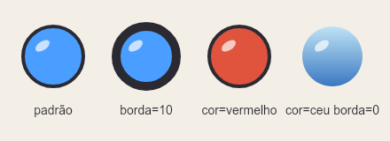

Repare:

- `borda=4` é um **número**: dentro do `def`, `ink=borda` usa ele como espessura do contorno, em pixels. `borda=10` engrossa; `borda=0` tira o contorno.
- `cor=#4a9eff` é uma **cor**: dentro do `def`, `c=cor` pinta com ela. O nome vale onde uma forma pede cor: `inkc=cor`, `emit=cor,1`, `thickc=cor` e as cores das partículas (`c=cor,#fff0` num `emitter`). Nesses três últimos, só vale cor simples (`#hex` ou nome da `palette`), sem gradiente.
- No `use`, um parâmetro de cor aceita tudo o que `c=` aceita: `#hex`, um nome da `palette` (`vermelho`), um gradiente (`ceu`) ou `none` (`transparent` é o mesmo), que tira a cor: `use botao 60,64 cor=none` desenha só o contorno do aro e o brilho.
- Um parâmetro que não foi mudado fica com o valor padrão do `def`: o primeiro botão é o "de fábrica".
- Cuidado com erros de digitação: um nome que o componente não tem (`bordda=10`) não muda nada, e o Weasel avisa, dizendo os nomes que valem:

```
aviso: parâmetro desconhecido "bordda": o componente "botao" tem cor, borda (e o use aceita scale, rot, flip, bone, cloth, opacity, z)
```

### Ver um componente sozinho: a prévia

No editor, com o cursor em qualquer linha entre `def` e `end`, dá para ver o componente sozinho e experimentar valores para os parâmetros:

- Um `def` **sem nenhum `use`** aparece na hora: o desenho dá lugar ao componente, num papel do tamanho dele. Saindo do `def`, o desenho volta como estava.
- Num `def` **já usado**, o desenho continua; ligue a chave **Prévia do def**, que aparece na barra só com o cursor num `def`. A mesma chave desliga a prévia de um `def` sem `use`.
- A **cruz rosa** marca o `0,0`: o ponto que vai parar no `x,y` do `use`.
- O painel **Prévia**, embaixo à direita, tem uma linha para cada parâmetro, começando no valor padrão:
  - **número**: escreva no campo ou arraste o nome para os lados (com Shift, anda 10× mais);
  - **cor**: o quadradinho abre o seletor; o campo aceita `#hex`, um nome da `palette`, um nome de cor ou `none`;
  - **gradiente** ou **padrão**: uma lista com os do arquivo.
- O painel **não muda o código**: os valores ficam só enquanto a página está aberta. O ↺ de uma linha volta aquele parâmetro ao padrão; **Voltar ao padrão** volta todos. **Copiar como use** copia uma linha pronta com o que você mudou (por exemplo `use botao 0,0 borda=10`): cole e troque o `0,0` pela posição.
- As **alças** continuam valendo: arrastar uma muda a linha do `def`, nas coordenadas dele.
- A prévia é parada: sem animação, luzes, caixas e o que vem do desenho em volta (a camada do `use`, `bone=`). Um erro que só acontece com um valor do painel aparece no painel, não no código.
- **Pintar** pinta só o componente.

### Tamanho e giro: `scale=` e `rot=`

`scale=` muda o tamanho de um uso, e `rot=` gira. Os dois acontecem **em volta da alça** (o `0,0` do componente). Neste peixe, a alça está marcada com um pontinho vermelho:

<!-- gerar: img/05_use_escala.png -->
```weasel
canvas 540 170 bg=#cfe8f5
palette ink=#2b2a33

def peixe
shape rabo c=#ff9a4a ink=3 : -16,0! -34,-13! -34,13!
shape barbatana c=#ff9a4a ink=3 : -8,-10! 4,-22! 12,-9!
ellipse corpo 0,0 24,14 c=#ffb347 ink=3
ellipse olho 11,-4 3 c=ink
# a alça (o ponto 0,0), em vermelho só para você ver onde ela fica
ellipse alca 0,0 3 c=#c44536
end

use peixe 60,80
use peixe 165,80 scale=0.6
use peixe 270,80 scale=1.5,0.7
use peixe 385,80 rot=-30
use peixe 480,80 rot=90

text t1 60,150 "normal" size=14 align=center
text t2 165,150 "scale=0.6" size=14 align=center
text t3 270,150 "scale=1.5,0.7" size=14 align=center
text t4 385,150 "rot=-30" size=14 align=center
text t5 480,150 "rot=90" size=14 align=center
```

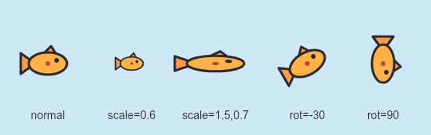

Repare:

- `scale=0.6`: um número só muda largura e altura juntas. 0.6 é 60% do tamanho; 2 seria o dobro.
- `scale=1.5,0.7`: dois números mudam a largura (150%) e a altura (70%) separadas. O peixe fica comprido e achatado.
- O contorno também engrossa ou afina com o tamanho.
- `rot=-30`: gira 30 graus para trás (sentido anti-horário): o peixe sobe. `rot=90` gira um quarto de volta no sentido do relógio: o peixe aponta para baixo.
- O pontinho vermelho não sai do lugar em nenhum deles: tudo gira e muda de tamanho em volta da alça.

### Espelhar: `flip=`

`flip=` vira um uso do avesso, como num espelho. Serve para o olho direito ser o esquerdo espelhado, ou para um personagem olhar para o outro lado.

<!-- gerar: img/05_use_flip.png -->
```weasel
canvas 480 170 bg=#cfe8f5
palette ink=#2b2a33

def peixe
shape rabo c=#ff9a4a ink=3 : -16,0! -34,-13! -34,13!
shape barbatana c=#ff9a4a ink=3 : -8,-10! 4,-22! 12,-9!
ellipse corpo 0,0 24,14 c=#ffb347 ink=3
ellipse olho 11,-4 3 c=ink
ellipse alca 0,0 3 c=#c44536
end

use peixe 70,80
use peixe 185,80 flip=x
use peixe 300,80 flip=y
use peixe 415,80 flip=xy

text t1 70,150 "normal" size=14 align=center
text t2 185,150 "flip=x" size=14 align=center
text t3 300,150 "flip=y" size=14 align=center
text t4 415,150 "flip=xy" size=14 align=center
```

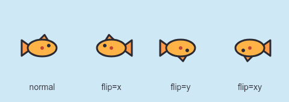

Repare:

- `flip=x` troca esquerda e direita: o peixe passa a nadar para a esquerda.
- `flip=y` troca cima e baixo: a barbatana vai para baixo, e o olho também.
- `flip=xy` faz os dois. Dá o mesmo que `rot=180`.
- O espelho também é em volta da alça: o pontinho vermelho fica onde estava.

### Transparência: `opacity=`

`opacity=` no `use` deixa o componente inteiro transparente, de 0 (invisível) a 1 (normal).

<!-- gerar: img/05_use_opacity.png -->
```weasel
canvas 400 170 bg=#cfe8f5
palette ink=#2b2a33
pattern algas hatch angle=90 gap=24 w=8 c=#6fae8f bg=#cfe8f5

def peixe
shape rabo c=#ff9a4a ink=3 : -16,0! -34,-13! -34,13!
shape barbatana c=#ff9a4a ink=3 : -8,-10! 4,-22! 12,-9!
ellipse corpo 0,0 24,14 c=#ffb347 ink=3
ellipse olho 11,-4 3 c=ink
end

rect fundo 0,30 400,100 c=algas
use peixe 75,80
use peixe 200,80 opacity=0.5
use peixe 325,80 opacity=0.2

text t1 75,155 "normal" size=14 align=center
text t2 200,155 "opacity=0.5" size=14 align=center
text t3 325,155 "opacity=0.2" size=14 align=center
```

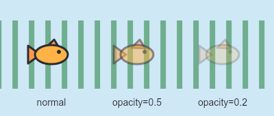

Repare:

- Com `opacity=0.5`, dá para ver as algas através do peixe.
- Cada peça do componente fica transparente sozinha. Por isso, onde o corpo cobre o rabo e a barbatana, dá para ver a ponta deles através do corpo.
- A transparência se multiplica: uma peça com `opacity=0.5` dentro de um `use … opacity=0.5` fica com 0.25.

### Um componente dentro do outro

Um componente pode usar outro. Serve para montar coisas grandes com peças pequenas: uma flor feita de pétalas, uma cerca feita de tábuas.

<!-- gerar: img/05_flor.png -->
```weasel
canvas 400 230 bg=#cfe8f5
palette ink=#2b2a33

# uma pétala: o 0,0 é o meio da flor, e a pétala fica para cima dele
def petala cor=#ff6b4a
ellipse p 0,-26 13,24 c=cor ink=2
end

# a flor usa a pétala cinco vezes, girando 72 graus a cada vez
def flor cor=#ff6b4a
stroke caule w=5 c=#4f9a3e : 0,10 -5,60 0,110
use petala 0,0 cor=cor
use petala 0,0 rot=72 cor=cor
use petala 0,0 rot=144 cor=cor
use petala 0,0 rot=216 cor=cor
use petala 0,0 rot=288 cor=cor
ellipse miolo 0,0 12 c=#ffd34d ink=2
end

rect grama 0,190 400,40 c=#7cc56a
use flor 80,90
use flor 200,100 scale=1.3 cor=#e05a8a
use flor 320,90 cor=#4a9eff
```

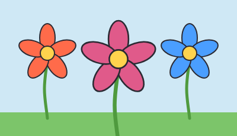

Repare:

- A `petala` é desenhada para cima do `0,0`. Girando em volta do `0,0` (o meio da flor), ela vai parar em outra posição em volta do miolo.
- Cinco pétalas, `360 ÷ 5 = 72` graus entre elas: `rot=0`, `72`, `144`, `216`, `288`.
- `cor=cor` passa a cor da flor para a pétala: o primeiro `cor` é o parâmetro da `petala`, o segundo é o valor que a `flor` recebeu.
- Quando a flor muda de tamanho (`scale=1.3`), tudo o que está dentro dela, as pétalas também, muda junto.

**Experimente:** faça uma flor de seis pétalas: seis linhas `use petala`, com `rot=0`, `60`, `120`, `180`, `240` e `300`.

### `repeat` dentro do componente

Cinco linhas `use petala` quase iguais pedem um `repeat`. Ele também vale dentro do `def`:

<!-- gerar: img/05_repeat_def.png -->
```weasel
canvas 400 230 bg=#cfe8f5
palette ink=#2b2a33

def petala cor=#ff6b4a
ellipse p 0,-26 13,24 c=cor ink=2
end

# a flor com um repeat: oito pétalas, cada uma giro graus depois da outra
def flor cor=#ff6b4a giro=45
stroke caule w=5 c=#4f9a3e : 0,10 -5,60 0,110
repeat i 0..7
use petala 0,0 rot={i*giro} cor=cor
end
ellipse miolo 0,0 12 c=#ffd34d ink=2
end

rect grama 0,190 400,40 c=#7cc56a
use flor 110,95
use flor 290,95 cor=#4a9eff giro=25
```

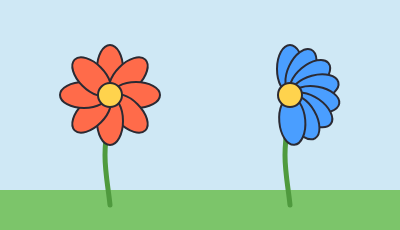

Repare:

- `repeat i 0..7` faz as oito pétalas, com `rot=0`, `45`, `90`… até `315`.
- Nas contas de dentro do `repeat` valem o `i` e os parâmetros do componente: `rot={i*giro}`. A flor azul tem `giro=25`, então as pétalas vão só de 0 a 175 graus e formam um leque.
- Os limites do `repeat` (`0..7`) são lidos uma vez só, antes de qualquer `use`. Eles aceitam números e variáveis do `let`, mas não os parâmetros do `def`: `repeat i 0..{n-1}` com `n` do `def` dá erro. Para flores com quantidades diferentes de pétalas, faça um `def` para cada uma.

**Experimente:** troque `giro=25` por `giro=90`. A flor azul fica com quatro pétalas em cruz: as oito caem em quatro lugares, duas em cada.

## Espelho: `mirror=`

Muita coisa é simétrica: asas, orelhas, olhos, pernas. Desenhe um lado e espelhe o outro:

<!-- gerar: img/05_mirror.png -->
```weasel
canvas 400 240 bg=#f4efe6
palette ink=#2b2a33 line=4

shape asaE c=#ff9a4a ink=line : 194,110 130,34 52,56 64,128! 130,148 192,128
shape asaD mirror=asaE@200
shape baixoE c=#ffd34d ink=line : 194,132 140,160 112,212! 160,206 194,152
shape baixoD mirror=baixoE@200 c=#ff6b4a
ellipse corpo 200,132 9,62 c=ink
stroke antena w=3 : 196,74 184,44 168,34
stroke antena2 mirror=antena@200
```

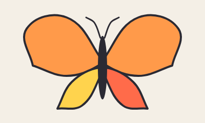

- `mirror=asaE@200` copia a forma `asaE` refletida na **linha vertical x=200** (o meio da borboleta). Cada ponto vai parar à mesma distância da linha, do outro lado: um ponto em x=194 (6 pixels à esquerda) vira x=206 (6 pixels à direita).
- `@y300` reflete na **linha horizontal** y=300 (de cima para baixo) ([exemplo](#de-cima-para-baixo-y)).
- Sem `@`, reflete no meio do canvas.
- A cópia herda tudo da original (cor, contorno, osso…), mas o que você escrever na linha vale por cima: `baixoD` ficou vermelha com `c=#ff6b4a`. É comum trocar o osso: `shape asaD mirror=asaE@200 bone=asaD`.
- O espelho é do mesmo tipo da original (um `stroke` espelha um `stroke`), e os pontos vêm dela (não escreva `:` e pontos na linha do espelho).

**Experimente:** mude a linha da `asaD` para `mirror=asaE@220`. A asa de cima da direita se afasta 40 pixels do corpo: o dobro da mudança no eixo.

### De cima para baixo: `@y`

Com `@y`, o espelho é de cima para baixo. É o jeito de fazer **reflexos na água**:

<!-- gerar: img/05_reflexo.png -->
```weasel
canvas 360 300 bg=#cfe8f5
palette ink=#2b2a33 line=4

rect lago 0,180 360,120 c=#4a7fb5
shape montanha c=#8a9bb0 ink=line : 40,180! 150,60! 260,180!
shape neve c=#ffffff : 150,60! 128,90! 150,82! 172,90!
ellipse sol 290,110 26 c=#ffd34d

# o reflexo: tudo espelhado na linha da água (y=180), mais transparente
shape montanhaR mirror=montanha@y180 opacity=0.35
shape neveR mirror=neve@y180 opacity=0.35
ellipse solR mirror=sol@y180 opacity=0.35
```

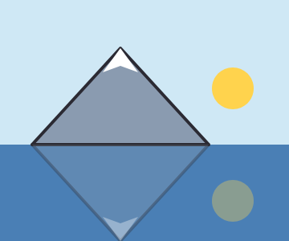

Repare:

- `@y180` é a linha horizontal y=180, a beira da água. O pico da montanha está 120 pixels acima dela (y=60); no reflexo, fica 120 pixels abaixo (y=300).
- `opacity=0.35` vale por cima do que veio da original: o reflexo fica apagado.
- O reflexo de uma `ellipse` é uma `ellipse` (`solR`), e o de um `shape` é um `shape`.

**Experimente:** mude `opacity=0.35` do `solR` para `opacity=1`. O sol refletido fica tão forte quanto o de verdade, e o lago parece um espelho.

## Vários arquivos: `include`

`include "arquivo.weasel"` funciona como se o outro arquivo fosse **colado naquela linha**. Serve para dividir um trabalho grande: a `palette` e os componentes num arquivo, cada personagem no seu, o cenário em outro.

Este exemplo põe o Cavaleiro de [`exemplos/cavaleiro.weasel`](../../exemplos/cavaleiro.weasel) num cenário novo, sem mudar nada no arquivo dele:

<!-- gerar: img/05_include.png -s 0.5 -->
```weasel
# o cenário vem antes do include, então fica atrás do Cavaleiro
layer cenario
rect grama 0,556 800,84 c=#6aa357
ellipse sol 660,120 50 c=#ffd34d
ellipse nuvem1 180,140 70,26 c=#ffffff
ellipse nuvem2 240,124 50,30 c=#ffffff

include "cavaleiro.weasel"

# depois do include, para valer por cima do canvas de lá
canvas 800 640 bg=#cfe3f0
```

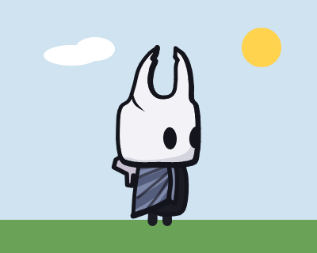

- O caminho é **relativo ao arquivo que inclui**. Na linha de comando, `include "personagens/heroi.weasel"` procura na pasta `personagens` ao lado do seu arquivo.
- No **editor web**, o arquivo incluído precisa estar na lista de arquivos (abra-o com **Abrir…**); ele é achado pelo nome.
- Como o arquivo entra naquela linha, a ordem importa: o que vem antes fica atrás, o que vem depois fica na frente. E o que é "único" (como o `canvas`) vale o último escrito.
- Um erro dentro do arquivo incluído aparece na linha do `include`, com o nome do arquivo e a linha de lá.
- O exemplo [`noite.weasel`](../../exemplos/noite.weasel) faz isso em grande: a rua, a chuva e a lanterna em volta do mesmo Cavaleiro.

**Experimente:** passe as cinco linhas do cenário (do `layer cenario` até a `nuvem2`) para depois do `include`. A grama passa a ser pintada por cima dos pés do Cavaleiro.

### Um arquivo só de peças

O jeito mais comum de usar o `include` é guardar a `palette` e os componentes num arquivo, e usar em vários desenhos. Primeiro, o arquivo de peças. Salve como `pecas.weasel`:

<!-- arquivo: pecas.weasel -->
```weasel
# pecas.weasel: as cores e os componentes, sem nenhum desenho
palette ink=#2b2a33 line=4 parede=#f1d9b5 telhado=#c4512b porta=#7a4a2c

def casinha cor=parede
rect frente -40,-60 80,60 c=cor ink=line
shape teto c=telhado ink=line : -50,-58! 0,-100! 50,-58!
rect entrada -10,-34 20,34 c=porta ink=line
end
```

Sozinho, ele não desenha nada: um `def` sem `use` não aparece. No editor, porém, cada `def` aparece na [prévia](#ver-um-componente-sozinho-a-prévia) quando o cursor entra nele: dá para conferir as peças sem sair deste arquivo. Agora, um desenho na mesma pasta que usa as peças:

<!-- gerar: img/05_include_pecas.png -->
```weasel
canvas 400 200 bg=#cfe8f5
include "pecas.weasel"

rect chao 0,160 400,40 c=#7cc56a
use casinha 80,162
use casinha 200,162 cor=#bfe3f5
use casinha 320,162 cor=#ffd34d
```

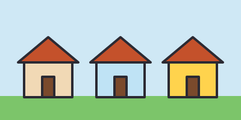

Repare:

- O desenho não tem nenhuma linha `palette` nem `def`: tudo veio de `pecas.weasel`. Mesmo assim, `use casinha` funciona.
- O `include` está logo depois do `canvas`, antes de tudo. Como `pecas.weasel` não desenha nada, a posição dele não muda quem fica na frente.
- Mudar uma cor em `pecas.weasel` (por exemplo, `telhado=#4a6fb5`) muda todos os desenhos que incluem o arquivo.

Para pôr personagens de outros arquivos num **filme**, o caminho é outro (`actor`), que mantém cada personagem separado, com as animações dele: veja o [capítulo 10](10-filme.md).

[← Camadas](04-camadas.md) · [Índice](README.md) · [Próximo: Ossos →](06-ossos.md)
