# 5. Contas e repetição

[← Camadas](04-camadas.md) · [Índice](README.md) · [Próximo: Componentes e arquivos →](06-componentes.md)

No [capítulo 1](01-primeiros-passos.md#contas-), você viu que um número pode ser uma conta entre chaves. Neste capítulo, os números ganham nomes (`let`), as contas ganham mais operações e funções, e o Weasel passa a repetir linhas por você (`repeat`), com sorteios que dão um ar natural ao desenho (`rand()`). Você precisa dos capítulos 1 a 4.

## Nomes para números: `let`

Uma **variável** é um nome que guarda um número. Ela é criada com `let`. Depois, o nome pode entrar em qualquer conta.

```
let nome=valor
let nome=valor nome=valor …
```

O boneco de neve do capítulo 1 tinha o raio de baixo (`50`) escrito em três lugares. Com `let`, cada número fica num lugar só:

<!-- gerar: img/05_boneco.png -->
```weasel
canvas 300 260 bg=#2c3e5c
let chao=190 r1=50 r2=32 r3=20
ellipse neve 150,280 220,50 c=#dfe9f3
ellipse baixo 150,{chao} {r1} c=#ffffff
ellipse meio 150,{chao-r1-r2} {r2} c=#ffffff
ellipse cabeca 150,{chao-r1-2*r2-r3} {r3} c=#ffffff
```

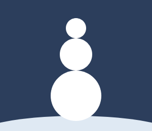

Linha por linha:

- `let chao=190 r1=50 r2=32 r3=20` cria quatro variáveis: a altura do centro da bola de baixo (`chao`) e os três raios.
- `{chao}` e `{r1}`: o nome no lugar do número. A bola de baixo fica com o centro em `y` 190 e o raio 50.
- `{chao-r1-r2}`: o centro do meio fica acima do topo da bola de baixo (`chao-r1`), a uma distância igual ao raio dele (`r2`).
- `{chao-r1-2*r2-r3}`: a cabeça sobe mais o meio inteiro (`2*r2`) e mais o raio dela.

**Experimente:** troque `r1=50` por `r1=65`. A bola de baixo cresce, e as de cima sobem juntas, encostadas. Você mudou um número só.

> No editor, segure **Alt** e arraste um número do código para os lados: ele muda, e o desenho acompanha ([capítulo 23](23-editor.md#números-no-código)).

### Uma variável feita de outras

O valor de um `let` também pode ser uma conta. Assim, uma variável depende de outra:

<!-- gerar: img/05_let.png -->
```weasel
canvas 400 240 bg=#f4efe6
palette ink=#2b2a33 line=5
let cx=200 cy=120 r=80 olho={r*0.14}

ellipse cara {cx},{cy} {r} c=#ffd34d ink=line
ellipse olhoE {cx-r*0.35},{cy-r*0.2} {olho},{olho*1.4} c=ink
ellipse olhoD {cx+r*0.35},{cy-r*0.2} {olho},{olho*1.4} c=ink
stroke boca w=line : {cx-r*0.45},{cy+r*0.25} {cx},{cy+r*0.5} {cx+r*0.45},{cy+r*0.25}
```


- `cx` e `cy` são o meio da carinha; `r` é o raio.
- `olho={r*0.14}` calcula o tamanho do olho a partir do raio: 80 × 0,14 = 11,2 pixels.
- `{cx-r*0.35}`: o olho esquerdo fica à esquerda do meio, a 35% do raio (200 − 28 = 172). O direito usa `+` e fica do outro lado.
- `{olho},{olho*1.4}`: os olhos são elipses 40% mais altas que largas.
- A boca é um traço de três pontos: os dois cantos e o meio, mais embaixo (`{cy+r*0.5}`).

Tudo na carinha depende de `cx`, `cy` e `r`. Por isso, ela muda inteira de uma vez.

**Experimente:** troque a linha do `let` por `let cx=120 cy=120 r=50 olho={r*0.14}`. A carinha diminui e vai para a esquerda, com os olhos e a boca no lugar certo.

### Opções do `let`

| Opção | O que faz | Valores | Se não escrever |
|---|---|---|---|
| o nome | o nome da variável | começa com letra ou `_`; depois, letras sem acento, números e `_` | obrigatório |
| o valor | o número que ela guarda | um número ou uma conta; aqui as chaves podem faltar (`let d=r*2` é o mesmo que `let d={r*2}`) | obrigatório |

A ficha completa está na [referência](20-referencia.md#let).

**Cuidado:**
- O Weasel lê todos os `let` antes do resto. Uma variável vale no arquivo inteiro, até nas linhas acima do `let`. A ordem dos `let` também não importa: `let a=b*2` pode vir antes de `let b=10`.
- Se o mesmo nome aparece em dois `let` do mesmo arquivo, vale o último, no arquivo todo, e o Weasel avisa. Um `let` depois de um `include`, para trocar um valor do outro arquivo, não avisa.
- Maiúsculas contam: `Cx` e `cx` são variáveis diferentes.
- Não use `-` no nome. Numa conta, `{a-b}` quer dizer "`a` menos `b`".
- O `let` só guarda números. As cores com nome ficam na `palette` ([capítulo 3](03-cores.md#cores-com-nome-palette)), e os nomes da `palette` não entram nas contas: com `palette line=5`, a conta `{line*2}` dá erro.
- O nome `pi` já é do Weasel (3,14159…). Um `let pi=3` não muda o `pi` das contas, e o Weasel avisa.

## O que cabe nas chaves

Dentro das chaves valem as quatro operações do capítulo 1 e os parênteses. Valem também mais duas: o **resto** da divisão (`%`) e a **potência** (`^`). A tabela mostra o resultado de cada conta, com `r=80`:

| Conta | Dá | Por quê |
|---|---|---|
| `{r*1.5}` | 120 | 80 × 1,5 |
| `{10/4}` | 2.5 | a divisão pode dar um número quebrado; no Weasel, ele se escreve com ponto |
| `{2+3*4}` | 14 | vezes e dividido são feitos antes de mais e menos |
| `{(2+3)*4}` | 20 | os parênteses são feitos primeiro |
| `{7%3}` | 1 | 7 dividido por 3 dá 2, e **sobra 1** |
| `{8%2}` | 0 | 8 dividido por 2 não deixa sobra |
| `{2^3}` | 8 | 2 × 2 × 2 |

- O resto (`%`) é ótimo para alternar: `{n%2}` dá 0, 1, 0, 1… enquanto `n` sobe de 1 em 1. Você vai usar isso no xadrez, mais abaixo.
- Os números quebrados usam ponto: `0.5`, `2.5`. A vírgula separa números, como em `10,20`.
- Dentro das chaves, pode haver espaços: `{cx - 20}`. Fora delas, não: `{cx}, {cy}` vira dois valores separados.

### Quando a conta dá errado

Se uma conta não dá certo, o Weasel mostra um erro na linha dela. Com o boneco de neve e um nome errado na cabeça (`r4` em vez de `r3`):

```
canvas 300 260 bg=#2c3e5c
let chao=190 r1=50 r2=32 r3=20
ellipse cabeca 150,56 {r4} c=#ffffff
```

a linha de comando (`node cli/weasel.js boneco.weasel --check`) responde:

```
boneco.weasel:3:23: erro: {r4}: variável desconhecida "r4"
  3 | ellipse cabeca 150,56 {r4} c=#ffffff
    |                       ^^^^
boneco.weasel:3:23: erro: use: ellipse nome cx,cy rx,ry (ou um raio só)
  3 | ellipse cabeca 150,56 {r4} c=#ffffff
    |                       ^^^^
2 erro(s).
```

O primeiro erro diz qual conta falhou e por quê. O segundo é consequência dele: sem o número, a elipse ficou sem raio. Dividir por zero e tirar a raiz de um número negativo também dão erro: `o resultado não é um número`. Todas as mensagens estão no [capítulo 21](21-funcoes.md#quando-a-conta-dá-errado).

## Repetir: `repeat`

Com `repeat`, você escreve uma vez, e o Weasel desenha muitas vezes. Serve para cercas, grama, estrelas, ladrilhos.

```
repeat variável início..fim
  linhas
end
```

As linhas entre o `repeat` e o `end` se repetem. A cada volta, a variável vale um número: primeiro o `início`, depois um a mais, até o `fim`.

<!-- gerar: img/05_cerca.png -->
```weasel
canvas 400 200 bg=#cfe8f5
palette ink=#2b2a33 line=3 madeira=#c58a4c
rect chao 0,150 400,50 c=#7cc56a
repeat i 0..7
  rect tabua {15+i*50},60 30,110 r=4 c=madeira ink=line
end
rect trave 0,95 400,12 c=madeira ink=line
```

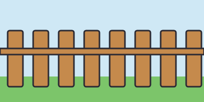

Linha por linha:

- `repeat i 0..7` repete a linha de baixo 8 vezes. Na primeira volta, `i` vale 0; na segunda, 1; na última, 7.
- `{15+i*50}`: cada tábua fica 50 pixels à direita da anterior. As tábuas começam em `x` 15, 65, 115… até 365.
- `end` fecha o `repeat`. Os espaços no começo da linha de dentro não são obrigatórios: eles só ajudam a ler.
- A `trave` vem depois do `end`. Por isso, ela é pintada por cima das tábuas ([capítulo 4](04-camadas.md#a-ordem-de-pintura)).

**Experimente:** troque `0..7` por `0..3`. Só quatro tábuas aparecem, na metade esquerda. A trave continua inteira, porque está fora do `repeat`.

> No editor, os pontos de uma linha repetida ficam cinza e não se movem com o mouse: mexer num mudaria todas as cópias ([capítulo 23](23-editor.md#números-no-código)).

### A variável em várias contas

A variável pode entrar em qualquer número da linha: na posição, no tamanho, na transparência…

<!-- gerar: img/05_bolhas.png -->
```weasel
canvas 400 220 bg=#1f6f9a
repeat i 0..6
  ellipse bolha {40+i*52},{190-i*26} {5+i*3} c=#ffffff40 ink=2 inkc=#e8f7ff
end
```

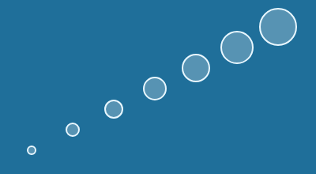

- `{40+i*52}`: cada bolha vai 52 pixels para a direita.
- `{190-i*26}`: e sobe 26 pixels.
- `{5+i*3}`: o raio começa em 5 e cresce 3 a cada bolha. A última tem raio 23.

**Experimente:** troque `{190-i*26}` por `110`. As bolhas ficam todas na mesma altura, crescendo para a direita.

### Um `repeat` dentro do outro

Com dois `repeat`, um dentro do outro, dá para fazer **grades**: linhas e colunas.

<!-- gerar: img/05_xadrez.png -->
```weasel
canvas 280 280 bg=#f4efe6
palette ink=#2b2a33 line=4

rect tabuleiro 20,20 240,240 c=#f1d9b5
repeat lin 0..5
repeat col 0..5
rect casa {20+col*40},{20+lin*40} 40,40 c=#7a4a2c opacity={(lin+col)%2}
end
end
rect borda 20,20 240,240 c=none ink=line
```

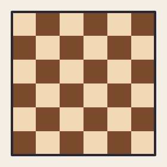

- O `repeat col` de dentro roda **inteiro** para cada valor de `lin`: são 6 × 6 = 36 casas.
- Cada `repeat` precisa do seu `end`. O primeiro `end` fecha o de dentro (`col`); o segundo fecha o de fora (`lin`).
- Cada casa tem 40 pixels de lado. A coluna anda para a direita (`col*40`), e a linha anda para baixo (`lin*40`).
- `(lin+col)%2` é o resto da divisão de `lin+col` por 2: dá 0, 1, 0, 1… Como `opacity=0` é invisível e `opacity=1` é sólida, as casas escuras aparecem uma sim, uma não. Na linha seguinte, `lin` aumenta 1, e a alternância começa trocada.
- A `borda` vem depois dos `repeat`, para o contorno ficar por cima das casas.

**Experimente:** troque `{(lin+col)%2}` por `{lin%2}`. Agora a casa só depende da linha: o tabuleiro vira listras, uma linha inteira clara, outra escura.

### Um limite que usa a outra variável

Os limites do `repeat` de dentro podem usar a variável do `repeat` de fora. Assim, cada linha tem um número diferente de coisas:

<!-- gerar: img/05_piramide.png -->
```weasel
canvas 340 260 bg=#f4efe6
palette ink=#2b2a33 line=3 caixa=#d9a066
rect chao 0,240 340,20 c=#9c8466
repeat lin 0..4
  repeat col 0..lin
    rect caixa {170-(lin+1)*30+col*60+3},{20+lin*44} 54,40 r=3 c=caixa ink=line
  end
end
```

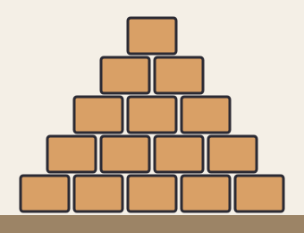

- `repeat col 0..lin`: na linha 0, `col` vai de 0 a 0 (uma caixa); na linha 4, de 0 a 4 (cinco caixas).
- Cada linha tem `lin+1` caixas de 60 pixels, ou seja, `(lin+1)*60` de largura. Para ela ficar no meio, começa em `170-(lin+1)*30`: o meio do canvas menos a metade da largura.
- O `+3` deixa uma folga entre uma caixa e outra.

**Experimente:** troque `0..4` por `0..2`. A pirâmide fica com três andares, no alto do canvas.

### De trás para a frente

Com o `início` maior que o `fim`, o `repeat` conta para trás: `repeat i 4..0` dá 4, 3, 2, 1, 0. Como o que é pintado depois fica por cima, a ordem muda quem cobre quem:

<!-- gerar: img/05_repeat_volta.png -->
```weasel
canvas 460 230 bg=#f4efe6
palette ink=#2b2a33 line=4

repeat i 0..4
ellipse bolaA {60+i*60},70 45 c=#ffd34d ink=line
end
repeat i 4..0
ellipse bolaB {60+i*60},170 45 c=#4a9eff ink=line
end

text t1 440,78 "0..4" size=20 align=right bold
text t2 440,178 "4..0" size=20 align=right bold
```

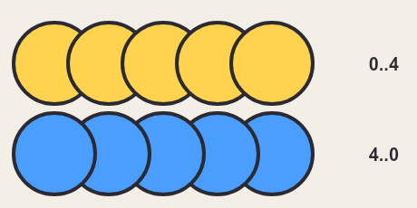

- Em cima (`0..4`), a bola da esquerda é pintada primeiro e a da direita por último: cada bola cobre a vizinha da esquerda.
- Embaixo (`4..0`), é o contrário: a bola da direita é pintada primeiro, e cada uma cobre a vizinha da direita.
- Os dois `repeat` usam o mesmo nome, `i`. Pode: um termina antes de o outro começar.

**Experimente:** troque `4..0` por `0..4` na fileira azul. Ela fica igual à amarela.

### Opções do `repeat`

| Opção | O que faz | Valores | Se não escrever |
|---|---|---|---|
| a variável | o nome que muda a cada volta | um nome, como no `let` | obrigatório |
| `início..fim` | o primeiro e o último valor, de 1 em 1 | dois números ou contas (`0..9`, `1..{n}`, `0..n-1`); de 1 a 1000 voltas | obrigatório |

A ficha completa está na [referência](20-referencia.md#repeat).

**Cuidado:**
- Cada `repeat` precisa do seu `end`. Sem ele, o Weasel mostra `repeat sem end`.
- A variável do `repeat` só vale até o `end`. Depois dele, `{i}` dá `variável desconhecida "i"`.
- O máximo é 1000 voltas num `repeat` (`0..999`). O arquivo inteiro, com todas as voltas, pode ter até 20000 linhas.
- Os limites são arredondados: `0..2.6` é o mesmo que `0..3`.
- Todas as cópias têm o mesmo nome. Um `cut=furo` abre todos os furos de um `repeat` de uma vez ([capítulo 4](04-camadas.md#furos-com-o-mesmo-nome-e-furos-que-se-cruzam)).
- Um `{i}` dentro de um nome vira número, com zeros na frente: `ellipse p{i}` dá as formas `p000`, `p001`, `p002`… Assim, cada cópia ganha um nome só dela.
- Um `let` dentro do `repeat` não muda a cada volta: ele não enxerga a variável do `repeat`. Escreva a conta direto na linha: `{i*2}`.

## Sorteios: `rand()`

`rand()` dá um número que parece sorteado. Com ele, coisas repetidas ficam com um ar natural, bagunçado. Mas o sorteio é **sempre o mesmo** para o mesmo número: o desenho sai igual toda vez que você exporta.

```
rand(x)          de 0 a 1 (nunca chega a 1)
rand(x,a,b)      de a a b
```

<!-- gerar: img/05_capim.png -->
```weasel
canvas 400 160 bg=#cfe8f5
rect chao 0,130 400,30 c=#7cc56a
repeat i 0..39
  stroke capim w=3 c=#4f9a3e : {i*10+5},135 {i*10+5+rand(i,-6,6)},{130-rand(i+100,15,50)}
end
```

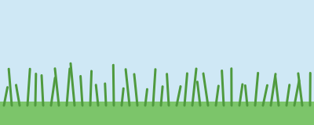

Linha por linha:

- Cada capim é um traço de dois pontos: o pé, no chão, e a ponta.
- O pé fica em `x` igual a `i*10+5`: um a cada 10 pixels.
- A ponta vai um pouco para o lado: `rand(i,-6,6)` sorteia de −6 a 6 pixels.
- A altura também é sorteada: `rand(i+100,15,50)` dá de 15 a 50 pixels acima do chão.
- Para ter dois sorteios diferentes na mesma volta, use números diferentes dentro do `rand`: `rand(i,…)` e `rand(i+100,…)`.

**Experimente:** troque `i+100` por `i+500`. Os capins mudam de altura, porque é outro sorteio. Exporte de novo: eles continuam iguais, sempre no mesmo lugar.

### O mesmo sorteio duas vezes

Um `rand` com o mesmo número dá sempre o mesmo resultado. Isso serve para usar um número sorteado em dois lugares da mesma linha:

<!-- gerar: img/05_rand.png -->
```weasel
canvas 400 200 bg=#1d2140
let n=40

# 40 estrelas: posição e tamanho sorteados
repeat i 0..{n-1}
ellipse estrela {rand(i,10,390)},{rand(i+100,10,110)} {rand(i+200,1,3)} c=#fff6c8
end

# 10 prédios: a altura sorteada aparece duas vezes na linha
repeat j 0..9
rect predio {j*40+2},{rand(j+300,80,140)} 36,{170-rand(j+300,80,140)} c=#3b3550
end
rect chao 0,170 400,30 c=#2c3a2e
```

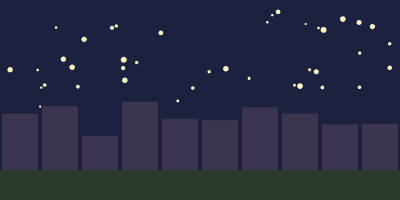

- Nas estrelas, `x`, `y` e o tamanho usam três sorteios diferentes: `rand(i,…)`, `rand(i+100,…)` e `rand(i+200,…)`. Com `rand(i,…)` nos três, as três coisas andariam juntas: as estrelas ficariam todas numa linha diagonal, e as mais à direita seriam as maiores.
- Nos prédios, `rand(j+300,80,140)` aparece **duas vezes**: uma para o topo do prédio e outra para a altura. Como é o mesmo sorteio, dá o mesmo número, e o pé de todos os prédios fica certinho em `y` 170.

**Experimente:** troque o segundo `j+300` por `j+400`. O topo e a altura deixam de combinar: alguns prédios ficam flutuando acima do chão.

**Cuidado:**
- O sorteio depende só do número de dentro. Números muito próximos, como `rand(0)` e `rand(0.0001)`, dão o mesmo sorteio. Use números que mudam de 1 em 1, como a variável do `repeat`.
- `rand(x,a)`, sem o `b`, ignora o `a` e dá de 0 a 1 (o Weasel avisa). Escreva sempre os dois limites.

## Comparar e escolher: `<`, `==` e `? :`

Uma **comparação** pergunta alguma coisa sobre dois números. Ela dá 1 quando a resposta é sim e 0 quando é não. A **escolha** `? :` usa essa resposta para escolher entre dois números.

```
{a < b}  {a <= b}  {a > b}  {a >= b}  {a == b}  {a != b}
{condição ? se_sim : se_não}
```

<!-- gerar: img/05_regua.png -->
```weasel
canvas 420 130 bg=#f4efe6
palette ink=#2b2a33
rect regua 15,30 390,70 r=6 c=#ffd98a ink=2
repeat i 0..36
  line traco w=2 c=ink : {30+i*10},30 {30+i*10},{30+(i%5==0 ? 30 : 14)}
end
```

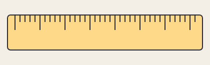

Linha por linha:

- `i%5` é o resto da divisão de `i` por 5. Ele dá 0 quando `i` é 0, 5, 10, 15…
- `i%5==0` pergunta se o resto é zero: dá 1 (sim) a cada cinco traços e 0 (não) nos outros.
- `? 30 : 14` escolhe o tamanho do traço: 30 pixels quando a resposta é sim; 14 quando é não.

| Conta | Pergunta | Exemplo com `r=80` | Dá |
|---|---|---|---|
| `<` `<=` | menor? menor ou igual? | `{r<50}` | 0 |
| `>` `>=` | maior? maior ou igual? | `{r>50}` | 1 |
| `==` | igual? (dois iguais) | `{r==80}` | 1 |
| `!=` | diferente? | `{r!=80}` | 0 |
| `c ? a : b` | se `c` não é 0, dá `a`; se é 0, dá `b` | `{r>50 ? 10 : 20}` | 10 |

- Uma comparação também serve sozinha, como número: o `opacity={(lin+col)%2}` do xadrez mostra ou esconde uma forma.
- O Weasel faz primeiro as contas e só depois compara: `{i+1<5}` é o mesmo que `{(i+1)<5}`.
- Uma escolha pode ficar dentro de outra: `{i<4 ? 10 : i<8 ? 20 : 30}` dá 10, 20 ou 30.
- Para juntar duas perguntas ("e", "ou", "não"), veja o [capítulo 21](21-funcoes.md#as-operações).

**Experimente:** troque `i%5==0` por `i%2==0`. A régua alterna: um traço comprido, um curto.

**Cuidado:** um `=` sozinho dá erro: `para comparar, use == (dois iguais)`.

## Funções prontas

As contas também têm **funções**: um nome com números entre parênteses, como `cos(60)`. O Weasel calcula e põe o resultado no lugar.

As mais úteis para pôr coisas em roda são `cos` e `sin`. Para um ângulo em graus, `cos` dá quanto andar na horizontal e `sin`, na vertical, numa roda de raio 1. Multiplique pelo raio que você quer:

<!-- gerar: img/05_relogio.png -->
```weasel
canvas 280 280 bg=#f4efe6
palette ink=#2b2a33 line=5
let cx=140 cy=140 r=110
ellipse caixa {cx},{cy} {r} c=#fffaf0 ink=line
repeat h 0..11
  ellipse marca {cx+cos(h*30)*(r-20)},{cy+sin(h*30)*(r-20)} {h%3==0 ? 8 : 4} c=ink
end
# os ponteiros: 10 horas e 10 minutos
line horas w=9 c=ink : {cx},{cy} {cx+cos(-150)*50},{cy+sin(-150)*50}
line minutos w=6 c=ink : {cx},{cy} {cx+cos(-30)*78},{cy+sin(-30)*78}
ellipse eixo {cx},{cy} 8 c=#e0533d
```

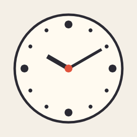

Linha por linha:

- `repeat h 0..11` faz as 12 marcas. Cada uma fica 30 graus adiante da anterior (`h*30`), porque 360 ÷ 12 = 30.
- `{cx+cos(h*30)*(r-20)},{cy+sin(h*30)*(r-20)}` é o ponto da roda de raio `r-20`, em volta do meio, no ângulo `h*30`.
- O ângulo 0 aponta para a direita (as 3 horas) e cresce no sentido do relógio, como o `rot=` ([capítulo 1](01-primeiros-passos.md#os-ângulos-rot)).
- `{h%3==0 ? 8 : 4}`: a cada três marcas (12, 3, 6 e 9 horas), uma bolinha maior.
- Os ponteiros vão do meio até um ponto da roda: −150 graus aponta para as 10 horas, e −30 graus para o 2 (os 10 minutos).

**Experimente:** no ponteiro dos minutos, troque `-30` por `90` nos dois lugares. Ele passa a apontar para baixo, para o 6.

Algumas funções que você vai usar bastante:

| Função | O que faz | Exemplo | Dá |
|---|---|---|---|
| `sin(g)` `cos(g)` | o ponto de um ângulo, em graus, numa roda de raio 1 | `{sin(90)}` | 1 |
| `min(a,b,…)` `max(a,b,…)` | o menor e o maior | `{max(4,10)}` | 10 |
| `round(v)` `floor(v)` `ceil(v)` | arredonda; para baixo; para cima | `{round(2.6)}` | 3 |
| `abs(v)` | o número sem o sinal | `{abs(-7)}` | 7 |
| `sqrt(v)` | a raiz quadrada | `{sqrt(16)}` | 4 |
| `lerp(a,b,t)` | um valor entre `a` e `b`: com `t=0` dá `a`, com `t=1` dá `b`, com `t=0.5`, o meio | `{lerp(100,300,0.5)}` | 200 |
| `dist(x1,y1,x2,y2)` | a distância entre dois pontos | `{dist(0,0,30,40)}` | 50 |

Todas as funções, cada uma com exemplos, estão no [capítulo 21](21-funcoes.md).

## Juntando tudo

Um jardim num dia de sol. O sol, a cerca, o capim e as flores saem de `repeat`. O capim e as flores têm alturas sorteadas.

<!-- gerar: img/05_jardim.png -->
```weasel
canvas 480 300 bg=ceu
gradient ceu linear 0,0 0,300 : #6fc3ef #e6f6fc
palette ink=#2b2a33 line=3 madeira=#c58a4c folha=#3f8f3a rosa=#ff7aa8 amarelo=#ffd34d miolo=#8a4a1c
let sx=400 sy=70

# o sol: 12 raios em volta do meio
repeat k 0..11
  line raio w=5 c=#ffc93d : {sx+cos(k*30)*44},{sy+sin(k*30)*44} {sx+cos(k*30)*62},{sy+sin(k*30)*62}
end
ellipse sol {sx},{sy} 34 c=amarelo

# os morros e a cerca
ellipse morro1 110,300 280,170 c=#9ad884
ellipse morro2 430,310 240,150 c=#86cc6e
repeat i 0..9
  rect tabua {6+i*48},168 30,90 r=4 c=madeira ink=line
end
rect trave 0,190 480,10 c=madeira ink=line

# o capim: altura e inclinação sorteadas
repeat i 0..79
  stroke capim w=3 c=folha : {i*6+3},302 {i*6+3+rand(i,-6,6)},{300-rand(i+100,18,46)}
end

# as flores: o caule, cinco pétalas em roda e o miolo
repeat f 0..6
  stroke caule w=4 c=folha : {40+f*66},302 {40+f*66},{rand(f+200,212,248)}
  repeat p 0..4
    ellipse petala {40+f*66+cos(p*72-90)*12},{rand(f+200,212,248)+sin(p*72-90)*12} 10,6 rot={p*72-90} c=rosa
    ellipse petala2 {40+f*66+cos(p*72-90)*12},{rand(f+200,212,248)+sin(p*72-90)*12} 10,6 rot={p*72-90} c=amarelo opacity={f%2}
  end
  ellipse miolo {40+f*66},{rand(f+200,212,248)} 6 c=miolo
end
```

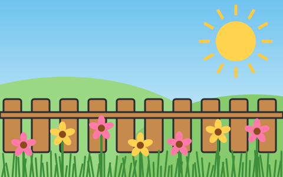

- **O sol:** 12 raios em roda, como as marcas do relógio. Cada raio é uma `line` que começa a 44 pixels do meio e termina a 62. O círculo vem depois e fica por cima.
- **A cerca:** as tábuas saem de um `repeat`, e a trave vem depois, por cima delas.
- **O capim:** 80 folhas, com a inclinação e a altura sorteadas, como no exemplo do `rand`.
- **As flores:** um `repeat` dentro do outro. O de fora (`f`) faz as 7 flores; o de dentro (`p`) faz as 5 pétalas em roda, a 72 graus uma da outra (360 ÷ 5). O `-90` põe a primeira pétala para cima.
- **A altura de cada flor** é o mesmo sorteio, `rand(f+200,212,248)`, escrito no caule, nas pétalas e no miolo. Por isso, as três partes ficam juntas.
- **Rosa e amarelo:** uma conta não vira cor. Então, cada pétala tem uma cópia amarela por cima, com `opacity={f%2}`: ela some nas flores pares e aparece nas ímpares, como as casas do xadrez.

**Experimente:** troque `repeat p 0..4` por `repeat p 0..7`, e todos os `72` por `45` (são seis). As flores ficam com 8 pétalas.

## Resumo

- `let nome=valor` cria uma variável. Ela vale no arquivo inteiro, e o valor pode ser uma conta com outras variáveis.
- Dentro das chaves valem `+ - * /`, os parênteses, o resto (`%`), a potência (`^`), as comparações (`< <= > >= == !=`), a escolha (`? :`) e as funções, como `cos`, `sin`, `min` e `round`.
- `repeat i início..fim` … `end` repete as linhas de dentro, de 1 a 1000 vezes, com `i` mudando a cada volta. Um `repeat` pode ficar dentro de outro.
- `rand(x,a,b)` dá um número sorteado de `a` a `b`, sempre o mesmo para o mesmo `x`.
- As cópias de um `repeat` têm o mesmo nome, e a variável só vale até o `end`.

[← Camadas](04-camadas.md) · [Índice](README.md) · [Próximo: Componentes e arquivos →](06-componentes.md)
