# 6. Componentes e arquivos

[← Contas e repetição](05-contas.md) · [Índice](README.md) · [Próximo: Ossos →](06-ossos.md)

Um **componente** é um desenho com nome: você desenha uma vez e põe no desenho quantas vezes quiser, em lugares, tamanhos e cores diferentes. Neste capítulo você aprende a criar componentes (`def`) e a usá-los (`use`), a espelhar uma forma para fazer o outro lado (`mirror=`), a dividir o trabalho em arquivos (`include`), a juntar formas para o editor (`group`) e a fazer outras versões do mesmo desenho (`variant`). Você precisa dos capítulos 1 a 5.

## Componentes: `def` e `use`

```
def nome
  linhas
end

use nome x,y
```

O `def` guarda o desenho. O `use` põe uma cópia dele no desenho:

<!-- gerar: img/06_arvores.png -->
```weasel
canvas 400 200 bg=#cfe8f5
palette ink=#2b2a33 line=4 tronco=#7a4a2c folhas=#4caf50

def arvore
  rect tronco -7,-30 14,32 c=tronco ink=line
  ellipse copa 0,-58 32,36 c=folhas ink=line
end

rect chao 0,166 400,40 c=#7cc56a
use arvore 70,168
use arvore 200,168
use arvore 330,168
```

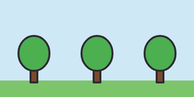

Linha por linha:

- `def arvore` abre o componente `arvore`. As linhas até o `end` são o desenho dele.
- O desenho fica em volta do ponto `0,0`, a **origem** do componente. Na árvore, a origem é o pé do tronco: o tronco sobe a partir dela (`-30`), e a copa fica mais acima (`-58`).
- Sozinho, o `def` não desenha nada.
- `use arvore 70,168` põe uma árvore com a origem no ponto `70,168`, em cima da grama. As outras duas vão para `200,168` e `330,168`.

**Experimente:** acrescente `use arvore 135,150` no fim. Uma quarta árvore aparece entre as duas primeiras, um pouco mais para trás. Ela fica por cima das outras, porque vem depois.

> No editor, o painel **Símbolos** mostra cada componente do arquivo ([capítulo 22](22-editor.md#painel-símbolos)), e a **prévia** mostra um componente sozinho enquanto o cursor está nele ([capítulo 22](22-editor.md#prévia-do-componente)).

### Parâmetros: números e cores

Um **parâmetro** é um valor que cada cópia pode trocar. Ele fica na linha do `def`, com um valor padrão:

```
def nome parâmetro=padrão parâmetro=padrão …
use nome x,y parâmetro=valor …
```

<!-- gerar: img/06_parametros.png -->
```weasel
canvas 460 220 bg=#cfe8f5
palette ink=#2b2a33 line=4 tronco=#7a4a2c outono=#c97b2a

def arvore copa=#4caf50 alto=60
  rect tronco -7,-28 14,30 c=tronco ink=line
  ellipse folhas 0,{-24-alto*0.45} {alto*0.5},{alto*0.55} c=copa ink=line
end

rect chao 0,184 460,40 c=#7cc56a
use arvore 60,186
use arvore 160,186 alto=90
use arvore 265,186 copa=outono
use arvore 380,186 alto=110 copa=#2e8b57
```

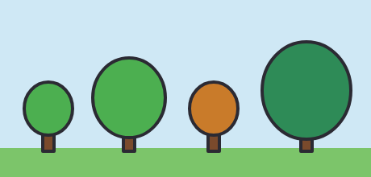

- `def arvore copa=#4caf50 alto=60` cria dois parâmetros. O valor padrão diz o tipo: `copa` é uma **cor**, e `alto` é um **número**.
- Um parâmetro de número vale nas contas de dentro do `def`: `{alto*0.5}`. A copa cresce junto com `alto`.
- Um parâmetro de cor vale onde vai uma cor: `c=copa`.
- A primeira árvore não troca nada: fica com os valores padrão.
- No `use`, uma cor pode ser `#hex`, um nome da `palette` (`outono`), um gradiente ou `none`.

**Experimente:** acrescente `use arvore 215,186 alto=30 copa=#e05a8a`. Aparece uma arvorezinha rosa entre a segunda e a terceira.

Um parâmetro de número também pode ser a grossura do contorno (`ink=borda`):

<!-- gerar: img/05_parametros.png -->
```weasel
canvas 440 160 bg=#f4efe6
palette ink=#2b2a33 vermelho=#e0533d
gradient ceu linear 0,0 0,1 box : #bfe3f5 #3a78c2

def botao cor=#4a9eff borda=4
ellipse aro 0,0 34 c=cor ink=borda
ellipse brilho -12,-12 9,5 rot=-35 c=#ffffff opacity=0.7
end

use botao 60,64
use botao 165,64 borda=10
use botao 270,64 cor=vermelho
use botao 375,64 cor=ceu borda=0

text t1 60,130 "padrão" size=14 align=center
text t2 165,130 "borda=10" size=14 align=center
text t3 270,130 "cor=vermelho" size=14 align=center
text t4 375,130 "cor=ceu borda=0" size=14 align=center
```

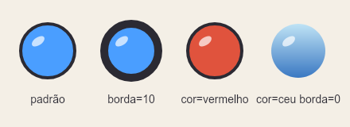

- `borda=10` engrossa o contorno; `borda=0` tira o contorno.
- `cor=ceu` pinta o botão com o gradiente `ceu`. Com `box`, ele se ajusta ao tamanho do aro ([capítulo 3](03-cores.md#um-gradiente-para-cada-forma-box)).

Um nome que o componente não tem não muda nada, e o Weasel avisa, com a lista dos nomes que valem. Com `use arvore 60,186 alot=90` (em vez de `alto`):

```
desenho.weasel:10:19: aviso: parâmetro desconhecido "alot": o componente "arvore" tem copa, alto (e o use aceita scale, rot, flip, bone, cloth, opacity, z)
```

O `use` também troca, só naquela cópia, uma cor ou um número da `palette` e uma variável do `let`: `use arvore 60,186 line=8` engrossa o contorno de uma árvore só.

### Tamanho e giro: `scale=` e `rot=`

`scale=` muda o tamanho de uma cópia, e `rot=` gira. Os dois acontecem **em volta da origem**. Neste peixe, a origem está marcada com um pontinho vermelho:

<!-- gerar: img/05_use_escala.png -->
```weasel
canvas 540 170 bg=#cfe8f5
palette ink=#2b2a33

def peixe
shape rabo c=#ff9a4a ink=3 : -16,0! -34,-13! -34,13!
shape barbatana c=#ff9a4a ink=3 : -8,-10! 4,-22! 12,-9!
ellipse corpo 0,0 24,14 c=#ffb347 ink=3
ellipse olho 11,-4 3 c=ink
# a origem (o ponto 0,0), em vermelho só para você ver onde ela fica
ellipse origem 0,0 3 c=#c44536
end

use peixe 60,80
use peixe 165,80 scale=0.6
use peixe 270,80 scale=1.5,0.7
use peixe 385,80 rot=-30
use peixe 480,80 rot=90

text t1 60,150 "normal" size=14 align=center
text t2 165,150 "scale=0.6" size=14 align=center
text t3 270,150 "scale=1.5,0.7" size=14 align=center
text t4 385,150 "rot=-30" size=14 align=center
text t5 480,150 "rot=90" size=14 align=center
```

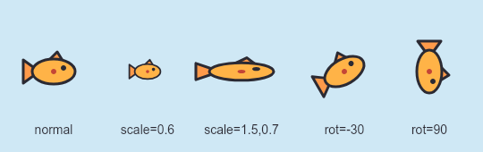

- `scale=0.6`: um número só muda a largura e a altura juntas. 0.6 é 60% do tamanho; 2 seria o dobro.
- `scale=1.5,0.7`: dois números mudam a largura (150%) e a altura (70%) separadas. O peixe fica comprido e achatado.
- O contorno também engrossa ou afina com o tamanho.
- `rot=-30` gira 30 graus no sentido anti-horário: o peixe aponta para cima. `rot=90` gira um quarto de volta no sentido do relógio: o peixe aponta para baixo.
- O pontinho vermelho não sai do lugar em nenhum deles: tudo gira e muda de tamanho em volta da origem.

**Experimente:** no último peixe, troque `rot=90` por `rot=180`. Ele passa a nadar para a esquerda, de barriga para cima.

### Espelhar: `flip=`

`flip=` espelha uma cópia. Serve para um olho ser o outro espelhado, ou para um personagem olhar para o outro lado.

<!-- gerar: img/05_use_flip.png -->
```weasel
canvas 480 170 bg=#cfe8f5
palette ink=#2b2a33

def peixe
shape rabo c=#ff9a4a ink=3 : -16,0! -34,-13! -34,13!
shape barbatana c=#ff9a4a ink=3 : -8,-10! 4,-22! 12,-9!
ellipse corpo 0,0 24,14 c=#ffb347 ink=3
ellipse olho 11,-4 3 c=ink
ellipse origem 0,0 3 c=#c44536
end

use peixe 70,80
use peixe 185,80 flip=x
use peixe 300,80 flip=y
use peixe 415,80 flip=xy

text t1 70,150 "normal" size=14 align=center
text t2 185,150 "flip=x" size=14 align=center
text t3 300,150 "flip=y" size=14 align=center
text t4 415,150 "flip=xy" size=14 align=center
```

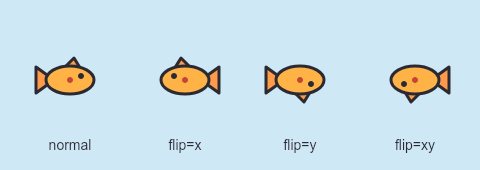

- `flip=x` troca a esquerda e a direita: o peixe nada para a esquerda.
- `flip=y` troca o cima e o baixo: a barbatana vai para baixo, e o olho também.
- `flip=xy` faz os dois. Dá o mesmo que `rot=180`.
- O espelho também é em volta da origem: o pontinho vermelho fica onde estava.

### Transparência: `opacity=`

`opacity=` no `use` deixa a cópia inteira transparente, de 0 (invisível) a 1 (normal).

<!-- gerar: img/05_use_opacity.png -->
```weasel
canvas 400 170 bg=#cfe8f5
palette ink=#2b2a33
pattern algas hatch angle=90 gap=24 w=8 c=#6fae8f bg=#cfe8f5

def peixe
shape rabo c=#ff9a4a ink=3 : -16,0! -34,-13! -34,13!
shape barbatana c=#ff9a4a ink=3 : -8,-10! 4,-22! 12,-9!
ellipse corpo 0,0 24,14 c=#ffb347 ink=3
ellipse olho 11,-4 3 c=ink
end

rect fundo 0,30 400,100 c=algas
use peixe 75,80
use peixe 200,80 opacity=0.5
use peixe 325,80 opacity=0.2

text t1 75,155 "normal" size=14 align=center
text t2 200,155 "opacity=0.5" size=14 align=center
text t3 325,155 "opacity=0.2" size=14 align=center
```

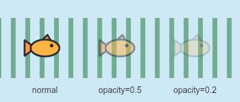

<!-- conferir: opacity do use inteiro (linha J) -->
- Com `opacity=0.5`, dá para ver as algas através do peixe.
- A transparência se multiplica: uma forma com `opacity=0.5` dentro de um `use … opacity=0.5` fica com 0.25.

### Um componente dentro do outro

Um componente pode usar outro. Assim, coisas grandes são montadas com peças pequenas:

<!-- gerar: img/05_flor.png -->
```weasel
canvas 400 230 bg=#cfe8f5
palette ink=#2b2a33

# uma pétala: o 0,0 é o meio da flor, e a pétala fica para cima dele
def petala cor=#ff6b4a
ellipse p 0,-26 13,24 c=cor ink=2
end

# a flor usa a pétala cinco vezes, girando 72 graus a cada vez
def flor cor=#ff6b4a
stroke caule w=5 c=#4f9a3e : 0,10 -5,60 0,110
use petala 0,0 cor=cor
use petala 0,0 rot=72 cor=cor
use petala 0,0 rot=144 cor=cor
use petala 0,0 rot=216 cor=cor
use petala 0,0 rot=288 cor=cor
ellipse miolo 0,0 12 c=#ffd34d ink=2
end

rect grama 0,190 400,40 c=#7cc56a
use flor 80,90
use flor 200,100 scale=1.3 cor=#e05a8a
use flor 320,90 cor=#4a9eff
```

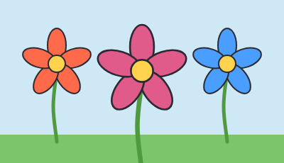

- A `petala` fica para cima da origem. Girando em volta da origem (o meio da flor), ela vai parar em outro lugar em volta do miolo.
- Cinco pétalas, `360 ÷ 5 = 72` graus entre elas: `rot=0`, `72`, `144`, `216` e `288`.
- `cor=cor` passa a cor da flor para a pétala. O primeiro `cor` é o parâmetro da `petala`; o segundo é o valor que a `flor` recebeu.
- Quando a flor muda de tamanho (`scale=1.3`), tudo o que está dentro dela muda junto, as pétalas também.

**Experimente:** acrescente `use flor 140,150 scale=0.5 cor=#ffd34d` no fim. Uma florzinha amarela aparece embaixo, entre as duas primeiras.

### `repeat` dentro do componente

Cinco linhas `use petala` quase iguais pedem um `repeat` ([capítulo 5](05-contas.md#repetir-repeat)). Ele também vale dentro do `def`:

<!-- gerar: img/05_repeat_def.png -->
```weasel
canvas 400 230 bg=#cfe8f5
palette ink=#2b2a33

def petala cor=#ff6b4a
ellipse p 0,-26 13,24 c=cor ink=2
end

# a flor com um repeat: oito pétalas, cada uma giro graus depois da outra
def flor cor=#ff6b4a giro=45
stroke caule w=5 c=#4f9a3e : 0,10 -5,60 0,110
repeat i 0..7
use petala 0,0 rot={i*giro} cor=cor
end
ellipse miolo 0,0 12 c=#ffd34d ink=2
end

rect grama 0,190 400,40 c=#7cc56a
use flor 110,95
use flor 290,95 cor=#4a9eff giro=25
```

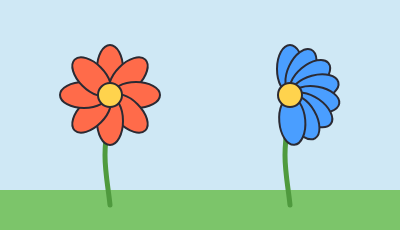

- `repeat i 0..7` faz as oito pétalas, com `rot=0`, `45`, `90`… até `315`.
- Nas contas de dentro, valem o `i` e os parâmetros do componente: `rot={i*giro}`. A flor azul tem `giro=25`, então as pétalas vão só de 0 a 175 graus e formam um leque.
- Os limites do `repeat` não podem usar os parâmetros do `def` (dá erro). Use números ou variáveis do `let`.

**Experimente:** troque `giro=25` por `giro=90`. A flor azul fica com quatro pétalas em cruz: as oito caem em quatro lugares, duas em cada.

### Opções do `def` e do `use`

| Opção | O que faz | Valores | Se não escrever |
|---|---|---|---|
| o nome (no `def`) | o nome do componente | um nome sem acento, que não se repete em outro `def` | obrigatório |
| `parâmetro=padrão` (no `def`) | um valor que cada cópia pode trocar | um número, uma cor ou um gradiente | sem parâmetros |
| `x,y` | onde a origem do componente vai parar | dois números, em pixels | `0,0` |
| `scale=` | o tamanho, em volta da origem | um número ou dois (largura, altura) | 1 |
| `rot=` | o giro, em graus, em volta da origem | qualquer número (positivo: sentido do relógio) | 0 |
| `flip=` | espelha a cópia | `x`, `y` ou `xy` | sem espelho |
| `opacity=` | a transparência da cópia | de 0 a 1 | 1 |
| `parâmetro=valor` (no `use`) | troca um parâmetro nesta cópia | como no `def`; aceita conta `{…}` | o padrão do `def` |

O `use` tem mais opções, ensinadas em outros capítulos: `lock` ([capítulo 4](04-camadas.md#travar-no-editor-lock)), `bone=` e `cloth=` ([capítulo 8](06-ossos.md)), `z=` e `billboard` ([capítulo 14](11-profundidade.md)). As fichas completas estão na referência: [`def`](19-referencia.md#def-e-end) e [`use`](19-referencia.md#use).

**Cuidado:**
- Dentro de um `def` valem as formas, o `use`, o `repeat`, o `group`, o `mirror=` e o `include`. Uma `layer`, um `let`, uma `palette` ou outro `def` lá dentro dão erro: `layer não pode ficar dentro de def (só formas e use)`.
- O `def` pode ficar antes ou depois do `use`. Mesmo sem nenhum `use`, os erros de dentro dele aparecem.
- Um `use` com um nome que não existe dá erro: `componente "nada" não existe`.
- Um componente pode ter outro dentro, até 8 um dentro do outro. Um componente que usa a si mesmo dá erro: `componentes demais um dentro do outro`.
- As formas de dentro têm o mesmo nome em todas as cópias. Um `cut=` ou um `hide=` com esse nome vale para todas.

## Espelho de uma forma: `mirror=`

Muita coisa é simétrica: asas, orelhas, olhos, pernas. Desenhe um lado e espelhe o outro com `mirror=`:

```
shape nome mirror=outra@x
shape nome mirror=outra@yN
shape nome mirror=outra
```

<!-- gerar: img/05_mirror.png -->
```weasel
canvas 400 240 bg=#f4efe6
palette ink=#2b2a33 line=4

shape asaE c=#ff9a4a ink=line : 194,110 130,34 52,56 64,128! 130,148 192,128
shape asaD mirror=asaE@200
shape baixoE c=#ffd34d ink=line : 194,132 140,160 112,212! 160,206 194,152
shape baixoD mirror=baixoE@200 c=#ff6b4a
ellipse corpo 200,132 9,62 c=ink
stroke antena w=3 : 196,74 184,44 168,34
stroke antena2 mirror=antena@200
```

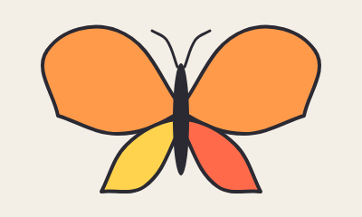

Linha por linha:

- `mirror=asaE@200` copia a forma `asaE`, refletida na **linha vertical** `x` 200, o meio da borboleta. Cada ponto vai parar à mesma distância da linha, do outro lado: um ponto em `x` 194 (6 pixels à esquerda) vira `x` 206 (6 pixels à direita).
- A cópia leva tudo da forma original: a cor, o contorno, os pontos. O que você escreve na linha do espelho vale por cima: `baixoD` ficou vermelha com `c=#ff6b4a`.
- O espelho vale para todas as formas: o `stroke antena2` espelha o `stroke antena`.

**Experimente:** na linha da `asaD`, troque `@200` por `@220`. A asa de cima, à direita, se afasta 40 pixels do corpo: o dobro da mudança na linha do espelho.

### Reflexo na água: `@y`

Com `@y`, o espelho é uma **linha deitada**, e a cópia fica de cabeça para baixo. É o jeito de fazer reflexos na água:

<!-- gerar: img/05_reflexo.png -->
```weasel
canvas 360 300 bg=#cfe8f5
palette ink=#2b2a33 line=4

rect lago 0,180 360,120 c=#4a7fb5
shape montanha c=#8a9bb0 ink=line : 40,180! 150,60! 260,180!
shape neve c=#ffffff : 150,60! 128,90! 150,82! 172,90!
ellipse sol 290,110 26 c=#ffd34d

# o reflexo: tudo espelhado na linha da água (y=180), mais transparente
shape montanhaR mirror=montanha@y180 opacity=0.35
shape neveR mirror=neve@y180 opacity=0.35
ellipse solR mirror=sol@y180 opacity=0.35
```

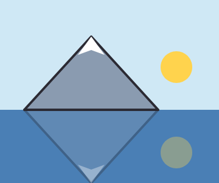

- `@y180` é a linha deitada em `y` 180, a beira da água. O pico da montanha está 120 pixels acima dela (`y` 60); no reflexo, fica 120 pixels abaixo (`y` 300).
- `opacity=0.35` vale por cima do que veio da original: o reflexo fica apagado.
- O reflexo de uma `ellipse` é uma `ellipse` (`solR`), e o de um `shape` é um `shape`.

**Experimente:** no `solR`, troque `opacity=0.35` por `opacity=1`. O sol refletido fica tão forte quanto o de verdade, e o lago parece um espelho.

### Opções do `mirror=`

| Opção | O que faz | Valores | Se não escrever |
|---|---|---|---|
| `mirror=forma` | esta linha vira uma cópia espelhada da forma | o nome de uma forma do mesmo comando | — |
| `@x` ou `@xN` | o espelho é a linha em pé nesse `x` | um número ou uma conta (`@{cx}`) | sem `@`: a linha em pé no meio do canvas |
| `@yN` | o espelho é a linha deitada nesse `y` | um número ou uma conta | — |

A ficha completa está nas [opções de todas as formas](19-referencia.md#opções-de-todas-as-formas).

**Cuidado:**
- A forma original precisa ter nome e ser do mesmo comando. Um `ellipse` não espelha um `shape`: `um ellipse não pode espelhar um shape`.
- Não escreva o `:` e os pontos na linha do espelho: eles vêm da original. Pontos escritos ali são ignorados, com aviso.
- A original pode vir antes ou depois do espelho. Dentro de um `def`, ela precisa ser do mesmo `def`.
- O espelho de um espelho não vale: espelhe sempre a original.

## Vários arquivos: `include`

`include` traz outro arquivo para dentro deste, como se ele estivesse **colado naquela linha**. Serve para dividir um trabalho grande: as cores e os componentes num arquivo, os desenhos em outros.

```
include "arquivo.weasel"
```

Primeiro, um arquivo só de peças. Salve como `pecas.weasel`:

<!-- arquivo: pecas.weasel -->
```weasel
# pecas.weasel: as cores e os componentes, sem nenhum desenho
palette ink=#2b2a33 line=4 parede=#f1d9b5 telhado=#c4512b porta=#7a4a2c

def casinha cor=parede
rect frente -40,-60 80,60 c=cor ink=line
shape teto c=telhado ink=line : -50,-58! 0,-100! 50,-58!
rect entrada -10,-34 20,34 c=porta ink=line
end
```

Sozinho, ele não desenha nada: só tem a `palette` e um `def`. Agora, um desenho na mesma pasta que usa essas peças:

<!-- gerar: img/05_include_pecas.png -->
```weasel
canvas 400 200 bg=#cfe8f5
include "pecas.weasel"

rect chao 0,160 400,40 c=#7cc56a
use casinha 80,162
use casinha 200,162 cor=#bfe3f5
use casinha 320,162 cor=#ffd34d
```

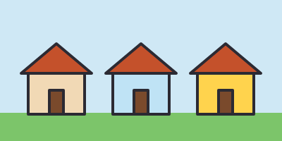

Linha por linha:

- `include "pecas.weasel"` traz a `palette` e o `def casinha`. O desenho não tem nenhuma linha `palette` nem `def`, e mesmo assim o `use casinha` funciona.
- O `include` está logo depois do `canvas`. Como `pecas.weasel` não desenha nada, o lugar dele não muda quem fica na frente.
- O caminho é a partir da pasta do arquivo que tem o `include`. Com `include "personagens/heroi.weasel"`, o Weasel procura na pasta `personagens`, ao lado do seu arquivo.

**Experimente:** em `pecas.weasel`, troque `telhado=#c4512b` por `telhado=#4a6fb5`. As três casinhas ficam com o telhado azul, e todo outro desenho que inclui `pecas.weasel` também muda.

> No editor, o arquivo incluído precisa estar aberto numa aba ([capítulo 22](22-editor.md#vários-arquivos)).

**Cuidado:**
- O arquivo entra no lugar da linha. O que ele desenha fica por cima do que vem antes e por baixo do que vem depois.
- Se uma linha que só pode aparecer uma vez, como o `canvas`, está nos dois arquivos, vale a de baixo.
- Um erro no outro arquivo aparece na linha do `include`, com o nome e a linha de lá: `pecas.weasel:6: …`.
- Escreva o nome com o `.weasel`: `include "pecas"` não acha o arquivo.
- Um arquivo pode incluir outro, até 8 um dentro do outro. Um arquivo que inclui a si mesmo, direto ou por outro, dá erro: `include em ciclo`.
- O exemplo [`noite.weasel`](../../exemplos/noite.weasel) põe o Cavaleiro de `cavaleiro.weasel` numa rua com chuva e uma lanterna, sem mudar nada no arquivo dele. Para pôr personagens de outros arquivos num **filme**, o caminho é outro: o `actor` ([capítulo 17](10-filme.md)).

## Grupos: `group`

Um grupo junta linhas para o **editor** escolher, mover e travar todas juntas. A imagem não muda com ele.

```
group nome
  linhas
end
```

<!-- conferir -->
```weasel
canvas 400 300 bg=#f4efe6
palette ink=#2b2a33 line=3

layer fundo lock
rect chao 0,240 400,60 c=#8a7a5a

layer boneco
group cabeca
  ellipse rosto 200,100 40 c=#f0c8a0 ink=line
  group olhos
    ellipse olhoA 186,95 5,6 c=ink
    ellipse olhoB 214,95 5,6 c=ink
  end
end
rect corpo 175,140 50,80 c=#3a6ea5 ink=line
rect bracoA 140,140 20,60 c=#3a6ea5 ink=line lock
rect bracoB 240,140 20,60 c=#3a6ea5 ink=line
```

- `group cabeca` … `end` junta o rosto e os olhos. No editor, um clique numa delas escolhe o grupo inteiro, e as três andam juntas.
- Um grupo pode ter outro dentro: `olhos` está dentro de `cabeca`. O recuo de dois espaços é só para ler melhor.
- O nome é opcional. Ele só serve para você se achar no código.
- `group nome lock` trava o grupo inteiro no editor, como o `lock` de uma forma ou de uma camada ([capítulo 4](04-camadas.md#travar-no-editor-lock)).

**Cuidado:**
- O grupo fica dentro de uma camada. Uma linha `layer` no meio dele dá erro.
- Um grupo pode ficar dentro de um `def`. Um `def` dentro de um grupo dá erro.
- Uma opção como `opacity=` no `group` dá aviso e não faz nada. Para mudar várias formas de uma vez na imagem, use uma camada.

> No editor, **Ctrl+G** escreve o `group` e o `end` em volta das formas escolhidas ([capítulo 22](22-editor.md#travar-e-agrupar)).

## Variantes: `variant`

Uma **variante** é outra versão do mesmo desenho, com algumas cores da `palette` trocadas. Serve para inimigos de outra cor, dia e noite, times e roupas. O desenho de sempre não muda: a variante só vale quando você a escolhe.

```
variant nome cor=valor cor=valor … [hide=nomes] [show=nomes]
```

<!-- gerar: img/06_variante_casa.png -->
<!-- gerar: img/06_variante_casa_noite.png --variant noite -->
```weasel
canvas 400 260 bg=ceu
palette ink=#2b2a33 line=5 fino=3
palette ceu=#bfe3f5 parede=#f1d9b5 telhado=#c4512b porta=#7a4a2c janela=#e8f4fb grama=#7cc56a

rect chao 0,222 400,40 c=grama
rect parede 110,120 180,110 c=parede ink=line
shape telhado c=telhado ink=line : 90,124! 200,50! 310,124!
rect porta 180,160 44,70 r=6 c=porta ink=line
rect janela1 128,140 36,36 c=janela ink=fino
rect janela2 238,140 36,36 c=janela ink=fino

variant noite ceu=#1b2140 grama=#2f5a3a parede=#a99a8a janela=#ffd56b
```

| Sem variante | Com `--variant noite` |
|---|---|
| 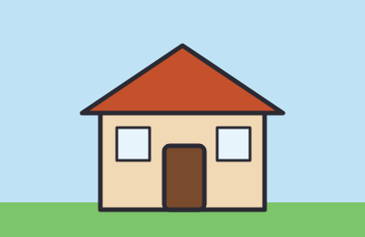 | 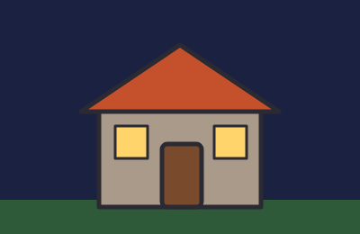 |

- A linha `variant noite …` não muda nada sozinha. Ela diz: "na versão `noite`, troque estas cores da `palette`".
- A variante só alcança o que usa o nome. Uma cor escrita direto, como `c=#c4512b`, não muda. Por isso, dê nome a toda cor que você talvez queira trocar.
- Na linha de comando, `--variant noite` exporta essa versão, e `--variant all` exporta todas de uma vez, com o nome da variante no fim do arquivo (`casa_noite.png`) ([capítulo 21](21-linha-de-comando.md)).

**Experimente:** acrescente `telhado=#4a4f6a` no fim da linha `variant`. Na versão `noite`, o telhado fica cinza-azulado; sem variante, ele continua vermelho.

> No editor, o seletor de variante fica na barra da vista do desenho ([capítulo 22](22-editor.md#variantes)).

### Trocar peças: `show=` e `hide=`

Uma variante também pode **esconder** e **mostrar** partes do desenho. É o que os jogos chamam de *skin*: o mesmo personagem com peças trocadas (outra arma, um chapéu, sem o elmo).

<!-- gerar: img/06_pecas.png -->
<!-- gerar: img/06_pecas_mago.png --variant mago -->
<!-- gerar: img/06_pecas_sem_elmo.png --variant sem_elmo -->
```weasel
canvas 200 160 bg=#cfe8f5
palette ink=#2b2a33 line=4 pele=#ffb36b

layer boneco
ellipse cabeca 100,76 34 c=pele ink=line
ellipse olhoE 88,72 4,6 c=ink
ellipse olhoD 112,72 4,6 c=ink
rect elmo 66,36 68,22 r=8 c=#9aa6b2 ink=line
shape chapeu c=#6a4bc4 ink=line hidden : 100,4! 130,50! 70,50!

layer espada
rect lamina 142,50 8,72 c=#d9dde3 ink=line
rect guarda 132,114 28,8 r=3 c=#c58a4c ink=line

layer cajado hidden
stroke vara w=6 c=#8a5a2b : 148,42 152,146
ellipse gema 148,36 9 c=#7ae0ff ink=line

variant mago pele=#ffd9a0 hide=elmo,espada show=chapeu,cajado
variant sem_elmo hide=elmo
```

| Sem variante | `--variant mago` | `--variant sem_elmo` |
|---|---|---|
| 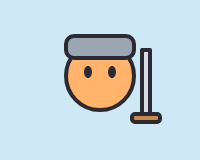 | 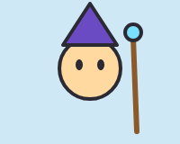 | 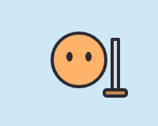 |

- `hide=` esconde formas ou camadas inteiras nessa versão. A espada é uma camada com duas formas, então `hide=espada` some com a lâmina e com a guarda.
- `show=` mostra o que está escondido com `hidden`: o chapéu (uma forma) e o cajado (uma camada).
- A mesma variante pode trocar cores e peças, como `mago`, que também clareia a pele.
- O nome vale para todas as formas com aquele nome, também dentro de componentes.

### Opções do `variant`

| Opção | O que faz | Valores | Se não escrever |
|---|---|---|---|
| o nome | o nome da versão | um nome sem acento | obrigatório |
| `nome=valor` | troca esse nome da `palette` nesta versão | os mesmos valores da `palette` | nada muda |
| `hide=` | esconde peças | nomes de formas ou de camadas, separados por vírgula | — |
| `show=` | mostra peças que têm `hidden` | nomes de formas ou de camadas, separados por vírgula | — |

A ficha completa está na [referência](19-referencia.md#variant).

**Cuidado:**
- Um nome que não está na `palette` vira um nome novo, sem aviso. Um erro de digitação (`variant noite cue=#000`) passa calado.
- Uma cor que copia outra (`sombra=cabelo`, do [capítulo 3](03-cores.md#um-nome-que-copia-outro-sombracabelo)) copiou a cor antes da variante. Então `variant ruivo cabelo=#c4512b` muda o cabelo e não muda a sombra. Para trocar as duas, cite as duas.
- No `show=` e no `hide=`, um nome que não existe dá aviso.
- O que some continua valendo para recortar com `clip=` e `cut=`, como qualquer forma `hidden`.

## Juntando tudo

Uma cidade à noite, na beira de um lago. Cada prédio é um componente com parâmetros, a cidade inteira é outro, e o reflexo é a mesma cidade, espelhada.

<!-- gerar: img/06_cidade.png -->
```weasel
canvas 480 340 bg=noite
gradient noite linear 0,0 0,210 : #0b1030 #33407a
palette ink=#141826 line=3 concreto=#3b4466 tijolo=#5e3f52 verde=#2f5552 luz=#ffd56b apagada=#232a48 agua=#16224a

# um prédio de até 8 andares, com a origem no meio do chão
def predio cor=concreto andares=5 semente=0
  rect parede -28,{-andares*22-12} 56,{andares*22+12} c=cor ink=line
  repeat a 0..7
    repeat c 0..1
      rect janela {-18+c*22},{-30-a*22} 14,14 c=apagada opacity={a<andares}
      rect acesa {-18+c*22},{-30-a*22} 14,14 c=luz opacity={(a<andares)*(rand(a*2+c+semente*20)<0.5)}
    end
  end
end

# a cidade inteira, com a origem na beira da água
def cidade
  use predio 40,0 andares=4 semente=1
  use predio 105,0 andares=7 cor=tijolo semente=2
  use predio 170,0 andares=5 cor=verde semente=3
  use predio 240,0 andares=8 semente=4
  use predio 305,0 andares=3 cor=tijolo semente=5
  use predio 370,0 andares=6 cor=verde semente=6
  use predio 438,0 andares=5 semente=7
end

repeat k 0..39
  ellipse estrela {rand(k,5,475)},{rand(k+100,5,120)} {rand(k+200,0.8,2)} c=#fff6c8
end
ellipse lua 305,96 18 c=#fff1c2
use cidade 0,210

# a água e o reflexo: a mesma cidade, de cabeça para baixo
rect lago 0,210 480,130 c=agua
layer reflexo opacity=0.35
use cidade 0,210 flip=y
ellipse luaR mirror=lua@y210

layer ondas
repeat k 0..19
  line onda w=2 c=#ffffff30 : {rand(k+300,0,430)},{218+k*6} {rand(k+300,0,430)+rand(k+400,20,70)},{218+k*6}
end
```

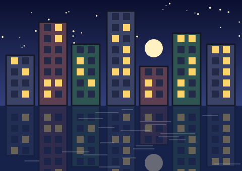

- **O prédio:** a parede cresce com o parâmetro `andares`. As janelas saem de dois `repeat`, sempre 8 andares de 2 janelas; `opacity={a<andares}` esconde as que passam do topo.
- **As luzes:** cada janela tem uma cópia amarela por cima, que aparece quando as duas perguntas dão 1: o andar existe (`a<andares`) **e** o sorteio deu menos de 0,5. Multiplicar as duas respostas é o "e": só dá 1 quando as duas dão 1.
- **A semente:** cada prédio tem uma `semente` diferente, então o sorteio das luzes muda de um prédio para outro.
- **A cidade:** um componente feito de sete prédios, com a origem na beira da água. Um `use` só põe a cidade inteira.
- **O reflexo:** a mesma cidade com `flip=y`, numa camada com `opacity=0.35` ([capítulo 4](04-camadas.md#transparência-da-camada-opacity)). Como a origem está na beira da água, o espelho começa exatamente ali. A lua refletida é um `mirror=` com `@y210`.
- **As ondas:** riscos brancos e transparentes, com o começo e o tamanho sorteados, por cima do reflexo.

**Experimente:** troque `semente=4` por `semente=9` no prédio mais alto. As luzes dele mudam, e o reflexo muda junto, porque é a mesma cidade.

## Resumo

- `def nome` … `end` guarda um desenho em volta da origem `0,0`; `use nome x,y` põe uma cópia com a origem no ponto `x,y`.
- Os parâmetros (`def arvore copa=#4caf50 alto=60`) deixam cada cópia diferente; o `use` também tem `scale=`, `rot=`, `flip=` e `opacity=`.
- Um componente pode usar outro e ter `repeat` dentro.
- `mirror=forma@x` (ou `@yN`) faz uma cópia espelhada de uma forma.
- `include "arquivo.weasel"` traz outro arquivo para aquela linha; `group` junta linhas para o editor.
- `variant` faz outra versão do desenho, trocando cores da `palette` e mostrando ou escondendo peças.

[← Contas e repetição](05-contas.md) · [Índice](README.md) · [Próximo: Ossos →](06-ossos.md)
