# 6. Ossos: o que faz o desenho se mexer

[← Contas e componentes](05-componentes.md) · [Índice](README.md) · [Próximo: Animação →](07-animacao.md)

Este é o capítulo que mais confunde, então vamos devagar.

## A ideia

Um **osso** (`bone`) é uma **alça invisível** presa num ponto do desenho. Esse ponto se chama **pivô** e é a articulação: o ombro de um braço, o pescoço de uma cabeça, os pés de um corpo. As formas que dizem `bone=nome` ficam "grudadas" no osso: quando o osso anda, gira ou estica, elas vão junto, **sempre em volta do pivô**.

Três coisas para guardar:

1. **Parado, o osso não muda nada.** Na pose parada, o desenho sai exatamente como as coordenadas dizem. O osso só age numa **animação** (com `key`, no [capítulo 7](07-animacao.md)) ou com os movimentos automáticos (balanço, mola…). Então você **desenha tudo na posição de descanso** e depois diz como os ossos se mexem.
2. **O pivô é o centro do movimento.** Girar um braço com o pivô no ombro gira em volta do ombro; com o pivô na mão, giraria em volta da mão. Escolher bem o pivô é metade do trabalho.
3. **Os ossos podem ter pai** (`parent=`). O filho vai junto com o pai: girou o ombro, o antebraço e a mão vão junto.

## Os três movimentos

```
bone nome pivot=x,y
shape … bone=nome : …
```

Numa animação, cada osso recebe até cinco números: `osso=dx,dy,rot,sx,sy`.

| Número | O que faz | Parado vale |
|---|---|---|
| `dx,dy` | **anda**: desloca, em pixels | `0,0` |
| `rot` | **gira** em volta do pivô, em graus; positivo = sentido horário | `0` |
| `sx,sy` | **estica**: escala na largura e na altura, a partir do pivô (`1` = normal, `2` = dobro, `0.5` = metade) | `1,1` |

<!-- gerar: img/06_movimentos.gif -a demo --guides -->
```weasel
canvas 480 230 bg=#f4efe6
palette ink=#2b2a33 line=4

bone anda pivot=80,170
bone gira pivot=240,170
bone estica pivot=400,170

rect a 60,90 40,80 r=8 c=#ff6b4a ink=line bone=anda
rect g 220,90 40,80 r=8 c=#4a90d9 ink=line bone=gira
rect e 380,90 40,80 r=8 c=#6cbb3c ink=line bone=estica

layer pivos guide
ellipse pa 80,170 6 c=#c44536 bone=anda
ellipse pg 240,170 6 c=#c44536 bone=gira
ellipse pe 400,170 6 c=#c44536 bone=estica
text ta 80,218 "anda=0,-50" size=14 align=center
text tg 240,218 "gira=0,0,45" size=14 align=center
text te 400,218 "estica=0,0,0,1.4,0.6" size=14 align=center

anim demo frames=36 fps=12
key 0 anda=0,0 gira=0,0,0 estica=0,0,0,1,1
key 18 anda=0,-50 gira=0,0,45 estica=0,0,0,1.4,0.6
key 36 anda=0,0 gira=0,0,0 estica=0,0,0,1,1
```

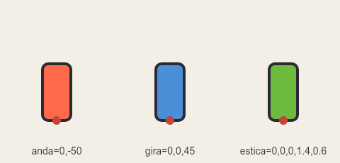

Os pontos vermelhos são os pivôs (camada `guide`, só para mostrar). Os três retângulos têm o pivô **embaixo, no meio**:

- o vermelho **anda** 50 pixels para cima (`dy=-50`, porque y negativo é para cima);
- o azul **gira** 45° em volta da base;
- o verde **estica** 1,4 vez na largura e encolhe para 0,6 na altura, e continua apoiado no pivô. É o "amassar" da bola quicando: com o pivô no chão, ela amassa contra o chão.

A camada `guide` não sai na exportação. No editor, ela aparece com **Guias** ligado (o padrão); na linha de comando, acrescente `--guides`, como foi feito para gerar esta imagem.

**Experimente:** troque `gira=0,0,45` por `gira=0,0,-45` na `key 18`. O azul passa a girar para o outro lado (anti-horário).

### Onde pôr o pivô

O pivô decide **em volta de qual ponto** a peça gira e estica. Aqui, três retângulos iguais giram os mesmos 35°. Só o lugar do pivô muda:

<!-- gerar: img/06_pivo.gif -a gira --guides -s 0.8 -->
```weasel
canvas 460 270 bg=#f4efe6
palette ink=#2b2a33 line=4

bone emCima pivot=110,50
bone noMeio pivot=230,120
bone embaixo pivot=350,190

rect a 94,50 32,140 r=10 c=#ff6b4a ink=line bone=emCima
rect b 214,50 32,140 r=10 c=#4a90d9 ink=line bone=noMeio
rect c 334,50 32,140 r=10 c=#6cbb3c ink=line bone=embaixo

text t1 110,250 "pivô em cima" size=16 align=center
text t2 230,250 "pivô no meio" size=16 align=center
text t3 350,250 "pivô embaixo" size=16 align=center

layer pivos guide
ellipse p1 110,50 6 c=#c44536 bone=emCima
ellipse p2 230,120 6 c=#c44536 bone=noMeio
ellipse p3 350,190 6 c=#c44536 bone=embaixo

anim gira frames=24 fps=12
key 0 emCima=0,0,0 noMeio=0,0,0 embaixo=0,0,0
key 12 emCima=0,0,35 noMeio=0,0,35 embaixo=0,0,35
key 24 emCima=0,0,0 noMeio=0,0,0 embaixo=0,0,0
```

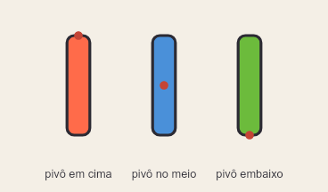

Repare:

- Os retângulos começam em y=50 e têm 140 de altura, então vão de y=50 a y=190.
- `pivot=110,50` fica na **ponta de cima**. A ponta de cima fica parada e a de baixo faz um arco, como um pêndulo.
- `pivot=230,120` fica no **meio** (50 + 140 ÷ 2 = 120). O retângulo gira no lugar, como uma hélice.
- `pivot=350,190` fica na **base**. A base fica parada e o topo tomba, como uma árvore.
- Os três ossos recebem a mesma `key`: `0,0,35` quer dizer "não anda (0,0) e gira 35 graus no sentido horário".

**Experimente:** mude o pivô do azul para `pivot=230,50` (e o ponto `p2` para `230,50`). Ele passa a balançar igual ao vermelho.

### Quantos números escrever

Não precisa escrever os cinco números sempre. Os que faltam valem o "parado" (`0` para andar e girar, `1` para esticar):

| Você escreve | Vale |
|---|---|
| `osso=10` | anda 10 em x |
| `osso=10,-5` | anda 10 em x e −5 em y |
| `osso=0,0,30` | gira 30° |
| `osso=0,0,0,1.5` | escala 1,5 por igual (largura e altura) |
| `osso=0,0,0,1.5,0.8` | largura 1,5 e altura 0,8 |

Cada quadrado abaixo usa uma linha da tabela:

<!-- gerar: img/06_numeros.gif -a mostra -s 0.8 -->
```weasel
canvas 460 300 bg=#f4efe6
palette ink=#2b2a33 line=3

bone a pivot=250,40
bone b pivot=250,95
bone c pivot=250,150
bone d pivot=250,205
bone e pivot=250,260

text n1 20,46 "a=40" size=17 bold
text n2 20,101 "b=40,-20" size=17 bold
text n3 20,156 "c=0,0,45" size=17 bold
text n4 20,211 "d=0,0,0,1.6" size=17 bold
text n5 20,266 "e=0,0,0,1.6,0.5" size=17 bold
text x1 330,46 "anda em x" size=14 c=#8a7f6e
text x2 330,101 "anda em x e y" size=14 c=#8a7f6e
text x3 330,156 "gira" size=14 c=#8a7f6e
text x4 330,211 "estica por igual" size=14 c=#8a7f6e
text x5 330,266 "largura e altura" size=14 c=#8a7f6e

rect qa 235,25 30,30 r=4 c=#ff6b4a ink=line bone=a
rect qb 235,80 30,30 r=4 c=#ffb000 ink=line bone=b
rect qc 235,135 30,30 r=4 c=#6cbb3c ink=line bone=c
rect qd 235,190 30,30 r=4 c=#4a90d9 ink=line bone=d
rect qe 235,245 30,30 r=4 c=#9b6cd9 ink=line bone=e

anim mostra frames=24 fps=12
key 0 a=0 b=0 c=0 d=0 e=0
key 12 a=40 b=40,-20 c=0,0,45 d=0,0,0,1.6 e=0,0,0,1.6,0.5
key 24 a=0 b=0 c=0 d=0 e=0
```

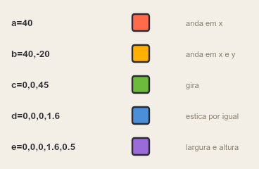

Repare:

- **1 número** (`a=40`): só o `dx`. O quadrado anda 40 pixels para a direita.
- **2 números** (`b=40,-20`): `dx` e `dy`. Anda 40 para a direita e 20 para cima (y negativo sobe).
- **3 números** (`c=0,0,45`): o terceiro é o giro, em graus. Para girar sem andar, os dois primeiros ficam `0`.
- **4 números** (`d=0,0,0,1.6`): o quarto é a escala, e vale para a largura **e** a altura. `1.6` = 60% maior.
- **5 números** (`e=0,0,0,1.6,0.5`): largura × 1,6 e altura × 0,5 (metade).
- Todos os pivôs estão no **meio** de cada quadrado, então eles giram e crescem no lugar.
- `key 0 a=0 …` e `key 24 a=0 …`: um número só, `0`, já quer dizer "parado".

## Pai e filho: `parent=`

Um braço tem ombro e cotovelo. O antebraço precisa ir junto quando o ombro gira, mas também precisa girar sozinho no cotovelo. Isso é um osso **filho**:

<!-- gerar: img/06_pai_filho.gif -a acena --guides -->
```weasel
canvas 440 280 bg=#f4efe6
palette ink=#2b2a33 line=5 pele=#ffcf9e manga=#4a90d9

bone ombro pivot=100,210
bone cotovelo parent=ombro pivot=220,210

rect bracoR 90,196 140,28 r=14 c=manga ink=line bone=ombro
rect antebraco 214,198 120,24 r=12 c=pele ink=line bone=cotovelo
ellipse mao 340,210 20 c=pele ink=line bone=cotovelo

layer pivos guide
ellipse p1 100,210 6 c=#c44536 bone=ombro
ellipse p2 220,210 6 c=#c44536 bone=cotovelo

anim acena frames=48 fps=16
key 0 ombro=0,0,0 cotovelo=0,0,0
key 12 ombro=0,0,-25 cotovelo=0,0,-55
key 24 ombro=0,0,-25 cotovelo=0,0,-10
key 36 ombro=0,0,-25 cotovelo=0,0,-55
key 48 ombro=0,0,0 cotovelo=0,0,0
```

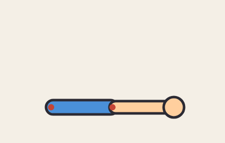

- `cotovelo` tem `parent=ombro`: **tudo o que o ombro faz, o cotovelo faz junto**. Quando o ombro gira −25°, o cotovelo (e o antebraço e a mão) sobem com ele.
- Por cima disso, o cotovelo gira o **próprio** ângulo (−55°, depois −10°…), em volta do pivô dele, que já foi carregado pelo ombro.
- Os ângulos do filho são **relativos ao pai**: `cotovelo=0,0,-55` quer dizer "55° a mais que o ombro", não "60° em relação à tela". O mesmo vale para o `dx,dy` do filho, que anda na direção do pai já girado.
- O pivô é sempre escrito na posição de **descanso**, nas coordenadas do desenho (`pivot=220,210`), mesmo que o pai mova tudo depois.

### Com e sem `parent=`

Para ver o que o `parent=` faz, compare dois braços iguais com as mesmas `key`. Só o de baixo tem `parent=`:

<!-- gerar: img/06_sem_pai.gif -a dobra --guides -->
```weasel
canvas 440 330 bg=#f4efe6
palette ink=#2b2a33 line=4 pele=#ffcf9e manga=#4a90d9

bone ombro1 pivot=70,130
bone cotovelo1 pivot=170,130
bone ombro2 pivot=70,290
bone cotovelo2 parent=ombro2 pivot=170,290

text t1 270,136 "sem parent=" size=17 bold
text t2 270,296 "com parent=ombro2" size=17 bold

rect bracoA 60,118 120,24 r=12 c=manga ink=line bone=ombro1
rect anteA 164,120 96,20 r=10 c=pele ink=line bone=cotovelo1
rect bracoB 60,278 120,24 r=12 c=manga ink=line bone=ombro2
rect anteB 164,280 96,20 r=10 c=pele ink=line bone=cotovelo2

layer pivos guide
ellipse p1 70,130 6 c=#c44536 bone=ombro1
ellipse p2 170,130 6 c=#c44536 bone=cotovelo1
ellipse p3 70,290 6 c=#c44536 bone=ombro2
ellipse p4 170,290 6 c=#c44536 bone=cotovelo2

anim dobra frames=24 fps=12
key 0 ombro1=0,0,0 cotovelo1=0,0,0 ombro2=0,0,0 cotovelo2=0,0,0
key 12 ombro1=0,0,-30 cotovelo1=0,0,-40 ombro2=0,0,-30 cotovelo2=0,0,-40
key 24 ombro1=0,0,0 cotovelo1=0,0,0 ombro2=0,0,0 cotovelo2=0,0,0
```

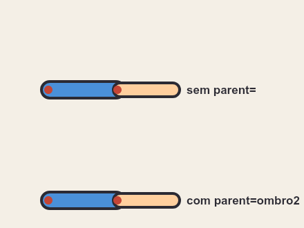

Repare:

- **Em cima, sem `parent=`**: o ombro sobe 30°, mas o `cotovelo1` não sabe disso. Ele gira os 40° dele em volta do ponto onde estava, e o braço "quebra" no meio.
- **Embaixo, com `parent=ombro2`**: o cotovelo é carregado pelo ombro (sobe 30°) e ainda gira mais 40° por conta própria. No fim, o antebraço está 70° acima do começo.
- As `key` dos dois braços são **iguais**. A diferença está só na linha do `bone`.

**Experimente:** apague o `parent=ombro2` da linha do `cotovelo2`. O braço de baixo passa a quebrar igual ao de cima.

### Como montar o esqueleto de um personagem

A receita que os exemplos usam:

```
bone raiz pivot=200,300              # entre os pés: move o personagem inteiro
bone corpo parent=raiz pivot=200,220 # quadril: inclina e respira
bone cabeca parent=corpo pivot=200,140 # pescoço
bone bracoE parent=corpo pivot=160,160 # ombros
bone bracoD parent=corpo pivot=240,160
```

- Um osso **raiz** com o pivô no chão, entre os pés: anda, pula e agacha o personagem inteiro. Com o pivô ali, `raiz=0,0,0,1.1,0.9` amassa o personagem contra o chão.
- O resto pendura na raiz, do centro para as pontas.
- Cada forma escolhe o osso que deve segui-la: a cabeça e os olhos com `bone=cabeca`, a mão com `bone=bracoD`.
- **Forma sem `bone=` não se mexe.** É o erro mais comum: animar o osso e esquecer de prender as formas nele.

## Movimentos automáticos: `sway`, `bob` e `jitter`

Alguns movimentos se repetem sem fim: uma flor balançando, um balão subindo e descendo, um bicho tremendo de medo. Em vez de escrever as `key`, dá para pedir direto no osso:

| Atributo | Movimento | Números |
|---|---|---|
| `sway=graus,segundos` | balança (gira para lá e para cá) | quanto gira, para cada lado, e quanto tempo dura um vaivém |
| `bob=pixels,segundos` | sobe e desce | quanto sobe e desce, e o tempo de um vaivém |
| `jitter=pixels` | treme sem ritmo | o tamanho do tremor |

Um terceiro número em `sway` e `bob` muda o ponto do vaivém onde o osso começa (a **fase**, em graus: `sway=8,2,90`), para dois ossos não balançarem iguais. Ele tem um exemplo próprio [mais abaixo](#a-fase-o-terceiro-número).

<!-- gerar: img/06_automaticos.gif -a parado -->
```weasel
canvas 440 240 bg=#cfe8f5
palette ink=#2b2a33 line=4

bone flor pivot=90,230 sway=10,2
bone balao pivot=220,100 bob=14,2
bone susto pivot=360,215 jitter=2

line chao c=#3f9a4a w=6 : 0,232 440,232
stroke caule w=6 c=#3f9a4a bone=flor : 90,232 96,180 90,130
ellipse petalas 90,112 30 c=#ff8fb1 ink=line bone=flor
ellipse miolo 90,112 13 c=#ffd34d ink=line bone=flor

stroke fio w=2 bone=balao : 220,150 212,180 222,210
ellipse b 220,104 38,46 c=#e8443a ink=line bone=balao
shape no c=#e8443a ink=line bone=balao : 220,148! 228,158! 212,158!

shape bicho c=#f6f4ff ink=line bone=susto : 360,150 392,176 396,215! 324,215! 328,176
ellipse olhoE 348,180 5,8 c=ink bone=susto
ellipse olhoD 372,180 5,8 c=ink bone=susto

anim parado frames=24 fps=12
```

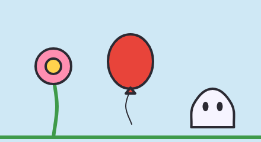

- Os movimentos automáticos só acontecem quando **alguma animação está tocando**. Por isso o exemplo tem `anim parado`, uma animação sem nenhuma `key`. Num filme, eles também andam sem animação, pelo relógio do filme.
- O tempo do vaivém é ajustado para caber um número inteiro de vezes na animação, então o **loop fecha** sem pulo. Aqui a animação tem 2 segundos (24 quadros a 12 por segundo) e cada vaivém também. Numa animação `once` (que toca uma vez só, [capítulo 7](07-animacao.md#loop-ou-uma-vez-só-once)), o tempo é exatamente o que você escreveu.
- Eles **somam** com as `key`: um osso pode balançar sozinho e ainda ser animado.

### Os dois números do `sway` (e do `bob`)

O primeiro número diz **quanto** o osso se mexe; o segundo, **quanto tempo** leva um vaivém (ir e voltar). Três flores, cada uma com um `sway` diferente:

<!-- gerar: img/06_sway.gif -a parado -->
```weasel
canvas 460 250 bg=#cfe8f5
palette ink=#2b2a33 line=4 caule=#3f9a4a petala=#ff8fb1

bone f1 pivot=80,200 sway=10,2
bone f2 pivot=230,200 sway=30,2
bone f3 pivot=380,200 sway=10,1

line chao c=caule w=6 : 0,202 460,202
stroke c1 w=6 c=caule bone=f1 : 80,202 80,90
ellipse p1 80,80 26 c=petala ink=line bone=f1
stroke c2 w=6 c=caule bone=f2 : 230,202 230,90
ellipse p2 230,80 26 c=petala ink=line bone=f2
stroke c3 w=6 c=caule bone=f3 : 380,202 380,90
ellipse p3 380,80 26 c=petala ink=line bone=f3

text t1 80,234 "sway=10,2" size=17 bold align=center
text t2 230,234 "sway=30,2" size=17 bold align=center
text t3 380,234 "sway=10,1" size=17 bold align=center

anim parado frames=24 fps=12
```

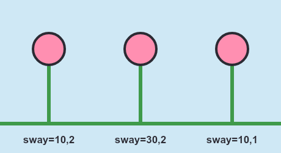

Repare:

- `sway=10,2` (esquerda): gira até 10 graus para cada lado, e cada vaivém leva 2 segundos.
- `sway=30,2` (meio): o mesmo tempo, mas vai até 30 graus. Balança **mais**.
- `sway=10,1` (direita): os mesmos 10 graus, mas um vaivém por segundo. Balança **mais rápido**: faz dois vaivéns enquanto a da esquerda faz um.
- O `bob` funciona igual, só que o primeiro número são **pixels** para cima e para baixo, em vez de graus.

**Experimente:** troque `sway=` por `bob=` na flor do meio (`bob=30,2`). Ela para de balançar e passa a subir e descer 30 pixels.

### A fase: o terceiro número

Quando várias coisas balançam juntas (um campo de flores, as folhas de uma árvore), fica artificial se todas vão para o mesmo lado ao mesmo tempo. O terceiro número, a **fase**, escolhe em que ponto do vaivém cada osso começa. Ele é medido em graus: um vaivém inteiro vale 360.

<!-- gerar: img/06_fase.gif -a parado -s 0.8 -->
```weasel
canvas 460 250 bg=#cfe8f5
palette ink=#2b2a33 line=4 caule=#3f9a4a

bone f1 pivot=80,200 sway=20,2,0
bone f2 pivot=230,200 sway=20,2,90
bone f3 pivot=380,200 sway=20,2,180

line chao c=caule w=6 : 0,202 460,202
stroke c1 w=6 c=caule bone=f1 : 80,202 80,90
ellipse p1 80,80 26 c=#ff8fb1 ink=line bone=f1
stroke c2 w=6 c=caule bone=f2 : 230,202 230,90
ellipse p2 230,80 26 c=#ffb84d ink=line bone=f2
stroke c3 w=6 c=caule bone=f3 : 380,202 380,90
ellipse p3 380,80 26 c=#b48cff ink=line bone=f3

text t1 80,234 "sway=20,2,0" size=17 bold align=center
text t2 230,234 "sway=20,2,90" size=17 bold align=center
text t3 380,234 "sway=20,2,180" size=17 bold align=center

anim parado frames=24 fps=12
```

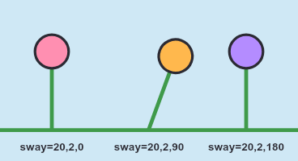

Repare:

- As três têm o mesmo `sway=20,2`: 20 graus para cada lado, 2 segundos por vaivém. Só a fase muda.
- **Fase `0`** (rosa): começa em pé, indo para a direita (o sentido horário).
- **Fase `90`** (laranja): começa um quarto de vaivém adiante, já toda inclinada para a direita.
- **Fase `180`** (roxa): começa em pé, mas indo para a esquerda. Ela é o espelho da rosa: quando uma vai para um lado, a outra vai para o outro.
- No `bob`, a fase funciona igual (`bob=10,2,90`). Lá, o lado "positivo" é para baixo.

**Experimente:** dê fases diferentes a várias flores (`0`, `40`, `80`, `120`…). O campo parece balançar com o vento, numa onda.

### O tamanho do tremor: `jitter`

O `jitter` serve para medo, frio, raiva ou um motor ligado. Em cada quadro, o osso pula para um lugar sorteado, até essa distância (em pixels) para cada lado:

<!-- gerar: img/06_jitter.gif -a parado -->
```weasel
canvas 460 230 bg=#2b2f45
palette ink=#14141c line=4 fantasma=#f6f4ff

bone s1 pivot=80,170 jitter=1
bone s2 pivot=230,170 jitter=3
bone s3 pivot=380,170 jitter=8

shape g1 c=fantasma ink=line bone=s1 : 80,90 112,116 116,170! 44,170! 48,116
ellipse o1a 68,124 5,8 c=ink bone=s1
ellipse o1b 92,124 5,8 c=ink bone=s1
shape g2 c=fantasma ink=line bone=s2 : 230,90 262,116 266,170! 194,170! 198,116
ellipse o2a 218,124 5,8 c=ink bone=s2
ellipse o2b 242,124 5,8 c=ink bone=s2
shape g3 c=fantasma ink=line bone=s3 : 380,90 412,116 416,170! 344,170! 348,116
ellipse o3a 368,124 5,8 c=ink bone=s3
ellipse o3b 392,124 5,8 c=ink bone=s3

text t1 80,210 "jitter=1" size=17 bold align=center c=#d8dcef
text t2 230,210 "jitter=3" size=17 bold align=center c=#d8dcef
text t3 380,210 "jitter=8" size=17 bold align=center c=#d8dcef

anim parado frames=12 fps=12
```

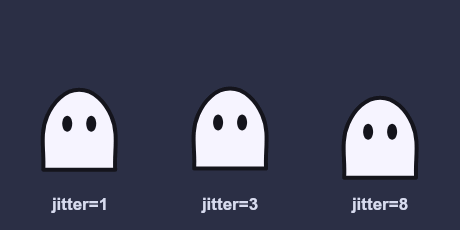

Repare:

- `jitter=1`: um tremor de 1 pixel, quase um arrepio.
- `jitter=8`: até 8 pixels para cada lado, em x e em y. É susto de verdade.
- O tremor muda **a cada quadro** da animação. Com mais quadros por segundo (`fps=`), ele fica mais nervoso.
- O sorteio é sempre o mesmo: rodar de novo dá exatamente o mesmo tremor.

## Molas: `spring=`

Uma **mola** faz o osso girar **atrasado** quando o pai se mexe, e balançar até parar. É o que dá vida a orelhas, antenas, rabos, cabelo, plumas e à espada do Cavaleiro.

<!-- gerar: img/06_mola.gif -a sacode -->
```weasel
canvas 400 260 bg=#f4efe6
palette ink=#2b2a33 line=4 ponta=#ff6b4a

bone corpo pivot=200,238
bone antenaE parent=corpo pivot=180,138 spring=0.1
bone antenaD parent=corpo pivot=220,138 spring=0.9

line chao c=#8a7f6e w=3 : 40,240 360,240
stroke aE w=4 bone=antenaE : 180,140 172,100 158,72
ellipse bE 158,70 9 c=ponta ink=line bone=antenaE
stroke aD w=4 bone=antenaD : 220,140 228,100 242,72
ellipse bD 242,70 9 c=ponta ink=line bone=antenaD
shape bichinho c=#9be38c ink=line bone=corpo : 200,126 262,176 252,238! 148,238! 138,176
ellipse olhoE 184,180 6,9 c=ink bone=corpo
ellipse olhoD 216,180 6,9 c=ink bone=corpo

anim sacode frames=48 fps=24
key 0 corpo=0,0,0
key 5 corpo=0,0,-14
key 11 corpo=0,0,14
key 16 corpo=0,0,0
key 48 corpo=0,0,0
```

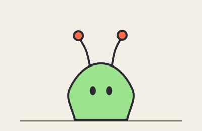

- O bichinho sacode o corpo (as `key` do `corpo`) e para. As antenas não têm `key` nenhuma: quem as mexe é a mola.
- `spring=` vai de 0 a 1 e diz o quanto a mola é **dura**. Perto de 0, mole: atrasa muito e balança devagar (a antena da esquerda, 0.1). Perto de 1, dura: quase acompanha o pai (a da direita, 0.9).
- A mola só **gira** o osso, e reage quando o pivô dele é sacudido, quase sempre pelo **pai** (aqui, o corpo sacudindo).
- Ela reage ao tranco **de lado**, atravessado na peça. Uma antena em pé balança quando o corpo vai para os lados. Já um rabo deitado (na horizontal) não balança se o corpo só anda para a frente e para trás, na direção do próprio rabo; ele balança quando o corpo pula.
- Molas não precisam de `key` própria, mas podem ter: a mola soma com o que as `key` mandam.
- Em transições muito rápidas a mola pode exagerar. Se isso acontecer, deixe-a mais dura ou tire a mola daquele osso. O mesmo vale para molas em corrente (um osso com mola filho de outro com mola): uma passa o balanço para a outra, e a ponta pode chicotear demais.

**Experimente:** ponha `spring=0.5` nas duas antenas. Elas passam a balançar iguais, num meio-termo entre as duas de agora.

## Tecido: `cloth`

Uma mola gira um pedaço inteiro. Um **tecido** faz outra coisa: os pontos da forma **longe** de um pivô ficam para trás quando o corpo anda, como uma capa, uma bandeira ou a barra de um fantasma.

```
cloth nome pivot=x,y tension= drag= swing= bone=
shape … cloth=nome bone=osso : …
```

<!-- gerar: img/06_tecido.gif -a corre -->
```weasel
canvas 440 240 bg=#cfe8f5
palette ink=#2b2a33 line=4

bone mastro pivot=150,222
cloth pano pivot=152,85 tension=0.15 drag=2 swing=1.5

line chao c=#3f9a4a w=6 : 0,226 440,226
shape bandeira c=#e8443a ink=line bone=mastro cloth=pano : 146,50! 290,64 284,112 146,120!
rect haste 144,40 12,184 r=6 c=#7a4a2c ink=line bone=mastro

anim corre frames=32 fps=16
key 0 mastro=-70,0
key 16 mastro=90,0
key 32 mastro=-70,0
```

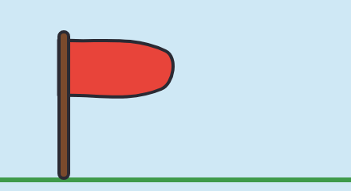

- O **pivô do tecido** é o ponto que não balança (aqui, onde a bandeira prende no mastro). Quanto mais longe dele, mais o ponto atrasa.
- A forma diz qual osso a carrega (`bone=mastro`) e qual tecido a faz balançar (`cloth=pano`). Várias formas podem usar o mesmo tecido e balançam juntas, como a capa, as faixas e as dobras do Cavaleiro.
- `tension=` vai de 0 (pano mole, balança muito) a 1 (duro). Padrão 0.5.
- `drag=` (padrão 1) é o quanto o ar empurra o pano para trás enquanto o osso anda; `swing=` (padrão 1) é o quanto ele balança com os trancos. Os dois vão de 0 a 10.
- `bone=` no `cloth` diz **de qual osso o tecido sente o movimento**. Sem ele, vale o osso da primeira forma que usa o tecido (aqui, o `mastro`). Quem **carrega** cada forma continua sendo o `bone=` da própria forma. Há um exemplo [mais abaixo](#bone-no-cloth-vento-com-o-mastro-parado).

### `tension`, `drag` e `swing` lado a lado

Cada linha da imagem compara dois valores de **um** atributo. As seis bandeiras estão no mesmo osso, que vai e volta:

<!-- gerar: img/06_tecido_numeros.gif -a corre -s 0.8 -->
```weasel
canvas 460 390 bg=#cfe8f5
palette ink=#2b2a33 line=3 pau=#7a4a2c

bone mastro pivot=230,380

cloth mole pivot=100,40 tension=0.1 drag=2 swing=2
cloth duro pivot=300,40 tension=0.9 drag=2 swing=2
cloth semAr pivot=100,165 drag=0 swing=0
cloth comAr pivot=300,165 drag=6 swing=0
cloth semTranco pivot=100,290 drag=0 swing=0
cloth comTranco pivot=300,290 drag=0 swing=6

layer rotulos
text r1 100,26 "tension=0.1" size=15 bold
text r2 300,26 "tension=0.9" size=15 bold
text r3 100,151 "drag=0" size=15 bold
text r4 300,151 "drag=6" size=15 bold
text r5 100,276 "swing=0" size=15 bold
text r6 300,276 "swing=6" size=15 bold

layer bandeiras
shape b1 c=#e8443a ink=line bone=mastro cloth=mole : 98,40! 190,48 186,88 98,94!
rect h1 92,36 8,90 r=4 c=pau bone=mastro
shape b2 c=#e8443a ink=line bone=mastro cloth=duro : 298,40! 390,48 386,88 298,94!
rect h2 292,36 8,90 r=4 c=pau bone=mastro
shape b3 c=#4a90d9 ink=line bone=mastro cloth=semAr : 98,165! 190,173 186,213 98,219!
rect h3 92,161 8,90 r=4 c=pau bone=mastro
shape b4 c=#4a90d9 ink=line bone=mastro cloth=comAr : 298,165! 390,173 386,213 298,219!
rect h4 292,161 8,90 r=4 c=pau bone=mastro
shape b5 c=#6cbb3c ink=line bone=mastro cloth=semTranco : 98,290! 190,298 186,338 98,344!
rect h5 92,286 8,90 r=4 c=pau bone=mastro
shape b6 c=#6cbb3c ink=line bone=mastro cloth=comTranco : 298,290! 390,298 386,338 298,344!
rect h6 292,286 8,90 r=4 c=pau bone=mastro

anim corre frames=16 fps=12
key 0 mastro=-50,0
key 8 mastro=50,0
key 16 mastro=-50,0
```


Repare, linha por linha:

- **Vermelhas, `tension=`** (de 0 a 1): a mole (`0.1`) estica e atrasa muito; a dura (`0.9`) quase não sai do lugar. As duas têm o mesmo `drag=2 swing=2`, para só a tensão mudar.
- **Azuis, `drag=`** (de 0 a 10): com `drag=0` (e `swing=0`), o pano fica duro como uma placa. Com `drag=6`, o ar empurra o pano para trás **enquanto o mastro anda**: a ponta fica para trás do movimento.
- **Verdes, `swing=`** (de 0 a 10): com `swing=6`, o pano chacoalha nos **trancos**, quando o mastro freia e muda de direção. No meio do caminho, em velocidade constante, ele quase não reage.
- Cada bandeira tem o **seu** `cloth`, com o pivô no ponto onde ela prende no pau.

**Experimente:** ponha `tension=0.5 drag=1 swing=1` (os padrões) em todas. As seis passam a balançar igual.

### `bone=` no `cloth`: vento com o mastro parado

Às vezes o pano deve balançar sem que nada se mexa: uma bandeira ao vento, uma cortina numa janela aberta. O truque é um osso **invisível**, que não carrega forma nenhuma, só para o tecido sentir o movimento dele:

<!-- gerar: img/06_vento.gif -a venta -->
```weasel
canvas 420 240 bg=#cfe8f5
palette ink=#2b2a33 line=3 pau=#7a4a2c

bone vento pivot=0,0 bob=30,1
cloth semOsso pivot=82,50 tension=0.3 drag=2 swing=2
cloth comOsso pivot=282,50 tension=0.3 drag=2 swing=2 bone=vento

line chao c=#3f9a4a w=6 : 0,226 420,226
text t1 80,24 "sem bone=" size=16 bold
text t2 280,24 "bone=vento" size=16 bold

shape b1 c=#e8443a ink=line cloth=semOsso : 80,50! 180,58 176,100 80,106!
rect h1 74,46 8,180 r=4 c=pau
shape b2 c=#e8443a ink=line cloth=comOsso : 280,50! 380,58 376,100 280,106!
rect h2 274,46 8,180 r=4 c=pau

anim venta frames=24 fps=12
```

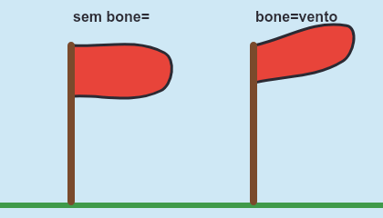

Repare:

- `bone vento … bob=30,1`: um osso que sobe e desce 30 pixels, uma vez por segundo. Nenhuma forma tem `bone=vento`, então ele não aparece e não carrega nada.
- `cloth comOsso … bone=vento`: o tecido da direita **sente** o sobe e desce do `vento` e reage a ele, mas a bandeira continua no lugar, porque ela não tem `bone=`.
- A bandeira da esquerda não tem osso nenhum: o tecido dela não sente movimento e fica parado.
- A animação `venta` não tem `key`: ela existe só para o `bob` tocar.

**Experimente:** troque `bob=30,1` por `bob=10,0.5`: um vento mais fraco e mais rápido.

## Pernas e braços com IK

Uma perna desenhada com `stroke` comum gira inteira com o osso. Mas pernas de verdade fazem outra coisa: **o pé fica no chão** e o joelho dobra quando o corpo desce. Isso é **IK** (cinemática inversa): você diz onde a perna nasce e onde o pé deve ficar, e o Weasel calcula o joelho.

```
stroke nome limb=largura_em_cima,largura_embaixo hip=x,y on=osso foot=chão,x bend=1
stroke nome limb=… hip=x,y on=osso target=osso_da_mão bend=-1
```

<!-- gerar: img/06_ik.gif -a agacha -->
```weasel
canvas 420 280 bg=#f4efe6
palette ink=#2b2a33 line=5 roxo=#7a5cc2 pele=#ffcf9e

bone corpo pivot=200,150
bone mao pivot=320,190

line chao c=#8a7f6e w=3 : 40,250 380,250

stroke pernaE limb=16,20 hip=180,176 on=corpo foot=chao,172
stroke pernaD limb=16,20 hip=220,176 on=corpo foot=chao,232
stroke braco limb=12,10 hip=236,140 on=corpo target=mao bend=-1 c=roxo
ellipse tronco 200,146 52,46 c=roxo ink=line bone=corpo
ellipse olhoE 186,130 6,9 c=ink bone=corpo
ellipse olhoD 214,130 6,9 c=ink bone=corpo
ellipse palma 320,190 13 c=pele ink=line bone=mao

anim agacha frames=48 fps=16
key 0 corpo=0,0 mao=0,0
key 12 corpo=0,22 mao=0,10
key 24 corpo=0,-34 mao=-20,-110 ease=in
key 36 corpo=0,0 mao=0,0
key 48 corpo=0,0 mao=0,0
```

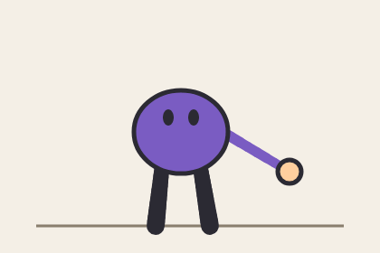

**Pernas** (`foot=`):

- `hip=x,y` é onde a perna **nasce** (o quadril), e `on=corpo` faz esse ponto andar com o osso.
- `foot=chao,172` põe o pé na `line` chamada `chao`, na altura dela em x=172. O pé fica parado ali.
- O **comprimento** da perna é a distância em linha reta do quadril ao pé, no desenho parado. Quando o corpo desce, sobra perna e o joelho dobra. Quando o corpo sobe além do comprimento, a perna estica e **pendura** na direção do pé (o pulo).
- `limb=16,20` é a largura da perna no quadril e no pé.

**Braços** (`target=`):

- `target=mao` faz a ponta do braço ir atrás do **pivô** do osso `mao`. Anime a mão com `key` (aqui ela desce, sobe e volta), e o braço dobra o cotovelo sozinho.
- O comprimento do braço é a distância **em linha reta** do ombro (`hip=`) ao pivô da mão, no desenho parado. Aqui, de 236,140 até 320,190: √(84² + 50²), uns 98 pixels. Se a mão for mais longe que isso, o braço estica e aponta para ela, mas não alcança: mantenha a mão ao alcance ([como ver o alcance](#até-onde-o-braço-alcança)).
- Uma forma presa ao osso `mao` (a `palma`) fica na ponta.

O membro é desenhado com a cor `c=` (padrão: a cor de tinta) e não precisa de pontos depois do `:`.

**Experimente:** no exemplo de cima, troque o `bend=-1` do braço por `bend=1`. O cotovelo passa a dobrar para cima em vez de para baixo ([mais sobre o `bend=`](#para-que-lado-dobra-bend) logo abaixo).

### Até onde o braço alcança

O comprimento do braço não aparece no desenho. Para ver até onde a mão pode ir, desenhe um círculo em volta do ombro, com esse raio, numa camada `guide` (ela só aparece no editor). A função [`dist`](05-componentes.md#distância-dist) faz a conta:

<!-- gerar: img/06_alcance.gif -a estica --guides -->
```weasel
canvas 420 280 bg=#f4efe6
palette ink=#2b2a33 line=5 roxo=#7a5cc2 pele=#ffcf9e

bone corpo pivot=200,150
bone mao pivot=320,190

stroke braco limb=12,10 hip=236,140 on=corpo target=mao bend=-1 c=roxo
ellipse tronco 200,146 52,46 c=roxo ink=line bone=corpo
ellipse olhoE 186,130 6,9 c=ink bone=corpo
ellipse olhoD 214,130 6,9 c=ink bone=corpo
ellipse palma 320,190 13 c=pele ink=line bone=mao

# até onde o braço alcança: um círculo em volta do ombro, só no editor
layer ajuda guide
ellipse alcance 236,140 {dist(236,140,320,190)} c=none ink=2 inkc=#c44536 bone=corpo

anim estica frames=48 fps=16
key 0 mao=0,0
key 12 mao=-30,-60
key 24 mao=70,-50
key 36 mao=0,0
key 48 mao=0,0
```

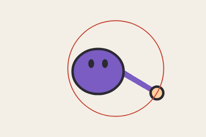

Repare:

- `{dist(236,140,320,190)}` é o comprimento do braço: do ombro (`hip=236,140`) até o pivô da `mao` (320,190), uns 98 pixels.
- O círculo está preso ao `corpo` (`bone=corpo`), como o ombro (`on=corpo`). Se o corpo andar, o círculo vai junto.
- Enquanto a mão está dentro do círculo, o cotovelo dobra e o braço chega nela. No caminho para o quadro 24, a mão sai do círculo: o braço fica reto, para na borda, e a mão fica solta no ar.
- A camada `ajuda` é `guide`: aparece no editor, mas não nas imagens exportadas. Esta imagem foi feita com `--guides`, que desenha as guias também.

**Experimente:** no `key 24`, troque `mao=70,-50` por `mao=-10,-30`. A mão fica dentro do círculo o tempo todo, e o braço sempre chega nela.

### Para que lado dobra: `bend=`

Um joelho pode dobrar para a frente ou para trás; um cotovelo, para cima ou para baixo. O `bend=` escolhe o lado. Três pernas iguais, presas no mesmo corpo que agacha:

<!-- gerar: img/06_bend.gif -a agacha -->
```weasel
canvas 460 260 bg=#f4efe6
palette ink=#2b2a33 line=4 roxo=#7a5cc2

bone corpo pivot=230,100

line chao c=#8a7f6e w=3 : 20,230 440,230
text t1 100,40 "bend=1" size=17 bold align=center
text t2 230,40 "bend=-1" size=17 bold align=center
text t3 360,40 "bend=0.4" size=17 bold align=center

stroke perna1 limb=14,18 hip=100,100 on=corpo foot=chao,100 bend=1
stroke perna2 limb=14,18 hip=230,100 on=corpo foot=chao,230 bend=-1
stroke perna3 limb=14,18 hip=360,100 on=corpo foot=chao,360 bend=0.4
rect barra 60,76 340,30 r=15 c=roxo ink=line bone=corpo

anim agacha frames=24 fps=12
key 0 corpo=0,0
key 12 corpo=0,60
key 24 corpo=0,0
```

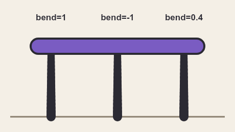

Repare:

- A barra desce 60 pixels (`corpo=0,60`), e os pés ficam no chão. Sobra perna, e os joelhos dobram.
- **`bend=1`** (o padrão): numa perna que desce do quadril para o pé, o joelho vai para a **direita** da tela, como num personagem virado para a direita.
- **`bend=-1`**: o joelho vai para a **esquerda**.
- **`bend=0.4`**: dobra menos. O joelho sai pouco para o lado e a perna parece encolher. Com `bend=0`, ela fica reta.
- Valores além de 1 (até 3) dobram igual a 1.
- Num **braço** que vai para a direita, `bend=1` levanta o cotovelo e `bend=-1` abaixa (é o caso do exemplo de cima).

### O pé num ponto: `foot=x,y`

`foot=chão,x` põe o pé **em cima de uma `line`**. Quando o pé deve ficar num lugar que não é uma linha (um degrau, uma pedra, um galho), use `foot=x,y`, o ponto exato:

<!-- gerar: img/06_degrau.gif -a agacha -->
```weasel
canvas 420 260 bg=#f4efe6
palette ink=#2b2a33 line=5 roxo=#7a5cc2

bone corpo pivot=200,100

line chao c=#8a7f6e w=3 : 20,230 400,230
rect degrau 240,170 150,60 c=#c9bca8 ink=3

stroke pernaE limb=18,12 hip=180,125 on=corpo foot=chao,165
stroke pernaD limb=18,12 hip=222,125 on=corpo foot=268,170
ellipse tronco 200,92 48,40 c=roxo ink=line bone=corpo
ellipse olhoE 188,80 6,9 c=ink bone=corpo
ellipse olhoD 214,80 6,9 c=ink bone=corpo

text t1 100,252 "foot=chao,165" size=15 bold align=center
text t2 315,205 "foot=268,170" size=15 bold align=center

anim agacha frames=24 fps=12
key 0 corpo=0,0
key 12 corpo=0,30
key 24 corpo=0,0
```

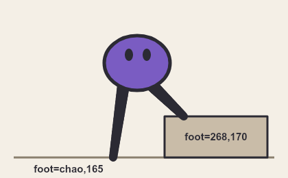

Repare:

- `foot=chao,165`: o pé esquerdo fica na `line` chamada `chao`, em x=165. A altura (y) vem da própria linha. Se a linha for inclinada, como uma rampa, o pé acompanha a altura dela naquele x.
- `foot=268,170`: o pé direito fica no ponto x=268, y=170, que é o alto do degrau (o `rect degrau` começa em y=170).
- A perna direita é mais curta (o pé está mais perto do quadril), por isso dobra mais quando o corpo desce.
- `limb=18,12`: as pernas têm 18 pixels de largura no quadril e afinam até 12 no pé.

**Experimente:** troque `foot=268,170` por `foot=chao,268`. O pé direito desce do degrau e vai para o chão, e a perna passa na frente do degrau (ela é desenhada depois dele).

## Formas que dobram: `bones=`

Uma forma com `bone=` gira inteira, como uma peça rígida. Com `bones=a,b,c`, cada ponto da forma segue os ossos **mais perto dele**, e a forma dobra: um rabo, uma cobra, um tentáculo, um corpo que se curva.

<!-- gerar: img/06_bones.gif -a mexe -->
```weasel
canvas 360 200 bg=#f4efe6
palette ink=#2b2a33 line=4

bone r1 pivot=120,100
bone r2 pivot=180,100 parent=r1
bone r3 pivot=240,100 parent=r2

shape cauda c=#ff9a4a ink=line bones=r1,r2,r3 : 110,84 300,94 310,100 300,106 110,116
shape rigida c=#9ab8ff ink=line bone=r1 opacity=0.4 : 110,144 300,154 310,160 300,166 110,176

anim mexe frames=24 fps=12
key 0 r1=0,0,0 r2=0,0,0 r3=0,0,0
key 6 r1=0,0,-15 r2=0,0,-25 r3=0,0,-30
key 18 r1=0,0,15 r2=0,0,25 r3=0,0,30
key 24 r1=0,0,0 r2=0,0,0 r3=0,0,0
```

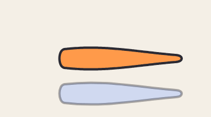

- Os ossos fazem uma corrente (`r2` é filho de `r1`, `r3` de `r2`), cada um um pouco mais adiante na cauda. Cada um cuida do pedaço entre o pivô dele e o pivô do seguinte.
- Perto de uma junta, os dois ossos dividem o ponto, e a curva sai lisa. Por isso a forma pode ter poucos pontos: quem dobra é a curva desenhada, não só os pontos do código.
- A forma de baixo (azul) usa `bone=r1`: gira inteira, sem dobrar.
- `bones=` precisa de pelo menos dois ossos, e não vale em `text` (para um osso só, use `bone=`).
- No Godot com esqueleto ([capítulo 9](09-jogo-godot.md#esqueleto-de-verdade-rigbones-experimental)), a forma vira uma malha que dobra do mesmo jeito.

**Experimente:** na `key 6`, deixe só o primeiro osso girar: `r1=0,0,-15 r2=0,0,0 r3=0,0,0`. A cauda inteira gira reta, sem curva, porque `r2` e `r3` só seguem o pai. Quem faz a curva é a diferença de ângulo de um osso para o outro.

## Pontos presos a um osso: `@osso`

Com `bones=`, **todos** os pontos seguem algum osso. Às vezes você quer o contrário: só alguns pontos andam, e o resto da forma fica onde está. É o caso de uma pata que sai do contorno do corpo, de uma bochecha que estufa ou de um braço de borracha. Escreva `@osso` logo depois do ponto:

```
shape nome … : x,y x,y@osso x,y!@osso x,y~dx,dy@osso …
```

<!-- gerar: img/06_pinos.gif -a acena -->
```weasel
canvas 420 240 bg=#f4efe6
palette ink=#2b2a33 line=4 roxo=#7a5cc2

bone mao pivot=334,120

shape bicho c=roxo ink=line : 90,175 105,95 190,68 278,96! 330,104@mao 340,134@mao 288,142! 268,192 180,208
ellipse olhoE 165,122 7 c=ink
ellipse olhoD 200,118 7 c=ink

anim acena frames=24 fps=12
key 0 mao=0,0
key 6 mao=40,-70
key 12 mao=0,0
key 18 mao=50,40
key 24 mao=0,0
```

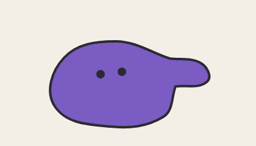

Repare:

- `330,104@mao` e `340,134@mao`: só esses dois pontos seguem o osso `mao`. Os outros ficam parados, porque a forma não tem `bone=`.
- Entre um ponto preso e um solto, a linha **estica**: quando a mão vai longe, o braço fica comprido e fino.
- O preenchimento e o contorno vêm junto. A cada quadro, o Weasel refaz a forma com os pontos no lugar novo: sai igual a se você tivesse escrito as coordenadas novas no código.
- `278,96!` e `288,142!` são cantos vivos na base do braço. É ali que a curva do corpo vira braço, e os cantos seguram esse lugar.
- Os olhos são formas separadas: eles não sabem dos pontos presos. Uma forma desenhada por cima de um ponto preso precisa do próprio `bone=` (ou dos próprios `@osso`) para ir junto.
- `@osso` vale nos pontos de `shape`, `stroke` e `line`. Uma `ellipse` ou um `rect` não têm pontos escritos: para esticar, reescreva a forma como `shape`.

**Experimente:** tire o `@mao` do `340,134`. Só um ponto vai junto com a mão, e a ponta do braço vira um bico comprido.

### Os pontos soltos seguem a forma; o peso: `@osso:0.5`

Com `bone=` na forma, os pontos **sem** `@` seguem esse osso, e os pontos com `@` seguem o osso deles. Um número depois de dois-pontos, de 0 a 1, diz **quanto** o ponto segue o osso: `@corpo:0.5` anda metade do caminho.

<!-- gerar: img/06_peso.gif -a estica -->
```weasel
canvas 360 240 bg=#f4efe6
palette ink=#2b2a33 line=4 verde=#5cc28a

bone corpo pivot=180,140

line chao c=#8a7f6e w=3 : 20,202 340,202

shape geleia c=verde ink=line : 110,200! 116,150@corpo:0.5 132,98@corpo 180,78@corpo 228,98@corpo 244,150@corpo:0.5 250,200!
ellipse olhoE 162,120 7 c=ink bone=corpo
ellipse olhoD 198,120 7 c=ink bone=corpo

anim estica frames=24 fps=12
key 0 corpo=0,0
key 8 corpo=0,-50 ease=out
key 16 corpo=0,20 ease=in
key 24 corpo=0,0
```

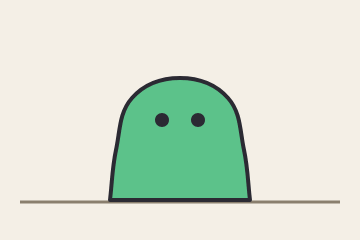

Repare:

- Os pontos de cima (`@corpo`) sobem e descem inteiros com o osso, junto com os olhos (`bone=corpo`).
- Os dois do meio dos lados (`@corpo:0.5`) andam **metade**: 25 pixels quando o corpo sobe 50. Por isso os lados esticam por igual.
- Os dois da base não têm `@` e a forma não tem `bone=`: ficam no chão.
- Peso 1 é o mesmo que não escrever o número. Peso 0 deixa o ponto com a forma, como se não houvesse `@`.

**Experimente:** ponha `bone=corpo` na `geleia` e tire os `@corpo` dos pontos. Agora os pontos soltos seguem o `corpo`, e a geleia pula inteira, base e tudo. Para segurar a base no chão, ela precisaria de um osso que não se mexe: `bone chao_osso pivot=180,200` e `110,200!@chao_osso`.

## IK nos ossos: `ik`

O `stroke limb=` ([lá em cima](#pernas-e-braços-com-ik)) desenha a perna para você. Quando a perna é **sua**, uma pata desenhada no contorno do corpo ou um braço com mão, faça a perna com ossos e diga ao `ik` quais são:

```
ik nome bones=raiz,meio,ponta foot=chão,x
ik nome bones=raiz,meio,ponta foot=x,y
ik nome bones=raiz,meio,ponta target=osso bend=1
```

<!-- gerar: img/06_ik_ossos.gif -a agacha -->
```weasel
canvas 420 280 bg=#f4efe6
palette ink=#2b2a33 line=4 marrom=#b07a4a

bone corpo pivot=200,130
bone coxa pivot=240,160 parent=corpo
bone canela pivot=256,198 parent=coxa
bone pe pivot=248,240 parent=canela

line chao c=#8a7f6e w=3 : 40,240 380,240

ik pata bones=coxa,canela,pe foot=chao,248

shape bicho c=marrom ink=line bone=corpo : 110,120 160,90 250,95 290,128 272,160 268,198@canela 274,238@pe 230,240@pe 242,198@canela 226,165 140,170 105,150
ellipse olho 268,114 6 c=ink bone=corpo

anim agacha frames=32 fps=12
key 0 corpo=0,0
key 10 corpo=0,34
key 20 corpo=0,-30 ease=out
key 26 corpo=0,0 ease=in
key 32 corpo=0,0
```

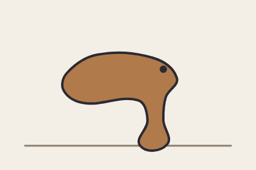

Repare:

- `bones=coxa,canela,pe` são três ossos em corrente: `canela` é filho de `coxa`, e `pe` é filho de `canela`. O `ik` gira a coxa e a canela. A animação só mexe no `corpo`.
- `foot=chao,248` põe o pivô do `pe` na `line` chamada `chao`, em x=248, como no `limb`. Também vale `foot=x,y`.
- Os comprimentos vêm do desenho parado: da coxa até a canela, e da canela até o pé. Os ossos não encolhem.
- Quando o corpo sobe além do alcance, a perna fica reta, apontando para o pé, e a pata sai do chão (o pulo).
- Sem `bend=`, o joelho dobra para o lado em que ele está no desenho: aqui, o pivô da `canela` está à frente da linha da coxa até o pé, então o joelho vai para a frente.
- O `pe` não gira junto com a canela: ele fica no ângulo do desenho, como um pé plano no chão. Uma `key` no `pe` ainda gira o pé (dobrar os dedos).
- A pata faz parte do contorno do corpo: os pontos dela estão presos com `@canela` e `@pe`. Os pontos entre o corpo e o joelho ficam soltos e esticam.
- Desenhe o pivô do `pe` em cima do chão. Assim a pose parada fica igual ao desenho.

**Experimente:** acrescente `bend=-1` no `ik`. O joelho passa a dobrar para trás, como a perna de um pássaro.

### Braço com alvo: `target=`

Com `target=osso`, a ponta vai atrás do **pivô** desse osso. Anime o alvo, e o braço dobra o cotovelo para chegar nele:

<!-- gerar: img/06_ik_alvo.gif -a pega -->
```weasel
canvas 400 260 bg=#f4efe6
palette ink=#2b2a33 line=4 roxo=#7a5cc2 pele=#ffcf9e

bone corpo pivot=120,160
bone ombro pivot=150,130 parent=corpo
bone cotovelo pivot=200,150 parent=ombro
bone mao pivot=250,130 parent=cotovelo
bone bola pivot=250,130

ik braco bones=ombro,cotovelo,mao target=bola

ellipse alvo 250,130 18 c=#ff9a4a ink=line bone=bola
stroke braco w=14 c=roxo : 150,130@ombro 200,150@cotovelo 250,130@mao
ellipse tronco 115,165 48,62 c=roxo ink=line bone=corpo
ellipse olho 130,140 6 c=ink bone=corpo
ellipse palma 250,130 11 c=pele ink=line bone=mao

anim pega frames=36 fps=12
key 0 bola=0,0
key 12 bola=-20,-60
key 24 bola=-20,10
key 36 bola=0,0
```

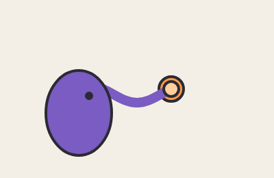

Repare:

- `target=bola`: a mão vai até o pivô da `bola`. A `bola` não é filha de ninguém do braço: o alvo não pode andar junto com o próprio braço (o editor avisa).
- O braço é um `stroke` com os três pontos presos aos três ossos. Ele dobra no cotovelo porque a curva passa pelos pontos no lugar novo.
- O cotovelo dobra para baixo porque, no desenho, ele está abaixo da linha do ombro até a mão.
- A `palma` segue o osso `mao`, que fica sempre no ângulo do desenho.

**Experimente:** na `key 12`, troque `bola=-20,-60` por `bola=60,-60`. A bola sai do alcance: o braço fica reto, apontando para ela, e a mão não chega.

No editor, a raiz e o meio de um `ik` não giram arrastando a bolinha do osso: quem os gira é o `ik`. Mexa no alvo ou no corpo. No Godot com esqueleto ([capítulo 9](09-jogo-godot.md#esqueleto-de-verdade-rigbones-experimental)), o Weasel calcula o `ik` e grava as rotações da coxa e da canela na animação, e os pontos presos viram pesos da malha.

## Andar por um caminho: `path=`

Com `path=nome`, o osso anda por uma linha, um traço ou uma forma, e `key quadro osso.along=0 … 1` diz quanto do caminho ele já andou (0 = começo, 1 = fim):

<!-- gerar: img/06_caminho.gif -a vai -->
```weasel
canvas 400 220 bg=#cfe8f5
palette ink=#2b2a33 line=3

stroke estrada w=14 c=#9aa0ad : 20,180 120,120 220,170 300,90 380,60
bone carro pivot=60,40 path=estrada
rect lata 40,28 40,20 r=5 c=#ff6b4a ink=line bone=carro
ellipse roda1 48,48 6 c=ink bone=carro
ellipse roda2 72,48 6 c=ink bone=carro

anim vai frames=36 fps=12
key 0 carro.along=0 ease=linear
key 36 carro.along=1
```

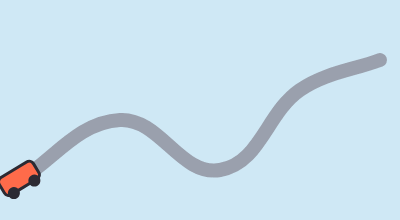

- O pivô do osso vai para o ponto do caminho. O carro foi desenhado em qualquer lugar (lá em cima): o osso leva o desenho junto.
- O osso **vira junto com a curva**, como o carro na subida. O desenho deve estar virado para a **direita**, que é a direção de quem anda. Para não virar, use `turn=0`.
- `ease=linear` dá velocidade constante. Num caminho fechado (uma forma), `along` maior que 1 dá mais voltas.
- As outras `key` do osso continuam valendo por cima: `carro=0,-10` levanta o carro 10 acima da estrada.
- Num filme, um ator também anda por um caminho do arquivo do filme ([capítulo 10](10-filme.md#andar-por-um-caminho-path)).

### Caminho fechado e `turn=0`

Uma pista de corrida, um aquário, um planeta em órbita: o caminho dá a volta e termina onde começou. Para isso, use uma forma **fechada** (aqui, uma `ellipse`) como caminho. Os dois peixes abaixo nadam na mesma pista; só o da direita tem `turn=0`:

<!-- gerar: img/06_turn.gif -a nada -->
```weasel
canvas 460 240 bg=#cfe8f5
palette ink=#2b2a33 line=3

ellipse pista1 115,120 85,70 c=none ink=12 inkc=#9aa0ad
ellipse pista2 345,120 85,70 c=none ink=12 inkc=#9aa0ad
text t1 115,128 "turn=1" size=17 bold align=center
text t2 345,128 "turn=0" size=17 bold align=center

bone peixe1 pivot=40,20 path=pista1
bone peixe2 pivot=40,20 path=pista2 turn=0
shape corpo1 c=#ff8a3d ink=line bone=peixe1 : 58,20 40,9 22,20 40,31
shape rabo1 c=#ff8a3d ink=line bone=peixe1 : 24,20! 12,10! 12,30!
shape corpo2 c=#4a90d9 ink=line bone=peixe2 : 58,20 40,9 22,20 40,31
shape rabo2 c=#4a90d9 ink=line bone=peixe2 : 24,20! 12,10! 12,30!

anim nada frames=24 fps=12
key 0 peixe1.along=0 peixe2.along=0 ease=linear
key 24 peixe1.along=1 peixe2.along=1
```

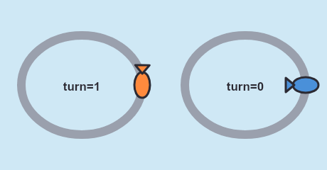

Repare:

- Os peixes foram desenhados num canto qualquer (perto de `40,20`), **virados para a direita**. O pivô do osso fica no meio do peixe.
- Numa `ellipse`, o caminho começa na ponta da **direita** e segue no sentido horário (desce primeiro).
- `along=0` até `along=1`: uma volta inteira em 24 quadros. Como o caminho é fechado, o fim (1) cai no mesmo lugar do começo (0) e o loop fecha sem pulo.
- **`turn=1`** (o padrão, laranja): o peixe vira junto com a curva e sempre olha para onde vai.
- **`turn=0`** (azul): o peixe não vira. Ele anda pela pista sempre virado para a direita, de lado ou de ré. Serve para o que não deve girar: um elevador, uma nuvem, um balão.

**Experimente:** troque `along=1` por `along=2` na `key 24`. Os peixes dão **duas** voltas no mesmo tempo, e nadam com o dobro da velocidade.

## Outras coisas que seguem um osso

Formas não são as únicas que andam com um osso. Um **componente inteiro** (`use`, [capítulo 5](05-componentes.md)) também aceita `bone=`: todas as peças dele vão juntas, como se cada uma tivesse o `bone=`.

<!-- gerar: img/06_chapeu.gif -a parado -->
```weasel
canvas 360 260 bg=#f4efe6
palette ink=#2b2a33 line=4

def chapeu cor=#4a6fd8
ellipse aba 0,0 46,9 c=cor ink=line
shape copa c=cor ink=line : -26,0! -22,-44! 22,-44! 26,0!
rect fita -24,-14 48,10 c=#ffd34d ink=3
end

bone corpo pivot=180,236 sway=10,2

line chao c=#8a7f6e w=3 : 40,238 320,238
shape bicho c=#9be38c ink=line bone=corpo : 180,110 238,160 242,236! 118,236! 122,160
ellipse olhoE 164,166 6,9 c=ink bone=corpo
ellipse olhoD 196,166 6,9 c=ink bone=corpo
use chapeu 180,112 bone=corpo

anim parado frames=24 fps=12
```

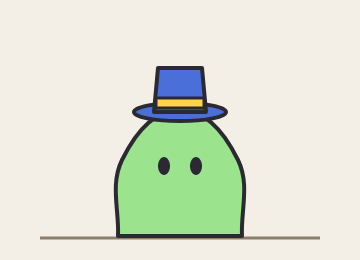

Repare:

- O `def chapeu` tem três peças (aba, copa e fita), desenhadas em volta de `0,0`, e nenhuma delas tem `bone=`.
- `use chapeu 180,112 bone=corpo`: o chapéu é posto no alto da cabeça e preso ao osso `corpo`. As três peças balançam com o bicho.
- O `bone=` do `use` vale para tudo o que está dentro do componente. Uma peça lá dentro com o próprio `bone=` usa o dela.
- Não há `key`: o balanço vem do `sway=10,2` do osso. A `anim parado`, vazia, existe só para o balanço tocar.

**Experimente:** troque `bone=corpo` do `use` por nada (apague o atributo). O bicho balança e o chapéu fica parado no ar.

Também seguem um osso, com o mesmo `bone=`:

- uma **luz** (`light … bone=`): a lanterna na mão, o lampião balançando ([capítulo 8](08-luz-efeitos.md#os-três-tipos-de-luz-e-o-ambiente));
- as **caixas de colisão** (`box … bone=`) e os **pontos de encaixe** (`point … bone=`) de um jogo ([capítulo 9](09-jogo-godot.md)).

[← Contas e componentes](05-componentes.md) · [Índice](README.md) · [Próximo: Animação →](07-animacao.md)
