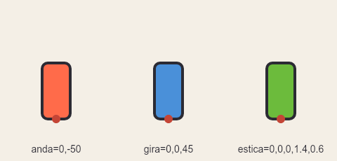
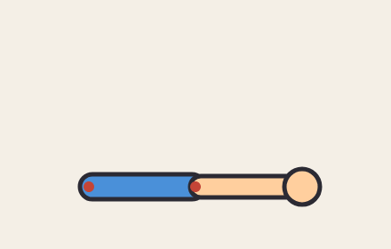
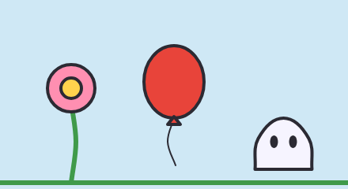
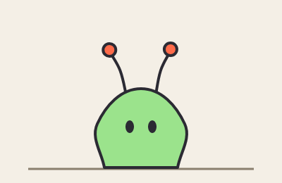
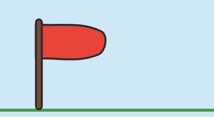
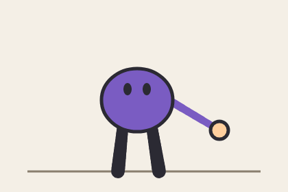

# 6. Ossos: o que faz o desenho se mexer

[← Contas e componentes](05-componentes.md) · [Índice](README.md) · [Próximo: Animação →](07-animacao.md)

Este é o capítulo que mais confunde, então vamos devagar.

## A ideia

Um **osso** (`bone`) é uma **alça invisível** presa num ponto do desenho. Esse ponto se chama **pivô** e é a articulação: o ombro de um braço, o pescoço de uma cabeça, os pés de um corpo. As formas que dizem `bone=nome` ficam "grudadas" no osso: quando o osso anda, gira ou estica, elas vão junto, **sempre em volta do pivô**.

Três coisas para guardar:

1. **Parado, o osso não muda nada.** Na pose parada, o desenho sai exatamente como as coordenadas dizem. O osso só age numa **animação** (com `key`, no [capítulo 7](07-animacao.md)) ou com os movimentos automáticos (balanço, mola…). Então você **desenha tudo na posição de descanso** e depois diz como os ossos se mexem.
2. **O pivô é o centro do movimento.** Girar um braço com o pivô no ombro gira em volta do ombro; com o pivô na mão, giraria em volta da mão. Escolher bem o pivô é metade do trabalho.
3. **Os ossos podem ter pai** (`parent=`). O filho vai junto com o pai: girou o ombro, o antebraço e a mão vão junto.

## Os três movimentos

```
bone nome pivot=x,y
shape … bone=nome : …
```

Numa animação, cada osso recebe até cinco números: `osso=dx,dy,rot,sx,sy`.

| Número | O que faz | Parado vale |
|---|---|---|
| `dx,dy` | **anda**: desloca, em pixels | `0,0` |
| `rot` | **gira** em volta do pivô, em graus; positivo = sentido horário | `0` |
| `sx,sy` | **estica**: escala na largura e na altura, a partir do pivô (`1` = normal, `2` = dobro, `0.5` = metade) | `1,1` |

<!-- gerar: img/06_movimentos.gif -a demo --guides -->
```weasel
canvas 480 230 bg=#f4efe6
palette ink=#2b2a33 line=4

bone anda pivot=80,170
bone gira pivot=240,170
bone estica pivot=400,170

rect a 60,90 40,80 r=8 c=#ff6b4a ink=line bone=anda
rect g 220,90 40,80 r=8 c=#4a90d9 ink=line bone=gira
rect e 380,90 40,80 r=8 c=#6cbb3c ink=line bone=estica

layer pivos guide
ellipse pa 80,170 6 c=#c44536 bone=anda
ellipse pg 240,170 6 c=#c44536 bone=gira
ellipse pe 400,170 6 c=#c44536 bone=estica
text ta 80,218 "anda=0,-50" size=14 align=center
text tg 240,218 "gira=0,0,45" size=14 align=center
text te 400,218 "estica=0,0,0,1.4,0.6" size=14 align=center

anim demo frames=36 fps=12
key 0 anda=0,0 gira=0,0,0 estica=0,0,0,1,1
key 18 anda=0,-50 gira=0,0,45 estica=0,0,0,1.4,0.6
key 36 anda=0,0 gira=0,0,0 estica=0,0,0,1,1
```



Os pontos vermelhos são os pivôs (camada `guide`, só para mostrar). Os três retângulos têm o pivô **embaixo, no meio**:

- o vermelho **anda** 50 pixels para cima (`dy=-50`, porque y negativo é para cima);
- o azul **gira** 45° em volta da base;
- o verde **estica** 1,4 vez na largura e encolhe para 0,6 na altura, e continua apoiado no pivô. É o "amassar" da bola quicando: com o pivô no chão, ela amassa contra o chão.

Não precisa escrever os cinco números sempre:

| Você escreve | Vale |
|---|---|
| `osso=10` | anda 10 em x |
| `osso=10,-5` | anda 10 em x e −5 em y |
| `osso=0,0,30` | gira 30° |
| `osso=0,0,0,1.5` | escala 1,5 por igual (largura e altura) |
| `osso=0,0,0,1.5,0.8` | largura 1,5 e altura 0,8 |

## Pai e filho: `parent=`

Um braço tem ombro e cotovelo. O antebraço precisa ir junto quando o ombro gira, mas também precisa girar sozinho no cotovelo. Isso é um osso **filho**:

<!-- gerar: img/06_pai_filho.gif -a acena --guides -->
```weasel
canvas 440 280 bg=#f4efe6
palette ink=#2b2a33 line=5 pele=#ffcf9e manga=#4a90d9

bone ombro pivot=100,210
bone cotovelo parent=ombro pivot=220,210

rect bracoR 90,196 140,28 r=14 c=manga ink=line bone=ombro
rect antebraco 214,198 120,24 r=12 c=pele ink=line bone=cotovelo
ellipse mao 340,210 20 c=pele ink=line bone=cotovelo

layer pivos guide
ellipse p1 100,210 6 c=#c44536 bone=ombro
ellipse p2 220,210 6 c=#c44536 bone=cotovelo

anim acena frames=48 fps=16
key 0 ombro=0,0,0 cotovelo=0,0,0
key 12 ombro=0,0,-25 cotovelo=0,0,-55
key 24 ombro=0,0,-25 cotovelo=0,0,-10
key 36 ombro=0,0,-25 cotovelo=0,0,-55
key 48 ombro=0,0,0 cotovelo=0,0,0
```



- `cotovelo` tem `parent=ombro`: **tudo o que o ombro faz, o cotovelo faz junto**. Quando o ombro gira −25°, o cotovelo (e o antebraço e a mão) sobem com ele.
- Por cima disso, o cotovelo gira o **próprio** ângulo (−55°, depois −10°…), em volta do pivô dele, que já foi carregado pelo ombro.
- Os ângulos do filho são **relativos ao pai**: `cotovelo=0,0,-55` quer dizer "55° a mais que o ombro", não "60° em relação à tela". O mesmo vale para o `dx,dy` do filho, que anda na direção do pai já girado.
- O pivô é sempre escrito na posição de **descanso**, nas coordenadas do desenho (`pivot=220,210`), mesmo que o pai mova tudo depois.

### Como montar o esqueleto de um personagem

A receita que os exemplos usam:

```
bone raiz pivot=200,300              # entre os pés: move o personagem inteiro
bone corpo parent=raiz pivot=200,220 # quadril: inclina e respira
bone cabeca parent=corpo pivot=200,140 # pescoço
bone bracoE parent=corpo pivot=160,160 # ombros
bone bracoD parent=corpo pivot=240,160
```

- Um osso **raiz** com o pivô no chão, entre os pés: anda, pula e agacha o personagem inteiro. Com o pivô ali, `raiz=0,0,0,1.1,0.9` amassa o personagem contra o chão.
- O resto pendura na raiz, do centro para as pontas.
- Cada forma escolhe o osso que deve segui-la: a cabeça e os olhos com `bone=cabeca`, a mão com `bone=bracoD`.
- **Forma sem `bone=` não se mexe.** É o erro mais comum: animar o osso e esquecer de prender as formas nele.

## Movimentos automáticos: `sway`, `bob` e `jitter`

Alguns movimentos se repetem sem fim: uma flor balançando, um balão subindo e descendo, um bicho tremendo de medo. Em vez de escrever as `key`, dá para pedir direto no osso:

| Atributo | Movimento | Números |
|---|---|---|
| `sway=graus,segundos` | balança (gira para lá e para cá) | quanto gira, para cada lado, e quanto tempo dura um vaivém |
| `bob=pixels,segundos` | sobe e desce | quanto sobe e desce, e o tempo de um vaivém |
| `jitter=pixels` | treme sem ritmo | o tamanho do tremor |

Um terceiro número em `sway` e `bob` atrasa o começo do vaivém, em graus (`sway=8,2,90`), para dois ossos não balançarem iguais.

<!-- gerar: img/06_automaticos.gif -a parado -->
```weasel
canvas 440 240 bg=#cfe8f5
palette ink=#2b2a33 line=4

bone flor pivot=90,230 sway=10,2
bone balao pivot=220,100 bob=14,2
bone susto pivot=360,215 jitter=2

line chao c=#3f9a4a w=6 : 0,232 440,232
stroke caule w=6 c=#3f9a4a bone=flor : 90,232 96,180 90,130
ellipse petalas 90,112 30 c=#ff8fb1 ink=line bone=flor
ellipse miolo 90,112 13 c=#ffd34d ink=line bone=flor

stroke fio w=2 bone=balao : 220,150 212,180 222,210
ellipse b 220,104 38,46 c=#e8443a ink=line bone=balao
shape no c=#e8443a ink=line bone=balao : 220,148! 228,158! 212,158!

shape bicho c=#f6f4ff ink=line bone=susto : 360,150 392,176 396,215! 324,215! 328,176
ellipse olhoE 348,180 5,8 c=ink bone=susto
ellipse olhoD 372,180 5,8 c=ink bone=susto

anim parado frames=24 fps=12
```



- Os movimentos automáticos só acontecem quando **alguma animação está tocando**. Por isso o exemplo tem `anim parado`, uma animação sem nenhuma `key`. Num filme, eles também andam sem animação, pelo relógio do filme.
- O tempo do vaivém é ajustado para caber um número inteiro de vezes na animação, então o **loop fecha** sem pulo. Aqui a animação tem 2 segundos (24 quadros a 12 por segundo) e cada vaivém também.
- Eles **somam** com as `key`: um osso pode balançar sozinho e ainda ser animado.

## Molas: `spring=`

Uma **mola** faz o osso girar **atrasado** quando o pai se mexe, e balançar até parar. É o que dá vida a orelhas, antenas, rabos, cabelo, plumas e à espada do Cavaleiro.

<!-- gerar: img/06_mola.gif -a sacode -->
```weasel
canvas 400 260 bg=#f4efe6
palette ink=#2b2a33 line=4 ponta=#ff6b4a

bone corpo pivot=200,238
bone antenaE parent=corpo pivot=180,138 spring=0.1
bone antenaD parent=corpo pivot=220,138 spring=0.9

line chao c=#8a7f6e w=3 : 40,240 360,240
stroke aE w=4 bone=antenaE : 180,140 172,100 158,72
ellipse bE 158,70 9 c=ponta ink=line bone=antenaE
stroke aD w=4 bone=antenaD : 220,140 228,100 242,72
ellipse bD 242,70 9 c=ponta ink=line bone=antenaD
shape bichinho c=#9be38c ink=line bone=corpo : 200,126 262,176 252,238! 148,238! 138,176
ellipse olhoE 184,180 6,9 c=ink bone=corpo
ellipse olhoD 216,180 6,9 c=ink bone=corpo

anim sacode frames=48 fps=24
key 0 corpo=0,0,0
key 5 corpo=0,0,-14
key 11 corpo=0,0,14
key 16 corpo=0,0,0
key 48 corpo=0,0,0
```



- O bichinho sacode o corpo (as `key` do `corpo`) e para. As antenas não têm `key` nenhuma: quem as mexe é a mola.
- `spring=` vai de 0 a 1 e diz o quanto a mola é **dura**. Perto de 0, mole: atrasa muito e balança devagar (a antena da esquerda, 0.1). Perto de 1, dura: quase acompanha o pai (a da direita, 0.9).
- A mola só **gira** o osso, e reage quando o pivô dele é sacudido, quase sempre pelo **pai** (aqui, o corpo sacudindo).
- Molas não precisam de `key` própria, mas podem ter: a mola soma com o que as `key` mandam.
- Em transições muito rápidas a mola pode exagerar. Se isso acontecer, deixe-a mais dura ou tire a mola daquele osso.

## Tecido: `cloth`

Uma mola gira um pedaço inteiro. Um **tecido** faz outra coisa: os pontos da forma **longe** de um pivô ficam para trás quando o corpo anda, como uma capa, uma bandeira ou a barra de um fantasma.

```
cloth nome pivot=x,y tension= drag= swing= bone=
shape … cloth=nome bone=osso : …
```

<!-- gerar: img/06_tecido.gif -a corre -->
```weasel
canvas 440 240 bg=#cfe8f5
palette ink=#2b2a33 line=4

bone mastro pivot=150,222
cloth pano pivot=152,85 tension=0.15 drag=2 swing=1.5

line chao c=#3f9a4a w=6 : 0,226 440,226
shape bandeira c=#e8443a ink=line bone=mastro cloth=pano : 146,50! 290,64 284,112 146,120!
rect haste 144,40 12,184 r=6 c=#7a4a2c ink=line bone=mastro

anim corre frames=32 fps=16
key 0 mastro=-70,0
key 16 mastro=90,0
key 32 mastro=-70,0
```



- O **pivô do tecido** é o ponto que não balança (aqui, onde a bandeira prende no mastro). Quanto mais longe dele, mais o ponto atrasa.
- A forma diz qual osso a carrega (`bone=mastro`) e qual tecido a faz balançar (`cloth=pano`). Várias formas podem usar o mesmo tecido e balançam juntas, como a capa, as faixas e as dobras do Cavaleiro.
- `tension=` vai de 0 (pano mole, balança muito) a 1 (duro). Padrão 0.5.
- `drag=` (padrão 1) é o quanto o ar empurra o pano para trás enquanto o osso anda; `swing=` (padrão 1) é o quanto ele balança com os trancos. Os dois vão de 0 a 10.
- `bone=` no `cloth` diz qual osso o carrega; sem ele, vale o osso das formas.

## Pernas e braços com IK

Uma perna desenhada com `stroke` comum gira inteira com o osso. Mas pernas de verdade fazem outra coisa: **o pé fica no chão** e o joelho dobra quando o corpo desce. Isso é **IK** (cinemática inversa): você diz onde a perna nasce e onde o pé deve ficar, e o Weasel calcula o joelho.

```
stroke nome limb=largura_em_cima,largura_embaixo hip=x,y on=osso foot=chão,x bend=1
stroke nome limb=… hip=x,y on=osso target=osso_da_mão bend=-1
```

<!-- gerar: img/06_ik.gif -a agacha -->
```weasel
canvas 420 280 bg=#f4efe6
palette ink=#2b2a33 line=5 roxo=#7a5cc2 pele=#ffcf9e

bone corpo pivot=200,150
bone mao pivot=320,190

line chao c=#8a7f6e w=3 : 40,250 380,250

stroke pernaE limb=16,20 hip=180,176 on=corpo foot=chao,172
stroke pernaD limb=16,20 hip=220,176 on=corpo foot=chao,232
stroke braco limb=12,10 hip=236,140 on=corpo target=mao bend=-1 c=roxo
ellipse tronco 200,146 52,46 c=roxo ink=line bone=corpo
ellipse olhoE 186,130 6,9 c=ink bone=corpo
ellipse olhoD 214,130 6,9 c=ink bone=corpo
ellipse palma 320,190 13 c=pele ink=line bone=mao

anim agacha frames=48 fps=16
key 0 corpo=0,0 mao=0,0
key 12 corpo=0,22 mao=0,10
key 24 corpo=0,-34 mao=-20,-110 ease=in
key 36 corpo=0,0 mao=0,0
key 48 corpo=0,0 mao=0,0
```



**Pernas** (`foot=`):

- `hip=x,y` é onde a perna **nasce** (o quadril), e `on=corpo` faz esse ponto andar com o osso.
- `foot=chao,172` põe o pé na `line` chamada `chao`, na altura dela em x=172. O pé fica parado ali.
- O **comprimento** da perna é a distância do quadril ao pé no desenho parado. Quando o corpo desce, sobra perna e o joelho dobra. Quando o corpo sobe além do comprimento, a perna estica e **pendura** na direção do pé (o pulo).
- `limb=16,20` é a largura da perna no quadril e no pé.

**Braços** (`target=`):

- `target=mao` faz a ponta do braço ir atrás do **pivô** do osso `mao`. Anime a mão com `key` (aqui ela desce, sobe e volta), e o braço dobra o cotovelo sozinho.
- O comprimento do braço é a distância do ombro (`hip=`) ao pivô da mão no desenho parado. Se a mão for mais longe que isso, o braço estica e aponta para ela, mas não alcança: mantenha a mão ao alcance.
- Uma forma presa ao osso `mao` (a `palma`) fica na ponta.

**Para que lado dobra** (`bend=`): numa perna que desce do quadril para o pé, `bend=1` (o padrão) joga o joelho para a direita da tela, como num personagem virado para a direita, e `bend=-1` para a esquerda. Num braço que vai para a direita, `bend=1` levanta o cotovelo e `bend=-1` abaixa (é o caso do exemplo). Valores entre 0 e 1 dobram menos.

O membro é desenhado com a cor `c=` (padrão: a cor de tinta) e não precisa de pontos depois do `:`.

[← Contas e componentes](05-componentes.md) · [Índice](README.md) · [Próximo: Animação →](07-animacao.md)
