# 7. Animação

[← Ossos](06-ossos.md) · [Índice](README.md) · [Próximo: Luz, efeitos e partículas →](08-luz-efeitos.md)

## Como o Weasel anima

Animar no Weasel é dizer **como os ossos (e outras coisas) estão em alguns quadros-chave**. O Weasel calcula os quadros do meio sozinho. É o mesmo princípio dos desenhos animados: o animador principal faz as poses importantes, e o "intervalador" preenche o resto.

```
anim nome frames=quantos fps=por_segundo [once]
key quadro osso=dx,dy,rot,sx,sy  outro=…  ease=…
key quadro …
event quadro nome
```

## A primeira animação: a bola quicando

<!-- gerar: img/07_bola.gif -a quica -->
```weasel
canvas 400 300 bg=#f4efe6 light=-0.5,-0.85
palette ink=#1d1b26 line=6 bola=#ff6b4a

line chao c=#c9bca8 w=4 : 40,262 360,262
bone bola pivot=200,260
ellipse b 200,216 44 c=bola ink=line weight=0.3 bone=bola

anim quica frames=24 fps=24
key 0 bola=0,0,0,1.25,0.78 ease=out
key 12 bola=0,-170,0,1,1 ease=in
key 24 bola=0,0,0,1.25,0.78
```

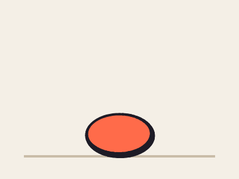

Linha por linha:

- `bone bola pivot=200,260`: o osso da bola tem o pivô **embaixo dela**, no chão. Assim, quando ela estica e encolhe, amassa contra o chão em vez de encolher no meio do ar.
- `anim quica frames=24 fps=24`: uma animação de 24 quadros, tocada a 24 quadros por segundo (então dura 1 segundo). Os quadros são numerados de **0 a 23**.
- `key 0 bola=0,0,0,1.25,0.78`: no quadro 0, a bola está no lugar, **amassada** (1,25 de largura e 0,78 de altura).
- `key 12 bola=0,-170,0,1,1`: no quadro 12 ela está 170 pixels acima, no tamanho normal.
- `key 24 …`: igual ao quadro 0. O quadro 24 não aparece (o último é o 23); ele existe para dizer **como o fim volta para o começo**. Repetir a primeira pose no quadro `frames` é o que faz o **loop fechar sem pulo**.

```
quadro:   0 ───────────── 12 ───────────── 24 (= 0 de novo)
bola:     amassada        no alto           amassada
ease:     out (sobe freando)  in (cai acelerando)
```

### Quantos desenhos e quão rápido: `frames=` e `fps=`

`frames=` diz **quantos quadros** (desenhos) a animação tem. `fps=` diz quantos deles passam **por segundo** ("frames per second"). A duração é a divisão: `frames ÷ fps` segundos. Aqui, o mesmo vaivém de uma bola, em três animações:

<!-- gerar: img/07_fps_normal.gif -a normal -->
<!-- gerar: img/07_fps_devagar.gif -a devagar -->
<!-- gerar: img/07_fps_liso.gif -a liso -->
```weasel
canvas 260 100 bg=#f4efe6
palette ink=#2b2a33 line=3

bone b pivot=40,60
line trilho c=#e0d8c8 w=2 : 40,60 220,60
ellipse bola 40,60 16 c=#ff6b4a ink=line bone=b

anim normal frames=12 fps=12
key 0 b=0
key 6 b=180
key 12 b=0

anim devagar frames=12 fps=6
key 0 b=0
key 6 b=180
key 12 b=0

anim liso frames=24 fps=24
key 0 b=0
key 12 b=180
key 24 b=0
```

| `normal`: `frames=12 fps=12` | `devagar`: `frames=12 fps=6` | `liso`: `frames=24 fps=24` |
|---|---|---|
|  |  | 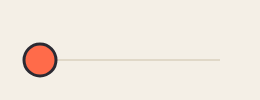 |
| 12 desenhos em 1 segundo (12 ÷ 12) | os mesmos 12 desenhos em 2 segundos (12 ÷ 6): mais lento e aos trancos | 24 desenhos em 1 segundo (24 ÷ 24): a mesma velocidade do `normal`, mais liso |

Repare:

- Um arquivo pode ter várias animações. Cada linha `anim` começa uma nova, e as `key` de baixo são dela, até o próximo `anim`.
- Em cada animação, a bola chega ao fim do trilho (`b=180`, 180 pixels para a direita) na **metade** dos quadros: no 6 de 12, no 12 de 24.
- Mais `fps` com mais `frames` não muda a velocidade, só deixa o movimento mais liso. O preço: mais quadros para exportar (e uma sprite sheet maior num jogo).
- `frames=` vai de 1 a 600 (padrão 24); `fps=` vai de 1 a 60 (padrão 12).

**Experimente:** na animação `liso`, troque `fps=24` por `fps=12`. Ela continua lisa, mas passa a durar 2 segundos (24 ÷ 12).

### Como os quadros do meio são calculados: `ease`

Entre duas `key`, o valor vai mudando aos poucos. O `ease=` de uma `key` diz **como o movimento sai dela até a próxima**:

| `ease=` | Movimento | Bom para |
|---|---|---|
| `smooth` (padrão) | começa devagar, acelera, freia no fim | quase tudo |
| `linear` | velocidade constante | rodas, esteiras, coisas mecânicas |
| `in` | começa devagar e acelera | cair, sair correndo |
| `out` | começa rápido e freia | subir, parar, chegar |
| `back` | passa um pouco do ponto e volta | um gesto com "elástico", algo que chega e se ajeita |
| `step` | fica parado e **pula** de uma vez para a próxima `key` | piscar, trocar de pose seco, animação "de dois em dois" |

Na bola, a subida usa `out` (sai rápida do chão e freia no alto) e a descida usa `in` (cai cada vez mais rápido): é a gravidade.

<!-- gerar: img/07_eases.gif -a eases -->
```weasel
canvas 460 320 bg=#f4efe6
palette ink=#2b2a33 line=3

bone b1 pivot=140,40
bone b2 pivot=140,90
bone b3 pivot=140,140
bone b4 pivot=140,190
bone b5 pivot=140,240
bone b6 pivot=140,290

layer trilhos
line t1 c=#e0d8c8 w=2 : 140,40 420,40
line t2 c=#e0d8c8 w=2 : 140,90 420,90
line t3 c=#e0d8c8 w=2 : 140,140 420,140
line t4 c=#e0d8c8 w=2 : 140,190 420,190
line t5 c=#e0d8c8 w=2 : 140,240 420,240
line t6 c=#e0d8c8 w=2 : 140,290 420,290
text n1 20,46 "smooth" size=17
text n2 20,96 "linear" size=17
text n3 20,146 "in" size=17
text n4 20,196 "out" size=17
text n5 20,246 "back" size=17
text n6 20,296 "step" size=17

layer bolas
ellipse e1 140,40 14 c=#ff6b4a ink=line bone=b1
ellipse e2 140,90 14 c=#ffb000 ink=line bone=b2
ellipse e3 140,140 14 c=#6cbb3c ink=line bone=b3
ellipse e4 140,190 14 c=#4a90d9 ink=line bone=b4
ellipse e5 140,240 14 c=#9b6cd9 ink=line bone=b5
ellipse e6 140,290 14 c=#e05a8a ink=line bone=b6

anim eases frames=48 fps=24
key 0 b1=0 ease=smooth
key 0 b2=0 ease=linear
key 0 b3=0 ease=in
key 0 b4=0 ease=out
key 0 b5=0 ease=back
key 0 b6=0 ease=step
key 24 b1=280 ease=smooth
key 24 b2=280 ease=linear
key 24 b3=280 ease=in
key 24 b4=280 ease=out
key 24 b5=280 ease=back
key 24 b6=280 ease=step
key 48 b1=0 b2=0 b3=0 b4=0 b5=0 b6=0
```

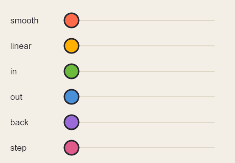

Como o `ease=` vale para a linha inteira, cada bola tem a sua linha `key` no mesmo quadro. Várias linhas `key` no mesmo quadro se juntam.

### Regras das `key`

- Os valores são **absolutos**, medidos a partir da pose parada: `key 12 bola=0,-170` quer dizer "170 acima do lugar desenhado", não "mais 170 em relação à key anterior".
- Cada osso é independente. Um osso que não aparece em nenhuma `key` da animação fica parado; um osso que aparece só em alguns quadros vai de uma das suas `key` para a outra, ignorando as linhas em que ele não está.
- Numa animação com **loop** (o padrão), do último quadro com `key` o valor volta para o primeiro, passando pelo fim. Por isso, para o loop não "dar um tranco", ponha no quadro `frames` a mesma pose do quadro 0.
- Com **`once`**, a animação toca uma vez e para: antes da primeira `key`, vale a primeira; depois da última, a última fica. Use para golpes, pulos, quedas e transições.
- Quadros podem ter `key` em qualquer número de 0 a `frames`. Uma `key` repetida para o mesmo osso e o mesmo quadro substitui a anterior.
- Um osso aceita de 1 a 5 números (`osso=40` só anda em x; `osso=0,0,30` gira…). A tabela e um exemplo com cada caso estão no [capítulo 6](06-ossos.md#quantos-números-escrever).

### Loop ou uma vez só: `once`

Um passo, uma respiração ou uma chama se repetem sem parar: isso é o **loop**, o padrão. Um pulo, um golpe ou uma porta abrindo acontecem **uma vez** e param no fim: para isso, escreva `once` na linha do `anim`. As duas animações abaixo têm as mesmas `key`. Só a de baixo tem `once`:

<!-- gerar: img/07_loop.gif -a vai -->
<!-- gerar: img/07_once.gif -a vaiUmaVez -->
```weasel
canvas 260 100 bg=#f4efe6
palette ink=#2b2a33 line=3

bone b pivot=40,60
line trilho c=#e0d8c8 w=2 : 40,60 220,60
ellipse bola 40,60 16 c=#4a90d9 ink=line bone=b

anim vai frames=24 fps=12
key 0 b=0
key 12 b=180

anim vaiUmaVez frames=24 fps=12 once
key 0 b=0
key 12 b=180
```

| `anim vai` (loop) | `anim vaiUmaVez … once` |
|---|---|
|  | 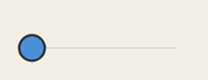 |

Repare:

- As duas animações têm 24 quadros, mas só duas `key`: a bola sai do começo (quadro 0) e chega ao fim do trilho no quadro 12. Do 12 ao 23 não há `key` nenhuma.
- **Loop** (esquerda): depois do quadro 23 vem o 0 de novo. Então, do quadro 12 em diante, a bola já vai voltando para a `key 0`, e o loop fecha sem pulo.
- **`once`** (direita): depois da última `key`, a bola **fica** onde está, parada no fim.
- O GIF e o player do editor sempre recomeçam do quadro 0 quando chegam ao fim. Por isso a bola da direita "pula" para o começo a cada volta. Num jogo, a animação `once` toca uma vez e para (no Godot, ela sai sem repetição).
- A palavra contrária, `loop`, também existe. Ela só é necessária nas [animações combinadas](#animações-combinadas-mix), que copiam o `once` da outra animação.

**Experimente:** na `vai`, acrescente `key 24 b=0`. Nada muda no loop (ele já voltava). Agora acrescente a mesma linha na `vaiUmaVez`: a bola volta também, porque agora a última `key` é a do quadro 24.

## Animando outras coisas: `forma.propriedade=valor`

As `key` também mudam formas, camadas e luzes. Em vez do nome de um osso, escreva `nome.propriedade=valor`:

| Propriedade | Em | O que muda | Como muda |
|---|---|---|---|
| `opacity` | forma, camada | transparência (0 a 1) | aos poucos |
| `c` | forma | cor de preenchimento (ou do traço) | as cores se misturam aos poucos |
| `inkc` | forma | cor do contorno | aos poucos |
| `w` | traço, linha | espessura | aos poucos |
| `ink` | forma | espessura do contorno | aos poucos |
| `show` | forma, camada, caixa | aparece (`1`) ou some (`0`) | de uma vez |
| `shape` | forma | **morph**: vira outra forma (fechada com fechada, traço com traço) | aos poucos (veja abaixo) |
| `draw` | forma | quanto já foi **desenhado**, de 0 a 1 | aos poucos ([abaixo](#desenhar-aos-poucos-draw)) |
| `above` `below` | forma, camada | pinta na frente (ou atrás) de outra ([capítulo 4](04-camadas.md#trocar-quem-fica-na-frente-durante-uma-animação-above-e-below)) | de uma vez |
| `blur` `glow` `tint` `brightness` `saturate` `contrast` `hue` | camada | efeitos ([capítulo 8](08-luz-efeitos.md#efeitos-de-camada)) | aos poucos |
| `power` `radius` `c` `glow` `aim` `cone` | luz | a luz ([capítulo 8](08-luz-efeitos.md)) | aos poucos |

<!-- gerar: img/07_lampada.gif -a acende -->
```weasel
canvas 300 260 bg=#1f2433
palette ink=#14141c line=5 apagada=#6b6f7d acesa=#ffe27a

gradient halo radial 150,108 110 : #ffe27aa0 #ffe27a00
ellipse brilho 150,108 110 c=halo
stroke fio w=4 c=#3a3f52 : 150,0 150,50
rect rosca 134,150 32,30 r=4 c=#9aa0ad ink=line
ellipse bulbo 150,108 50,56 c=apagada ink=line
text clique 236,226 "clique!" size=22 bold align=center c=#ffe27a

anim acende frames=32 fps=12
key 0 bulbo.c=apagada brilho.opacity=0 clique.show=0
key 8 bulbo.c=apagada brilho.opacity=0 clique.show=1
key 12 bulbo.c=acesa brilho.opacity=1 clique.show=0
key 24 bulbo.c=acesa brilho.opacity=1
key 28 bulbo.c=apagada brilho.opacity=0
key 32 bulbo.c=apagada brilho.opacity=0
```

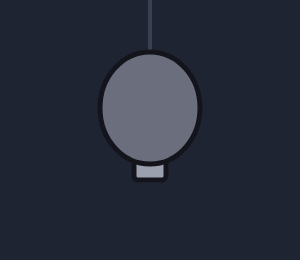

- `bulbo.c` vai de cinza para amarelo entre os quadros 8 e 12: as cores se **misturam** aos poucos.
- `brilho.opacity` acende o halo junto.
- `clique.show=1` liga o texto de uma vez no quadro 8, e `clique.show=0` desliga no 12.
- Se várias formas têm o mesmo nome (por exemplo, dentro de um componente usado várias vezes), a `key` muda todas.
- A `opacity` das `key` **multiplica** a `opacity=` escrita na forma. Uma forma com `opacity=0` no código fica invisível para sempre; para começar apagada, use `key 0 forma.opacity=0`.
- Fora das animações (na pose parada), valem os valores do código: o halo aparece e o texto também.

### Contorno e espessura: `inkc`, `ink` e `w`

Para chamar atenção para uma peça (um botão que pisca, um alvo escolhido, um fio que esquenta), mude o contorno ou a grossura do traço:

<!-- gerar: img/07_contorno.gif -a muda -->
```weasel
canvas 460 200 bg=#f4efe6
palette ink=#2b2a33

rect caixa 40,40 100,90 r=10 c=#ffd34d ink=6
ellipse bola 230,85 48 c=#9be38c ink=2
stroke fio c=#4a90d9 w=3 : 330,130 360,50 400,120 430,40

text t1 90,175 "caixa.inkc" size=17 bold align=center
text t2 230,175 "bola.ink" size=17 bold align=center
text t3 380,175 "fio.w" size=17 bold align=center

anim muda frames=24 fps=12
key 0 caixa.inkc=ink bola.ink=2 fio.w=3
key 12 caixa.inkc=#e8443a bola.ink=14 fio.w=18
key 24 caixa.inkc=ink bola.ink=2 fio.w=3
```

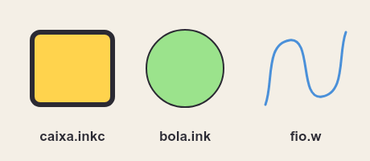

Repare:

- `caixa.inkc`: a **cor do contorno** vai da cor de tinta (`ink`, da `palette`) até vermelho e volta, misturando aos poucos. A caixa precisa ter contorno (`ink=6`) para isso aparecer.
- `bola.ink`: a **grossura do contorno**, em pixels, vai de 2 a 14.
- `fio.w`: a **grossura do traço**, em pixels, vai de 3 a 18. O `w` é dos traços (`stroke` e `line`); o `ink`, do contorno das formas fechadas.
- Os três valores voltam no quadro 24, igual ao 0, para o loop fechar.

### Camadas inteiras: efeitos, `opacity` e `show`

Para desfocar o fundo, clarear a tela num relâmpago ou deixar um personagem vermelho quando leva dano, anime a **camada**: a `key` usa o nome da camada em vez do nome de uma forma. Cada estrela abaixo está numa camada própria, e cada camada anima um efeito:

<!-- gerar: img/07_camadas.gif -a efeitos -s 0.75 -->
```weasel
canvas 480 370 bg=#2b2f45
palette ink=#14141c line=4

def estrela
shape s c=#ffd34d ink=line : 0,-38! 11,-12 38,-10! 17,8 25,36! 0,20 -25,36! -17,8 -38,-10! -11,-12
end

layer l1
use estrela 80,55
layer l2
use estrela 240,55
layer l3
use estrela 400,55
layer l4 glow=#ff6b4a,0
use estrela 80,175
layer l5 tint=#4a90d9,0
use estrela 240,175
layer l6
use estrela 400,175
layer l7
use estrela 80,295
layer l8
use estrela 240,295
layer l9
use estrela 400,295

layer rotulos
text t1 80,112 "opacity" size=15 bold align=center c=#d8dcef
text t2 240,112 "show" size=15 bold align=center c=#d8dcef
text t3 400,112 "blur" size=15 bold align=center c=#d8dcef
text t4 80,232 "glow" size=15 bold align=center c=#d8dcef
text t5 240,232 "tint" size=15 bold align=center c=#d8dcef
text t6 400,232 "brightness" size=15 bold align=center c=#d8dcef
text t7 80,352 "saturate" size=15 bold align=center c=#d8dcef
text t8 240,352 "contrast" size=15 bold align=center c=#d8dcef
text t9 400,352 "hue" size=15 bold align=center c=#d8dcef

anim efeitos frames=12 fps=6
key 0 l1.opacity=1 l2.show=1 l3.blur=0 l4.glow=0 l5.tint=0 l6.brightness=1 l7.saturate=1 l8.contrast=1 l9.hue=0
key 4 l2.show=0
key 8 l2.show=1
key 6 l1.opacity=0.15 l3.blur=6 l4.glow=24 l5.tint=0.8 l6.brightness=2 l7.saturate=0 l8.contrast=0.3 l9.hue=180
key 12 l1.opacity=1 l3.blur=0 l4.glow=0 l5.tint=0 l6.brightness=1 l7.saturate=1 l8.contrast=1 l9.hue=0
```

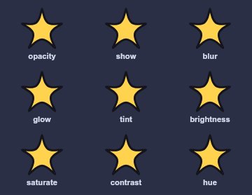

Repare, estrela por estrela (os números vão de "normal", no quadro 0, até o valor do quadro 6, e voltam):

| Estrela | Valor normal | No quadro 6 | O que o número quer dizer |
|---|---|---|---|
| `opacity` | 1 | 0.15 | transparência, de 0 (invisível) a 1 |
| `show` | 1 | 0 nos quadros 4 a 7 | aparece (1) ou some (0), **de uma vez** |
| `blur` | 0 | 6 | desfoque, em pixels |
| `glow` | 0 | 24 | o raio do brilho em volta, em pixels |
| `tint` | 0 | 0.8 | quanto tinge com a cor, de 0 a 1 |
| `brightness` | 1 | 2 | brilho: 1 = normal, 2 = o dobro |
| `saturate` | 1 | 0 | saturação: 0 = cinza |
| `contrast` | 1 | 0.3 | contraste: menos de 1 = mais apagado |
| `hue` | 0 | 180 | gira as cores, em graus (180 = a cor do lado oposto) |

- `glow` e `tint` precisam de uma **cor**, e ela vem da linha do `layer`: `layer l4 glow=#ff6b4a,0` diz a cor (vermelha) e começa sem brilho (raio 0). Do mesmo jeito, `layer l5 tint=#4a90d9,0` diz o azul e começa sem tingir. Sem o `tint=cor,…` na camada, a `key` do `tint` não muda nada; sem o `glow=` na camada, o brilho sai branco.
- `opacity` e `show` também valem para uma forma só; os outros efeitos são só de camada. Os efeitos parados (sem animar) estão no [capítulo 8](08-luz-efeitos.md#efeitos-de-camada).
- `above` e `below` mudam a ordem das camadas ([capítulo 4](04-camadas.md#trocar-quem-fica-na-frente-durante-uma-animação-above-e-below)).

**Experimente:** troque `l9.hue=180` por `l9.hue=90`. A estrela para no verde, em vez de ir até o azul.

### Luzes

Uma lâmpada que acende, um holofote que varre o palco, um alarme que troca de cor: as luzes ([capítulo 8](08-luz-efeitos.md)) também mudam com `key`, pelo nome da luz:

<!-- gerar: img/07_luzes.gif -a liga -s 0.75 -->
```weasel
canvas 440 240 bg=#101320
palette ink=#14141c line=3

layer cena
rect parede 0,0 440,200 c=#8a7f9a
rect chao 0,200 440,40 c=#6a5a4a
shape bichoE c=#9be38c ink=line : 110,140 140,166 144,200! 76,200! 80,166
shape bichoD c=#ffb3c7 ink=line : 330,140 360,166 364,200! 296,200! 300,166

layer aparelhos unlit
stroke fio w=3 c=#3a3a44 : 110,0 110,40
ellipse bulbo 110,48 9 c=#fff1d0 ink=line
rect caixa 318,0 24,18 r=3 c=#3a3a44 ink=line
text t1 110,228 "power radius c glow" size=14 bold align=center c=#d8dcef
text t2 330,228 "aim cone" size=14 bold align=center c=#d8dcef

ambient c=#3a3f66 power=0.3
light lampada point 110,48 c=#ffb860 power=0.5 radius=70 glow=10
light canhao spot 330,16 aim=70 cone=8 c=#fff1d0 power=2 radius=240

anim liga frames=12 fps=6
key 0 lampada.power=0.5 lampada.radius=70 lampada.c=#ffb860 lampada.glow=10 canhao.aim=70 canhao.cone=8
key 6 lampada.power=3 lampada.radius=190 lampada.c=#7ad0ff lampada.glow=50 canhao.aim=110 canhao.cone=22
key 12 lampada.power=0.5 lampada.radius=70 lampada.c=#ffb860 lampada.glow=10 canhao.aim=70 canhao.cone=8
```

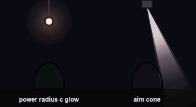

Repare:

- **A lâmpada** (`point`, à esquerda) muda quatro coisas juntas: `power`, a força (de 0 a 20); `radius`, até onde a luz chega, em pixels; `c`, a cor, que se mistura aos poucos de laranja para azul; e `glow`, o raio do halo visível, em pixels.
- **O holofote** (`spot`, à direita): `aim` é para onde ele aponta, em graus (0 = direita, 90 = para baixo). De 70 a 110, o facho passa de baixo-direita para baixo-esquerda. `cone` é a abertura para cada lado, em graus: de 8 (fino) a 22 (largo).
- A camada `aparelhos` é `unlit` (não recebe luz), para a lâmpada, a caixa do holofote e os textos não ficarem escuros.

**Experimente:** troque `canhao.cone=22` por `canhao.cone=60`. No meio da animação, o facho abre bem mais e ilumina o chão quase todo.

## Desenhar aos poucos: `.draw`

`key quadro forma.draw=0` esconde a forma, e `draw=1` mostra ela inteira. Entre os dois, o Weasel **desenha a forma aos poucos**, como se uma caneta passasse por ela. É o efeito dos vídeos explicativos: a rota traçada no mapa, a seta que se desenha, o título digitado.

<!-- gerar: img/07_mapa.gif -a aparece -->
```weasel
canvas 400 240 bg=#e9d8b4
palette ink=#5a3b22 line=4 rota=#c44536

rect papel 12,12 376,216 r=10 c=#f8edd4 ink=line
text titulo 200,54 "Mapa do tesouro" size=28 align=center bold
ellipse sol 70,104 22 c=#ffb84d
shape ilha c=#9bc97a ink=line weight=0.5 : 282,84 352,92 362,146 314,168 274,136
stroke caminho w=5 c=rota taper=0,0.25 : 48,198 104,150 176,186 252,150 318,124
text marca 320,134 "X" size=28 bold align=center c=rota

anim aparece frames=48 fps=12 once
key 0 titulo.draw=0 sol.draw=0 ilha.draw=0 caminho.draw=0 marca.show=0 ease=linear
key 12 titulo.draw=1
key 6 sol.draw=0 ease=linear
key 16 sol.draw=1
key 10 ilha.draw=0 ease=linear
key 22 ilha.draw=1
key 20 caminho.draw=0 ease=linear
key 36 caminho.draw=1 marca.show=1
```

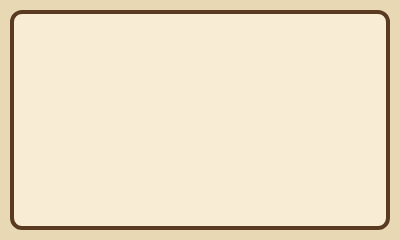

Como cada tipo de forma é desenhado:

| Forma | Com `draw` entre 0 e 1 |
|---|---|
| `stroke` e `line` | o traço cresce do primeiro ponto até o último |
| forma fechada com contorno (`ink=`) | o contorno corre em volta da forma, e o preenchimento aparece no fim |
| forma fechada sem contorno | um traço da cor da forma corre em volta, e o preenchimento aparece no fim |
| `text` | as letras aparecem uma a uma, cada uma no lugar dela |

- `ease=linear` dá velocidade constante, como uma caneta. Com o `smooth` (o padrão), o desenho começa devagar e termina devagar.
- O traço vai na **ordem dos pontos**. Para desenhar do outro lado, escreva os pontos ao contrário.
- Os quadros com `key` de cada forma são independentes: no exemplo, o sol começa no quadro 6, enquanto o título ainda está sendo digitado.
- A animação é `once` para o mapa ficar pronto no fim, em vez de se apagar ao voltar para o começo.
- Na pose parada, sem animação, tudo aparece inteiro.
- Num filme, as formas do próprio arquivo do filme também se desenham com `at`: `at 1s rota.draw=0` e `at 4s rota.draw=1` ([capítulo 10](10-filme.md#mudanças-no-tempo-at)).

## Morph: uma forma vira outra

`key 10 forma.shape=outra` faz a forma **se transformar** no formato de `outra` até aquele quadro. É assim que se pisca um olho, se abre uma boca ou se muda uma expressão sem ossos.

<!-- gerar: img/07_morph.gif -a vira -->
```weasel
canvas 420 160 bg=#f4efe6
palette ink=#2b2a33 line=4

ellipse bolha 70,80 44 c=#ff9a4a ink=line
shape estrela c=#ffd34d ink=line hidden : 70,30! 82,64! 118,66! 90,88! 100,122! 70,102! 40,122! 50,88! 22,66! 58,64!
shape boca c=#c44536 ink=line : 180,70 260,70 260,90 180,90
shape sorriso c=#c44536 ink=line hidden : 170,66 200,74 220,76 240,74 270,66 250,96 220,104 190,96
stroke onda w=5 c=#4a90d9 : 300,80 400,80
stroke zigue w=5 c=#4a90d9 hidden : 300,100 320,60 340,100 360,60 380,100 400,60

anim vira frames=24 fps=12
key 0 bolha.shape=bolha boca.shape=boca onda.shape=onda
key 12 bolha.shape=estrela boca.shape=sorriso onda.shape=zigue
key 24 bolha.shape=bolha boca.shape=boca onda.shape=onda
```

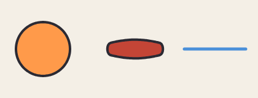

As regras:

- Uma forma **fechada** vira outra fechada (elipse, retângulo ou `shape`, de qualquer número de pontos), e um **traço** vira outro traço. O círculo do exemplo vira uma estrela de 10 pontos; a boca de 4 pontos vira uma de 8.
- Quando as duas formas são do mesmo tipo e têm o mesmo número de pontos, ponto 1 vira ponto 1, ponto 2 vira ponto 2… Nos outros casos, o Weasel espalha pontos iguais pelo contorno das duas e casa cada um com o mais perto do outro lado.
- A forma de destino quase sempre tem `hidden`: ela não aparece, só serve de molde.
- Para voltar ao normal, faça o morph para a própria forma: `key 20 olho.shape=olho`.
- A forma que muda mantém a cor, o contorno e o osso dela; só o formato muda.
- Uma forma não vira texto, e um texto não vira forma: o morph é só entre formas e traços.

**Experimente:** acrescente `ease=step` na `key 0`. A bolinha, a boca e a linha deixam de se transformar aos poucos e **trocam de uma vez** no quadro 12, como numa animação de recortes. A volta (do 12 ao 24) continua aos poucos, porque a `key 12` ainda usa o `smooth`.

## Um personagem completo

O Pingo junta tudo: o corpo respira (osso com escala), a cabeça acompanha, os olhos piscam (morph para elipses achatadas, e o brilho some com `show`), a boca abre (morph de uma `shape`), o "oi!" aparece e some (`opacity`) e há um evento.

<!-- gerar: img/07_pingo.gif -a parado -->
```weasel
canvas 360 300 bg=#dff1f7 light=-0.6,-0.8
palette ink=#2b2a33 line=6 pele=#ffb26b sombra=#a9c6d1

bone raiz pivot=180,270
bone cabeca parent=raiz pivot=180,200

layer chao
ellipse sombraChao 180,272 76,10 c=sombra

layer corpo
shape corpo c=pele ink=line weight=0.3 bone=raiz : 180,92 258,148 270,228 232,270! 128,270! 90,228 102,148

layer rosto
ellipse olhoE 152,172 11,16 c=ink bone=cabeca
ellipse olhoD 208,172 11,16 c=ink bone=cabeca
ellipse brilhoE 148,165 3.5,4.5 c=#ffffff bone=cabeca
ellipse brilhoD 204,165 3.5,4.5 c=#ffffff bone=cabeca
# moldes do olho fechado: uma elipse achatada (não aparecem)
ellipse fechadoE 152,178 12,2 hidden
ellipse fechadoD 208,178 12,2 hidden
shape boca c=#8a3b3b ink=3 bone=cabeca : 166,213! 180,218 194,213! 180,222
shape bocaAberta hidden : 166,210! 180,213 194,210! 180,236

layer fala
text oi 250,96 "oi!" size=30 bold c=ink

anim parado frames=48 fps=12
key 0 raiz=0,0,0,1,1 cabeca=0,0 oi.opacity=0
key 24 raiz=0,0,0,1.05,0.95 cabeca=0,4
key 48 raiz=0,0,0,1,1 cabeca=0,0
key 8 boca.shape=boca oi.opacity=0
key 11 boca.shape=bocaAberta oi.opacity=1
key 15 boca.shape=boca
key 22 oi.opacity=1
key 26 oi.opacity=0
key 34 olhoE.shape=olhoE olhoD.shape=olhoD brilhoE.show=1 brilhoD.show=1
key 36 olhoE.shape=fechadoE olhoD.shape=fechadoD brilhoE.show=0 brilhoD.show=0
key 38 olhoE.shape=olhoE olhoD.shape=olhoD brilhoE.show=1 brilhoD.show=1
event 11 fala
event 36 pisca
```

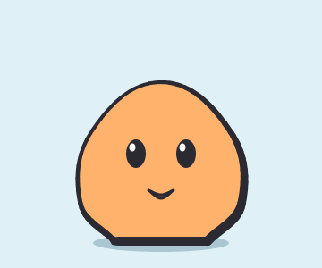

Repare em três coisas:

- Os **olhos** e a **boca** usam `bone=cabeca`, e a cabeça é filha da `raiz`: quando o corpo respira, o rosto vai junto e ainda desce um pouquinho a mais (`cabeca=0,4`).
- Para **piscar**, cada olho vira o molde `fechado` (uma elipse achatada) no quadro 36 e volta no 38; o brilho do olho some nesse meio-tempo com `show=0`. Os moldes só emprestam o formato: a cor continua a do olho.
- A **boca** é uma `shape` de 4 pontos, e `bocaAberta` também tem 4: por isso uma vira a outra.
- As `key` estão misturadas por assunto (respiração, fala, piscada), não por ordem de quadro. Pode: o Weasel organiza sozinho.

## Animações combinadas: `mix=`

Andar e atacar ao mesmo tempo é uma animação nova, mas não precisa ser feita do zero. `mix=` junta duas animações: a **base** inteira, com alguns ossos vindos da **ação**:

<!-- gerar: img/07_mix.gif -a walk_atk -->
```weasel
canvas 300 200 bg=#f4efe6
palette ink=#2b2a33 line=4

bone corpo pivot=150,150
bone braco pivot=170,110 parent=corpo
bone perna pivot=150,150 parent=corpo
ellipse tronco 150,110 24,40 c=#4a6fd8 ink=line bone=corpo
rect espada 168,50 6,60 c=#d9dde3 ink=line bone=braco
rect pe 140,150 20,40 c=#5ea860 ink=line bone=perna
box golpe hit rect 160,40 30,60 bone=braco only=atk off

anim walk frames=16 fps=12
key 0 corpo=0,0,0 perna=0,0,-20 braco=0,0,10
key 8 corpo=0,-8,0 perna=0,0,20 braco=0,0,-10
key 16 corpo=0,0,0 perna=0,0,-20 braco=0,0,10

anim atk frames=8 fps=12 once
key 0 braco=0,0,0 golpe.show=0
key 3 braco=0,0,-80
key 5 braco=0,0,90 golpe.show=1
key 7 golpe.show=0
key 8 braco=0,0,0
event 5 golpe

anim walk_atk mix=walk,atk bones=braco
```

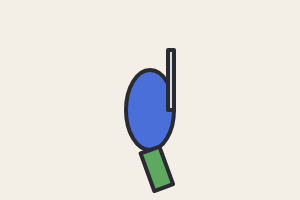

- `mix=walk,atk bones=braco`: tudo vem do `walk`, menos o osso `braco` (e os filhos dele), que vem do `atk`.
- O tempo é o da ação: 8 quadros, 12 fps e `once`, como o `atk`. Para mudar, escreva `frames=`, `fps=` ou `loop` na linha do `anim`. Os quadros são copiados pelo **tempo**: um quadro da combinada pega o que a origem fazia naquele instante, mesmo com outro `fps=`.
- Numa combinada em loop, o tempo dela tem de **fechar o ciclo** das animações de onde os ossos vêm (o mesmo tempo, ou um múltiplo). Uma combinada de 1,8 s em cima de um andar de 2,667 s recomeça no meio do passo, e as pernas pulam de volta: o editor avisa e sugere um tempo que fecha (sem `frames=` e `fps=`, vale o tempo da ação).
- O que é da ação vem junto: a caixa de golpe (presa ao braço e com `only=atk`) liga nos quadros certos, e o evento `golpe` também. As camadas e caixas com `only=walk` ou `only=atk` aparecem na combinada.
- `key` escritas na própria animação combinada valem por cima.
- Num jogo top-down, dê o nome com a direção (`walk_attack_right`): no Godot, o lado espelhado sai sozinho.

**Experimente:** troque `bones=braco` por `bones=corpo`. Agora o corpo **e os filhos dele** (o braço e a perna) vêm do `atk`, que não mexe na perna nem no corpo: o boneco para de andar e só golpeia.

## Posar arrastando os ossos

No editor, também dá para animar **mexendo no desenho**: em vez de adivinhar números, você arrasta o osso até a pose ficar boa, e o Weasel escreve a `key` para você. Para treinar, use este boneco:

<!-- conferir -->
```weasel
canvas 300 240 bg=#f4efe6
palette ink=#2b2a33 line=5 pele=#ffcf9e

bone corpo pivot=150,220
bone braco parent=corpo pivot=172,120

shape tronco c=#4a90d9 ink=line bone=corpo : 150,90 186,120 190,220! 110,220! 114,120
rect bracoR 166,112 70,16 r=8 c=pele ink=line bone=braco

anim acena frames=24 fps=12
key 0 braco=0,0,0
```

Passo a passo:

1. Cole o código num arquivo novo do editor.
2. Ligue a chave **Ossos** (ao lado de **Guias**). Cada osso ganha uma **bolinha** no pivô e uma **alça**: um traço verde-água que sai da bolinha, com uma ponta redonda.
3. No player, escolha a animação `acena` e deixe-a **pausada**. Com o player tocando, os ossos não arrastam.
4. Vá para o quadro 12: arraste a barra do player, ou clique fora do código e aperte `→` doze vezes.
5. Arraste a **ponta da alça** do `braco` para cima. O braço gira em volta do ombro. Solte quando gostar.
6. Olhe o código: apareceu uma linha nova logo depois da `key 0`, algo como `key 12 braco=0,0,-41.5` (o número depende de quanto você arrastou).
7. Toque a animação: o braço sobe até o quadro 12 e volta, porque o loop leva de volta para a `key 0`.

Mais detalhes:

- Arrastar a **bolinha** (em vez da alça) **move** o osso: o Weasel escreve o `dx,dy`. Num osso filho, o deslocamento é medido na direção do pai, como em qualquer `key`.
- Se o quadro já tem uma linha `key`, o Weasel troca só o valor daquele osso nela (ou acrescenta o osso no fim da linha). Se não tem, ele cria a linha, na ordem dos quadros.
- Os números saem com uma casa decimal. A escala (`sx,sy`) fica como estava: arrastar não estica.
- **Ctrl+Z** desfaz. Com o **Papel vegetal** ligado, dá para ver os quadros vizinhos enquanto você posa.

## Eventos: `event`

```
event 11 fala
event 36 pisca
```

Um **evento** marca um quadro com um nome: um passo, um som, o momento do golpe. Ele não desenha nada. Serve para o jogo (ou o editor de vídeo) saber **quando** algo acontece:

- no player do editor, os quadros com evento aparecem com ⚑;
- na sprite sheet, vão no JSON de cada quadro;
- na cena do Godot, chegam pelo sinal `evento(nome)` do AnimationPlayer, no quadro certo ([capítulo 9](09-jogo-godot.md)). Vários nomes no mesmo quadro (na mesma linha `event` ou em linhas separadas) chegam um depois do outro, na ordem do código.

Um pulo com três momentos marcados: quando sai do chão, quando chega no alto e quando volta ao chão (com dois nomes no mesmo quadro):

<!-- conferir -->
```weasel
canvas 300 220 bg=#f4efe6
palette ink=#2b2a33 line=4

bone corpo pivot=150,200
line chao c=#8a7f6e w=3 : 40,202 260,202
shape bicho c=#9be38c ink=line bone=corpo : 150,120 186,150 190,200! 110,200! 114,150

anim pula frames=24 fps=12
key 0 corpo=0,0,0,1.2,0.8 ease=out
key 3 corpo=0,0 ease=out
key 12 corpo=0,-90 ease=in
key 21 corpo=0,0
key 24 corpo=0,0,0,1.2,0.8
event 3 sai_do_chao
event 12 no_alto
event 21 bate poeira
```

Como um evento não aparece no desenho, a imagem do pulo não mostraria nada de novo. Para conferir que os eventos estão lá, salve como `pulo.weasel` e peça o resumo do arquivo com `--info`:

```bash
node cli/weasel.js pulo.weasel --info
```

```
canvas   300 × 220, fundo #f4efe6
camadas  1
  base             2 item(ns)
formas   2
ossos    corpo
animações 1
  pula           24 quadros, 12 fps
                 eventos: sai_do_chao@3, no_alto@12, bate@21, poeira@21
```

Repare:

- `event 3 sai_do_chao`: o número é o quadro, o mesmo das `key`. No quadro 3, o bicho acabou de desamassar e vai subir.
- `event 21 bate poeira`: uma linha pode ter **vários nomes**. Os dois acontecem no mesmo quadro: o jogo pode tocar o som de "bate" e soltar a poeira ao mesmo tempo.
- No resumo, cada evento aparece como `nome@quadro`.
- Um evento no quadro `frames` (aqui, 24) vale como quadro 0, porque o 24 é o 0 da volta seguinte.
- Os nomes são livres. Use nomes que o jogo vai entender (`passo`, `golpe`, `som_pulo`).

## Camadas que só aparecem em certas animações: `only=`

Um personagem costuma ter partes que só existem em algumas animações: o rastro de um ataque, a fumaça de uma corrida, o balão de fala, a vista de costas.

```
layer fumaca only=dash
layer frente only=pose,idle_down,walk_down
```

- `only=` recebe nomes de animação separados por vírgula.
- `pose` é a **pose parada** (sem animação; no player, a primeira opção do menu): inclua `pose` para a camada aparecer no desenho parado também. Por isso, nenhuma animação deve se chamar `pose`: o Weasel avisa.
- As caixas de jogo (`box`) aceitam o mesmo `only=`.

Um bicho com duas animações. Parado, ele tem olhos abertos; correndo, aperta os olhos de esforço e deixa riscos de vento para trás. Cada rosto fica numa camada, e cada camada diz em que animações aparece:

<!-- gerar: img/07_only_pose.png -->
<!-- gerar: img/07_only_parado.gif -a parado -->
<!-- gerar: img/07_only_corre.gif -a corre -->
```weasel
canvas 300 200 bg=#f4efe6
palette ink=#2b2a33 line=4 bicho=#9be38c

bone raiz pivot=150,180

layer chao
line linha c=#8a7f6e w=3 : 10,182 290,182

layer corpo
shape b c=bicho ink=line bone=raiz : 150,100 186,130 190,180! 110,180! 114,130

layer olhos only=pose,parado
ellipse olhoE 142,134 5,8 c=ink bone=raiz
ellipse olhoD 166,134 5,8 c=ink bone=raiz

layer esforco only=corre
stroke apertoE w=4 bone=raiz : 134,128 146,135! 134,142
stroke apertoD w=4 bone=raiz : 174,128 162,135! 174,142
stroke v1 w=4 c=#9aa0ad : 40,110 90,110
stroke v2 w=4 c=#9aa0ad : 20,135 80,135
stroke v3 w=4 c=#9aa0ad : 45,160 95,160

anim parado frames=24 fps=12
key 0 raiz=0,0,0,1,1
key 12 raiz=0,0,0,1.04,0.96
key 24 raiz=0,0,0,1,1

anim corre frames=8 fps=12
key 0 raiz=0,0,8
key 4 raiz=0,-14,8
key 8 raiz=0,0,8
```

| Pose parada (sem animação) | Animação `parado` | Animação `corre` |
|---|---|---|
|  | 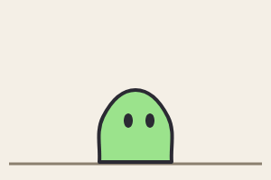 | 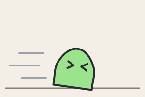 |

Repare:

- `layer chao` e `layer corpo` não têm `only=`: aparecem sempre.
- `layer olhos only=pose,parado`: dois nomes, separados por vírgula. Os olhos abertos aparecem na pose parada **e** na animação `parado`.
- `layer esforco only=corre`: os olhos apertados e os riscos de vento só aparecem na `corre`.
- As formas das camadas continuam presas aos ossos normalmente (`bone=raiz`).
- A imagem da esquerda foi gerada sem `-a`: é a pose parada. Sem `pose` na lista dos olhos, o bicho ficaria sem olhos nessa imagem e no editor, quando nenhuma animação está escolhida.

**Experimente:** tire o `pose,` da camada `olhos`. Gere a imagem sem animação: o bicho fica sem olhos.

## Uma imagem guia para cada movimento

A imagem guia ([capítulo 2](02-formas.md#desenhar-por-cima-de-uma-imagem-ref)) aceita o mesmo `only=`, e também `frames=`, para cada animação ter o seu rascunho por baixo:

```
ref parado "rascunhos/parado.png" 0,0 only=pose,idle
ref passo1 "rascunhos/andar1.png" 0,0 only=walk frames=0..5
ref passo2 "rascunhos/andar2.png" 0,0 only=walk frames=6..11
ref pulo "rascunhos/pulo.png" 0,0 only=jump opacity=0.3
```

- Com uma animação escolhida no player, só aparecem as imagens guia dela; `pose` é a pose parada. Sem `only=`, a imagem aparece em todas.
- `frames=a..b` limita aos quadros de `a` até `b` (os mesmos números das `key`): um desenho para cada parte do passo.
- No editor, **Adicionar imagem…** com uma animação escolhida já escreve o `only=` dela.
- O `ref` só vale no arquivo onde está escrito: as imagens guia de um personagem não aparecem num arquivo que faz `include` dele.

## Vendo e exportando

- **No editor**, o player embaixo do desenho escolhe a animação, toca, pausa e anda quadro a quadro (setas `←` `→` com o foco fora do código). Com o cursor numa linha `key` ou `event`, o player pula para aquele quadro. O botão **Papel vegetal** mostra os quadros vizinhos por transparência, como na mesa de luz do animador. O botão **Trajetória** desenha o caminho dos pontos (`point`) em todos os quadros; com `feet=` no `anim`, mostra também quanto o personagem anda por segundo sem os pés escorregarem ([capítulo 9](09-jogo-godot.md#andar-sem-escorregar-feet)).
- **Na linha de comando:**

```bash
node cli/weasel.js pingo.weasel -a parado -o pingo.gif
```

```bash
node cli/weasel.js pingo.weasel -a parado --frame 11 -o fala.png
```

```bash
node cli/weasel.js pingo.weasel -a parado --frames -o quadros/pingo.png
```

O primeiro faz um GIF; o segundo, o PNG de um quadro (o mesmo número usado nas `key`); o terceiro, um PNG por quadro. Para jogos, a sprite sheet e a cena do Godot estão no [capítulo 9](09-jogo-godot.md).

Para ver, sem desenhar nada, quais animações, ossos e eventos um arquivo tem, use `--info` (há um exemplo da saída em [Eventos](#eventos-event)):

```bash
node cli/weasel.js pingo.weasel --info
```

[← Ossos](06-ossos.md) · [Índice](README.md) · [Próximo: Luz, efeitos e partículas →](08-luz-efeitos.md)
