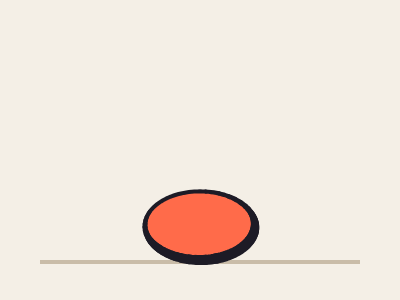
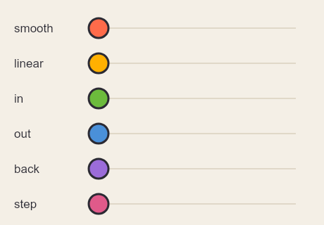
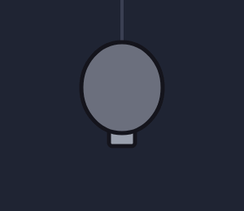
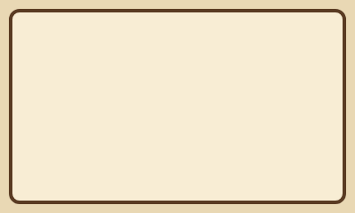
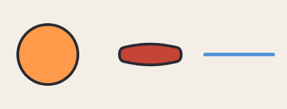
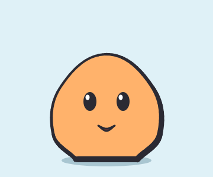
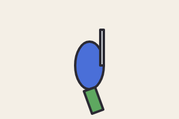

# 7. Animação

[← Ossos](06-ossos.md) · [Índice](README.md) · [Próximo: Luz, efeitos e partículas →](08-luz-efeitos.md)

## Como o Weasel anima

Animar no Weasel é dizer **como os ossos (e outras coisas) estão em alguns quadros-chave**. O Weasel calcula os quadros do meio sozinho. É o mesmo princípio dos desenhos animados: o animador principal faz as poses importantes, e o "intervalador" preenche o resto.

```
anim nome frames=quantos fps=por_segundo [once]
key quadro osso=dx,dy,rot,sx,sy  outro=…  ease=…
key quadro …
event quadro nome
```

## A primeira animação: a bola quicando

<!-- gerar: img/07_bola.gif -a quica -->
```weasel
canvas 400 300 bg=#f4efe6 light=-0.5,-0.85
palette ink=#1d1b26 line=6 bola=#ff6b4a

line chao c=#c9bca8 w=4 : 40,262 360,262
bone bola pivot=200,260
ellipse b 200,216 44 c=bola ink=line weight=0.3 bone=bola

anim quica frames=24 fps=24
key 0 bola=0,0,0,1.25,0.78 ease=out
key 12 bola=0,-170,0,1,1 ease=in
key 24 bola=0,0,0,1.25,0.78
```



Linha por linha:

- `bone bola pivot=200,260`: o osso da bola tem o pivô **embaixo dela**, no chão. Assim, quando ela estica e encolhe, amassa contra o chão em vez de encolher no meio do ar.
- `anim quica frames=24 fps=24`: uma animação de 24 quadros, tocada a 24 quadros por segundo (então dura 1 segundo). Os quadros são numerados de **0 a 23**.
- `key 0 bola=0,0,0,1.25,0.78`: no quadro 0, a bola está no lugar, **amassada** (1,25 de largura e 0,78 de altura).
- `key 12 bola=0,-170,0,1,1`: no quadro 12 ela está 170 pixels acima, no tamanho normal.
- `key 24 …`: igual ao quadro 0. O quadro 24 não aparece (o último é o 23); ele existe para dizer **como o fim volta para o começo**. Repetir a primeira pose no quadro `frames` é o que faz o **loop fechar sem pulo**.

```
quadro:   0 ───────────── 12 ───────────── 24 (= 0 de novo)
bola:     amassada        no alto           amassada
ease:     out (sobe freando)  in (cai acelerando)
```

### Como os quadros do meio são calculados: `ease`

Entre duas `key`, o valor vai mudando aos poucos. O `ease=` de uma `key` diz **como o movimento sai dela até a próxima**:

| `ease=` | Movimento | Bom para |
|---|---|---|
| `smooth` (padrão) | começa devagar, acelera, freia no fim | quase tudo |
| `linear` | velocidade constante | rodas, esteiras, coisas mecânicas |
| `in` | começa devagar e acelera | cair, sair correndo |
| `out` | começa rápido e freia | subir, parar, chegar |
| `back` | passa um pouco do ponto e volta | um gesto com "elástico", algo que chega e se ajeita |
| `step` | fica parado e **pula** de uma vez para a próxima `key` | piscar, trocar de pose seco, animação "de dois em dois" |

Na bola, a subida usa `out` (sai rápida do chão e freia no alto) e a descida usa `in` (cai cada vez mais rápido): é a gravidade.

<!-- gerar: img/07_eases.gif -a eases -->
```weasel
canvas 460 320 bg=#f4efe6
palette ink=#2b2a33 line=3

bone b1 pivot=140,40
bone b2 pivot=140,90
bone b3 pivot=140,140
bone b4 pivot=140,190
bone b5 pivot=140,240
bone b6 pivot=140,290

layer trilhos
line t1 c=#e0d8c8 w=2 : 140,40 420,40
line t2 c=#e0d8c8 w=2 : 140,90 420,90
line t3 c=#e0d8c8 w=2 : 140,140 420,140
line t4 c=#e0d8c8 w=2 : 140,190 420,190
line t5 c=#e0d8c8 w=2 : 140,240 420,240
line t6 c=#e0d8c8 w=2 : 140,290 420,290
text n1 20,46 "smooth" size=17
text n2 20,96 "linear" size=17
text n3 20,146 "in" size=17
text n4 20,196 "out" size=17
text n5 20,246 "back" size=17
text n6 20,296 "step" size=17

layer bolas
ellipse e1 140,40 14 c=#ff6b4a ink=line bone=b1
ellipse e2 140,90 14 c=#ffb000 ink=line bone=b2
ellipse e3 140,140 14 c=#6cbb3c ink=line bone=b3
ellipse e4 140,190 14 c=#4a90d9 ink=line bone=b4
ellipse e5 140,240 14 c=#9b6cd9 ink=line bone=b5
ellipse e6 140,290 14 c=#e05a8a ink=line bone=b6

anim eases frames=48 fps=24
key 0 b1=0 ease=smooth
key 0 b2=0 ease=linear
key 0 b3=0 ease=in
key 0 b4=0 ease=out
key 0 b5=0 ease=back
key 0 b6=0 ease=step
key 24 b1=280 ease=smooth
key 24 b2=280 ease=linear
key 24 b3=280 ease=in
key 24 b4=280 ease=out
key 24 b5=280 ease=back
key 24 b6=280 ease=step
key 48 b1=0 b2=0 b3=0 b4=0 b5=0 b6=0
```



Como o `ease=` vale para a linha inteira, cada bola tem a sua linha `key` no mesmo quadro. Várias linhas `key` no mesmo quadro se juntam.

### Regras das `key`

- Os valores são **absolutos**, medidos a partir da pose parada: `key 12 bola=0,-170` quer dizer "170 acima do lugar desenhado", não "mais 170 em relação à key anterior".
- Cada osso é independente. Um osso que não aparece em nenhuma `key` da animação fica parado; um osso que aparece só em alguns quadros vai de uma das suas `key` para a outra, ignorando as linhas em que ele não está.
- Numa animação com **loop** (o padrão), do último quadro com `key` o valor volta para o primeiro, passando pelo fim. Por isso, para o loop não "dar um tranco", ponha no quadro `frames` a mesma pose do quadro 0.
- Com **`once`**, a animação toca uma vez e para: antes da primeira `key`, vale a primeira; depois da última, a última fica. Use para golpes, pulos, quedas e transições.
- Quadros podem ter `key` em qualquer número de 0 a `frames`. Uma `key` repetida para o mesmo osso e o mesmo quadro substitui a anterior.

## Animando outras coisas: `forma.propriedade=valor`

As `key` também mudam formas, camadas e luzes. Em vez do nome de um osso, escreva `nome.propriedade=valor`:

| Propriedade | Em | O que muda | Como muda |
|---|---|---|---|
| `opacity` | forma, camada | transparência (0 a 1) | aos poucos |
| `c` | forma | cor de preenchimento (ou do traço) | as cores se misturam aos poucos |
| `inkc` | forma | cor do contorno | aos poucos |
| `w` | traço, linha | espessura | aos poucos |
| `ink` | forma | espessura do contorno | aos poucos |
| `show` | forma, camada, caixa | aparece (`1`) ou some (`0`) | de uma vez |
| `shape` | forma | **morph**: vira outra forma (fechada com fechada, traço com traço) | aos poucos (veja abaixo) |
| `draw` | forma | quanto já foi **desenhado**, de 0 a 1 | aos poucos ([abaixo](#desenhar-aos-poucos-draw)) |
| `above` `below` | forma, camada | pinta na frente (ou atrás) de outra ([capítulo 4](04-camadas.md#trocar-quem-fica-na-frente-durante-uma-animação-above-e-below)) | de uma vez |
| `blur` `glow` `tint` `brightness` `saturate` `contrast` `hue` | camada | efeitos ([capítulo 8](08-luz-efeitos.md#efeitos-de-camada)) | aos poucos |
| `power` `radius` `c` `glow` `aim` `cone` | luz | a luz ([capítulo 8](08-luz-efeitos.md)) | aos poucos |

<!-- gerar: img/07_lampada.gif -a acende -->
```weasel
canvas 300 260 bg=#1f2433
palette ink=#14141c line=5 apagada=#6b6f7d acesa=#ffe27a

gradient halo radial 150,108 110 : #ffe27aa0 #ffe27a00
ellipse brilho 150,108 110 c=halo
stroke fio w=4 c=#3a3f52 : 150,0 150,50
rect rosca 134,150 32,30 r=4 c=#9aa0ad ink=line
ellipse bulbo 150,108 50,56 c=apagada ink=line
text clique 236,226 "clique!" size=22 bold align=center c=#ffe27a

anim acende frames=32 fps=12
key 0 bulbo.c=apagada brilho.opacity=0 clique.show=0
key 8 bulbo.c=apagada brilho.opacity=0 clique.show=1
key 12 bulbo.c=acesa brilho.opacity=1 clique.show=0
key 24 bulbo.c=acesa brilho.opacity=1
key 28 bulbo.c=apagada brilho.opacity=0
key 32 bulbo.c=apagada brilho.opacity=0
```



- `bulbo.c` vai de cinza para amarelo entre os quadros 8 e 12: as cores se **misturam** aos poucos.
- `brilho.opacity` acende o halo junto.
- `clique.show=1` liga o texto de uma vez no quadro 8, e `clique.show=0` desliga no 12.
- Se várias formas têm o mesmo nome (por exemplo, dentro de um componente usado várias vezes), a `key` muda todas.
- A `opacity` das `key` **multiplica** a `opacity=` escrita na forma. Uma forma com `opacity=0` no código fica invisível para sempre; para começar apagada, use `key 0 forma.opacity=0`.
- Fora das animações (na pose parada), valem os valores do código: o halo aparece e o texto também.

## Desenhar aos poucos: `.draw`

`key quadro forma.draw=0` esconde a forma, e `draw=1` mostra ela inteira. Entre os dois, o Weasel **desenha a forma aos poucos**, como se uma caneta passasse por ela. É o efeito dos vídeos explicativos: a rota traçada no mapa, a seta que se desenha, o título digitado.

<!-- gerar: img/07_mapa.gif -a aparece -->
```weasel
canvas 400 240 bg=#e9d8b4
palette ink=#5a3b22 line=4 rota=#c44536

rect papel 12,12 376,216 r=10 c=#f8edd4 ink=line
text titulo 200,54 "Mapa do tesouro" size=28 align=center bold
ellipse sol 70,104 22 c=#ffb84d
shape ilha c=#9bc97a ink=line weight=0.5 : 282,84 352,92 362,146 314,168 274,136
stroke caminho w=5 c=rota taper=0,0.25 : 48,198 104,150 176,186 252,150 318,124
text marca 320,134 "X" size=28 bold align=center c=rota

anim aparece frames=48 fps=12 once
key 0 titulo.draw=0 sol.draw=0 ilha.draw=0 caminho.draw=0 marca.show=0 ease=linear
key 12 titulo.draw=1
key 6 sol.draw=0 ease=linear
key 16 sol.draw=1
key 10 ilha.draw=0 ease=linear
key 22 ilha.draw=1
key 20 caminho.draw=0 ease=linear
key 36 caminho.draw=1 marca.show=1
```



Como cada tipo de forma é desenhado:

| Forma | Com `draw` entre 0 e 1 |
|---|---|
| `stroke` e `line` | o traço cresce do primeiro ponto até o último |
| forma fechada com contorno (`ink=`) | o contorno corre em volta da forma, e o preenchimento aparece no fim |
| forma fechada sem contorno | um traço da cor da forma corre em volta, e o preenchimento aparece no fim |
| `text` | as letras aparecem uma a uma, cada uma no lugar dela |

- `ease=linear` dá velocidade constante, como uma caneta. Com o `smooth` (o padrão), o desenho começa devagar e termina devagar.
- O traço vai na **ordem dos pontos**. Para desenhar do outro lado, escreva os pontos ao contrário.
- Os quadros com `key` de cada forma são independentes: no exemplo, o sol começa no quadro 6, enquanto o título ainda está sendo digitado.
- A animação é `once` para o mapa ficar pronto no fim, em vez de se apagar ao voltar para o começo.
- Na pose parada, sem animação, tudo aparece inteiro.
- Num filme, as formas do próprio arquivo do filme também se desenham com `at`: `at 1s rota.draw=0` e `at 4s rota.draw=1` ([capítulo 10](10-filme.md#mudanças-no-tempo-at)).

## Morph: uma forma vira outra

`key 10 forma.shape=outra` faz a forma **se transformar** no formato de `outra` até aquele quadro. É assim que se pisca um olho, se abre uma boca ou se muda uma expressão sem ossos.

<!-- gerar: img/07_morph.gif -a vira -->
```weasel
canvas 420 160 bg=#f4efe6
palette ink=#2b2a33 line=4

ellipse bolha 70,80 44 c=#ff9a4a ink=line
shape estrela c=#ffd34d ink=line hidden : 70,30! 82,64! 118,66! 90,88! 100,122! 70,102! 40,122! 50,88! 22,66! 58,64!
shape boca c=#c44536 ink=line : 180,70 260,70 260,90 180,90
shape sorriso c=#c44536 ink=line hidden : 170,66 200,74 220,76 240,74 270,66 250,96 220,104 190,96
stroke onda w=5 c=#4a90d9 : 300,80 400,80
stroke zigue w=5 c=#4a90d9 hidden : 300,100 320,60 340,100 360,60 380,100 400,60

anim vira frames=24 fps=12
key 0 bolha.shape=bolha boca.shape=boca onda.shape=onda
key 12 bolha.shape=estrela boca.shape=sorriso onda.shape=zigue
key 24 bolha.shape=bolha boca.shape=boca onda.shape=onda
```



As regras:

- Uma forma **fechada** vira outra fechada (elipse, retângulo ou `shape`, de qualquer número de pontos), e um **traço** vira outro traço. O círculo do exemplo vira uma estrela de 10 pontos; a boca de 4 pontos vira uma de 8.
- Quando as duas formas são do mesmo tipo e têm o mesmo número de pontos, ponto 1 vira ponto 1, ponto 2 vira ponto 2… Nos outros casos, o Weasel espalha pontos iguais pelo contorno das duas e casa cada um com o mais perto do outro lado.
- A forma de destino quase sempre tem `hidden`: ela não aparece, só serve de molde.
- Para voltar ao normal, faça o morph para a própria forma: `key 20 olho.shape=olho`.
- A forma que muda mantém a cor, o contorno e o osso dela; só o formato muda.

## Um personagem completo

O Pingo junta tudo: o corpo respira (osso com escala), a cabeça acompanha, os olhos piscam (morph para elipses achatadas, e o brilho some com `show`), a boca abre (morph de uma `shape`), o "oi!" aparece e some (`opacity`) e há um evento.

<!-- gerar: img/07_pingo.gif -a parado -->
```weasel
canvas 360 300 bg=#dff1f7 light=-0.6,-0.8
palette ink=#2b2a33 line=6 pele=#ffb26b sombra=#a9c6d1

bone raiz pivot=180,270
bone cabeca parent=raiz pivot=180,200

layer chao
ellipse sombraChao 180,272 76,10 c=sombra

layer corpo
shape corpo c=pele ink=line weight=0.3 bone=raiz : 180,92 258,148 270,228 232,270! 128,270! 90,228 102,148

layer rosto
ellipse olhoE 152,172 11,16 c=ink bone=cabeca
ellipse olhoD 208,172 11,16 c=ink bone=cabeca
ellipse brilhoE 148,165 3.5,4.5 c=#ffffff bone=cabeca
ellipse brilhoD 204,165 3.5,4.5 c=#ffffff bone=cabeca
# moldes do olho fechado: uma elipse achatada (não aparecem)
ellipse fechadoE 152,178 12,2 hidden
ellipse fechadoD 208,178 12,2 hidden
shape boca c=#8a3b3b ink=3 bone=cabeca : 166,213! 180,218 194,213! 180,222
shape bocaAberta hidden : 166,210! 180,213 194,210! 180,236

layer fala
text oi 250,96 "oi!" size=30 bold c=ink

anim parado frames=48 fps=12
key 0 raiz=0,0,0,1,1 cabeca=0,0 oi.opacity=0
key 24 raiz=0,0,0,1.05,0.95 cabeca=0,4
key 48 raiz=0,0,0,1,1 cabeca=0,0
key 8 boca.shape=boca oi.opacity=0
key 11 boca.shape=bocaAberta oi.opacity=1
key 15 boca.shape=boca
key 22 oi.opacity=1
key 26 oi.opacity=0
key 34 olhoE.shape=olhoE olhoD.shape=olhoD brilhoE.show=1 brilhoD.show=1
key 36 olhoE.shape=fechadoE olhoD.shape=fechadoD brilhoE.show=0 brilhoD.show=0
key 38 olhoE.shape=olhoE olhoD.shape=olhoD brilhoE.show=1 brilhoD.show=1
event 11 fala
event 36 pisca
```



Repare em três coisas:

- Os **olhos** e a **boca** usam `bone=cabeca`, e a cabeça é filha da `raiz`: quando o corpo respira, o rosto vai junto e ainda desce um pouquinho a mais (`cabeca=0,4`).
- Para **piscar**, cada olho vira o molde `fechado` (uma elipse achatada) no quadro 36 e volta no 38; o brilho do olho some nesse meio-tempo com `show=0`. Os moldes só emprestam o formato: a cor continua a do olho.
- A **boca** é uma `shape` de 4 pontos, e `bocaAberta` também tem 4: por isso uma vira a outra.
- As `key` estão misturadas por assunto (respiração, fala, piscada), não por ordem de quadro. Pode: o Weasel organiza sozinho.

## Animações combinadas: `mix=`

Andar e atacar ao mesmo tempo é uma animação nova, mas não precisa ser feita do zero. `mix=` junta duas animações: a **base** inteira, com alguns ossos vindos da **ação**:

<!-- gerar: img/07_mix.gif -a walk_atk -->
```weasel
canvas 300 200 bg=#f4efe6
palette ink=#2b2a33 line=4

bone corpo pivot=150,150
bone braco pivot=170,110 parent=corpo
bone perna pivot=150,150 parent=corpo
ellipse tronco 150,110 24,40 c=#4a6fd8 ink=line bone=corpo
rect espada 168,50 6,60 c=#d9dde3 ink=line bone=braco
rect pe 140,150 20,40 c=#5ea860 ink=line bone=perna
box golpe hit rect 160,40 30,60 bone=braco only=atk off

anim walk frames=16 fps=12
key 0 corpo=0,0,0 perna=0,0,-20 braco=0,0,10
key 8 corpo=0,-8,0 perna=0,0,20 braco=0,0,-10
key 16 corpo=0,0,0 perna=0,0,-20 braco=0,0,10

anim atk frames=8 fps=12 once
key 0 braco=0,0,0 golpe.show=0
key 3 braco=0,0,-80
key 5 braco=0,0,90 golpe.show=1
key 7 golpe.show=0
key 8 braco=0,0,0
event 5 golpe

anim walk_atk mix=walk,atk bones=braco
```



- `mix=walk,atk bones=braco`: tudo vem do `walk`, menos o osso `braco` (e os filhos dele), que vem do `atk`.
- O tempo é o da ação: 8 quadros, 12 fps e `once`, como o `atk`. Para mudar, escreva `frames=`, `fps=` ou `loop` na linha do `anim`.
- O que é da ação vem junto: a caixa de golpe (presa ao braço e com `only=atk`) liga nos quadros certos, e o evento `golpe` também. As camadas e caixas com `only=walk` ou `only=atk` aparecem na combinada.
- `key` escritas na própria animação combinada valem por cima.
- Num jogo top-down, dê o nome com a direção (`walk_attack_right`): no Godot, o lado espelhado sai sozinho.

## Posar arrastando os ossos

No editor, também dá para animar **mexendo no desenho**. Ligue **Ossos**, escolha uma animação no player, pare num quadro e:

- arraste a **bolinha** de um osso para movê-lo;
- arraste a **alça** (o traço verde que sai do osso) para girá-lo.

O Weasel escreve o osso na `key` daquele quadro, com os valores novos. Se o quadro ainda não tem `key`, ele cria a linha, na ordem dos quadros. É um jeito de experimentar uma pose e ver no código o que ela virou. **Ctrl+Z** desfaz.

## Eventos: `event`

```
event 11 fala
event 36 pisca
```

Um **evento** marca um quadro com um nome: um passo, um som, o momento do golpe. Ele não desenha nada. Serve para o jogo (ou o editor de vídeo) saber **quando** algo acontece:

- no player do editor, os quadros com evento aparecem com ⚑;
- na sprite sheet, vão no JSON de cada quadro;
- na cena do Godot, chegam pelo sinal `evento(nome)` do AnimationPlayer, no quadro certo ([capítulo 9](09-jogo-godot.md)).

## Camadas que só aparecem em certas animações: `only=`

Um personagem costuma ter partes que só existem em algumas animações: o rastro de um ataque, a fumaça de uma corrida, o balão de fala, a vista de costas.

```
layer fumaca only=dash
layer frente only=pose,idle_down,walk_down
```

- `only=` recebe nomes de animação separados por vírgula.
- `pose` é a **pose parada** (sem animação): inclua `pose` para a camada aparecer no desenho parado também.
- As caixas de jogo (`box`) aceitam o mesmo `only=`.

## Vendo e exportando

- **No editor**, o player embaixo do desenho escolhe a animação, toca, pausa e anda quadro a quadro (setas `←` `→` com o foco fora do código). Com o cursor numa linha `key` ou `event`, o player pula para aquele quadro. O botão **Papel vegetal** mostra os quadros vizinhos por transparência, como na mesa de luz do animador.
- **Na linha de comando:**

```bash
node cli/weasel.js pingo.weasel -a parado -o pingo.gif
```

```bash
node cli/weasel.js pingo.weasel -a parado --frame 11 -o fala.png
```

```bash
node cli/weasel.js pingo.weasel -a parado --frames -o quadros/pingo.png
```

O primeiro faz um GIF; o segundo, o PNG de um quadro (o mesmo número usado nas `key`); o terceiro, um PNG por quadro. Para jogos, a sprite sheet e a cena do Godot estão no [capítulo 9](09-jogo-godot.md).

[← Ossos](06-ossos.md) · [Índice](README.md) · [Próximo: Luz, efeitos e partículas →](08-luz-efeitos.md)
