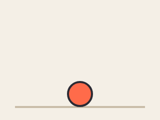
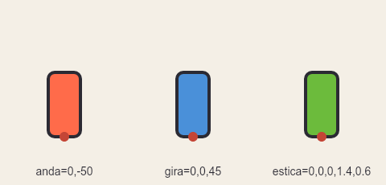
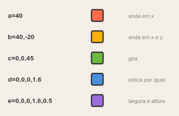
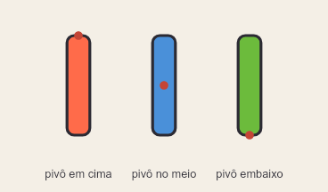
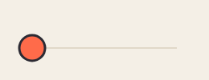
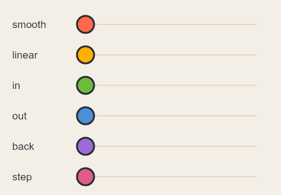
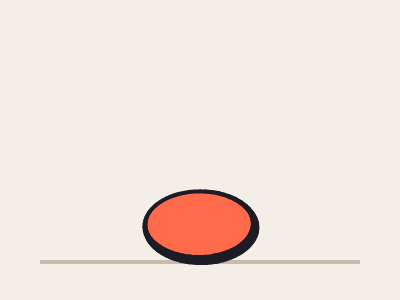
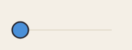
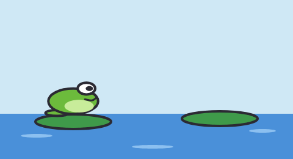

# 7. Primeiro movimento

[← Componentes e arquivos](06-componentes.md) · [Índice](README.md) · [Próximo: Ossos →](08-ossos.md)

Até aqui, os desenhos ficavam parados. Neste capítulo, eles se mexem. Você aprende a prender formas a um **osso** (`bone`), a fazer uma **animação** (`anim`), a dizer onde o osso está em alguns quadros (`key`), a escolher a velocidade (`frames=`, `fps=` e `ease=`) e a decidir se a animação se repete ou toca uma vez (`once`). É o mínimo para os capítulos 8 e 9. Você precisa dos capítulos 1 a 4.

## Como o Weasel anima

Uma animação é uma sequência de imagens, os **quadros**, mostradas uma depois da outra, bem rápido. Você não desenha cada quadro. Você diz como o desenho está em **alguns** quadros, os **quadros-chave**, e o Weasel calcula os quadros do meio. Nos desenhos animados é igual: um desenhista faz as poses principais, e outro desenha os quadros entre elas.

Quem se mexe é um **osso**: um ponto invisível que leva junto as formas presas a ele.

```
bone nome pivot=x,y
forma … bone=nome
anim nome frames=quantos fps=por_segundo
key quadro nome=dx,dy,giro,largura,altura
```

## A primeira animação

<!-- gerar: img/07_primeira.gif -a sobe -->
```weasel
canvas 320 240 bg=#f4efe6
palette ink=#2b2a33 line=4

line chao c=#c9bca8 w=4 : 30,214 290,214
bone pulo pivot=160,212
ellipse bola 160,188 24 c=#ff6b4a ink=line bone=pulo

anim sobe frames=24 fps=12
key 0 pulo=0,0
key 12 pulo=0,-120
```



Linha por linha:

- `bone pulo pivot=160,212`: um osso chamado `pulo`. O **pivô** é o ponto do osso; aqui ele fica embaixo da bola, no chão. O osso não aparece na imagem.
- `ellipse bola … bone=pulo`: a bola fica **presa** ao osso. Quando o osso anda, a bola vai junto.
- `anim sobe frames=24 fps=12`: uma animação chamada `sobe`, com 24 quadros, tocados a 12 por segundo. Ela dura 2 segundos (24 ÷ 12). Os quadros são numerados de 0 a 23.
- `key 0 pulo=0,0`: no quadro 0, o osso está no lugar desenhado. Ele anda 0 em x e 0 em y.
- `key 12 pulo=0,-120`: no quadro 12, o osso está 120 pixels acima. Lembre: y negativo é para cima.
- Entre os quadros 0 e 12, o Weasel calcula o caminho. Depois do 12, a bola volta sozinha para a `key 0`, porque a animação se repete (o **loop**, [mais abaixo](#loop-ou-uma-vez-só-once)).

Fora da animação, na **pose parada**, o osso não muda nada: a bola fica onde as coordenadas dizem. Por isso você desenha tudo na posição de descanso e depois diz como os ossos se mexem.

**Experimente:** troque `pulo=0,-120` por `pulo=100,-120`. A bola sobe na diagonal, para a direita, e volta.

**Cuidado:** uma forma sem `bone=` não se mexe. É o erro mais comum: animar o osso e esquecer de prender a forma nele.

## Ver a animação

- **No editor**, o player embaixo do desenho escolhe a animação e toca ([capítulo 22](22-editor.md#player)). A primeira opção dele é a pose parada.
- **Na linha de comando**, `-a` escolhe a animação, e um nome terminado em `.gif` faz um GIF:

```bash
node cli/weasel.js bola.weasel -a sobe -o bola.gif
```

Sem `-a`, sai a pose parada. Com `-a sobe --frame 12 -o alto.png`, sai só o quadro 12, numa imagem PNG. As outras saídas (um PNG por quadro, WebP, vídeo) estão no [capítulo 9](09-animacao.md#ver-e-exportar).

## Andar, girar e esticar

Cada osso, numa `key`, recebe até cinco números: `osso=dx,dy,rot,sx,sy`.

| Números | O que fazem | Parado vale |
|---|---|---|
| `dx,dy` | **anda**: quantos pixels em x e em y | `0,0` |
| `rot` | **gira** em volta do pivô, em graus; positivo é o sentido do relógio | `0` |
| `sx,sy` | **estica** a largura e a altura; o pivô fica parado (`1` = normal, `2` = o dobro, `0.5` = a metade) | `1,1` |

<!-- gerar: img/06_movimentos.gif -a demo --guides -->
```weasel
canvas 480 230 bg=#f4efe6
palette ink=#2b2a33 line=4

bone anda pivot=80,170
bone gira pivot=240,170
bone estica pivot=400,170

rect a 60,90 40,80 r=8 c=#ff6b4a ink=line bone=anda
rect g 220,90 40,80 r=8 c=#4a90d9 ink=line bone=gira
rect e 380,90 40,80 r=8 c=#6cbb3c ink=line bone=estica

layer pivos guide
ellipse pa 80,170 6 c=#c44536 bone=anda
ellipse pg 240,170 6 c=#c44536 bone=gira
ellipse pe 400,170 6 c=#c44536 bone=estica
text ta 80,218 "anda=0,-50" size=14 align=center
text tg 240,218 "gira=0,0,45" size=14 align=center
text te 400,218 "estica=0,0,0,1.4,0.6" size=14 align=center

anim demo frames=36 fps=12
key 0 anda=0,0 gira=0,0,0 estica=0,0,0,1,1
key 18 anda=0,-50 gira=0,0,45 estica=0,0,0,1.4,0.6
key 36 anda=0,0 gira=0,0,0 estica=0,0,0,1,1
```



Os pontos vermelhos marcam os pivôs. Eles estão numa camada `guide` ([capítulo 4](04-camadas.md#camada-de-construção-guide)): aparecem no editor e com `--guides`, mas não na imagem exportada. Os três retângulos têm o pivô embaixo, no meio:

- o vermelho **anda** 50 pixels para cima (`dy=-50`);
- o azul **gira** 45° em volta da base;
- o verde **estica** 1,4 vez na largura e encolhe para 0,6 na altura. Ele continua apoiado no pivô, como uma bola que amassa contra o chão.
- Três ossos, cada um com a sua forma, na mesma `key`: cada osso tem o seu próprio movimento.

**Experimente:** troque `gira=0,0,45` por `gira=0,0,-45` na `key 18`. O azul passa a girar para o outro lado, contra o sentido do relógio.

### Quantos números escrever

Não precisa escrever os cinco números sempre. Os que faltam valem o "parado":

| Você escreve | Vale |
|---|---|
| `osso=10` | anda 10 em x |
| `osso=10,-5` | anda 10 em x e −5 em y |
| `osso=0,0,30` | gira 30° |
| `osso=0,0,0,1.5` | estica 1,5 vez por igual (largura e altura) |
| `osso=0,0,0,1.5,0.8` | largura 1,5 e altura 0,8 |

Cada quadrado abaixo usa uma linha da tabela:

<!-- gerar: img/06_numeros.gif -a mostra -s 0.8 -->
```weasel
canvas 460 300 bg=#f4efe6
palette ink=#2b2a33 line=3

bone a pivot=250,40
bone b pivot=250,95
bone c pivot=250,150
bone d pivot=250,205
bone e pivot=250,260

text n1 20,46 "a=40" size=17 bold
text n2 20,101 "b=40,-20" size=17 bold
text n3 20,156 "c=0,0,45" size=17 bold
text n4 20,211 "d=0,0,0,1.6" size=17 bold
text n5 20,266 "e=0,0,0,1.6,0.5" size=17 bold
text x1 330,46 "anda em x" size=14 c=#8a7f6e
text x2 330,101 "anda em x e y" size=14 c=#8a7f6e
text x3 330,156 "gira" size=14 c=#8a7f6e
text x4 330,211 "estica por igual" size=14 c=#8a7f6e
text x5 330,266 "largura e altura" size=14 c=#8a7f6e

rect qa 235,25 30,30 r=4 c=#ff6b4a ink=line bone=a
rect qb 235,80 30,30 r=4 c=#ffb000 ink=line bone=b
rect qc 235,135 30,30 r=4 c=#6cbb3c ink=line bone=c
rect qd 235,190 30,30 r=4 c=#4a90d9 ink=line bone=d
rect qe 235,245 30,30 r=4 c=#9b6cd9 ink=line bone=e

anim mostra frames=24 fps=12
key 0 a=0 b=0 c=0 d=0 e=0
key 12 a=40 b=40,-20 c=0,0,45 d=0,0,0,1.6 e=0,0,0,1.6,0.5
key 24 a=0 b=0 c=0 d=0 e=0
```



Repare:

- Os pivôs estão no meio de cada quadrado, então eles giram e crescem no lugar.
- Com **4 números**, o quarto vale para a largura **e** a altura: `1.6` é 60% maior.
- `key 0 a=0 …`: um número só, `0`, já quer dizer "parado".
- Uma escala negativa **espelha**: `osso=0,0,0,-1,1` vira o desenho para o outro lado, em volta do pivô. O sapo do fim do capítulo usa isso.

**Experimente:** na `key 12`, troque `c=0,0,45` por `c=0,0,360`. O quadrado verde dá uma volta inteira.

## Onde pôr o pivô

O pivô decide **em volta de qual ponto** a forma gira e estica. Aqui, três retângulos iguais giram os mesmos 35°. Só o lugar do pivô muda:

<!-- gerar: img/06_pivo.gif -a gira --guides -s 0.8 -->
```weasel
canvas 460 270 bg=#f4efe6
palette ink=#2b2a33 line=4

bone emCima pivot=110,50
bone noMeio pivot=230,120
bone embaixo pivot=350,190

rect a 94,50 32,140 r=10 c=#ff6b4a ink=line bone=emCima
rect b 214,50 32,140 r=10 c=#4a90d9 ink=line bone=noMeio
rect c 334,50 32,140 r=10 c=#6cbb3c ink=line bone=embaixo

text t1 110,250 "pivô em cima" size=16 align=center
text t2 230,250 "pivô no meio" size=16 align=center
text t3 350,250 "pivô embaixo" size=16 align=center

layer pivos guide
ellipse p1 110,50 6 c=#c44536 bone=emCima
ellipse p2 230,120 6 c=#c44536 bone=noMeio
ellipse p3 350,190 6 c=#c44536 bone=embaixo

anim gira frames=24 fps=12
key 0 emCima=0,0,0 noMeio=0,0,0 embaixo=0,0,0
key 12 emCima=0,0,35 noMeio=0,0,35 embaixo=0,0,35
key 24 emCima=0,0,0 noMeio=0,0,0 embaixo=0,0,0
```



Repare:

- Os retângulos vão de y=50 a y=190 (começam em 50 e têm 140 de altura).
- `pivot=110,50`, na **ponta de cima**: ela fica parada, e a de baixo faz um arco, como um pêndulo.
- `pivot=230,120`, no **meio** (50 + 140 ÷ 2): o retângulo gira no lugar, como uma hélice.
- `pivot=350,190`, na **base**: ela fica parada, e o topo tomba, como uma árvore.
- Um braço gira no ombro, uma cabeça no pescoço, uma porta na dobradiça. Ponha o pivô onde a peça se prende.

**Experimente:** mude o pivô do azul para `pivot=230,50` (e o ponto `p2` para `230,50`). Ele passa a balançar igual ao vermelho.

## Quantos quadros e quão rápido: `frames=` e `fps=`

`frames=` diz **quantos quadros** a animação tem. `fps=` diz quantos deles passam **por segundo** ("frames per second", em inglês). A duração é a divisão: `frames ÷ fps` segundos. Aqui, o mesmo vaivém de uma bola, em três animações do mesmo arquivo:

<!-- gerar: img/07_fps_normal.gif -a normal -->
<!-- gerar: img/07_fps_devagar.gif -a devagar -->
<!-- gerar: img/07_fps_liso.gif -a liso -->
```weasel
canvas 260 100 bg=#f4efe6
palette ink=#2b2a33 line=3

bone b pivot=40,60
line trilho c=#e0d8c8 w=2 : 40,60 220,60
ellipse bola 40,60 16 c=#ff6b4a ink=line bone=b

anim normal frames=12 fps=12
key 0 b=0
key 6 b=180
key 12 b=0

anim devagar frames=12 fps=6
key 0 b=0
key 6 b=180
key 12 b=0

anim liso frames=24 fps=24
key 0 b=0
key 12 b=180
key 24 b=0
```

| `normal`: `frames=12 fps=12` | `devagar`: `frames=12 fps=6` | `liso`: `frames=24 fps=24` |
|---|---|---|
|  |  |  |
| 12 quadros em 1 segundo (12 ÷ 12) | os mesmos 12 quadros em 2 segundos (12 ÷ 6): mais lento e aos trancos | 24 quadros em 1 segundo (24 ÷ 24): a mesma velocidade do `normal`, mais liso |

Repare:

- Um arquivo pode ter várias animações. Cada linha `anim` começa uma nova, e as `key` de baixo são dela, até o próximo `anim`.
- Em cada animação, a bola chega ao fim do trilho (`b=180`, 180 pixels para a direita) na **metade** dos quadros: no 6 de 12, no 12 de 24.
- Dobrar o `frames=` e o `fps=` juntos mantém a duração e deixa o movimento mais liso. O preço: mais quadros para exportar.
- `frames=` vai de 1 a 600 (se não escrever, 24). `fps=` vai de 1 a 60 (se não escrever, 12).

**Experimente:** na animação `liso`, troque `fps=24` por `fps=12`. Ela continua lisa, mas passa a durar 2 segundos (24 ÷ 12).

## Devagar ou depressa: `ease`

Entre duas `key`, o valor vai mudando aos poucos. O `ease=` de uma `key` diz **como** ele muda, desta `key` até a próxima:

| `ease=` | Como o movimento anda | Bom para |
|---|---|---|
| `smooth` (o padrão) | começa devagar, acelera e termina devagar | quase tudo |
| `linear` | com a mesma velocidade o tempo todo | rodas, esteiras, coisas de máquina |
| `in` | começa devagar e termina rápido | cair, sair correndo |
| `out` | começa rápido e termina devagar | subir, frear, chegar |
| `back` | passa um pouco do ponto e volta | um gesto com elástico, algo que chega e se ajeita |
| `step` | fica parado e **pula** de uma vez na `key` seguinte | piscar, trocar de pose de uma vez |

Seis bolas fazem o mesmo caminho, cada uma com um `ease`. Não precisa ler o código todo: cada bola tem um osso e uma linha `key` com o seu `ease=`.

<!-- gerar: img/07_eases.gif -a eases -->
```weasel
canvas 460 320 bg=#f4efe6
palette ink=#2b2a33 line=3

bone b1 pivot=140,40
bone b2 pivot=140,90
bone b3 pivot=140,140
bone b4 pivot=140,190
bone b5 pivot=140,240
bone b6 pivot=140,290

layer trilhos
line t1 c=#e0d8c8 w=2 : 140,40 420,40
line t2 c=#e0d8c8 w=2 : 140,90 420,90
line t3 c=#e0d8c8 w=2 : 140,140 420,140
line t4 c=#e0d8c8 w=2 : 140,190 420,190
line t5 c=#e0d8c8 w=2 : 140,240 420,240
line t6 c=#e0d8c8 w=2 : 140,290 420,290
text n1 20,46 "smooth" size=17
text n2 20,96 "linear" size=17
text n3 20,146 "in" size=17
text n4 20,196 "out" size=17
text n5 20,246 "back" size=17
text n6 20,296 "step" size=17

layer bolas
ellipse e1 140,40 14 c=#ff6b4a ink=line bone=b1
ellipse e2 140,90 14 c=#ffb000 ink=line bone=b2
ellipse e3 140,140 14 c=#6cbb3c ink=line bone=b3
ellipse e4 140,190 14 c=#4a90d9 ink=line bone=b4
ellipse e5 140,240 14 c=#9b6cd9 ink=line bone=b5
ellipse e6 140,290 14 c=#e05a8a ink=line bone=b6

anim eases frames=48 fps=24
key 0 b1=0 ease=smooth
key 0 b2=0 ease=linear
key 0 b3=0 ease=in
key 0 b4=0 ease=out
key 0 b5=0 ease=back
key 0 b6=0 ease=step
key 24 b1=280 ease=smooth
key 24 b2=280 ease=linear
key 24 b3=280 ease=in
key 24 b4=280 ease=out
key 24 b5=280 ease=back
key 24 b6=280 ease=step
key 48 b1=0 b2=0 b3=0 b4=0 b5=0 b6=0
```



Repare:

- O `ease=` vale para a linha `key` inteira. Por isso cada bola tem a sua linha no quadro 0 e no 24.
- Pode haver várias linhas `key` no mesmo quadro: o Weasel junta todas.
- A bola do `step` fica parada até o quadro 24 e então pula para o fim do trilho.

### A bola quicando

Uma bola de verdade sai do chão rápido, freia no alto e cai cada vez mais depressa. É a gravidade, e o `ease` faz isso: `out` na subida e `in` na descida. A bola ainda amassa no chão:

<!-- gerar: img/07_bola.gif -a quica -->
```weasel
canvas 400 300 bg=#f4efe6 light=-0.5,-0.85
palette ink=#1d1b26 line=6 bola=#ff6b4a

line chao c=#c9bca8 w=4 : 40,262 360,262
bone bola pivot=200,260
ellipse b 200,216 44 c=bola ink=line weight=0.3 bone=bola

anim quica frames=24 fps=24
key 0 bola=0,0,0,1.25,0.78 ease=out
key 12 bola=0,-170,0,1,1 ease=in
key 24 bola=0,0,0,1.25,0.78
```



Repare:

- O pivô está **embaixo da bola**, no chão. Assim, quando ela estica e encolhe, amassa contra o chão em vez de encolher no meio do ar.
- `key 0 … ease=out`: no chão, amassada (1,25 de largura e 0,78 de altura), saindo rápido para cima.
- `key 12 … ease=in`: 170 pixels acima, redonda (`1,1`), começando a cair devagar.
- `key 24`: igual à `key 0`. O quadro 24 não é desenhado (o último é o 23); num loop, ele é o quadro 0 de novo. Sem esta linha, a bola faria o mesmo caminho, porque o loop volta sozinho da última `key` para a primeira ([mais abaixo](#loop-ou-uma-vez-só-once)).

**Experimente:** troque os dois `ease=` por `ease=linear`. A bola passa a subir e descer com a mesma velocidade, como um elevador, e perde o peso.

## Loop ou uma vez só: `once`

Um passo, uma respiração ou uma chama se repetem sem parar: isso é o **loop**, o padrão. Um pulo, um golpe ou uma porta abrindo acontecem **uma vez** e param no fim: para isso, escreva `once` na linha do `anim`. As duas animações abaixo têm as mesmas `key`. Só a de baixo tem `once`:

<!-- gerar: img/07_loop.gif -a vai -->
<!-- gerar: img/07_once.gif -a vaiUmaVez -->
```weasel
canvas 260 100 bg=#f4efe6
palette ink=#2b2a33 line=3

bone b pivot=40,60
line trilho c=#e0d8c8 w=2 : 40,60 220,60
ellipse bola 40,60 16 c=#4a90d9 ink=line bone=b

anim vai frames=24 fps=12
key 0 b=0
key 12 b=180

anim vaiUmaVez frames=24 fps=12 once
key 0 b=0
key 12 b=180
```

| `anim vai` (loop) | `anim vaiUmaVez … once` |
|---|---|
|  |  |

Repare:

- As duas animações têm 24 quadros e só duas `key`: a bola sai do começo (quadro 0) e chega ao fim do trilho no quadro 12. Do 12 ao 23 não há `key`.
- **Loop** (esquerda): depois do quadro 23 vem o 0 de novo. Então, do quadro 12 em diante, a bola já vai voltando para a `key 0`. O loop sempre volta da última `key` para a primeira, sem pulo.
- **`once`** (direita): depois da última `key`, a bola **fica** onde está, parada no fim.
- Um GIF sempre recomeça do quadro 0 quando chega ao fim. Por isso a bola da direita pula para o começo a cada volta. Num jogo, a animação `once` toca uma vez e para.

**Experimente:** na `vai`, acrescente `key 24 b=0`. Nada muda: o loop já voltava para o 0. Agora acrescente a mesma linha na `vaiUmaVez`: a bola volta também, porque agora a última `key` é a do quadro 24.

**Cuidado:** num loop, uma `key` no quadro `frames=` **diferente** da `key 0` dá um pulo quando a animação recomeça, porque o quadro `frames=` é o quadro 0 de novo. Igual à `key 0`, ela não muda nada: os exemplos deste guia às vezes a escrevem só para deixar claro onde o ciclo fecha.

## As regras das `key`

- Os números são medidos a partir do **desenho**, não da `key` anterior: `key 12 bola=0,-170` quer dizer "170 acima do lugar desenhado", e não "mais 170".
- Cada osso só olha as linhas em que aparece: ele vai de uma `key` dele até a próxima `key` dele. Um osso que não aparece em nenhuma `key` fica parado.
- Com uma `key` só, o osso fica naquela pose a animação inteira.
- O quadro vai de 0 a `frames=`. Um número quebrado é arredondado; um quadro maior que `frames=` dá aviso e vale `frames=`.
- O mesmo osso duas vezes no mesmo quadro: vale a de baixo.
- Uma `key` antes de qualquer `anim` dá erro.

## Opções do `anim` e da `key`

| Opção | O que faz | Valores | Se não escrever |
|---|---|---|---|
| o nome (no `anim`) | o nome da animação, para o player e para o `-a` | um nome sem acento, que não se repete | obrigatório |
| `frames=` | quantos quadros a animação tem | de 1 a 600 | 24 |
| `fps=` | quantos quadros por segundo | de 1 a 60 | 12 |
| `once` | toca uma vez e para no último quadro | — | a animação se repete (loop) |
| o quadro (na `key`) | em que quadro vale a pose | de 0 a `frames=` | obrigatório |
| `osso=dx,dy,rot,sx,sy` | a pose do osso: anda, gira e estica em volta do pivô | de 1 a 5 números | `0,0,0,1,1` (a pose do desenho) |
| `ease=` | como o valor muda desta `key` até a próxima | `smooth`, `linear`, `in`, `out`, `back` ou `step` | `smooth` |

A `key` também muda cores, transparência e formas, e o `anim` ainda junta animações: isso é o [capítulo 9](09-animacao.md). As fichas completas estão na referência: [`bone`](19-referencia.md#bone), [`anim`](19-referencia.md#anim) e [`key`](19-referencia.md#key).

## Juntando tudo

Um sapo pula de uma folha para a outra no lago, vira para trás e pula de volta. Cada folha afunda um pouco quando ele cai nela.

<!-- gerar: img/07_sapo.gif -a pula -->
```weasel
canvas 480 260 bg=#cfe8f5
palette ink=#2b2a33 line=4 sapo=#6cbb3c barriga=#c8ec9a folha=#3f9a4a

rect lago 0,186 480,74 c=#4a90d9
ellipse brilho1 60,222 26,3 c=#8cc0f0
ellipse brilho2 250,240 34,3 c=#8cc0f0
ellipse brilho3 430,214 22,3 c=#8cc0f0

# as folhas: cada uma com o seu osso, para afundar quando o sapo cai
bone folhaE pivot=120,192
bone folhaD pivot=360,192
ellipse fE 120,194 62,12 c=folha ink=line bone=folhaE
ellipse fD 360,194 62,12 c=folha ink=line bone=folhaD

# o sapo, virado para a direita, com o pivô nos pés
bone sapo pivot=120,188
ellipse pata 98,184 16,6 c=sapo ink=line bone=sapo
ellipse corpo 120,160 34,26 c=sapo ink=line bone=sapo
ellipse barrigaS 128,170 20,13 c=barriga bone=sapo
ellipse olho 138,134 12 c=#ffffff ink=line bone=sapo
ellipse pupila 142,134 5 c=ink bone=sapo
stroke boca w=3 bone=sapo : 136,156 146,158 152,152

anim pula frames=48 fps=12
# pula para a direita: agacha, estica, voa e cai amassado
key 0 sapo=0,0,0,1.2,0.8 ease=out
key 4 sapo=0,0,0,0.9,1.15 ease=out
key 10 sapo=120,-90,-15 ease=in
key 16 sapo=240,0,10,1.25,0.75 ease=out
key 20 sapo=240,0,0,1,1 ease=step
# vira para a esquerda de uma vez (escala -1) e pula de volta
key 24 sapo=240,0,0,-1,1
key 28 sapo=240,0,0,-0.9,1.15 ease=out
key 34 sapo=120,-90,15,-1,1 ease=in
key 40 sapo=0,0,-10,-1.25,0.75 ease=out
key 44 sapo=0,0,0,-1,1 ease=step
# as folhas afundam 5 pixels quando ele cai e voltam
key 0 folhaE=0,5
key 6 folhaE=0,0
key 38 folhaE=0,0
key 40 folhaE=0,5
key 14 folhaD=0,0
key 16 folhaD=0,5
key 22 folhaD=0,0
```



- **O pivô do sapo** está nos pés. Ele amassa contra a folha ao cair (`1.25,0.75`) e estica ao sair (`0.9,1.15`).
- **O arco do pulo** é feito com `ease=`: `out` na subida (sai rápido e freia no alto) e `in` na descida (cai cada vez mais depressa). No alto, o sapo gira um pouco (`-15`), de nariz para cima.
- **A virada**: `ease=step` na `key 20` segura o sapo parado até o quadro 24, onde a escala `-1` o vira para a esquerda de uma vez. No fim, a volta para a `key 0` desvira.
- **As folhas** têm os seus ossos e as suas `key`, sem relação com o sapo: cada osso anda sozinho. A `key 38 folhaE=0,0` segura a folha no lugar até o sapo chegar; sem ela, a folha iria afundando devagar do quadro 6 ao 40. Do 40 em diante, ela fica afundada e só sobe no começo do ciclo seguinte, porque o loop leva da última `key` para a primeira.

## Resumo

- Um **osso** (`bone nome pivot=x,y`) é um ponto invisível. As formas com `bone=nome` andam, giram e esticam com ele, em volta do pivô.
- Uma **animação** (`anim nome frames= fps=`) tem `frames=` quadros, tocados a `fps=` por segundo. As `key` dizem onde os ossos estão em alguns quadros, e o Weasel calcula os outros.
- `key quadro osso=dx,dy,rot,sx,sy`: anda, gira (positivo: sentido do relógio) e estica. Os números são medidos a partir do desenho; os que faltam valem o "parado".
- O pivô decide em volta de qual ponto a forma gira e estica: ponha-o onde a peça se prende.
- O `ease=` escolhe como o valor muda até a próxima `key`: `smooth`, `linear`, `in`, `out`, `back` ou `step`.
- A animação se repete (loop) e volta sozinha da última `key` para a primeira; com `once`, ela toca uma vez e para.

[← Componentes e arquivos](06-componentes.md) · [Índice](README.md) · [Próximo: Ossos →](08-ossos.md)
