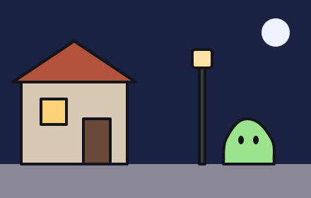
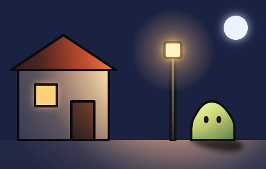
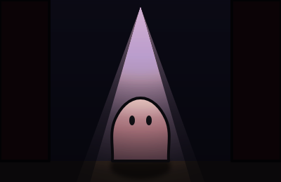
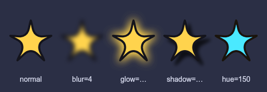
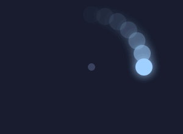
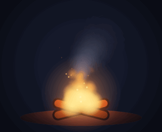

# 8. Luz, efeitos e partículas

[← Animação](07-animacao.md) · [Índice](README.md) · [Próximo: Jogo e Godot →](09-jogo-godot.md)

## Luz de verdade

O `light=` do `canvas` ([capítulo 2](02-formas.md#contorno-que-engrossa-no-lado-da-sombra-weight)) só engrossa contornos. As instruções deste capítulo mudam **as cores**: o que está perto de uma lâmpada fica com a cor dela, o resto fica no escuro, e cada forma fica mais clara do lado da luz.

| A mesma cena sem luz | Com `ambient` e `light` |
|---|---|
|  |  |

<!-- gerar: img/08_luz.png -->
```weasel
canvas 440 280 bg=#1b2140
palette ink=#14141c line=4
palette parede=#d8c8b4 telhado=#b0533a rua=#8a8a96 poste=#3a3a44 vidro=#ffe2a8 bicho=#9be38c

layer guia guide
line piso : 0,232 440,232

layer ceu unlit
ellipse lua 390,46 20 c=#eef2ff emit=#bcd2ff,1

layer cena
rect rua 0,232 440,48 c=rua
rect casa 30,112 150,120 c=parede ink=line
shape telhado c=telhado ink=line : 18,116! 105,58! 192,116!
rect janela 58,140 36,36 c=#ffd27a ink=line emit=#ffb860,0.8
rect porta 118,168 38,64 c=#6a4a3a ink=line
rect poste 282,92 8,140 c=poste ink=line
rect lanterna 272,70 28,26 r=4 c=vidro ink=line emit=#ffb860,1.2

layer bichinho cast=piso,0.5,4
shape corpo c=bicho ink=line : 350,168 384,196 388,232! 316,232! 320,196
ellipse olhoE 341,198 4,6 c=ink
ellipse olhoD 362,198 4,6 c=ink

ambient c=#5866a0 power=0.5
light lampiao point 286,84 c=#ffb860 power=2.2 radius=300 glow=70
light luar dir -0.4,-0.9 c=#9fb4ff power=0.2
```

<details>
<summary>Código da versão sem luz</summary>

<!-- gerar: img/08_sem_luz.png -->
```weasel
canvas 440 280 bg=#1b2140
palette ink=#14141c line=4
palette parede=#d8c8b4 telhado=#b0533a rua=#8a8a96 poste=#3a3a44 vidro=#ffe2a8 bicho=#9be38c

layer ceu
ellipse lua 390,46 20 c=#eef2ff

layer cena
rect rua 0,232 440,48 c=rua
rect casa 30,112 150,120 c=parede ink=line
shape telhado c=telhado ink=line : 18,116! 105,58! 192,116!
rect janela 58,140 36,36 c=#ffd27a ink=line
rect porta 118,168 38,64 c=#6a4a3a ink=line
rect poste 282,92 8,140 c=poste ink=line
rect lanterna 272,70 28,26 r=4 c=vidro ink=line

layer bichinho
shape corpo c=bicho ink=line : 350,168 384,196 388,232! 316,232! 320,196
ellipse olhoE 341,198 4,6 c=ink
ellipse olhoD 362,198 4,6 c=ink
```

</details>

As cores do desenho continuam sendo "as cores de dia". A luz é aplicada por cima, a cada quadro: se o bichinho andar até o poste, ou o poste balançar, a cor e a sombra mudam junto.

### Os três tipos de luz e o ambiente

| Instrução | O que é |
|---|---|
| `ambient c=cor power=força` | A luz **geral**, que chega em tudo por igual: a "noite azulada", a sombra de uma floresta. Sem `ambient`, numa cena com luzes vale branco com força 0,6. |
| `light nome point x,y c= power= radius= glow=` | Uma **lâmpada**: ilumina em volta de `x,y` e vai sumindo até o `radius=` (padrão 300). `glow=` desenha um halo visível com esse raio. |
| `light nome spot x,y aim=graus cone=graus …` | Um **holofote** ou lanterna: como o `point`, mas só dentro de um cone. `aim=` é para onde aponta (0 = direita, 90 = para baixo, o padrão) e `cone=` a abertura para cada lado (padrão 30). |
| `light nome dir dx,dy c= power=` | O **sol ou a lua**: luz que vem de uma direção, igual em tudo. `dx,dy` aponta para onde a luz está (`-0.4,-0.9` = em cima, um pouco à esquerda). |

Atributos de todas as luzes:

| Atributo | Padrão | O que faz |
|---|---|---|
| `c=` | branco | cor da luz (só cor `#hex` ou da `palette`) |
| `power=` | 1 | força (de 0 a 20) |
| `flicker=0.15` | 0 | tremula, como chama de vela (de 0 a 1) |
| `rim=5` | 0 | desenha um fio de luz, na cor da luz, na borda das formas virada para ela |
| `bone=` | — | a luz anda com um osso (uma lanterna na mão, um lampião balançando) |

Luzes também animam com `key` (`key 6 lampiao.power=0.4`): `power`, `radius`, `c`, `glow`, `aim` e `cone`.

### O que recebe luz

- Com qualquer `light` ou `ambient` na cena, **toda camada é iluminada**, menos as marcadas com **`unlit`**: céu, interface, títulos, efeitos que já são luz (fogo, faíscas). No exemplo, o céu é `unlit`, senão a lua ficaria escura.
- Cada forma fica com a cor da luz que chega no meio dela, mais clara do lado da luz e mais escura do outro. `shade=` na camada controla esse claro e escuro (padrão 0.5; 0 desliga).
- `rim=cor,largura` na camada põe um fio de luz numa cor fixa na borda virada para a luz.
- A luz é 2D: uma forma não faz sombra em outra. Sombra no chão é com `cast=` (abaixo).

### Coisas que brilham: `emit`

`emit=cor,força` numa forma faz ela **brilhar** com um halo dessa cor e **não receber luz** (ela é a luz): janelas acesas, o vidro da lanterna, olhos que brilham no escuro, a lua. No exemplo, a janela e a lanterna têm `emit`. A força vai de 0 a 10 (padrão 1).

`emit` só desenha o brilho; para a forma **iluminar** as vizinhas, ponha também uma `light` no mesmo lugar (como o `lampiao` dentro da lanterna).

### Sombra projetada no chão

`layer nome cast=chão,opacidade,desfoque` faz a camada projetar a própria **silhueta no chão**, inclinada para longe de cada luz:

- `chão` é o nome de uma `line`. No exemplo, `piso` fica numa camada `guide`: não aparece, só diz onde é o chão.
- `opacidade` (padrão 0.45) e `desfoque` (padrão 6) são opcionais.
- `from=camada1,camada2` usa a silhueta de outras camadas, para uma camada só de sombra fazer a sombra de um personagem inteiro, vindo de um `include` ([`noite.weasel`](../../exemplos/noite.weasel) faz isso).
- Luzes `point` e `spot` acima do chão, e `dir` vindas de cima, fazem sombra. Quanto mais longe da luz, mais fraca.

### Holofote

<!-- gerar: img/08_holofote.png -->
```weasel
canvas 400 260 bg=#101320
palette ink=#14141c line=4

layer guia guide
line piso : 0,230 400,230

layer palco
rect fundo 0,0 400,230 c=#6a5a7a
rect tablado 0,230 400,30 c=#7a5a44
rect cortinaE 0,0 70,230 c=#8c1e2a ink=line
rect cortinaD 330,0 70,230 c=#8c1e2a ink=line

layer artista cast=piso,0.6,3
shape corpo c=#ffb3c7 ink=line : 200,140 236,170 240,230! 160,230! 164,170
ellipse olhoE 188,172 4,7 c=ink
ellipse olhoD 212,172 4,7 c=ink

ambient c=#3a3f66 power=0.35
light canhao spot 200,10 aim=90 cone=16 c=#fff1d0 power=2 radius=320
```



## Efeitos de camada

Estes atributos de `layer` tratam a camada inteira como uma imagem e aplicam um efeito nela:

<!-- gerar: img/08_efeitos.png -->
```weasel
canvas 520 180 bg=#2b2f45
palette ink=#14141c line=4

def estrela cor=#ffd34d
shape s c=cor ink=line : 0,-40! 11,-12 40,-10! 17,8 26,38! 0,20 -26,38! -17,8 -40,-10! -11,-12
end

layer normal
use estrela 60,80
layer borrada blur=4
use estrela 160,80
layer brilhante glow=#ffd34d,18,2
use estrela 260,80
layer comSombra shadow=#000000b0,8,8,6
use estrela 360,80
layer outraCor hue=150 saturate=1.4
use estrela 460,80

layer rotulos
text t1 60,160 "normal" size=14 align=center c=#d8dcef
text t2 160,160 "blur=4" size=14 align=center c=#d8dcef
text t3 260,160 "glow=…" size=14 align=center c=#d8dcef
text t4 360,160 "shadow=…" size=14 align=center c=#d8dcef
text t5 460,160 "hue=150" size=14 align=center c=#d8dcef
```



| Atributo | O que faz |
|---|---|
| `blur=4` | desfoque, em pixels (neblina, fundo fora de foco) |
| `glow=cor,raio,força` | brilho em volta de tudo da camada (força padrão 1, até 5) |
| `shadow=cor,dx,dy,desfoque` | sombra deslocada (use cor com transparência, como `#000000b0`) |
| `tint=cor,quanto` | tinge com uma cor (0 a 1): um personagem que leva dano fica vermelho |
| `brightness=` `saturate=` `contrast=` | brilho, saturação e contraste (1 = normal; 0.5 metade; 2 o dobro) |
| `hue=graus` | gira as cores no círculo de cores |
| `trail=quadros,queda,cor` | rastro de movimento (abaixo) |

Os efeitos animam com `key`: `key 4 aura.glow=40`, `key 6 heroi.tint=0.6`, `key 0 neblina.blur=8`. Eles usam o recurso de filtro do navegador; onde ele não existe, o desfoque vira uma aproximação e os ajustes de cor são ignorados.

### Rastro: `trail=`

`trail=quadros,queda` desenha, por trás da camada, os quadros **anteriores** da animação, cada um mais fraco (`queda` de 0 a 1: quanto sobra de um para o outro). Uma cor opcional tinge o rastro.

<!-- gerar: img/08_rastro.gif -a gira -->
```weasel
canvas 300 220 bg=#14182a

bone braco pivot=150,110
ellipse centro 150,110 6 c=#3a4060

layer cometa trail=6,0.6
ellipse c 236,110 14 c=#9fd0ff emit=#9fd0ff,1 bone=braco

anim gira frames=24 fps=24
key 0 braco=0,0,0 ease=linear
key 24 braco=0,0,360
```



Repare no `ease=linear` com a rotação de 0 a 360: o giro é constante e o quadro 24 (360°) é igual ao 0, então o loop não tem emenda.

## Partículas

`emitter` solta **partículas**: fagulhas, fumaça, chuva, neve, bolhas, vaga-lumes. Cada partícula nasce no ponto do emissor, sai numa direção sorteada, vive um tempo e some, mudando de tamanho e cor no caminho.

<!-- gerar: img/08_fogueira.gif -a queima -->
```weasel
canvas 320 260 bg=#14182a
finish game bloom=0.5 vignette=0.6
palette ink=#14141c line=4

layer chao
ellipse terra 160,232 120,16 c=#4a3d52

layer lenha
rect tora1 104,206 112,18 r=9 rot=-14 c=#7a4a2c ink=line
rect tora2 104,206 112,18 r=9 rot=14 c=#6a3f26 ink=line

layer fogo unlit
emitter fumaca 160,150 rate=5 life=2.4 speed=34 angle=-90 spread=24 wind=14 c=#6a6d8060,#6a6d8000 size=16,48 shape=soft seed=5
emitter chama 160,208 rate=40 life=0.8 speed=70 angle=-90 spread=30 gravity=-60 area=44,4 c=#ffd27a,#ff400000 size=24,4 shape=soft emit=#ff9a4a,0.6
emitter fagulha 160,200 rate=10 life=1.4 speed=100 angle=-90 spread=70 gravity=-20 drag=0.6 c=#ffe2a8,#ff800000 size=4,1 seed=2

ambient c=#3a4270 power=0.5
light fogueira point 160,186 c=#ff9a4a power=1.5 radius=220 glow=80 flicker=0.15

anim queima frames=24 fps=12
```



| Atributo | Padrão | O que faz |
|---|---|---|
| `rate=` | 20 | quantas partículas nascem **por segundo** |
| `burst=` | 0 | em vez de um fluxo, uma **rajada** de N partículas de uma vez, no começo de cada volta da animação (explosão, poeira de um pulo) |
| `life=` | 1 | quantos segundos cada uma vive (com uma pequena variação) |
| `speed=` | 80 | velocidade inicial, em pixels por segundo |
| `angle=` | −90 | direção, em graus (−90 = para cima, 90 = para baixo, 0 = direita) |
| `spread=` | 40 | quanto a direção varia, em graus (360 = para todo lado) |
| `gravity=` | 0 | puxa para baixo (negativo: sobe, como fogo e bolhas) |
| `wind=` | 0 | empurra para o lado (positivo: para a direita) |
| `drag=` | 0 | resistência do ar: freia a partícula com o tempo |
| `size=início,fim` | 4 | tamanho ao nascer e ao morrer |
| `c=início,fim` | cor de tinta | cor ao nascer e ao morrer (use transparência `00` no fim para sumir suave) |
| `shape=` | `dot` | `dot` (bolinha), `soft` (bolinha esfumaçada), `square`, `streak` (risco na direção do movimento: chuva) e `star` |
| `area=l,a` | 0 | espalha o nascimento num retângulo (chuva no céu inteiro: `area=1000,0`) |
| `seed=` | 1 | muda o sorteio, para dois emissores iguais não ficarem idênticos |
| `emit=cor,força` | — | as partículas brilham |
| `bone=` | — | o emissor anda com um osso (a fumaça do escapamento, as mariposas em volta da lanterna) |

- As partículas também precisam de uma **animação tocando** (aqui, `anim queima`, sem `key`), como os movimentos automáticos. Na pose parada, aparece um instante "congelado".
- O sorteio é **fixo**: a mesma animação sai sempre igual, e o loop fecha certinho, sem partículas sumindo ou aparecendo na emenda.
- Ponha o fogo numa camada `unlit` (o fogo é a luz) e uma `light` no meio dele, com `flicker=`, para iluminar o resto.

## Acabamentos de cinema

A fogueira usa `finish game bloom=0.5 vignette=0.6`:

| Atributo de `finish` | O que faz |
|---|---|
| `bloom=` | o que é muito claro "vaza" num brilho suave, como em câmera de verdade |
| `vignette=` | escurece as bordas da imagem e leva o olho para o meio |
| `grain=` | granulado de filme (pouco já basta: `grain=0.03`) |

Os três vão de 0 a 3. Eles valem para a imagem pronta, então ficam bem em cenas inteiras (cenários, filmes) e pouco fazem num personagem sozinho. O granulado deixa GIFs bem maiores, porque ruído não comprime.

[← Animação](07-animacao.md) · [Índice](README.md) · [Próximo: Jogo e Godot →](09-jogo-godot.md)
