# 8. Luz, efeitos e partículas

[← Animação](07-animacao.md) · [Índice](README.md) · [Próximo: Jogo e Godot →](09-jogo-godot.md)

## Luz de verdade

O `light=` do `canvas` ([capítulo 2](02-formas.md#contorno-que-engrossa-no-lado-da-sombra-weight)) só engrossa contornos. As instruções deste capítulo mudam **as cores**: o que está perto de uma lâmpada fica com a cor dela, o resto fica no escuro, e cada forma fica mais clara do lado da luz.

| A mesma cena sem luz | Com `ambient` e `light` |
|---|---|
| 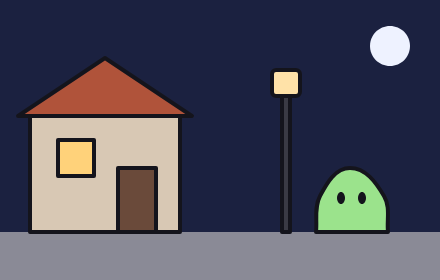 |  |

<!-- arquivo: rua.weasel -->
<!-- gerar: img/08_luz.png -->
<!-- gerar: img/08_luz_menor.png -s 0.5 -->
```weasel
canvas 440 280 bg=#1b2140
palette ink=#14141c line=4
palette parede=#d8c8b4 telhado=#b0533a rua=#8a8a96 poste=#3a3a44 vidro=#ffe2a8 bicho=#9be38c

layer guia guide
line piso : 0,232 440,232

layer ceu unlit
ellipse lua 390,46 20 c=#eef2ff emit=#bcd2ff,1

layer cena
rect rua 0,232 440,48 c=rua
rect casa 30,112 150,120 c=parede ink=line
shape telhado c=telhado ink=line : 18,116! 105,58! 192,116!
rect janela 58,140 36,36 c=#ffd27a ink=line emit=#ffb860,0.8
rect porta 118,168 38,64 c=#6a4a3a ink=line
rect poste 282,92 8,140 c=poste ink=line
rect lanterna 272,70 28,26 r=4 c=vidro ink=line emit=#ffb860,1.2

layer bichinho cast=piso,0.5,4
shape corpo c=bicho ink=line : 350,168 384,196 388,232! 316,232! 320,196
ellipse olhoE 341,198 4,6 c=ink
ellipse olhoD 362,198 4,6 c=ink

ambient c=#5866a0 power=0.5
light lampiao point 286,84 c=#ffb860 power=2.2 radius=300 glow=70
light luar dir -0.4,-0.9 c=#9fb4ff power=0.2
```

<details>
<summary>Código da versão sem luz</summary>

<!-- gerar: img/08_sem_luz.png -->
```weasel
canvas 440 280 bg=#1b2140
palette ink=#14141c line=4
palette parede=#d8c8b4 telhado=#b0533a rua=#8a8a96 poste=#3a3a44 vidro=#ffe2a8 bicho=#9be38c

layer ceu
ellipse lua 390,46 20 c=#eef2ff

layer cena
rect rua 0,232 440,48 c=rua
rect casa 30,112 150,120 c=parede ink=line
shape telhado c=telhado ink=line : 18,116! 105,58! 192,116!
rect janela 58,140 36,36 c=#ffd27a ink=line
rect porta 118,168 38,64 c=#6a4a3a ink=line
rect poste 282,92 8,140 c=poste ink=line
rect lanterna 272,70 28,26 r=4 c=vidro ink=line

layer bichinho
shape corpo c=bicho ink=line : 350,168 384,196 388,232! 316,232! 320,196
ellipse olhoE 341,198 4,6 c=ink
ellipse olhoD 362,198 4,6 c=ink
```

</details>

As cores do desenho continuam sendo "as cores de dia". A luz é aplicada por cima, a cada quadro: se o bichinho andar até o poste, ou o poste balançar, a cor e a sombra mudam junto.

Guarde esta cena como `rua.weasel`: o fim do capítulo usa ela de novo.

### Os três tipos de luz e o ambiente

| Instrução | O que é |
|---|---|
| `ambient c=cor power=força` | A luz **geral**, que chega em tudo por igual: a "noite azulada", a sombra de uma floresta. Sem `ambient`, numa cena com luzes vale branco com força 0,6. |
| `light nome point x,y c= power= radius= glow=` | Uma **lâmpada**: ilumina em volta de `x,y` e vai sumindo até o `radius=` (padrão 300). `glow=` desenha um halo visível com esse raio. |
| `light nome spot x,y aim=graus cone=graus …` | Um **holofote** ou lanterna: como o `point`, mas só dentro de um cone. `aim=` é para onde aponta (0 = direita, 90 = para baixo, o padrão) e `cone=` a abertura para cada lado (padrão 30). |
| `light nome dir dx,dy c= power=` | O **sol ou a lua**: luz que vem de uma direção, igual em tudo. `dx,dy` aponta para onde a luz está (`-0.4,-0.9` = em cima, um pouco à esquerda). |

Atributos de todas as luzes:

| Atributo | Padrão | O que faz |
|---|---|---|
| `c=` | branco | cor da luz (só cor `#hex` ou da `palette`) |
| `power=` | 1 | força (de 0 a 20) |
| `flicker=0.15` | 0 | tremula, como chama de vela (de 0 a 1) |
| `rim=5` | 0 | desenha um fio de luz, na cor da luz, na borda das formas virada para ela |
| `bone=` | — | a luz anda com um osso (uma lanterna na mão, um lampião balançando) |

Luzes também animam com `key` (`key 6 lampiao.power=0.4`): `power`, `radius`, `c`, `glow`, `aim` e `cone`.

> **Dica do editor:** com o cursor na linha de uma luz, ela aparece no desenho para você ajustar com o mouse. A `point` e a `spot` têm um **ponto** no lugar da lâmpada: arraste para mudar o `x,y`. A `dir` não tem lugar, só direção; por isso ela tem uma **seta** amarela que sai do centro do quadro e aponta para o sol. Arraste o sol da ponta para girar o `dx,dy` (com **Shift**, de 15 em 15 graus). É a mesma seta do `light=` do `canvas` ([capítulo 2](02-formas.md#contorno-que-engrossa-no-lado-da-sombra-weight)).

As seções abaixo mostram cada uma dessas coisas sozinha, com um exemplo para rodar.

### Uma cena para testar a luz

Para comparar duas luzes, o melhor é usar **o mesmo desenho** e mudar só a luz. Esta pracinha não tem nenhuma luz. Salve o código como `praca.weasel`, na mesma pasta dos seus testes:

<!-- arquivo: praca.weasel -->
<!-- gerar: img/08_praca.png -->
```weasel
canvas 240 160
palette ink=#14141c line=3

layer guia guide
line piso : 0,128 240,128

layer cenario shade=0
rect ceu -20,-20 280,148 c=#9cc8ec
rect grama -20,128 280,60 c=#7cb35a

layer coisas cast=piso,0.6,2
rect caixa 22,84 44,44 c=#e0a050 ink=line
ellipse bola 104,110 18 c=#e8504a ink=line
shape bicho c=#9be38c ink=line : 182,72 214,100 218,128! 146,128! 150,100
ellipse olhoE 174,100 3,5 c=ink
ellipse olhoD 192,100 3,5 c=ink
```

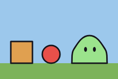

Vários exemplos a seguir começam com `include "praca.weasel"`: o arquivo inteiro entra naquela linha ([capítulo 5](05-componentes.md#vários-arquivos-include)), e o exemplo só acrescenta a luz embaixo.

Repare em três detalhes da pracinha. Eles só fazem diferença quando houver luz:

- O céu e a grama são `rect` **maiores que o canvas** (começam em −20). Isso é de propósito: o fundo do canvas (`bg=`) **não recebe luz**, mas um `rect` recebe. Assim, quando a cena escurece, o céu escurece junto.
- A camada `cenario` tem `shade=0`. Sem isso, o céu inteiro ficaria mais claro de um lado e mais escuro do outro, como uma bola. O `shade=` está explicado [mais abaixo](#claro-e-escuro-shade).
- `cast=piso,0.6,2` faz as coisas deitarem sombra na linha `piso`. A linha fica numa camada `guide`: não aparece, só marca onde é o chão. Veja [Sombra projetada no chão](#sombra-projetada-no-chão).

### A luz geral: `ambient`

O `ambient` é a luz que chega **em tudo, por igual**, vinda de lugar nenhum: o claro do dia, o azul da noite, o laranja do fim de tarde. Ele tem dois atributos:

- `c=` é a cor da luz (padrão branco).
- `power=` é a força, de 0 a 5 (padrão 0.6). Com 0, tudo fica preto. Com branco e 1, as cores ficam iguais às do desenho.

Cada exemplo abaixo tem só duas linhas: a pracinha e o `ambient`.

<!-- gerar: img/08_amb_forte.png -->
```weasel
include "praca.weasel"
ambient power=1
```

<!-- gerar: img/08_amb_padrao.png -->
```weasel
include "praca.weasel"
ambient
```

<!-- gerar: img/08_amb_noite.png -->
```weasel
include "praca.weasel"
ambient c=#6070c0 power=0.8
```

<!-- gerar: img/08_amb_tarde.png -->
```weasel
include "praca.weasel"
ambient c=#ffa060 power=1
```

| `ambient power=1` | `ambient` (branco, 0.6) |
|---|---|
|  | 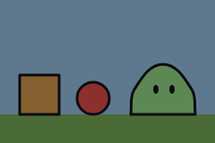 |
| **`ambient c=#6070c0 power=0.8`** | **`ambient c=#ffa060 power=1`** |
| 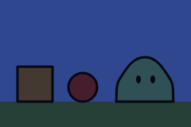 | 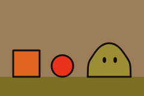 |

Repare:

- Branco com força 1 deixa tudo **igual ao desenho**. Força maior que 1 não clareia mais que isso: o máximo são as cores que você escolheu.
- Uma força menor que 1 **escurece**. Com só `ambient`, sem `power=`, vale 0.6.
- Uma cor **tinge** a cena: as cores do desenho são multiplicadas pela cor da luz. Por isso a bola vermelha fica bem escura na luz azul (a luz azul tem pouco vermelho para devolver).
- O `ambient` não tem direção: as formas não ficam mais claras de um lado. Para isso, é preciso uma `light`.

**Experimente:** no último exemplo, troque a cor por `c=#80ff80`, um verde claro. A grama e o bichinho continuam claros, mas a bola vermelha e a caixa laranja escurecem: a luz verde tem pouco vermelho para elas devolverem.

### Lâmpada: `light point`

Uma `light point` é uma **lâmpada**: ela ilumina em volta de um ponto, e a luz vai ficando fraca com a distância. Os três exemplos a seguir comparam três lâmpadas lado a lado, cada uma em cima de um bichinho.

#### A força: `power=`

<!-- gerar: img/08_power.png -->
```weasel
canvas 480 180 bg=#101320
palette ink=#14141c line=3

def bicho cor=#9be38c
shape corpo c=cor ink=line : 0,-46 30,-20 34,10! -34,10! -30,-20
ellipse olhoE -9,-20 3,5 c=ink
ellipse olhoD 9,-20 3,5 c=ink
end

layer sala shade=0
rect parede 0,0 480,160 c=#c8b8a8
rect chao 0,160 480,20 c=#8a7a6a

layer bichos
use bicho 80,150
use bicho 240,150
use bicho 400,150

layer lampadas unlit
ellipse lampA 80,64 6 c=#fff2c0
ellipse lampB 240,64 6 c=#fff2c0
ellipse lampC 400,64 6 c=#fff2c0
text t1 80,20 "power=0.5" size=14 align=center c=#ffffff
text t2 240,20 "power=1" size=14 align=center c=#ffffff
text t3 400,20 "power=2" size=14 align=center c=#ffffff

ambient c=#404870 power=0.4
light a point 80,64 c=#ffd27a power=0.5 radius=200
light b point 240,64 c=#ffd27a power=1 radius=200
light c point 400,64 c=#ffd27a power=2 radius=200
```

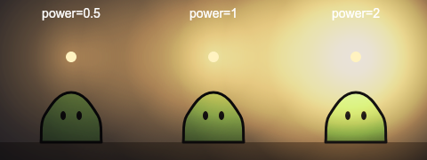

Repare:

- `light a point 80,64` cria uma luz chamada `a` no ponto 80,64. Cada luz precisa de um nome diferente (`a`, `b`, `c`): é pelo nome que uma `key` muda a luz depois.
- `power=` é a **força**, de 0 a 20 (padrão 1). O dobro da força é o dobro de luz.
- A luz chega na parede e nos bichinhos, mas as **lampadinhas** estão numa camada `unlit` ("sem luz"): elas mostram a própria cor, sem escurecer. Os rótulos de texto também.
- `ambient c=#404870 power=0.4` deixa a sala azulada e escura. Sem ele, valeria branco 0.6, e a sala ficaria clara demais para ver as lâmpadas.

#### O alcance: `radius=`

<!-- gerar: img/08_radius.png -->
```weasel
canvas 480 180 bg=#101320
palette ink=#14141c line=3

def bicho cor=#9be38c
shape corpo c=cor ink=line : 0,-46 30,-20 34,10! -34,10! -30,-20
ellipse olhoE -9,-20 3,5 c=ink
ellipse olhoD 9,-20 3,5 c=ink
end

layer sala shade=0
rect parede 0,0 480,160 c=#c8b8a8
rect chao 0,160 480,20 c=#8a7a6a

layer bichos
use bicho 80,150
use bicho 240,150
use bicho 400,150

layer lampadas unlit
ellipse lampA 80,64 6 c=#fff2c0
ellipse lampB 240,64 6 c=#fff2c0
ellipse lampC 400,64 6 c=#fff2c0
text t1 80,20 "radius=70" size=14 align=center c=#ffffff
text t2 240,20 "radius=130" size=14 align=center c=#ffffff
text t3 400,20 "radius=200" size=14 align=center c=#ffffff

ambient c=#404870 power=0.4
light a point 80,64 c=#ffd27a power=1.5 radius=70
light b point 240,64 c=#ffd27a power=1.5 radius=130
light c point 400,64 c=#ffd27a power=1.5 radius=200
```

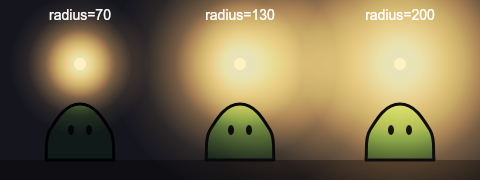

Repare:

- `radius=` é **até onde a luz chega**, em pixels (padrão 300). Depois dessa distância, a luz é zero.
- As três lâmpadas têm a mesma força (`power=1.5`). Só muda o alcance.
- Com `radius=70`, a lâmpada está a uns 90 pixels do meio do bichinho: a luz não chega nele.
- A luz não para de repente: ela vai ficando fraca do centro até a borda. Por isso, na parede, cada lâmpada faz um círculo que se apaga devagar.

#### O halo: `glow=`

<!-- gerar: img/08_glow_luz.png -->
```weasel
canvas 480 180 bg=#101320
palette ink=#14141c line=3

def bicho cor=#9be38c
shape corpo c=cor ink=line : 0,-46 30,-20 34,10! -34,10! -30,-20
ellipse olhoE -9,-20 3,5 c=ink
ellipse olhoD 9,-20 3,5 c=ink
end

layer sala shade=0
rect chao 0,160 480,20 c=#3a3446

layer bichos
use bicho 80,150
use bicho 240,150
use bicho 400,150

layer lampadas unlit
ellipse lampA 80,64 6 c=#fff2c0
ellipse lampB 240,64 6 c=#fff2c0
ellipse lampC 400,64 6 c=#fff2c0
text t1 80,20 "sem glow" size=14 align=center c=#ffffff
text t2 240,20 "glow=30" size=14 align=center c=#ffffff
text t3 400,20 "glow=70" size=14 align=center c=#ffffff

ambient c=#404870 power=0.4
light a point 80,64 c=#ffd27a power=1 radius=150
light b point 240,64 c=#ffd27a power=1 radius=150 glow=30
light c point 400,64 c=#ffd27a power=1 radius=150 glow=70
```

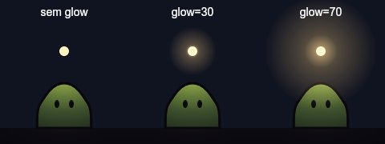

Repare:

- `glow=` desenha um **halo** em volta da lâmpada, com esse raio em pixels (padrão 0, sem halo). É o brilho que se vê no ar, perto de uma lâmpada acesa.
- O halo é **só desenho**: os três bichinhos recebem a mesma luz. Quem ilumina é o `power=` e o `radius=`.
- Aqui não há parede, de propósito: o halo aparece melhor contra o escuro.

**Experimente:** no exemplo do `power=`, acrescente `glow=40` nas três luzes. O halo da lâmpada mais forte fica mais claro: o halo também acompanha a força.

### Chama que tremula: `flicker=`

`flicker=` faz a força da luz **variar a cada quadro**, como a chama de uma vela ou de uma fogueira. Como é uma coisa que muda com o tempo, o exemplo é uma animação:

<!-- gerar: img/08_flicker.gif -a tremula -->
```weasel
canvas 320 160 bg=#14182a
palette ink=#14141c line=3

layer mesa
rect tampo 0,130 320,30 c=#6a4a3a

layer velas
rect velaA 72,90 16,40 r=2 c=#f0e6d0 ink=line
rect velaB 232,90 16,40 r=2 c=#f0e6d0 ink=line

layer chamas unlit
ellipse chamaA 80,80 5,9 c=#ffd27a emit=#ff9a4a,1
ellipse chamaB 240,80 5,9 c=#ffd27a emit=#ff9a4a,1
text t1 80,24 "sem flicker" size=14 align=center c=#ffffff
text t2 240,24 "flicker=0.4" size=14 align=center c=#ffffff

ambient c=#3a4270 power=0.3
light a point 80,80 c=#ff9a4a power=1.4 radius=120 glow=60
light b point 240,80 c=#ff9a4a power=1.4 radius=120 glow=60 flicker=0.4

anim tremula frames=12 fps=12
```

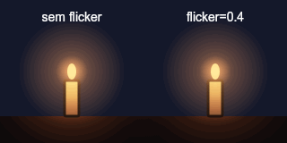

Repare:

- `flicker=0.4` deixa a força variar até 40% para cima ou para baixo, sorteada a cada quadro. O valor vai de 0 (parado, o padrão) a 1 (tremendo muito).
- A animação `tremula` não tem nenhuma `key`: ela só existe para o tempo passar. Sem uma animação tocando, a luz fica parada.
- O sorteio é fixo: a mesma animação treme sempre igual, toda vez que você exportar.

**Experimente:** mude para `flicker=1`. A vela da direita chega a apagar em alguns quadros.

### Luz que anda com um osso: `bone=`

Com `bone=`, a luz fica **presa a um osso** e anda com ele: um lampião que balança, uma lanterna na mão do personagem. O que ela ilumina muda junto.

<!-- gerar: img/08_lampiao.gif -a balanca -->
```weasel
canvas 320 220 bg=#101320
palette ink=#14141c line=3 ferro=#3a3a44

def bicho cor=#9be38c
shape corpo c=cor ink=line : 0,-46 30,-20 34,10! -34,10! -30,-20
ellipse olhoE -9,-20 3,5 c=ink
ellipse olhoD 9,-20 3,5 c=ink
end

layer sala
rect chao 0,200 320,20 c=#5a5066

layer bichos
use bicho 70,190
use bicho 250,190

bone corda pivot=160,0 sway=30,2
layer lampiao unlit
line fio c=ferro w=2 bone=corda : 160,0 160,80
rect vidro 150,80 20,26 r=4 c=#ffe2a8 ink=line bone=corda

ambient c=#404870 power=0.35
light luz point 160,94 c=#ffb860 power=2 radius=220 bone=corda

anim balanca frames=16 fps=8
```

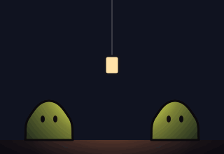

Repare:

- `bone corda pivot=160,0 sway=30,2` é um osso que balança sozinho 30 graus para cada lado, a cada 2 segundos ([movimentos automáticos, capítulo 6](06-ossos.md#movimentos-automáticos-sway-bob-e-jitter)).
- O fio e o vidro têm `bone=corda`: balançam com o osso. A luz também tem `bone=corda`, e o ponto `160,94` dela gira junto, como se fosse uma forma.
- A animação `balanca` dura 16 quadros a 8 por segundo: 2 segundos, uma volta inteira do `sway`. Assim o GIF fecha o loop sem pulo.

### Sol e lua: `light dir`

Uma `light dir` é uma luz **muito longe**, como o sol ou a lua. Ela chega igual em todo lugar, sempre do mesmo lado. Em vez de uma posição, ela recebe uma **direção**: `dx,dy` é uma setinha que sai da cena e aponta **para onde o sol está**.

- `-1,-0.6`: para a esquerda (−1) e para cima (−0.6). O sol está em cima, à esquerda.
- `1,-0.6`: para a direita e para cima. O sol está em cima, à direita.
- Só a direção importa: `-1,-0.6` e `-2,-1.2` são o mesmo sol.

<!-- gerar: img/08_sol_esq.png -->
```weasel
include "praca.weasel"
ambient c=#6070a0 power=0.4
light sol dir -1,-0.6 c=#ffd890 power=1.2
```

<!-- gerar: img/08_sol_dir.png -->
```weasel
include "praca.weasel"
ambient c=#6070a0 power=0.4
light sol dir 1,-0.6 c=#ffd890 power=1.2
```

| `light sol dir -1,-0.6` | `light sol dir 1,-0.6` |
|---|---|
| 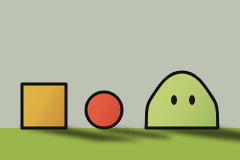 | 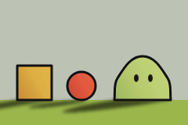 |

Repare:

- A sombra no chão vai sempre para o lado **contrário** do sol. Ela vem do `cast=` da pracinha.
- Cada forma fica mais clara do lado do sol e mais escura do outro (olhe a bola e o bichinho).
- O `dir` só usa `c=` e `power=`. `radius=` e `glow=` não fazem nada nele: o sol não tem um ponto de onde a luz sai.
- O `ambient` continua valendo junto: ele é a luz do céu, que clareia o lado da sombra.

**Experimente:** troque a direção para `-0.2,-1` (o sol quase em cima). As sombras ficam curtas, quase embaixo das coisas. E com `0,1` (o sol embaixo do chão) não há sombra nenhuma: só luz vinda de cima faz sombra.

### O que recebe luz

- Com qualquer `light` ou `ambient` na cena, **toda camada é iluminada**, menos as marcadas com **`unlit`**: céu, interface, títulos, efeitos que já são luz (fogo, faíscas). No exemplo, o céu é `unlit`, senão a lua ficaria escura.
- Cada forma fica com a cor da luz que chega no meio dela, mais clara do lado da luz e mais escura do outro. `shade=` na camada controla esse claro e escuro (padrão 0.5; 0 desliga).
- `rim=cor,largura` na camada põe um fio de luz numa cor fixa na borda virada para a luz.
- A luz é 2D: uma forma não faz sombra em outra. Sombra no chão é com `cast=` (abaixo).

#### `lit` e `unlit`

`unlit` numa camada quer dizer "esta camada **não recebe luz**": ela aparece com as cores do desenho, mesmo no escuro. A palavra `lit` ("iluminada") também existe, mas ela é o padrão: escrever `lit` não muda nada, só deixa claro para quem lê.

<!-- gerar: img/08_unlit.png -->
```weasel
canvas 320 150 bg=#101320
palette ink=#14141c line=3

layer placaA lit
rect fundoA 30,40 110,60 r=8 c=#ffd34d ink=line
text letraA 85,80 "LOJA" size=24 align=center c=#c0392b bold

layer placaB unlit
rect fundoB 180,40 110,60 r=8 c=#ffd34d ink=line
text letraB 235,80 "LOJA" size=24 align=center c=#c0392b bold

layer rotulos unlit
text t1 85,130 "lit (o padrão)" size=14 align=center c=#ffffff
text t2 235,130 "unlit" size=14 align=center c=#ffffff

ambient c=#404870 power=0.4
```

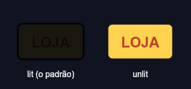

As duas placas são iguais. A da esquerda recebe a luz da noite e escurece; a da direita ignora a luz. Use `unlit` para o que tem que ser lido sempre (placar, legenda) e para o que **é** luz (fogo, lâmpada, tela acesa).

#### Claro e escuro: `shade=`

Com uma luz que vem de um lado, cada forma fica mais clara desse lado e mais escura do outro. `shade=` na camada diz **o quanto**: de 0 (nada, a forma fica de uma cor só) a 2 (bem forte). O padrão é 0.5.

<!-- gerar: img/08_shade.png -->
```weasel
canvas 420 160 bg=#2a2f45
palette ink=#14141c line=3

layer bolaA shade=0
ellipse a 70,70 42 c=#e8504a ink=line
layer bolaB
ellipse b 210,70 42 c=#e8504a ink=line
layer bolaC shade=2
ellipse c 350,70 42 c=#e8504a ink=line

layer rotulos unlit
text t1 70,140 "shade=0" size=14 align=center c=#ffffff
text t2 210,140 "shade=0.5 (padrão)" size=14 align=center c=#ffffff
text t3 350,140 "shade=2" size=14 align=center c=#ffffff

ambient c=#8090c0 power=0.5
light sol dir -1,-1 c=#fff1d0 power=1
```

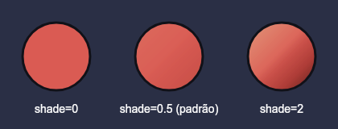

Repare:

- Cada bola está na sua própria camada, porque `shade=` é um atributo de **camada**: vale para todas as formas dela.
- Com `shade=0`, a bola continua recebendo a luz (a cor muda), mas fica chapada, sem volume.
- Um `shade=` alto dá volume, mas exagera em formas grandes e retas. Por isso a pracinha usa `shade=0` no céu e na grama.

#### Fio de luz na borda: `rim=`

Um **fio de luz na borda** (em inglês, *rim light*) é aquela linha clara que aparece no contorno de um personagem quando a luz vem de trás dele. Ele separa o personagem do fundo escuro. Há dois jeitos de ligar.

**Na camada**, com `rim=cor,largura`: o fio tem uma cor fixa, e a largura é em pixels (padrão 4).

<!-- gerar: img/08_rim.png -->
```weasel
canvas 420 170 bg=#101320
palette ink=#14141c line=3

def bicho cor=#5a8a52
shape corpo c=cor ink=line : 0,-56 36,-24 40,12! -40,12! -36,-24
ellipse olhoE -11,-24 4,6 c=ink
ellipse olhoD 11,-24 4,6 c=ink
end

layer bichoA
use bicho 70,120
layer bichoB rim=#ffe2a8,3
use bicho 210,120
layer bichoC rim=#7fd4ff,8
use bicho 350,120

layer rotulos unlit
text t1 70,156 "sem rim" size=14 align=center c=#ffffff
text t2 210,156 "rim=#ffe2a8,3" size=14 align=center c=#ffffff
text t3 350,156 "rim=#7fd4ff,8" size=14 align=center c=#ffffff

ambient c=#404870 power=0.5
light lua dir 1,-0.6 c=#c8d4ff power=0.6
```

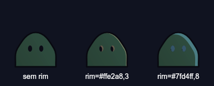

**Na luz**, com `rim=largura`: o fio sai **na cor da própria luz**, e vale para todas as camadas da cena (a não ser as que têm o seu próprio `rim=`). Compare com o [sol da esquerda](#sol-e-lua-light-dir) de antes:

<!-- gerar: img/08_rim_luz.png -->
```weasel
include "praca.weasel"
ambient c=#6070a0 power=0.4
light sol dir -1,-0.6 c=#ffd890 power=1.2 rim=4
```

| Sem `rim=` | `light sol … rim=4` |
|---|---|
|  | 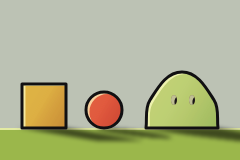 |

Repare:

- O fio aparece sempre na borda **virada para a luz**: à direita com a lua da direita, à esquerda com o sol da esquerda.
- Até os olhos do bichinho ganham fio: o `rim` vale para todas as formas da camada.

### Coisas que brilham: `emit`

`emit=cor,força` numa forma faz ela **brilhar** com um halo dessa cor e **não receber luz** (ela é a luz): janelas acesas, o vidro da lanterna, olhos que brilham no escuro, a lua. No exemplo, a janela e a lanterna têm `emit`. A força vai de 0 a 10 (padrão 1).

`emit` só desenha o brilho; para a forma **iluminar** as vizinhas, ponha também uma `light` no mesmo lugar (como o `lampiao` dentro da lanterna).

Quatro janelas iguais numa noite escura, com `emit` diferentes:

<!-- gerar: img/08_emit.png -->
```weasel
canvas 480 150 bg=#101320
palette ink=#14141c line=3

layer janelas
rect jA 40,40 70,60 c=#ffd27a ink=line
rect jB 150,40 70,60 c=#ffd27a ink=line emit=#ffb860,0.5
rect jC 260,40 70,60 c=#ffd27a ink=line emit=#ffb860,1
rect jD 370,40 70,60 c=#ffd27a ink=line emit=#ff6a3d,3

layer rotulos unlit
text t1 75,130 "sem emit" size=13 align=center c=#ffffff
text t2 185,130 "emit=#ffb860,0.5" size=13 align=center c=#ffffff
text t3 295,130 "emit=#ffb860,1" size=13 align=center c=#ffffff
text t4 405,130 "emit=#ff6a3d,3" size=13 align=center c=#ffffff

ambient c=#404870 power=0.4
```

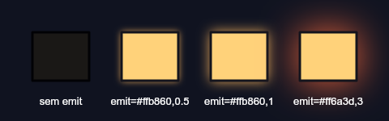

Repare:

- A janela sem `emit` recebe a luz da noite e fica escura. As outras **ignoram a luz**: continuam amarelas, mesmo estando na mesma camada.
- A força (0.5, 1, 3) é o **tamanho do halo**. A cor do halo pode ser diferente da cor da forma: a última janela é amarela com halo vermelho.
- Só há `ambient` (a noite azulada), nenhuma `light`. Por isso nenhuma janela ilumina o que está em volta: o `emit` só desenha o brilho.

### Sombra projetada no chão

`layer nome cast=chão,opacidade,desfoque` faz a camada projetar a própria **silhueta no chão**, inclinada para longe de cada luz:

- `chão` é o nome de uma `line`. No exemplo, `piso` fica numa camada `guide`: não aparece, só diz onde é o chão.
- `opacidade` (padrão 0.45) e `desfoque` (padrão 6) são opcionais.
- `from=camada1,camada2` usa a silhueta de outras camadas, para uma camada só de sombra fazer a sombra de um personagem inteiro, vindo de um `include` ([`noite.weasel`](../../exemplos/noite.weasel) faz isso).
- Luzes `point` e `spot` acima do chão, e `dir` vindas de cima, fazem sombra. Quanto mais longe da luz, mais fraca.

Os três números do `cast=`, lado a lado:

<!-- gerar: img/08_cast.png -->
```weasel
canvas 480 190 bg=#2a2f45
palette ink=#14141c line=3

def bicho cor=#9be38c
shape corpo c=cor ink=line : 0,-56 36,-24 40,12! -40,12! -36,-24
ellipse olhoE -11,-24 4,6 c=ink
ellipse olhoD 11,-24 4,6 c=ink
end

layer guia guide
line piso : 0,140 480,140

layer chao
rect terra 0,140 480,50 c=#7a8a5a

layer bichoA cast=piso
use bicho 70,128
layer bichoB cast=piso,0.9,0
use bicho 230,128
layer bichoC cast=piso,0.3,14
use bicho 390,128

layer rotulos unlit
text t1 70,180 "cast=piso" size=13 align=center c=#ffffff
text t2 230,180 "cast=piso,0.9,0" size=13 align=center c=#ffffff
text t3 390,180 "cast=piso,0.3,14" size=13 align=center c=#ffffff

ambient c=#8090c0 power=0.6
light sol dir -1,-0.8 c=#fff1d0 power=1
```

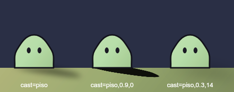

Repare:

- `cast=piso` sozinho usa os padrões: opacidade 0.45 (quase metade) e desfoque 6 pixels.
- O segundo número é a **opacidade**, de 0 (invisível) a 1 (preta). O terceiro é o **desfoque**, em pixels: 0 dá uma borda nítida, como sol forte ao meio-dia; números grandes dão uma sombra macia, como num dia nublado.
- Cada bichinho tem a sua camada, porque o `cast=` é da camada inteira: ela vira **uma** silhueta só.
- Os pés dos bichinhos estão na altura da linha `piso` (y = 140). A sombra começa nos pés e deita no chão.

**Experimente:** troque o sol por `light sol dir 1,-0.8 c=#fff1d0 power=1` (o sol à direita). As três sombras passam para a esquerda.

#### Uma sombra para várias camadas: `from=`

Um personagem quase sempre tem várias camadas (corpo, braço, cabeça). Se cada uma tiver o seu `cast=`, cada uma faz a sua sombra, e onde duas sombras se cruzam o chão fica **mais escuro**. Com `from=`, uma camada só de sombra junta as silhuetas e faz **uma** sombra:

<!-- gerar: img/08_from.png -->
```weasel
canvas 400 200 bg=#2a2f45
palette ink=#14141c line=3 neve=#eef2ff

layer guia guide
line piso : 0,160 400,160

layer chao
rect terra 0,160 400,40 c=#c8d0e0

# esquerda: cada camada faz a própria sombra
layer baseA cast=piso,0.6,0
ellipse b1 90,130 30 c=neve ink=line
layer meioA cast=piso,0.6,0
ellipse b2 90,90 24 c=neve ink=line
layer cabecaA cast=piso,0.6,0
ellipse b3 90,56 17 c=neve ink=line

# direita: uma camada só de sombra, com a silhueta das três
layer sombraB cast=piso,0.6,0 from=baseB,meioB,cabecaB
layer baseB
ellipse c1 270,130 30 c=neve ink=line
layer meioB
ellipse c2 270,90 24 c=neve ink=line
layer cabecaB
ellipse c3 270,56 17 c=neve ink=line

layer rotulos unlit
text t1 90,24 "cast nas três camadas" size=13 align=center c=#ffffff
text t2 270,24 "uma sombra com from=" size=13 align=center c=#ffffff

ambient c=#8090c0 power=0.7
light sol dir -1,-0.6 c=#fff1d0 power=1
```

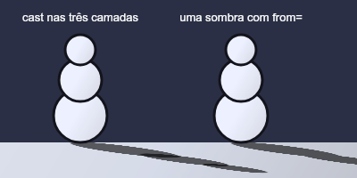

Repare:

- A camada `sombraB` **não tem nenhuma forma**: ela só faz a sombra. As silhuetas vêm das camadas listadas no `from=`.
- Ela vem **antes** das camadas do boneco, então a sombra é pintada por baixo dele.
- `from=` só vale junto com `cast=` (sozinho, o Weasel avisa).
- É assim que se dá sombra a um personagem que vem de um `include`, sem mexer no arquivo dele: a camada de sombra fica no seu arquivo e lista as camadas do personagem.

### Holofote

<!-- gerar: img/08_holofote.png -->
```weasel
canvas 400 260 bg=#101320
palette ink=#14141c line=4

layer guia guide
line piso : 0,230 400,230

layer palco
rect fundo 0,0 400,230 c=#6a5a7a
rect tablado 0,230 400,30 c=#7a5a44
rect cortinaE 0,0 70,230 c=#8c1e2a ink=line
rect cortinaD 330,0 70,230 c=#8c1e2a ink=line

layer artista cast=piso,0.6,3
shape corpo c=#ffb3c7 ink=line : 200,140 236,170 240,230! 160,230! 164,170
ellipse olhoE 188,172 4,7 c=ink
ellipse olhoD 212,172 4,7 c=ink

ambient c=#3a3f66 power=0.35
light canhao spot 200,10 aim=90 cone=16 c=#fff1d0 power=2 radius=320
```

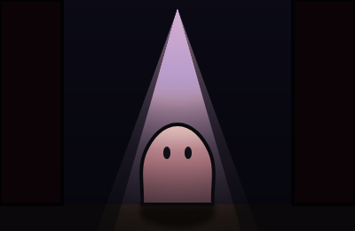

#### A abertura: `cone=`

`cone=` é a abertura do facho, em graus, **para cada lado** do centro (de 1 a 180; padrão 30). Então `cone=20` faz um facho de 40 graus no total.

<!-- gerar: img/08_cone.png -->
```weasel
canvas 480 200 bg=#101320
palette ink=#14141c line=3

def bicho cor=#9be38c
shape corpo c=cor ink=line : 0,-46 30,-20 34,10! -34,10! -30,-20
ellipse olhoE -9,-20 3,5 c=ink
ellipse olhoD 9,-20 3,5 c=ink
end

layer palco shade=0
rect parede 0,0 480,180 c=#c8b8a8
rect chao 0,180 480,20 c=#8a7a6a

layer bichos
use bicho 80,170
use bicho 240,170
use bicho 400,170

layer rotulos unlit
text t1 80,194 "cone=8" size=13 align=center c=#ffffff
text t2 240,194 "cone=20" size=13 align=center c=#ffffff
text t3 400,194 "cone=40" size=13 align=center c=#ffffff

ambient c=#404870 power=0.3
light a spot 80,0 aim=90 cone=8 c=#fff1d0 power=2 radius=300
light b spot 240,0 aim=90 cone=20 c=#fff1d0 power=2 radius=300
light c spot 400,0 aim=90 cone=40 c=#fff1d0 power=2 radius=300
```

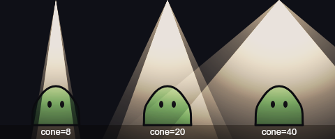

Repare:

- Os três apontam para baixo (`aim=90`) e têm a mesma força. Só muda a abertura.
- Em volta do facho há uma faixa mais fraca: o holofote não corta a luz de uma vez.
- O facho aparece na parede porque ela é um `rect` que recebe luz. No fundo do canvas (`bg=`), ele não apareceria.

#### Para onde aponta: `aim=`

`aim=` é a direção do facho, em graus: 0 = para a direita, 90 = para baixo (o padrão), 180 = para a esquerda, −90 = para cima. Como `aim` anima com `key`, dá para fazer um farol que varre o céu:

<!-- gerar: img/08_aim.gif -a varre -->
```weasel
canvas 320 200 bg=#0c0f1c
palette ink=#14141c line=3

layer ceu shade=0
rect noite 0,0 320,180 c=#5a6488
ellipse nuvemA 70,50 40,14 c=#c8cce0
ellipse nuvemB 250,70 46,16 c=#c8cce0
ellipse nuvemC 160,30 30,10 c=#c8cce0

layer chao
rect predio 130,150 60,50 c=#2a2a36 ink=line
rect morro 0,180 320,20 c=#1a1e2a

ambient c=#404870 power=0.35
light farol spot 160,150 aim=-150 cone=10 c=#fff1d0 power=2 radius=300

anim varre frames=16 fps=8
key 0 farol.aim=-150
key 8 farol.aim=-30
key 16 farol.aim=-150
```

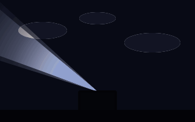

Repare:

- O farol fica no topo do prédio (`160,150`) e aponta para cima e para a esquerda (`aim=-150`).
- `key 8 farol.aim=-30` gira o facho até cima e à direita. `key 16` volta ao começo, para o loop fechar.
- As nuvens só aparecem quando o facho passa: fora dele, só chega o `ambient`, bem fraco.

**Experimente:** na linha `light farol`, troque `cone=10` por `cone=30`. O facho fica largo e acende duas nuvens de uma vez.

## Efeitos de camada

Estes atributos de `layer` tratam a camada inteira como uma imagem e aplicam um efeito nela:

<!-- gerar: img/08_efeitos.png -->
```weasel
canvas 520 180 bg=#2b2f45
palette ink=#14141c line=4

def estrela cor=#ffd34d
shape s c=cor ink=line : 0,-40! 11,-12 40,-10! 17,8 26,38! 0,20 -26,38! -17,8 -40,-10! -11,-12
end

layer normal
use estrela 60,80
layer borrada blur=4
use estrela 160,80
layer brilhante glow=#ffd34d,18,2
use estrela 260,80
layer comSombra shadow=#000000b0,8,8,6
use estrela 360,80
layer outraCor hue=150 saturate=1.4
use estrela 460,80

layer rotulos
text t1 60,160 "normal" size=14 align=center c=#d8dcef
text t2 160,160 "blur=4" size=14 align=center c=#d8dcef
text t3 260,160 "glow=…" size=14 align=center c=#d8dcef
text t4 360,160 "shadow=…" size=14 align=center c=#d8dcef
text t5 460,160 "hue=150" size=14 align=center c=#d8dcef
```

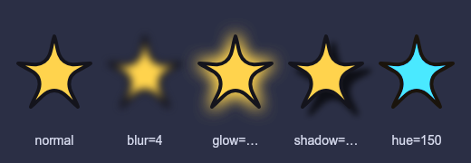

| Atributo | O que faz |
|---|---|
| `blur=4` | desfoque, em pixels (neblina, fundo fora de foco) |
| `glow=cor,raio,força` | brilho em volta de tudo da camada (força padrão 1, até 5) |
| `shadow=cor,dx,dy,desfoque` | sombra deslocada (use cor com transparência, como `#000000b0`) |
| `tint=cor,quanto` | tinge com uma cor (0 a 1): um personagem que leva dano fica vermelho |
| `brightness=` `saturate=` `contrast=` | brilho, saturação e contraste (1 = normal; 0.5 metade; 2 o dobro) |
| `hue=graus` | gira as cores no círculo de cores |
| `trail=quadros,queda,cor` | rastro de movimento (abaixo) |

Os efeitos animam com `key`: `key 4 aura.glow=40`, `key 6 heroi.tint=0.6`, `key 0 neblina.blur=8`. Eles usam o recurso de filtro do navegador; onde ele não existe, o desfoque vira uma aproximação e os ajustes de cor são ignorados.

### Os números do `glow=` e do `shadow=`

O `glow=` e o `shadow=` têm vários números. Aqui estão eles mudando um de cada vez:

<!-- gerar: img/08_glow_sombra.png -->
```weasel
canvas 480 280 bg=#2b2f45
palette ink=#14141c line=4

def estrela cor=#ffd34d
shape s c=cor ink=line : 0,-34! 9,-10 34,-8! 14,7 22,32! 0,17 -22,32! -14,7 -34,-8! -9,-10
end

layer g1 glow=#ffd34d,6
use estrela 80,60
layer g2 glow=#ffd34d,20
use estrela 240,60
layer g3 glow=#ff4d6d,20,4
use estrela 400,60

layer s1 shadow=#000000b0,6,6,0
use estrela 80,190
layer s2 shadow=#000000b0,6,6,10
use estrela 240,190
layer s3 shadow=#00000080,-14,4,4
use estrela 400,190

layer rotulos
text t1 80,124 "glow=#ffd34d,6" size=13 align=center c=#d8dcef
text t2 240,124 "glow=#ffd34d,20" size=13 align=center c=#d8dcef
text t3 400,124 "glow=#ff4d6d,20,4" size=13 align=center c=#d8dcef
text t4 80,256 "shadow=…,6,6,0" size=13 align=center c=#d8dcef
text t5 240,256 "shadow=…,6,6,10" size=13 align=center c=#d8dcef
text t6 400,256 "shadow=…,-14,4,4" size=13 align=center c=#d8dcef
```

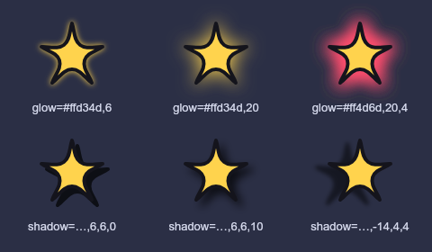

Repare, na linha de cima (`glow=cor,raio,força`):

- O **raio** é até onde o brilho vai, em pixels (padrão 12): 6 é um brilho curto, 20 é largo.
- A **força** (padrão 1, até 5) repete o brilho por cima dele mesmo. Com 4, o brilho vermelho fica bem mais forte.

E na de baixo (`shadow=cor,dx,dy,desfoque`):

- `dx,dy` é o quanto a sombra anda, em pixels: `6,6` é para a direita e para baixo; `-14,4` é para a esquerda e um pouco para baixo.
- O **desfoque** é em pixels: 0 dá uma sombra recortada, de borda nítida; 10 dá uma sombra macia.
- A cor com transparência (`b0` no fim, ou `80`, mais clara) deixa ver o fundo através da sombra.

### Os ajustes de cor

`tint=`, `brightness=`, `saturate=` e `contrast=` mudam as cores da camada inteira. Os números são multiplicadores: 1 é "como está", 0.5 é a metade, 2 é o dobro.

<!-- gerar: img/08_ajustes.png -->
```weasel
canvas 480 300 bg=#2b2f45
palette ink=#14141c line=3

def bicho
shape corpo c=#9be38c ink=line : 0,-46 30,-20 34,10! -34,10! -30,-20
ellipse olhoE -9,-20 3,5 c=ink
ellipse olhoD 9,-20 3,5 c=ink
ellipse chapeu 0,-46 20,8 c=#e8504a ink=line
rect laco -30,0 60,10 c=#4a8ae8 ink=line
end

layer c1
use bicho 80,80
layer c2 tint=#ff2020,0.6
use bicho 240,80
layer c3 brightness=0.5
use bicho 400,80
layer c4 brightness=1.6
use bicho 80,220
layer c5 saturate=0
use bicho 240,220
layer c6 contrast=2
use bicho 400,220

layer rotulos
text t1 80,124 "normal" size=13 align=center c=#d8dcef
text t2 240,124 "tint=#ff2020,0.6" size=13 align=center c=#d8dcef
text t3 400,124 "brightness=0.5" size=13 align=center c=#d8dcef
text t4 80,264 "brightness=1.6" size=13 align=center c=#d8dcef
text t5 240,264 "saturate=0" size=13 align=center c=#d8dcef
text t6 400,264 "contrast=2" size=13 align=center c=#d8dcef
```

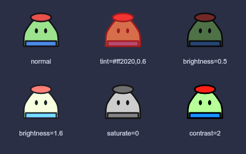

Repare:

- `tint=#ff2020,0.6` pinta 60% de vermelho por cima de tudo, até do contorno. O segundo número vai de 0 (nada) a 1 (vermelho chapado); o padrão é 0.5.
- `brightness=0.5` deixa tudo com metade do brilho; `1.6` clareia.
- `saturate=0` tira as cores (fica cinza). Um número maior que 1 deixa as cores mais vivas.
- `contrast=2` separa mais o claro do escuro: as cores ficam mais fortes e o contorno, mais preto.
- O `hue=` (girar as cores) está na imagem das estrelas, lá em cima.

#### Piscar de vermelho quando leva dano

Um uso clássico num jogo: o personagem pisca de vermelho quando apanha. Escreva a cor do `tint=` na camada com o quanto em **0** (invisível), e mude só o quanto com `key`:

<!-- gerar: img/08_dano.gif -a dano -->
```weasel
canvas 200 150 bg=#2b2f45
palette ink=#14141c line=3

bone corpo pivot=100,130

layer heroi tint=#ff2020,0
shape corpo c=#9be38c ink=line bone=corpo : 100,60 134,90 138,130! 62,130! 66,90
ellipse olhoE 90,92 3,5 c=ink bone=corpo
ellipse olhoD 110,92 3,5 c=ink bone=corpo

anim dano frames=12 fps=12 once
key 0 corpo=0,0,0 heroi.tint=0
key 2 corpo=-10,0,-8 heroi.tint=0.8
key 4 heroi.tint=0
key 6 heroi.tint=0.8
key 8 corpo=0,0,0 heroi.tint=0
```

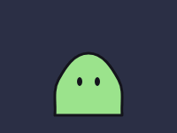

Repare:

- `heroi.tint=0.8` muda o **quanto** do tint da camada `heroi`. A cor (`#ff2020`) vem da linha `layer`: sem ela, a `key` não teria que cor usar.
- O corpo vai para trás e inclina (`corpo=-10,0,-8`) junto com o primeiro piscar, e volta no quadro 8.
- `once` faz a animação tocar uma vez só, como um golpe.

### Rastro: `trail=`

`trail=quadros,queda` desenha, por trás da camada, os quadros **anteriores** da animação, cada um mais fraco (`queda` de 0 a 1: quanto sobra de um para o outro). Uma cor opcional tinge o rastro.

<!-- gerar: img/08_rastro.gif -a gira -->
```weasel
canvas 300 220 bg=#14182a

bone braco pivot=150,110
ellipse centro 150,110 6 c=#3a4060

layer cometa trail=6,0.6
ellipse c 236,110 14 c=#9fd0ff emit=#9fd0ff,1 bone=braco

anim gira frames=24 fps=24
key 0 braco=0,0,0 ease=linear
key 24 braco=0,0,360
```

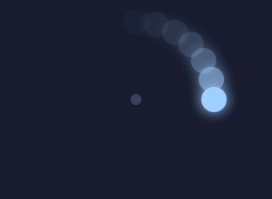

Repare no `ease=linear` com a rotação de 0 a 360: o giro é constante e o quadro 24 (360°) é igual ao 0, então o loop não tem emenda.

Os três números do `trail=`, comparados em duas bolas que vão e voltam:

<!-- gerar: img/08_rastro_cor.gif -a vai -->
```weasel
canvas 360 160 bg=#14182a

bone vaiA pivot=60,50
bone vaiB pivot=60,120

layer bolaA trail=3,0.5
ellipse a 60,50 12 c=#9fd0ff bone=vaiA
layer bolaB trail=10,0.8,#ff6ad5
ellipse b 60,120 12 c=#9fd0ff bone=vaiB

layer rotulos
text t1 180,20 "trail=3,0.5" size=13 align=center c=#d8dcef
text t2 180,90 "trail=10,0.8,#ff6ad5" size=13 align=center c=#d8dcef

anim vai frames=24 fps=12
key 0 vaiA=0 vaiB=0
key 12 vaiA=240 vaiB=240
key 24 vaiA=0 vaiB=0
```

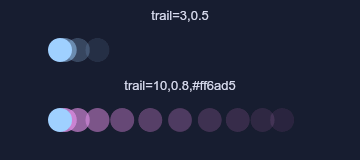

Repare:

- O **primeiro número** é quantos quadros para trás aparecem (de 1 a 30): 3 dá um rastro curto, 10 um rastro longo.
- O **segundo** é a queda: com 0.5, cada cópia tem metade da força da anterior e some rápido; com 0.8, sobra mais de cada uma.
- O **terceiro**, opcional, é a cor do rastro: a bola continua azul, só as cópias ficam rosa.
- `key 12 vaiA=240` com um número só move o osso 240 pixels para a direita ([capítulo 6](06-ossos.md#quantos-números-escrever)).

## Partículas

`emitter` solta **partículas**: fagulhas, fumaça, chuva, neve, bolhas, vaga-lumes. Cada partícula nasce no ponto do emissor, sai numa direção sorteada, vive um tempo e some, mudando de tamanho e cor no caminho.

<!-- gerar: img/08_fogueira.gif -a queima -->
```weasel
canvas 320 260 bg=#14182a
finish game bloom=0.5 vignette=0.6
palette ink=#14141c line=4

layer chao
ellipse terra 160,232 120,16 c=#4a3d52

layer lenha
rect tora1 104,206 112,18 r=9 rot=-14 c=#7a4a2c ink=line
rect tora2 104,206 112,18 r=9 rot=14 c=#6a3f26 ink=line

layer fogo unlit
emitter fumaca 160,150 rate=5 life=2.4 speed=34 angle=-90 spread=24 wind=14 c=#6a6d8060,#6a6d8000 size=16,48 shape=soft seed=5
emitter chama 160,208 rate=40 life=0.8 speed=70 angle=-90 spread=30 gravity=-60 area=44,4 c=#ffd27a,#ff400000 size=24,4 shape=soft emit=#ff9a4a,0.6
emitter fagulha 160,200 rate=10 life=1.4 speed=100 angle=-90 spread=70 gravity=-20 drag=0.6 c=#ffe2a8,#ff800000 size=4,1 seed=2

ambient c=#3a4270 power=0.5
light fogueira point 160,186 c=#ff9a4a power=1.5 radius=220 glow=80 flicker=0.15

anim queima frames=24 fps=12
```

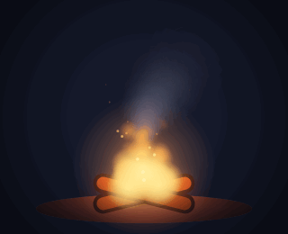

| Atributo | Padrão | O que faz |
|---|---|---|
| `rate=` | 20 | quantas partículas nascem **por segundo** |
| `burst=` | 0 | uma **rajada** de N partículas de uma vez, no começo de cada volta da animação (explosão, poeira de um pulo). Ela soma com o fluxo do `rate=`: para ter só a rajada, escreva também `rate=0` |
| `life=` | 1 | quantos segundos cada uma vive (com uma pequena variação) |
| `speed=` | 80 | velocidade inicial, em pixels por segundo |
| `angle=` | −90 | direção, em graus (−90 = para cima, 90 = para baixo, 0 = direita) |
| `spread=` | 40 | quanto a direção varia, em graus (360 = para todo lado) |
| `gravity=` | 0 | puxa para baixo (negativo: sobe, como fogo e bolhas) |
| `wind=` | 0 | empurra para o lado (positivo: para a direita) |
| `drag=` | 0 | resistência do ar: freia a partícula com o tempo |
| `size=início,fim` | 4 | tamanho ao nascer e ao morrer |
| `c=início,fim` | cor de tinta | cor ao nascer e ao morrer (use transparência `00` no fim para sumir suave) |
| `shape=` | `dot` | `dot` (bolinha), `soft` (bolinha esfumaçada), `square`, `streak` (risco na direção do movimento: chuva) e `star` |
| `area=l,a` | 0 | espalha o nascimento num retângulo (chuva no céu inteiro: `area=1000,0`) |
| `seed=` | 1 | muda o sorteio, para dois emissores iguais não ficarem idênticos |
| `emit=cor,força` | — | as partículas brilham |
| `bone=` | — | o emissor anda com um osso (a fumaça do escapamento, as mariposas em volta da lanterna) |

- As partículas também precisam de uma **animação tocando** (aqui, `anim queima`, sem `key`), como os movimentos automáticos. Na pose parada, aparece um instante "congelado".
- O sorteio é **fixo**: a mesma animação sai sempre igual, e o loop fecha certinho, sem partículas sumindo ou aparecendo na emenda.
- Ponha o fogo numa camada `unlit` (o fogo é a luz) e uma `light` no meio dele, com `flicker=`, para iluminar o resto.

Os exemplos a seguir mudam um atributo de cada vez. Quase todos **não têm animação**: a imagem é aquele instante congelado da pose parada, que é ótimo para comparar. Cole qualquer um deles com uma linha `anim teste frames=24 fps=12` no fim para ver as partículas se mexendo.

### O formato: `shape=`

<!-- gerar: img/08_part_formas.png -->
```weasel
canvas 520 180 bg=#14182a

layer faiscas
emitter e1 52,120 rate=20 speed=70 spread=50 size=16,6 c=#ffd27a,#ff6a3d00 shape=dot
emitter e2 156,120 rate=20 speed=70 spread=50 size=16,6 c=#ffd27a,#ff6a3d00 shape=soft
emitter e3 260,120 rate=20 speed=70 spread=50 size=16,6 c=#ffd27a,#ff6a3d00 shape=square
emitter e4 364,120 rate=20 speed=70 spread=50 size=8,3 c=#ffd27a,#ff6a3d00 shape=streak
emitter e5 468,120 rate=20 speed=70 spread=50 size=16,6 c=#ffd27a,#ff6a3d00 shape=star

layer rotulos
text t1 52,168 "dot" size=13 align=center c=#d8dcef
text t2 156,168 "soft" size=13 align=center c=#d8dcef
text t3 260,168 "square" size=13 align=center c=#d8dcef
text t4 364,168 "streak" size=13 align=center c=#d8dcef
text t5 468,168 "star" size=13 align=center c=#d8dcef
```

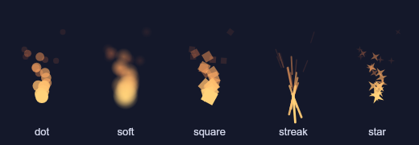

Repare:

- `dot` é uma bolinha lisa (o padrão). `soft` é uma bolinha de borda esfumaçada: boa para fumaça, neblina e chamas.
- `square` é um quadradinho, cada um girado de um jeito: confete, cinzas, pixels.
- `streak` é um **risco** na direção em que a partícula anda: chuva, faíscas rápidas. O comprimento é 4 vezes o `size=`, por isso ele tem um tamanho menor que os outros.
- `star` é uma estrelinha de quatro pontas: magia, brilho.

### A direção: `angle=` e `spread=`

<!-- gerar: img/08_part_direcao.png -->
```weasel
canvas 520 180 bg=#14182a

layer faiscas
emitter e1 52,90 rate=60 speed=60 spread=0 c=#9fd0ff
emitter e2 156,90 rate=60 speed=60 c=#9fd0ff
emitter e3 260,90 rate=60 speed=60 spread=360 c=#9fd0ff
emitter e4 364,90 rate=60 speed=60 angle=0 spread=20 c=#9fd0ff
emitter e5 468,90 rate=60 speed=60 angle=135 spread=20 c=#9fd0ff

layer rotulos
text t1 52,168 "spread=0" size=13 align=center c=#d8dcef
text t2 156,168 "(padrão: 40)" size=13 align=center c=#d8dcef
text t3 260,168 "spread=360" size=13 align=center c=#d8dcef
text t4 364,168 "angle=0" size=13 align=center c=#d8dcef
text t5 468,168 "angle=135" size=13 align=center c=#d8dcef
```

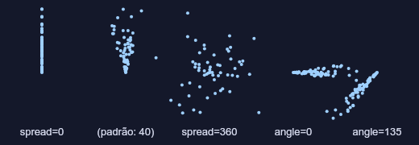

Repare:

- `angle=` é para onde as partículas vão, em graus. Como no resto do Weasel, 0 = direita, 90 = baixo, 180 = esquerda e −90 = cima (o padrão).
- `spread=` é o quanto essa direção pode variar, em graus, no total. Com 0, todas saem iguais, numa fila; com 40 (o padrão), num leque; com 360, para todo lado, como uma explosão.
- As partículas de um mesmo emissor não andam todas na mesma velocidade: cada uma sorteia um pouco mais ou um pouco menos que o `speed=`. Por isso elas se espalham ao longo do caminho.

### As forças: `gravity=`, `wind=` e `drag=`

<!-- gerar: img/08_part_forcas.png -->
```weasel
canvas 520 200 bg=#14182a

layer faiscas
emitter e1 52,130 rate=60 speed=110 spread=10 life=1.2 c=#ffd27a
emitter e2 136,130 rate=60 speed=110 spread=10 life=1 c=#ffd27a gravity=200 angle=-70
emitter e3 260,130 rate=60 speed=40 spread=10 life=1.2 c=#ffd27a gravity=-150
emitter e4 364,130 rate=60 speed=110 spread=10 life=1.2 c=#ffd27a wind=150
emitter e5 468,130 rate=60 speed=110 spread=10 life=1.2 c=#ffd27a drag=3

layer rotulos
text t1 52,188 "nada" size=13 align=center c=#d8dcef
text t2 156,188 "gravity=200" size=13 align=center c=#d8dcef
text t3 260,188 "gravity=-150" size=13 align=center c=#d8dcef
text t4 364,188 "wind=150" size=13 align=center c=#d8dcef
text t5 468,188 "drag=3" size=13 align=center c=#d8dcef
```

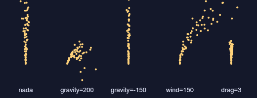

Repare:

- Sem forças, a partícula anda em linha reta, sempre na mesma velocidade.
- `gravity=200` puxa para **baixo**: a partícula sobe, perde força e cai, como a água de um chafariz. O número é em pixels por segundo, a cada segundo (quanto mais alto, mais forte o puxão).
- `gravity=-150`, negativo, puxa para **cima**: a partícula sai devagar (`speed=40`) e vai acelerando, como fogo e bolhas.
- `wind=150` empurra para a **direita** (negativo: para a esquerda), cada vez mais com o tempo.
- `drag=3` é a resistência do ar: a partícula sai rápida e vai **freando** até quase parar. É o que faz a fumaça "assentar".

### Vida, tamanho e cor: `life=`, `size=` e `c=`

<!-- gerar: img/08_part_vida.png -->
```weasel
canvas 520 200 bg=#14182a

layer faiscas
emitter e1 52,150 rate=40 speed=80 life=0.4 c=#9fd0ff
emitter e2 156,150 rate=40 speed=80 life=1.6 c=#9fd0ff
emitter e3 260,150 rate=20 speed=80 size=2,16 c=#9fd0ff
emitter e4 364,150 rate=20 speed=80 size=16,2 c=#9fd0ff
emitter e5 468,150 rate=40 speed=80 c=#ffffff,#ff400000

layer rotulos
text t1 52,188 "life=0.4" size=13 align=center c=#d8dcef
text t2 156,188 "life=1.6" size=13 align=center c=#d8dcef
text t3 260,188 "size=2,16" size=13 align=center c=#d8dcef
text t4 364,188 "size=16,2" size=13 align=center c=#d8dcef
text t5 468,188 "c=#ffffff,#ff400000" size=12 align=center c=#d8dcef
```

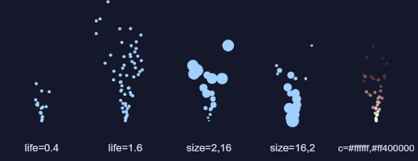

Repare:

- `life=` é quanto tempo cada partícula vive, em segundos (padrão 1). Com a mesma velocidade, vida curta = jato baixo; vida longa = jato alto.
- `size=início,fim` é o tamanho, em pixels, ao nascer e ao morrer. `2,16` cresce (fumaça que se espalha); `16,2` encolhe (fagulha que apaga). Com um número só, o tamanho não muda.
- `c=início,fim` faz a mesma coisa com a cor. O fim `#ff400000` termina em `00`, transparente: a partícula some aos poucos, em vez de sumir de uma vez.

### Onde nascem: `area=`, e o sorteio: `seed=`

<!-- gerar: img/08_part_area.png -->
```weasel
canvas 520 200 bg=#14182a

layer faiscas
emitter e1 52,150 rate=40 speed=60 spread=10 c=#ffd27a
emitter e2 156,150 rate=40 speed=60 spread=10 c=#ffd27a area=80,0
emitter e3 260,130 rate=40 speed=60 spread=10 c=#ffd27a area=80,60
emitter e4 364,150 rate=10 speed=60 c=#ffd27a size=6
emitter e5 468,150 rate=10 speed=60 c=#ffd27a size=6 seed=2

layer rotulos
text t1 52,188 "sem area" size=13 align=center c=#d8dcef
text t2 156,188 "area=80,0" size=13 align=center c=#d8dcef
text t3 260,188 "area=80,60" size=13 align=center c=#d8dcef
text t4 364,188 "seed=1 (padrão)" size=13 align=center c=#d8dcef
text t5 468,188 "seed=2" size=13 align=center c=#d8dcef
```

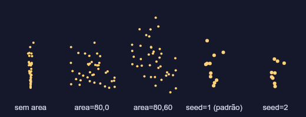

Repare:

- Sem `area=`, todas as partículas nascem **no mesmo ponto**.
- `area=80,0` espalha o nascimento numa **linha** de 80 pixels de largura (0 de altura), com o ponto do emissor no meio. É assim que se faz chuva no céu inteiro: `area=1000,0` em cima da tela.
- `area=80,60` espalha num **retângulo** de 80 × 60: bom para vaga-lumes, poeira no ar, bolhas num aquário.
- Os dois últimos são iguais, menos o `seed=`. O `seed=` é o "número da sorte" do sorteio: com outro número, as partículas saem em outros lugares. Use quando tiver dois emissores iguais lado a lado (duas tochas), senão eles ficam idênticos, como um espelho.

### Uma rajada só: `burst=`

`rate=` é um **fluxo**: partículas nascendo sem parar. `burst=` é uma **rajada**: várias de uma vez, no começo de cada volta da animação. Como isso acontece no tempo, este exemplo é uma animação:

<!-- gerar: img/08_rajada.gif -a solta -->
```weasel
canvas 320 180 bg=#14182a

layer faiscas
emitter fluxo 80,90 rate=20 speed=60 spread=360 c=#9fd0ff,#9fd0ff00 size=6,2
emitter rajada 240,90 rate=0 burst=20 speed=60 spread=360 c=#ffd27a,#ffd27a00 size=6,2

layer rotulos
text t1 80,166 "rate=20" size=13 align=center c=#d8dcef
text t2 240,166 "rate=0 burst=20" size=13 align=center c=#d8dcef

anim solta frames=18 fps=12
```

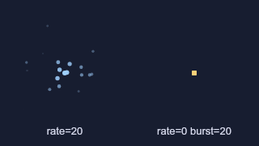

Repare:

- O `rajada` tem `rate=0`. Isso é importante: o `rate=` vale 20 mesmo quando você não escreve, então um emissor só com `burst=20` solta a rajada **e** o fluxo.
- A rajada acontece no quadro 0 de cada volta. A animação tem 18 quadros (1,5 segundo), então o estouro se repete a cada 1,5 segundo.
- Para um estouro que acontece uma vez só (um pulo, uma explosão), use uma animação com `once`.

**Experimente:** apague o `rate=0` do emissor `rajada`. Ele passa a soltar também o fluxo de 20 por segundo, e a rajada fica escondida no meio das outras bolinhas.

### Partículas presas a um osso: `bone=`

Com `bone=`, o emissor **anda com o osso**. Mas cada partícula, depois que nasce, segue sozinha: ela não volta com o osso. Por isso a fumaça de um foguete fica para trás, desenhando o caminho:

<!-- gerar: img/08_foguete.gif -a gira -->
```weasel
canvas 300 220 bg=#14182a
palette ink=#14141c line=3

bone voo pivot=150,110

layer fumaca
emitter rastro 176,24 rate=20 life=1.2 speed=8 spread=360 size=6,18 c=#c8cce0a0,#c8cce000 shape=soft bone=voo

layer nave
shape foguete c=#e8504a ink=line bone=voo : 124,24! 138,14 176,14! 176,34! 138,34

anim gira frames=24 fps=12
key 0 voo=0,0,0 ease=linear
key 24 voo=0,0,-360
```

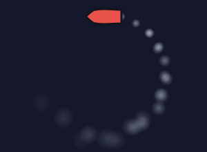

Repare:

- O osso `voo` gira em volta do meio do canvas (`pivot=150,110`). O foguete e o emissor estão no alto, a uns 85 pixels do pivô, então dão voltas num círculo. A `key 24 voo=0,0,-360` gira no sentido anti-horário (número negativo), por isso o bico do foguete aponta para a esquerda.
- O emissor fica no ponto `176,24`, a traseira do foguete: a fumaça sai de trás.
- O emissor tem `speed=8` e `spread=360`: a fumaça quase não anda sozinha. Quem desenha o círculo é o foguete andando.
- As bolinhas nascem pequenas e transparentes pela metade (`a0` no fim da cor), e terminam grandes e invisíveis (`00`). Por isso a trilha engrossa e some.

**Experimente:** troque para `speed=40 angle=90` (para baixo). A fumaça passa a cair do foguete, como de um avião em pane.

## Acabamentos de cinema

A fogueira usa `finish game bloom=0.5 vignette=0.6`:

| Atributo de `finish` | O que faz |
|---|---|
| `bloom=` | o que é muito claro "vaza" num brilho suave, como em câmera de verdade |
| `vignette=` | escurece as bordas da imagem e leva o olho para o meio |
| `grain=` | granulado de filme (pouco já basta: `grain=0.03`) |

O `bloom` vai de 0 a 3, o `vignette` de 0 a 1 e o `grain` de 0 a 0.33. Eles valem para a imagem pronta, então ficam bem em cenas inteiras (cenários, filmes) e pouco fazem num personagem sozinho. O granulado deixa GIFs bem maiores, porque ruído não comprime. Cada um deles, sozinho e lado a lado, está no [capítulo 4](04-camadas.md#acabamentos-de-cinema-bloom-vignette-e-grain).

Eles combinam muito bem com luz: o `bloom` faz as lâmpadas e as janelas acesas "vazarem" de verdade. Aqui está a rua do começo do capítulo (o `rua.weasel` que você guardou), com e sem os dois:

<!-- gerar: img/08_rua_cinema.png -s 0.5 -->
```weasel
include "rua.weasel"
finish bloom=1.5 vignette=0.5
```

| A rua sem acabamento | `finish bloom=1.5 vignette=0.5` |
|---|---|
| 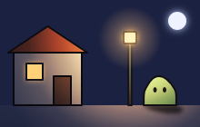 | 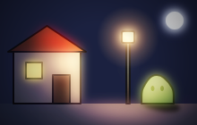 |

Repare:

- O `finish` pode vir depois do `include`: ele vale para a imagem inteira, de onde quer que venha.
- O `bloom` pega o que já é bem claro: a lanterna, a lua, a parede iluminada e o halo do `glow=`. O que é escuro (o céu, a rua longe do poste) quase não muda.
- A imagem foi gerada com `-s 0.5` (metade do tamanho), só para caber lado a lado.

[← Animação](07-animacao.md) · [Índice](README.md) · [Próximo: Jogo e Godot →](09-jogo-godot.md)
