# 8. Ossos

[← Primeiro movimento](07-movimento.md) · [Índice](README.md) · [Próximo: Animação →](09-animacao.md)

No capítulo 7, cada osso andava sozinho. Aqui os ossos se juntam num **esqueleto** (`parent=`), e você aprende os ossos que se mexem sozinhos (`sway`, `bob`, `jitter` e `spring=`), o pano que balança (`cloth`), as formas que dobram e esticam (`bones=` e `@osso`) e as pernas que ficam no chão quando o corpo desce (IK). Você precisa dos capítulos 1 a 7.

## Pai e filho: `parent=`

Um braço tem ombro e cotovelo. O antebraço precisa ir junto quando o ombro gira, mas também precisa girar sozinho no cotovelo. Isso é um osso **filho**:

```
bone pai pivot=x,y
bone filho parent=pai pivot=x,y
```

<!-- gerar: img/06_pai_filho.gif -a acena --guides -->
```weasel
canvas 440 280 bg=#f4efe6
palette ink=#2b2a33 line=5 pele=#ffcf9e manga=#4a90d9

bone ombro pivot=100,210
bone cotovelo parent=ombro pivot=220,210

rect bracoR 90,196 140,28 r=14 c=manga ink=line bone=ombro
rect antebraco 214,198 120,24 r=12 c=pele ink=line bone=cotovelo
ellipse mao 340,210 20 c=pele ink=line bone=cotovelo

layer pivos guide
ellipse p1 100,210 6 c=#c44536 bone=ombro
ellipse p2 220,210 6 c=#c44536 bone=cotovelo

anim acena frames=48 fps=16
key 0 ombro=0,0,0 cotovelo=0,0,0
key 12 ombro=0,0,-25 cotovelo=0,0,-55
key 24 ombro=0,0,-25 cotovelo=0,0,-10
key 36 ombro=0,0,-25 cotovelo=0,0,-55
key 48 ombro=0,0,0 cotovelo=0,0,0
```

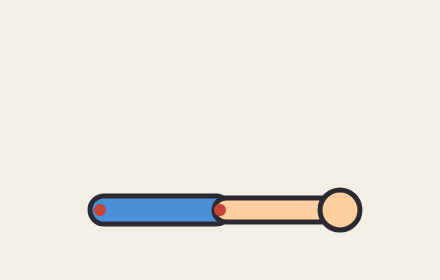

Os pontos vermelhos são os pivôs, numa camada `guide`. Repare:

- `cotovelo` tem `parent=ombro`: **tudo o que o ombro faz, o cotovelo faz junto**. Quando o ombro gira −25°, o cotovelo, o antebraço e a mão sobem com ele.
- Por cima disso, o cotovelo gira o **próprio** ângulo (−55°, depois −10°), em volta do pivô dele, que já se mexeu junto com o ombro.
- Os números do filho somam com os do pai: `cotovelo=0,0,-55` quer dizer "55° a mais que o ombro". Na tela, o antebraço fica em −80° (−25 − 55). O `dx,dy` do filho também segue o pai: se o pai está girado, o filho anda na direção girada.
- O pivô é sempre escrito na posição de descanso, nas coordenadas do desenho (`pivot=220,210`), mesmo que o pai mova tudo depois.
- O pai pode vir depois do filho no arquivo. Dois ossos que são pais um do outro dão erro.

**Experimente:** apague o `parent=ombro`. O ombro sobe, mas o antebraço não sabe disso: ele gira em volta do lugar onde estava, e o braço quebra no meio.

## O esqueleto de um personagem

Os personagens da pasta `exemplos/` usam esta receita:

- um osso **raiz** com o pivô no chão, entre os pés: ele anda, pula e amassa o personagem inteiro;
- um osso para o **corpo** (no quadril), filho da raiz;
- a **cabeça** (no pescoço) e os **braços** (nos ombros), filhos do corpo.

Comece pelo centro e vá até as pontas. Depois, cada forma diz qual osso ela segue:

<!-- gerar: img/08_esqueleto.gif -a acena -->
```weasel
canvas 320 300 bg=#f4efe6
palette ink=#2b2a33 line=4 pele=#ffcf9e camisa=#4a90d9 calca=#3a4a6b chapeu=#c44536

def chapeu
ellipse aba 0,0 40,8 c=chapeu ink=line
rect copa -24,-38 48,38 r=6 c=chapeu ink=line
end

bone raiz pivot=160,278
bone corpo parent=raiz pivot=160,222
bone cabeca parent=corpo pivot=160,146
bone bracoE parent=corpo pivot=120,158
bone bracoD parent=corpo pivot=200,158

line chao c=#c9bca8 w=4 : 40,280 280,280
rect pernaE 136,216 18,62 r=6 c=calca ink=line bone=raiz
rect pernaD 166,216 18,62 r=6 c=calca ink=line bone=raiz
rect bE 112,150 16,64 r=8 c=camisa ink=line bone=bracoE
ellipse maoE 120,218 10 c=pele ink=line bone=bracoE
rect bD 192,150 16,64 r=8 c=camisa ink=line bone=bracoD
ellipse maoD 200,218 10 c=pele ink=line bone=bracoD
rect tronco 122,140 76,90 r=24 c=camisa ink=line bone=corpo
ellipse rosto 160,108 38 c=pele ink=line bone=cabeca
ellipse olhoE 146,104 5,7 c=ink bone=cabeca
ellipse olhoD 174,104 5,7 c=ink bone=cabeca
stroke boca w=3 bone=cabeca : 148,124 160,130 172,124
use chapeu 160,74 bone=cabeca

anim acena frames=24 fps=12
key 0 raiz=0,0,0,1,1 corpo=0,0,-3 cabeca=0,0,0 bracoD=0,0,-130
key 6 cabeca=0,0,8 bracoD=0,0,-165
key 12 raiz=0,0,0,1.04,0.96 corpo=0,0,3 cabeca=0,0,0 bracoD=0,0,-130
key 18 cabeca=0,0,8 bracoD=0,0,-165
```

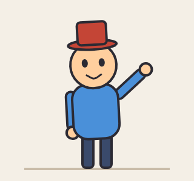

Repare:

- `raiz` tem o pivô entre os pés, no chão. Com `raiz=0,0,0,1.04,0.96`, o boneco inteiro fica um pouco mais largo e mais baixo, apoiado no chão: é a respiração. As pernas seguem a raiz.
- `corpo` é filho da `raiz`; `cabeca`, `bracoE` e `bracoD` são filhos do `corpo`. Quando o corpo inclina, a cabeça e os braços vão junto.
- `bracoD=0,0,-130` gira o braço contra o sentido do relógio, em volta do ombro, até ele ficar levantado; entre −130 e −165, ele acena.
- O `bracoE` não aparece em nenhuma `key`, mas se mexe: ele segue o corpo.
- `use chapeu 160,74 bone=cabeca`: o componente inteiro (a aba e a copa) segue a cabeça.

**Experimente:** troque `bone=cabeca` dos olhos por `bone=corpo`. A cabeça inclina, e os olhos ficam para trás.

**Cuidado:** uma forma sem `bone=` não se mexe, mesmo dentro de um esqueleto.

### Outras coisas que seguem um osso

O `bone=` do `use` vale para todas as peças do componente. Uma peça lá dentro com o próprio `bone=` usa o dela. Também seguem um osso, com o mesmo `bone=`:

- uma **luz** (`light … bone=`): a lanterna na mão, o lampião balançando ([capítulo 10](10-luz.md#luz-que-anda-com-um-osso-bone));
- um **emissor de partículas** (`emitter … bone=`): a fumaça do cachimbo ([capítulo 11](11-efeitos.md#partículas-presas-a-um-osso-bone));
- as **caixas de colisão** (`box … bone=`) e os **pontos de encaixe** (`point … bone=`) de um jogo ([capítulo 15](15-jogo-personagem.md#uma-caixa-que-segue-o-braço-e-só-liga-no-golpe)).

## Movimentos automáticos: `sway`, `bob` e `jitter`

Alguns movimentos se repetem sem fim: uma flor balançando, um balão subindo e descendo, um bicho tremendo de medo. Em vez de escrever as `key`, dá para pedir direto no osso:

| Atributo | Movimento | Números |
|---|---|---|
| `sway=graus,segundos` | balança (gira para lá e para cá) | quanto gira para cada lado e quanto tempo dura um vaivém |
| `bob=pixels,segundos` | sobe e desce | quanto sobe e desce e quanto tempo dura um vaivém |
| `jitter=pixels` | treme sem ritmo | o tamanho do tremor |

<!-- gerar: img/06_automaticos.gif -a parado -->
```weasel
canvas 440 240 bg=#cfe8f5
palette ink=#2b2a33 line=4

bone flor pivot=90,230 sway=10,2
bone balao pivot=220,100 bob=14,2
bone susto pivot=360,215 jitter=2

line chao c=#3f9a4a w=6 : 0,232 440,232
stroke caule w=6 c=#3f9a4a bone=flor : 90,232 96,180 90,130
ellipse petalas 90,112 30 c=#ff8fb1 ink=line bone=flor
ellipse miolo 90,112 13 c=#ffd34d ink=line bone=flor

stroke fio w=2 bone=balao : 220,150 212,180 222,210
ellipse b 220,104 38,46 c=#e8443a ink=line bone=balao
shape no c=#e8443a ink=line bone=balao : 220,148! 228,158! 212,158!

shape bicho c=#f6f4ff ink=line bone=susto : 360,150 392,176 396,215! 324,215! 328,176
ellipse olhoE 348,180 5,8 c=ink bone=susto
ellipse olhoD 372,180 5,8 c=ink bone=susto

anim parado frames=24 fps=12
```

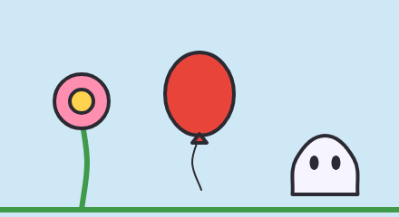

Repare:

- Os movimentos automáticos só aparecem quando **uma animação está tocando**. Por isso o exemplo tem `anim parado`, uma animação sem nenhuma `key`. Na pose parada, eles não fazem nada. Num filme ([capítulo 18](18-filme.md)), eles se mexem mesmo sem animação.
- O Weasel ajusta o tempo do vaivém para a animação terminar onde começou. Aqui a animação dura 2 segundos (24 ÷ 12), e cada vaivém também. Numa animação `once`, o tempo é exatamente o que você escreveu.
- Eles **somam** com as `key`: um osso pode balançar sozinho e ainda ser animado.

### Os dois números do `sway` e do `bob`

O primeiro número diz **quanto** o osso se mexe; o segundo, **quanto tempo** leva um vaivém (ir e voltar). O tempo precisa ser maior que 0. Três flores, cada uma com um `sway` diferente:

<!-- gerar: img/06_sway.gif -a parado -->
```weasel
canvas 460 250 bg=#cfe8f5
palette ink=#2b2a33 line=4 caule=#3f9a4a petala=#ff8fb1

bone f1 pivot=80,200 sway=10,2
bone f2 pivot=230,200 sway=30,2
bone f3 pivot=380,200 sway=10,1

line chao c=caule w=6 : 0,202 460,202
stroke c1 w=6 c=caule bone=f1 : 80,202 80,90
ellipse p1 80,80 26 c=petala ink=line bone=f1
stroke c2 w=6 c=caule bone=f2 : 230,202 230,90
ellipse p2 230,80 26 c=petala ink=line bone=f2
stroke c3 w=6 c=caule bone=f3 : 380,202 380,90
ellipse p3 380,80 26 c=petala ink=line bone=f3

text t1 80,234 "sway=10,2" size=17 bold align=center
text t2 230,234 "sway=30,2" size=17 bold align=center
text t3 380,234 "sway=10,1" size=17 bold align=center

anim parado frames=24 fps=12
```

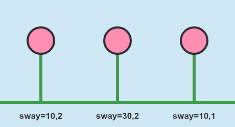

- `sway=10,2` (esquerda): gira até 10 graus para cada lado, e cada vaivém leva 2 segundos.
- `sway=30,2` (meio): o mesmo tempo, mas até 30 graus. Balança **mais**.
- `sway=10,1` (direita): os mesmos 10 graus, um vaivém por segundo. Balança **mais rápido**.
- O `bob` funciona igual, mas o primeiro número são **pixels**, em vez de graus.

**Experimente:** troque `sway=` por `bob=` na flor do meio (`bob=30,2`). Ela para de balançar e passa a subir e descer 30 pixels.

### A fase: o terceiro número

Quando várias coisas balançam juntas, fica artificial se todas vão para o mesmo lado ao mesmo tempo. O terceiro número, a **fase**, escolhe em que ponto do vaivém cada osso começa. Ele é medido em graus: um vaivém inteiro vale 360.

<!-- gerar: img/06_fase.gif -a parado -s 0.8 -->
```weasel
canvas 460 250 bg=#cfe8f5
palette ink=#2b2a33 line=4 caule=#3f9a4a

bone f1 pivot=80,200 sway=20,2,0
bone f2 pivot=230,200 sway=20,2,90
bone f3 pivot=380,200 sway=20,2,180

line chao c=caule w=6 : 0,202 460,202
stroke c1 w=6 c=caule bone=f1 : 80,202 80,90
ellipse p1 80,80 26 c=#ff8fb1 ink=line bone=f1
stroke c2 w=6 c=caule bone=f2 : 230,202 230,90
ellipse p2 230,80 26 c=#ffb84d ink=line bone=f2
stroke c3 w=6 c=caule bone=f3 : 380,202 380,90
ellipse p3 380,80 26 c=#b48cff ink=line bone=f3

text t1 80,234 "sway=20,2,0" size=17 bold align=center
text t2 230,234 "sway=20,2,90" size=17 bold align=center
text t3 380,234 "sway=20,2,180" size=17 bold align=center

anim parado frames=24 fps=12
```

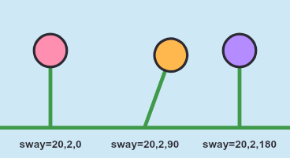

- **Fase `0`** (rosa): começa em pé, indo para a direita (o sentido do relógio).
- **Fase `90`** (laranja): começa um quarto de vaivém adiante, já toda inclinada para a direita.
- **Fase `180`** (roxa): começa em pé, indo para a esquerda. Quando a rosa vai para um lado, ela vai para o outro.
- No `bob`, a fase funciona igual (`bob=10,2,90`). Com fase 0, o osso começa descendo.

**Experimente:** dê fases diferentes a várias flores (`0`, `40`, `80`, `120`…). O campo parece balançar com o vento, numa onda.

### O tremor: `jitter`

O `jitter` serve para medo, frio, raiva ou um motor ligado. A cada quadro, o osso pula para um lugar sorteado, até essa distância para cada lado, em x e em y. Vai de 0 a 200 pixels: `jitter=1` é um arrepio; `jitter=8`, um susto de verdade.

- Com mais quadros por segundo (`fps=`), o tremor fica mais nervoso.
- O sorteio é sempre o mesmo: exportar de novo dá exatamente o mesmo tremor.

## Molas: `spring=`

Uma **mola** faz o osso girar **atrasado** quando o pivô dele é sacudido, e balançar até parar. Serve para orelhas, antenas, rabos, cabelo e plumas.

<!-- gerar: img/06_mola.gif -a sacode -->
```weasel
canvas 400 260 bg=#f4efe6
palette ink=#2b2a33 line=4 ponta=#ff6b4a

bone corpo pivot=200,238
bone antenaE parent=corpo pivot=180,138 spring=0.1
bone antenaD parent=corpo pivot=220,138 spring=0.9

line chao c=#8a7f6e w=3 : 40,240 360,240
stroke aE w=4 bone=antenaE : 180,140 172,100 158,72
ellipse bE 158,70 9 c=ponta ink=line bone=antenaE
stroke aD w=4 bone=antenaD : 220,140 228,100 242,72
ellipse bD 242,70 9 c=ponta ink=line bone=antenaD
shape bichinho c=#9be38c ink=line bone=corpo : 200,126 262,176 252,238! 148,238! 138,176
ellipse olhoE 184,180 6,9 c=ink bone=corpo
ellipse olhoD 216,180 6,9 c=ink bone=corpo

anim sacode frames=48 fps=24
key 0 corpo=0,0,0
key 5 corpo=0,0,-14
key 11 corpo=0,0,14
key 16 corpo=0,0,0
key 48 corpo=0,0,0
```

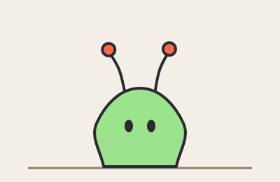

Repare:

- O bichinho sacode o corpo e para. As antenas não têm `key`: quem as mexe é a mola, porque o pivô delas anda com o corpo.
- `spring=` vai de 0 a 1 e diz o quanto a mola é **dura**. Perto de 0, mole: atrasa muito e balança devagar (a antena da esquerda, `0.1`). Perto de 1, dura: quase acompanha o pai (a da direita, `0.9`).
- A mola só **gira** o osso, no máximo uns 69° para cada lado.
- Ela só reage quando o tranco é de lado, cruzando a peça. Uma antena em pé balança quando o corpo vai para os lados. Um rabo deitado não balança se o corpo só anda na direção dele; balança quando o corpo pula.
- A mola soma com as `key` do próprio osso, se ele tiver.

**Experimente:** ponha `spring=0.5` nas duas antenas. Elas passam a balançar iguais, num meio-termo.

**Cuidado:**
- `spring=0` não desliga a mola: vale como uma mola muito mole. Para tirar a mola, apague o `spring=`.
- Se o pai se mexe rápido demais, a mola pode exagerar. Deixe-a mais dura. Uma mola filha de outra mola recebe o balanço dela, e a ponta pode chicotear demais.

### Opções do `bone`

| Opção | O que faz | Valores | Se não escrever |
|---|---|---|---|
| o nome | o nome do osso, para o `bone=` das formas e para a `key` | um nome sem acento, que não se repete | obrigatório |
| `pivot=x,y` | o pivô: o ponto em volta do qual o osso gira e estica | dois números, em pixels | obrigatório (sem ele, dá erro) |
| `parent=` | o osso pai | o nome de outro osso | sem pai |
| `sway=graus,segundos[,fase]` | balança sozinho | graus: qualquer número; segundos: maior que 0; fase: em graus | sem balanço |
| `bob=pixels,segundos[,fase]` | sobe e desce sozinho (com fase 0, desce primeiro) | como no `sway=` | parado |
| `jitter=` | treme a cada quadro | de 0 a 200, em pixels | 0 |
| `spring=` | mola: gira atrasado e balança até parar | de 0 a 1 (perto de 1: dura) | sem mola |

O osso tem mais opções: `path=` e `turn=` (andar por um caminho, [capítulo 9](09-animacao.md#andar-por-um-caminho-path)) e `yaw=`, `pitch=`, `persp=` e `round=` (o giro 3D, [capítulo 14](14-profundidade.md#uma-cabeça-que-olha-para-os-lados-round)). A ficha completa está na [referência do `bone`](20-referencia.md#bone).

## Tecido: `cloth`

Uma mola gira um pedaço inteiro. Um **tecido** faz outra coisa: os pontos da forma **longe** de um pivô ficam para trás quando o osso anda, como uma capa, uma bandeira ou a barra de um fantasma.

```
cloth nome pivot=x,y [tension=…] [drag=…] [swing=…] [bone=…]
forma … bone=osso cloth=nome
```

<!-- gerar: img/06_tecido.gif -a corre -->
```weasel
canvas 440 240 bg=#cfe8f5
palette ink=#2b2a33 line=4

bone mastro pivot=150,222
cloth pano pivot=152,85 tension=0.15 drag=2 swing=1.5

line chao c=#3f9a4a w=6 : 0,226 440,226
shape bandeira c=#e8443a ink=line bone=mastro cloth=pano : 146,50! 290,64 284,112 146,120!
rect haste 144,40 12,184 r=6 c=#7a4a2c ink=line bone=mastro

anim corre frames=32 fps=16
key 0 mastro=-70,0
key 16 mastro=90,0
key 32 mastro=-70,0
```

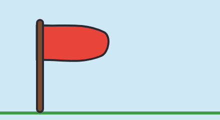

Repare:

- O **pivô do tecido** é o ponto onde o pano está preso (aqui, no mastro). Ali ele não balança; quanto mais longe, mais o ponto atrasa. O pano anda no máximo 40% da distância do pivô até o ponto mais longe dele.
- A forma diz qual osso a carrega (`bone=mastro`) e qual tecido a faz balançar (`cloth=pano`). Várias formas podem usar o mesmo tecido e balançam juntas.
- `tension=` vai de 0 (pano mole, balança muito) a 1 (duro). Se não escrever, 0.5.
- `drag=` é o quanto o ar empurra o pano para trás enquanto o osso anda. `swing=` é o quanto o pano balança quando o osso freia ou muda de direção. Os dois vão de 0 a 10; se não escrever, 1.
- Como os movimentos automáticos, o pano só balança quando uma animação está tocando.

**Cuidado:** uma forma com `cloth=` e `bones=` (mais abaixo) dá aviso: ela dobra pelos ossos, e o pano fica parado.

### `tension`, `drag` e `swing` lado a lado

Cada linha da imagem compara dois valores de **um** atributo. As seis bandeiras estão no mesmo osso, que vai e volta:

<!-- gerar: img/06_tecido_numeros.gif -a corre -s 0.8 -->
```weasel
canvas 460 390 bg=#cfe8f5
palette ink=#2b2a33 line=3 pau=#7a4a2c

bone mastro pivot=230,380

cloth mole pivot=100,40 tension=0.1 drag=2 swing=2
cloth duro pivot=300,40 tension=0.9 drag=2 swing=2
cloth semAr pivot=100,165 drag=0 swing=0
cloth comAr pivot=300,165 drag=6 swing=0
cloth semTranco pivot=100,290 drag=0 swing=0
cloth comTranco pivot=300,290 drag=0 swing=6

layer rotulos
text r1 100,26 "tension=0.1" size=15 bold
text r2 300,26 "tension=0.9" size=15 bold
text r3 100,151 "drag=0" size=15 bold
text r4 300,151 "drag=6" size=15 bold
text r5 100,276 "swing=0" size=15 bold
text r6 300,276 "swing=6" size=15 bold

layer bandeiras
shape b1 c=#e8443a ink=line bone=mastro cloth=mole : 98,40! 190,48 186,88 98,94!
rect h1 92,36 8,90 r=4 c=pau bone=mastro
shape b2 c=#e8443a ink=line bone=mastro cloth=duro : 298,40! 390,48 386,88 298,94!
rect h2 292,36 8,90 r=4 c=pau bone=mastro
shape b3 c=#4a90d9 ink=line bone=mastro cloth=semAr : 98,165! 190,173 186,213 98,219!
rect h3 92,161 8,90 r=4 c=pau bone=mastro
shape b4 c=#4a90d9 ink=line bone=mastro cloth=comAr : 298,165! 390,173 386,213 298,219!
rect h4 292,161 8,90 r=4 c=pau bone=mastro
shape b5 c=#6cbb3c ink=line bone=mastro cloth=semTranco : 98,290! 190,298 186,338 98,344!
rect h5 92,286 8,90 r=4 c=pau bone=mastro
shape b6 c=#6cbb3c ink=line bone=mastro cloth=comTranco : 298,290! 390,298 386,338 298,344!
rect h6 292,286 8,90 r=4 c=pau bone=mastro

anim corre frames=16 fps=12
key 0 mastro=-50,0
key 8 mastro=50,0
key 16 mastro=-50,0
```


- **Vermelhas, `tension=`**: a mole (`0.1`) estica e atrasa muito; a dura (`0.9`) quase não sai do lugar.
- **Azuis, `drag=`**: com `drag=0` (e `swing=0`), o pano fica duro como uma placa. Com `drag=6`, o ar empurra a ponta para trás **enquanto o mastro anda**.
- **Verdes, `swing=`**: com `swing=6`, o pano chacoalha quando o mastro freia e muda de direção. No meio do caminho, ele quase não reage.
- Cada bandeira tem o **seu** `cloth`, com o pivô no ponto onde ela prende no pau.

**Experimente:** ponha `tension=0.5 drag=1 swing=1` (os padrões) em todas. As seis passam a balançar igual.

### Vento com o mastro parado: `bone=` no `cloth`

Às vezes o pano deve balançar sem que nada se mexa: uma bandeira ao vento, uma cortina numa janela aberta. O truque é um osso **sem nenhuma forma presa nele**, só para o tecido sentir o movimento:

<!-- gerar: img/06_vento.gif -a venta -->
```weasel
canvas 420 240 bg=#cfe8f5
palette ink=#2b2a33 line=3 pau=#7a4a2c

bone vento pivot=0,0 bob=30,1
cloth semOsso pivot=82,50 tension=0.3 drag=2 swing=2
cloth comOsso pivot=282,50 tension=0.3 drag=2 swing=2 bone=vento

line chao c=#3f9a4a w=6 : 0,226 420,226
text t1 80,24 "sem bone=" size=16 bold
text t2 280,24 "bone=vento" size=16 bold

shape b1 c=#e8443a ink=line cloth=semOsso : 80,50! 180,58 176,100 80,106!
rect h1 74,46 8,180 r=4 c=pau
shape b2 c=#e8443a ink=line cloth=comOsso : 280,50! 380,58 376,100 280,106!
rect h2 274,46 8,180 r=4 c=pau

anim venta frames=24 fps=12
```

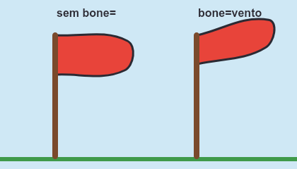

- `bone vento … bob=30,1`: um osso que sobe e desce 30 pixels, uma vez por segundo. Nenhuma forma tem `bone=vento`, então ele não carrega nada.
- `cloth comOsso … bone=vento`: o tecido da direita **sente** o sobe e desce do `vento` e reage a ele. A bandeira continua no lugar, porque ela não tem `bone=`.
- Sem `bone=` no `cloth`, o tecido sente o osso da primeira forma que o usa. A bandeira da esquerda não tem osso nenhum: o tecido dela fica parado.

**Experimente:** troque `bob=30,1` por `bob=10,0.5`: um vento mais fraco e mais rápido.

| Opção do `cloth` | O que faz | Valores | Se não escrever |
|---|---|---|---|
| `pivot=x,y` | onde o pano está preso | dois números, em pixels | obrigatório |
| `tension=` | a dureza do pano | de 0 a 1 | 0.5 |
| `drag=` | o ar empurrando o pano para trás | de 0 a 10 | 1 |
| `swing=` | o balanço nos trancos | de 0 a 10 | 1 |
| `bone=` | o osso de quem o pano sente o movimento | o nome de um osso | o osso da primeira forma com este `cloth=` |

O `use` também aceita `cloth=`. A ficha completa está na [referência do `cloth`](20-referencia.md#cloth).

## Formas que dobram: `bones=`

Uma forma com `bone=` gira inteira, como uma peça dura. Com `bones=a,b,c`, cada ponto da forma segue os ossos **mais perto dele**, e a forma dobra: um rabo, uma cobra, um tentáculo, um corpo que se curva.

<!-- gerar: img/06_bones.gif -a mexe -->
```weasel
canvas 360 200 bg=#f4efe6
palette ink=#2b2a33 line=4

bone r1 pivot=120,100
bone r2 pivot=180,100 parent=r1
bone r3 pivot=240,100 parent=r2

shape cauda c=#ff9a4a ink=line bones=r1,r2,r3 : 110,84 300,94 310,100 300,106 110,116
shape rigida c=#9ab8ff ink=line bone=r1 opacity=0.4 : 110,144 300,154 310,160 300,166 110,176

anim mexe frames=24 fps=12
key 0 r1=0,0,0 r2=0,0,0 r3=0,0,0
key 6 r1=0,0,-15 r2=0,0,-25 r3=0,0,-30
key 18 r1=0,0,15 r2=0,0,25 r3=0,0,30
key 24 r1=0,0,0 r2=0,0,0 r3=0,0,0
```

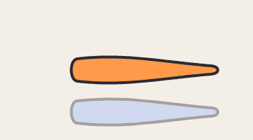

Repare:

- Os ossos fazem uma corrente (`r2` é filho de `r1`, `r3` de `r2`), cada um um pouco mais adiante na cauda.
- A **ordem da lista** divide a forma em pedaços: cada osso cuida do pedaço entre o pivô dele e o pivô do seguinte; o último segue adiante.
- Perto de uma junta, os dois ossos dividem o ponto, e a curva sai lisa. Por isso a forma dobra lisa mesmo com poucos pontos: o Weasel dobra a curva inteira, não só os pontos.
- A forma de baixo (azul) usa `bone=r1`: gira inteira, sem dobrar.
- `bones=` precisa de pelo menos dois ossos. Vale em `shape`, `stroke`, `line`, `ellipse` e `rect`, mas não em `text`.
- No Godot com esqueleto ([capítulo 16](16-jogo-avancado.md#esqueleto-de-verdade-rigbones-experimental)), a forma vira uma malha que dobra do mesmo jeito.

**Experimente:** na `key 6`, deixe só o primeiro osso girar: `r1=0,0,-15 r2=0,0,0 r3=0,0,0`. A cauda inteira gira reta, sem curva, porque `r2` e `r3` só seguem o pai. Quem faz a curva é a diferença de ângulo de um osso para o outro.

## Pontos presos a um osso: `@osso`

Com `bones=`, **todos** os pontos seguem algum osso. Às vezes você quer o contrário: só alguns pontos andam, e o resto da forma fica onde está. É o caso de uma pata que sai do contorno do corpo, de uma bochecha que estufa ou de um braço de borracha. Escreva `@osso` logo depois do ponto:

```
shape nome … : x,y x,y@osso x,y!@osso x,y~dx,dy@osso …
```

<!-- gerar: img/06_pinos.gif -a acena -->
```weasel
canvas 420 240 bg=#f4efe6
palette ink=#2b2a33 line=4 roxo=#7a5cc2

bone mao pivot=334,120

shape bicho c=roxo ink=line : 90,175 105,95 190,68 278,96! 330,104@mao 340,134@mao 288,142! 268,192 180,208
ellipse olhoE 165,122 7 c=ink
ellipse olhoD 200,118 7 c=ink

anim acena frames=24 fps=12
key 0 mao=0,0
key 6 mao=40,-70
key 12 mao=0,0
key 18 mao=50,40
key 24 mao=0,0
```

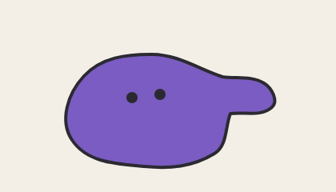

Repare:

- `330,104@mao` e `340,134@mao`: só esses dois pontos seguem o osso `mao`. Os outros ficam parados, porque a forma não tem `bone=`.
- Entre um ponto preso e um solto, a linha **estica**: quando a mão vai longe, o braço fica comprido e fino.
- A cada quadro, o Weasel redesenha a forma com os pontos no lugar novo, como se você tivesse escrito as coordenadas novas. O preenchimento e o contorno vêm junto.
- `278,96!` e `288,142!` são cantos vivos na base do braço. É ali que o corpo vira braço; os cantos impedem que a curva do braço entorte o corpo.
- Os olhos são formas separadas: eles não sabem dos pontos presos. Para ir junto, uma forma precisa do próprio `bone=` (ou dos próprios `@osso`).
- `@osso` vale nos pontos de `shape`, `stroke` e `line`, com qualquer tipo de ponto (`!`, `~dx,dy` ou com duas alças). Uma `ellipse` ou um `rect` não têm pontos escritos: para esticar, reescreva a forma como `shape`.

**Experimente:** tire o `@mao` do `340,134`. Só um ponto vai junto com a mão, e a ponta do braço vira um bico comprido.

### O peso: `@osso:0.5`

Com `bone=` na forma, os pontos **sem** `@` seguem esse osso, e os pontos com `@` seguem o osso deles. Um número depois de dois-pontos, de 0 a 1, diz **quanto** o ponto segue o osso: `@corpo:0.5` anda metade do caminho.

<!-- gerar: img/06_peso.gif -a estica -->
```weasel
canvas 360 240 bg=#f4efe6
palette ink=#2b2a33 line=4 verde=#5cc28a

bone corpo pivot=180,140

line chao c=#8a7f6e w=3 : 20,202 340,202

shape geleia c=verde ink=line : 110,200! 116,150@corpo:0.5 132,98@corpo 180,78@corpo 228,98@corpo 244,150@corpo:0.5 250,200!
ellipse olhoE 162,120 7 c=ink bone=corpo
ellipse olhoD 198,120 7 c=ink bone=corpo

anim estica frames=24 fps=12
key 0 corpo=0,0
key 8 corpo=0,-50 ease=out
key 16 corpo=0,20 ease=in
key 24 corpo=0,0
```

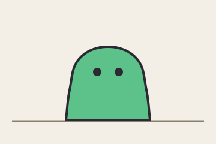

- Os pontos de cima (`@corpo`) sobem e descem inteiros com o osso, junto com os olhos (`bone=corpo`).
- Os dois do meio dos lados (`@corpo:0.5`) andam **metade**: 25 pixels quando o corpo sobe 50. Por isso os lados esticam por igual.
- Os dois da base não têm `@`, e a forma não tem `bone=`: eles ficam no chão.
- Peso 1 é o mesmo que não escrever o número. Peso 0 deixa o ponto com a forma, como se não houvesse `@`. O peso aceita uma conta: `@corpo:{1/3}`.

**Experimente:** ponha `bone=corpo` na `geleia` e tire os `@corpo` dos pontos. Agora todos os pontos seguem o `corpo`, e a geleia pula inteira, base e tudo.

**Cuidado:** os `@osso` não valem junto com `bones=` na mesma forma (dá aviso, e os pontos presos ficam parados).

Numa forma com muitos pontos, escrever `@osso` em cada um dá trabalho. No editor, a ferramenta **Prender** (Shift+P) escreve para você ([capítulo 23](23-editor.md#prender)), e a **Testar ossos** (O) mexe nos ossos só na tela, para ver se cada ponto foi para o osso certo ([capítulo 23](23-editor.md#testar-ossos)).

## Pernas e braços com IK

Uma perna desenhada com `stroke` comum gira inteira com o osso. Mas pernas de verdade fazem outra coisa: **o pé fica no chão** e o joelho dobra quando o corpo desce. Isso é **IK** (do inglês, cinemática inversa): você diz onde a perna nasce e onde o pé deve ficar, e o Weasel calcula o joelho. Um `stroke` com `hip=` vira uma perna (ou um braço) assim:

```
stroke nome limb=largura_no_quadril,largura_no_pé hip=x,y on=osso foot=nome_da_linha,x
stroke nome limb=… hip=x,y on=osso target=osso_da_mão
```

<!-- gerar: img/06_ik.gif -a agacha -->
```weasel
canvas 420 280 bg=#f4efe6
palette ink=#2b2a33 line=5 roxo=#7a5cc2 pele=#ffcf9e

bone corpo pivot=200,150
bone mao pivot=320,190

line chao c=#8a7f6e w=3 : 40,250 380,250

stroke pernaE limb=16,20 hip=180,176 on=corpo foot=chao,172
stroke pernaD limb=16,20 hip=220,176 on=corpo foot=chao,232
stroke braco limb=12,10 hip=236,140 on=corpo target=mao bend=-1 c=roxo
ellipse tronco 200,146 52,46 c=roxo ink=line bone=corpo
ellipse olhoE 186,130 6,9 c=ink bone=corpo
ellipse olhoD 214,130 6,9 c=ink bone=corpo
ellipse palma 320,190 13 c=pele ink=line bone=mao

anim agacha frames=48 fps=16
key 0 corpo=0,0 mao=0,0
key 12 corpo=0,22 mao=0,10
key 24 corpo=0,-34 mao=-20,-110 ease=in
key 36 corpo=0,0 mao=0,0
key 48 corpo=0,0 mao=0,0
```

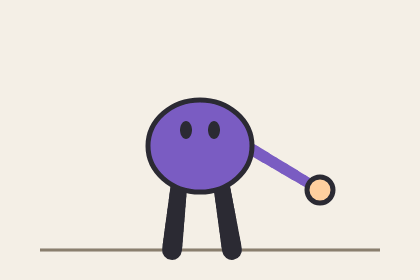

**As pernas** (`foot=`):

- `hip=x,y` é onde a perna **nasce** (o quadril), e `on=corpo` faz esse ponto andar com o osso. Sem `on=`, o quadril fica parado.
- `foot=chao,172` põe o pé na forma chamada `chao`, na altura dela em x=172. O pé fica parado ali.
- O **comprimento** da perna é a distância em linha reta do quadril ao pé, no desenho. Quando o corpo desce, sobra perna, e o joelho dobra. Se o corpo sobe tanto que a perna não chega ao chão, ela fica reta, apontando para o pé, e o pé sai do chão (o pulo).
- `limb=16,20` é a largura da perna no quadril e no pé. Com um número só, as duas pontas ficam iguais.

**O braço** (`target=`):

- `target=mao` faz a ponta do braço ir atrás do **pivô** do osso `mao`. Anime a mão, e o braço dobra o cotovelo sozinho.
- O comprimento do braço é a distância do ombro (`hip=`) ao pivô da mão, no desenho: de 236,140 até 320,190, uns 98 pixels. Se a mão for mais longe que isso, o braço fica reto e aponta para ela, mas não alcança.
- Uma forma presa ao osso `mao` (a `palma`) fica na ponta.

A perna (ou o braço) usa a cor de `c=`; sem `c=`, a cor `ink` da `palette`. Ela não tem pontos depois do `:`.

**Experimente:** troque o `bend=-1` do braço por `bend=1`. O cotovelo passa a dobrar para cima em vez de para baixo.

### Para que lado dobra: `bend=`

Um joelho pode dobrar para a frente ou para trás; um cotovelo, para cima ou para baixo. O `bend=` escolhe o lado. Três pernas iguais, presas no mesmo corpo que agacha:

<!-- gerar: img/06_bend.gif -a agacha -->
```weasel
canvas 460 260 bg=#f4efe6
palette ink=#2b2a33 line=4 roxo=#7a5cc2

bone corpo pivot=230,100

line chao c=#8a7f6e w=3 : 20,230 440,230
text t1 100,40 "bend=1" size=17 bold align=center
text t2 230,40 "bend=-1" size=17 bold align=center
text t3 360,40 "bend=0.4" size=17 bold align=center

stroke perna1 limb=14,18 hip=100,100 on=corpo foot=chao,100 bend=1
stroke perna2 limb=14,18 hip=230,100 on=corpo foot=chao,230 bend=-1
stroke perna3 limb=14,18 hip=360,100 on=corpo foot=chao,360 bend=0.4
rect barra 60,76 340,30 r=15 c=roxo ink=line bone=corpo

anim agacha frames=24 fps=12
key 0 corpo=0,0
key 12 corpo=0,60
key 24 corpo=0,0
```

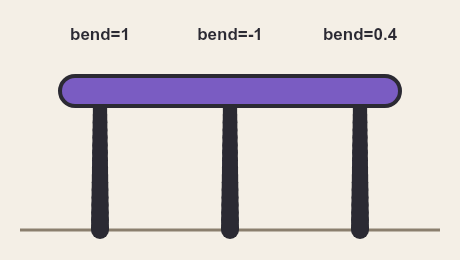

- A barra desce 60 pixels, e os pés ficam no chão. Sobra perna, e os joelhos dobram.
- **`bend=1`** (o padrão): numa perna que desce do quadril para o pé, o joelho vai para a **direita**, como num personagem virado para a direita.
- **`bend=-1`**: o joelho vai para a **esquerda**.
- **`bend=0.4`**: dobra menos; a perna parece encolher. Com `bend=0`, ela fica reta.
- O `bend=` vai de −3 a 3, mas acima de 1 dobra igual a 1 (e abaixo de −1, igual a −1).
- Num braço que vai para a direita, `bend=1` levanta o cotovelo e `bend=-1` abaixa. Num `use` espelhado, o lado se inverte sozinho.

### O pé num ponto: `foot=x,y`

`foot=nome,x` põe o pé em cima de uma forma com pelo menos dois pontos (`line`, `stroke` ou `shape`). A altura vem dessa forma, medida em linha reta de um ponto ao outro: numa linha inclinada, como uma rampa, o pé acompanha a altura dela naquele x.

Quando o pé deve ficar num lugar que não é uma linha (um degrau, uma pedra, um galho), use `foot=x,y`, o ponto exato: `stroke pernaD limb=18,12 hip=222,125 on=corpo foot=268,170` deixa o pé parado em x=268, y=170. Uma perna com o pé mais perto do quadril é mais curta, e dobra mais quando o corpo desce.

**Até onde o braço alcança:** o comprimento não aparece no desenho. Para ver até onde a mão pode ir, desenhe numa camada `guide` um círculo em volta do ombro, com esse raio, preso ao mesmo osso do ombro. A função `dist` ([capítulo 21](21-funcoes.md#dist)) faz a conta: `ellipse alcance 236,140 {dist(236,140,320,190)} c=none ink=2 inkc=#c44536 bone=corpo`.

| Opção da perna | O que faz | Valores | Se não escrever |
|---|---|---|---|
| `hip=x,y` | onde a perna (ou o braço) nasce | dois números, em pixels | obrigatório |
| `on=` | o osso que leva o quadril | o nome de um osso | o quadril fica parado |
| `foot=nome,x` | o pé na forma `nome`, na altura dela em `x` | uma `line`, um `stroke` ou um `shape` com 2 pontos ou mais | um dos três (`foot=nome,x`, `foot=x,y` ou `target=`) é obrigatório |
| `foot=x,y` | o pé parado nesse ponto | dois números, em pixels | — |
| `target=` | a ponta vai até o pivô de um osso | o nome de um osso | — |
| `limb=` | a largura no quadril e no pé | um número ou dois | a largura do `w=` (4) |
| `bend=` | para que lado e quanto dobra | de −3 a 3 (acima de 1, igual a 1) | 1 |

Com `foot=` e `target=` juntos, vale o `target=`, e o Weasel avisa. A ficha completa está na [referência do `stroke`](20-referencia.md#stroke).

## IK nos ossos: `ik`

O `stroke limb=` desenha a perna para você. Às vezes você quer desenhar a perna você mesmo, como uma pata no contorno do corpo ou um braço com mão. Então faça a perna com ossos e diga ao `ik` quais são:

```
ik nome bones=raiz,meio,ponta foot=nome_da_linha,x
ik nome bones=raiz,meio,ponta foot=x,y
ik nome bones=raiz,meio,ponta target=osso
```

<!-- gerar: img/06_ik_ossos.gif -a agacha -->
```weasel
canvas 420 280 bg=#f4efe6
palette ink=#2b2a33 line=4 marrom=#b07a4a

bone corpo pivot=200,130
bone coxa pivot=240,160 parent=corpo
bone canela pivot=256,198 parent=coxa
bone pe pivot=248,240 parent=canela

line chao c=#8a7f6e w=3 : 40,240 380,240

ik pata bones=coxa,canela,pe foot=chao,248

shape bicho c=marrom ink=line bone=corpo : 110,120 160,90 250,95 290,128 272,160 268,198@canela 274,238@pe 230,240@pe 242,198@canela 226,165 140,170 105,150
ellipse olho 268,114 6 c=ink bone=corpo

anim agacha frames=32 fps=12
key 0 corpo=0,0
key 10 corpo=0,34
key 20 corpo=0,-30 ease=out
key 26 corpo=0,0 ease=in
key 32 corpo=0,0
```

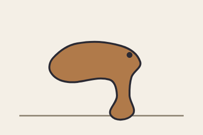

Repare:

- `bones=coxa,canela,pe` são três ossos em corrente: `canela` é filho de `coxa`, e `pe` é filho de `canela`. A corrente é obrigatória, e cada osso entra num `ik` só.
- O `ik` gira a coxa e a canela. A animação só mexe no `corpo`.
- `foot=chao,248` põe o pivô do `pe` na linha `chao`, em x=248, como no `stroke`. Também vale `foot=x,y`.
- Os comprimentos vêm do desenho: da coxa até a canela, e da canela até o pé. Uma `key` que estica um desses ossos (`sx,sy`) muda o comprimento.
- Quando o corpo sobe além do alcance, a perna fica reta, apontando para o pé, e a pata sai do chão.
- Sem `bend=`, o joelho dobra para o lado em que ele está no desenho: aqui, o pivô da `canela` está à frente da reta que liga o pivô da `coxa` ao do `pe`, então o joelho vai para a frente.
- O `pe` não gira com a canela: ele fica no ângulo que teria sem o `ik`, como um pé plano no chão. Se o corpo girar, o pé gira junto. Uma `key` no `pe` ainda gira o pé (para dobrar os dedos).
- A pata faz parte do contorno do corpo: os pontos dela estão presos com `@canela` e `@pe`.

**Experimente:** acrescente `bend=-1` no `ik`. O joelho passa a dobrar para trás, como a perna de um pássaro.

**Cuidado:** o `ik` vale também na pose parada. Desenhe o pivô do pé em cima do chão (no lugar do `foot=`); senão, a pose parada muda e não fica igual ao desenho.

### Braço com alvo: `target=`

Com `target=osso`, a ponta vai atrás do **pivô** desse osso. Anime o alvo, e o braço dobra o cotovelo para chegar nele:

<!-- gerar: img/06_ik_alvo.gif -a pega -->
```weasel
canvas 400 260 bg=#f4efe6
palette ink=#2b2a33 line=4 roxo=#7a5cc2 pele=#ffcf9e

bone corpo pivot=120,160
bone ombro pivot=150,130 parent=corpo
bone cotovelo pivot=200,150 parent=ombro
bone mao pivot=250,130 parent=cotovelo
bone bola pivot=250,130

ik braco bones=ombro,cotovelo,mao target=bola

ellipse alvo 250,130 18 c=#ff9a4a ink=line bone=bola
stroke braco w=14 c=roxo : 150,130@ombro 200,150@cotovelo 250,130@mao
ellipse tronco 115,165 48,62 c=roxo ink=line bone=corpo
ellipse olho 130,140 6 c=ink bone=corpo
ellipse palma 250,130 11 c=pele ink=line bone=mao

anim pega frames=36 fps=12
key 0 bola=0,0
key 12 bola=-20,-60
key 24 bola=-20,10
key 36 bola=0,0
```

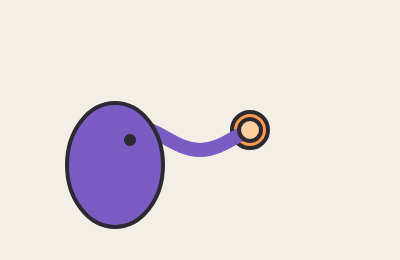

- `target=bola`: a mão vai até o pivô da `bola`. A `bola` não pode ser a raiz do braço nem um filho dela, porque o alvo andaria junto com o próprio braço. Se for, o Weasel mostra um erro, e o `ik` não vale.
- O braço é um `stroke` com os três pontos presos aos três ossos. Ele dobra no cotovelo porque a curva passa pelos pontos no lugar novo.
- O cotovelo dobra para baixo porque, no desenho, ele está abaixo da reta do ombro até a mão.

**Experimente:** na `key 12`, troque `bola=-20,-60` por `bola=60,-60`. A bola sai do alcance: o braço fica reto, apontando para ela, e a mão não chega.

| Opção do `ik` | O que faz | Valores | Se não escrever |
|---|---|---|---|
| `bones=raiz,meio,ponta` | os três ossos da corrente | três nomes de osso em corrente | obrigatório |
| `foot=nome,x` ou `foot=x,y` | o pivô da ponta fica no chão ou num ponto | como no `stroke` | um dos dois (`foot=` ou `target=`) é obrigatório |
| `target=` | o pivô da ponta vai até o pivô de outro osso | um osso de fora da corrente | — |
| `bend=` | para que lado o meio dobra | `1` ou `-1` (`0` dá erro) | o lado em que o meio está no desenho |

No editor, arrastar a ponta de um `ik` move o alvo ([capítulo 23](23-editor.md#ossos-no-desenho)). No Godot com esqueleto ([capítulo 16](16-jogo-avancado.md#esqueleto-de-verdade-rigbones-experimental)), o Weasel calcula o `ik` e grava os giros na animação. A ficha completa está na [referência do `ik`](20-referencia.md#ik).

## Juntando tudo

Um bicho de cachecol prepara o pulo, salta e cai. As pernas ficam no chão até ele sair, as antenas e o rabo balançam com o tranco, e a ponta do cachecol voa.

<!-- gerar: img/08_bicho.gif -a pula -->
```weasel
canvas 420 300 bg=#dff1f7
palette ink=#2b2a33 line=4 roxo=#7a5cc2 lilas=#a993e0 cachecol=#e8443a ponta=#ffd34d

line chao c=#8a7f6e w=4 : 20,272 400,272

# o corpo e o resto do esqueleto
bone corpo pivot=200,176
bone antE parent=corpo pivot=184,132 spring=0.15
bone antD parent=corpo pivot=216,132 spring=0.15
bone r1 parent=corpo pivot=150,186 spring=0.3
bone r2 parent=r1 pivot=118,192 spring=0.3
bone r3 parent=r2 pivot=92,184 spring=0.3
cloth pano pivot=236,150 tension=0.25 drag=3 swing=2

# o rabo dobra pelos três ossos
shape rabo c=lilas ink=line bones=r1,r2,r3 : 156,180 120,186 92,176 70,160! 84,190 118,202 156,198

# as pernas ficam no chão até o pulo
stroke pernaE limb=16,20 hip=184,204 on=corpo foot=chao,176 c=roxo
stroke pernaD limb=16,20 hip=216,204 on=corpo foot=chao,228 c=roxo

stroke aE w=4 bone=antE : 184,134 176,108 164,90
ellipse bolaE 164,88 8 c=ponta ink=line bone=antE
stroke aD w=4 bone=antD : 216,134 224,108 236,90
ellipse bolaD 236,88 8 c=ponta ink=line bone=antD

ellipse tronco 200,170 54,46 c=roxo ink=line bone=corpo
ellipse olhoE 186,158 6,9 c=ink bone=corpo
ellipse olhoD 214,158 6,9 c=ink bone=corpo
stroke boca w=3 bone=corpo : 190,180 200,186 210,180

# o cachecol: a ponta é um tecido
shape volta c=cachecol ink=line bone=corpo : 160,196 200,204 240,196 240,210 200,218 160,210
shape fita c=cachecol ink=line bone=corpo cloth=pano : 230,200! 280,206 300,222 288,232 240,214!

anim pula frames=36 fps=12
key 0 corpo=0,0
key 8 corpo=0,26 ease=out
key 14 corpo=0,-64 ease=in
key 22 corpo=0,14 ease=out
key 28 corpo=0,0
```

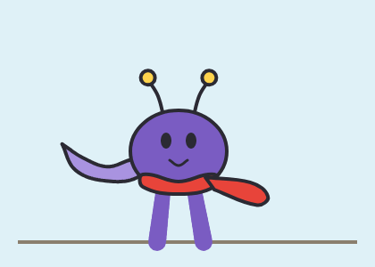

- **O corpo** é o único osso com `key`: ele desce (agacha), sobe 64 pixels e cai.
- **As pernas** são `stroke` com `hip=` e `foot=chao,…`: dobram quando o corpo desce e penduram no ar no pulo.
- **As antenas** são molas filhas do corpo: balançam atrasadas a cada tranco.
- **O rabo** dobra por três ossos em corrente (`bones=r1,r2,r3`), cada um com a sua mola. A diferença de atraso entre eles faz a curva.
- **A ponta do cachecol** é um tecido (`cloth=pano`) preso perto do pescoço: ela fica para trás quando o corpo sobe e quando ele cai.

## Resumo

- `parent=` faz um osso filho: ele segue o pai e ainda tem o próprio movimento. Um esqueleto começa por uma raiz no chão e vai do centro para as pontas; cada forma (e cada `use`) diz qual osso segue.
- `sway=`, `bob=` e `jitter=` mexem o osso sozinho, enquanto uma animação toca; `spring=` faz uma mola que gira atrasada quando o pivô é sacudido.
- `cloth` faz os pontos longe de um pivô ficarem para trás, como um pano.
- `bones=a,b,c` dobra uma forma por vários ossos; `x,y@osso` prende um ponto só, e `@osso:0.5` prende pela metade.
- Um `stroke` com `hip=` e `foot=` (ou `target=`) vira uma perna (ou um braço) com IK: o pé fica no chão e o joelho dobra. O `ik` faz o mesmo com três ossos desenhados por você.

[← Primeiro movimento](07-movimento.md) · [Índice](README.md) · [Próximo: Animação →](09-animacao.md)
