# 9. Animação

[← Ossos](08-ossos.md) · [Índice](README.md) · [Próximo: Luz e sombra →](08-luz-efeitos.md)

Nos capítulos 7 e 8, a `key` mexia ossos. Ela também muda as formas: a cor, a transparência, o contorno, quanto da forma já foi desenhado e até o formato. Neste capítulo você aprende a animar formas, a marcar momentos (`event`), a fazer um osso andar por um caminho (`path=`), a mostrar camadas só em algumas animações (`only=`), a trocar quem fica na frente, a juntar duas animações (`mix=`) e a exportar. Você precisa dos capítulos 1 a 8.

## Animar formas: `forma.propriedade=valor`

Numa `key`, em vez do nome de um osso, escreva o nome de uma forma, um ponto, a propriedade e o valor:

```
key quadro forma.propriedade=valor …
```

| Propriedade | O que muda | Entre duas `key` |
|---|---|---|
| `opacity` | a transparência, de 0 a 1 | aos poucos |
| `c` | a cor do preenchimento (num traço ou num texto, a cor dele) | as cores se misturam aos poucos |
| `inkc` | a cor do contorno | aos poucos |
| `w` | a grossura de um traço ou de uma linha | aos poucos |
| `ink` | a grossura do contorno de uma forma fechada ou de um texto | aos poucos |
| `show` | a forma aparece (`1`) ou some (`0`) | de uma vez |
| `draw` | quanto da forma já foi desenhado, de 0 a 1 ([abaixo](#desenhar-aos-poucos-draw)) | aos poucos |
| `shape` | o formato: a forma vira outra ([abaixo](#morph-uma-forma-vira-outra)) | aos poucos |
| `above` e `below` | quem fica na frente ([abaixo](#trocar-quem-fica-na-frente-above-e-below)) | de uma vez |

A `key` também muda camadas inteiras e os efeitos delas ([capítulo 11](08-luz-efeitos.md#efeitos-de-camada)), as luzes ([capítulo 10](08-luz-efeitos.md#luz-de-verdade)) e o giro 3D e a profundidade das formas (`yaw`, `pitch` e `z`, [capítulo 14](11-profundidade.md)). As tabelas completas estão na [referência da `key`](19-referencia.md#key-numa-forma).

<!-- gerar: img/07_lampada.gif -a acende -->
```weasel
canvas 300 260 bg=#1f2433
palette ink=#14141c line=5 apagada=#6b6f7d acesa=#ffe27a

gradient halo radial 150,108 110 : #ffe27aa0 #ffe27a00
ellipse brilho 150,108 110 c=halo
stroke fio w=4 c=#3a3f52 : 150,0 150,50
rect rosca 134,150 32,30 r=4 c=#9aa0ad ink=line
ellipse bulbo 150,108 50,56 c=apagada ink=line
text clique 236,226 "clique!" size=22 bold align=center c=#ffe27a

anim acende frames=32 fps=12
key 0 bulbo.c=apagada brilho.opacity=0 clique.show=0
key 8 bulbo.c=apagada brilho.opacity=0 clique.show=1
key 12 bulbo.c=acesa brilho.opacity=1 clique.show=0
key 24 bulbo.c=acesa brilho.opacity=1
key 28 bulbo.c=apagada brilho.opacity=0
key 32 bulbo.c=apagada brilho.opacity=0
```

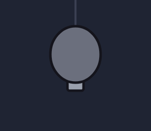

Repare:

- `bulbo.c` vai de cinza para amarelo entre os quadros 8 e 12: as cores se **misturam** aos poucos. Um gradiente ou uma textura não se misturam: trocam de uma vez.
- `brilho.opacity` acende o halo junto.
- `clique.show=1` mostra o texto de uma vez no quadro 8, e `clique.show=0` esconde no 12. O `show` também aceita `on` e `off`, `sim` e `não`.
- A `opacity` da `key` **multiplica** a `opacity=` da linha. Uma forma com `opacity=0` no código fica invisível para sempre. Para começar apagada, escreva `key 0 forma.opacity=0`.
- Numa forma com `hidden`, a `key` não a faz aparecer (dá aviso). Para começar escondida, tire o `hidden` e escreva `key 0 forma.show=0`.
- Se várias formas têm o mesmo nome (as cópias de um componente, por exemplo), a `key` muda todas.
- Na pose parada, valem os valores do código: o halo aparece, e o texto também.

**Experimente:** troque `acesa=#ffe27a` por `acesa=#7ad0ff` na `palette`. A lâmpada acende azul, e o halo continua amarelo, porque ele tem a cor própria.

### Contorno e espessura: `inkc`, `ink` e `w`

Para chamar a atenção para uma peça (um botão que pisca, um alvo escolhido, um fio que esquenta), mude o contorno ou a grossura do traço:

<!-- gerar: img/07_contorno.gif -a muda -->
```weasel
canvas 460 200 bg=#f4efe6
palette ink=#2b2a33

rect caixa 40,40 100,90 r=10 c=#ffd34d ink=6
ellipse bola 230,85 48 c=#9be38c ink=2
stroke fio c=#4a90d9 w=3 : 330,130 360,50 400,120 430,40

text t1 90,175 "caixa.inkc" size=17 bold align=center
text t2 230,175 "bola.ink" size=17 bold align=center
text t3 380,175 "fio.w" size=17 bold align=center

anim muda frames=24 fps=12
key 0 caixa.inkc=ink bola.ink=2 fio.w=3
key 12 caixa.inkc=#e8443a bola.ink=14 fio.w=18
key 24 caixa.inkc=ink bola.ink=2 fio.w=3
```

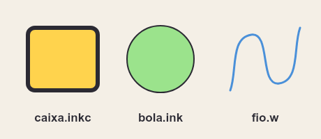

- `caixa.inkc`: a **cor do contorno** vai da cor dos contornos (o `ink` da `palette`) até vermelho e volta. A caixa precisa ter contorno (`ink=6`) para isso aparecer.
- `bola.ink`: a **grossura do contorno**, em pixels, vai de 2 a 14.
- `fio.w`: a **grossura do traço**, em pixels, vai de 3 a 18. O `w` é dos traços (`stroke` e `line`); o `ink`, do contorno das formas fechadas e dos textos.
- Uma grossura negativa vale 0.

**Experimente:** na `key 12`, troque `fio.w=18` por `fio.w=1`. O traço afina em vez de engrossar.

## Desenhar aos poucos: `.draw`

`key quadro forma.draw=0` esconde a forma, e `draw=1` mostra a forma inteira. Entre os dois, o Weasel **desenha a forma aos poucos**, como se uma caneta passasse por ela. É o efeito dos vídeos explicativos: a rota traçada no mapa, a seta que se desenha, o título digitado.

<!-- gerar: img/07_mapa.gif -a aparece -->
```weasel
canvas 400 240 bg=#e9d8b4
palette ink=#5a3b22 line=4 rota=#c44536

rect papel 12,12 376,216 r=10 c=#f8edd4 ink=line
text titulo 200,54 "Mapa do tesouro" size=28 align=center bold
ellipse sol 70,104 22 c=#ffb84d
shape ilha c=#9bc97a ink=line weight=0.5 : 282,84 352,92 362,146 314,168 274,136
stroke caminho w=5 c=rota taper=0,0.25 : 48,198 104,150 176,186 252,150 318,124
text marca 320,134 "X" size=28 bold align=center c=rota

anim aparece frames=48 fps=12 once
key 0 titulo.draw=0 sol.draw=0 ilha.draw=0 caminho.draw=0 marca.show=0 ease=linear
key 12 titulo.draw=1
key 6 sol.draw=0 ease=linear
key 16 sol.draw=1
key 10 ilha.draw=0 ease=linear
key 22 ilha.draw=1
key 20 caminho.draw=0 ease=linear
key 36 caminho.draw=1 marca.show=1
```

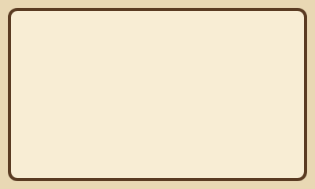

Como cada tipo de forma é desenhado:

| Forma | Com `draw` entre 0 e 1 |
|---|---|
| `stroke` e `line` | o traço cresce do primeiro ponto até o último |
| forma fechada com contorno | o contorno corre em volta da forma, e o preenchimento aparece no fim |
| forma fechada sem contorno | um traço da cor da forma corre em volta, e o preenchimento aparece no fim |
| `text` | as letras aparecem uma a uma, cada uma no lugar dela |

Repare:

- `ease=linear` dá velocidade constante, como uma caneta. Com o `smooth` (o padrão), o desenho começa e termina devagar.
- O traço vai na **ordem dos pontos**. Para desenhar do outro lado, escreva os pontos ao contrário.
- As `key` de cada forma são independentes: o sol começa no quadro 6, enquanto o título ainda está sendo digitado.
- A animação é `once` para o mapa ficar pronto no fim, em vez de se apagar ao voltar para o começo.
- Na pose parada, tudo aparece inteiro.
- Num filme, use `at` no lugar de `key`: `at 1s rota.draw=0` ([capítulo 17](10-filme.md#mudanças-no-tempo-at)).

**Experimente:** troque os pontos do `caminho` pela ordem contrária (`318,124 252,150 176,186 104,150 48,198`). A rota passa a ser traçada a partir do X.

## Morph: uma forma vira outra

`key 10 forma.shape=outra` faz a forma **se transformar** no formato de `outra` até aquele quadro. É assim que se pisca um olho, se abre uma boca ou se muda uma expressão sem ossos.

<!-- gerar: img/07_morph.gif -a vira -->
```weasel
canvas 420 160 bg=#f4efe6
palette ink=#2b2a33 line=4

ellipse bolha 70,80 44 c=#ff9a4a ink=line
shape estrela c=#ffd34d ink=line hidden : 70,30! 82,64! 118,66! 90,88! 100,122! 70,102! 40,122! 50,88! 22,66! 58,64!
shape boca c=#c44536 ink=line : 180,70 260,70 260,90 180,90
shape sorriso c=#c44536 ink=line hidden : 170,66 200,74 220,76 240,74 270,66 250,96 220,104 190,96
stroke onda w=5 c=#4a90d9 : 300,80 400,80
stroke zigue w=5 c=#4a90d9 hidden : 300,100 320,60 340,100 360,60 380,100 400,60

anim vira frames=24 fps=12
key 0 bolha.shape=bolha boca.shape=boca onda.shape=onda
key 12 bolha.shape=estrela boca.shape=sorriso onda.shape=zigue
key 24 bolha.shape=bolha boca.shape=boca onda.shape=onda
```

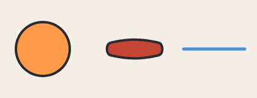

As regras:

- Uma forma **fechada** vira outra fechada (`ellipse`, `rect` ou `shape`), e um **traço** vira outro traço (`stroke` ou `line`). O número de pontos não precisa ser igual: o círculo vira uma estrela de 10 pontos, e a boca de 4 pontos vira uma de 8.
- Com o mesmo tipo de forma e o mesmo número de pontos, o ponto 1 vira o ponto 1, o 2 vira o 2, e assim por diante. Nos outros casos, o Weasel redistribui os pontos nas duas formas e casa os pares mais próximos.
- A forma que muda fica com o **formato e o lugar** da outra: desenhe a forma de destino onde ela deve ficar. A cor, o contorno e o osso continuam os da forma que muda.
- A forma de destino quase sempre tem `hidden`: ela não aparece, só empresta o formato.
- Para voltar ao normal, faça o morph para a própria forma: `key 20 olho.shape=olho`.
- Textos, partículas e pernas feitas com `stroke … hip=` não fazem morph.
- Para virar um personagem inteiro de lado para a frente, use a virada (`turn`, [capítulo 15](09-jogo-godot.md#virar-de-lado-para-a-frente-turn)).

**Experimente:** acrescente `ease=step` na `key 0`. A bolha, a boca e a linha deixam de se transformar aos poucos e **trocam de uma vez** no quadro 12. A volta (do 12 ao 24) continua aos poucos, porque a `key 12` ainda usa o `smooth`.

## Eventos: `event`

Um **evento** marca um quadro com um nome: um passo, um som, o momento de um golpe. Ele não desenha nada. Serve para o jogo (ou o editor de vídeo) saber **quando** algo acontece.

```
event quadro nome [outro_nome …]
```

Um pulo com três momentos marcados: quando sai do chão, quando chega no alto e quando volta ao chão (com dois nomes no mesmo quadro):

<!-- conferir -->
```weasel
canvas 300 220 bg=#f4efe6
palette ink=#2b2a33 line=4

bone corpo pivot=150,200
line chao c=#8a7f6e w=3 : 40,202 260,202
shape bicho c=#9be38c ink=line bone=corpo : 150,120 186,150 190,200! 110,200! 114,150

anim pula frames=24 fps=12
key 0 corpo=0,0,0,1.2,0.8 ease=out
key 3 corpo=0,0 ease=out
key 12 corpo=0,-90 ease=in
key 21 corpo=0,0
key 24 corpo=0,0,0,1.2,0.8
event 3 sai_do_chao
event 12 no_alto
event 21 bate poeira
```

Um evento não aparece na imagem. Para ver os eventos, salve como `pulo.weasel` e peça o resumo do arquivo com `--info`:

```bash
node cli/weasel.js pulo.weasel --info
```

```
canvas   300 × 220, fundo #f4efe6
camadas  1
  base             2 item(ns)
formas   2
ossos    corpo
animações 1
  pula           24 quadros, 12 fps
                 eventos: sai_do_chao@3, no_alto@12, bate@21, poeira@21
```

Repare:

- `event 3 sai_do_chao`: o número é o quadro, o mesmo das `key`. No quadro 3, o bicho acabou de desamassar e vai subir.
- `event 21 bate poeira`: uma linha pode ter **vários nomes**. Os dois acontecem no mesmo quadro: o jogo pode tocar o som e soltar a poeira ao mesmo tempo.
- No resumo, cada evento aparece como `nome@quadro`.
- Um evento no quadro `frames=` (aqui, 24) vale como quadro 0, porque o 24 é o 0 da volta seguinte.
- Os nomes são livres: use nomes que o jogo vai entender (`passo`, `golpe`, `som_pulo`). Um nome com espaço vai entre aspas (`"um passo"`).
- No player do editor, os quadros com evento aparecem com ⚑. Na sprite sheet, os eventos vão no arquivo JSON; no Godot, chegam pelo sinal `evento(nome)` ([capítulo 15](09-jogo-godot.md)).

**Experimente:** acrescente `event 0 comeca` e rode o `--info` de novo. A lista ganha `comeca@0`.

## Um personagem completo

O Pingo junta o que você viu até aqui: o corpo respira (osso com escala), a cabeça acompanha, os olhos piscam (morph para elipses achatadas, e o brilho some com `show`), a boca abre (morph de uma `shape`), o "oi!" aparece e some (`opacity`), e dois eventos marcam a fala e a piscada.

<!-- gerar: img/07_pingo.gif -a parado -->
```weasel
canvas 360 300 bg=#dff1f7 light=-0.6,-0.8
palette ink=#2b2a33 line=6 pele=#ffb26b sombra=#a9c6d1

bone raiz pivot=180,270
bone cabeca parent=raiz pivot=180,200

layer chao
ellipse sombraChao 180,272 76,10 c=sombra

layer corpo
shape corpo c=pele ink=line weight=0.3 bone=raiz : 180,92 258,148 270,228 232,270! 128,270! 90,228 102,148

layer rosto
ellipse olhoE 152,172 11,16 c=ink bone=cabeca
ellipse olhoD 208,172 11,16 c=ink bone=cabeca
ellipse brilhoE 148,165 3.5,4.5 c=#ffffff bone=cabeca
ellipse brilhoD 204,165 3.5,4.5 c=#ffffff bone=cabeca
# moldes do olho fechado: uma elipse achatada (não aparecem)
ellipse fechadoE 152,178 12,2 hidden
ellipse fechadoD 208,178 12,2 hidden
shape boca c=#8a3b3b ink=3 bone=cabeca : 166,213! 180,218 194,213! 180,222
shape bocaAberta hidden : 166,210! 180,213 194,210! 180,236

layer fala
text oi 250,96 "oi!" size=30 bold c=ink

anim parado frames=48 fps=12
key 0 raiz=0,0,0,1,1 cabeca=0,0 oi.opacity=0
key 24 raiz=0,0,0,1.05,0.95 cabeca=0,4
key 48 raiz=0,0,0,1,1 cabeca=0,0
key 8 boca.shape=boca oi.opacity=0
key 11 boca.shape=bocaAberta oi.opacity=1
key 15 boca.shape=boca
key 22 oi.opacity=1
key 26 oi.opacity=0
key 34 olhoE.shape=olhoE olhoD.shape=olhoD brilhoE.show=1 brilhoD.show=1
key 36 olhoE.shape=fechadoE olhoD.shape=fechadoD brilhoE.show=0 brilhoD.show=0
key 38 olhoE.shape=olhoE olhoD.shape=olhoD brilhoE.show=1 brilhoD.show=1
event 11 fala
event 36 pisca
```

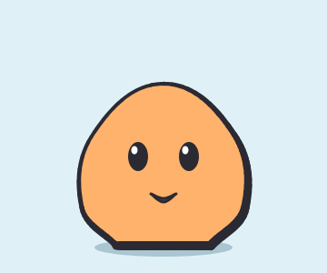

Repare:

- Os **olhos** e a **boca** usam `bone=cabeca`, e a cabeça é filha da `raiz`: quando o corpo respira, o rosto vai junto e ainda desce um pouquinho a mais (`cabeca=0,4`).
- Para **piscar**, cada olho vira o molde `fechado` (uma elipse achatada) no quadro 36 e volta no 38; o brilho some nesse meio-tempo com `show=0`. Os moldes só emprestam o formato: a cor continua a do olho.
- A **boca** vira a `bocaAberta` no quadro 11 e volta no 15.
- As `key` estão agrupadas por assunto (respiração, fala, piscada), não por ordem de quadro. Isso é permitido: o Weasel põe os quadros em ordem sozinho.

**Experimente:** na `key 24`, troque `raiz=0,0,0,1.05,0.95` por `raiz=0,0,0,1.15,0.85`. O Pingo respira mais fundo, e o rosto desce junto.

## Andar por um caminho: `path=`

Com `path=nome` na linha do `bone`, o osso anda por uma linha, um traço ou uma forma. `key quadro osso.along=…` diz quanto do caminho ele já andou: 0 é o começo, 1 é o fim.

```
bone nome pivot=x,y path=caminho [turn=0]
key quadro nome.along=0 … 1
```

<!-- gerar: img/06_caminho.gif -a vai -->
```weasel
canvas 400 220 bg=#cfe8f5
palette ink=#2b2a33 line=3

stroke estrada w=14 c=#9aa0ad : 20,180 120,120 220,170 300,90 380,60
bone carro pivot=60,40 path=estrada
rect lata 40,28 40,20 r=5 c=#ff6b4a ink=line bone=carro
ellipse roda1 48,48 6 c=ink bone=carro
ellipse roda2 72,48 6 c=ink bone=carro

anim vai frames=36 fps=12
key 0 carro.along=0 ease=linear
key 36 carro.along=1
```

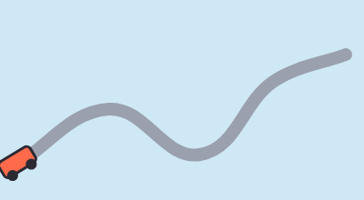

Repare:

- O pivô do osso vai para o ponto do caminho. O carro foi desenhado em qualquer lugar (lá em cima): o osso leva o desenho junto.
- O osso **vira junto com a curva**, como o carro na subida. Desenhe o carro virado para a direita: é para lá que ele anda.
- `ease=linear` faz o carro andar sempre na mesma velocidade.
- Num caminho aberto, como este, o `along` fica entre 0 e 1: além disso, o osso fica na ponta.
- As outras `key` do osso continuam valendo por cima: `carro=0,-10` levanta o carro 10 pixels acima da estrada.
- Sem nenhuma `key` de `along`, o osso fica no pivô dele, fora do caminho. Um `along` num osso sem `path=` dá erro.
- O caminho é a forma como ela está desenhada: se ela tiver osso, o carro não acompanha esse osso.
- Num filme, um ator também anda por um caminho ([capítulo 17](10-filme.md#andar-por-um-caminho-path)).

**Experimente:** troque `key 36 carro.along=1` por `key 36 carro.along=0.5`. O carro para no meio da estrada e volta para o começo quando a animação recomeça.

### Caminho fechado e `turn=0`

Uma pista de corrida, um aquário, um planeta em órbita: o caminho dá a volta e termina onde começou. Para isso, use uma forma **fechada** (aqui, uma `ellipse`) como caminho. Os dois peixes abaixo nadam na mesma pista; só o da direita tem `turn=0`:

<!-- gerar: img/06_turn.gif -a nada -->
```weasel
canvas 460 240 bg=#cfe8f5
palette ink=#2b2a33 line=3

ellipse pista1 115,120 85,70 c=none ink=12 inkc=#9aa0ad
ellipse pista2 345,120 85,70 c=none ink=12 inkc=#9aa0ad
text t1 115,128 "turn=1" size=17 bold align=center
text t2 345,128 "turn=0" size=17 bold align=center

bone peixe1 pivot=40,20 path=pista1
bone peixe2 pivot=40,20 path=pista2 turn=0
shape corpo1 c=#ff8a3d ink=line bone=peixe1 : 58,20 40,9 22,20 40,31
shape rabo1 c=#ff8a3d ink=line bone=peixe1 : 24,20! 12,10! 12,30!
shape corpo2 c=#4a90d9 ink=line bone=peixe2 : 58,20 40,9 22,20 40,31
shape rabo2 c=#4a90d9 ink=line bone=peixe2 : 24,20! 12,10! 12,30!

anim nada frames=24 fps=12
key 0 peixe1.along=0 peixe2.along=0 ease=linear
key 24 peixe1.along=1 peixe2.along=1
```

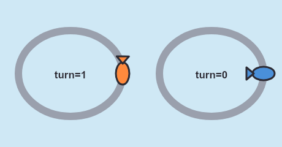

Repare:

- Os peixes foram desenhados num canto qualquer (perto de `40,20`), **virados para a direita**. O pivô do osso fica no meio do peixe.
- Onde o caminho começa: numa `ellipse`, na ponta da **direita**, seguindo no sentido do relógio (desce primeiro); num `rect`, no canto de cima à esquerda, indo para a direita; numa `line`, num `stroke` ou num `shape`, no primeiro ponto.
- De `along=0` a `along=1`: uma volta inteira em 24 quadros. Num caminho fechado, o fim (1) cai no mesmo lugar do começo (0), e o loop não dá pulo. Mais que 1 dá mais voltas; um número negativo anda para trás.
- **`turn=1`** (o padrão, laranja): o peixe vira junto com a curva e sempre olha para onde vai.
- **`turn=0`** (azul): o peixe não vira. Ele anda pela pista sempre virado para a direita, de lado ou de ré. Serve para o que não deve girar: um elevador, uma nuvem, um balão.

**Experimente:** troque `along=1` por `along=2` na `key 24`. Os peixes dão **duas** voltas no mesmo tempo, com o dobro da velocidade.

## Camadas que só aparecem em certas animações: `only=`

Um personagem costuma ter partes que só existem em algumas animações: o rastro de um ataque, a fumaça de uma corrida, o balão de fala, a vista de costas.

```
layer nome only=animação,outra_animação
```

Um bicho com duas animações. Parado, ele tem olhos abertos; correndo, aperta os olhos de esforço e deixa riscos de vento para trás. Cada rosto fica numa camada, e cada camada diz em que animações aparece:

<!-- gerar: img/07_only_pose.png -->
<!-- gerar: img/07_only_parado.gif -a parado -->
<!-- gerar: img/07_only_corre.gif -a corre -->
```weasel
canvas 300 200 bg=#f4efe6
palette ink=#2b2a33 line=4 bicho=#9be38c

bone raiz pivot=150,180

layer chao
line linha c=#8a7f6e w=3 : 10,182 290,182

layer corpo
shape b c=bicho ink=line bone=raiz : 150,100 186,130 190,180! 110,180! 114,130

layer olhos only=pose,parado
ellipse olhoE 142,134 5,8 c=ink bone=raiz
ellipse olhoD 166,134 5,8 c=ink bone=raiz

layer esforco only=corre
stroke apertoE w=4 bone=raiz : 134,128 146,135! 134,142
stroke apertoD w=4 bone=raiz : 174,128 162,135! 174,142
stroke v1 w=4 c=#9aa0ad : 40,110 90,110
stroke v2 w=4 c=#9aa0ad : 20,135 80,135
stroke v3 w=4 c=#9aa0ad : 45,160 95,160

anim parado frames=24 fps=12
key 0 raiz=0,0,0,1,1
key 12 raiz=0,0,0,1.04,0.96
key 24 raiz=0,0,0,1,1

anim corre frames=8 fps=12
key 0 raiz=0,0,8
key 4 raiz=0,-14,8
key 8 raiz=0,0,8
```

| Pose parada (sem animação) | Animação `parado` | Animação `corre` |
|---|---|---|
|  | 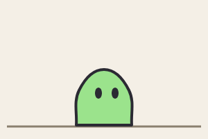 | 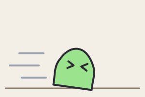 |

Repare:

- `layer chao` e `layer corpo` não têm `only=`: aparecem sempre.
- `layer olhos only=pose,parado`: os olhos abertos aparecem na pose parada **e** na animação `parado`. A palavra `pose` quer dizer a pose parada (sem animação); por isso, nenhuma animação deve se chamar `pose` (o Weasel avisa).
- `layer esforco only=corre`: os olhos apertados e os riscos de vento só aparecem na `corre`.
- As formas dessas camadas continuam presas aos ossos normalmente.
- As caixas de colisão de um jogo (`box`, [capítulo 15](09-jogo-godot.md#caixas-de-colisão-box)) aceitam o mesmo `only=`.

**Experimente:** tire o `pose,` da camada `olhos`. Na pose parada (a imagem da esquerda, ou o editor sem animação escolhida), o bicho fica sem olhos.

## Trocar quem fica na frente: `above=` e `below=`

Uma animação também pode mudar a ordem de pintura. `key quadro forma.above=outra` faz a forma ser pintada logo **na frente** da outra a partir daquele quadro, e `below=` faz ela ser pintada logo **atrás**. É assim que uma bola dá a volta num poste, um braço passa atrás do corpo ou uma espada gira em volta do personagem:

<!-- gerar: img/04_volta.gif -a volta -->
```weasel
canvas 320 200 bg=#f4efe6
palette ink=#2b2a33 line=5 bola=#ff6b4a madeira=#a8794f

bone bola pivot=160,110

ellipse bola 160,110 28 c=bola ink=line bone=bola
rect poste 154,16 12,176 r=4 c=madeira ink=line

anim volta frames=24 fps=12
key 0 bola=-110,0,0,1,1 bola.below=poste
key 6 bola=0,-18,0,0.85,0.85
key 12 bola=110,0,0,1,1 bola.above=poste
key 18 bola=0,18,0,1.15,1.15
key 24 bola=-110,0,0,1,1 bola.below=poste
```

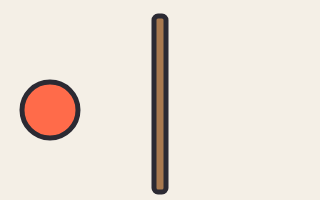

Repare:

- Na ida (quadros 0 a 12), `bola.below=poste` põe a bola atrás do poste. Na volta (quadros 12 a 24), `bola.above=poste` põe na frente.
- A troca é **de uma vez**, como o `show`, e vale até a próxima `key` que mude a ordem da bola. Por isso ela fica nos quadros 0 e 12, quando a bola está longe do poste e ninguém vê o salto.
- Na ida, a bola sobe e encolhe um pouco (`0.85`); na volta, desce e cresce (`1.15`). Isso dá a impressão de longe e perto.
- As duas formas precisam estar na **mesma camada**. Para mudar uma camada inteira de lugar, use os nomes das camadas: `key 8 bracoD.above=corpo`.
- `none` volta para a ordem do arquivo: `key 20 bola.above=none`.
- Na pose parada, vale a ordem do arquivo.

**Experimente:** na `key 0`, troque `bola.below=poste` por `bola.above=poste`. A bola passa a ficar na frente do poste a volta inteira.

## Animações combinadas: `mix=`

Andar e atacar ao mesmo tempo é uma animação nova, mas não precisa ser feita do zero. `mix=` junta duas animações: a **base** inteira, com alguns ossos vindos da **ação**:

```
anim nome mix=base,ação bones=osso,…
```

<!-- gerar: img/07_mix.gif -a walk_atk -->
```weasel
canvas 300 200 bg=#f4efe6
palette ink=#2b2a33 line=4

bone corpo pivot=150,150
bone braco pivot=170,110 parent=corpo
bone perna pivot=150,150 parent=corpo
ellipse tronco 150,110 24,40 c=#4a6fd8 ink=line bone=corpo
rect espada 168,50 6,60 c=#d9dde3 ink=line bone=braco
rect pe 140,150 20,40 c=#5ea860 ink=line bone=perna
box golpe hit rect 160,40 30,60 bone=braco only=atk off

anim walk frames=16 fps=12
key 0 corpo=0,0,0 perna=0,0,-20 braco=0,0,10
key 8 corpo=0,-8,0 perna=0,0,20 braco=0,0,-10
key 16 corpo=0,0,0 perna=0,0,-20 braco=0,0,10

anim atk frames=8 fps=12 once
key 0 braco=0,0,0 golpe.show=0
key 3 braco=0,0,-80
key 5 braco=0,0,90 golpe.show=1
key 7 golpe.show=0
key 8 braco=0,0,0
event 5 golpe

anim walk_atk mix=walk,atk bones=braco
```

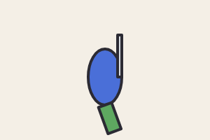

Repare:

- `mix=walk,atk bones=braco`: tudo vem do `walk`, menos o osso `braco` (e os filhos dele), que vem do `atk`. O `mix=` junta exatamente duas animações, nenhuma delas pode ser outro `mix=`, e o `bones=` é obrigatório.
- O tempo é o da ação: 8 quadros, 12 por segundo e `once`, como o `atk`. Para mudar, escreva `frames=`, `fps=`, `once` ou `loop` na linha do `anim` (`loop` só é preciso aqui, para repetir uma combinada cuja ação tem `once`). Os quadros são copiados pelo **tempo**: um quadro da combinada pega o que a outra animação fazia naquele instante, mesmo com outro `fps=`.
- O que é da ação vem junto: o evento `golpe` e as camadas com `only=atk`. A linha `box` é uma caixa de colisão de jogo ([capítulo 15](09-jogo-godot.md#uma-caixa-que-segue-o-braço-e-só-liga-no-golpe)); ela não aparece na imagem, mas também liga nos quadros certos.
- Uma `key` escrita na própria combinada ganha da que vem das outras animações.
- Numa combinada em loop, o tempo dela tem de fechar o ciclo das animações de onde os ossos vêm. Exemplo: se o andar dura 2 segundos e a combinada 1,5, ela recomeça no meio do passo e as pernas pulam. Use 2 ou 4 segundos; o editor avisa e sugere um tempo.

**Experimente:** troque `bones=braco` por `bones=corpo`. Agora o corpo **e os filhos dele** (o braço e a perna) vêm do `atk`, que não mexe na perna nem no corpo: o boneco para de andar e só golpeia.

## Uma imagem guia para cada movimento

A imagem guia ([capítulo 2](02-formas.md#desenhar-por-cima-de-uma-imagem-ref)) aceita o mesmo `only=`, e também `frames=`, para cada animação ter o seu rascunho por baixo:

```
ref parado "rascunhos/parado.png" 0,0 only=pose,idle
ref passo1 "rascunhos/andar1.png" 0,0 only=walk frames=0..5
ref passo2 "rascunhos/andar2.png" 0,0 only=walk frames=6..11
ref pulo "rascunhos/pulo.png" 0,0 only=jump opacity=0.3
```

- Com uma animação escolhida no player, só aparecem as imagens guia dela; `pose` é a pose parada. Sem `only=`, a imagem aparece em todas.
- `frames=a..b` limita aos quadros de `a` até `b` (os mesmos números das `key`): um desenho para cada parte do passo.
- O `ref` só vale no arquivo onde está escrito: as imagens guia de um personagem não aparecem num arquivo que faz `include` dele.

## Ver e exportar

No editor, o player embaixo do desenho escolhe a animação, toca, pausa e anda quadro a quadro, e a linha do tempo mostra e muda as `key` ([capítulo 22](22-editor.md#player)). Na linha de comando:

```bash
node cli/weasel.js pingo.weasel -a parado -o pingo.gif
```

```bash
node cli/weasel.js pingo.weasel -a parado --frame 11 -o fala.png
```

```bash
node cli/weasel.js pingo.weasel -a parado --frames -o quadros/pingo.png
```

O primeiro faz um GIF; o segundo, o PNG de um quadro (o mesmo número das `key`); o terceiro, um PNG por quadro (`pingo_000.png`, `pingo_001.png`…). Também saem:

- `-o pingo.webp`: um WebP animado, com cores de verdade e transparência suave;
- `-o pingo.mp4`: um vídeo, que toca no celular e nos editores de vídeo (precisa do programa ffmpeg);
- `-a "idle walk*3 jump"`: várias animações em seguida, na ordem; `*3` repete três vezes;
- `--sticker` com `.webp`: uma figurinha do WhatsApp.

Os detalhes estão no [capítulo 21](21-linha-de-comando.md#uma-animação). A sprite sheet e a cena do Godot estão no [capítulo 16](09-jogo-godot.md#exportando-para-o-godot). Para ver, sem desenhar nada, quais animações, ossos e eventos um arquivo tem, use `--info`.

## Juntando tudo

A abertura de um vídeo explicativo: o título é digitado, uma lâmpada pula para dentro da tela e acende, uma seta se desenha até uma bola azul, e a bola vira uma estrela. Os eventos marcam cada momento, para o editor de vídeo pôr um som em cada um.

<!-- gerar: img/09_abertura.gif -a abertura -->
```weasel
canvas 480 270 bg=#1f2a44
palette ink=#14141c line=4 apagada=#6b6f7d acesa=#ffd34d texto=#f4efe6 seta=#ff8a5c

text titulo 240,52 "Como nasce uma ideia" size=30 bold align=center c=texto

# a lâmpada, numa camada que só aparece no quadro 16
layer lampada
bone lamp pivot=130,200
gradient halo radial 130,138 84 : #ffd34d90 #ffd34d00
ellipse brilho 130,138 84 c=halo bone=lamp
ellipse bulbo 130,138 36,40 c=apagada ink=line bone=lamp
rect rosca 116,174 28,24 r=4 c=#9aa0ad ink=line bone=lamp

# a seta e a ideia
layer final
stroke traco w=6 c=seta taper=0.3,0 : 182,146 236,108 296,118 332,148
shape ponta c=seta : 348,162! 322,160! 336,138!
ellipse ideia 386,176 34 c=#4a90d9 ink=line
shape estrela c=#ffd34d ink=line hidden : 386,132! 397,162! 428,162! 403,181! 413,212! 386,193! 359,212! 369,181! 344,162! 375,162!

anim abertura frames=72 fps=12 once
key 0 titulo.draw=0 lampada.show=0 bulbo.c=apagada brilho.opacity=0 traco.draw=0 ponta.show=0 ideia.opacity=0 ease=linear
key 0 lamp=0,0,0,0,0
key 16 titulo.draw=1 lampada.show=1
key 16 lamp=0,0,0,0,0 ease=back
key 26 lamp=0,0,0,1,1
key 30 bulbo.c=apagada brilho.opacity=0
key 34 bulbo.c=acesa brilho.opacity=1
key 36 traco.draw=0 ease=linear
key 48 traco.draw=1 ponta.show=1 ideia.opacity=0
key 52 ideia.opacity=1 ideia.shape=ideia
key 62 ideia.shape=estrela
event 0 titulo
event 16 pop
event 34 acende
event 48 seta
event 62 estrela
```


- **O título** é um `text` com `draw` de 0 a 1, com `ease=linear`: as letras aparecem uma a uma.
- **A lâmpada** fica numa camada escondida até o quadro 16 (`lampada.show`). Ali ela cresce da escala `0,0` até `1,1` com `ease=back`: passa um pouco do tamanho e volta, como se pulasse para dentro da tela. O pivô na base faz ela crescer a partir dali.
- **O acender** mistura a cor do bulbo (`bulbo.c`) e liga o halo (`brilho.opacity`).
- **A seta** é um traço com `draw` e uma ponta que aparece de uma vez (`ponta.show=1`) quando o traço termina.
- **A bola azul** aparece com `opacity` e vira a estrela por morph: ela fica com o formato e o lugar da estrela, mas mantém a cor azul.
- **`once`** deixa a estrela pronta no fim. Os **eventos** (`titulo`, `pop`, `acende`, `seta`, `estrela`) aparecem no `--info` e no JSON da sprite sheet.

## Resumo

- `key quadro forma.propriedade=valor` muda formas: `opacity`, `c`, `inkc`, `w`, `ink` e `show`; as cores se misturam aos poucos, e o `show` troca de uma vez.
- `draw` de 0 a 1 desenha a forma aos poucos; `shape=outra` faz a forma virar outra (morph).
- `event quadro nome` marca um momento para o jogo ou o editor de vídeo; o `--info` lista os eventos.
- `path=` faz um osso andar por uma forma, com `key osso.along=`; `turn=0` não deixa o osso virar.
- `only=` mostra uma camada só em algumas animações; `above=` e `below=` trocam quem fica na frente; `mix=base,ação bones=…` junta duas animações.
- `-a` escolhe a animação na linha de comando: `-o x.gif`, `.webp`, `.mp4`, ou `--frame N` para um quadro.

[← Ossos](08-ossos.md) · [Índice](README.md) · [Próximo: Luz e sombra →](08-luz-efeitos.md)
