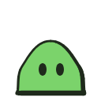
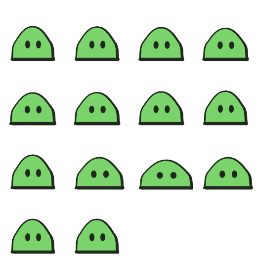
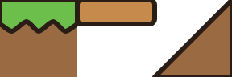

# 9. Jogo e Godot

[← Luz, efeitos e partículas](08-luz-efeitos.md) · [Índice](README.md) · [Próximo: Filme →](10-filme.md)

Um personagem de jogo no Weasel é um arquivo `.weasel` comum, com desenho, ossos e animações (`idle`, `walk`, `attack`…). Este capítulo mostra o que se acrescenta para ele sair **pronto para o jogo**: colisão, golpe e dano por quadro, o ponto de origem, direções, e como exportar para o Godot (ou qualquer motor).

## Um personagem de jogo

<!-- gerar: img/09_gosma.png -->
<!-- gerar: img/09_folha.png -f sheet -a all -->
```weasel
canvas 128 128 bg=none light=-0.6,-0.8
palette ink=#1f2a1c line=4 gosma=#7bd36b

godot body=character root=64,120 name=Gosma

bone corpo pivot=64,120

layer corpo
shape gosma c=gosma ink=line weight=0.3 bone=corpo : 64,52 100,84 106,118! 22,118! 28,84
ellipse olhoE 54,88 5,8 c=ink bone=corpo
ellipse olhoD 76,88 5,8 c=ink bone=corpo

box pes body rect 34,104 60,16
box dano hurt rect 26,56 76,64
box golpe_right hit rect 98,66 28,44 only=attack_right off

anim idle_right frames=8 fps=8
key 0 corpo=0,0,0,1,1
key 4 corpo=0,0,0,1.06,0.94
key 8 corpo=0,0,0,1,1

anim attack_right frames=6 fps=12 once
key 0 corpo=0,0,0,1,1
key 2 corpo=10,0,0,1.25,0.85 golpe_right.show=1
key 4 corpo=0,0,0,1,1 golpe_right.show=0
event 2 golpe
```

| O desenho | A sprite sheet (`-f sheet -a all`) |
|---|---|
|  |  |

O que é de jogo aqui:

- `canvas … bg=none`: fundo **transparente**, para o personagem ficar por cima do cenário do jogo.
- `godot body=character root=64,120 name=Gosma`: a cena do Godot terá um nó raiz `CharacterBody2D` chamado `Gosma`, e o ponto `64,120` (entre os "pés") vira a **origem** do personagem no jogo.
- As três linhas `box` são as **caixas de colisão**, explicadas abaixo.
- As animações terminam em `_right`: na cena do Godot, as versões `_left` saem **espelhadas** sozinhas.
- `event 2 golpe` avisa o jogo do quadro do golpe.

## Caixas de colisão: `box`

```
box nome body|hit|hurt rect x,y largura,altura   [bone=osso] [only=anims] [off]
box nome body|hit|hurt circle cx,cy raio
box nome body|hit|hurt capsule cx,cy largura,altura
```

| Tipo | Para quê | No Godot vira |
|---|---|---|
| `body` | a colisão do corpo com o chão e as paredes | `CollisionShape2D` do corpo |
| `hit` | o **golpe** (hitbox): onde o ataque acerta | uma `Area2D` chamada `Hitbox` |
| `hurt` | onde o personagem **leva dano** (hurtbox) | uma `Area2D` chamada `Hurtbox` |

- `rect` usa o canto de cima à esquerda, como o `rect` de desenho; `circle` e `capsule` usam o centro.
- `bone=osso` faz a caixa seguir a **posição e a rotação** do osso (não a escala).
- `only=attack_right` liga a caixa só nessas animações (`pose` vale para a pose parada).
- `off` faz ela começar **desligada**. `key 2 golpe_right.show=1` liga num quadro e `key 4 golpe_right.show=0` desliga. Assim o golpe só existe nos quadros em que a espada (ou a gosma) está esticada.
- No editor, com **Guias** ligado, as caixas aparecem por cima do desenho: corpo em verde, golpe em vermelho, dano em amarelo; desligadas ficam tracejadas.

## O nó do Godot: `godot`

```
godot body=character|static|area|rigid|node root=x,y name=Nome normal=força
```

| Atributo | Padrão | O que faz |
|---|---|---|
| `body=` | `character` | o nó raiz: `CharacterBody2D`, `StaticBody2D`, `Area2D`, `RigidBody2D` ou `Node2D` |
| `root=x,y` | o `root=` do `unity`, ou o meio da base do desenho | o ponto do desenho que vira a origem (0,0) da cena |
| `name=` | o nome do arquivo | o nome do nó raiz |
| `normal=` | 1 | a força do relevo do normal map (0 a 10) |

## Exportando para o Godot

```bash
node cli/weasel.js gosma.weasel -o godot/gosma.tscn
```

Isso gera uma pasta pronta para copiar para dentro do projeto do Godot:

| Arquivo | O que é |
|---|---|
| `gosma.png` | a folha com todos os quadros |
| `gosma_normal.png` | o **normal map**, para a luz 2D do Godot (`PointLight2D`) iluminar o personagem com relevo |
| `gosma.tres` | o `SpriteFrames` com as animações |
| `gosma.tscn` | a **cena pronta**: o personagem com sprite, colisão, hitbox, hurtbox e AnimationPlayer |
| `weasel_anim.gd` | o ajudante do AnimationPlayer (`tocar()` e o sinal `evento`) |

A cena fica assim:

```
Gosma (CharacterBody2D)            ← godot body=; a origem é o root=
├── Sprite (AnimatedSprite2D)      ← o SpriteFrames, com o normal map
├── pes (CollisionShape2D)         ← box … body
├── Hitbox (Area2D)                ← box … hit
├── Hurtbox (Area2D)               ← box … hurt
└── AnimationPlayer                ← weasel_anim.gd
```

- O **AnimationPlayer** tem uma animação para cada `anim` (mais as espelhadas). Cada uma troca o quadro do sprite, liga, desliga e move as caixas quadro a quadro e chama os eventos na hora certa. **Toque as animações pelo AnimationPlayer**, não pelo sprite.
- `tocar("attack", velocity)` escolhe a direção sozinho: toca `attack_right` ou `attack_left` (ou `_up`, `_down` e as diagonais, se existirem), e só recomeça quando a animação muda.
- Os eventos chegam pelo sinal `evento(nome)`.
- `--no-normal` tira o normal map; `--no-mirror` não gera o lado espelhado.

Um script de jogo usando a cena:

```gdscript
extends CharacterBody2D   # script do jogo, na cena exportada

@onready var anim: AnimationPlayer = $AnimationPlayer

func _ready() -> void:
	anim.evento.connect(_quando_evento)
	$Hitbox.area_entered.connect(_quando_acerta)

func _physics_process(_delta: float) -> void:
	velocity = Input.get_vector("ui_left", "ui_right", "ui_up", "ui_down") * 120.0
	move_and_slide()
	if anim.current_animation.begins_with("attack") and anim.is_playing():
		return
	if Input.is_action_just_pressed("ui_accept"):
		anim.tocar("attack", velocity)
	else:
		anim.tocar("idle", velocity)

func _quando_acerta(area: Area2D) -> void:
	if area.owner != self:  # o golpe também encosta na própria Hurtbox
		print("acertou ", area.owner.name)

func _quando_evento(nome: StringName) -> void:
	if nome == &"golpe":
		pass  # toque o som do golpe aqui
```

## Direções (jogos vistos de cima)

Num jogo top-down, o personagem tem vistas diferentes para cada direção. A convenção:

- anime `walk_down`, `walk_up` e `walk_right` (e, se quiser, as diagonais `walk_down_right`, `walk_up_right`);
- o lado que falta (`walk_left`…) sai **espelhado** na cena do Godot, com as caixas espelhadas também;
- cada vista fica numa camada com `only=` (`layer costas only=idle_up,walk_up,attack_up`), e a de frente inclui `pose` para aparecer no desenho parado.

O exemplo [`furao.weasel`](../../exemplos/furao.weasel) é um personagem completo assim: frente, costas e lado, parado, andando e atacando com espada, com eventos de passo e de golpe.

## Tileset: blocos para montar fases

Com `tileset`, o canvas vira uma **folha de blocos** (de 32×32, por exemplo), e cada `tile` diz qual célula vira bloco e como ela colide:

<!-- gerar: img/09_tileset.png -s 3 -->
```weasel
canvas 96 32 bg=none
palette ink=#2a1d16 line=2 grama=#6cbf4a terra=#9a6b43 madeira=#c58a4c

tileset size=32

rect terraA 0,6 32,26 c=terra
shape gramaA c=grama ink=line smooth=0.6 : 0,0! 32,0! 32,10! 27,13 22,9 16,13 11,9 5,13 0,10!
rect tabua 32,0 32,10 r=2 c=madeira ink=line
shape rampa c=terra ink=line : 64,32! 96,0! 96,32!

tile chao 0,0 solid
tile plataforma 1,0 oneway
tile rampa 2,0 collision=rampa
```



| Instrução | O que faz |
|---|---|
| `tileset size=32` | blocos de 32×32 (`size=32,16` para retangulares). Com `auto`, toda célula desenhada sem `tile` vira um bloco sem colisão (decoração). |
| `tile nome coluna,linha solid` | colide no quadrado inteiro. Coluna e linha começam em 0. |
| `tile nome coluna,linha oneway` | plataforma: colide só por cima (dá para pular por baixo dela) |
| `tile nome coluna,linha collision=forma` | colide no formato de uma forma (rampa, meio bloco) |

- O nome de cada bloco vai junto, como dado do bloco: no Godot, `tile_data.get_custom_data("nome")` diz se é `espinhos`, `moeda`…
- Exporte com `node cli/weasel.js blocos.weasel -f godot -o godot/blocos.tres` (`--normal` acrescenta o normal map). O `.png` e o `.tres` precisam ficar na mesma pasta.
- O exemplo [`blocos.weasel`](../../exemplos/blocos.weasel) tem grama, terra, pedra em hachura, plataforma, rampa, espinhos, caixa, moeda que brilha e uma nuvem que o `auto` vira blocos.
- No editor, com **Guias**, aparecem a grade, o nome de cada bloco e a colisão.

## Para outros motores: sprite sheet e `unity`

```bash
node cli/weasel.js gosma.weasel -f sheet -a all --trim -t -o sprites/gosma.png
```

A sprite sheet sai em PNG mais um JSON no formato do TexturePacker/Phaser, que quase todo motor lê: a posição de cada quadro, a duração, as animações (`frameTags`), os eventos e as caixas ligadas em cada quadro. Veja o [JSON da gosma](img/09_folha.json); nele, cada caixa vem pelo centro (`x`,`y`) e pelo tamanho.

Para a Unity, `unity unit=100 root=x,y collider=l,a,dx,dy` acrescenta ao JSON os pixels por unidade, o pivô (o ponto `root=`, que também vira a origem dos personagens num filme) e um colisor.

| Opção da linha de comando | O que faz |
|---|---|
| `-a all` | todas as animações (ou `-a idle_right` para uma) |
| `--trim` | recorta o espaço vazio em volta (igual em todos os quadros, para eles continuarem alinhados) |
| `-t` | fundo transparente |
| `-s 0.5` | escala |
| `--layout rows` | uma linha por animação, em vez de uma grade |
| `--variant all` | uma folha para cada variante de cor |

[← Luz, efeitos e partículas](08-luz-efeitos.md) · [Índice](README.md) · [Próximo: Filme →](10-filme.md)
