# 9. Jogo e Godot

[← Luz, efeitos e partículas](08-luz-efeitos.md) · [Índice](README.md) · [Próximo: Filme →](10-filme.md)

Um personagem de jogo no Weasel é um arquivo `.weasel` comum, com desenho, ossos e animações (`idle`, `walk`, `attack`…). Este capítulo mostra o que se acrescenta para ele sair **pronto para o jogo**: colisão, golpe e dano por quadro, pontos de encaixe, o ponto de origem, direções, e como exportar para o Godot (ou qualquer motor).

## Um personagem de jogo

<!-- gerar: img/09_gosma.png -->
<!-- gerar: img/09_folha.png -f sheet -a all -->
```weasel
canvas 128 128 bg=none light=-0.6,-0.8
palette ink=#1f2a1c line=4 gosma=#7bd36b

godot body=character root=64,120 name=Gosma

bone corpo pivot=64,120

layer corpo
shape gosma c=gosma ink=line weight=0.3 bone=corpo : 64,52 100,84 106,118! 22,118! 28,84
ellipse olhoE 54,88 5,8 c=ink bone=corpo
ellipse olhoD 76,88 5,8 c=ink bone=corpo

box pes body rect 34,104 60,16
box dano hurt rect 26,56 76,64
box golpe_right hit rect 98,66 28,44 only=attack_right off

anim idle_right frames=8 fps=8
key 0 corpo=0,0,0,1,1
key 4 corpo=0,0,0,1.06,0.94
key 8 corpo=0,0,0,1,1

anim attack_right frames=6 fps=12 once
key 0 corpo=0,0,0,1,1
key 2 corpo=10,0,0,1.25,0.85 golpe_right.show=1
key 4 corpo=0,0,0,1,1 golpe_right.show=0
event 2 golpe
```

| O desenho | A sprite sheet (`-f sheet -a all`) |
|---|---|
| 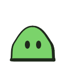 | 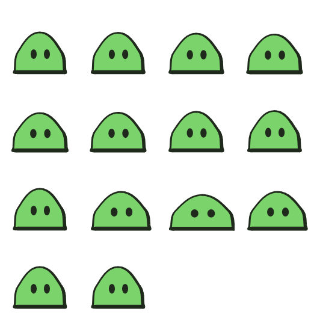 |

O que é de jogo aqui:

- `canvas … bg=none`: fundo **transparente**, para o personagem ficar por cima do cenário do jogo.
- `godot body=character root=64,120 name=Gosma`: a cena do Godot terá um nó raiz `CharacterBody2D` chamado `Gosma`, e o ponto `64,120` (entre os "pés") vira a **origem** do personagem no jogo.
- As três linhas `box` são as **caixas de colisão**, explicadas abaixo.
- As animações terminam em `_right`: na cena do Godot, as versões `_left` saem **espelhadas** sozinhas.
- `event 2 golpe` avisa o jogo do quadro do golpe.

## Caixas de colisão: `box`

```
box nome body|hit|hurt rect x,y largura,altura   [bone=osso] [only=anims] [off]
box nome body|hit|hurt circle cx,cy raio
box nome body|hit|hurt capsule cx,cy largura,altura
```

| Tipo | Para quê | No Godot vira |
|---|---|---|
| `body` | a colisão do corpo com o chão e as paredes | `CollisionShape2D` do corpo |
| `hit` | o **golpe** (hitbox): onde o ataque acerta | uma `Area2D` chamada `Hitbox` |
| `hurt` | onde o personagem **leva dano** (hurtbox) | uma `Area2D` chamada `Hurtbox` |

- `rect` usa o canto de cima à esquerda, como o `rect` de desenho; `circle` e `capsule` usam o centro.
- `bone=osso` faz a caixa seguir a **posição e a rotação** do osso (não a escala).
- `only=attack_right` liga a caixa só nessas animações (`pose` vale para a pose parada).
- `off` faz ela começar **desligada**. `key 2 golpe_right.show=1` liga num quadro e `key 4 golpe_right.show=0` desliga. Assim o golpe só existe nos quadros em que a espada (ou a gosma) está esticada.
- No editor, com **Hitboxes** ligado (o padrão), as caixas aparecem por cima do desenho: corpo em verde, golpe em vermelho, dano em amarelo; desligadas ficam tracejadas. Desligue **Hitboxes** para ver o desenho limpo: continua aparecendo só a caixa da linha onde está o cursor.

As caixas são **invisíveis** no desenho e nas imagens exportadas: elas só vão para o jogo. A linha de comando também não as desenha (o `--guides` dela só mostra as camadas `guide`). Por isso, nas imagens deste capítulo, uma camada `guide` repete cada caixa com um `rect` ou uma `ellipse` nas cores do editor. No seu arquivo, essa camada não é necessária: no editor, com **Hitboxes**, as caixas aparecem sozinhas.

### Os três formatos: `rect`, `circle` e `capsule`

Uma caixa de colisão não precisa ser um retângulo. Uma cabeça cabe melhor num **círculo**. Um corpo fica melhor numa **cápsula** (um retângulo de pontas redondas), que escorrega em degraus e quinas em vez de enganchar.

<!-- gerar: img/09_caixas.png --guides -s 2 -->
```weasel
canvas 160 140 bg=#e8eef5
palette ink=#2a2433 line=3 pele=#9fd36b metal=#c8ccd8

godot root=64,132 name=Guarda

layer guarda
ellipse cabeca 64,40 20 c=pele ink=line
ellipse olho 72,38 3,4 c=ink
rect tronco 44,58 40,74 r=16 c=pele ink=line
rect espada 84,82 56,8 r=2 c=metal ink=line

box corpo body capsule 64,95 40,74
box cabecinha hurt circle 64,40 20
box lamina hit rect 84,78 56,16

# só para a imagem do guia: um desenho de cada caixa, nas cores do editor
layer caixas guide
rect verCorpo 44,58 40,74 r=20 c=#3fcf8e26 ink=2 inkc=#3fcf8e
ellipse verCabeca 64,40 20 c=#ffd16626 ink=2 inkc=#ffd166
rect verLamina 84,78 56,16 c=#ff5a5a26 ink=2 inkc=#ff5a5a
text nomeCorpo 6,100 "body" size=11 c=#1f8a5a
text nomeCabeca 90,20 "hurt" size=11 c=#a07a10
text nomeLamina 112,110 "hit" size=11 c=#c03030
```

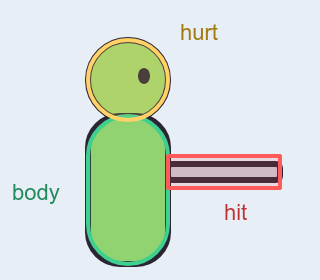

Repare:

- `box corpo body capsule 64,95 40,74`: uma cápsula com o **centro** em 64,95, 40 pixels de largura e 74 de altura. Como ela é mais alta que larga, fica em pé; as pontas redondas têm metade da largura (20) de raio.
- `box cabecinha hurt circle 64,40 20`: um círculo com centro em 64,40 e raio 20. É o mesmo círculo da `ellipse cabeca`: só a cabeça leva dano.
- `box lamina hit rect 84,78 56,16`: um retângulo com o **canto de cima à esquerda** em 84,78, 56 de largura e 16 de altura, como um `rect` de desenho.
- Os nomes das caixas não podem repetir os das formas (`cabecinha`, e não `cabeca`): numa `key`, o Weasel não saberia de qual dos dois você está falando.
- A camada `caixas` só existe para a imagem. A imagem foi gerada com `--guides` (para mostrar a camada) e `-s 2` (o dobro do tamanho).

Para conferir as caixas sem abrir o editor, use `--info`:

```bash
node cli/weasel.js guarda.weasel --info
```

```
godot    character, raiz 64,132, nó Guarda
caixas   3
  corpo          body capsule
  cabecinha      hurt circle
  lamina         hit rect
```

E na cena exportada para o Godot (`-o godot/guarda.tscn`), cada formato vira a forma de colisão do Godot com o mesmo nome:

```
[sub_resource type="CapsuleShape2D" id="Shape_0"]
radius = 20
height = 74

[sub_resource type="CircleShape2D" id="Shape_1"]
radius = 20

[sub_resource type="RectangleShape2D" id="Shape_2"]
size = Vector2(56, 16)
…
[node name="corpo" type="CollisionShape2D" parent="."]
position = Vector2(0, -37)
```

A posição é contada a partir do `root=64,132`: o centro da cápsula (64,95) fica 37 pixels **acima** da origem, e no Godot "para cima" é negativo.

### Uma caixa que segue o braço e só liga no golpe

Um golpe de espada só deve acertar **enquanto a espada passa**, e a área do golpe precisa **acompanhar a espada**. Para isso servem `bone=`, `only=` e `off`, juntos:

<!-- gerar: img/09_golpe.gif -a attack_right --guides -->
```weasel
canvas 170 140 bg=#e8eef5
palette ink=#2a2433 line=3 pele=#9fd36b metal=#c8ccd8

godot root=64,132 name=Guarda

bone braco pivot=70,84

layer guarda
ellipse cabeca 64,40 20 c=pele ink=line
ellipse olho 72,38 3,4 c=ink
rect tronco 44,58 40,74 r=16 c=pele ink=line
layer arma
rect espada 70,80 60,8 r=2 c=metal ink=line bone=braco
ellipse mao 72,84 8 c=pele ink=line bone=braco

box lamina hit rect 84,76 48,16 bone=braco only=attack_right off

# só para a imagem do guia: a caixa desenhada nas cores do editor
layer caixas guide
rect verLamina 84,76 48,16 c=#ff5a5a26 ink=2 inkc=#ff5a5a bone=braco

anim idle_right frames=4 fps=4
key 0 braco=0,0,-60 verLamina.show=0

anim attack_right frames=8 fps=10 once
key 0 braco=0,0,-60 verLamina.show=0
key 2 braco=0,0,20 lamina.show=1 verLamina.show=1
key 4 lamina.show=0 verLamina.show=0
key 8 braco=0,0,-60
```

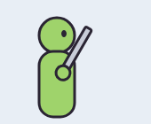

Repare:

- `bone=braco`: a caixa gira e anda com o osso do braço, como a espada. Ela não estica nem encolhe com a escala do osso.
- `only=attack_right`: a caixa **só existe** nessa animação. No `idle_right`, ela nem aparece.
- `off`: dentro do `attack_right`, ela começa **desligada**.
- `key 2 … lamina.show=1` liga a caixa no quadro 2 (espada esticada) e `key 4 lamina.show=0` desliga no quadro 4. O golpe acerta só nos quadros 2 e 3.
- A forma `verLamina` repete as mesmas `key` de `show`, só para a imagem mostrar o que a caixa faz.

O `--info` resume tudo isso numa linha:

```
caixas   1
  lamina         hit rect osso braco só em attack_right (começa desligada)
```

Na **sprite sheet** (`-f sheet -a all`), a caixa só aparece no JSON dos quadros em que está ligada, já girada com o braço (o `x`,`y` é o centro, em pixels do quadro, e `rot` é o giro em graus):

```json
"attack_right_01": { … "boxes": [] },
"attack_right_02": { … "boxes": [{ "name": "lamina", "kind": "hit", "shape": "rect", "x": 105.708, "y": 96.997, "w": 48, "h": 16, "rot": 20 }] },
"attack_right_03": { … "boxes": [{ "name": "lamina", "kind": "hit", "shape": "rect", "x": 106.859, "y": 93.241, "w": 48, "h": 16, "rot": 14.074 }] },
"attack_right_04": { … "boxes": [] },
```

Na **cena do Godot**, o AnimationPlayer liga e desliga a caixa (`disabled` é "desligada") nos tempos certos. No `attack_right` (10 quadros por segundo, então o quadro 2 é 0,2 s):

```
tracks/6/path = NodePath("Hitbox/lamina:disabled")
…
"times": PackedFloat32Array(0, 0.2, 0.4),
…
"values": [true, false, true]
```

**Experimente:** troque `key 4 lamina.show=0 verLamina.show=0` por `key 6 lamina.show=0 verLamina.show=0`. O golpe passa a acertar também na volta da espada.

## Pontos de encaixe: `point`

```
point nome x,y [bone=osso]
```

Um **ponto de encaixe** é um ponto com nome que acompanha um osso: de onde sai o tiro, onde a mão segura a arma, onde nasce a poeira do passo. Ele não aparece no desenho, mas vai para o jogo quadro a quadro, então o jogo sabe onde ele está em cada momento da animação.

<!-- gerar: img/09_ponto.gif -a shoot_right --guides -->
```weasel
canvas 160 128 bg=#e8eef5
palette ink=#2a2433 line=4 pele=#7cc4e8 arma=#5b5f6e fogo=#ffcf4d

godot body=character root=64,122 name=Atirador

bone corpo pivot=64,122
bone braco pivot=74,74 parent=corpo

layer corpo
ellipse tronco 60,90 26,32 c=pele ink=line bone=corpo
ellipse olho 70,76 4,6 c=ink bone=corpo
layer braco
rect cano 74,68 46,10 r=3 c=arma ink=line bone=braco
ellipse mao 76,76 8 c=pele ink=line bone=braco
ellipse clarao 130,73 10,6 c=fogo bone=braco

point saida 122,73 bone=braco
point pe 64,122

# só para ver onde o ponto está (as camadas guide não vão para o jogo)
layer mira guide
ellipse alvo 122,73 3 c=#c77dff bone=braco

anim shoot_right frames=12 fps=12
key 0 braco=0,0,0 clarao.show=0
key 4 braco=0,0,-30
key 6 clarao.show=1
key 8 clarao.show=0
key 12 braco=0,0,0
event 6 tiro
```

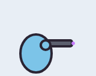

- `point saida 122,73 bone=braco` fica na ponta do cano e gira com o braço. O ponto roxo da camada `guide` mostra onde ele está; no editor, com **Guias** ligado, os pontos aparecem sozinhos, em roxo, com uma seta para onde o osso aponta.
- `point pe 64,122` não tem osso: fica parado entre os pés.
- O ponto segue a **posição e a rotação** do osso, como as caixas.
- O nome não pode repetir o de uma caixa: no Godot, os dois viram nós da mesma cena.

O `--info` lista os pontos e o osso de cada um:

```
pontos   2
  saida          122,73 osso braco
  pe             64,122
```

Na cena do Godot, cada ponto vira um **`Marker2D`** com o nome do ponto, que o AnimationPlayer move quadro a quadro. Na animação espelhada (`shoot_left`), o ponto e a direção também espelham. No script do jogo:

```gdscript
const BALA := preload("res://bala.tscn")

func _quando_evento(nome: StringName) -> void:
	if nome == &"tiro":
		var bala := BALA.instantiate()
		bala.global_position = $saida.global_position
		bala.direcao = $saida.global_transform.x  # para onde o cano aponta
		get_parent().add_child(bala)
```

Na sprite sheet, os pontos vão no JSON de cada quadro, em pixels do quadro e com a rotação do osso em graus. No quadro 4, com o braço levantado 30 graus:

```json
"points": [{ "name": "saida", "x": 115.069, "y": 49.134, "rot": -30 }, { "name": "pe", "x": 64, "y": 122 }]
```

O `rot` só aparece quando o osso está girado: no quadro 0, o ponto `saida` vem só com `x` e `y`. Com `--trim`, os números mudam, porque o quadro passa a começar onde começa o desenho.

## Andar sem escorregar: `feet=`

```
anim nome … feet=ponto,ponto
```

Num jogo, o personagem anda **no lugar**, como numa esteira: o corpo fica parado no quadro e cada pé vai para trás enquanto está no chão. Quem leva o personagem pela fase é o jogo, movendo o nó. Se o jogo anda mais depressa (ou mais devagar) do que o pé vai para trás, o pé **escorrega** no chão. `feet=` diz ao Weasel quais pontos são os pés, e ele mede quanto o personagem tem de andar por segundo para os pés no chão ficarem parados.

<!-- gerar: img/09_passada.gif -a anda_right --guides -->
<!-- gerar: img/09_passada_trajetoria.png -a anda_right --trajectory -->
```weasel
canvas 200 200 bg=#e8eef5
palette ink=#2a2433 line=4 pele=#7cc4e8

godot body=character root=100,180 name=Andador

bone corpo pivot=100,110
bone perna_e pivot=106,130 parent=corpo
bone perna_d pivot=94,128 parent=corpo

layer chao guide
line linha_chao c=#9aa5b1 w=1 : 0,180 200,180

layer perna_atras
stroke coxa_d w=8 c=ink bone=perna_d : 94,128 94,172
ellipse sapato_d 98,173 9,4 c=ink bone=perna_d
layer corpo
ellipse tronco 100,105 28,30 c=pele ink=line bone=corpo
ellipse olho 112,96 3,4 c=ink bone=corpo
layer perna_frente
stroke coxa_e w=8 c=ink bone=perna_e : 106,130 106,176
ellipse sapato_e 110,177 9,4 c=ink bone=perna_e

# os pés: um ponto na sola de cada um, preso ao osso da perna (a de trás pisa um
# pouco mais alto, no lado de longe)
point pe_e 106,180 bone=perna_e
point pe_d 94,176 bone=perna_d

# cada pé vai 10 px para trás por quadro enquanto pisa e volta pelo ar
anim anda_right frames=8 fps=12 feet=pe_e,pe_d
key 0 perna_e=20,0,0 perna_d=-20,0,0 ease=linear
key 2 perna_d=0,-12,0 ease=linear
key 4 perna_e=-20,0,0 perna_d=20,0,0 ease=linear
key 6 perna_e=0,-12,0 ease=linear
key 8 perna_e=20,0,0 perna_d=-20,0,0 ease=linear
event 0 passo
event 4 passo
```

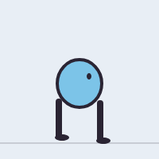

- Um `point` na sola de cada pé, preso ao osso da perna ([pontos de encaixe](#pontos-de-encaixe-point)).
- `feet=pe_e,pe_d` no `anim`: os nomes dos pontos, separados por vírgula. Ponha nas animações em que o personagem anda (passo, trote, corrida). Na parada, a medida dá zero.
- **Como ele mede:** para cada pé, o chão é a altura mais baixa a que aquele pé chega na animação, e o pé está no chão nos quadros perto dela. Entre dois quadros seguidos no chão, o Weasel vê quanto o pé andou para trás e fica com o valor do meio (um quadro torto não estraga a conta). Aqui, 10 px por quadro a 12 fps: o personagem anda 120 px por segundo.
- Vale para personagens vistos **de lado**, andando para a direita ou para a esquerda.

O `--info` mostra a medida em cada animação com `feet=` (com `-s`, já na escala da exportação):

```
  anda_right     8 quadros, 12 fps
                 eventos: passo@0, passo@4
                 pés: anda 120 px/s para a direita (10 px por quadro a 12 fps)
```

### A trajetória dos pés

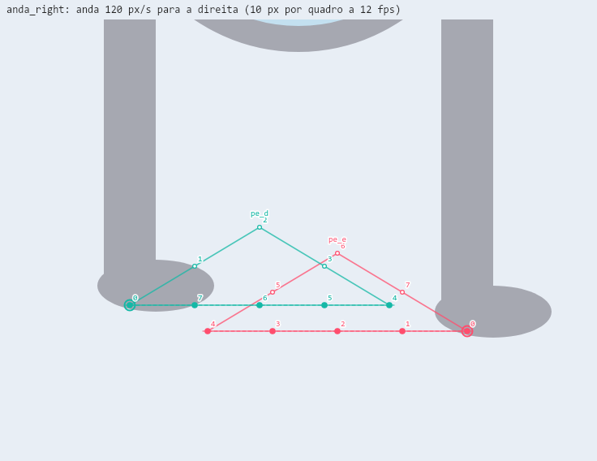

`--trajectory` desenha o caminho de cada pé em todos os quadros da animação, numerado, por cima do personagem clarinho (a imagem acima). As bolinhas cheias são os quadros no chão, e a linha tracejada é onde o pé pisa. No chão, as bolinhas têm de ficar **em linha e igualmente espaçadas**; uma fora do lugar é um escorregão. `--trajectory=mao,pe_e` segue outros pontos (os que não são pés mostram só o caminho).

```bash
node cli/weasel.js andador.weasel -a anda_right --trajectory -o pes.png
```

No editor, o botão **Trajetória** mostra o mesmo por cima do desenho, com um anel no quadro atual e a medida no canto. Numa animação sem `feet=`, ele mostra o caminho de todos os pontos.

Quando um pé, no chão, anda diferente dos outros, o `--info`, o `--trajectory` e o editor avisam:

```
                 aviso: pe_d escorrega: no chão vai para trás de 6 a 14 px por quadro (os outros, 10)
```

### No jogo

Na cena do Godot, o AnimationPlayer guarda a medida de cada animação em `velocidades` (em px por segundo, já na escala da exportação; as espelhadas andam o mesmo). `velocidade()` devolve a da animação tocando agora, e `velocidade("anda")` a de `anda` virada para a última direção, como o `tocar()`. O jogo escolhe o que fazer com ela: andar na velocidade dos pés, ou acertar o ritmo da animação pela velocidade do jogo.

```gdscript
func _physics_process(_delta: float) -> void:
	var dir := Input.get_axis("ui_left", "ui_right")
	anim.tocar("anda" if dir else "parado", Vector2(dir, 0))
	velocity.x = dir * anim.velocidade()   # anda na velocidade dos pés
	move_and_slide()
```

```gdscript
	# ou: o jogo manda na velocidade, e o passo acompanha
	anim.speed_scale = absf(velocity.x) / anim.velocidade() if velocity.x else 1.0
```

Na sprite sheet, a medida vai no JSON, em `meta.frameTags` (`groundSpeed`, px por segundo na escala da folha).

## O nó do Godot: `godot`

```
godot body=character|static|area|rigid|node root=x,y name=Nome normal=força
```

| Atributo | Padrão | O que faz |
|---|---|---|
| `body=` | `character` | o nó raiz: `CharacterBody2D`, `StaticBody2D`, `Area2D`, `RigidBody2D` ou `Node2D` |
| `root=x,y` | o `root=` do `unity`, ou o meio da base do desenho | o ponto do desenho que vira a origem (0,0) da cena |
| `name=` | o nome do arquivo | o nome do nó raiz |
| `normal=` | 1 | a força do relevo do normal map (0 a 10) |

### Que tipo de objeto: `body=`

`body=` diz ao Godot **que tipo de coisa** o desenho é: algo que anda e bate nas paredes, algo parado, uma área que só percebe quem encosta, algo que cai e rola sozinho, ou só um enfeite. Uma moeda, por exemplo, não bate em nada: o jogador passa por ela e ela some. Isso é uma **área** (`area`):

<!-- gerar: img/09_moeda.png -s 2 -->
```weasel
canvas 48 48 bg=none
palette ink=#5a3a10 line=3

godot body=area name=Moeda

ellipse moeda 24,24 18 c=#ffd34d ink=line
rect brilho 20,14 6,20 r=3 c=#fff2b0

box pega body circle 24,24 18
```

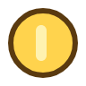

```bash
node cli/weasel.js moeda.weasel -o godot/moeda.tscn
```

```
salvo godot/moeda.png  52×52, 1 quadros de 48×48 · 2 KB
salvo godot/moeda_normal.png  52×52, normal map · 3 KB
salvo godot/moeda.tres  SpriteFrames do Godot 4 · 1 KB
salvo godot/moeda.tscn  cena do Godot 4 (1 caixa) · 1 KB
salvo godot/weasel_anim.gd  ajudante do AnimationPlayer · 2 KB
```

Dentro do `moeda.tscn`:

```
[node name="Moeda" type="Area2D"]
…
[node name="pega" type="CollisionShape2D" parent="."]
position = Vector2(0, -24)
```

No jogo, o sinal `body_entered` da `Area2D` avisa quando o jogador encosta na moeda.

O que cada `body=` cria, e para que serve:

| `body=` | Nó raiz no `.tscn` | Bom para |
|---|---|---|
| `character` | `CharacterBody2D` | o herói e os inimigos: andam pelo código e param nas paredes |
| `static` | `StaticBody2D` | o que não se mexe mas bloqueia: parede, caixote, porta fechada |
| `area` | `Area2D` | o que só percebe quem encosta: moeda, armadilha, porta de saída |
| `rigid` | `RigidBody2D` | o que a física do Godot move sozinha: bola, caixa que cai e rola |
| `node` | `Node2D` | enfeite sem física. As caixas `body` vão para uma `Area2D` chamada `Corpo`, porque um `Node2D` não colide |

### A origem e o nome: `root=` e `name=`

A **origem** é o ponto (0,0) do nó no Godot: é ele que fica na posição que o jogo dá ao objeto, e é em volta dele que o objeto gira. Num personagem, ela fica entre os pés (para ele "pisar" no chão). Numa moeda que gira no ar, fica melhor no meio.

Sem `root=`, a origem é o **meio da base** do desenho: para a moeda de 48×48, o ponto 24,48. Com `godot body=area root=24,24 name=Moeda`, ela passa para o meio da moeda. Compare o `.tscn` das duas:

| Sem `root=` (origem em 24,48) | Com `root=24,24` |
|---|---|
| `offset = Vector2(-24, -48)` | `offset = Vector2(-24, -24)` |
| `pega` em `position = Vector2(0, -24)` | `pega` em `position = Vector2(0, 0)` |

- O `offset` do sprite é o quanto a imagem é empurrada para a esquerda e para cima, para o ponto `root=` cair em cima da origem.
- A caixa `pega` (o círculo no meio da moeda) fica 24 pixels acima da origem no primeiro caso, e **em cima** dela no segundo.

`name=` é o nome do nó raiz. Sem ele, o Weasel usa o nome do arquivo, juntando as palavras com maiúsculas: `moeda_de_ouro.weasel` vira o nó `MoedaDeOuro`. O nome só pode ter letras, números e `_`.

### O relevo para a luz do Godot: `normal=`

Um **normal map** é uma segunda imagem, em tons de azul e roxo, que diz para onde cada pedacinho do desenho está "virado". A luz 2D do Godot (`PointLight2D`) usa essa imagem para iluminar o personagem com **relevo**: o lado virado para a lâmpada fica claro, o outro fica escuro, como no [capítulo 8](08-luz-efeitos.md), mas calculado dentro do jogo.

- O `.tscn` já vem com o normal map (`moeda_normal.png` acima).
- `normal=` é a força do relevo, de 0 a 10 (padrão 1). Com 0, o desenho fica chapado; com números maiores, mais "estufado".
- `--no-normal` exporta sem ele. A mesma moeda, com `--no-normal`, sai sem o `moeda_normal.png`:

```
salvo godot/moeda.png  52×52, 1 quadros de 48×48 · 2 KB
salvo godot/moeda.tres  SpriteFrames do Godot 4 · 1 KB
salvo godot/moeda.tscn  cena do Godot 4 (1 caixa) · 1 KB
salvo godot/weasel_anim.gd  ajudante do AnimationPlayer · 2 KB
```

## Exportando para o Godot

```bash
node cli/weasel.js gosma.weasel -o godot/gosma.tscn
```

A linha de comando avisa cada arquivo que salvou:

```
salvo godot/gosma.png  490×354, 14 quadros de 120×86 · 35 KB
salvo godot/gosma_normal.png  490×354, normal map · 82 KB
salvo godot/gosma.tres  SpriteFrames do Godot 4 · 3 KB
salvo godot/gosma.tscn  cena do Godot 4 (3 caixas, espelhadas: idle_left, attack_left) · 13 KB
salvo godot/weasel_anim.gd  ajudante do AnimationPlayer · 2 KB
```

Isso gera uma pasta pronta para copiar para dentro do projeto do Godot:

| Arquivo | O que é |
|---|---|
| `gosma.png` | a folha com todos os quadros |
| `gosma_normal.png` | o **normal map**, para a luz 2D do Godot (`PointLight2D`) iluminar o personagem com relevo |
| `gosma.tres` | o `SpriteFrames` com as animações |
| `gosma.tscn` | a **cena pronta**: o personagem com sprite, colisão, hitbox, hurtbox e AnimationPlayer |
| `weasel_anim.gd` | o ajudante do AnimationPlayer (`tocar()` e o sinal `evento`) |

A cena fica assim:

```
Gosma (CharacterBody2D)            ← godot body=; a origem é o root=
├── Sprite (AnimatedSprite2D)      ← o SpriteFrames, com o normal map
├── pes (CollisionShape2D)         ← box … body
├── Hitbox (Area2D)                ← box … hit
├── Hurtbox (Area2D)               ← box … hurt
├── saida (Marker2D)               ← point (se houver)
└── AnimationPlayer                ← weasel_anim.gd
```

- O **AnimationPlayer** tem uma animação para cada `anim` (mais as espelhadas). Cada uma troca o quadro do sprite, liga, desliga e move as caixas e os pontos quadro a quadro e chama os eventos na hora certa. **Toque as animações pelo AnimationPlayer**, não pelo sprite.
- `tocar("attack", velocity)` escolhe a direção sozinho: toca `attack_right` ou `attack_left` (ou `_up`, `_down` e as diagonais, se existirem), e só recomeça quando a animação muda.
- Os eventos chegam pelo sinal `evento(nome)`. Dois ou mais no mesmo quadro chegam um depois do outro, na ordem do código.
- Com `feet=`, `velocidade()` diz quanto o personagem anda por segundo na animação tocando agora sem os pés escorregarem ([acima](#no-jogo)).
- `--no-normal` tira o normal map; `--no-mirror` não gera o lado espelhado; `--rig` exporta com esqueleto de verdade ([abaixo](#esqueleto-de-verdade-rigbones-experimental)).

Um script de jogo usando a cena:

```gdscript
extends CharacterBody2D   # script do jogo, na cena exportada

@onready var anim: AnimationPlayer = $AnimationPlayer

func _ready() -> void:
	anim.evento.connect(_quando_evento)
	$Hitbox.area_entered.connect(_quando_acerta)

func _physics_process(_delta: float) -> void:
	velocity = Input.get_vector("ui_left", "ui_right", "ui_up", "ui_down") * 120.0
	move_and_slide()
	if anim.current_animation.begins_with("attack") and anim.is_playing():
		return
	if Input.is_action_just_pressed("ui_accept"):
		anim.tocar("attack", velocity)
	else:
		anim.tocar("idle", velocity)

func _quando_acerta(area: Area2D) -> void:
	if area.owner != self:  # o golpe também encosta na própria Hurtbox
		print("acertou ", area.owner.name)

func _quando_evento(nome: StringName) -> void:
	if nome == &"golpe":
		pass  # toque o som do golpe aqui
```

## Esqueleto de verdade: `rig=bones` (experimental)

A cena por quadros guarda **imagens prontas**: o Godot troca de uma para a outra 12 vezes por segundo (ou no `fps` da animação). Com esqueleto, o Godot recebe os **ossos** e as **peças** do desenho, e calcula o movimento sozinho:

```
godot body=character root=100,190 name=Lagarto rig=bones
```

Ou, sem mudar o arquivo, `node cli/weasel.js lagarto.weasel --rig -o godot/lagarto.tscn` (e `--no-rig` exporta por quadros mesmo com `rig=bones`). No editor, é a caixa **Esqueleto (Bone2D)** na aba Godot.

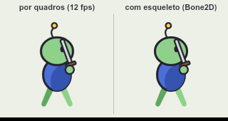

Qual escolher:

| | Por quadros (padrão) | Com esqueleto |
|---|---|---|
| Movimento | pula de quadro em quadro | liso, também em câmera lenta |
| Tamanho | uma imagem por quadro | uma imagem por peça (o Cavaleiro cai de 1,6 MB para 52 KB) |
| No Godot | o AnimationPlayer troca os quadros | dá para misturar animações no AnimationTree e girar ossos pelo código |
| Bom para | pixel art, inimigos pequenos, personagens que mudam muito de forma | o herói, chefes, personagens grandes e macios |

Na prática, com o atirador da seção [Pontos de encaixe](#pontos-de-encaixe-point) salvo como `atirador.weasel`, as duas exportações ficam assim:

```bash
node cli/weasel.js atirador.weasel -o godot/atirador.tscn
node cli/weasel.js atirador.weasel --rig -o godot/atirador.tscn
```

```
salvo godot/atirador.png  490×290, 12 quadros de 120×94 · 25 KB
…
salvo godot/atirador.png  87×94, 3 imagens de peças · 4 KB
…
salvo godot/atirador.tscn  cena do Godot 4 com esqueleto (2 ossos, 3 peças presas aos ossos, 2 pontos, espelhadas: shoot_left) · 12 KB
```

Por quadros, a folha tem os 12 quadros da animação. Com `--rig`, ela tem só **3 peças** (o tronco, o cano e o clarão), e os nós da cena ficam:

```
[node name="Atirador" type="CharacterBody2D"]
[node name="Visual" type="Node2D" parent="."]
[node name="Esqueleto" type="Skeleton2D" parent="Visual"]
[node name="corpo" type="Bone2D" parent="Visual/Esqueleto"]
[node name="tronco_0" type="RemoteTransform2D" parent="Visual/Esqueleto/corpo"]
[node name="braco" type="Bone2D" parent="Visual/Esqueleto/corpo"]
[node name="cano_1" type="RemoteTransform2D" parent="Visual/Esqueleto/corpo/braco"]
[node name="clarao_2" type="RemoteTransform2D" parent="Visual/Esqueleto/corpo/braco"]
[node name="Pecas" type="Node2D" parent="Visual"]
[node name="tronco_0" type="Sprite2D" parent="Visual/Pecas"]
[node name="cano_1" type="Sprite2D" parent="Visual/Pecas"]
[node name="clarao_2" type="Sprite2D" parent="Visual/Pecas"]
[node name="saida" type="Marker2D" parent="."]
[node name="pe" type="Marker2D" parent="."]
[node name="AnimationPlayer" type="AnimationPlayer" parent="."]
```

Os dois `bone` (`corpo` e `braco`) viraram `Bone2D`, um dentro do outro, como o `parent=`. O cano e o clarão estão presos ao `braco`, então giram com ele.

Como fica a cena (um personagem maior, com pernas e tecido):

```
Lagarto (CharacterBody2D)
├── Visual (Node2D)                  ← vira de lado nas animações espelhadas (_left)
│   ├── Esqueleto (Skeleton2D)
│   │   └── corpo (Bone2D)           ← um Bone2D para cada bone, na mesma hierarquia
│   │       ├── tronco_2 (RemoteTransform2D)   → leva a peça junto com o osso
│   │       └── braco (Bone2D) …
│   │           └── pernaE_coxa (Bone2D) → pernaE_canela   ← criados para a perna com IK
│   └── Pecas (Node2D)
│       ├── pernaE_0 (Polygon2D)     ← a perna: uma malha que dobra com a coxa e a canela
│       ├── tronco_2 (Sprite2D)      ← as peças, na ordem de pintura, todas da mesma folha
│       └── …
├── corpo_caixa · Hitbox · Hurtbox · ponta   ← caixas e pontos, como na cena por quadros
└── AnimationPlayer                  ← weasel_anim.gd
```

- Cada `bone` vira um `Bone2D`; a origem dele é o pivô. Cada sequência de formas presas ao mesmo osso vira **uma imagem**, e um `RemoteTransform2D` faz ela seguir o osso.
- O que **dobra** vira um `Polygon2D` com pele: a imagem parada vira uma malha, e cada ponto dela segue os ossos com um peso, como no Weasel.
  - **Perna ou braço com IK:** o Weasel cria dois ossos, a coxa e a canela (`pernaE_coxa` e `pernaE_canela`), e a malha dobra no joelho.
  - **Tecido:** um osso a mais (`capa_pano`) balança, e a ponta do tecido segue o balanço; perto do pivô, fica parado.
  - **Formas com `bones=`:** a malha usa os mesmos ossos e os mesmos pesos.
  - **Pontos presos com `@osso`:** a malha pesa no osso de cada ponto preso, e o resto no osso da forma (sem `bone=`, num osso `parado` na raiz). Entre um ponto preso e um solto, o peso passa de um para o outro como a linha estica no Weasel.
- **`ik`:** o Weasel calcula o `ik` e grava as rotações da raiz, do meio e da ponta na animação. No Godot fica igual ao Weasel, mas o pé não procura o chão sozinho durante o jogo (uma rampa no meio do caminho não muda a perna).
- O que **muda de forma** troca de imagem, presa ao osso: morph, `draw` e cores animadas (a imagem só troca quando a forma muda; o olho que pisca tem três imagens). Partículas, rastro e sombra no chão trocam de imagem quadro a quadro, no mundo.
- **Normal map:** sai junto (`lagarto_normal.png`), uma imagem por peça, para a luz 2D do Godot. `--no-normal` (ou a caixa **Normal map**) tira.
- **`above=` e `below=`** viram `z_index` das peças, só nos quadros em que a ordem muda.
- **Luzes animadas do Weasel** (ou presas a um osso que se mexe): o que elas iluminam troca de imagem quadro a quadro, para a luz ficar certa. Com as luzes paradas, as peças levam a luz da pose parada; no Godot, prefira as luzes 2D dele com o normal map.
- Um osso que nenhuma animação mexe fica livre para o código do jogo: `$Visual/Esqueleto/corpo/cabeca.rotation = …` faz a cabeça olhar para o mouse.
- Caixas, pontos de encaixe, eventos, `tocar()` e as animações espelhadas funcionam como na cena por quadros.

O lagarto de teste ([`test/casos/esqueleto.weasel`](../../test/casos/esqueleto.weasel)) tem um pouco de tudo: corpo e cabeça que respiram, antena com mola, espada, pernas com IK, olho que pisca e sombra recortada. Ele, o Furão, o Chefe, o Cavaleiro (com a capa de tecido) e o Fantasma foram abertos no Godot 4.7.2 e comparados quadro a quadro com o Weasel, junto com uma cauda com `bones=` e a bola que passa atrás e na frente do poste.

## Direções (jogos vistos de cima)

Num jogo top-down, o personagem tem vistas diferentes para cada direção. A convenção:

- anime `walk_down`, `walk_up` e `walk_right` (e, se quiser, as diagonais `walk_down_right`, `walk_up_right`);
- o lado que falta (`walk_left`…) sai **espelhado** na cena do Godot, com as caixas espelhadas também;
- cada vista fica numa camada com `only=` (`layer costas only=idle_up,walk_up,attack_up`), e a de frente inclui `pose` para aparecer no desenho parado.

O exemplo [`furao.weasel`](../../exemplos/furao.weasel) é um personagem completo assim: frente, costas e lado, parado, andando e atacando com espada, com eventos de passo e de golpe.

### Um bichinho com cinco vistas

Este é o mínimo para um personagem andar em **oito direções**: cinco animações desenhadas, e as outras três saem espelhadas.

<!-- gerar: img/09_direcoes.png -f sheet -a all --layout rows -->
```weasel
canvas 64 64 bg=none
palette ink=#2a2433 line=3 pelo=#f0b060 claro=#ffe0b0

godot root=32,58 name=Bolinha

# pula de leve em todas as animações (2 pixels, a cada meio segundo)
bone corpo pivot=32,58 bob=2,0.5

layer corpo
ellipse bola 32,36 20,22 c=pelo ink=line bone=corpo

# cada direção tem a sua cara
layer baixo only=walk_down,pose
ellipse barriga 32,42 11,10 c=claro bone=corpo
ellipse olhoE 25,31 3,4 c=ink bone=corpo
ellipse olhoD 39,31 3,4 c=ink bone=corpo
layer cima only=walk_up
shape rabo c=pelo ink=2 bone=corpo : 32,52 38,60 32,62 26,60
layer direita only=walk_right
ellipse focinho 50,38 7,6 c=claro ink=2 bone=corpo
ellipse olho 42,30 3,4 c=ink bone=corpo
layer baixoDireita only=walk_down_right
ellipse barriga2 37,42 10,10 c=claro bone=corpo
ellipse olhoE2 31,31 3,4 c=ink bone=corpo
ellipse olhoD2 44,31 3,4 c=ink bone=corpo
layer cimaDireita only=walk_up_right
shape rabo2 c=pelo ink=2 bone=corpo : 22,50 22,60 16,60 14,54

anim walk_down frames=4 fps=8
anim walk_up frames=4 fps=8
anim walk_right frames=4 fps=8
anim walk_down_right frames=4 fps=8
anim walk_up_right frames=4 fps=8
```

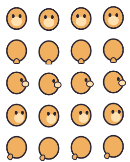

Repare:

- A imagem é a **sprite sheet** com `--layout rows`: uma linha por animação, na ordem do arquivo (`walk_down`, `walk_up`, `walk_right`, `walk_down_right`, `walk_up_right`).
- O corpo (`layer corpo`) não tem `only=`: aparece em todas as vistas. Só a "cara" muda, uma camada por direção.
- A camada `baixo` tem `only=walk_down,pose`: o `pose` faz a vista de frente aparecer também no desenho parado, sem animação.
- As animações não têm `key`: o pulinho vem do `bob=2,0.5` do osso ([capítulo 6](06-ossos.md#movimentos-automáticos-sway-bob-e-jitter)), que funciona em qualquer animação tocando.

Na exportação para o Godot, as três direções da esquerda aparecem sozinhas:

```
salvo godot/bolinha.tscn  cena do Godot 4 (0 caixas, espelhadas: walk_left, walk_down_left, walk_up_left) · 12 KB
```

No jogo, `anim.tocar("walk", velocity)` olha para onde o personagem está andando e escolhe uma das oito. Como existem diagonais (`walk_down_right` e `walk_up_right`), ele divide o círculo em oito fatias de 45 graus; sem diagonais, usa só as quatro direções retas. Quando o personagem para (`velocity` zero), ele continua virado para a última direção.

## Tileset: blocos para montar fases

Com `tileset`, o canvas vira uma **folha de blocos** (de 32×32, por exemplo), e cada `tile` diz qual célula vira bloco e como ela colide:

<!-- gerar: img/09_tileset.png -s 3 -->
```weasel
canvas 96 32 bg=none
palette ink=#2a1d16 line=2 grama=#6cbf4a terra=#9a6b43 madeira=#c58a4c

tileset size=32

rect terraA 0,6 32,26 c=terra
shape gramaA c=grama ink=line smooth=0.6 : 0,0! 32,0! 32,10! 27,13 22,9 16,13 11,9 5,13 0,10!
rect tabua 32,0 32,10 r=2 c=madeira ink=line
shape rampa c=terra ink=line : 64,32! 96,0! 96,32!

tile chao 0,0 solid
tile plataforma 1,0 oneway
tile rampa 2,0 collision=rampa
```

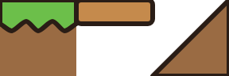

| Instrução | O que faz |
|---|---|
| `tileset size=32` | blocos de 32×32 (`size=32,16` para retangulares). Com `auto`, toda célula desenhada sem `tile` vira um bloco sem colisão (decoração). |
| `tile nome coluna,linha solid` | colide no quadrado inteiro. Coluna e linha começam em 0. |
| `tile nome coluna,linha oneway` | plataforma: colide só por cima (dá para pular por baixo dela) |
| `tile nome coluna,linha collision=forma` | colide no formato de uma forma (rampa, meio bloco) |

- O nome de cada bloco vai junto, como dado do bloco: no Godot, `tile_data.get_custom_data("nome")` diz se é `espinhos`, `moeda`…
- Exporte com `node cli/weasel.js blocos.weasel -f godot -o godot/blocos.tres` (`--normal` acrescenta o normal map). O `.png` e o `.tres` precisam ficar na mesma pasta.
- O exemplo [`blocos.weasel`](../../exemplos/blocos.weasel) tem grama, terra, pedra em hachura, plataforma, rampa, espinhos, caixa, moeda que brilha e uma nuvem que o `auto` vira blocos.
- No editor, com **Guias**, aparecem a grade, o nome de cada bloco e a colisão.
- Para jogos **isométricos**, `tileset size=64,64 iso` faz blocos em losango: veja [Tileset isométrico para o Godot](11-profundidade.md#tileset-isométrico-para-o-godot).

O `.tres` (um **TileSet** do Godot: a lista de blocos que o editor de fases do Godot usa) dos três blocos acima tem, para cada célula, a colisão e o nome:

```
0:0/0/physics_layer_0/polygon_0/points = PackedVector2Array(-16, -16, 16, -16, 16, 16, -16, 16)
0:0/0/custom_data_0 = "chao"
1:0/0/physics_layer_0/polygon_0/points = PackedVector2Array(-16, -16, 16, -16, 16, 16, -16, 16)
1:0/0/physics_layer_0/polygon_0/one_way = true
1:0/0/custom_data_0 = "plataforma"
2:0/0/physics_layer_0/polygon_0/points = PackedVector2Array(-16, 16, 16, -16, 16, 16)
2:0/0/custom_data_0 = "rampa"
```

- `0:0` é a coluna 0, linha 0. Os pontos são contados a partir do **meio** do bloco: `-16,-16` é o canto de cima à esquerda de um bloco de 32.
- O `chao` e a `plataforma` colidem no quadrado inteiro; a plataforma tem também `one_way = true` (só por cima).
- A `rampa` colide num triângulo, o formato da forma `rampa`.

### Enfeites automáticos e colisão sob medida: `auto`

Numa fase, muita coisa é só enfeite (flores, pedrinhas, nuvens) e não precisa de `tile`. Com `auto`, toda célula desenhada que não tem `tile` vira um bloco **sem colisão**. E a forma do `collision=` pode ficar numa camada `guide`: ela dá o formato da colisão sem aparecer no bloco.

<!-- gerar: img/09_auto.png -s 3 --guides -->
```weasel
canvas 96 32 bg=none
palette ink=#2a1d16 line=2 pedra=#8a8a96 flor=#ff7aa8 folha=#5ca84a

tileset size=32 auto

layer blocos
rect pedraGrande 0,0 32,32 c=pedra ink=line
rect caule 46,16 4,16 c=folha
ellipse petala 48,14 7 c=flor ink=line
ellipse pedrinha 80,26 12,6 c=pedra ink=line

# a colisão do último bloco: meio bloco, só a metade de baixo
layer colisoes guide
rect meio 64,16 32,16 c=#ff5a5a40 ink=1 inkc=#ff5a5a

tile pedra 0,0 solid
tile pedrinha 2,0 collision=meio
```

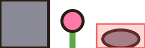

Repare:

- A flor (coluna 1) **não tem `tile`**. Com `auto`, ela vira um bloco mesmo assim, sem colisão: o jogador passa na frente dela.
- `tile pedrinha 2,0 collision=meio` usa o `rect meio` como colisão: só a metade de baixo do bloco.
- O `meio` está numa camada `guide`, então **não aparece** no bloco do jogo. A imagem foi gerada com `--guides` só para você ver onde ele fica.

No `.tres`, a flor ganha um nome automático (`bloco_1_0`, coluna 1, linha 0) e nenhuma colisão, e a pedrinha colide só embaixo (de y = 0, o meio do bloco, até 16, a borda de baixo):

```
1:0/0 = 0
1:0/0/custom_data_0 = "bloco_1_0"
2:0/0 = 0
2:0/0/physics_layer_0/polygon_0/points = PackedVector2Array(-16, 0, 16, 0, 16, 16, -16, 16)
2:0/0/custom_data_0 = "pedrinha"
```

### Blocos retangulares: `size=largura,altura`

Com dois números, `size=` faz blocos que não são quadrados. Meio bloco de altura é bom para pontes, prateleiras e degraus:

<!-- gerar: img/09_tabuas.png -s 3 -->
```weasel
canvas 64 32 bg=none
palette ink=#2a1d16 line=2 madeira=#c58a4c escura=#8a5a30

tileset size=32,16

rect tabuaA 0,3 32,10 r=2 c=madeira ink=line
rect tabuaB 32,3 32,10 r=2 c=madeira ink=line
rect vigaA 0,17 32,14 c=escura ink=line
rect vigaB 32,17 32,14 c=escura ink=line

tile ponteE 0,0 oneway
tile ponteD 1,0 oneway
tile vigaE 0,1 solid
tile vigaD 1,1 solid
```

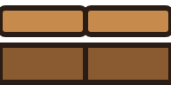

Repare:

- `size=32,16`: 32 de largura e 16 de altura. O canvas de 64×32 cabe duas colunas e **duas linhas** de blocos.
- A linha 1 (`0,1` e `1,1`) é a de baixo: as vigas.
- No `.tres`, o tamanho do bloco e a colisão seguem o retângulo: `texture_region_size = Vector2i(32, 16)` e pontos de `-16, -8` a `16, 8`.

## Para outros motores: sprite sheet e `unity`

```bash
node cli/weasel.js gosma.weasel -f sheet -a all --trim -t -o sprites/gosma.png
```

A sprite sheet sai em PNG mais um JSON no formato do TexturePacker/Phaser, que quase todo motor lê: a posição de cada quadro, a duração, as animações (`frameTags`), os eventos, as caixas ligadas e os pontos de encaixe em cada quadro. Veja o [JSON da gosma](img/09_folha.json); nele, cada caixa vem pelo centro (`x`,`y`) e pelo tamanho.

Por exemplo, o quadro do golpe da gosma (quadro 2 do `attack_right`), com `--trim`:

```json
"attack_right_02": {
  "frame": { "x": 246, "y": 178, "w": 120, "h": 86 },
  …
  "duration": 83,
  "events": ["golpe"],
  "boxes": [
    { "name": "pes", "kind": "body", "shape": "rect", "x": 56, "y": 70, "w": 60, "h": 16 },
    { "name": "dano", "kind": "hurt", "shape": "rect", "x": 56, "y": 46, "w": 76, "h": 64 },
    { "name": "golpe_right", "kind": "hit", "shape": "rect", "x": 104, "y": 46, "w": 28, "h": 44 }
  ]
}
```

- `frame` é onde o quadro está dentro do PNG. `duration` é quanto ele dura, em milissegundos (a 12 quadros por segundo, 83 ms).
- `events` traz o `event 2 golpe`, e `boxes` as três caixas ligadas nesse quadro (a `golpe_right` só aparece nos quadros 2 e 3).

Para a Unity, `unity unit=100 root=x,y collider=l,a,dx,dy` acrescenta ao JSON os pixels por unidade, o pivô (o ponto `root=`, que também vira a origem dos personagens num filme) e um colisor.

<!-- conferir -->
```weasel
canvas 48 48 bg=none
palette ink=#5a3a10 line=3

unity unit=48 root=24,48 collider=0.75,0.75,0,0.5

ellipse moeda 24,24 18 c=#ffd34d ink=line
rect brilho 20,14 6,20 r=3 c=#fff2b0
```

```bash
node cli/weasel.js moeda.weasel -f sheet -o sprites/moeda.png
```

No fim do `moeda.json`:

```json
"unity": {
  "pixelsPerUnit": 48,
  "pivotBottomLeft": { "x": 0.5, "y": 0 },
  "collider": [0.75, 0.75, 0, 0.5]
}
```

Repare:

- `unit=48`: 48 pixels valem **uma unidade** da Unity. A moeda inteira tem 1 unidade.
- `root=24,48` é o meio da base. No JSON, ele vira `pivotBottomLeft`, contado como na Unity: de 0 a 1, a partir do canto de **baixo** à esquerda (0,5 = no meio, 0 = embaixo).
- `collider=0.75,0.75,0,0.5` é medido **em unidades**, a partir do `root=`: 0,75 × 0,75 de tamanho (36 × 36 pixels), com o centro 0 para o lado e 0,5 **para cima** (24 pixels acima da base, o meio da moeda).
- Se o arquivo não tiver nenhuma caixa `body`, a cena do Godot também usa esse colisor como corpo: na mesma moeda, exportada para `.tscn`, aparece uma caixa `corpo` de 36 × 36, 24 pixels acima da origem.

| Opção da linha de comando | O que faz |
|---|---|
| `-a all` | todas as animações (ou `-a idle_right` para uma) |
| `--trim` | recorta o espaço vazio em volta (igual em todos os quadros, para eles continuarem alinhados) |
| `-t` | fundo transparente |
| `-s 0.5` | escala |
| `--layout rows` | uma linha por animação, em vez de uma grade (como a [folha das direções](#um-bichinho-com-cinco-vistas)) |
| `--variant all` | uma folha para cada variante de cor |

[← Luz, efeitos e partículas](08-luz-efeitos.md) · [Índice](README.md) · [Próximo: Filme →](10-filme.md)
