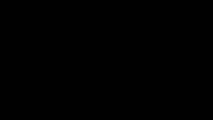

# 10. Filme

[← Jogo e Godot](09-jogo-godot.md) · [Índice](README.md) · [Próximo: Referência rápida →](11-referencia.md)

Um arquivo que começa com `film` é um **filme**. Ele não desenha personagens: ele **põe em cena** arquivos `.weasel` que já existem (os mesmos do jogo), divide o tempo em **planos** e diz o que muda e quando. Corrigiu o personagem no arquivo dele? A correção vale no jogo e no filme.

## Um filme curto

Este filme usa três arquivos de [`exemplos/`](../../exemplos/): o cenário de morros, o Cavaleiro e o fantasma.

<!-- gerar: img/10_filme.gif -s 0.25 -->
```weasel
film fps=12
canvas 1920 1080 bg=ceu
gradient ceu linear 0,0 0,1080 : #060916 #131a3a@0.62 #26284a

ambient c=#5866a0 power=0.5
light lampiao point 2000,566 c=#ffb860 power=1.6 radius=720 glow=130

actor cenario "cenario.weasel" 0,0
actor heroi "cavaleiro.weasel" 1500,900 scale=0.9 anim=stand
actor fantasma "fantasma.weasel" 3000,880 origin=240,350 scale=1.1 anim=flutua hide=ceu

layer titulo screen unlit only=chegada
text nome 720,250 "O encontro" size=110 c=#f4efe6 align=center font=serif bold

shot chegada dur=3s
camera 1750,600 zoom=1.1 fade=1
at 0s titulo.opacity=1
at 1s camera.fade=0 ease=linear
at 2s titulo.opacity=1
at 2.6s titulo.opacity=0
at 3s fantasma.pos=2350,880 ease=out

shot susto dur=3s
camera 1850,700 zoom=1.4
at 0s fantasma.pos=2350,880
at 0.3s heroi.anim=jump
at 1.5s heroi.anim=dash heroi.flip=x
at 1.8s heroi.pos=1500,900 camera.pos=1850,700
at 2.4s heroi.pos=1000,900 camera.pos=1500,700 ease=out
at 2.4s camera.fade=0
at 3s camera.fade=1 ease=linear
```


O arquivo tem três partes:

1. **O que vale para o filme todo** (antes do primeiro `shot`): o tamanho do quadro (`canvas`), o fundo, as luzes, os atores e as camadas próprias do filme (o título).
2. **Os planos** (`shot`), um depois do outro: `chegada` (3 segundos) e `susto` (3 segundos).
3. Dentro de cada plano, a **câmera** e as mudanças no tempo (`at`).

## `film` e `canvas`

```
film fps=24
canvas 1920 1080 bg=cor
```

- `fps=` é quantos quadros por segundo o vídeo tem (padrão 24).
- `canvas` é o tamanho do **quadro do vídeo** (padrão 1920×1080) e o fundo. O mundo pode ser bem maior que o quadro: a câmera escolhe o pedaço que aparece.
- Sem nenhum `shot`, o filme é um plano só, e `film dur=10s` diz a duração.

## Atores: `actor`

```
actor nome "arquivo.weasel" x,y scale= flip= anim= origin= hide= depth= …
```

- Um ator é **outro arquivo** posto em cena, com tudo o que ele tem: camadas, ossos, animações, luzes.
- `x,y` é onde ele fica no mundo. O ponto do arquivo que vai parar em `x,y` é o `root=` do `unity` dele (o ponto entre os pés, o mesmo do jogo); sem `unity`, o canto `0,0` do desenho. `origin=` escolhe outro ponto: o fantasma usa `origin=240,350`, a base da sombra dele.
- `anim=` é a animação que ele começa tocando. Cada ator toca no fps da animação dele: um ciclo de 12 fps num filme de 24 fps fica "em dois", como no desenho animado.
- `hide=ceu` esconde camadas do arquivo do ator (o céu do fantasma, que faz sentido sozinho, mas não no filme).
- `scale=`, `rot=`, `flip=x`, `opacity=`, `speed=` (velocidade da animação), `variant=` (outra variante de cores).
- Opções: `hidden` (começa invisível), `bg` (desenha o fundo do arquivo do ator), `screen` (preso na tela), `unlit` (ignora a luz do filme), `front`.
- Um ator declarado **antes** do primeiro `shot` vale para todos os planos; dentro de um `shot`, só para aquele.

## Planos: `shot`

```
shot nome dur=4s
```

Os planos tocam em sequência. O importante: **cada plano começa com tudo como foi declarado**. O que um `at` mudou num plano não passa para o seguinte. Por isso o plano `susto` começa com `at 0s fantasma.pos=2350,880`: sem isso, o fantasma voltaria para `3000,880`, onde foi declarado.

### Transições: `in=`

Sem nada, um plano corta seco para o seguinte. `in=tipo,duração` faz o plano **entrar** com uma transição:

<!-- gerar: img/10_transicoes.gif -s 0.5 -->
```weasel
film fps=12
canvas 480 270 bg=#14182a

layer manha only=manha
rect ceu1 0,0 480,270 c=#9fd3ef
ellipse sol1 380,70 36 c=#ffd34d
rect chao1 0,200 480,70 c=#7cc56a
layer tarde only=tarde
rect ceu2 0,0 480,270 c=#f2a65a
ellipse sol2 130,160 54 c=#ff7a45
rect chao2 0,200 480,70 c=#5c8f4a
layer noite only=noite
rect ceu3 0,0 480,270 c=#1b2140
ellipse lua 360,70 30 c=#f4efe6
rect chao3 0,200 480,70 c=#2f5a3a

shot manha dur=1.5s in=fade,0.8s
shot tarde dur=1.5s in=wipe,0.6s
shot noite dur=2s in=iris,1s
```



| Tipo | O que faz |
|---|---|
| `fade` | dissolve: o plano novo aparece por cima do anterior |
| `wipe` | cortina: o plano novo entra da esquerda para a direita |
| `slide` | o plano novo empurra o anterior para fora, para a esquerda |
| `zoom` | o plano anterior cresce e some, mostrando o novo |
| `iris` | um círculo fecha sobre o plano anterior e abre sobre o novo, com preto em volta (o fim dos desenhos animados antigos) |

- A duração é opcional: `in=fade` dura meio segundo.
- Durante a transição, o plano anterior fica **parado no último quadro dele**, e o plano novo já está andando. A transição acontece dentro do plano novo, então a duração do filme e o tempo dos sons e das legendas não mudam.
- No primeiro plano do filme, a transição vem do preto (o `fade` do exemplo).
- Na linha do tempo do editor, a transição aparece como uma cunha clara no começo do plano.
- O `fade` da câmera (`camera fade=1`) continua valendo para escurecer até o preto dentro de um plano.

## Câmera: `camera`

```
camera x,y zoom= rot= follow= offset= lag= shake= fade= fadec=
```

| Atributo | O que faz |
|---|---|
| `x,y` | para onde a câmera olha: esse ponto do mundo fica **no centro do quadro** |
| `zoom=` | aproxima (2 = tudo duas vezes maior) ou afasta (0.5) |
| `rot=` | inclina o quadro, em graus |
| `follow=ator` | segue um ator; `offset=dx,dy` desloca o ponto seguido; `lag=0.5` faz a câmera chegar meio segundo atrasada, macia |
| `shake=16` | treme, em pixels (um pouso, uma explosão) |
| `fade=1` | escurece tudo (0 = normal); `fadec=` muda a cor do escurecido (`#ffffff` para um clarão) |

A câmera parada no centro do canvas e com `zoom=1` mostra o desenho exatamente como foi feito.

## Mudanças no tempo: `at`

```
at tempo alvo.propriedade=valor  outro.prop=valor …  ease=…
```

O `at` é a `key` dos filmes, mas contada em **tempo** e com atores, câmera, luzes, camadas e formas como alvo.

**Tempo:** `2s`, `1.5` (segundos), `500ms`, `48f` (quadros do filme), `1m30s`. Com `+` na frente, conta a partir do `at` anterior: `at +0.5s`. O tempo conta do **começo do plano**.

**Como os valores mudam:**

- O valor declarado (no `actor` ou na `camera`) vale como um `at 0s`.
- De um `at` para o seguinte, a mudança é **gradual**. O `ease=` diz como ela **chega** naquele `at` (padrão `smooth`; `linear` para velocidade constante; `out` para chegar freando). Repare que é o contrário da `key`, em que o `ease` diz como o movimento **sai**.
- Para algo ficar parado e só depois andar, repita a posição num `at` anterior. No exemplo, o Cavaleiro fica em `1500,900` até 1,8 s e só então corre até `1000,900`, chegando em 2,4 s.
- `anim`, `flip`, `show`, `follow`, `speed` e `variant` trocam **de uma vez**. Trocar `anim` recomeça a animação do quadro 0; animações com loop repetem até a próxima troca.

**O que o `at` muda:**

| Alvo | Propriedades |
|---|---|
| ator | `pos`, `x`, `y`, `scale`, `rot`, `opacity`, `depth`, `flip`, `show`, `anim`, `speed`, `variant` |
| `camera` | `pos`, `x`, `y`, `zoom`, `rot`, `shake`, `follow`, `offset`, `lag`, `fade`, `fadec` |
| luz do filme | `power`, `radius`, `c`, `glow`, `aim`, `cone` |
| camada do filme | `opacity`, `show` e os efeitos (`blur`, `glow`, `tint`…) |
| forma do filme | `draw` (desenha aos poucos, [capítulo 7](07-animacao.md#desenhar-aos-poucos-draw)), `opacity`, `show` |

As formas do próprio arquivo do filme (um mapa, uma seta, um título) mudam com `at` como as camadas: `at 1s rota.draw=0` e `at 4s rota.draw=1` desenham a rota aos poucos. As formas dos atores mudam pelas animações deles.

## Profundidade e paralaxe

Quando a câmera anda, o que está **longe** deveria andar menos que o que está perto. Isso é a **paralaxe**, e no Weasel ela vem do `depth=`:

- `depth=1` (o padrão) é o plano da ação.
- `depth=2` está duas vezes mais longe: quando a câmera anda ou dá zoom, anda e cresce menos. A lua do cenário tem `depth=12` e quase não sai do lugar.
- `depth=0.5` está perto da câmera e passa mais rápido (moitas na frente).
- `depth=` vai num ator inteiro ou em cada camada de qualquer arquivo. O [`cenario.weasel`](../../exemplos/cenario.weasel) tem o céu, a serra, os morros e as moitas da frente em profundidades diferentes. Fora de um filme, `depth=` não muda nada.
- `layer … screen` fica **preso na tela** (títulos, legendas desenhadas, molduras): não anda com a câmera.
- `layer … front` põe a camada na frente dos atores da mesma profundidade (a moita na frente do personagem).
- No arquivo do filme, `only=` de uma camada aceita nomes de **plano**: o título do exemplo só aparece no plano `chegada`.

## Luz no filme

As `light` e o `ambient` do arquivo do filme iluminam **o cenário e todos os atores**: o lampião esquenta a cor do Cavaleiro quando ele chega perto. As luzes que cada ator tem no próprio arquivo continuam valendo para ele, e `unlit` no `actor` faz um ator ignorar a luz do filme.

## Filmes longos: `scene`

Para um filme de 20 minutos, um arquivo só fica enorme. A organização que funciona:

```
# filme.weasel — só junta as cenas
film fps=24
scene "cena01.weasel"
scene "cena02.weasel"
scene "cena03.weasel"
```

- Cada `cena01.weasel` é um filme (começa com `film`) com os próprios planos.
- `scene` acrescenta, naquele ponto, os planos do outro arquivo.
- Personagens e cenários ficam em arquivos próprios, os mesmos do jogo.

## Som, legendas e lip sync

O som no Weasel é **de referência**: serve para animar no tempo certo e para conferir. A mixagem final (música, efeitos, vozes) é feita no editor de vídeo.

```
audio grilos "som/grilos.wav" loop vol=0.35            # fora de shot: o filme inteiro

shot conversa dur=5s
actor coruja "coruja.weasel" 2059,512 origin=240,404 scale=0.5
audio fala "som/coruja_fala.wav" at=0.4s lips=coruja    # o bico segue a fala
sub 0.65s "Uh-uuh! Boa noite, Cavaleiro." dur=2s
sub +0.2s "Cuidado com o fantasma…" dur=1.6s
```

| Instrução | O que faz |
|---|---|
| `audio nome "arquivo" at= from= dur= vol= [loop]` | Um som. Dentro de um `shot`, `at=` conta do começo dele; fora, do começo do filme. `from=` pula o começo do arquivo, `dur=` corta, `vol=` é o volume (1 = normal), `loop` repete. |
| `audio … lips=ator` | A boca do ator segue a fala (lip sync). |
| `audio … cues="fala.json"` | Usa as bocas calculadas pelo programa Rhubarb Lip Sync, que acerta mais as consoantes. |
| `audio … text="…"` | Vira legenda durante o som. |
| `sub tempo "texto" dur=` | Uma legenda. `+0.2s` começa 0,2 s depois do fim da anterior. Sem `dur=`, dura o tempo de ler. `\n` quebra a linha. |
| `film lang=pt subs=burn subsize= subc=` | Língua das legendas, legendas desenhadas no vídeo, tamanho e cor. |

**A boca do personagem** é declarada no arquivo dele, com `mouth`, por morph:

```
shape bico c=bico ink=line bone=cabeca : 240,256 252,270 240,292! 228,270
shape bicoAberto c=bico ink=line bone=cabeca hidden : 240,254 255,270 240,304! 225,270
mouth bico A=bico B=bicoAberto@0.3 C=bicoAberto@0.6 D=bicoAberto E=bicoAberto@0.45 F=bicoAberto@0.2
```

- `mouth bico` diz qual forma é a boca; cada letra diz o formato daquela boca, como morph (mesmo tipo e mesmo número de pontos). `@0.3` é "30% do caminho até a forma".
- As letras seguem as bocas clássicas da animação: **A** fechada (M, B, P), **B** pouco aberta, **C** aberta, **D** bem aberta, **E** arredondada (O), **F** biquinho (U), **G** dentes no lábio (F, V), **H** língua (L), **X** descanso. Sem uma letra, vale a mais parecida.
- Sem `cues=`, o Weasel ouve o `.wav` e estima: o volume diz o quanto abre, o timbre diz qual vogal. Bom para rascunho; para voz de verdade, use o Rhubarb.
- Num jogo, `mouth` não muda nada.

## Exportando o filme

No editor, o player escolhe o filme inteiro ou um plano, e a **linha do tempo** embaixo do desenho mostra os planos, os sons (com a forma de onda) e as legendas; arrastar um bloco muda o tempo no código. A chave **Câmera** alterna entre o que a câmera filma e o mundo inteiro, com a moldura da câmera.

Na linha de comando (vídeo precisa do [ffmpeg](https://ffmpeg.org) instalado):

| Quero… | Comando |
|---|---|
| vídeo MP4 | `node cli/weasel.js filme.weasel -o filme.mp4` |
| prévia rápida em meia resolução | `node cli/weasel.js filme.weasel -o previa.mp4 -s 0.5` |
| vídeo menor, para mandar por WhatsApp ou e-mail | `node cli/weasel.js filme.weasel -o para_mandar.mp4 --small --burn-subs` |
| um quadro (capa, miniatura) | `node cli/weasel.js filme.weasel -o capa.png --time 4s` |
| só um plano, ou um trecho | `--shot susto` · `--from 10s --to 20s` |
| ProRes para o editor de vídeo, um arquivo por plano, com a linha do tempo | `node cli/weasel.js filme.weasel -o render/filme.mov --shots --fcpxml --edl` |
| GIF (filmes curtos) | `node cli/weasel.js filme.weasel -o filme.gif -s 0.25` |
| ver planos, tempos, atores, sons e legendas | `node cli/weasel.js filme.weasel --info` |

O [README](../../README.md#filmes-na-linha-de-comando) tem a lista completa, inclusive como levar o filme para o DaVinci Resolve, o Final Cut ou o Premiere.

[← Jogo e Godot](09-jogo-godot.md) · [Índice](README.md) · [Próximo: Referência rápida →](11-referencia.md)
