# 10. Filme

[← Jogo e Godot](09-jogo-godot.md) · [Índice](README.md) · [Próximo: Profundidade (2.5D) →](11-profundidade.md)

Um arquivo que começa com `film` é um **filme**. Ele não desenha personagens: ele **põe em cena** arquivos `.weasel` que já existem (os mesmos do jogo), divide o tempo em **planos** e diz o que muda e quando. Corrigiu o personagem no arquivo dele? A correção vale no jogo e no filme.

## Um filme curto

Este filme usa três arquivos de [`exemplos/`](../../exemplos/): o cenário de morros, o Cavaleiro e o fantasma.

<!-- gerar: img/10_filme.gif -s 0.25 -->
```weasel
film fps=12
canvas 1920 1080 bg=ceu
gradient ceu linear 0,0 0,1080 : #060916 #131a3a@0.62 #26284a

ambient c=#5866a0 power=0.5
light lampiao point 2000,566 c=#ffb860 power=1.6 radius=720 glow=130

actor cenario "cenario.weasel" 0,0
actor heroi "cavaleiro.weasel" 1500,900 scale=0.9 anim=stand
actor fantasma "fantasma.weasel" 3000,880 origin=240,350 scale=1.1 anim=flutua hide=ceu

layer titulo screen unlit only=chegada
text nome 720,250 "O encontro" size=110 c=#f4efe6 align=center font=serif bold

shot chegada dur=3s
camera 1750,600 zoom=1.1 fade=1
at 0s titulo.opacity=1
at 1s camera.fade=0 ease=linear
at 2s titulo.opacity=1
at 2.6s titulo.opacity=0
at 3s fantasma.pos=2350,880 ease=out

shot susto dur=3s
camera 1850,700 zoom=1.4
at 0s fantasma.pos=2350,880
at 0.3s heroi.anim=jump
at 1.5s heroi.anim=dash heroi.flip=x
at 1.8s heroi.pos=1500,900 camera.pos=1850,700
at 2.4s heroi.pos=1000,900 camera.pos=1500,700 ease=out
at 2.4s camera.fade=0
at 3s camera.fade=1 ease=linear
```

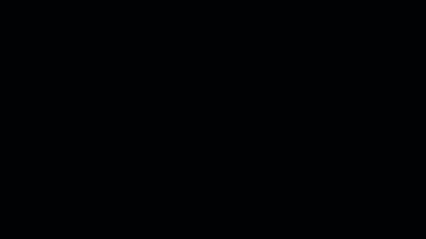

O arquivo tem três partes:

1. **O que vale para o filme todo** (antes do primeiro `shot`): o tamanho do quadro (`canvas`), o fundo, as luzes, os atores e as camadas próprias do filme (o título).
2. **Os planos** (`shot`), um depois do outro: `chegada` (3 segundos) e `susto` (3 segundos).
3. Dentro de cada plano, a **câmera** e as mudanças no tempo (`at`).

Não se assuste com o tamanho: o resto do capítulo mostra cada peça sozinha, num exemplo pequeno.

## `film` e `canvas`

```
film fps=24
canvas 1920 1080 bg=cor
```

- `fps=` é quantos quadros por segundo o vídeo tem (padrão 24).
- `canvas` é o tamanho do **quadro do vídeo** (padrão 1920×1080) e o fundo. O mundo pode ser bem maior que o quadro: a câmera escolhe o pedaço que aparece.
- Sem nenhum `shot`, o filme é um plano só, e `film dur=10s` diz a duração.
- O `film` também tem as opções das legendas (`lang=`, `subs=`, `subsize=`, `subc=`); elas estão em [Som, legendas e lip sync](#som-legendas-e-lip-sync).

### O menor filme: sem planos

Para testar um personagem em cena, não precisa de plano nenhum. `film dur=` diz quanto tempo o filme dura:

<!-- gerar: img/10_sem_shot.gif -->
```weasel
film fps=12 dur=2s
canvas 480 270 bg=#20263a

# o fantasma tocando a animação "flutua" (hide=ceu tira o céu do arquivo dele)
actor fantasma "fantasma.weasel" 96,20 scale=0.6 anim=flutua hide=ceu
```


Linha por linha:

- `film fps=12 dur=2s`: um filme de 2 segundos, com 12 quadros por segundo (24 quadros ao todo).
- `canvas 480 270`: o quadro do vídeo tem 480 pixels de largura e 270 de altura. Para testar, um quadro pequeno é mais rápido.
- `actor fantasma …`: põe o arquivo `fantasma.weasel` em cena. As opções do `actor` estão logo abaixo.

**Experimente:** troque `fps=12` por `fps=4`. O filme continua com 2 segundos, mas agora com só 8 quadros: o fantasma anda aos trancos.

## Atores: `actor`

```
actor nome "arquivo.weasel" x,y scale= flip= anim= origin= hide= depth= …
```

- Um ator é **outro arquivo** posto em cena, com tudo o que ele tem: camadas, ossos, animações, luzes.
- `x,y` é onde ele fica no mundo. O ponto do arquivo que vai parar em `x,y` é o `root=` do `unity` dele (o ponto entre os pés, o mesmo do jogo); sem `unity`, o canto `0,0` do desenho. `origin=` escolhe outro ponto: o fantasma usa `origin=240,350`, a base da sombra dele.
- `anim=` é a animação que ele começa tocando. Cada ator toca no fps da animação dele: um ciclo de 12 fps num filme de 24 fps fica "em dois", como no desenho animado.
- `hide=ceu` esconde camadas do arquivo do ator (o céu do fantasma, que faz sentido sozinho, mas não no filme).
- `scale=`, `rot=`, `flip=x`, `opacity=`, `speed=` (velocidade da animação), `variant=` (outra variante de cores).
- Opções: `hidden` (começa invisível), `bg` (desenha o fundo do arquivo do ator), `screen` (preso na tela), `unlit` (ignora a luz do filme), `front`.
- Um ator declarado **antes** do primeiro `shot` vale para todos os planos; dentro de um `shot`, só para aquele.

Os exemplos a seguir mostram cada atributo, um de cada vez.

### O mesmo ator de vários jeitos: `scale=`, `rot=`, `flip=`, `opacity=`

Estes quatro atributos mudam **como o ator aparece**, sem mexer no arquivo dele. Aqui, o mesmo Cavaleiro aparece cinco vezes:

<!-- gerar: img/10_ator_jeitos.png -s 0.5 -->
```weasel
film dur=1s
canvas 1800 620 bg=#f4efe6

layer nomes
text t1 180,600 "normal" size=40 align=center c=#1c1f2b
text t2 540,600 "scale=0.5" size=40 align=center c=#1c1f2b
text t3 900,600 "rot=-30" size=40 align=center c=#1c1f2b
text t4 1260,600 "flip=x" size=40 align=center c=#1c1f2b
text t5 1620,600 "opacity=0.35" size=40 align=center c=#1c1f2b

actor a "cavaleiro.weasel" 180,540
actor b "cavaleiro.weasel" 540,540 scale=0.5
actor c "cavaleiro.weasel" 900,540 rot=-30
actor d "cavaleiro.weasel" 1260,540 flip=x
actor e "cavaleiro.weasel" 1620,540 opacity=0.35
```

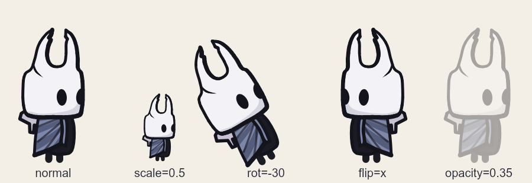

Repare:

- Os cinco estão com os pés na linha `y=540`. O Cavaleiro tem `unity root=400,560` no arquivo dele: é esse ponto (entre os pés) que vai para o `x,y` do `actor`.
- `scale=0.5` é metade do tamanho (1 = normal, 2 = o dobro). Com dois números, `scale=1,0.5` muda a largura e a altura separadas.
- `rot=-30` inclina 30 graus. Positivo gira no sentido do relógio; negativo, ao contrário. O giro é em volta do ponto dos pés.
- `flip=x` espelha da esquerda para a direita (o Cavaleiro olha para o outro lado). `flip=y` vira de cabeça para baixo, `flip=xy` faz os dois e `flip=none` desfaz.
- `opacity=0.35` é a transparência, de 0 (invisível) a 1 (normal).
- A imagem foi gerada com `-s 0.5` (metade do tamanho) para caber na página.

**Experimente:** troque `rot=-30` por `rot=90`: o Cavaleiro deita, com os pés no mesmo lugar.

### O ponto que vai para o `x,y`: `origin=`

O fantasma não tem `unity` no arquivo dele. Sem `origin=`, o canto de cima à esquerda do desenho (o `0,0` do arquivo) é que vai para o `x,y`. Com `origin=`, você escolhe outro ponto. As cruzes vermelhas marcam o `x,y` de cada um:

<!-- gerar: img/10_ator_origin.png -->
```weasel
film dur=1s
canvas 900 420 bg=#20263a

layer marcas front
line m1 c=#e94f37 w=4 : 100,90 140,90
line m2 c=#e94f37 w=4 : 120,70 120,110
line m3 c=#e94f37 w=4 : 600,330 640,330
line m4 c=#e94f37 w=4 : 620,310 620,350
text t1 240,400 "sem origin=" size=26 align=center c=#f4efe6
text t2 620,400 "origin=240,350" size=26 align=center c=#f4efe6

actor a "fantasma.weasel" 120,90 scale=0.5 hide=ceu
actor b "fantasma.weasel" 620,330 scale=0.5 hide=ceu origin=240,350
```

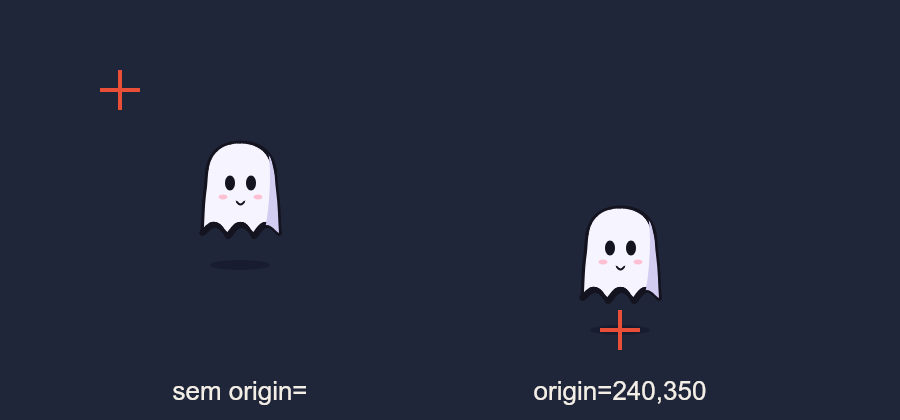

Repare:

- **Sem `origin=`**, a cruz fica longe do fantasma, no canto do desenho (onde estaria o céu, que foi escondido). Para pôr esse fantasma no chão, você teria que fazer contas.
- **Com `origin=240,350`**, a cruz fica na sombra embaixo dele. O número é um ponto **do arquivo do fantasma** (a sombra é `ellipse sombra 240,350 …` lá). Agora `x,y` é "onde ele pisa".
- `layer marcas front` deixa as cruzes **na frente** dos atores (sem `front`, as camadas do filme ficam atrás deles; veja [Profundidade e paralaxe](#profundidade-e-paralaxe)).

### Esconder camadas e mostrar o fundo: `hide=` e `bg`

O arquivo de um personagem às vezes tem coisas que só fazem sentido nele: a coruja tem um céu com lua e um galho. `hide=` esconde camadas do ator (os nomes das camadas do arquivo dele, separados por vírgula). `bg` faz o contrário: desenha também o fundo do `canvas` do arquivo dele.

<!-- gerar: img/10_ator_hide.png -->
```weasel
film dur=1s
canvas 1000 320 bg=#f4efe6

layer nomes
text t1 125,312 "normal" size=22 align=center c=#1c1f2b
text t2 375,312 "hide=ceu" size=22 align=center c=#1c1f2b
text t3 625,312 "hide=ceu,galho" size=22 align=center c=#1c1f2b
text t4 875,312 "bg" size=22 align=center c=#1c1f2b

actor a "coruja.weasel" 125,250 origin=240,404 scale=0.5
actor b "coruja.weasel" 375,250 origin=240,404 scale=0.5 hide=ceu
actor c "coruja.weasel" 625,250 origin=240,404 scale=0.5 hide=ceu,galho
actor d "coruja.weasel" 875,250 origin=240,404 scale=0.5 bg
```

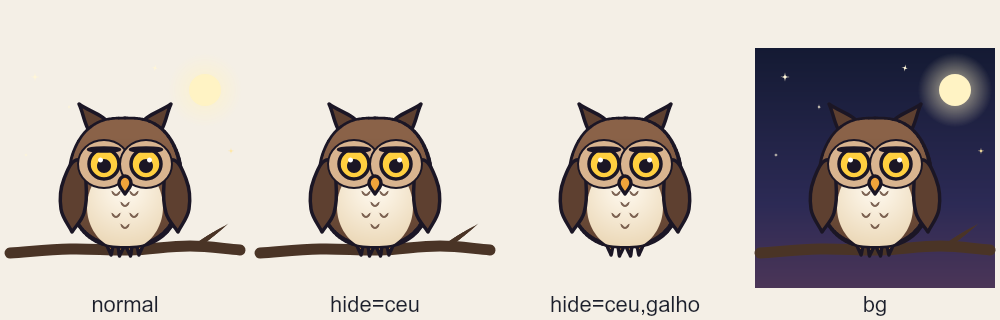

Repare:

- **normal**: sem `bg`, o fundo do arquivo da coruja não aparece, mas as **camadas** dele aparecem (a lua e as estrelas estão na camada `ceu`; o galho, na camada `galho`).
- `hide=ceu` tira a lua e as estrelas; `hide=ceu,galho` tira o galho também. Fica só a coruja, pronta para pousar em qualquer cenário.
- `bg` pinta o fundo do arquivo dela (o degradê da noite), do tamanho do `canvas` dela: um quadrado atrás da coruja.

### Outras cores: `variant=`

Se o arquivo do ator tem variantes de cor ([capítulo 3](03-cores.md)), `variant=` escolhe uma. A coruja tem duas, `neve` e `fogo`:

<!-- gerar: img/10_ator_variant.png -->
```weasel
film dur=1s
canvas 750 280 bg=#f4efe6

layer nomes
text t1 125,270 "sem variant" size=22 align=center c=#1c1f2b
text t2 375,270 "variant=neve" size=22 align=center c=#1c1f2b
text t3 625,270 "variant=fogo" size=22 align=center c=#1c1f2b

actor a "coruja.weasel" 125,235 origin=240,404 scale=0.5 hide=ceu,galho
actor b "coruja.weasel" 375,235 origin=240,404 scale=0.5 hide=ceu,galho variant=neve
actor c "coruja.weasel" 625,235 origin=240,404 scale=0.5 hide=ceu,galho variant=fogo
```

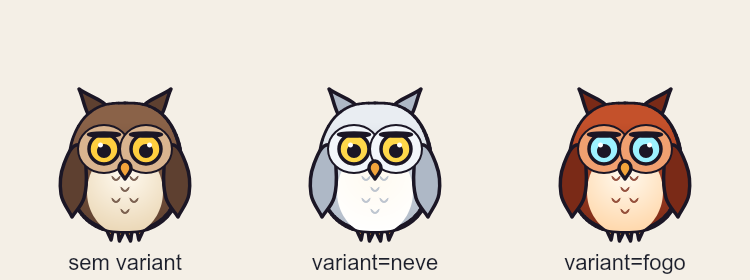

- As três vêm do mesmo arquivo; só a `palette` muda.
- No meio do filme, `at 2s coruja.variant=neve` troca de uma vez (veja [Mudanças no tempo](#mudanças-no-tempo-at)); `variant=none` volta às cores normais.

### Animação e velocidade: `anim=` e `speed=`

`anim=` diz qual animação do arquivo o ator toca. `speed=` muda a velocidade dela: 1 é normal, 0.5 é metade, 2 é o dobro e 0 congela.

<!-- gerar: img/10_ator_speed.gif -s 0.4 -->
```weasel
film fps=10 dur=3.2s
canvas 1000 560 bg=#f4efe6

layer chao
rect piso 0,500 1000,60 c=#d8cbb0
text t1 250,545 "anim=jump" size=34 align=center c=#1c1f2b
text t2 750,545 "anim=jump speed=0.5" size=34 align=center c=#1c1f2b

actor a "cavaleiro.weasel" 250,500 scale=0.7 anim=jump
actor b "cavaleiro.weasel" 750,500 scale=0.7 anim=jump speed=0.5
```

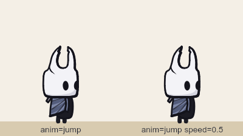

- A animação `jump` do Cavaleiro dura 1,6 segundo (24 quadros a 15 por segundo). Em 3,2 segundos, o da esquerda pula **duas vezes**; o da direita, com `speed=0.5`, pula **uma**.
- A animação repete sozinha (loop) até o fim do filme, a não ser que ela tenha `once` no arquivo.

**Experimente:** troque `speed=0.5` por `speed=0`. O Cavaleiro da direita fica parado no primeiro quadro do pulo.

### Onde estão os outros

Os outros atributos do `actor` fazem mais sentido junto com outras coisas e estão nas seções delas:

| Atributo | Onde |
|---|---|
| `hidden` (começa invisível) | [Aparecer: `show` ou `opacity`](#aparecer-show-ou-opacity) |
| `expr=` | [Expressões](#expressões-expr) |
| `path=` e `turn=` | [Andar por um caminho](#andar-por-um-caminho-path) |
| `depth=`, `screen`, `front` | [Profundidade e paralaxe](#profundidade-e-paralaxe) |
| `unlit` | [Luz no filme](#luz-no-filme) |

## Planos: `shot`

```
shot nome dur=4s
```

Os planos tocam em sequência. O importante: **cada plano começa com tudo como foi declarado**. O que um `at` mudou num plano não passa para o seguinte. Por isso o plano `susto` começa com `at 0s fantasma.pos=2350,880`: sem isso, o fantasma voltaria para `3000,880`, onde foi declarado.

Veja isso acontecer. No plano `ida`, o fantasma anda até a direita. No plano `volta`, ele **começa de novo na esquerda**, onde foi declarado:

<!-- gerar: img/10_planos.gif -->
```weasel
film fps=10
canvas 480 270 bg=#cfe8f5

layer chao
rect grama 0,220 480,50 c=#7cc56a
layer nome1 only=ida
text t1 240,40 "plano ida" size=26 align=center c=#1c1f2b
layer nome2 only=volta
text t2 240,40 "plano volta" size=26 align=center c=#1c1f2b

actor fantasma "fantasma.weasel" 80,230 origin=240,350 scale=0.4 hide=ceu

shot ida dur=1.5s
at 1.5s fantasma.pos=400,230

shot volta dur=1.5s
actor coruja "coruja.weasel" 400,225 origin=240,404 scale=0.3 hide=ceu,galho
at 1.5s fantasma.pos=240,230
```

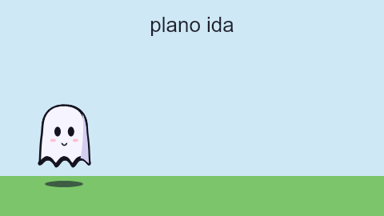

Repare:

- `shot ida dur=1.5s`: um plano chamado `ida`, de 1,5 segundo. Tudo o que vem depois dele (até o próximo `shot`) é desse plano.
- O fantasma foi declarado **antes** dos planos: ele está nos dois. Cada plano o põe de novo em `80,230`.
- A coruja foi declarada **dentro** do plano `volta`: só existe nele.
- `layer nome1 only=ida`: no arquivo do filme, `only=` de uma camada aceita **nomes de plano**. O letreiro `plano ida` só aparece no plano `ida`.

### Transições: `in=`

Sem nada, um plano corta seco para o seguinte. `in=tipo,duração` faz o plano **entrar** com uma transição:

<!-- gerar: img/10_transicoes.gif -s 0.5 -->
```weasel
film fps=12
canvas 480 270 bg=#14182a

layer manha only=manha
rect ceu1 0,0 480,270 c=#9fd3ef
ellipse sol1 380,70 36 c=#ffd34d
rect chao1 0,200 480,70 c=#7cc56a
layer tarde only=tarde
rect ceu2 0,0 480,270 c=#f2a65a
ellipse sol2 130,160 54 c=#ff7a45
rect chao2 0,200 480,70 c=#5c8f4a
layer noite only=noite
rect ceu3 0,0 480,270 c=#1b2140
ellipse lua 360,70 30 c=#f4efe6
rect chao3 0,200 480,70 c=#2f5a3a

shot manha dur=1.5s in=fade,0.8s
shot tarde dur=1.5s in=wipe,0.6s
shot noite dur=2s in=iris,1s
```

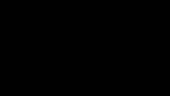

| Tipo | O que faz |
|---|---|
| `fade` | dissolve: o plano novo aparece por cima do anterior |
| `wipe` | cortina: o plano novo entra da esquerda para a direita |
| `slide` | o plano novo empurra o anterior para fora, para a esquerda |
| `zoom` | o plano anterior cresce e some, mostrando o novo |
| `iris` | um círculo fecha sobre o plano anterior e abre sobre o novo, com preto em volta (o fim dos desenhos animados antigos) |

- A duração é opcional: `in=fade` dura meio segundo.
- Durante a transição, o plano anterior fica **parado no último quadro dele**, e o plano novo já está andando. A transição acontece dentro do plano novo, então a duração do filme e o tempo dos sons e das legendas não mudam.
- No primeiro plano do filme, a transição vem do preto (o `fade` do exemplo).
- Na linha do tempo do editor, a transição aparece como uma cunha clara no começo do plano.
- O `fade` da câmera (`camera fade=1`) continua valendo para escurecer até o preto dentro de um plano.

Os dois tipos que faltaram, `slide` e `zoom`, com números grandes para você ver quem sai e quem entra:

<!-- gerar: img/10_transicoes2.gif -->
```weasel
film fps=12
canvas 480 270 bg=#14182a

layer um only=um
rect fundo1 0,0 480,270 c=#9fd3ef
text n1 240,160 "1" size=120 align=center c=#1c1f2b bold
layer dois only=dois
rect fundo2 0,0 480,270 c=#f2a65a
text n2 240,160 "2" size=120 align=center c=#1c1f2b bold
layer tres only=tres
rect fundo3 0,0 480,270 c=#b39ddb
text n3 240,160 "3" size=120 align=center c=#1c1f2b bold

shot um dur=1s
shot dois dur=1.5s in=slide,0.8s
shot tres dur=1.5s in=zoom,0.8s
```

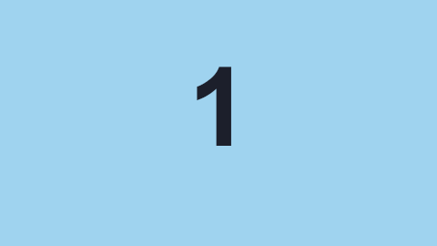

- `in=slide,0.8s`: em 0,8 segundo, o plano `dois` entra pela direita e empurra o `um` para fora.
- `in=zoom,0.8s`: o plano `dois` cresce e fica transparente, e o `tres` aparece por trás.
- O plano `um` não tem `in=`: o filme começa nele de uma vez, sem vir do preto.

**Experimente:** troque `in=slide,0.8s` por `in=slide,0.2s`. A troca fica rápida, quase um corte.

## Câmera: `camera`

```
camera x,y zoom= rot= follow= offset= lag= shake= fade= fadec=
```

| Atributo | O que faz |
|---|---|
| `x,y` | para onde a câmera olha: esse ponto do mundo fica **no centro do quadro** |
| `zoom=` | aproxima (2 = tudo duas vezes maior) ou afasta (0.5) |
| `rot=` | inclina o quadro, em graus |
| `follow=ator` | segue um ator; `offset=dx,dy` desloca o ponto seguido; `lag=0.5` faz a câmera chegar meio segundo atrasada, macia |
| `shake=16` | treme, em pixels (um pouso, uma explosão) |
| `fade=1` | escurece tudo (0 = normal); `fadec=` muda a cor do escurecido (`#ffffff` para um clarão) |
| `lens=` | a lente: aumenta perto e longe por igual (veja [Profundidade no filme](11-profundidade.md#profundidade-no-filme-lente-e-névoa)) |
| `fog=cor` `haze=` | névoa da distância: o que está longe (`depth=` maior que 1) some nessa cor; `haze=` é onde ela chega na metade (6) |

A câmera parada no centro do canvas e com `zoom=1` mostra o desenho exatamente como foi feito.

- Uma `camera` **antes** dos planos vale para todos; dentro de um `shot`, só para ele.
- Sem `x,y`, a câmera olha para o centro do `canvas` do filme.

### Um mundo para filmar

Para ver a câmera trabalhar, é bom ter um mundo **mais largo que o quadro**. Este arquivo é um desenho comum (não é filme): uma rua com quatro casas numeradas, com 1920 pixels de largura. Os exemplos da câmera põem esta rua em cena como um ator, do mesmo jeito que o filme do começo usa o `cenario.weasel`.

<!-- arquivo: vila.weasel -->
<!-- gerar: img/10_vila.png -s 0.5 -->
```weasel
canvas 1920 540 bg=#bfe3f5
palette ink=#1c1f2b line=4

def casa cor=#e94f37
  rect parede -80,-140 160,140 c=cor ink=line
  shape telhado c=#7a3b2e ink=line : -100,-140! 0,-220! 100,-140!
  rect porta -20,-70 40,70 c=#5b3a29 ink=line
end

layer chao
ellipse sol 1760,90 50 c=#ffd34d
rect grama -800,400 3520,400 c=#8bc34a

layer casas
use casa 240,400 cor=#e94f37
use casa 720,400 cor=#f2a65a
use casa 1200,400 cor=#4fc3f7
use casa 1680,400 cor=#b39ddb
text n1 240,315 "1" size=40 align=center c=ink bold
text n2 720,315 "2" size=40 align=center c=ink bold
text n3 1200,315 "3" size=40 align=center c=ink bold
text n4 1680,315 "4" size=40 align=center c=ink bold
```

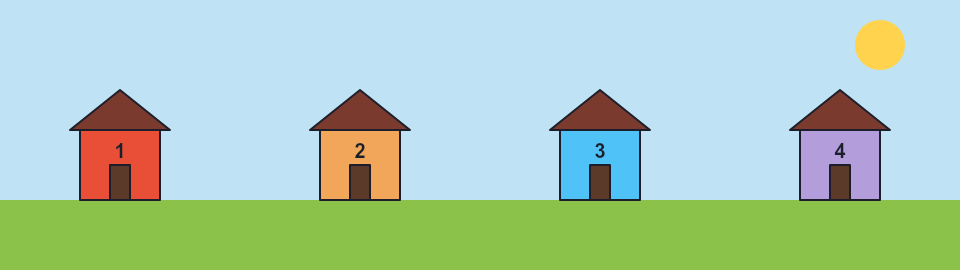

- A grama vai além das bordas (de `x=-800` até `x=2720`) para não aparecer um buraco quando a câmera inclina ou passa do fim da rua.
- O filme usa o quadro de 960×540, a metade da largura da rua. A câmera mostra só um pedaço de cada vez.

### Olhar e aproximar: `x,y` e `zoom=`

<!-- gerar: img/10_camera_zoom.gif -s 0.5 -->
```weasel
film fps=12
canvas 960 540 bg=#bfe3f5
actor vila "vila.weasel" 0,0

shot perto dur=3s
camera 480,270
at 0.5s camera.pos=480,270 camera.zoom=1
at 1.5s camera.pos=720,320 camera.zoom=2
at 2.2s camera.pos=720,320 camera.zoom=2
at 3s camera.pos=480,270 camera.zoom=1
```

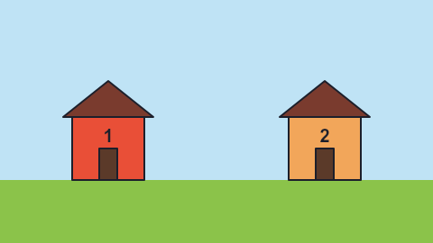

Linha por linha:

- `actor vila "vila.weasel" 0,0`: a rua inteira, com o canto `0,0` dela no `0,0` do mundo.
- `camera 480,270`: a câmera olha para o ponto `480,270` do mundo, que fica no centro do quadro. Como o quadro tem 960×540, ela mostra de `x=0` até `x=960`: as casas 1 e 2.
- `at 0.5s camera.pos=480,270 camera.zoom=1`: repete o começo em 0,5 s, para a câmera ficar parada até ali.
- `at 1.5s camera.pos=720,320 camera.zoom=2`: em 1,5 s ela está olhando para a casa 2 (`x=720`), com tudo **duas vezes maior**.
- `at 2.2s …` repete a mesma coisa: a câmera espera ali até 2,2 s. Depois volta ao começo em 3 s.

**Experimente:** troque `camera.zoom=2` por `camera.zoom=0.5`. A câmera se afasta, e a rua inteira cabe no quadro.

### Inclinar e tremer: `rot=` e `shake=`

`rot=` inclina o quadro (em graus). `shake=` faz a câmera tremer, em pixels: bom para um tombo, uma explosão, um pouso.

<!-- gerar: img/10_camera_rot.gif -s 0.5 -->
```weasel
film fps=12
canvas 960 540 bg=#bfe3f5
actor vila "vila.weasel" 0,0

shot inclina dur=3s
camera 480,270
at 0.5s camera.rot=0
at 1.2s camera.rot=15
at 1.6s camera.rot=15 camera.shake=0
at 1.7s camera.shake=20 ease=linear
at 2.4s camera.shake=20
at 2.5s camera.shake=0 camera.rot=15
at 3s camera.rot=0
```

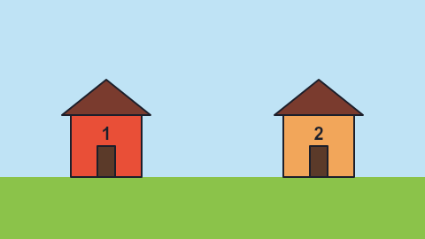

Repare:

- `camera.rot=15` inclina **a câmera** 15 graus. Por isso o desenho aparece torto para o outro lado, como numa foto tirada com a câmera torta.
- O tremor liga rápido (de 1,6 a 1,7 s, com `ease=linear`), fica em 20 pixels até 2,4 s e desliga em 0,1 s. O tremor é um ruído suave: a câmera chacoalha sem pular.

### Seguir um ator: `follow=`, `offset=` e `lag=`

Em vez de dizer a posição da câmera a cada momento, ela pode **seguir um ator**. Aqui o fantasma atravessa a rua duas vezes: no primeiro plano a câmera vai grudada nele; no segundo, um pouco atrasada.

<!-- gerar: img/10_camera_segue.gif -s 0.5 -->
```weasel
film fps=10
canvas 960 540 bg=#bfe3f5
actor vila "vila.weasel" 0,0
actor fantasma "fantasma.weasel" 150,470 origin=240,350 scale=0.5 hide=ceu

layer placa1 screen only=junto
text p1 480,50 "follow=fantasma" size=36 align=center c=#1c1f2b bold
layer placa2 screen only=atrasado
text p2 480,50 "follow=fantasma lag=0.6" size=36 align=center c=#1c1f2b bold

shot junto dur=2s
camera follow=fantasma offset=0,-200
at 0.2s fantasma.pos=150,470
at 1.8s fantasma.pos=1750,470

shot atrasado dur=2s
camera follow=fantasma offset=0,-200 lag=0.6
at 0.2s fantasma.pos=150,470
at 1.8s fantasma.pos=1750,470
```

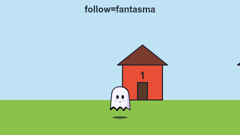

Repare:

- `follow=fantasma`: o ponto do fantasma (a base da sombra, por causa do `origin=`) fica no centro do quadro.
- `offset=0,-200`: a câmera olha 200 pixels **acima** desse ponto. Sem isso, o chão ficaria no meio do quadro e o céu ocuparia metade da imagem.
- `lag=0.6`: a câmera corre atrás do fantasma e chega atrasada, macia. O número é em segundos: quanto maior, mais atrasada.
- `layer placa1 screen only=junto`: um letreiro **preso na tela** (`screen`), que não anda com a câmera, e só no plano `junto`. Mais sobre `screen` em [Profundidade e paralaxe](#profundidade-e-paralaxe).

**Experimente:** troque `lag=0.6` por `lag=2`. A câmera fica tão atrasada que o fantasma sai do quadro antes de ela chegar.

### Escurecer e clarear: `fade=` e `fadec=`

`fade=` cobre o quadro com uma cor: 0 é a imagem normal, 1 é a cor inteira. A cor é preta, a não ser que `fadec=` diga outra.

<!-- gerar: img/10_camera_fade.gif -s 0.5 -->
```weasel
film fps=12
canvas 960 540 bg=#bfe3f5
actor vila "vila.weasel" 0,0

shot apaga dur=2s
at 0.5s camera.fade=0
at 1.5s camera.fade=1 ease=linear

shot clarao dur=2s
camera fade=1 fadec=#ffffff
at 0.2s camera.fade=1
at 1.2s camera.fade=0
```

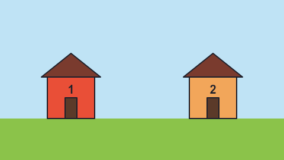

- No plano `apaga`, a imagem escurece de 0,5 s até 1,5 s: o fim de uma cena.
- No plano `clarao`, a `camera` do plano já começa com `fade=1` e `fadec=#ffffff` (tudo branco) e volta ao normal até 1,2 s: um clarão, um raio, um susto.

## Mudanças no tempo: `at`

```
at tempo alvo.propriedade=valor  outro.prop=valor …  ease=…
```

O `at` é a `key` dos filmes, mas contada em **tempo** e com atores, câmera, luzes, camadas e formas como alvo. O tempo também pode ser um [marcador](#marcadores-mark): `at trovao`.

**Tempo:** `2s`, `1.5` (segundos), `500ms`, `48f` (quadros do filme), `1m30s`. Com `+` na frente, conta a partir do `at` anterior: `at +0.5s`. O tempo conta do **começo do plano**.

**Como os valores mudam:**

- O valor declarado (no `actor` ou na `camera`) vale como um `at 0s`.
- De um `at` para o seguinte, a mudança é **gradual**. O `ease=` diz como ela **chega** naquele `at` (padrão `smooth`; `linear` para velocidade constante; `out` para chegar freando). Repare que é o contrário da `key`, em que o `ease` diz como o movimento **sai**.
- Para algo ficar parado e só depois andar, repita a posição num `at` anterior. No exemplo, o Cavaleiro fica em `1500,900` até 1,8 s e só então corre até `1000,900`, chegando em 2,4 s.
- `anim`, `flip`, `show`, `follow`, `speed` e `variant` trocam **de uma vez**. Trocar `anim` recomeça a animação do quadro 0; animações com loop repetem até a próxima troca.

**O que o `at` muda:**

| Alvo | Propriedades |
|---|---|
| ator | `pos`, `x`, `y`, `scale`, `rot`, `opacity`, `depth`, `flip`, `show`, `anim`, `speed`, `variant`, `expr` ([expressões](#expressões-expr)), `along` ([caminho](#andar-por-um-caminho-path)) |
| `camera` | `pos`, `x`, `y`, `zoom`, `rot`, `shake`, `follow`, `offset`, `lag`, `fade`, `fadec`, `lens`, `fog`, `haze` |
| luz do filme | `power`, `radius`, `c`, `glow`, `aim`, `cone` |
| camada do filme | `opacity`, `show`, `yaw`, `pitch` e os efeitos (`blur`, `glow`, `tint`…) |
| forma do filme | `draw` (desenha aos poucos, [capítulo 7](07-animacao.md#desenhar-aos-poucos-draw)), `opacity`, `show`, `yaw`, `pitch`, `z` |

As formas do próprio arquivo do filme (um mapa, uma seta, um título) mudam com `at` como as camadas: `at 1s rota.draw=0` e `at 4s rota.draw=1` desenham a rota aos poucos. As formas dos atores mudam pelas animações deles. O giro em 3D (`yaw`, `pitch`, `z`) está no [capítulo 11](11-profundidade.md#profundidade-no-filme-lente-e-névoa).

### Uma bolinha para os testes

Os próximos exemplos precisam de algo que ande. Este arquivo pequeno é só uma bolinha vermelha:

<!-- arquivo: bolinha.weasel -->
```weasel
canvas 40 40 bg=none
unity root=20,20
ellipse bola 20,20 16 c=#e94f37 ink=3
```

- `unity root=20,20` diz que o ponto que vai para o `x,y` do ator é o **meio da bolinha** (sem isso, seria o canto `0,0`).

### Como o valor chega: `ease=`

Seis bolinhas saem do mesmo lugar ao mesmo tempo e chegam na linha tracejada ao mesmo tempo, cada uma com um `ease=`:

<!-- gerar: img/10_ease.gif -->
```weasel
film fps=12 dur=2.5s
canvas 480 300 bg=#f4efe6

layer nomes
text n1 20,47 "smooth" size=20 c=#1c1f2b
text n2 20,92 "linear" size=20 c=#1c1f2b
text n3 20,137 "in" size=20 c=#1c1f2b
text n4 20,182 "out" size=20 c=#1c1f2b
text n5 20,227 "back" size=20 c=#1c1f2b
text n6 20,272 "step" size=20 c=#1c1f2b
line fim c=#b9ab95 w=2 dash=6,6 : 440,15 440,295

actor b1 "bolinha.weasel" 130,40
actor b2 "bolinha.weasel" 130,85
actor b3 "bolinha.weasel" 130,130
actor b4 "bolinha.weasel" 130,175
actor b5 "bolinha.weasel" 130,220
actor b6 "bolinha.weasel" 130,265

at 0.3s b1.x=130 b2.x=130 b3.x=130 b4.x=130 b5.x=130 b6.x=130
at 2s b1.x=440 ease=smooth
at 2s b2.x=440 ease=linear
at 2s b3.x=440 ease=in
at 2s b4.x=440 ease=out
at 2s b5.x=440 ease=back
at 2s b6.x=440 ease=step
```

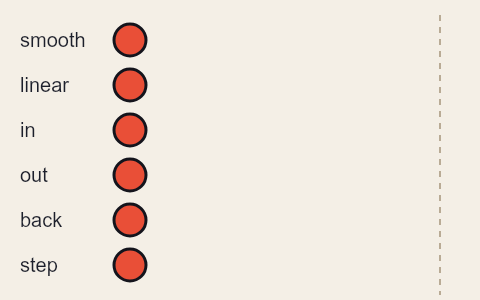

Repare:

- Todas ficam paradas até 0,3 s (o `at 0.3s` repete o lugar de partida) e chegam em `x=440` em 2 s.
- `smooth` (o padrão) sai devagar, acelera e freia. `linear` vai sempre na mesma velocidade.
- `in` sai devagar e chega rápido; `out` sai rápido e **chega freando**.
- `back` passa um pouco da linha e volta.
- `step` fica parada e pula de uma vez quando chega o tempo do `at`.
- `b1.x=440` muda só o `x`; o `y` continua o que estava. Para mudar os dois, `b1.pos=440,40`.
- O `ease=` vale para tudo o que está naquele `at`. Para eases diferentes no mesmo tempo, escreva um `at` para cada um (como aqui).

### Contando a partir do anterior: `+`

Com `+` na frente, o tempo conta **do `at` de cima**. Assim, para atrasar a sequência inteira, basta mudar o primeiro tempo.

<!-- gerar: img/10_at_mais.gif -->
```weasel
film fps=12 dur=3s
canvas 480 200 bg=#f4efe6

layer pontos
ellipse p1 60,150 5 c=#b9ab95
ellipse p2 180,60 5 c=#b9ab95
ellipse p3 300,150 5 c=#b9ab95
ellipse p4 420,60 5 c=#b9ab95

actor bola "bolinha.weasel" 60,150

at 0.5s bola.pos=60,150
at +0.5s bola.pos=180,60
at +500ms bola.pos=300,150
at +6f bola.pos=420,60
```

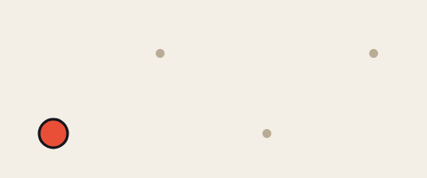

Repare:

- `at 0.5s` é o tempo de verdade: a bolinha espera até 0,5 s.
- `at +0.5s` é 0,5 s **depois do anterior**: 1 s. O seguinte é 1,5 s e o último, 2 s.
- `+0.5s`, `+500ms` e `+6f` são o mesmo intervalo aqui: 500 ms são meio segundo, e 6 quadros (`f`) num filme de 12 quadros por segundo também.

**Experimente:** troque o primeiro `at 0.5s` por `at 1.5s`. A sequência inteira começa um segundo mais tarde, sem mudar mais nada.

### Aparecer: `show` ou `opacity`

Um ator com `hidden` começa invisível. `show=1` faz ele aparecer **de uma vez**. Para aparecer **aos poucos**, use `opacity` de 0 a 1.

<!-- gerar: img/10_aparece.gif -s 0.6 -->
```weasel
film fps=12 dur=2.5s
canvas 800 360 bg=#20263a

layer nomes
text t1 200,345 "hidden + show=1" size=26 align=center c=#f4efe6
text t2 600,345 "opacity de 0 a 1" size=26 align=center c=#f4efe6

actor a "fantasma.weasel" 200,300 origin=240,350 scale=0.6 hide=ceu hidden
actor b "fantasma.weasel" 600,300 origin=240,350 scale=0.6 hide=ceu opacity=0

at 0.5s b.opacity=0
at 1s a.show=1
at 2s b.opacity=1
```

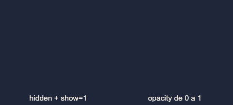

- `at 1s a.show=1`: o `show` troca de uma vez, como um interruptor (1 = aparece, 0 = some).
- `b.opacity` vai de 0 (em 0,5 s) até 1 (em 2 s): o fantasma da direita vai ficando visível.
- Para uma **forma** ou **camada** do filme que aparece depois, não use `hidden` nela: `hidden` numa forma quer dizer "nunca aparece" (ela só serve de molde). Comece com `at 0s nome.show=0` e mude para `show=1` depois, como a bandeira do exemplo abaixo.

### Camadas e formas do filme

O arquivo do filme também desenha: um mapa, uma seta, um título. Essas formas e camadas mudam com `at`, sem precisar de outro arquivo.

<!-- gerar: img/10_rota.gif -->
```weasel
film fps=10 dur=2.8s
canvas 480 270 bg=#9fd3ef

layer mapa
shape ilha c=#e8d9a8 ink=4 inkc=#8d6e4a : 40,210 90,90 220,50 360,40 440,120 420,230 250,250
ellipse lago 250,150 40,26 c=#9fd3ef

layer caminho
stroke rota w=5 c=#e94f37 : 90,200 150,130 250,200 330,110 390,80
shape bandeira c=#e94f37 : 390,80! 390,40! 420,50! 390,60!

layer titulo
text nome 240,262 "A ilha do tesouro" size=26 align=center c=#1c1f2b bold

at 0s titulo.opacity=0 titulo.blur=10 rota.draw=0 bandeira.show=0
at 1s titulo.opacity=1 titulo.blur=0
at 0.5s rota.draw=0
at 2.4s rota.draw=1 bandeira.show=1
```

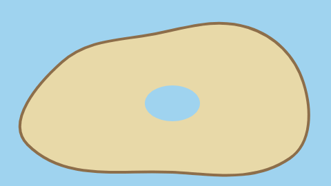

Repare:

- `titulo` é uma **camada**: `titulo.opacity` e `titulo.blur` (o desfoque, em pixels) mudam a camada inteira. O título aparece desfocado e fica nítido em 1 s.
- `rota` é uma **forma** (um `stroke`): `rota.draw` vai de 0 (nada desenhado) até 1 (inteira), entre 0,5 s e 2,4 s.
- `bandeira.show=0` em 0 s esconde a bandeira; `bandeira.show=1` em 2,4 s mostra de uma vez.
- Os `at` não precisam estar em ordem de tempo; cada propriedade junta os tempos dela. Mas os que usam `+` contam a partir da linha de cima.

## Expressões: `expr`

Num filme longo, o personagem reage o tempo todo: fica bravo, feliz, assustado. Em vez de criar uma animação para cada reação, dê nome às **expressões** no arquivo do personagem:

<!-- arquivo: rosto.weasel -->
<!-- gerar: img/10_rosto.png -->
```weasel
canvas 200 200 bg=none
palette ink=#2b2a33 line=4 pele=#ffcf8a

unity root=100,190
bone cabeca pivot=100,150
bone sobE pivot=80,82 parent=cabeca
bone sobD pivot=120,82 parent=cabeca

layer rosto
ellipse cara 100,110 60,56 c=pele ink=line bone=cabeca
ellipse olhoE 80,102 6,9 c=ink bone=cabeca
ellipse olhoD 120,102 6,9 c=ink bone=cabeca
stroke sobrancelhaE w=5 c=ink bone=sobE : 66,84 94,80
stroke sobrancelhaD w=5 c=ink bone=sobD : 106,80 134,84
shape boca c=#c44536 ink=3 bone=cabeca : 84,130 116,130 112,138 88,138
shape sorriso c=#c44536 ink=3 bone=cabeca hidden : 76,124 100,132 124,124 116,144 100,150 84,144
ellipse grito c=#c44536 ink=3 bone=cabeca hidden 100,138 12,16

expr bravo sobE=0,4,25 sobD=0,4,-25 cara.c=#ff9a7a
expr feliz sobE=0,-6,-10 sobD=0,-6,10 boca.shape=sorriso
expr susto sobE=0,-12 sobD=0,-12 boca.shape=grito cabeca=0,-6
```

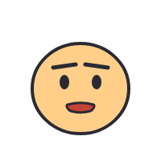

- `expr nome …` tem o mesmo jeito de uma `key`, sem o quadro: ossos (`sobE=0,4,25`) e formas (`boca.shape=sorriso`, `cara.c=#ff9a7a`).
- No filme, `at 3s heroi.expr=bravo` põe a expressão no ator, e `expr=none` tira. Também vale no `actor`: `actor heroi "rosto.weasel" … expr=feliz`.
- A troca é **aos poucos**, como a posição: do `at` anterior até este. Para trocar rápido, repita a expressão de antes um pouco antes (`at 2s heroi.expr=feliz` e `at 2.2s heroi.expr=bravo`).
- Os ossos da expressão substituem os da animação que o ator está tocando; os outros ossos continuam na animação. A boca do lip sync vale por cima da expressão.

Fora do filme, a carinha fica sempre neutra: a expressão só aparece quando um filme pede. Aqui estão as três, cada uma num ator com `expr=`:

<!-- gerar: img/10_expressoes.png -->
```weasel
film dur=1s
canvas 800 230 bg=#f4efe6

layer nomes
text n1 100,220 "sem expr" size=22 align=center c=#1c1f2b
text n2 300,220 "expr=feliz" size=22 align=center c=#1c1f2b
text n3 500,220 "expr=bravo" size=22 align=center c=#1c1f2b
text n4 700,220 "expr=susto" size=22 align=center c=#1c1f2b

actor a "rosto.weasel" 100,190
actor b "rosto.weasel" 300,190 expr=feliz
actor c "rosto.weasel" 500,190 expr=bravo
actor d "rosto.weasel" 700,190 expr=susto
```

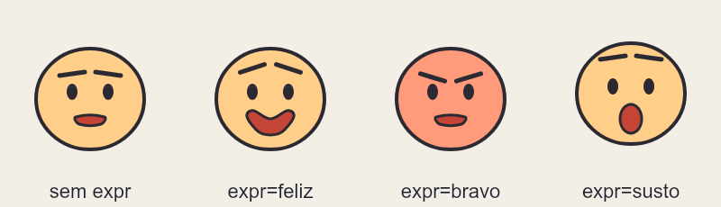

Repare como cada expressão usa uma coisa diferente:

- `feliz` levanta as sobrancelhas (os ossos `sobE` e `sobD` sobem 6 pixels e giram 10 graus) e troca a boca pelo molde `sorriso`.
- `bravo` abaixa e inclina as sobrancelhas e muda a **cor** da cara.
- `susto` sobe as sobrancelhas, abre a boca (o molde `grito`) e levanta a cabeça inteira 6 pixels.

## Marcadores: `mark`

`mark nome tempo` dá nome a um momento do filme, e os `at` podem usar o nome no lugar do tempo:

```
mark trovao 1m12.5s
…
at trovao raio.power=8
at trovao+0.3s heroi.expr=susto
at trovao-1s heroi.expr=none
```

- Antes dos `shot`, o tempo do `mark` conta do começo do **filme**. Dentro de um `shot`, do começo dele.
- `at trovao+0.3s` e `at trovao-1s` contam a partir do marcador. O `at` precisa ficar dentro do `shot` em que o marcador cai.
- Na **linha do tempo** do editor, os marcadores aparecem na régua, em roxo, com uma linha tracejada descendo pelos sons. **Arraste** um marcador para cima da forma de onda da narração: o `mark` é reescrito, e tudo o que usa o nome vai junto.
- Os marcadores também vão para o editor de vídeo (`.fcpxml` e `.edl`), junto com os começos dos planos.

Um trovão de verdade: o clarão vem no marcador, e o susto 0,3 segundo depois.

<!-- gerar: img/10_trovao.gif -->
```weasel
film fps=12 dur=3s
canvas 480 270 bg=#1b2140

layer chuva
line l1 c=#5866a0 w=2 : 60,20 40,80
line l2 c=#5866a0 w=2 : 200,40 180,100
line l3 c=#5866a0 w=2 : 340,10 320,70
line l4 c=#5866a0 w=2 : 430,60 410,120

actor heroi "rosto.weasel" 240,260 expr=feliz
camera fadec=#ffffff

mark trovao 1.5s

at trovao-0.1s camera.fade=0
at trovao camera.fade=0.9 ease=linear
at trovao+0.3s camera.fade=0
at trovao heroi.expr=feliz
at trovao+0.3s heroi.expr=susto
```


Repare:

- `mark trovao 1.5s`: o momento do trovão. Todos os `at` contam a partir dele.
- O clarão: `fade=0` um pouquinho antes (`trovao-0.1s`), `fade=0.9` em branco no trovão (`fadec=#ffffff` está na `camera`) e de volta a 0 em `trovao+0.3s`.
- O susto: a expressão continua `feliz` até o trovão e vira `susto` em 0,3 s. Sem o `at trovao heroi.expr=feliz`, a carinha ficaria assustada aos poucos desde o começo do filme.

**Experimente:** troque `mark trovao 1.5s` por `mark trovao 0.8s`. O clarão e o susto mudam de lugar juntos, sem mexer nos `at`.

## Andar por um caminho: `path=`

Um ator com `path=nome` anda por uma linha, um traço ou uma forma do arquivo do filme, e `at … ator.along=0 … 1` diz quanto do caminho ele já andou:

```
layer guia guide
stroke trilha w=2 c=#4a90d9 : 60,250 180,200 300,240 420,190
actor heroi "rosto.weasel" 60,250 scale=0.6 path=trilha turn=0
```

- Com `along`, a posição do ator vem do caminho (o `pos` deixa de valer).
- O ator vira junto com a curva, a não ser com `turn=0` (como no exemplo, em que o rosto continua de pé).
- Ossos de um personagem também andam por caminhos, dentro de uma animação ([capítulo 6](06-ossos.md#andar-por-um-caminho-path)).

### Virar com a curva ou ficar de pé: `turn=`

Dois morros iguais, duas carinhas. A da esquerda inclina junto com o morro; a da direita, com `turn=0`, fica sempre de pé:

<!-- gerar: img/10_turn.gif -->
```weasel
film fps=10 dur=2.5s
canvas 480 240 bg=#f4efe6

layer morros
stroke morro1 w=3 c=#9fc5e8 : 50,200 130,70 210,200
stroke morro2 w=3 c=#9fc5e8 : 290,200 370,70 450,200
text n1 130,232 "path=morro1" size=18 align=center c=#1c1f2b
text n2 370,232 "path=morro2 turn=0" size=18 align=center c=#1c1f2b

actor a "rosto.weasel" 50,200 scale=0.4 path=morro1
actor b "rosto.weasel" 290,200 scale=0.4 path=morro2 turn=0

at 0.2s a.along=0 b.along=0
at 2.3s a.along=1 b.along=1 ease=linear
```

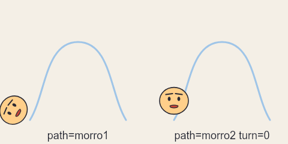

- `along=0` é o começo do caminho e `along=1` é o fim. `along=0.5` seria a metade.
- O caminho aqui está numa camada comum, para você ver os morros. No filme de verdade, ponha o caminho numa camada `guide`: ele continua valendo, mas não aparece no vídeo.

### Juntando tudo

<!-- gerar: img/10_marcas.gif -s 0.5 -->
```weasel
film fps=12
canvas 480 270 bg=#cfe8f5

layer chao
rect grama 0,220 480,50 c=#7cc56a
layer guia guide
stroke trilha w=2 c=#4a90d9 : 60,250 180,200 300,240 420,190

actor heroi "rosto.weasel" 60,250 scale=0.6 path=trilha turn=0

mark entra 0.5s
mark bravo 2.2s

shot a dur=1.5s
at 0s heroi.along=0 heroi.expr=feliz
at entra heroi.along=0
at 1.5s heroi.along=0.4

shot b dur=2s
mark susto 1.5s
at 0s heroi.along=0.4 heroi.expr=feliz
at bravo-0.2s heroi.expr=feliz
at bravo heroi.expr=bravo
at susto heroi.expr=susto heroi.along=1
```


- O personagem é o `rosto.weasel` de cima. Ele fica parado até o marcador `entra` e então anda pela trilha.
- O marcador `bravo` (2,2 s do filme) cai no segundo plano: a carinha fica brava ali, e `bravo-0.2s` faz a troca durar só 0,2 s.
- `susto` foi marcado dentro do plano `b`, a 1,5 s do começo dele.

## Profundidade e paralaxe

Quando a câmera anda, o que está **longe** deveria andar menos que o que está perto. Olhe pela janela de um carro: o poste passa voando, o morro anda devagar e a lua parece ir junto com você. Isso é a **paralaxe**, e no Weasel ela vem do `depth=`:

- `depth=1` (o padrão) é o plano da ação.
- `depth=2` está duas vezes mais longe: quando a câmera anda ou dá zoom, anda e cresce menos. A lua do cenário tem `depth=12` e quase não sai do lugar.
- `depth=0.5` está perto da câmera e passa mais rápido (moitas na frente).
- `depth=` vai num ator inteiro ou em cada camada de qualquer arquivo. O [`cenario.weasel`](../../exemplos/cenario.weasel) tem o céu, a serra, os morros e as moitas da frente em profundidades diferentes. Fora de um filme, `depth=` não muda nada.
- `layer … screen` fica **preso na tela** (títulos, legendas desenhadas, molduras): não anda com a câmera.
- `layer … front` põe a camada na frente dos atores da mesma profundidade (a moita na frente do personagem).
- No arquivo do filme, `only=` de uma camada aceita nomes de **plano**: o título do exemplo só aparece no plano `chegada`.
- A câmera também tem **lente** (`lens=`) e **névoa da distância** (`fog=`, `haze=`); juntas, dão o efeito do *Vertigo*. Estão em [Profundidade no filme](11-profundidade.md#profundidade-no-filme-lente-e-névoa).

### A câmera anda para o lado

Cada camada tem o número do `depth=` dela escrito em cima. A câmera anda 960 pixels para a direita:

<!-- gerar: img/10_paralaxe.gif -s 0.5 -->
```weasel
film fps=10 dur=3s
canvas 960 540 bg=#bfe3f5

layer longe depth=8
ellipse sol 300,80 45 c=#ffd34d
text t8 300,160 "8" size=34 align=center c=#1c1f2b bold

layer montes depth=4
shape serra c=#8fa9c7 : -300,540! -300,300 100,200 450,290 800,190 1150,280 1500,200 1800,300 1800,540!
repeat i 0..2
  text t4_{i} {i*700+100},300 "4" size=34 align=center c=#1c1f2b bold
end

layer morros depth=2
shape morro c=#6fae6a : -300,540! -300,360 300,320 900,370 1500,310 2100,370 2700,330 2700,540!
repeat i 0..4
  text t2_{i} {i*500+220},400 "2" size=34 align=center c=#1c1f2b bold
end

layer chao
rect terra -300,430 3000,110 c=#c9a66b
repeat i 0..9
  rect poste{i} {i*240+100},360 14,80 c=#6b4a30
  text t1_{i} {i*240+107},480 "1" size=34 align=center c=#1c1f2b bold
end

layer frente depth=0.5
repeat i 0..7
  ellipse moita{i} {i*420+150},575 130,70 c=#2f6e3a
  text t05_{i} {i*420+150},532 "0.5" size=34 align=center c=#f4efe6 bold
end

layer letreiro screen
text tela 940,40 "screen" size=34 align=right c=#c0392b bold

at 0.3s camera.x=480
at 2.7s camera.x=1440
```

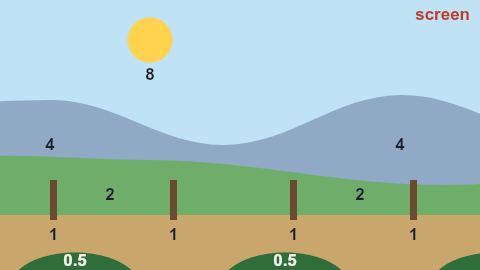

Repare, com a câmera andando 960 pixels:

- As **moitas** (`depth=0.5`) andam o **dobro**: 1920 pixels. Passam voando.
- Os **postes** (`depth=1`) andam os 960 pixels da câmera.
- Os **morros** (`depth=2`) andam a metade (480), a **serra** (`depth=4`) um quarto (240) e o **sol** (`depth=8`) um oitavo (120).
- O letreiro `screen` fica sempre no canto: ele não está no mundo, está no vidro da câmera.
- Quanto mais perto (número menor), mais largo o desenho precisa ser: a câmera passa por mais coisa dele. Por isso as moitas se repetem até `x=3090`, e o sol é um só.

**Experimente:** ponha `depth=1` nas montanhas (`layer montes`). Elas passam a andar junto com os postes, e o fundo perde a sensação de distância.

### Na frente do ator: `front`

As camadas do arquivo do filme ficam **atrás** dos atores da mesma profundidade. `front` numa camada põe ela na frente. E `front` num ator põe o ator na frente até das camadas `front`.

<!-- gerar: img/10_front.png -s 0.5 -->
```weasel
film dur=1s
canvas 1500 600 bg=#cfe8f5

layer chao
rect terra 0,520 1500,80 c=#c9a66b
text n1 250,60 "moita" size=36 align=center c=#1c1f2b
text n2 750,60 "moita front" size=36 align=center c=#1c1f2b
text n3 1250,60 "moita front + ator front" size=36 align=center c=#1c1f2b

layer moita1
ellipse m1 250,540 170,150 c=#2f6e3a
layer moita2 front
ellipse m2 750,540 170,150 c=#2f6e3a
layer moita3 front
ellipse m3 1250,540 170,150 c=#2f6e3a

actor a "cavaleiro.weasel" 250,520 scale=0.8
actor b "cavaleiro.weasel" 750,520 scale=0.8
actor c "cavaleiro.weasel" 1250,520 scale=0.8 front
```

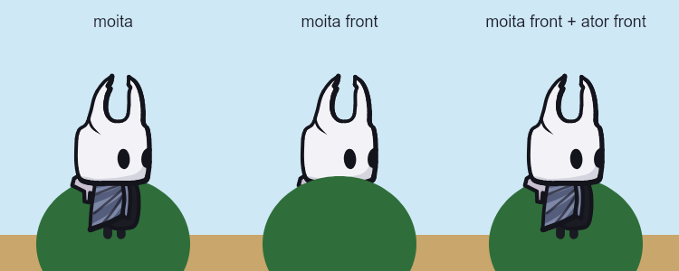

- **moita**: sem `front`, a moita é pintada antes do ator. O Cavaleiro aparece por cima dela.
- **moita front**: a moita é pintada depois do ator e esconde as pernas dele. É o jeito de pôr um personagem "atrás do arbusto".
- **ator front**: o Cavaleiro com `front` volta para a frente, mesmo da moita `front`.
- `front` só decide a ordem entre coisas da **mesma profundidade**. Uma camada com `depth=0.5` fica na frente de tudo o que tem `depth=1`, com ou sem `front`.

## Luz no filme

As `light` e o `ambient` do arquivo do filme iluminam **o cenário e todos os atores**: o lampião esquenta a cor do Cavaleiro quando ele chega perto. As luzes que cada ator tem no próprio arquivo continuam valendo para ele, e `unlit` no `actor` faz um ator ignorar a luz do filme.

Aqui uma lâmpada acende aos poucos entre duas corujas. A da direita tem `unlit`:

<!-- gerar: img/10_luz.gif -s 0.5 -->
```weasel
film fps=10 dur=2.5s
canvas 960 400 bg=#141a33

ambient c=#5866a0 power=0.4
light lampada point 480,120 c=#ffb860 power=0 radius=420 glow=60

layer poste
rect haste 474,120 12,250 c=#24242e
rect chao 0,370 960,30 c=#2b2c42
text n1 240,395 "coruja" size=24 align=center c=#c9c3d8
text n2 720,395 "coruja unlit" size=24 align=center c=#c9c3d8

actor a "coruja.weasel" 240,370 origin=240,404 scale=0.55 hide=ceu,galho
actor b "coruja.weasel" 720,370 origin=240,404 scale=0.55 hide=ceu,galho unlit

at 0.3s lampada.power=0
at 1.8s lampada.power=2
```

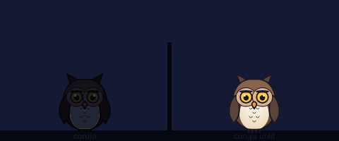

Repare:

- `ambient c=#5866a0 power=0.4` é a luz de fundo, fraca e azulada: a noite. Ela deixa a coruja da esquerda escura.
- `light lampada point 480,120 … power=0`: uma lâmpada no alto do poste, começando **apagada**. `radius=420` é até onde ela chega, em pixels; `glow=60` é o halo em volta dela.
- `at 1.8s lampada.power=2`: a lâmpada acende até a força 2. A coruja da esquerda ganha o laranja da luz.
- A coruja com `unlit` não recebe a luz do filme: fica com as cores do arquivo dela, nem escura nem alaranjada. Use `unlit` em letreiros, fantasmas que brilham sozinhos, coisas "fora" da cena.

**Experimente:** acrescente `lampada.c=#7fd3ff` no `at 1.8s`. A luz muda de cor enquanto acende, e a coruja fica azulada.

## Filmes longos: `scene`

Para um filme de 20 minutos, um arquivo só fica enorme. A organização que funciona:

```
# filme.weasel — só junta as cenas
film fps=24
scene "cena01.weasel"
scene "cena02.weasel"
scene "cena03.weasel"
```

- Cada `cena01.weasel` é um filme (começa com `film`) com os próprios planos.
- `scene` acrescenta, naquele ponto, os planos do outro arquivo.
- Personagens e cenários ficam em arquivos próprios, os mesmos do jogo.

Um exemplo pequeno, com duas cenas. A primeira é de dia:

<!-- arquivo: cena01.weasel -->
```weasel
film fps=12
canvas 480 270 bg=#9fd3ef

layer dia
ellipse sol 400,60 34 c=#ffd34d
rect grama 0,210 480,60 c=#7cc56a
text nome 20,40 "cena01" size=24 c=#1c1f2b bold

actor bola "bolinha.weasel" 60,190

shot rola dur=1.5s
at 1.5s bola.pos=420,190
```

A segunda, de noite, com dois planos:

<!-- arquivo: cena02.weasel -->
```weasel
film fps=12
canvas 480 270 bg=#1b2140

layer noite
ellipse lua 400,60 26 c=#f4efe6
rect grama 0,210 480,60 c=#2f5a3a
text nome 20,40 "cena02" size=24 c=#f4efe6 bold

actor bola "bolinha.weasel" 420,190

shot volta dur=1s in=fade
at 1s bola.pos=240,190

shot pula dur=1s
at 0s bola.pos=240,190
at 0.5s bola.pos=240,90 ease=out
at 1s bola.pos=240,190 ease=in
```

E o filme que junta as duas:

<!-- gerar: img/10_cenas.gif -->
```weasel
film fps=12
canvas 480 270

scene "cena01.weasel"
scene "cena02.weasel"
```

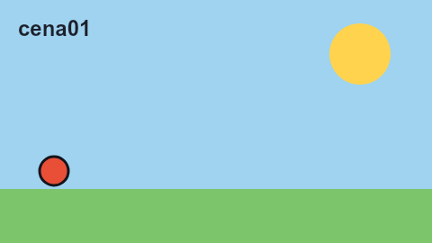

- Cada cena é um filme completo: você pode abrir e exportar `cena02.weasel` sozinha para conferir.
- O filme principal tem só o `canvas` (o tamanho do vídeo) e os `scene`. Uma cena de outro tamanho é ajustada (encolhida ou aumentada) para caber no quadro, centralizada.
- O `in=fade` do plano `volta` faz a passagem de uma cena para a outra.
- Os planos ganham o nome da cena na frente. O `--info` mostra assim:

```
filme    480 × 270, 12 fps, 3.5s (42 quadros, 00:03:06), fundo #ffffff
planos   3
  cena01/rola      00:00:00    1.5s     18 quadros  câmera 240,135 · 2 mudança(s) com at
  cena02/volta     00:01:06      1s     12 quadros  câmera 240,135 · 2 mudança(s) com at · entra com fade (0.5s)
  cena02/pula      00:02:06      1s     12 quadros  câmera 240,135 · 6 mudança(s) com at
```

Os tempos como `00:01:06` são **minutos:segundos:quadro**: o plano `volta` começa em 1 segundo e 6 quadros (1,5 s, a 12 quadros por segundo).

## Som, legendas e lip sync

O som no Weasel é **de referência**: serve para animar no tempo certo e para conferir. A mixagem final (música, efeitos, vozes) é feita no editor de vídeo.

```
audio grilos "som/grilos.wav" loop vol=0.35            # fora de shot: o filme inteiro

shot conversa dur=5s
actor coruja "coruja.weasel" 2059,512 origin=240,404 scale=0.5
audio fala "som/coruja_fala.wav" at=0.4s lips=coruja    # o bico segue a fala
sub 0.65s "Uh-uuh! Boa noite, Cavaleiro." dur=2s
sub +0.2s "Cuidado com o fantasma…" dur=1.6s
```

| Instrução | O que faz |
|---|---|
| `audio nome "arquivo" at= from= dur= vol= [loop]` | Um som. Dentro de um `shot`, `at=` conta do começo dele; fora, do começo do filme. `from=` pula o começo do arquivo, `dur=` corta, `vol=` é o volume (1 = normal), `loop` repete. |
| `audio … lips=ator` | A boca do ator segue a fala (lip sync). |
| `audio … cues="fala.json"` | Usa as bocas calculadas pelo programa Rhubarb Lip Sync, que acerta mais as consoantes. |
| `audio … text="…"` | Vira legenda durante o som. |
| `sub tempo "texto" dur=` | Uma legenda. `+0.2s` começa 0,2 s depois do fim da anterior. Sem `dur=`, dura o tempo de ler. `\n` quebra a linha. |
| `film lang=pt subs=burn subsize= subc=` | Língua das legendas, legendas desenhadas no vídeo, tamanho e cor. |

**A boca do personagem** é declarada no arquivo dele, com `mouth`, por morph:

```
shape bico c=bico ink=line bone=cabeca : 240,256 252,270 240,292! 228,270
shape bicoAberto c=bico ink=line bone=cabeca hidden : 240,254 255,270 240,304! 225,270
mouth bico A=bico B=bicoAberto@0.3 C=bicoAberto@0.6 D=bicoAberto E=bicoAberto@0.45 F=bicoAberto@0.2
```

- `mouth bico` diz qual forma é a boca; cada letra diz o formato daquela boca, como morph (mesmo tipo e mesmo número de pontos). `@0.3` é "30% do caminho até a forma".
- As letras seguem as bocas clássicas da animação: **A** fechada (M, B, P), **B** pouco aberta, **C** aberta, **D** bem aberta, **E** arredondada (O), **F** biquinho (U), **G** dentes no lábio (F, V), **H** língua (L), **X** descanso. Sem uma letra, vale a mais parecida.
- Sem `cues=`, o Weasel ouve o `.wav` e estima: o volume diz o quanto abre, o timbre diz qual vogal. Bom para rascunho; para voz de verdade, use o Rhubarb.
- Num jogo, `mouth` não muda nada.

### A coruja fala: `lips=` e legendas desenhadas

Um GIF não tem som, mas mostra o **bico** seguindo a voz e as **legendas** desenhadas na imagem:

<!-- gerar: img/10_fala.gif -s 0.75 -->
```weasel
film fps=8 subs=burn subsize=24 subc=#ffe08a
canvas 480 270 bg=#141a33

actor coruja "coruja.weasel" 240,120 origin=240,260 scale=0.8 hide=ceu,galho,fala

shot conversa dur=3.4s
audio fala "som/coruja_fala.wav" at=0.4s lips=coruja
sub 0.65s "Uh-uuh! Boa noite, Cavaleiro." dur=1.6s
sub +0.2s "Cuidado com\no fantasma…" dur=0.95s
```


Linha por linha:

- `film … subs=burn`: as legendas são **desenhadas** no vídeo (sem isso, elas vão num arquivo `.srt` ao lado do vídeo). `subsize=24` é o tamanho da letra, em pixels; `subc=#ffe08a` é a cor.
- `actor coruja … origin=240,260 scale=0.8`: o ponto `240,260` do arquivo da coruja (o bico) fica em `240,120` do quadro, e a coruja fica grande: um close.
- `audio fala "som/coruja_fala.wav" at=0.4s lips=coruja`: a voz começa 0,4 s depois do começo do plano, e o bico da coruja (o `mouth` do arquivo dela) segue a voz.
- `sub 0.65s "…" dur=1.6s`: a primeira legenda aparece em 0,65 s e fica 1,6 s.
- `sub +0.2s "Cuidado com\no fantasma…"`: a segunda começa 0,2 s depois do fim da primeira. O `\n` quebra a linha.

### Tudo o que o som aceita

Este filme não vira imagem (o importante nele é o som). Rode com `--info` para ver os tempos, ou exporte em vídeo para ouvir:

<!-- conferir -->
```weasel
film fps=24 lang=pt
canvas 1920 1080 bg=#141a33

audio grilos "som/grilos.wav" loop vol=0.35

actor coruja "coruja.weasel" 960,900 origin=240,404 hide=ceu,galho,fala

shot conversa dur=6s
audio fala "som/coruja_fala.wav" at=0.4s lips=coruja
sub 0.65s "Uh-uuh! Boa noite, Cavaleiro." dur=2s
sub +0.2s "Cuidado com o fantasma…" dur=1.6s
sub 0.65s "Hoo-hoo! Good evening, Knight." dur=2s lang=en
sub +0.2s "Watch out for the ghost…" dur=1.6s lang=en
audio eco "som/coruja_fala.wav" at=4.6s from=0.4s dur=1s vol=0.5 text="(eco)"
```

Linha por linha:

- `film … lang=pt`: as legendas sem `lang=` são em português.
- `audio grilos … loop vol=0.35`: fora dos planos, então toca desde o começo do filme. O arquivo tem 3 segundos; `loop` repete até o fim. `vol=0.35` é um pouco mais de um terço do volume.
- `audio fala … at=0.4s lips=coruja`: a fala da coruja, 0,4 s depois do começo do plano.
- As duas legendas com `lang=en` são a versão em inglês das mesmas falas.
- `audio eco … at=4.6s from=0.4s dur=1s vol=0.5 text="(eco)"`: o mesmo arquivo de novo, em 4,6 s, **pulando** os primeiros 0,4 s dele (`from=`), tocando só 1 segundo (`dur=`), na metade do volume, com a legenda `(eco)` enquanto toca.

Salve como `conversa.weasel` dentro de `exemplos/` e rode `node cli/weasel.js conversa.weasel --info`:

```
filme    1920 × 1080, 24 fps, 6s (144 quadros, 00:06:00), fundo #141a33
atores   coruja (coruja.weasel)
sons     3
  fala             00:00:10    4.2s  som/coruja_fala.wav · boca de coruja
  eco              00:04:14      1s  som/coruja_fala.wav · vol 0.5
  grilos           00:00:00      6s  som/grilos.wav · loop · vol 0.35
legendas 5 (pt, en)
planos   1
  conversa         00:00:00      6s    144 quadros  câmera 960,540
```

Ao exportar em vídeo (`-o conversa.mp4`), as legendas saem em arquivos ao lado, uma língua em cada: `conversa.srt` (português) e `conversa.en.srt` (inglês). O `conversa.srt` fica assim:

```
1
00:00:00,650 --> 00:00:02,650
Uh-uuh! Boa noite, Cavaleiro.

2
00:00:02,850 --> 00:00:04,450
Cuidado com o fantasma…

3
00:00:04,600 --> 00:00:05,600
(eco)
```

O `.srt` é o formato de legenda que os players de vídeo e o YouTube aceitam.

## Exportando o filme

No editor, o player escolhe o filme inteiro ou um plano, e a **linha do tempo** embaixo do desenho mostra os planos, os sons (com a forma de onda) e as legendas; arrastar um bloco muda o tempo no código. A chave **Câmera** alterna entre o que a câmera filma e o mundo inteiro, com a moldura da câmera.

Na linha de comando (vídeo precisa do [ffmpeg](https://ffmpeg.org) instalado):

| Quero… | Comando |
|---|---|
| vídeo MP4 | `node cli/weasel.js filme.weasel -o filme.mp4` |
| prévia rápida em meia resolução | `node cli/weasel.js filme.weasel -o previa.mp4 -s 0.5` |
| vídeo menor, para mandar por WhatsApp ou e-mail | `node cli/weasel.js filme.weasel -o para_mandar.mp4 --small --burn-subs` |
| um quadro (capa, miniatura) | `node cli/weasel.js filme.weasel -o capa.png --time 4s` |
| só um plano, ou um trecho | `--shot susto` · `--from 10s --to 20s` |
| ProRes para o editor de vídeo, um arquivo por plano, com a linha do tempo | `node cli/weasel.js filme.weasel -o render/filme.mov --shots --fcpxml --edl` |
| GIF (filmes curtos) | `node cli/weasel.js filme.weasel -o filme.gif -s 0.25` |
| só o som misturado | `node cli/weasel.js filme.weasel -o som.wav` |
| ver planos, tempos, atores, sons e legendas | `node cli/weasel.js filme.weasel --info` |

O que a linha de comando responde, com o `conversa.weasel` de cima. Um vídeo em um quarto do tamanho (`-s 0.25`):

```
> node cli/weasel.js conversa.weasel -o conversa.mp4 -s 0.25
salvo conversa.mp4  480×270, 24 fps, 00:06:00, com 3 sons · 168 KB · 144 quadros em 0.3s (427.3 q/s, 8 threads)
salvo conversa.srt  3 legendas · 1 KB
salvo conversa.en.srt  2 legendas (en) · 1 KB
```

Só um quadro, como imagem:

```
> node cli/weasel.js conversa.weasel -o capa.png --time 1.5s -s 0.25
salvo capa.png  480×270, quadro 36 (00:01:12, shot conversa) · 8 KB
```

Para o editor de vídeo (DaVinci Resolve, Final Cut, Premiere): um `.mov` por plano e a **linha do tempo** pronta em dois formatos, `.edl` e `.fcpxml` (arquivos que esses programas abrem com os vídeos e os sons já no lugar, cada som na sua trilha):

```
> node cli/weasel.js conversa.weasel -o render/conversa.mov --shots --fcpxml --edl -s 0.25
com --edl/--fcpxml o vídeo sai sem o som misturado: cada som vai numa trilha da linha do tempo
salvo render/conversa_conversa.mov  480×270, 24 fps, 00:06:00 · 1.9 MB · 144 quadros em 0.3s (500.0 q/s, 8 threads)
salvo render/conversa_conversa.srt  3 legendas · 1 KB
salvo render/conversa_conversa.en.srt  2 legendas (en) · 1 KB
salvo render/conversa.edl  EDL (CMX3600): 1 vídeo, 4 sons em 3 trilhas, 1 marcador · 1 KB
salvo render/conversa.fcpxml  FCPXML 1.9: 1 vídeo, 4 sons em 3 trilhas, 1 marcador · 2 KB
```

- Com `--shots`, cada plano vira um arquivo, com o nome do plano no fim (`conversa_conversa.mov`: o filme `conversa`, o plano `conversa`).
- "4 sons em 3 trilhas": os grilos em loop viram dois pedaços de 3 segundos, um depois do outro na mesma trilha; a fala e o eco ficam cada um na sua.

O [README](../../README.md#filmes-na-linha-de-comando) tem a lista completa, inclusive como levar o filme para o DaVinci Resolve, o Final Cut ou o Premiere.

[← Jogo e Godot](09-jogo-godot.md) · [Índice](README.md) · [Próximo: Profundidade (2.5D) →](11-profundidade.md)
