# 10. Luz e sombra

[← Animação](09-animacao.md) · [Índice](README.md) · [Próximo: Efeitos e partículas →](11-efeitos.md)

Até aqui, cada forma saía com a cor que você escreveu. Neste capítulo, a **luz** muda essas cores: o que está perto de uma lâmpada fica com a cor dela, o resto fica no escuro, e as coisas fazem sombra no chão. Você aprende a luz geral (`ambient`), a lâmpada, o holofote e o sol (`light`), o que recebe luz e o que brilha sozinho, e a sombra projetada (`cast=`). Os exemplos com movimento usam ossos e `key`: você precisa dos capítulos 1 a 9.

O `light=` do `canvas` ([capítulo 3](03-cores.md#contorno-que-engrossa-no-lado-da-sombra-weight)) é outra coisa: ele só diz de que lado fica o contorno mais grosso (e o lado da sombra de alguns estilos de arte, no capítulo 13). Ele não muda as cores.

## Luz de verdade

A mesma rua, sem luz e com luz:

| Sem luz | Com `ambient` e `light` |
|---|---|
| 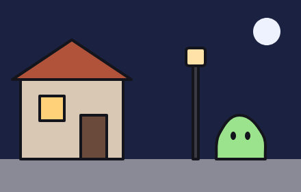 | 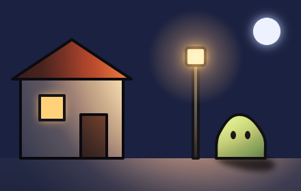 |

<!-- gerar: img/08_luz.png -->
```weasel
canvas 440 280 bg=#1b2140
palette ink=#14141c line=4
palette parede=#d8c8b4 telhado=#b0533a rua=#8a8a96 poste=#3a3a44 vidro=#ffe2a8 bicho=#9be38c

layer guia guide
line piso : 0,232 440,232

layer ceu unlit
ellipse lua 390,46 20 c=#eef2ff emit=#bcd2ff,1

layer cena
rect rua 0,232 440,48 c=rua
rect casa 30,112 150,120 c=parede ink=line
shape telhado c=telhado ink=line : 18,116! 105,58! 192,116!
rect janela 58,140 36,36 c=#ffd27a ink=line emit=#ffb860,0.8
rect porta 118,168 38,64 c=#6a4a3a ink=line
rect poste 282,92 8,140 c=poste ink=line
rect lanterna 272,70 28,26 r=4 c=vidro ink=line emit=#ffb860,1.2

layer bichinho cast=piso,0.5,4
shape corpo c=bicho ink=line : 350,168 384,196 388,232! 316,232! 320,196
ellipse olhoE 341,198 4,6 c=ink
ellipse olhoD 362,198 4,6 c=ink

ambient c=#5866a0 power=0.5
light lampiao point 286,84 c=#ffb860 power=2.2 radius=300 glow=70
light luar dir -0.4,-0.9 c=#9fb4ff power=0.2
```

<details>
<summary>Código da versão sem luz</summary>

<!-- gerar: img/08_sem_luz.png -->
```weasel
canvas 440 280 bg=#1b2140
palette ink=#14141c line=4
palette parede=#d8c8b4 telhado=#b0533a rua=#8a8a96 poste=#3a3a44 vidro=#ffe2a8 bicho=#9be38c

layer ceu
ellipse lua 390,46 20 c=#eef2ff

layer cena
rect rua 0,232 440,48 c=rua
rect casa 30,112 150,120 c=parede ink=line
shape telhado c=telhado ink=line : 18,116! 105,58! 192,116!
rect janela 58,140 36,36 c=#ffd27a ink=line
rect porta 118,168 38,64 c=#6a4a3a ink=line
rect poste 282,92 8,140 c=poste ink=line
rect lanterna 272,70 28,26 r=4 c=vidro ink=line

layer bichinho
shape corpo c=bicho ink=line : 350,168 384,196 388,232! 316,232! 320,196
ellipse olhoE 341,198 4,6 c=ink
ellipse olhoD 362,198 4,6 c=ink
```

</details>

Não se preocupe com cada linha: as seções a seguir explicam uma por uma. Por enquanto, repare no fim do código:

- `ambient` é a luz da noite, azulada, que chega em tudo por igual.
- `light lampiao point …` é a lâmpada dentro da lanterna: ela clareia e amarela o que está perto do poste.
- `light luar dir …` é a lua: uma luz fraca, que vem de cima.
- `emit=` faz a janela, a lanterna e a lua brilharem com as próprias cores, mesmo no escuro.
- `cast=piso` faz o bichinho projetar a sombra no chão.

As cores do desenho continuam sendo "as cores de dia". A luz é aplicada por cima, a cada quadro: se o bichinho andar até o poste, ou o poste balançar, a cor e a sombra mudam junto.

Há quatro tipos de luz:

| Linha | O que é |
|---|---|
| `ambient` | a luz **geral**: chega em tudo, por igual, vinda de lugar nenhum |
| `light nome point x,y` | uma **lâmpada**: ilumina em volta de um ponto |
| `light nome spot x,y` | um **holofote**: uma lâmpada que só ilumina dentro de um cone |
| `light nome dir dx,dy` | o **sol** ou a **lua**: uma luz que vem de uma direção, igual em tudo |

Cada `light` tem um nome, que a `key` usa para mudar a luz depois. Dois nomes iguais dão erro. No editor, com o cursor na linha de uma luz, ela aparece no desenho para você ajustar com o mouse ([capítulo 22](22-editor.md#luzes-no-desenho)).

## Uma cena para testar a luz

Para comparar duas luzes, o melhor é usar **o mesmo desenho** e mudar só a luz. Esta pracinha não tem nenhuma luz. Salve o código como `praca.weasel`, na mesma pasta dos seus testes:

<!-- arquivo: praca.weasel -->
<!-- gerar: img/08_praca.png -->
```weasel
canvas 240 160
palette ink=#14141c line=3

layer guia guide
line piso : 0,128 240,128

layer cenario shade=0
rect ceu -20,-20 280,148 c=#9cc8ec
rect grama -20,128 280,60 c=#7cb35a

layer coisas cast=piso,0.6,2
rect caixa 22,84 44,44 c=#e0a050 ink=line
ellipse bola 104,110 18 c=#e8504a ink=line
shape bicho c=#9be38c ink=line : 182,72 214,100 218,128! 146,128! 150,100
ellipse olhoE 174,100 3,5 c=ink
ellipse olhoD 192,100 3,5 c=ink
```

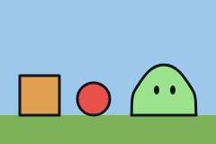

Vários exemplos a seguir começam com `include "praca.weasel"`: o arquivo inteiro entra naquela linha ([capítulo 6](06-componentes.md#vários-arquivos-include)), e o exemplo só acrescenta a luz embaixo.

Três detalhes da pracinha só fazem diferença quando houver luz:

- O céu e a grama são `rect`, e não o `bg=`: o fundo do canvas não recebe luz. Eles passam um pouco das bordas (começam em −20) para não sobrar fresta.
- A camada `cenario` tem `shade=0`. Sem isso, o céu ficaria mais claro de um lado e mais escuro do outro, como uma bola ([`shade=`, mais abaixo](#claro-e-escuro-shade)).
- `cast=piso,0.6,2` faz as coisas projetarem sombra no chão: a linha `piso`, numa camada `guide`, que não aparece ([Sombra projetada no chão](#sombra-projetada-no-chão-cast)).

## A luz geral: `ambient`

```
ambient [c=cor] [power=força]
```

O `ambient` é a luz que chega **em tudo, por igual**: o claro do dia, o azul da noite, o laranja do fim da tarde. `c=` é a cor (se não escrever, branco) e `power=` é a força, de 0 a 5 (se não escrever, 0.6). Cada exemplo abaixo tem só duas linhas: a pracinha e o `ambient`.

<!-- gerar: img/08_amb_forte.png -->
```weasel
include "praca.weasel"
ambient power=1
```

<!-- gerar: img/08_amb_padrao.png -->
```weasel
include "praca.weasel"
ambient
```

<!-- gerar: img/08_amb_noite.png -->
```weasel
include "praca.weasel"
ambient c=#6070c0 power=0.8
```

<!-- gerar: img/08_amb_tarde.png -->
```weasel
include "praca.weasel"
ambient c=#ffa060 power=1
```

| `ambient power=1` | `ambient` (branco, 0.6) |
|---|---|
|  | 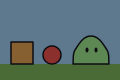 |
| **`ambient c=#6070c0 power=0.8`** | **`ambient c=#ffa060 power=1`** |
| 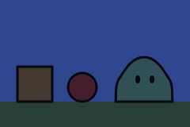 | 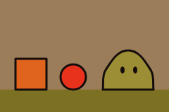 |

Repare:

- Branco com força 1 deixa tudo **igual ao desenho**. Uma força maior que 1 não clareia mais: o máximo são as cores que você escreveu.
- Uma força menor que 1 **escurece**. Sem `power=`, vale 0.6.
- Uma cor **tinge** a cena: as cores do desenho são multiplicadas pela cor da luz. A luz azul quase não tem vermelho, e por isso a bola vermelha fica bem escura nela.
- O `ambient` não tem direção: as formas não ficam mais claras de um lado. Para isso, é preciso uma `light`.

**Experimente:** no último exemplo, troque a cor por `c=#80ff80`, um verde claro. A grama e o bichinho continuam claros, mas a bola vermelha e a caixa laranja escurecem: a luz verde quase não tem vermelho.

**Cuidado:**
- Sem nenhuma luz (nem `ambient`, nem `light`), o desenho sai com as cores escritas. Com uma `light` e sem `ambient`, vale um `ambient` branco com 0.6.
- Com dois `ambient` no mesmo arquivo, vale só o de baixo, e o Weasel avisa.
- O `ambient` não tem nome: ele não muda com a `key`. Para a cena escurecer aos poucos, anime uma `light dir` (o sol se pondo) ou o `brightness=` da camada ([capítulo 11](11-efeitos.md#animar-os-efeitos-com-key)).

## Lâmpada: `light point`

```
light nome point x,y [c=cor] [power=força] [radius=alcance] [glow=halo]
```

Uma `light point` é uma **lâmpada**: ela ilumina em volta de um ponto, e a luz fica fraca com a distância. Para comparar três lâmpadas lado a lado, os próximos exemplos usam esta sala escura, com três bichinhos e três lampadinhas desenhadas. Salve como `sala.weasel`:

<!-- arquivo: sala.weasel -->
<!-- gerar: img/10_sala.png -->
```weasel
canvas 480 180 bg=#101320
palette ink=#14141c line=3

def bicho cor=#9be38c
shape corpo c=cor ink=line : 0,-46 30,-20 34,10! -34,10! -30,-20
ellipse olhoE -9,-20 3,5 c=ink
ellipse olhoD 9,-20 3,5 c=ink
end

layer sala shade=0
rect parede 0,0 480,160 c=#c8b8a8
rect chao 0,160 480,20 c=#8a7a6a

layer bichos
use bicho 80,150
use bicho 240,150
use bicho 400,150

layer lampadas unlit
ellipse lampA 80,64 6 c=#fff2c0
ellipse lampB 240,64 6 c=#fff2c0
ellipse lampC 400,64 6 c=#fff2c0
```

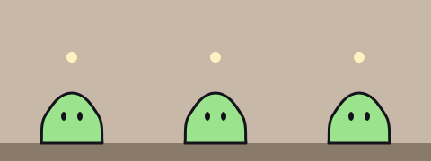

As lampadinhas são só desenho: quem ilumina é a linha `light`. Elas estão numa camada `unlit` ("sem luz"), para mostrarem a própria cor mesmo no escuro ([`unlit`, mais abaixo](#lit-e-unlit)).

### A força: `power=`

<!-- gerar: img/08_power.png -->
```weasel
include "sala.weasel"

layer rotulos unlit
text t1 80,20 "power=0.5" size=14 align=center c=#ffffff
text t2 240,20 "power=1" size=14 align=center c=#ffffff
text t3 400,20 "power=2" size=14 align=center c=#ffffff

ambient c=#404870 power=0.4
light a point 80,64 c=#ffd27a power=0.5 radius=200
light b point 240,64 c=#ffd27a power=1 radius=200
light c point 400,64 c=#ffd27a power=2 radius=200
```

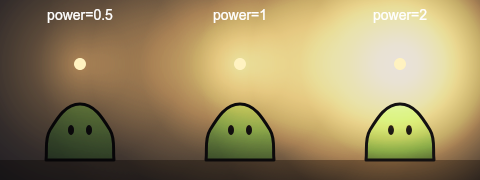

Repare:

- `light a point 80,64` cria uma luz chamada `a` no ponto 80,64, no lugar da primeira lampadinha.
- `power=` é a **força**, de 0 a 20 (se não escrever, 1). Mais força, mais luz. Com 0, a lâmpada apaga.
- `ambient c=#404870 power=0.4` deixa a sala azulada e escura. Sem ele, valeria branco 0.6, e a sala ficaria clara demais para ver as lâmpadas.

### O alcance: `radius=`

<!-- gerar: img/08_radius.png -->
```weasel
include "sala.weasel"

layer rotulos unlit
text t1 80,20 "radius=70" size=14 align=center c=#ffffff
text t2 240,20 "radius=130" size=14 align=center c=#ffffff
text t3 400,20 "radius=200" size=14 align=center c=#ffffff

ambient c=#404870 power=0.4
light a point 80,64 c=#ffd27a power=1.5 radius=70
light b point 240,64 c=#ffd27a power=1.5 radius=130
light c point 400,64 c=#ffd27a power=1.5 radius=200
```

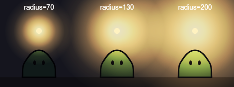

Repare:

- `radius=` é **até onde a luz chega**, em pixels (se não escrever, 300). Depois dessa distância, a luz é zero.
- As três lâmpadas têm a mesma força (`power=1.5`). Só muda o alcance.
- Com `radius=70`, o bichinho está quase no limite do alcance: ele quase não recebe luz.
- A luz não para de repente: ela fica fraca aos poucos, do centro até o limite. Por isso, na parede, cada lâmpada faz um círculo que se apaga devagar.

### O halo: `glow=`

<!-- gerar: img/08_glow_luz.png -->
```weasel
canvas 480 180 bg=#101320
palette ink=#14141c line=3

def bicho cor=#9be38c
shape corpo c=cor ink=line : 0,-46 30,-20 34,10! -34,10! -30,-20
ellipse olhoE -9,-20 3,5 c=ink
ellipse olhoD 9,-20 3,5 c=ink
end

layer sala shade=0
rect chao 0,160 480,20 c=#3a3446

layer bichos
use bicho 80,150
use bicho 240,150
use bicho 400,150

layer lampadas unlit
ellipse lampA 80,64 6 c=#fff2c0
ellipse lampB 240,64 6 c=#fff2c0
ellipse lampC 400,64 6 c=#fff2c0
text t1 80,20 "sem glow" size=14 align=center c=#ffffff
text t2 240,20 "glow=30" size=14 align=center c=#ffffff
text t3 400,20 "glow=70" size=14 align=center c=#ffffff

ambient c=#404870 power=0.4
light a point 80,64 c=#ffd27a power=1 radius=150
light b point 240,64 c=#ffd27a power=1 radius=150 glow=30
light c point 400,64 c=#ffd27a power=1 radius=150 glow=70
```

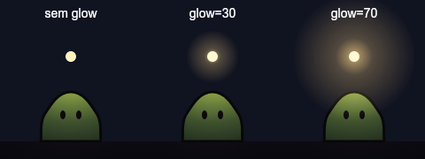

Repare:

- `glow=` desenha um **halo** em volta da lâmpada, com esse raio em pixels (se não escrever, 0: sem halo). É o brilho que se vê no ar, perto de uma lâmpada acesa.
- O halo é **só desenho**: os três bichinhos recebem a mesma luz. Quem ilumina é o `power=` e o `radius=`.
- Este exemplo não usa a sala, de propósito: sem a parede, o halo aparece melhor contra o escuro.

**Experimente:** no exemplo do `power=`, acrescente `glow=40` nas três luzes. O halo da lâmpada mais forte fica mais claro: ele acompanha o `power=`.

## Holofote: `light spot`

```
light nome spot x,y [aim=graus] [cone=graus] [as opções da point]
```

Um `spot` é uma lâmpada que só ilumina **dentro de um cone**, como um holofote ou uma lanterna. Ele tem tudo da `point` e mais duas opções: `aim=`, para onde aponta, e `cone=`, a abertura.

<!-- gerar: img/08_holofote.png -->
```weasel
canvas 400 260 bg=#101320
palette ink=#14141c line=4

layer guia guide
line piso : 0,230 400,230

layer palco
rect fundo 0,0 400,230 c=#6a5a7a
rect tablado 0,230 400,30 c=#7a5a44
rect cortinaE 0,0 70,230 c=#8c1e2a ink=line
rect cortinaD 330,0 70,230 c=#8c1e2a ink=line

layer artista cast=piso,0.6,3
shape corpo c=#ffb3c7 ink=line : 200,140 236,170 240,230! 160,230! 164,170
ellipse olhoE 188,172 4,7 c=ink
ellipse olhoD 212,172 4,7 c=ink

ambient c=#3a3f66 power=0.35
light canhao spot 200,10 aim=90 cone=16 c=#fff1d0 power=2 radius=320
```

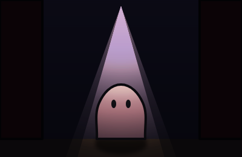

O holofote está no alto do palco (`200,10`), aponta para baixo (`aim=90`) e abre 16 graus para cada lado. Fora do cone, só chega o `ambient`.

### A abertura: `cone=`

`cone=` é a abertura do facho, em graus, **para cada lado** do centro: de 1 a 180 (se não escrever, 30). Então `cone=20` faz um facho de 40 graus no total.

<!-- gerar: img/08_cone.png -->
```weasel
canvas 480 200 bg=#101320
palette ink=#14141c line=3

def bicho cor=#9be38c
shape corpo c=cor ink=line : 0,-46 30,-20 34,10! -34,10! -30,-20
ellipse olhoE -9,-20 3,5 c=ink
ellipse olhoD 9,-20 3,5 c=ink
end

layer palco shade=0
rect parede 0,0 480,180 c=#c8b8a8
rect chao 0,180 480,20 c=#8a7a6a

layer bichos
use bicho 80,170
use bicho 240,170
use bicho 400,170

layer rotulos unlit
text t1 80,194 "cone=8" size=13 align=center c=#ffffff
text t2 240,194 "cone=20" size=13 align=center c=#ffffff
text t3 400,194 "cone=40" size=13 align=center c=#ffffff

ambient c=#404870 power=0.3
light a spot 80,0 aim=90 cone=8 c=#fff1d0 power=2 radius=300
light b spot 240,0 aim=90 cone=20 c=#fff1d0 power=2 radius=300
light c spot 400,0 aim=90 cone=40 c=#fff1d0 power=2 radius=300
```

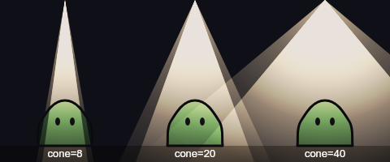

Repare:

- Os três apontam para baixo (`aim=90`) e têm a mesma força. Só muda a abertura.
- Em volta do facho há uma faixa mais fraca, até 1,25 vez o `cone=`: o holofote não corta a luz de uma vez.
- O facho aparece na parede porque ela é um `rect` que recebe luz. No fundo do canvas (`bg=`), ele não apareceria.

### Para onde aponta: `aim=`

`aim=` é a direção do facho, em graus: 0 = para a direita, 90 = para baixo (se não escrever), 180 = para a esquerda, −90 = para cima. Como o `aim` muda com a `key`, dá para fazer um farol que varre o céu:

<!-- gerar: img/08_aim.gif -a varre -->
```weasel
canvas 320 200 bg=#0c0f1c
palette ink=#14141c line=3

layer ceu shade=0
rect noite 0,0 320,180 c=#5a6488
ellipse nuvemA 70,50 40,14 c=#c8cce0
ellipse nuvemB 250,70 46,16 c=#c8cce0
ellipse nuvemC 160,30 30,10 c=#c8cce0

layer chao
rect predio 130,150 60,50 c=#2a2a36 ink=line
rect morro 0,180 320,20 c=#1a1e2a

ambient c=#404870 power=0.35
light farol spot 160,150 aim=-150 cone=10 c=#fff1d0 power=2 radius=300

anim varre frames=16 fps=8
key 0 farol.aim=-150
key 8 farol.aim=-30
key 16 farol.aim=-150
```

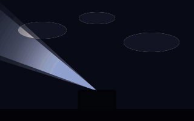

Repare:

- O farol fica no topo do prédio (`160,150`) e aponta para cima e para a esquerda (`aim=-150`).
- `key 8 farol.aim=-30` gira o facho até cima e à direita. A `key 16` repete a `key 0`: ela não é obrigatória, porque o loop volta sozinho para a primeira `key` ([capítulo 7](07-movimento.md#as-regras-das-key)).
- As nuvens só aparecem quando o facho passa: fora dele, só chega o `ambient`, bem fraco.

**Experimente:** na linha `light farol`, troque `cone=10` por `cone=30`. O facho fica largo e acende duas nuvens de uma vez.

## Sol e lua: `light dir`

```
light nome dir dx,dy [c=cor] [power=força]
```

Uma `light dir` é uma luz **muito longe**, como o sol ou a lua. Ela chega igual em todo lugar, sempre do mesmo lado. Em vez de uma posição, ela recebe uma **direção**: `dx,dy` é uma setinha que sai da cena e aponta **para onde o sol está**.

- `-1,-0.6`: para a esquerda (−1) e para cima (−0.6). O sol está em cima, à esquerda.
- `1,-0.6`: para a direita e para cima. O sol está em cima, à direita.
- Só a direção importa: `-1,-0.6` e `-2,-1.2` são o mesmo sol.

<!-- gerar: img/08_sol_esq.png -->
```weasel
include "praca.weasel"
ambient c=#6070a0 power=0.4
light sol dir -1,-0.6 c=#ffd890 power=1.2
```

<!-- gerar: img/08_sol_dir.png -->
```weasel
include "praca.weasel"
ambient c=#6070a0 power=0.4
light sol dir 1,-0.6 c=#ffd890 power=1.2
```

| `light sol dir -1,-0.6` | `light sol dir 1,-0.6` |
|---|---|
| 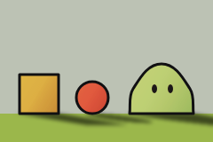 | 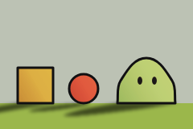 |

Repare:

- A sombra no chão vai sempre para o lado **contrário** do sol. Ela vem do `cast=` da pracinha.
- Cada forma fica mais clara do lado do sol e mais escura do outro (olhe a bola e o bichinho).
- O `ambient` continua valendo junto: ele é a luz do céu, que clareia o lado da sombra.

**Experimente:** troque a direção para `-0.2,-1` (o sol quase em cima). As sombras ficam curtas, quase embaixo das coisas. Com `0,1` (o sol embaixo do chão), não há sombra nenhuma: só a luz que vem de cima faz sombra.

**Cuidado:** na `dir`, `radius=`, `glow=`, `aim=`, `cone=` e `bone=` não fazem nada, e o Weasel avisa: o sol não tem um ponto de onde a luz sai. O `flicker=` e o `rim=` (abaixo) valem nela.

## Luz que muda com o tempo

### Chama que tremula: `flicker=`

`flicker=` faz a força da luz **variar a cada quadro**, como a chama de uma vela. Como é uma coisa que muda com o tempo, o exemplo é uma animação:

<!-- gerar: img/08_flicker.gif -a tremula -->
```weasel
canvas 320 160 bg=#14182a
palette ink=#14141c line=3

layer mesa
rect tampo 0,130 320,30 c=#6a4a3a

layer velas
rect velaA 72,90 16,40 r=2 c=#f0e6d0 ink=line
rect velaB 232,90 16,40 r=2 c=#f0e6d0 ink=line

layer chamas unlit
ellipse chamaA 80,80 5,9 c=#ffd27a emit=#ff9a4a,1
ellipse chamaB 240,80 5,9 c=#ffd27a emit=#ff9a4a,1
text t1 80,24 "sem flicker" size=14 align=center c=#ffffff
text t2 240,24 "flicker=0.4" size=14 align=center c=#ffffff

ambient c=#3a4270 power=0.3
light a point 80,80 c=#ff9a4a power=1.4 radius=120 glow=60
light b point 240,80 c=#ff9a4a power=1.4 radius=120 glow=60 flicker=0.4

anim tremula frames=12 fps=12
```

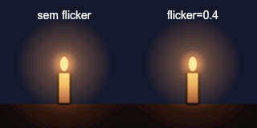

Repare:

- `flicker=0.4` deixa a força variar até 40% para cima ou para baixo, sorteada a cada quadro. Vai de 0 (parado, se não escrever) a 1 (tremendo muito).
- A animação `tremula` não tem nenhuma `key`: ela só existe para o tempo passar. No desenho parado, a luz fica firme. Num filme (capítulo 17), ela muda 12 vezes por segundo.
- O sorteio é fixo: a mesma animação treme sempre igual, toda vez que você exportar.
- O `flicker=` vale também no sol (`dir`): um relâmpago, a luz de uma televisão ligada.

**Experimente:** mude para `flicker=1`. A vela da direita chega a apagar em alguns quadros.

### Luz que anda com um osso: `bone=`

Com `bone=`, a luz fica **presa a um osso** e anda com ele: um lampião que balança, uma lanterna na mão. O que ela ilumina muda junto.

<!-- gerar: img/08_lampiao.gif -a balanca -->
```weasel
canvas 320 220 bg=#101320
palette ink=#14141c line=3 ferro=#3a3a44

def bicho cor=#9be38c
shape corpo c=cor ink=line : 0,-46 30,-20 34,10! -34,10! -30,-20
ellipse olhoE -9,-20 3,5 c=ink
ellipse olhoD 9,-20 3,5 c=ink
end

layer sala
rect chao 0,200 320,20 c=#5a5066

layer bichos
use bicho 70,190
use bicho 250,190

bone corda pivot=160,0 sway=30,2
layer lampiao unlit
line fio c=ferro w=2 bone=corda : 160,0 160,80
rect vidro 150,80 20,26 r=4 c=#ffe2a8 ink=line bone=corda

ambient c=#404870 power=0.35
light luz point 160,94 c=#ffb860 power=2 radius=220 bone=corda

anim balanca frames=16 fps=8
```

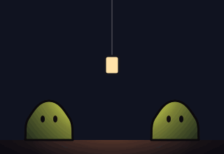

Repare:

- `bone corda pivot=160,0 sway=30,2` é um osso que balança sozinho 30 graus para cada lado, a cada 2 segundos ([capítulo 8](08-ossos.md#movimentos-automáticos-sway-bob-e-jitter)).
- O fio e o vidro têm `bone=corda`: balançam com o osso. A luz também tem `bone=corda`, e o ponto `160,94` dela gira junto, como se fosse uma forma.
- A animação dura 16 quadros a 8 por segundo: 2 segundos, uma volta inteira do `sway`. Assim o GIF fecha o loop sem pulo.
- Num holofote (`spot`), o `aim=` também gira com o osso: a lanterna aponta para onde o braço aponta. O [Juntando tudo](#juntando-tudo) faz isso.

### Animar a luz com `key`

A `key` muda uma luz pelo nome dela, como muda um osso. Este pedaço acende o lampião da rua aos poucos:

```
anim acende frames=24 fps=12
key 0 lampiao.power=0 lampiao.glow=0
key 12 lampiao.power=2.2 lampiao.glow=70
```

A `key` muda, aos poucos, o `power`, o `radius`, a cor `c`, o `glow`, o `aim` e o `cone`. A cor muda aos poucos, misturando as duas.

**Cuidado:**
- A luz não tem `show`: para apagar, use `power=0`.
- Na `key`, o Weasel não corta os números: `power=30` e `cone=999` passam, com um aviso, mas a linha `light` corta em 20 e em 180. Fique nas mesmas faixas da linha.
- O `flicker=`, o `rim=` e o `bone=` não mudam com a `key`.

## O que recebe luz

Com qualquer `light` ou `ambient` na cena, **toda camada recebe luz**, menos as `unlit`. Cada ponto do preenchimento de uma forma recebe a luz que chega ali: por isso uma parede mostra o círculo de uma lâmpada. O contorno, os traços (`stroke` e `line`) e os textos recebem a luz de um ponto só. A forma também fica mais clara do lado da luz e mais escura do outro (o `shade=`).

A luz é 2D: uma forma não faz sombra em outra. A sombra no chão é com `cast=`, [mais abaixo](#sombra-projetada-no-chão-cast).

### `lit` e `unlit`

`unlit` numa camada quer dizer "esta camada **não recebe luz**": ela aparece com as cores do desenho, mesmo no escuro. A palavra `lit` ("iluminada") também existe, mas ela é o padrão: escrever `lit` não muda nada, e o Weasel avisa.

<!-- gerar: img/08_unlit.png -->
```weasel
canvas 320 150 bg=#101320
palette ink=#14141c line=3

layer placaA
rect fundoA 30,40 110,60 r=8 c=#ffd34d ink=line
text letraA 85,80 "LOJA" size=24 align=center c=#c0392b bold

layer placaB unlit
rect fundoB 180,40 110,60 r=8 c=#ffd34d ink=line
text letraB 235,80 "LOJA" size=24 align=center c=#c0392b bold

layer rotulos unlit
text t1 85,130 "lit (o padrão)" size=14 align=center c=#ffffff
text t2 235,130 "unlit" size=14 align=center c=#ffffff

ambient c=#404870 power=0.4
```

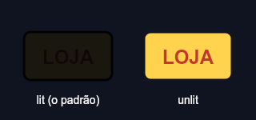

As duas placas são iguais. A da esquerda, sem nada (o padrão), recebe a luz da noite e escurece; a da direita ignora a luz. Use `unlit` para o que tem que ser lido sempre (placar, legenda) e para o que **é** luz (fogo, lâmpada, tela acesa).

### Claro e escuro: `shade=`

Com uma luz que vem de um lado, cada forma fica mais clara desse lado e mais escura do outro. `shade=` na camada diz **o quanto**: de 0 (nada: a forma fica de uma cor só) a 2 (bem forte). Se não escrever, 0.5.

<!-- gerar: img/08_shade.png -->
```weasel
canvas 420 160 bg=#2a2f45
palette ink=#14141c line=3

layer bolaA shade=0
ellipse a 70,70 42 c=#e8504a ink=line
layer bolaB
ellipse b 210,70 42 c=#e8504a ink=line
layer bolaC shade=2
ellipse c 350,70 42 c=#e8504a ink=line

layer rotulos unlit
text t1 70,140 "shade=0" size=14 align=center c=#ffffff
text t2 210,140 "shade=0.5 (padrão)" size=14 align=center c=#ffffff
text t3 350,140 "shade=2" size=14 align=center c=#ffffff

ambient c=#8090c0 power=0.5
light sol dir -1,-1 c=#fff1d0 power=1
```

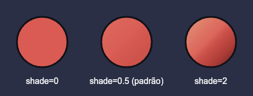

Repare:

- Cada bola está na sua própria camada, porque `shade=` é uma opção de **camada**: vale para todas as formas dela.
- Com `shade=0`, a bola continua recebendo a luz (a cor muda), mas fica chapada, sem volume.
- Um `shade=` alto dá volume, mas exagera em formas grandes e retas. Por isso a pracinha usa `shade=0` no céu e na grama.

### Fio de luz na borda: `rim=`

Um **fio de luz na borda** (em inglês, *rim light*) é aquela linha clara no contorno de um personagem quando a luz vem de trás dele. Ele separa o personagem do fundo escuro. Há dois jeitos de ligar.

**Na camada**, com `rim=cor,largura`: o fio tem uma cor fixa, e a largura é em pixels (se não escrever, 4).

<!-- gerar: img/08_rim.png -->
```weasel
canvas 420 170 bg=#101320
palette ink=#14141c line=3

def bicho cor=#5a8a52
shape corpo c=cor ink=line : 0,-56 36,-24 40,12! -40,12! -36,-24
ellipse olhoE -11,-24 4,6 c=ink
ellipse olhoD 11,-24 4,6 c=ink
end

layer bichoA
use bicho 70,120
layer bichoB rim=#ffe2a8,3
use bicho 210,120
layer bichoC rim=#7fd4ff,8
use bicho 350,120

layer rotulos unlit
text t1 70,156 "sem rim" size=14 align=center c=#ffffff
text t2 210,156 "rim=#ffe2a8,3" size=14 align=center c=#ffffff
text t3 350,156 "rim=#7fd4ff,8" size=14 align=center c=#ffffff

ambient c=#404870 power=0.5
light lua dir 1,-0.6 c=#c8d4ff power=0.6
```

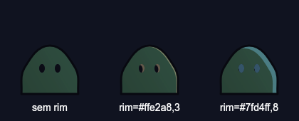

**Na luz**, com `rim=largura` (de 0 a 100): o fio sai **na cor da luz**, e vale para todas as camadas da cena que não têm o seu próprio `rim=`. Compare com o [sol da esquerda](#sol-e-lua-light-dir):

<!-- gerar: img/08_rim_luz.png -->
```weasel
include "praca.weasel"
ambient c=#6070a0 power=0.4
light sol dir -1,-0.6 c=#ffd890 power=1.2 rim=4
```

| Sem `rim=` | `light sol … rim=4` |
|---|---|
|  | 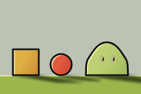 |

Repare:

- O fio fica sempre na borda **virada para a luz**: à direita com a lua da direita, à esquerda com o sol da esquerda.
- Até os olhos do bichinho ganham fio: o `rim` vale para todas as formas da camada.
- Com várias luzes, o fio fica do lado de onde vem mais luz em cada forma, e vale a maior largura entre os `rim=` das luzes.

**Cuidado:** o `rim=` só aparece com uma `light`: o `ambient` não tem direção.

### Coisas que brilham: `emit=`

`emit=cor,força` faz a forma **brilhar** com um halo dessa cor. A forma passa a ignorar a luz: ela é a luz. Serve para janelas acesas, o vidro de uma lanterna, olhos que brilham no escuro, a lua. A força é o tamanho do halo, de 0 a 10 (se não escrever, 1). Quatro janelas iguais numa noite escura:

<!-- gerar: img/08_emit.png -->
```weasel
canvas 480 150 bg=#101320
palette ink=#14141c line=3

layer janelas
rect jA 40,40 70,60 c=#ffd27a ink=line
rect jB 150,40 70,60 c=#ffd27a ink=line emit=#ffb860,0.5
rect jC 260,40 70,60 c=#ffd27a ink=line emit=#ffb860,1
rect jD 370,40 70,60 c=#ffd27a ink=line emit=#ff6a3d,3

layer rotulos unlit
text t1 75,130 "sem emit" size=13 align=center c=#ffffff
text t2 185,130 "emit=#ffb860,0.5" size=13 align=center c=#ffffff
text t3 295,130 "emit=#ffb860,1" size=13 align=center c=#ffffff
text t4 405,130 "emit=#ff6a3d,3" size=13 align=center c=#ffffff

ambient c=#404870 power=0.4
```

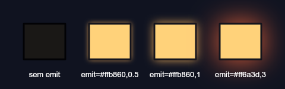

Repare:

- A janela sem `emit` recebe a luz da noite e fica escura. As outras **ignoram a luz**: continuam amarelas, mesmo estando na mesma camada.
- A cor do halo pode ser diferente da cor da forma: a última janela é amarela com halo vermelho.
- Só há `ambient`, nenhuma `light`. Por isso nenhuma janela ilumina o que está em volta: o `emit` só desenha o brilho. Para a forma iluminar as vizinhas, ponha também uma `light` no mesmo lugar, como o `lampiao` dentro da lanterna da rua.

**Cuidado:** uma força acima de 10 vale 10, com um aviso. O `emit=` não muda com a `key`: para uma janela acender, anime a `opacity` dela ([capítulo 9](09-animacao.md#animar-formas-formapropriedadevalor)).

## Sombra projetada no chão: `cast=`

```
layer nome cast=chão[,opacidade[,desfoque]] [from=camada,camada…]
```

`cast=` faz a camada projetar a própria **silhueta no chão**, deitada para longe de cada luz. O `chão` é o nome de uma `line`, que costuma ficar numa camada `guide`: ela não aparece, só diz onde é o chão. A `opacidade` vai de 0 (invisível) a 1 (preta), e se não escrever, 0.45. O `desfoque` é em pixels, e se não escrever, 6.

<!-- gerar: img/08_cast.png -->
```weasel
canvas 480 190 bg=#2a2f45
palette ink=#14141c line=3

def bicho cor=#9be38c
shape corpo c=cor ink=line : 0,-56 36,-24 40,12! -40,12! -36,-24
ellipse olhoE -11,-24 4,6 c=ink
ellipse olhoD 11,-24 4,6 c=ink
end

layer guia guide
line piso : 0,140 480,140

layer chao
rect terra 0,140 480,50 c=#7a8a5a

layer bichoA cast=piso
use bicho 70,128
layer bichoB cast=piso,0.9,0
use bicho 230,128
layer bichoC cast=piso,0.3,14
use bicho 390,128

layer rotulos unlit
text t1 70,180 "cast=piso" size=13 align=center c=#ffffff
text t2 230,180 "cast=piso,0.9,0" size=13 align=center c=#ffffff
text t3 390,180 "cast=piso,0.3,14" size=13 align=center c=#ffffff

ambient c=#8090c0 power=0.6
light sol dir -1,-0.8 c=#fff1d0 power=1
```

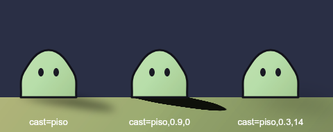

Repare:

- `cast=piso` sozinho usa os padrões: opacidade 0.45 e desfoque de 6 pixels.
- Um desfoque 0 dá uma borda nítida, como o sol forte do meio-dia; um desfoque grande dá uma sombra macia, como num dia nublado.
- Cada bichinho tem a sua camada, porque o `cast=` é da camada inteira: ela vira **uma** silhueta só.
- Os pés dos bichinhos estão na altura da linha `piso` (y = 140). A sombra começa nos pés e deita no chão.
- As lâmpadas (`point` e `spot`) acima do chão também fazem sombra. Quanto mais longe da luz, mais fraca a sombra.

**Experimente:** troque o sol por `light sol dir 1,-0.8 c=#fff1d0 power=1` (o sol à direita). As três sombras passam para a esquerda.

**Cuidado:**
- O `cast=` precisa de uma `light`: só com `ambient`, não há sombra.
- Uma lâmpada precisa estar mais de 10 pixels acima do chão para fazer sombra.
- O `chão` tem que ser o nome de uma `line`. Outro nome dá erro.
- Uma opacidade fora de 0 a 1 é cortada, com um aviso.

### Uma sombra para várias camadas: `from=`

Um personagem quase sempre tem várias camadas (corpo, braço, cabeça). Se cada uma tiver o seu `cast=`, cada uma faz a sua sombra, e onde duas sombras se cruzam o chão fica **mais escuro**. `from=` junta a silhueta de várias camadas numa sombra só:

<!-- gerar: img/08_from.png -->
```weasel
canvas 400 200 bg=#2a2f45
palette ink=#14141c line=3 neve=#eef2ff

layer guia guide
line piso : 0,160 400,160

layer chao
rect terra 0,160 400,40 c=#c8d0e0

# esquerda: cada camada faz a própria sombra
layer baseA cast=piso,0.6,0
ellipse b1 90,130 30 c=neve ink=line
layer meioA cast=piso,0.6,0
ellipse b2 90,90 24 c=neve ink=line
layer cabecaA cast=piso,0.6,0
ellipse b3 90,56 17 c=neve ink=line

# direita: uma camada só de sombra, com a silhueta das três
layer sombraB cast=piso,0.6,0 from=baseB,meioB,cabecaB
layer baseB
ellipse c1 270,130 30 c=neve ink=line
layer meioB
ellipse c2 270,90 24 c=neve ink=line
layer cabecaB
ellipse c3 270,56 17 c=neve ink=line

layer rotulos unlit
text t1 90,24 "cast nas três camadas" size=13 align=center c=#ffffff
text t2 270,24 "uma sombra com from=" size=13 align=center c=#ffffff

ambient c=#8090c0 power=0.7
light sol dir -1,-0.6 c=#fff1d0 power=1
```

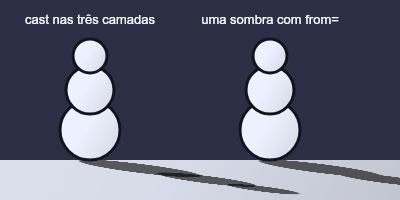

Repare:

- A camada `sombraB` **não tem nenhuma forma**: ela só faz a sombra. As silhuetas vêm das camadas listadas no `from=`.
- Ela vem **antes** das camadas do boneco, então a sombra é pintada por baixo dele.
- `from=` só vale junto com `cast=` (sozinho, o Weasel avisa).
- É assim que se dá sombra a um personagem que vem de um `include`, sem mexer no arquivo dele: a camada de sombra fica no seu arquivo e lista as camadas do personagem ([`noite.weasel`](../../exemplos/noite.weasel) faz isso).

## Opções das luzes

A `light`:

| Opção | O que faz | Valores | Se não escrever |
|---|---|---|---|
| `point`, `spot` ou `dir` | lâmpada, holofote ou sol | uma das três palavras | obrigatório |
| `x,y` (`point`, `spot`) ou `dx,dy` (`dir`) | onde a luz está, ou para onde está o sol | dois números | obrigatório |
| `c=` | a cor da luz | uma cor `#hex` ou da `palette` | branco |
| `power=` | a força; 0 apaga | de 0 a 20 | 1 |
| `radius=` | até onde a luz chega (`point` e `spot`) | de 1 a 100000, em pixels | 300 |
| `glow=` | o raio do halo (`point` e `spot`) | de 0 a 100000, em pixels | 0 |
| `aim=` | para onde o holofote aponta | graus: 0 = direita, 90 = para baixo | 90 |
| `cone=` | a abertura do holofote, para cada lado | de 1 a 180, em graus | 30 |
| `flicker=` | a força treme a cada quadro | de 0 a 1 | 0 |
| `rim=` | fio de luz na cor da luz, em todas as camadas | de 0 a 100, em pixels | 0 |
| `bone=` | a luz anda (e o holofote gira) com o osso (`point` e `spot`) | o nome de um osso | parada |

Nas camadas e nas formas:

| Opção | Onde | O que faz | Valores | Se não escrever |
|---|---|---|---|---|
| `unlit` | `layer` | a camada não recebe luz | — | recebe |
| `shade=` | `layer` | o claro e escuro de cada forma | de 0 a 2 | 0.5 |
| `rim=cor,largura` | `layer` | fio de luz de cor fixa | cor e pixels | largura 4 |
| `cast=chão,opacidade,desfoque` | `layer` | sombra no chão | uma `line`; de 0 a 1; pixels | 0.45 e 6 |
| `from=` | `layer` com `cast=` | a sombra usa a silhueta destas camadas | nomes de camada | a própria camada |
| `emit=cor,força` | forma | brilha e ignora a luz | cor `#hex`; de 0 a 10 | 1 |

As fichas completas estão na referência: [`light`](19-referencia.md#light), [`ambient`](19-referencia.md#ambient) e [`layer`](19-referencia.md#layer).

## Juntando tudo

Um bicho procura alguma coisa num porão escuro, com uma lanterna na mão. O facho varre as caixas e o barril, e as sombras deles giram no chão. Uma vela tremula em cima das caixas, e a janela deixa entrar a luz da lua.

<!-- gerar: img/10_porao.gif -a procura -s 0.75 -->
```weasel
canvas 400 260 bg=#0b0d16
palette ink=#14141c line=3 madeira=#8a5a3c tabua=#6a4a34 pele=#9be38c

layer guia guide
line piso : 0,222 400,222

layer porao shade=0
rect parede -10,-10 420,232 c=#7a6f80
rect chao -10,222 420,48 c=#5a4a3e

layer janela unlit
rect moldura 296,22 68,46 c=#2a2a36 ink=line
rect vidro 302,28 56,34 c=#bcd2ff emit=#9fb4ff,0.8

layer caixas cast=piso,0.55,3
rect caixa1 214,166 60,56 c=madeira ink=line
rect caixa2 226,128 38,38 c=tabua ink=line
rect barril 316,150 48,72 r=12 c=#7a4a2c ink=line
line aro1 c=ink w=3 : 316,172 364,172
line aro2 c=ink w=3 : 316,200 364,200

layer vela unlit
rect cera 240,108 10,20 c=#f0e6d0 ink=2
ellipse chama 245,101 4,7 c=#ffd27a emit=#ff9a4a,1

bone corpo pivot=90,222 bob=2,2
bone braco parent=corpo pivot=106,176

layer bicho cast=piso,0.5,3
shape corpo c=pele ink=line bone=corpo : 90,126 122,156 126,222! 54,222! 58,156
ellipse olhoE 98,160 4,6 c=ink bone=corpo
ellipse olhoD 114,160 4,6 c=ink bone=corpo
rect bracoR 102,170 42,12 r=6 c=pele ink=line bone=braco
rect lanterna 140,166 22,20 r=3 c=#3a3a44 ink=line bone=braco

ambient c=#3a4270 power=0.35
light facho spot 162,176 aim=0 cone=16 c=#fff1d0 power=2.4 radius=320 bone=braco
light vela point 245,99 c=#ff9a4a power=0.9 radius=110 glow=36 flicker=0.3
light luar dir 1,-0.8 c=#9fb4ff power=0.3 rim=2

anim procura frames=48 fps=12
key 0 braco=0,0,-28
key 24 braco=0,0,26
```

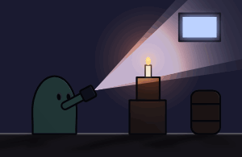

- **O escuro** é o `ambient` azulado e fraco. A parede e o chão são `rect` com `shade=0`, para o facho e o círculo da vela aparecerem neles.
- **A lanterna** é um `spot` com `bone=braco` e `aim=0` (para a direita). O braço gira de −28° a 26°, e o facho gira junto, de cima para baixo e de volta.
- **As sombras** vêm do `cast=piso` das caixas e do bicho. Elas mudam a cada quadro, porque o facho muda de lugar.
- **A vela** é uma `point` fraca com `flicker=0.3` e um halo (`glow=36`). A chama e a cera ficam numa camada `unlit`.
- **A janela** brilha com `emit=` e não ilumina nada. Quem traz a luz da lua é a `light luar dir`, bem fraca. O `rim=2` dela liga o fio de luz em todas as camadas; em cada forma, ele fica do lado de onde vem mais luz. Repare no fio branco na beira da caixa quando o facho passa.

**Experimente:** troque `cone=16` por `cone=40`. O facho abre e ilumina o porão quase todo, e o susto do escuro some.

## Resumo

- `ambient` é a luz geral, igual em tudo; `light point` é uma lâmpada, `light spot` um holofote e `light dir` o sol ou a lua.
- `power=` é a força, `radius=` o alcance e `glow=` o halo; no holofote, `aim=` aponta e `cone=` abre.
- `flicker=` faz a luz tremer, `bone=` a leva junto com um osso, e a `key` muda a força, o alcance, a cor, o halo, a direção e a abertura.
- `unlit` tira a luz de uma camada, `shade=` dá volume, `rim=` põe um fio de luz na borda e `emit=` faz uma forma brilhar sozinha.
- `cast=` projeta a sombra de uma camada no chão (uma `line`); `from=` junta várias camadas numa sombra só.

[← Animação](09-animacao.md) · [Índice](README.md) · [Próximo: Efeitos e partículas →](11-efeitos.md)
