# 11. Efeitos e partículas

[← Luz e sombra](10-luz.md) · [Índice](README.md) · [Próximo: Acabamento →](12-acabamento.md)

Este capítulo mostra o que se põe **por cima** do desenho: os efeitos de camada (desfoque, brilho, sombra, cores), o rastro de movimento e as partículas, como fogo, fumaça, chuva e faíscas. Os efeitos e as partículas se mexem com a animação: você precisa dos capítulos 1 a 10.

## Efeitos de camada

```
layer nome [blur=…] [glow=cor,raio,força] [shadow=cor,dx,dy,desfoque] [tint=cor,quanto]
           [brightness=…] [saturate=…] [contrast=…] [hue=…] [trail=quadros,queda,cor]
```

Estas opções da `layer` tratam a camada inteira como uma imagem e aplicam um efeito nela. Cinco estrelas iguais, cada uma na sua camada:

<!-- gerar: img/08_efeitos.png -->
```weasel
canvas 520 180 bg=#2b2f45
palette ink=#14141c line=4

def estrela cor=#ffd34d
shape s c=cor ink=line : 0,-40! 11,-12 40,-10! 17,8 26,38! 0,20 -26,38! -17,8 -40,-10! -11,-12
end

layer normal
use estrela 60,80
layer borrada blur=4
use estrela 160,80
layer brilhante glow=#ffd34d,18,2
use estrela 260,80
layer comSombra shadow=#000000b0,8,8,6
use estrela 360,80
layer outraCor hue=150 saturate=1.4
use estrela 460,80

layer rotulos
text t1 60,160 "normal" size=14 align=center c=#d8dcef
text t2 160,160 "blur=4" size=14 align=center c=#d8dcef
text t3 260,160 "glow=…" size=14 align=center c=#d8dcef
text t4 360,160 "shadow=…" size=14 align=center c=#d8dcef
text t5 460,160 "hue=150" size=14 align=center c=#d8dcef
```

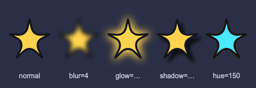

Repare:

- `blur=4` desfoca a camada: 4 é o raio do desfoque, em pixels, de 0 a 500. Serve para neblina e para um fundo fora de foco.
- `glow=` põe um brilho em volta de tudo o que está na camada. `shadow=` põe uma sombra deslocada. Os números dos dois estão na próxima seção.
- `hue=150` gira as cores no círculo das cores, em graus: o amarelo vira azul-claro. Com 180, cada cor vira a do lado oposto.
- Uma camada pode ter vários efeitos juntos: a última tem `hue=` e `saturate=`.

No editor, o menu **Efeito** e a parte **Camada** do painel **Propriedades** escrevem esses números por você ([capítulo 23](23-editor.md#efeitos-da-camada)).

**Cuidado:**
- As formas que vêm antes da primeira `layer` ficam na camada automática `base`, que não tem efeitos. Para pôr um efeito nelas, escreva uma linha `layer nome` antes.
- Num navegador antigo, o desfoque fica mais grosseiro e os ajustes de cor não aparecem.

### Os números do `glow=` e do `shadow=`

O `glow=` e o `shadow=` têm vários números. Aqui estão eles mudando um de cada vez:

<!-- gerar: img/08_glow_sombra.png -->
```weasel
canvas 480 280 bg=#2b2f45
palette ink=#14141c line=4

def estrela cor=#ffd34d
shape s c=cor ink=line : 0,-34! 9,-10 34,-8! 14,7 22,32! 0,17 -22,32! -14,7 -34,-8! -9,-10
end

layer g1 glow=#ffd34d,6
use estrela 80,60
layer g2 glow=#ffd34d,20
use estrela 240,60
layer g3 glow=#ff4d6d,20,4
use estrela 400,60

layer s1 shadow=#000000b0,6,6,0
use estrela 80,190
layer s2 shadow=#000000b0,6,6,10
use estrela 240,190
layer s3 shadow=#00000080,-14,4,4
use estrela 400,190

layer rotulos
text t1 80,124 "glow=#ffd34d,6" size=13 align=center c=#d8dcef
text t2 240,124 "glow=#ffd34d,20" size=13 align=center c=#d8dcef
text t3 400,124 "glow=#ff4d6d,20,4" size=13 align=center c=#d8dcef
text t4 80,256 "shadow=…,6,6,0" size=13 align=center c=#d8dcef
text t5 240,256 "shadow=…,6,6,10" size=13 align=center c=#d8dcef
text t6 400,256 "shadow=…,-14,4,4" size=13 align=center c=#d8dcef
```

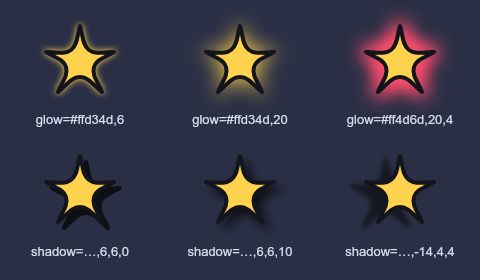

Repare, na linha de cima (`glow=cor,raio,força`):

- O **raio** é até onde o brilho vai, em pixels (se não escrever, 12): 6 é um brilho curto, 20 é largo.
- A **força** repete o brilho por cima dele mesmo: de 0.1 a 5 (se não escrever, 1). Com 4, o brilho vermelho fica bem mais forte.

E na de baixo (`shadow=cor,dx,dy,desfoque`):

- `dx,dy` é o quanto a sombra anda, em pixels: `6,6` é para a direita e para baixo; `-14,4` é para a esquerda e um pouco para baixo. Se não escrever, `4,6`.
- O **desfoque** é em pixels (se não escrever, 8): 0 dá uma sombra recortada, de borda nítida; 10 dá uma sombra macia.
- A cor com transparência (`b0` no fim, ou `80`, mais clara) deixa ver o fundo através da sombra.

**Cuidado:** uma força do `glow=` fora de 0.1 a 5 é cortada, com um aviso. A `shadow=` desta seção é uma sombra **deslocada**, que não depende da luz; a sombra no chão é o `cast=` do [capítulo 10](10-luz.md#sombra-projetada-no-chão-cast).

### Os ajustes de cor

`tint=`, `brightness=`, `saturate=` e `contrast=` mudam as cores da camada inteira.

<!-- gerar: img/08_ajustes.png -->
```weasel
canvas 480 300 bg=#2b2f45
palette ink=#14141c line=3

def bicho
shape corpo c=#9be38c ink=line : 0,-46 30,-20 34,10! -34,10! -30,-20
ellipse olhoE -9,-20 3,5 c=ink
ellipse olhoD 9,-20 3,5 c=ink
ellipse chapeu 0,-46 20,8 c=#e8504a ink=line
rect laco -30,0 60,10 c=#4a8ae8 ink=line
end

layer c1
use bicho 80,80
layer c2 tint=#ff2020,0.6
use bicho 240,80
layer c3 brightness=0.5
use bicho 400,80
layer c4 brightness=1.6
use bicho 80,220
layer c5 saturate=0
use bicho 240,220
layer c6 contrast=2
use bicho 400,220

layer rotulos
text t1 80,124 "normal" size=13 align=center c=#d8dcef
text t2 240,124 "tint=#ff2020,0.6" size=13 align=center c=#d8dcef
text t3 400,124 "brightness=0.5" size=13 align=center c=#d8dcef
text t4 80,264 "brightness=1.6" size=13 align=center c=#d8dcef
text t5 240,264 "saturate=0" size=13 align=center c=#d8dcef
text t6 400,264 "contrast=2" size=13 align=center c=#d8dcef
```

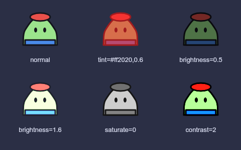

Repare:

- `tint=#ff2020,0.6` pinta 60% de vermelho por cima de tudo, até do contorno. O segundo número é o **quanto** de cor: de 0 (nada) a 1 (vermelho chapado). Se não escrever, 0.5.
- No `brightness=`, no `saturate=` e no `contrast=`, 1 é "como está", 0.5 é a metade e 2 é o dobro. Os três vão de 0 a 10.
- `brightness=0.5` deixa tudo com metade do brilho; `1.6` clareia.
- `saturate=0` tira as cores (fica cinza). Um número maior que 1 deixa as cores mais vivas.
- `contrast=2` separa mais o claro do escuro: as cores ficam mais fortes e o contorno, mais preto.

**Experimente:** troque `saturate=0` por `saturate=0 brightness=1.4`. O bichinho cinza fica claro, como uma foto antiga desbotada.

**Cuidado:** um `tint=` com o quanto fora de 0 a 1 é cortado, com um aviso.

## Animar os efeitos com `key`

Para desfocar o fundo, clarear a tela num relâmpago ou deixar um personagem vermelho quando leva dano, anime a **camada**: a `key` usa o nome da camada, como usa o nome de uma forma ([capítulo 9](09-animacao.md#animar-formas-formapropriedadevalor)). Cada estrela abaixo está numa camada própria, e cada camada anima um efeito:

<!-- gerar: img/07_camadas.gif -a efeitos -s 0.75 -->
```weasel
canvas 480 370 bg=#2b2f45
palette ink=#14141c line=4

def estrela
shape s c=#ffd34d ink=line : 0,-38! 11,-12 38,-10! 17,8 25,36! 0,20 -25,36! -17,8 -38,-10! -11,-12
end

layer l1
use estrela 80,55
layer l2
use estrela 240,55
layer l3
use estrela 400,55
layer l4 glow=#ff6b4a,0
use estrela 80,175
layer l5 tint=#4a90d9,0
use estrela 240,175
layer l6
use estrela 400,175
layer l7
use estrela 80,295
layer l8
use estrela 240,295
layer l9
use estrela 400,295

layer rotulos
text t1 80,112 "opacity" size=15 bold align=center c=#d8dcef
text t2 240,112 "show" size=15 bold align=center c=#d8dcef
text t3 400,112 "blur" size=15 bold align=center c=#d8dcef
text t4 80,232 "glow" size=15 bold align=center c=#d8dcef
text t5 240,232 "tint" size=15 bold align=center c=#d8dcef
text t6 400,232 "brightness" size=15 bold align=center c=#d8dcef
text t7 80,352 "saturate" size=15 bold align=center c=#d8dcef
text t8 240,352 "contrast" size=15 bold align=center c=#d8dcef
text t9 400,352 "hue" size=15 bold align=center c=#d8dcef

anim efeitos frames=12 fps=6
key 0 l1.opacity=1 l2.show=1 l3.blur=0 l4.glow=0 l5.tint=0 l6.brightness=1 l7.saturate=1 l8.contrast=1 l9.hue=0
key 4 l2.show=0
key 8 l2.show=1
key 6 l1.opacity=0.15 l3.blur=6 l4.glow=24 l5.tint=0.8 l6.brightness=2 l7.saturate=0 l8.contrast=0.3 l9.hue=180
key 12 l1.opacity=1 l3.blur=0 l4.glow=0 l5.tint=0 l6.brightness=1 l7.saturate=1 l8.contrast=1 l9.hue=0
```

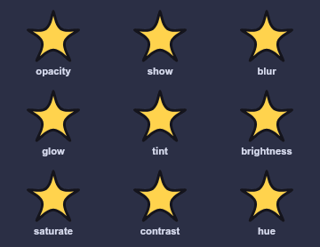

Os números vão de "normal", no quadro 0, até o valor do quadro 6, e voltam:

| Estrela | Normal | No quadro 6 | O que o número quer dizer |
|---|---|---|---|
| `opacity` | 1 | 0.15 | a transparência da camada inteira, de 0 (invisível) a 1 |
| `show` | 1 | 0 nos quadros 4 a 7 | aparece (1) ou some (0), **de uma vez** |
| `blur` | 0 | 6 | o desfoque, em pixels |
| `glow` | 0 | 24 | o raio do brilho, em pixels |
| `tint` | 0 | 0.8 | o quanto tinge com a cor, de 0 a 1 |
| `brightness` | 1 | 2 | o brilho: 1 = normal, 2 = o dobro |
| `saturate` | 1 | 0 | a saturação: 0 = cinza |
| `contrast` | 1 | 0.3 | o contraste: menos de 1 = mais apagado |
| `hue` | 0 | 180 | gira as cores, em graus |

Repare:

- `glow` e `tint` precisam de uma **cor**, e ela vem da linha `layer`: `layer l4 glow=#ff6b4a,0` diz a cor (vermelha) e começa sem brilho (raio 0). A `key` muda só o raio do `glow` e só o quanto do `tint`.
- `opacity` e `show` também valem numa forma só; os outros efeitos são só de camada.
- As `key` da camada também trocam a ordem das camadas (`above=` e `below=`, [capítulo 9](09-animacao.md#trocar-quem-fica-na-frente-above-e-below)).

**Experimente:** troque `l9.hue=180` por `l9.hue=90`. A estrela para no verde, em vez de ir até o azul.

**Cuidado:**
- Sem o `tint=cor,…` na linha `layer`, a `key` do `tint` não tem cor para pintar (aviso). Sem o `glow=` na linha, o brilho sai branco.
- Na `key`, os efeitos não têm as faixas da linha `layer` e não dão aviso. Não use números negativos no `brightness`, no `saturate` e no `contrast`.
- O `shadow=`, o `trail=` e as opções de luz da camada (`cast=`, `rim=`, `shade=`) não mudam com a `key`.

### Piscar de vermelho quando leva dano

Um uso clássico num jogo: o personagem pisca de vermelho quando apanha. Escreva a cor do `tint=` na camada com o quanto em **0** (invisível), e mude só o quanto com `key`:

<!-- gerar: img/08_dano.gif -a dano -->
```weasel
canvas 200 150 bg=#2b2f45
palette ink=#14141c line=3

bone corpo pivot=100,130

layer heroi tint=#ff2020,0
shape corpo c=#9be38c ink=line bone=corpo : 100,60 134,90 138,130! 62,130! 66,90
ellipse olhoE 90,92 3,5 c=ink bone=corpo
ellipse olhoD 110,92 3,5 c=ink bone=corpo

anim dano frames=12 fps=12 once
key 0 corpo=0,0,0 heroi.tint=0
key 2 corpo=-10,0,-8 heroi.tint=0.8
key 4 heroi.tint=0
key 6 heroi.tint=0.8
key 8 corpo=0,0,0 heroi.tint=0
```


Repare:

- `heroi.tint=0.8` muda o **quanto** do tint da camada `heroi`. A cor (`#ff2020`) vem da linha `layer`.
- O corpo vai para trás e inclina (`corpo=-10,0,-8`) junto com o primeiro piscar, e volta no quadro 8.
- `once` faz a animação tocar uma vez só, como um golpe.

## Rastro: `trail=`

`trail=quadros,queda,cor` desenha, por trás da camada, os quadros **anteriores** da animação. Cada cópia é mais fraca que a anterior, e a cor, se você escrever, tinge as cópias.

<!-- gerar: img/08_rastro.gif -a gira -->
```weasel
canvas 300 220 bg=#14182a

bone braco pivot=150,110
ellipse centro 150,110 6 c=#3a4060

layer cometa trail=6,0.6
ellipse c 236,110 14 c=#9fd0ff emit=#9fd0ff,1 bone=braco

anim gira frames=24 fps=24
key 0 braco=0,0,0 ease=linear
key 24 braco=0,0,360
```

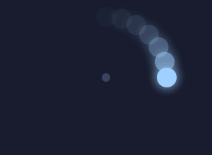

Repare no `ease=linear` com a rotação de 0 a 360: o giro é constante, e o quadro 24 (360°) é igual ao 0. Assim o loop não tem emenda.

Os três números do `trail=`, comparados em duas bolas que vão e voltam:

<!-- gerar: img/08_rastro_cor.gif -a vai -->
```weasel
canvas 360 160 bg=#14182a

bone vaiA pivot=60,50
bone vaiB pivot=60,120

layer bolaA trail=3,0.5
ellipse a 60,50 12 c=#9fd0ff bone=vaiA
layer bolaB trail=10,0.8,#ff6ad5
ellipse b 60,120 12 c=#9fd0ff bone=vaiB

layer rotulos
text t1 180,20 "trail=3,0.5" size=13 align=center c=#d8dcef
text t2 180,90 "trail=10,0.8,#ff6ad5" size=13 align=center c=#d8dcef

anim vai frames=24 fps=12
key 0 vaiA=0 vaiB=0
key 12 vaiA=240 vaiB=240
key 24 vaiA=0 vaiB=0
```

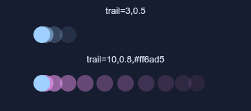

Repare:

- O **primeiro número** é quantos quadros para trás aparecem, de 1 a 30: 3 dá um rastro curto, 10 um rastro longo.
- O **segundo** é a queda: quanto sobra de uma cópia para a próxima, de 0.05 a 0.95 (se não escrever, 0.5). Com 0.5, cada cópia tem metade da força da anterior e some rápido; com 0.8, sobra mais de cada uma.
- O **terceiro**, opcional, é a cor do rastro: a bola continua azul, só as cópias ficam rosa.
- `key 12 vaiA=240`, com um número só, move o osso 240 pixels para a direita ([capítulo 7](07-movimento.md#quantos-números-escrever)).

**Cuidado:** o rastro só aparece com uma animação tocando: na pose parada, não há quadros anteriores. Uma queda fora de 0.05 a 0.95 é cortada, com um aviso; um número de quadros fora de 1 a 30 dá erro.

## Partículas

```
emitter [nome] x,y [rate=…] [burst=…] [life=…] [speed=…] [angle=…] [spread=…]
        [gravity=…] [wind=…] [drag=…] [size=início,fim] [c=início,fim] [shape=…] [area=…] [seed=…]
```

`emitter` solta **partículas**: fagulhas, fumaça, chuva, neve, bolhas, vaga-lumes. Cada partícula nasce no ponto do emissor, sai numa direção sorteada, vive um tempo e some, mudando de tamanho e de cor no caminho.

<!-- gerar: img/08_fogueira.gif -a queima -->
```weasel
canvas 320 260 bg=#14182a
finish game bloom=0.5 vignette=0.6
palette ink=#14141c line=4

layer chao
ellipse terra 160,232 120,16 c=#4a3d52

layer lenha
rect tora1 104,206 112,18 r=9 rot=-14 c=#7a4a2c ink=line
rect tora2 104,206 112,18 r=9 rot=14 c=#6a3f26 ink=line

layer fogo unlit
emitter fumaca 160,150 rate=5 life=2.4 speed=34 angle=-90 spread=24 wind=14 c=#6a6d8060,#6a6d8000 size=16,48 shape=soft seed=5
emitter chama 160,208 rate=40 life=0.8 speed=70 angle=-90 spread=30 gravity=-60 area=44,4 c=#ffd27a,#ff400000 size=24,4 shape=soft emit=#ff9a4a,0.6
emitter fagulha 160,200 rate=10 life=1.4 speed=100 angle=-90 spread=70 gravity=-20 drag=0.6 c=#ffe2a8,#ff800000 size=4,1 seed=2

ambient c=#3a4270 power=0.5
light fogueira point 160,186 c=#ff9a4a power=1.5 radius=220 glow=80 flicker=0.15

anim queima frames=24 fps=12
```

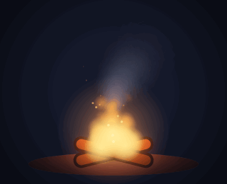

Repare:

- Três emissores fazem a fogueira: a fumaça, a chama e as fagulhas. Cada um tem a sua direção, a sua velocidade e as suas cores. As seções abaixo mostram cada opção sozinha.
- As partículas precisam de uma **animação tocando** (aqui, `anim queima`, sem `key`), como a chama que tremula do capítulo 10. Na pose parada, aparece um instante "congelado".
- O sorteio é **fixo**: a mesma animação sai sempre igual, e o loop fecha certinho, sem partículas sumindo ou aparecendo na emenda.
- O fogo está numa camada `unlit` (o fogo é a luz), e uma `light` com `flicker=` no meio dele ilumina a lenha ([capítulo 10](10-luz.md#chama-que-tremula-flicker)).
- A linha `finish` do começo faz o claro vazar num brilho e escurece as bordas. Ela está no [capítulo 12](12-acabamento.md#acabamentos-de-cinema-bloom-vignette-e-grain).

Os exemplos a seguir mudam uma opção de cada vez. Quase todos **não têm animação**: a imagem é aquele instante congelado da pose parada, que é ótimo para comparar. Cole qualquer um deles com uma linha `anim teste frames=24 fps=12` no fim para ver as partículas se mexendo.

### O formato: `shape=`

<!-- gerar: img/08_part_formas.png -->
```weasel
canvas 520 180 bg=#14182a

layer faiscas
emitter e1 52,120 rate=20 speed=70 spread=50 size=16,6 c=#ffd27a,#ff6a3d00 shape=dot
emitter e2 156,120 rate=20 speed=70 spread=50 size=16,6 c=#ffd27a,#ff6a3d00 shape=soft
emitter e3 260,120 rate=20 speed=70 spread=50 size=16,6 c=#ffd27a,#ff6a3d00 shape=square
emitter e4 364,120 rate=20 speed=70 spread=50 size=8,3 c=#ffd27a,#ff6a3d00 shape=streak
emitter e5 468,120 rate=20 speed=70 spread=50 size=16,6 c=#ffd27a,#ff6a3d00 shape=star

layer rotulos
text t1 52,168 "dot" size=13 align=center c=#d8dcef
text t2 156,168 "soft" size=13 align=center c=#d8dcef
text t3 260,168 "square" size=13 align=center c=#d8dcef
text t4 364,168 "streak" size=13 align=center c=#d8dcef
text t5 468,168 "star" size=13 align=center c=#d8dcef
```

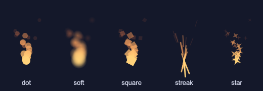

Repare:

- `dot` é uma bolinha lisa (se não escrever). `soft` é uma bolinha de borda esfumaçada, com o dobro do tamanho: boa para fumaça, neblina e chamas.
- `square` é um quadradinho, cada um girado de um jeito: confete, cinzas, pixels.
- `streak` é um **risco** na direção em que a partícula anda: chuva, faíscas rápidas. O comprimento é 4 vezes o `size=`; por isso ele tem um tamanho menor que os outros.
- `star` é uma estrelinha de quatro pontas: magia, brilho.

### A direção: `angle=` e `spread=`

<!-- gerar: img/08_part_direcao.png -->
```weasel
canvas 520 180 bg=#14182a

layer faiscas
emitter e1 52,90 rate=60 speed=60 spread=0 c=#9fd0ff
emitter e2 156,90 rate=60 speed=60 c=#9fd0ff
emitter e3 260,90 rate=60 speed=60 spread=360 c=#9fd0ff
emitter e4 364,90 rate=60 speed=60 angle=0 spread=20 c=#9fd0ff
emitter e5 468,90 rate=60 speed=60 angle=135 spread=20 c=#9fd0ff

layer rotulos
text t1 52,168 "spread=0" size=13 align=center c=#d8dcef
text t2 156,168 "(padrão: 40)" size=13 align=center c=#d8dcef
text t3 260,168 "spread=360" size=13 align=center c=#d8dcef
text t4 364,168 "angle=0" size=13 align=center c=#d8dcef
text t5 468,168 "angle=135" size=13 align=center c=#d8dcef
```

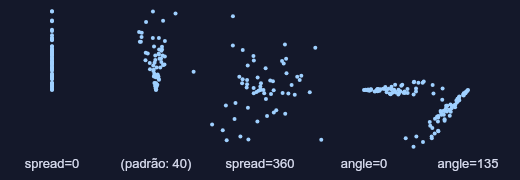

Repare:

- `angle=` é para onde as partículas vão, em graus. Como no resto do Weasel, 0 = direita, 90 = baixo, 180 = esquerda e −90 = cima (se não escrever).
- `spread=` é o quanto essa direção pode variar, em graus, no total (de 0 a 360). Com 0, todas saem iguais, numa fila; com 40 (se não escrever), num leque; com 360, para todo lado, como uma explosão.
- As partículas de um mesmo emissor não andam todas na mesma velocidade: cada uma sorteia até 30% a mais ou a menos que o `speed=`. Por isso elas se espalham ao longo do caminho.

### As forças: `gravity=`, `wind=` e `drag=`

<!-- gerar: img/08_part_forcas.png -->
```weasel
canvas 520 200 bg=#14182a

layer faiscas
emitter e1 52,130 rate=60 speed=110 spread=10 life=1.2 c=#ffd27a
emitter e2 136,130 rate=60 speed=110 spread=10 life=1 c=#ffd27a gravity=200 angle=-70
emitter e3 260,130 rate=60 speed=40 spread=10 life=1.2 c=#ffd27a gravity=-150
emitter e4 364,130 rate=60 speed=110 spread=10 life=1.2 c=#ffd27a wind=150
emitter e5 468,130 rate=60 speed=110 spread=10 life=1.2 c=#ffd27a drag=3

layer rotulos
text t1 52,188 "nada" size=13 align=center c=#d8dcef
text t2 156,188 "gravity=200" size=13 align=center c=#d8dcef
text t3 260,188 "gravity=-150" size=13 align=center c=#d8dcef
text t4 364,188 "wind=150" size=13 align=center c=#d8dcef
text t5 468,188 "drag=3" size=13 align=center c=#d8dcef
```

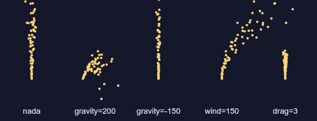

Repare:

- Sem forças, a partícula anda em linha reta, sempre na mesma velocidade (`speed=`, em pixels por segundo; se não escrever, 80).
- `gravity=200` puxa para **baixo**: a partícula sobe, perde força e cai, como a água de um chafariz. O número é em pixels por segundo, a cada segundo: quanto maior, mais forte o puxão.
- `gravity=-150`, negativo, puxa para **cima**: a partícula sai devagar (`speed=40`) e vai acelerando, como fogo e bolhas.
- `wind=150` empurra para a **direita** (negativo: para a esquerda), cada vez mais com o tempo.
- `drag=3` é a resistência do ar, de 0 a 100: a partícula sai rápida e vai **freando** até quase parar. É o que faz a fumaça parar no ar e se espalhar.

### Vida, tamanho e cor: `life=`, `size=` e `c=`

<!-- gerar: img/08_part_vida.png -->
```weasel
canvas 520 200 bg=#14182a

layer faiscas
emitter e1 52,150 rate=40 speed=80 life=0.4 c=#9fd0ff
emitter e2 156,150 rate=40 speed=80 life=1.6 c=#9fd0ff
emitter e3 260,150 rate=20 speed=80 size=2,16 c=#9fd0ff
emitter e4 364,150 rate=20 speed=80 size=16,2 c=#9fd0ff
emitter e5 468,150 rate=40 speed=80 c=#ffffff,#ff400000

layer rotulos
text t1 52,188 "life=0.4" size=13 align=center c=#d8dcef
text t2 156,188 "life=1.6" size=13 align=center c=#d8dcef
text t3 260,188 "size=2,16" size=13 align=center c=#d8dcef
text t4 364,188 "size=16,2" size=13 align=center c=#d8dcef
text t5 468,188 "c=#ffffff,#ff400000" size=12 align=center c=#d8dcef
```

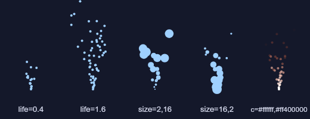

Repare:

- `life=` é quanto tempo cada partícula vive, em segundos: de 0.02 a 60 (se não escrever, 1). Cada uma varia até 25% para mais ou para menos. Com a mesma velocidade, vida curta é um jato baixo, e vida longa, um jato alto.
- `size=início,fim` é o **diâmetro**, em pixels, ao nascer e ao morrer (se não escrever, 4). `2,16` cresce (fumaça que se espalha); `16,2` encolhe (fagulha que apaga). Com um número só, o tamanho não muda.
- `c=início,fim` faz a mesma coisa com a cor. O fim `#ff400000` termina em `00`, transparente: a partícula some aos poucos, em vez de sumir de uma vez. Sem `c=`, as partículas saem na cor `ink` da `palette`.

### Onde nascem: `area=`, e o sorteio: `seed=`

<!-- gerar: img/08_part_area.png -->
```weasel
canvas 520 200 bg=#14182a

layer faiscas
emitter e1 52,150 rate=40 speed=60 spread=10 c=#ffd27a
emitter e2 156,150 rate=40 speed=60 spread=10 c=#ffd27a area=80,0
emitter e3 260,130 rate=40 speed=60 spread=10 c=#ffd27a area=80,60
emitter e4 364,150 rate=10 speed=60 c=#ffd27a size=6
emitter e5 468,150 rate=10 speed=60 c=#ffd27a size=6 seed=2

layer rotulos
text t1 52,188 "sem area" size=13 align=center c=#d8dcef
text t2 156,188 "area=80,0" size=13 align=center c=#d8dcef
text t3 260,188 "area=80,60" size=13 align=center c=#d8dcef
text t4 364,188 "seed=1 (padrão)" size=13 align=center c=#d8dcef
text t5 468,188 "seed=2" size=13 align=center c=#d8dcef
```

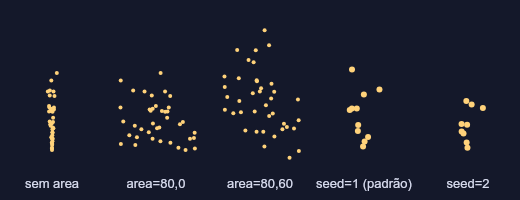

Repare:

- Sem `area=`, todas as partículas nascem **no mesmo ponto**.
- `area=80,0` espalha o nascimento numa **linha** de 80 pixels de largura (0 de altura), com o ponto do emissor no meio. É assim que se faz chuva no céu inteiro: `area=1000,0` em cima da tela.
- `area=80,60` espalha num **retângulo** de 80 × 60: bom para vaga-lumes, poeira no ar, bolhas num aquário. Com um número só (`area=80`), o retângulo é um quadrado.
- Os dois últimos são iguais, menos o `seed=`. O `seed=` é o "número da sorte" do sorteio: com outro número, as partículas saem em outros lugares. Use quando tiver dois emissores iguais lado a lado (duas tochas): senão, as partículas dos dois saem iguaizinhas.

### Uma rajada só: `burst=`

`rate=` é um **fluxo**: partículas nascendo sem parar, tantas por segundo (de 0 a 2000; se não escrever, 20). `burst=` é uma **rajada**: várias de uma vez, no começo de cada volta da animação. Como isso acontece no tempo, este exemplo é uma animação:

<!-- gerar: img/08_rajada.gif -a solta -->
```weasel
canvas 320 180 bg=#14182a

layer faiscas
emitter fluxo 80,90 rate=20 speed=60 spread=360 c=#9fd0ff,#9fd0ff00 size=6,2
emitter rajada 240,90 rate=0 burst=20 speed=60 spread=360 c=#ffd27a,#ffd27a00 size=6,2

layer rotulos
text t1 80,166 "rate=20" size=13 align=center c=#d8dcef
text t2 240,166 "rate=0 burst=20" size=13 align=center c=#d8dcef

anim solta frames=18 fps=12
```

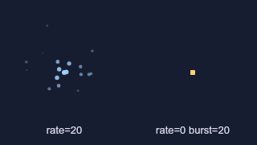

Repare:

- O `rajada` tem `rate=0`. Isso é importante: o `rate=` vale 20 mesmo quando você não escreve, então um emissor só com `burst=20` solta a rajada **e** o fluxo.
- A rajada acontece no quadro 0 de cada volta. A animação tem 18 quadros (1,5 segundo), então o estouro se repete a cada 1,5 segundo.
- Para um estouro que acontece uma vez só (um pulo, uma explosão), use uma animação com `once`.

**Experimente:** apague o `rate=0` do emissor `rajada`. Ele passa a soltar também o fluxo de 20 por segundo, e a rajada fica escondida no meio das outras bolinhas.

### Partículas presas a um osso: `bone=`

Com `bone=`, o emissor **anda com o osso**. Mas cada partícula, depois que nasce, segue sozinha: ela não volta com o osso. Por isso a fumaça de um foguete fica para trás, desenhando o caminho:

<!-- gerar: img/08_foguete.gif -a gira -->
```weasel
canvas 300 220 bg=#14182a
palette ink=#14141c line=3

bone voo pivot=150,110

layer fumaca
emitter rastro 176,24 rate=20 life=1.2 speed=8 spread=360 size=6,18 c=#c8cce0a0,#c8cce000 shape=soft bone=voo

layer nave
shape foguete c=#e8504a ink=line bone=voo : 124,24! 138,14 176,14! 176,34! 138,34

anim gira frames=24 fps=12
key 0 voo=0,0,0 ease=linear
key 24 voo=0,0,-360
```

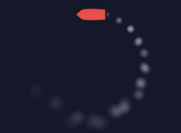

Repare:

- O osso `voo` gira em volta do meio do canvas (`pivot=150,110`). O foguete e o emissor estão no alto, a uns 85 pixels do pivô, então dão voltas num círculo.
- O bico do foguete foi desenhado para a esquerda. Por isso o giro é negativo (`-360`, anti-horário): assim ele anda de bico para a frente.
- O emissor fica no ponto `176,24`, a traseira do foguete: a fumaça sai de trás. Ele tem `speed=8` e `spread=360`: a fumaça quase não anda sozinha. Quem desenha o círculo é o foguete andando.
- As bolinhas nascem pequenas e meio transparentes (`a0` no fim da cor) e terminam grandes e invisíveis (`00`). Por isso a trilha engrossa e some.

**Experimente:** troque para `speed=40 angle=90` (para baixo). A fumaça passa a cair do foguete, como de um avião em pane.

### Mais sobre o `emitter`

- O nome é opcional: `emitter 160,200 rate=10` também vale. Com nome, a `key` pode mostrar e esconder o emissor (`key 10 fumaca.show=0`).
- `opacity=` deixa todas as partículas mais transparentes, e `hidden` e `lock` valem como nas formas ([capítulo 4](04-camadas.md#travar-no-editor-lock)).
- `emit=cor,força` no emissor faz as partículas brilharem e ignorarem a luz, como numa forma ([capítulo 10](10-luz.md#coisas-que-brilham-emit)). Sem `emit=` e fora de uma camada `unlit`, cada partícula recebe a luz do ponto onde está.
- Na pose parada, o instante congelado é o de 1,25 vez o `life=` depois do começo (só com `burst=`, 0,35 vez). Num filme, as partículas andam com o tempo do filme.
- Numa animação em loop, o `rate=` se ajusta para dar um número inteiro de partículas por volta: é isso que fecha o loop sem pulo.

**Cuidado:** com `rate=0` e sem `burst=`, o emissor não solta nada, e o Weasel avisa. O `c=` só aceita uma cor `#hex` (ou um nome da `palette` que guarde uma).

### Opções do `emitter`

| Opção | O que faz | Valores | Se não escrever |
|---|---|---|---|
| `x,y` | onde as partículas nascem | dois números, em pixels | obrigatório |
| `rate=` | quantas nascem por segundo | de 0 a 2000 | 20 |
| `burst=` | uma rajada no começo de cada volta | de 0 a 5000 | 0 |
| `life=` | quanto tempo cada uma vive (±25%) | de 0.02 a 60, em segundos | 1 |
| `speed=` | a velocidade ao nascer (±30%) | 0 ou mais, em pixels por segundo | 80 |
| `angle=` | a direção | graus: 0 = direita, −90 = para cima | −90 |
| `spread=` | a abertura em volta do `angle=` | de 0 a 360, em graus | 40 |
| `gravity=` | puxa para baixo (negativo: para cima) | pixels por segundo, a cada segundo | 0 |
| `wind=` | puxa para a direita (negativo: para a esquerda) | pixels por segundo, a cada segundo | 0 |
| `drag=` | freia com o tempo | de 0 a 100 | 0 |
| `size=início,fim` | o diâmetro | um ou dois números, em pixels | 4 |
| `c=início,fim` | a cor | uma ou duas cores `#hex` | a cor `ink` |
| `shape=` | o formato | `dot`, `soft`, `square`, `streak` ou `star` | `dot` |
| `area=largura,altura` | o retângulo onde nascem | um ou dois números, em pixels | 0 (um ponto) |
| `seed=` | troca o sorteio | qualquer número | 1 |
| `bone=` | o emissor anda com o osso | o nome de um osso | parado |
| `emit=cor,força` | as partículas brilham e ignoram a luz | como nas formas | — |

A ficha completa está na [referência do `emitter`](20-referencia.md#emitter).

## Juntando tudo

O caldeirão de uma bruxa ferve no escuro. A poção muda de cor e pulsa, as bolhas sobem, o vapor sai borrado, estrelinhas piscam no ar e um astro mágico dá voltas, deixando um rastro.

<!-- gerar: img/11_caldeirao.gif -a ferve -s 0.75 -->
```weasel
canvas 360 300 bg=#141224
palette ink=#14141c line=4 ferro=#3a3a48 madeira=#8a5a3c

layer fundo shade=0
rect parede -10,-10 380,262 c=#4a4360
rect chao -10,252 380,60 c=#2a2436

layer placa unlit shadow=#000000a0,5,5,3
rect tabua 22,26 104,38 r=6 c=#7a5234 ink=line
text nome 74,52 "POÇÕES" size=18 bold align=center c=#f4e6c8

layer fogo unlit
emitter chama 180,252 rate=40 life=0.6 speed=60 spread=30 gravity=-60 area=80,4 c=#ffd27a,#ff400000 size=20,4 shape=soft emit=#ff9a4a,0.6

layer caldeirao
rect pe1 128,226 14,28 r=4 c=ferro ink=line
rect pe2 218,226 14,28 r=4 c=ferro ink=line
ellipse panela 180,200 78,50 c=ferro ink=line
rect boca 96,158 168,18 r=9 c=#4a4a5a ink=line

layer pocao glow=#7dff6a,8,2
ellipse liquido 180,160 72,8 c=#5fd35a
emitter bolha 180,160 rate=8 life=1.2 speed=24 spread=20 gravity=-30 area=110,4 size=5,10 c=#9dff8a,#9dff8a00 seed=3

layer vapor blur=3
emitter fumaca 180,146 rate=6 life=2.4 speed=26 spread=20 wind=12 size=20,60 c=#c8cce060,#c8cce000 shape=soft seed=5

layer magia unlit
emitter brilho 180,110 rate=6 life=1.6 speed=10 spread=360 area=150,70 size=8,2 c=#fff6a0,#fff6a000 shape=star emit=#fff6a0,0.6 seed=7

bone orbita pivot=180,150
layer estrela unlit trail=8,0.7,#c9a0ff
ellipse astro 180,76 8 c=#ffe27a emit=#ffe27a,1 bone=orbita

ambient c=#5a5080 power=0.55
light fogueira point 180,250 c=#ff9a4a power=1.6 radius=220 flicker=0.2

anim ferve frames=48 fps=12
key 0 pocao.hue=0 pocao.glow=8 orbita=0,0,0 ease=linear
key 24 pocao.glow=22
key 48 pocao.hue=360 orbita=0,0,360
```


- **A poção** é uma camada com `glow=`. A `key` gira o `hue` de 0 a 360 em 4 segundos (as cores dão a volta inteira) e faz o raio do brilho crescer até o quadro 24 e voltar. O `hue` gira as cores das formas e das bolhas da camada; o brilho fica verde.
- **As bolhas** estão na camada da poção: mudam de cor com ela. Sobem com a gravidade negativa e nascem espalhadas pela boca do caldeirão (`area=110,4`).
- **O vapor** é feito de bolinhas `soft` grandes e transparentes, numa camada com `blur=3`, e o `wind=` leva para a direita.
- **As estrelinhas** nascem num retângulo grande (`area=150,70`), quase paradas, e brilham com `emit=`.
- **O astro** gira com o osso `orbita`, numa camada com `trail=8,0.7,#c9a0ff`: o rastro lilás mostra o caminho.
- **A placa** tem uma `shadow=` deslocada, e **o fogo** embaixo é um emissor com uma `light` que tremula (capítulo 10).

**Experimente:** na linha `layer vapor`, troque `blur=3` por `blur=0`. O vapor vira um monte de bolinhas: o desfoque é o que as junta numa nuvem.

## Resumo

- As opções de efeito da `layer` tratam a camada como uma imagem: `blur=` desfoca, `glow=` brilha em volta, `shadow=` faz uma sombra deslocada, e `tint=`, `brightness=`, `saturate=`, `contrast=` e `hue=` mudam as cores.
- A `key` anima os efeitos pelo nome da camada (`key 6 fundo.blur=4`); a cor do `glow` e do `tint` vem da linha `layer`.
- `trail=` deixa as poses anteriores pintadas atrás da camada, cada uma mais fraca.
- `emitter` solta partículas: `rate=` e `burst=` dizem quantas, `life=`, `speed=`, `angle=` e `spread=` dizem como saem, `gravity=`, `wind=` e `drag=` mudam o caminho, e `size=`, `c=` e `shape=` mudam a aparência.
- As partículas precisam de uma animação tocando; o sorteio é fixo, e `seed=` troca o sorteio.

[← Luz e sombra](10-luz.md) · [Índice](README.md) · [Próximo: Acabamento →](12-acabamento.md)
