# 11. Profundidade (2.5D)

[← Filme](10-filme.md) · [Índice](README.md) · [Próximo: Referência rápida →](12-referencia.md)

O Weasel continua desenhando no plano, mas cada forma pode **ficar de pé num mundo com fundo**: girar como uma carta, ter espessura, ir para perto ou para longe, deitar como chão. É o truque do **2.5D**: peças chatas, arrumadas em 3D. Dá para fazer uma carta que vira, uma cabeça que olha para os lados, uma estrada que some no horizonte, um mapa isométrico e o zoom do *Vertigo* no filme.

Quem não usa nada disto não vê diferença: sem giro, nada sai do lugar.

## As três direções

- **x** vai para a direita e **y** para baixo, como sempre.
- **z** sai da tela, na sua direção: `z=40` está 40 pixels **mais perto** de você; `z=-40`, mais longe.
- `yaw=` gira em volta do eixo de pé, como uma porta (positivo: a frente vira para a direita).
- `pitch=` gira em volta do eixo deitado (positivo: o alto vai para longe, a frente olha para cima).

Os dois são em graus. Numa forma, ela gira em volta do próprio meio:

<!-- gerar: img/11_giro.png -->
```weasel
canvas 720 300 bg=#f4efe6
palette ink=#1c1f2b line=5 carta=#e94f37

rect parada 40,60 160,190 r=14 c=carta ink=line
rect deitada 280,60 160,190 r=14 c=carta ink=line pitch=55
rect virada 520,60 160,190 r=14 c=carta ink=line yaw=50

text t1 120,290 "parada" size=22 align=center c=ink
text t2 360,290 "pitch=55" size=22 align=center c=ink
text t3 600,290 "yaw=50" size=22 align=center c=ink
```


- O lado que vai para longe fica **menor**: é a **perspectiva**. `persp=` é a distância do olho em pixels (padrão: o dobro do lado maior do desenho). Mais perto (`persp=400`) deforma mais; `persp=0` tira a perspectiva.
- A forma que vira de lado fica **mais escura**, como uma carta que sai da luz. O `shade=` da camada controla isso (padrão 0.5; 0 desliga).
- O giro vale para todas as formas: `shape`, `ellipse`, `rect`, `stroke`, `line` e `text`.

**Experimente:** troque `yaw=50` por `yaw=-50`. A carta vira para o outro lado: agora é a esquerda que fica menor.

### Perto ou longe do olho: `persp=`

A perspectiva depende de **onde está o seu olho**. Olho perto da carta (um número pequeno) deforma muito, como uma foto tirada bem de perto. Olho longe deforma pouco. As três cartas abaixo têm o mesmo `yaw=50`:

<!-- gerar: img/11_persp.png -->
```weasel
canvas 720 300 bg=#f4efe6
palette ink=#1c1f2b line=5 carta=#e94f37

rect perto 40,60 160,190 r=14 c=carta ink=line yaw=50 persp=300
rect normal 280,60 160,190 r=14 c=carta ink=line yaw=50
rect plana 520,60 160,190 r=14 c=carta ink=line yaw=50 persp=0

text t1 120,290 "persp=300" size=22 align=center c=ink
text t2 360,290 "sem persp=" size=22 align=center c=ink
text t3 600,290 "persp=0" size=22 align=center c=ink
```

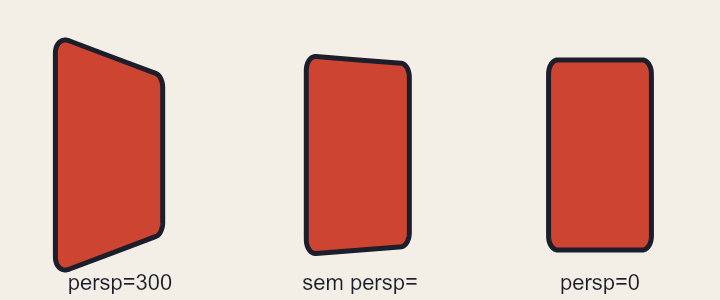

Repare:

- `persp=300`: o olho está a 300 pixels da carta. O lado que vem para perto (a esquerda) **cresce** e o que vai para longe encolhe bastante.
- Sem `persp=`, o olho fica a 1440 pixels (o dobro de 720, o lado maior deste desenho): uma deformação suave.
- `persp=0` desliga a perspectiva: a carta só fica mais estreita, com os dois lados da mesma altura. É o jeito de jogos "de prancheta" e de diagramas técnicos.

### Mais escuro de lado: `shade=`

Uma carta virada recebe menos luz. O `shade=` da **camada** diz quanto ela escurece: 0 não escurece, 0.5 é o padrão e até 2 escurece muito. Cada carta abaixo está numa camada diferente, todas com `yaw=60`:

<!-- gerar: img/11_shade.png -->
```weasel
canvas 720 300 bg=#f4efe6
palette ink=#1c1f2b line=5 carta=#e94f37

layer sem shade=0
rect c1 40,60 160,190 r=14 c=carta ink=line yaw=60
layer meio
rect c2 280,60 160,190 r=14 c=carta ink=line yaw=60
layer forte shade=1.5
rect c3 520,60 160,190 r=14 c=carta ink=line yaw=60

layer nomes
text t1 120,290 "shade=0" size=22 align=center c=ink
text t2 360,290 "sem shade= (0.5)" size=22 align=center c=ink
text t3 600,290 "shade=1.5" size=22 align=center c=ink
```

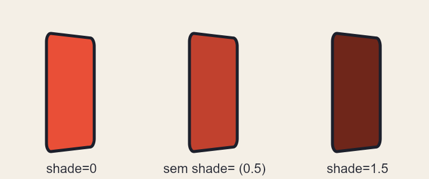

- O escuro aumenta quanto mais a carta vira: de frente, nada; de lado (`yaw=90`), o máximo.
- Só o giro da própria forma (ou do osso dela) escurece. O giro da **camada inteira** (veja [Girar a camada inteira](#girar-a-camada-inteira-yaw-pitch-e-pivot)) não escurece nada.
- O mesmo `shade=` também controla o claro e escuro da luz da cena ([capítulo 8](08-luz-efeitos.md)).

## Uma carta que vira: `back=` e `thick=`

Para girar **várias peças juntas**, ponha todas num osso e gire o osso. `yaw=` e `pitch=` também valem no `bone`, e o giro acontece em volta do pivô:

<!-- gerar: img/11_carta.gif -a gira -s 0.5 -->
```weasel
canvas 400 400 bg=#f4efe6
palette ink=#1c1f2b line=6 frente=#fff6e0 verso=#2e86ab sol=#ffd23f

bone carta pivot=200,200

layer cartas zsort
rect frente 100,60 200,280 r=18 c=frente ink=line thick=10 thickc=#d8cbb0 back=costas bone=carta
rect costas 100,60 200,280 r=18 c=verso ink=line hidden
ellipse sol 200,180 56 c=sol ink=5 z=1 bone=carta
text nome 200,300 "SOL" size=40 align=center c=ink z=1 bone=carta bold

anim gira frames=36
key 0 carta.yaw=0 ease=linear
key 36 carta.yaw=360
```


- `back=costas` diz qual forma aparece quando a carta fica **de costas**. As duas precisam ser fechadas e do mesmo tamanho; ponha `hidden` no verso, senão ele aparece também sozinho.
- `thick=10` dá **espessura**: a carta vira um bloco de 10 pixels, com a borda aparecendo de lado. `thickc=` é a cor da borda (sem ele, a cor da forma um pouco mais escura).
- O sol e o nome têm `z=1`: estão um pixel na frente da carta. Sem isso, teriam a mesma profundidade dela e continuariam aparecendo por cima do verso.
- `zsort` na camada pinta **de longe para perto** a cada quadro, em vez de seguir a ordem do código. Por isso o sol some atrás do verso quando a carta vira.
- `key 0 carta.yaw=0`: o giro do osso anima como qualquer outra coisa. Numa forma solta, é `nome.yaw=` (e `nome.pitch=`, `nome.z=`); numa camada, `camada.yaw=`.
- `ease=linear` está na `key 0` porque o `ease` de uma `key` diz como o movimento **sai** dela: assim a carta gira sempre na mesma velocidade, sem parar na frente a cada volta.

### A cor dos lados: `thickc=`

`thick=` levanta a forma como um bloco. Os lados ganham a cor da forma, um pouco mais escura; `thickc=` escolhe outra cor. Os dois blocos abaixo têm 60 pixels de espessura e o mesmo giro:

<!-- gerar: img/11_thickc.png -->
```weasel
canvas 560 300 bg=#f4efe6
palette ink=#1c1f2b line=4 caixa=#2e86ab

rect bloco1 70,70 140,140 c=caixa ink=line thick=60 yaw=35 pitch=-25
rect bloco2 350,70 140,140 c=caixa ink=line thick=60 yaw=35 pitch=-25 thickc=#ffd23f

text t1 140,285 "thick=60" size=22 align=center c=ink
text t2 420,285 "thick=60 thickc=#ffd23f" size=22 align=center c=ink
```

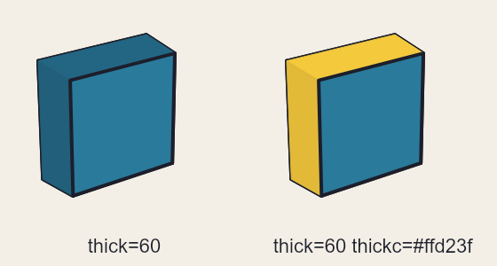

- `thick=60`: o bloco tem 60 pixels de fundo, **para trás** da forma (a frente fica onde a forma foi desenhada).
- `yaw=35 pitch=-25`: virado para o lado e com o alto vindo para perto, para os lados aparecerem.
- Os lados não ficam todos iguais: o de cima é mais claro que o da esquerda, porque a luz vem de cima à esquerda.
- `thick=` só vale em formas fechadas (`shape`, `ellipse`, `rect`).

### Quem fica na frente: `zsort`

Sem `zsort`, as formas são pintadas **na ordem do código**: a de baixo no arquivo fica por cima, mesmo com `z=`. Com `zsort` na camada, o Weasel pinta de longe para perto, e o `z=` decide.

<!-- gerar: img/11_zsort.png -->
```weasel
canvas 640 300 bg=#f4efe6
palette ink=#1c1f2b line=4

layer sem
ellipse perto1 130,130 70 c=#e94f37 ink=line z=40
ellipse meio1 180,160 70 c=#ffd23f ink=line z=0
ellipse longe1 230,190 70 c=#2e86ab ink=line z=-40

layer com zsort
ellipse perto2 410,130 70 c=#e94f37 ink=line z=40
ellipse meio2 460,160 70 c=#ffd23f ink=line z=0
ellipse longe2 510,190 70 c=#2e86ab ink=line z=-40

layer nomes
text t1 180,290 "sem zsort" size=22 align=center c=ink
text t2 460,290 "com zsort" size=22 align=center c=ink
```

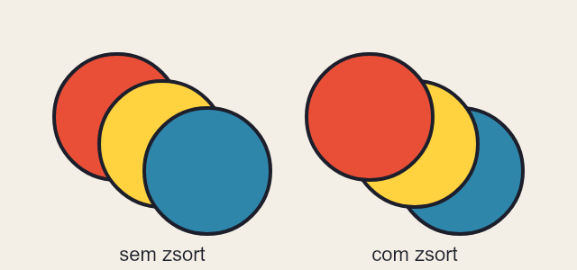

Repare:

- Nos dois grupos, o código é igual: o vermelho (`z=40`, perto) vem primeiro e o azul (`z=-40`, longe) por último.
- **sem zsort**: o azul é pintado por último e cobre os outros, mesmo estando "longe".
- **com zsort**: o vermelho, o mais perto, fica por cima. É o que você espera ver.
- Sem nenhum giro, o `z=` não muda o tamanho nem o lugar das formas: só a ordem, e só com `zsort`.

## Uma cabeça que olha para os lados: `round=`

Uma cabeça desenhada de frente é chata: se ela só girar como carta, o rosto achata. Com `round=raio` no osso, as peças dele ficam **na superfície de uma bola**: o olho do lado que vai embora chega mais perto da borda e encolhe, e o que passa para trás da bola some aos poucos. É o efeito do Live2D, sem desenhar a cabeça de lado.

<!-- gerar: img/11_cabeca.gif -a olha -s 0.5 -->
```weasel
canvas 400 400 bg=#f4efe6
palette ink=#1c1f2b line=5 pele=#f2c9a0 nariz=#e0a77e

bone pescoco pivot=200,360
bone rosto parent=pescoco pivot=200,330 round=110,200,200

layer cabeca zsort
ellipse cranio 200,200 110 c=pele ink=line bone=pescoco
ellipse orelhaE 92,210 18,28 c=pele ink=line bone=rosto z=-40
ellipse orelhaD 308,210 18,28 c=pele ink=line bone=rosto z=-40
ellipse olhoE 160,185 11,16 c=ink bone=rosto
ellipse olhoD 240,185 11,16 c=ink bone=rosto
shape nariz c=nariz ink=4 bone=rosto : 200,200 212,232 188,232
stroke boca w=5 bone=rosto : 165,262 200,278 235,262

anim olha frames=32
key 0 rosto.yaw=-35 rosto.pitch=0
key 8 rosto.yaw=0 rosto.pitch=-15
key 16 rosto.yaw=35 rosto.pitch=0
key 24 rosto.yaw=0 rosto.pitch=15
key 32 rosto.yaw=-35 rosto.pitch=0
```


- `round=110,200,200` é o raio e o centro da bola, os mesmos do crânio. Só com o raio (`round=110`), o centro é o meio das peças presas no osso.
- O **crânio** fica no osso `pescoco`, que não gira: ele é o fundo, sempre redondo. Só o **rosto** (olhos, nariz, boca) corre por cima dele.
- As **orelhas** ficam fora da bola. Uma peça com `z=` próprio não vai para a bola: continua um cartão, aqui 40 pixels atrás do meio da cabeça. Com `zsort`, a orelha que vai para trás fica atrás do crânio, e a outra aparece na frente.
- Vale para olhar para cima e para baixo também (`pitch=`), e junta com o resto: os olhos podem piscar e a boca falar enquanto a cabeça vira.

**Experimente:** troque `round=110,200,200` por `round=60,200,200` (uma bola menor que o crânio). O rosto passa a virar como o de uma cabeça menor: nos giros, o olho que vai embora quase some e o nariz se achata.

## Girar a camada inteira: `yaw=`, `pitch=` e `pivot=`

Às vezes o que gira é **tudo** de uma camada: uma placa, uma porta, um mapa. `yaw=` e `pitch=` na camada giram todas as formas dela juntas, sem precisar de osso. `pivot=x,y` diz onde fica o **eixo** do giro; sem ele, o eixo passa pelo meio do desenho inteiro (o meio do `canvas`).

<!-- gerar: img/11_porta.gif -a gira -s 0.75 -->
```weasel
canvas 640 320 bg=#f4efe6
palette ink=#1c1f2b line=5

layer fundo
rect vao 400,40 160,250 c=#3b3355

layer placa pivot=160,165
rect p 80,90 160,150 r=12 c=#ffd23f ink=line
text pt 160,180 "ABERTO" size=30 align=center c=ink bold

layer porta pivot=400,165
rect folha 400,40 160,250 c=#c0392b ink=line
ellipse macaneta 535,170 9 c=#ffd23f ink=3

layer nomes
text t1 160,310 "pivot=160,165 (o meio)" size=20 align=center c=ink
text t2 480,310 "pivot=400,165 (a dobradiça)" size=20 align=center c=ink

anim gira frames=24
key 0 placa.yaw=0 ease=linear
key 24 placa.yaw=360
key 0 porta.yaw=0
key 12 porta.yaw=75
key 24 porta.yaw=0
```

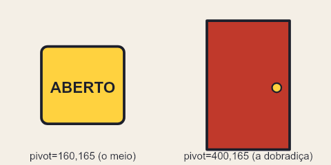

Linha por linha:

- `layer placa pivot=160,165`: o eixo passa pelo meio da placa (o retângulo vai de `x=80` a `240`; o meio é `160`). A placa e o texto giram juntos, como uma peça só.
- `layer porta pivot=400,165`: o eixo passa pela **borda esquerda** da porta (`x=400`), como uma dobradiça. A porta gira presa ali.
- `key 0 placa.yaw=0 ease=linear` e `key 24 placa.yaw=360`: uma volta inteira em 24 quadros (2 segundos), sempre na mesma velocidade.
- `key 12 porta.yaw=75`: no meio da animação, a porta está aberta 75 graus. Positivo: o lado da maçaneta vai para longe (a porta abre para dentro).

Repare:

- De costas, o texto da placa aparece **espelhado**. Para um verso de verdade, use formas com `back=` ([acima](#uma-carta-que-vira-back-e-thick)).
- O giro da camada **não escurece** as formas (o `shade=` vale só para o giro das formas e dos ossos).
- `pitch=` na camada funciona do mesmo jeito, em volta do eixo deitado. A camada também aceita `persp=`.

**Experimente:** apague o `pivot=400,165` da porta. O eixo vai para o meio do desenho (`x=320`), longe da dobradiça: a porta sai do batente e anda para o lado enquanto gira.

## Chão em perspectiva: `floor`

`floor` **deita a camada** como um chão: a linha de baixo do desenho fica onde está, e quanto mais para cima no código, mais longe. O infinito chega no **horizonte**:

<!-- gerar: img/11_chao.png -->
```weasel
canvas 640 360 bg=ceu
gradient ceu linear 0,0 0,110 : #8fc9ee #d9eef7
palette ink=#1c1f2b line=3 grama=#7cb342 asfalto=#5d5d5d faixa=#ffffff tronco=#8d5a3b folha=#4caf50

def arvore
  rect tronco -8,-60 16,60 c=tronco ink=line
  ellipse copa 0,-95 40,48 c=folha ink=line
end

layer chao floor horizon=110 zsort
rect campo -20000,-20000 40640,20360 c=grama
rect estrada 260,-20000 120,20360 c=asfalto
repeat i 0..7
  rect faixa{i} 314,{300 - i*170} 12,70 c=faixa
end
repeat i 0..5
  use arvore 180,{360 - i*300} billboard
  use arvore 460,{360 - i*300} billboard
end
```


- `horizon=110` é a altura do horizonte na tela (padrão: 30% do desenho, de cima para baixo). `pivot=x,y` muda a linha que fica parada (padrão: o meio da linha de baixo).
- Sem `persp=`, o chão deita 45°. Com `pitch=`, você escolhe o ângulo; com `persp=`, a lente.
- Desenhe o chão **comprido**: a grama e a estrada vão até `y=-20000` para chegar no horizonte. Um chão curto acaba no meio do caminho.
- As árvores usam `billboard`: ficam **sempre de frente**, de pé no ponto do `use`, e diminuem com a distância. Sem ele, elas deitariam junto com o chão. `billboard` também vale numa forma solta (o ponto de apoio é o meio da base dela).

### De pé ou deitado: `billboard` numa forma

Uma forma solta num chão `floor` deita junto com ele, como um desenho pintado no asfalto. Com `billboard`, ela fica **de pé**, de frente para você, apoiada no meio da base dela. Os quatro pinheiros abaixo têm a mesma forma; dois estão perto (`y` perto de 270) e dois mais longe (`y` perto de -130):

<!-- gerar: img/11_billboard.png -->
```weasel
canvas 640 300 bg=#bfe3f5
palette ink=#1c1f2b line=3 pinho=#2f6e3a

layer chao floor horizon=90 zsort
rect grama -20000,-20000 40640,20300 c=#8bc34a
shape p1 c=pinho ink=line : 150,270! 150,250! 115,250! 160,150! 205,250! 170,250! 170,270!
shape p2 c=pinho ink=line : 150,-130! 150,-150! 115,-150! 160,-250! 205,-150! 170,-150! 170,-130!
shape p3 c=pinho ink=line billboard : 470,270! 470,250! 435,250! 480,150! 525,250! 490,250! 490,270!
shape p4 c=pinho ink=line billboard : 470,-130! 470,-150! 435,-150! 480,-250! 525,-150! 490,-150! 490,-130!

layer nomes
text t1 160,40 "sem billboard" size=22 align=center c=ink
text t2 480,40 "billboard" size=22 align=center c=ink
```

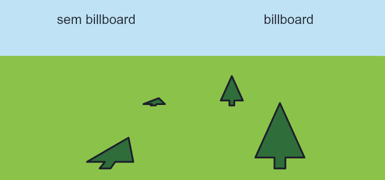

- **sem billboard**: o pinheiro deita com o chão e fica achatado. Bom para coisas que são mesmo do chão: faixas, poças, sombras, um tapete.
- **billboard**: o pinheiro fica de pé. Ele continua **diminuindo com a distância**, porque o ponto de apoio dele está no chão.
- O ponto de apoio de uma forma `billboard` é o **meio da base** dela (aqui, o pé do tronco). Num `use … billboard`, é o próprio ponto do `use`.

### Olhar de cima ou rente ao chão: `pitch=` e `pivot=` no `floor`

As três estradas abaixo são iguais e têm o mesmo horizonte; muda só o `pitch=` de cada chão. O círculo vermelho está sempre no mesmo lugar do chão: 300 pixels depois da linha de baixo.

<!-- gerar: img/11_chao_pitch.png -->
```weasel
canvas 720 300 bg=#bfe3f5
palette faixa=#ffffff asfalto=#5d5d5d placa=#e94f37

layer grama
rect g 0,100 720,200 c=#8bc34a

layer estrada1 floor horizon=100 pivot=120,300 pitch=20
rect e1 75,-20000 90,20300 c=asfalto
repeat i 0..40
  rect f1_{i} 114,{270 - i*60} 12,30 c=faixa
end
ellipse p1 190,0 18 c=placa ink=3 billboard

layer estrada2 floor horizon=100 pivot=360,300
rect e2 315,-20000 90,20300 c=asfalto
repeat i 0..40
  rect f2_{i} 354,{270 - i*60} 12,30 c=faixa
end
ellipse p2 430,0 18 c=placa ink=3 billboard

layer estrada3 floor horizon=100 pivot=600,300 pitch=70
rect e3 555,-20000 90,20300 c=asfalto
repeat i 0..40
  rect f3_{i} 594,{270 - i*60} 12,30 c=faixa
end
ellipse p3 670,0 18 c=placa ink=3 billboard

layer nomes
text t1 120,40 "pitch=20" size=22 align=center c=#1c1f2b
text t2 360,40 "sem pitch= (45)" size=22 align=center c=#1c1f2b
text t3 600,40 "pitch=70" size=22 align=center c=#1c1f2b
```

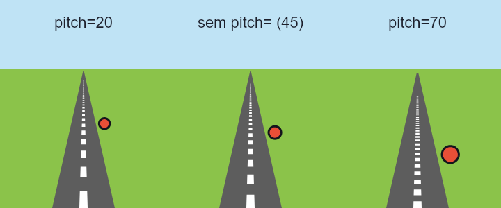

Repare:

- `pivot=120,300` em cada chão: a linha que fica parada, e o ponto para onde a estrada foge. Cada estrada tem o seu, por isso as três somem em lugares diferentes do horizonte.
- `pitch=20`: o chão **foge depressa** para o horizonte. Aos 300 pixels, o círculo já parece longe e pequeno. Dá a sensação de olhar de cima, para um chão que vai longe.
- `pitch=70`: o chão foge devagar. As faixas perto ficam baixinhas e juntas, e o círculo ainda parece perto. Dá a sensação de olhar rente ao chão.
- `persp=` também muda isso, pelo outro lado: com `persp=`, o Weasel calcula o ângulo para o chão chegar no horizonte. Use um ou outro.

## Mapa isométrico: `iso`

`layer … iso=x,y` faz da camada um **mapa isométrico**: os quadrados do código viram losangos, e `thick=` levanta blocos. É o jeito de jogos de estratégia e de fazenda vistos de cima e de lado.

<!-- gerar: img/11_iso.png -->
```weasel
canvas 560 290 bg=#20242e
palette ink=#1c1f2b line=3 grama=#9ccc65 caixa=#d7a86e pedra=#90a4ae agua=#4fc3f7 telhado=#c0392b parede=#f4efe6

layer chao iso=280,60
rect piso 0,0 200,200 c=grama ink=line
rect caminho 90,0 30,200 c=#d9c49a

layer coisas iso=280,60 zsort
rect caixa1 20,20 44,44 c=caixa ink=line thick=40
rect caixa2 20,68 30,30 c=caixa ink=line thick=24
rect torre 140,24 40,40 c=pedra ink=line thick=120
rect casa 130,120 56,50 c=parede ink=line thick=46
shape telhado c=telhado ink=line z=46 thick=14 : 126,116! 190,116! 190,174! 126,174!
ellipse poco 50,150 24 c=pedra ink=line thick=20
ellipse agua 50,150 16 c=agua z=20
```


- No código, **x e y são o mapa visto de cima**: o piso é um quadrado de 200×200. Na tela, x anda para a direita e para baixo; y, para a esquerda e para baixo. `iso=280,60` é onde fica o canto (0,0) do mapa (padrão: em cima, no meio do desenho).
- `thick=` **sobe**: a forma vira o tampo de um bloco daquela altura. Os lados ganham luz diferente (o da esquerda mais claro).
- `z=` levanta sem fazer bloco: a água do poço está na altura da borda (`z=20`), e o telhado fica em cima das paredes da casa (`z=46`).
- O **chão vai numa camada própria**, sem `zsort`, embaixo da camada das coisas. Na mesma camada com `zsort`, o meio do chão fica mais "perto" que as caixas do fundo e acaba pintado por cima delas.
- `iso` não junta com `yaw=`, `pitch=` nem `floor` na mesma camada.

**Experimente:** troque `thick=120` da torre por `thick=200`. A torre fica mais alta, e a ponta dela sai do desenho por cima. O desenho não cresce sozinho: para caber, troque também o `canvas` para `560 370` e desça o mapa 80 pixels com `iso=280,140` nas duas camadas.

### Empilhar e escrever: `use … z=` e texto no mapa

Um componente com `use … z=` sobe inteiro: todas as formas dele ganham aquele `z=`. Assim dá para **empilhar caixas** sem desenhar cada uma. E um `text` numa camada `iso` também vira mapa: fica pintado no chão.

<!-- gerar: img/11_iso_pilha.png -->
```weasel
canvas 480 340 bg=#20242e
palette ink=#1c1f2b line=3 caixa=#d7a86e grama=#9ccc65

def caixa
  rect tampa 0,0 40,40 c=caixa ink=line thick=40
end

layer chao iso=240,150
rect piso 0,0 180,180 c=grama ink=line
text placa 90,160 "DEPOSITO" size=22 align=center c=ink bold

layer pilha iso=240,150 zsort
use caixa 20,20
use caixa 20,20 z=40
use caixa 20,20 z=80
use caixa 110,30
use caixa 110,30 z=40
use caixa 60,100
text nome 40,40 "3 caixas" size=18 align=center c=#f4efe6 z=150 billboard
```

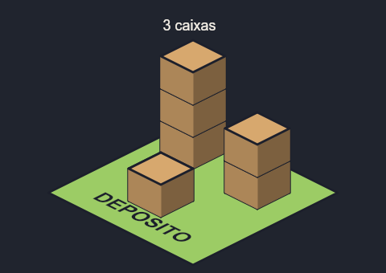

Repare:

- `def caixa` é uma caixa de 40×40 no mapa, com 40 pixels de altura (`thick=40`).
- `use caixa 20,20 z=40` põe a segunda caixa **em cima** da primeira: ela começa a 40 pixels do chão, onde a de baixo termina. `z=80` é a terceira.
- `text placa … "DEPOSITO"` está na camada do chão: as letras deitam no mapa, como tinta no gramado.
- `text nome … z=150 billboard` fica **de pé**, flutuando a 150 pixels de altura, sempre de frente: uma etiqueta em cima da pilha.

### Tileset isométrico para o Godot

O `tileset` também sai em isométrico. Com `iso`, cada célula tem o **losango** (largura × metade) na parte de baixo; o que sobra em cima é para a altura das caixas e paredes. Desenhe cada bloco numa camada `iso=` cujo canto (0,0) é o alto do losango daquela célula:

<!-- conferir -->
```weasel
canvas 128 64 bg=none
palette ink=#1c1f2b line=2 grama=#8bc34a caixa=#d7a86e

tileset size=64,64 iso

layer grama iso=32,32
rect g 0,0 32,32 c=grama ink=line
layer caixa iso=96,32
rect c 0,0 32,32 c=caixa ink=line thick=32

tile grama 0,0
tile caixa 1,0 solid
```

- Na célula de 64×64, o losango é de 64×32. Um quadrado de 32×32 no código vira exatamente esse losango, e `thick=32` faz uma caixa que enche a célula até em cima.
- O `.tres` sai com o formato isométrico do Godot (*Isometric*, *Diamond Down*); a colisão de `solid` é o losango. No Godot, use o `TileSet` num `TileMapLayer` e pinte o mapa normalmente.
- Para um chão sem caixas, `size=64,32` basta.

## Profundidade no filme: lente e névoa

No filme, `depth=` já dá a paralaxe (veja [Profundidade e paralaxe](10-filme.md#profundidade-e-paralaxe)). A câmera ganha mais duas coisas:

- `lens=` é a **lente**: aumenta tudo por igual, perto e longe, como dar zoom numa câmera parada. O `zoom=` é diferente: é a câmera **andando** para a frente, e o perto cresce mais que o longe.
- `fog=cor` é a **névoa da distância**: as camadas com `depth=` maior que 1 vão sumindo nessa cor. `haze=` é a profundidade em que a névoa chega na metade (padrão 6). As camadas da ação (`depth=1`), as mais perto e as `screen` não recebem névoa.

### Andar ou aproximar: `zoom=` e `lens=`

Os dois aumentam a imagem, mas de jeitos diferentes. O mesmo filme tem dois planos: no primeiro só o `zoom=` muda, de 1 para 2; no segundo, só a `lens=`. As duas imagens abaixo saem do mesmo código, uma com cada plano (`--from` e `--to` escolhem o trecho do filme):

<!-- gerar: img/11_zoom.gif --from 0s --to 2s -s 0.4 -->
<!-- gerar: img/11_lente.gif --from 2s --to 4s -s 0.4 -->
```weasel
film fps=12
canvas 960 540 bg=#cfe3ef

layer montanhas depth=8
shape monte c=#5b7c99 : 0,330 180,90 380,290 600,70 800,270 960,130 960,540 0,540
layer arvores depth=3
rect tronco1 160,200 20,140 c=#6b4a30
ellipse copa1 170,190 60 c=#2f6e3a
rect tronco2 780,200 20,140 c=#6b4a30
ellipse copa2 790,190 60 c=#2f6e3a
layer palco
rect chao 0,330 960,210 c=#7aa35a
ellipse heroi 480,270 40,64 c=#e94f37 ink=4

layer nome1 screen only=zoom
text n1 30,60 "zoom= de 1 a 2" size=40 c=#1c1f2b bold
layer nome2 screen only=lente
text n2 30,60 "lens= de 1 a 2" size=40 c=#1c1f2b bold

shot zoom dur=2s
at 0.3s camera.zoom=1
at 1.7s camera.zoom=2

shot lente dur=2s
at 0.3s camera.lens=1
at 1.7s camera.lens=2
```

| `zoom=` (a câmera anda) | `lens=` (a lente aproxima) |
|---|---|
| 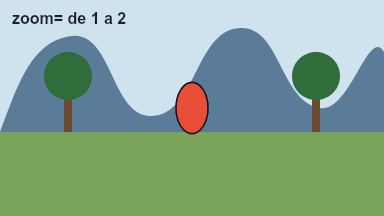 |  |

Repare:

- Com `zoom=2`, o herói (`depth=1`) fica **duas vezes maior**, as árvores (`depth=3`) crescem só um pouco e as montanhas (`depth=8`) quase nada. É o que acontece quando você **anda** na direção do herói: o que está longe muda pouco.
- Com `lens=2`, **tudo** fica duas vezes maior, até as montanhas. É o zoom de uma câmera parada no lugar.
- Os letreiros são camadas `screen` com `only=` (o nome do plano): não crescem com nenhum dos dois.

### A névoa da distância: `fog=` e `haze=`

Ao ar livre, o que está longe fica mais claro e apagado, da cor do céu. `fog=` é essa cor; `haze=` diz **a que distância** a névoa já cobriu metade. Este filme tem quatro planos, um com cada névoa; cada imagem é o primeiro quadro de um plano (`--time` escolhe o momento). As camadas têm todas a **mesma cor**; o número em cada uma é o `depth=` dela.

<!-- gerar: img/11_nevoa_sem.png --time 0s -s 0.3 -->
<!-- gerar: img/11_nevoa_20.png --time 1s -s 0.3 -->
<!-- gerar: img/11_nevoa_6.png --time 2s -s 0.3 -->
<!-- gerar: img/11_nevoa_2.png --time 3s -s 0.3 -->
```weasel
film
canvas 960 540 bg=#dfe9f0

layer d12 depth=12
shape s12 c=#3d5a80 : 0,300 240,140 480,260 720,120 960,240 960,540 0,540
text t12 720,200 "12" size=44 align=center c=#ffffff bold
layer d6 depth=6
shape s6 c=#3d5a80 : 0,360 300,240 620,330 960,250 960,540 0,540
text t6 300,310 "6" size=44 align=center c=#ffffff bold
layer d3 depth=3
shape s3 c=#3d5a80 : 0,420 360,330 700,410 960,350 960,540 0,540
text t3 830,420 "3" size=44 align=center c=#ffffff bold
layer d15 depth=1.5
shape s15 c=#3d5a80 : 0,480 260,420 560,470 960,430 960,540 0,540
text t15 260,480 "1.5" size=44 align=center c=#ffffff bold
layer d1
rect chao 0,505 960,35 c=#3d5a80
text t1 600,535 "1" size=30 align=center c=#ffffff bold

layer nome0 screen only=sem
text n0 30,70 "sem fog=" size=50 c=#1c1f2b bold
layer nome1 screen only=pouca
text n1 30,70 "haze=20" size=50 c=#1c1f2b bold
layer nome2 screen only=normal
text n2 30,70 "haze=6 (padrão)" size=50 c=#1c1f2b bold
layer nome3 screen only=muita
text n3 30,70 "haze=2" size=50 c=#1c1f2b bold

shot sem dur=1s
shot pouca dur=1s
camera fog=#dfe9f0 haze=20
shot normal dur=1s
camera fog=#dfe9f0
shot muita dur=1s
camera fog=#dfe9f0 haze=2
```

| | |
|---|---|
| 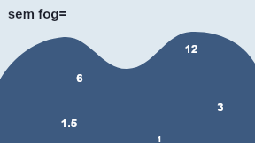 | 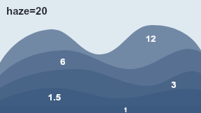 |
| 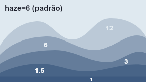 | 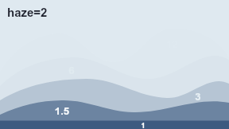 |

Repare:

- **sem fog=**: tudo da mesma cor. Os morros viram um bloco só, e não dá para saber o que está longe.
- `fog=#dfe9f0` é a **cor do céu** (a mesma do `bg=`). Use sempre a cor do fundo: assim o longe "some no céu".
- `haze=20`: a névoa só chega na metade lá na profundidade 20. A camada `12` fica só um pouco mais clara.
- `haze=6` (o padrão): a camada `6` está meio apagada (é a metade), e a `12` bem mais.
- `haze=2`: névoa forte. Já na profundidade 2 está na metade; a `6` e a `12` quase desaparecem no céu.
- A camada `1` (o chão da ação) não recebe névoa nunca.

### Tudo junto: o *Vertigo*

Juntando a lente e o zoom, sai o efeito do filme *Vertigo*, de Hitchcock (o "dolly zoom"): a câmera se afasta (`zoom=` diminui) enquanto a lente fecha (`lens=` aumenta). O herói fica do mesmo tamanho e o fundo cresce atrás dele, uma sensação de vertigem:

<!-- gerar: img/11_vertigo.gif -s 0.4 -->
```weasel
film fps=12
canvas 960 540 bg=#cfe3ef

layer montanhas depth=8
shape monte c=#5b7c99 : 0,420 180,170 380,380 600,150 800,360 960,210 960,540 0,540
layer morros depth=3
shape morro c=#4f8a56 : 0,470 240,330 520,450 760,320 960,440 960,540 0,540
layer arvores depth=1.6
rect tronco1 160,330 20,140 c=#6b4a30
ellipse copa1 170,320 60 c=#2f6e3a
rect tronco2 780,330 20,140 c=#6b4a30
ellipse copa2 790,320 60 c=#2f6e3a
layer palco depth=1
rect chao 0,460 960,80 c=#7aa35a
ellipse heroi 480,400 40,64 c=#e94f37 ink=4

shot vertigo dur=2s
camera fog=#cfe3ef haze=4
at 0s camera.zoom=1 camera.lens=1
at 2s camera.zoom=0.5 camera.lens=2 ease=linear
```


- O herói (`depth=1`) fica do mesmo tamanho porque `zoom=0.5` (metade) e `lens=2` (o dobro) se cancelam nele. Nas camadas de longe, o `zoom=` vale menos e a `lens=` vale igual: elas crescem.
- `lens=`, `fog=` e `haze=` mudam com `at` como o resto da câmera (`camera.lens=2`).
- No filme, `at` também gira formas e camadas: `carta.yaw=180`, `chao.pitch=60`, `nuvem.z=30`.

### Girar no filme: `at` com `yaw=` e `pitch=`

No filme, o giro muda com `at`, do mesmo jeito que a posição de um ator. Aqui um mapa deita para trás e uma carta vira de costas, ao mesmo tempo:

<!-- gerar: img/11_filme_giro.gif -s 0.75 -->
```weasel
film fps=12 dur=3s
canvas 640 360 bg=#f4efe6
palette ink=#1c1f2b line=5

layer mapa pivot=180,180
rect papel 60,60 240,240 c=#e8d9a8 ink=line
stroke rio w=10 c=#4fc3f7 : 90,100 160,170 120,240 200,290
ellipse vila 230,140 22 c=#e94f37 ink=4

layer carta zsort pivot=485,190
rect frente 400,80 170,220 r=14 c=#fff6e0 ink=line back=verso
rect verso 400,80 170,220 r=14 c=#2e86ab ink=line hidden
text sol 485,205 "SOL" size=40 align=center c=ink z=1 bold

at 0.5s mapa.pitch=0 carta.yaw=0
at 2.5s mapa.pitch=60 carta.yaw=180
```

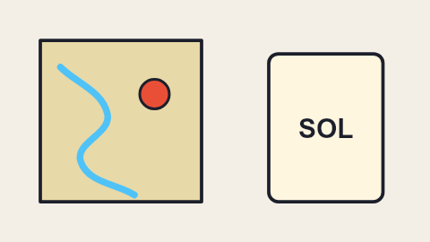

Repare:

- `mapa.pitch=60`: a camada `mapa` inteira deita 60 graus para trás, em volta do `pivot=180,180` (o meio do papel).
- `carta.yaw=180`: a camada `carta` dá meia volta em volta do meio dela. Como a frente tem `back=verso`, de costas aparece o verso azul; o `zsort` esconde o texto atrás.
- `at 0.5s … =0` segura tudo parado até 0,5 s; depois os dois giram até 2,5 s.
- Para girar uma forma só, use o nome dela: `at 2.5s frente.yaw=180` (e `frente.z=` para aproximar).

## Limites e dicas

- **É ilusão de peças chatas.** Uma forma girada continua chata; o volume vem da espessura (`thick=`), da bola (`round=`) e da ordem (`zsort`). Para um objeto que gira 360° e muda de forma, desenhe as vistas e troque com `show=`.
- **Sem `zsort`**, a ordem continua a do código, mesmo com `z=`. Ponha `zsort` na camada em que as peças trocam de lugar.
- **No Godot**, o esqueleto de verdade (`rig=bones`) não gira em 3D: com `yaw=`, `pitch=`, `z=` ou `iso`, exporte com `rig=frames` (o padrão), que sai cada quadro pronto.
- **No editor**, as alças das formas giradas, deitadas ou isométricas ficam onde a forma aparece, e arrastar muda o número certo no código.
- Uma peça fora do raio da bola (`round=`) não tem onde ficar na superfície: quando a cabeça vira, ela entra por cima do rosto. O que fica de fora, como orelhas e cabelo, vai num cartão com `z=` (como as orelhas do exemplo) ou no osso de cima.

[← Filme](10-filme.md) · [Índice](README.md) · [Próximo: Referência rápida →](12-referencia.md)
