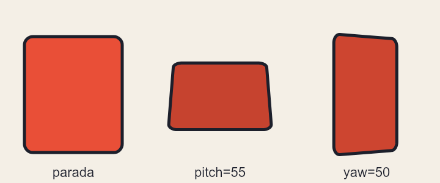
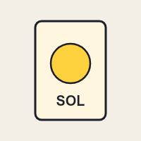
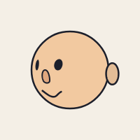
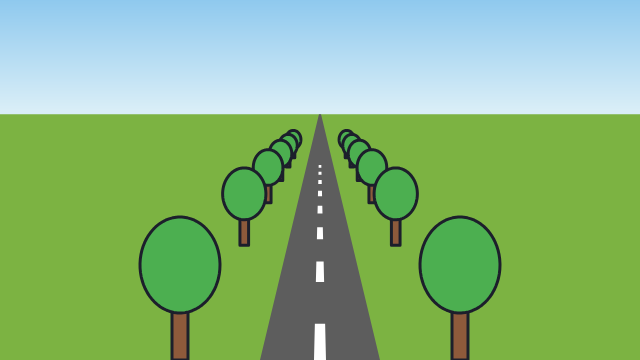
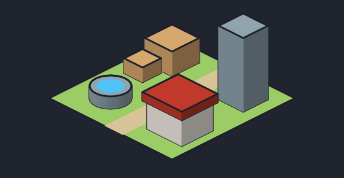
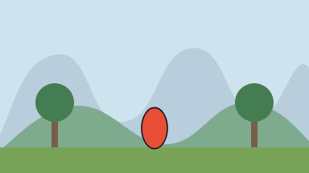

# 11. Profundidade (2.5D)

[← Filme](10-filme.md) · [Índice](README.md) · [Próximo: Referência rápida →](12-referencia.md)

O Weasel continua desenhando no plano, mas cada forma pode **ficar de pé num mundo com fundo**: girar como uma carta, ter espessura, ir para perto ou para longe, deitar como chão. É o truque do **2.5D**: peças chatas, arrumadas em 3D. Dá para fazer uma carta que vira, uma cabeça que olha para os lados, uma estrada que some no horizonte, um mapa isométrico e o zoom do *Vertigo* no filme.

Quem não usa nada disto não vê diferença: sem giro, nada sai do lugar.

## As três direções

- **x** vai para a direita e **y** para baixo, como sempre.
- **z** sai da tela, na sua direção: `z=40` está 40 pixels **mais perto** de você; `z=-40`, mais longe.
- `yaw=` gira em volta do eixo de pé, como uma porta (positivo: a frente vira para a direita).
- `pitch=` gira em volta do eixo deitado (positivo: o alto vai para longe, a frente olha para cima).

Os dois são em graus. Numa forma, ela gira em volta do próprio meio:

<!-- gerar: img/11_giro.png -->
```weasel
canvas 720 300 bg=#f4efe6
palette ink=#1c1f2b line=5 carta=#e94f37

rect parada 40,60 160,190 r=14 c=carta ink=line
rect deitada 280,60 160,190 r=14 c=carta ink=line pitch=55
rect virada 520,60 160,190 r=14 c=carta ink=line yaw=50

text t1 120,290 "parada" size=22 align=center c=ink
text t2 360,290 "pitch=55" size=22 align=center c=ink
text t3 600,290 "yaw=50" size=22 align=center c=ink
```



- O lado que vai para longe fica **menor**: é a **perspectiva**. `persp=` é a distância do olho em pixels (padrão: o dobro do lado maior do desenho). Mais perto (`persp=400`) deforma mais; `persp=0` tira a perspectiva.
- A forma que vira de lado fica **mais escura**, como uma carta que sai da luz. O `shade=` da camada controla isso (padrão 0.5; 0 desliga).
- O giro vale para todas as formas: `shape`, `ellipse`, `rect`, `stroke`, `line` e `text`.

## Uma carta que vira: `back=` e `thick=`

Para girar **várias peças juntas**, ponha todas num osso e gire o osso. `yaw=` e `pitch=` também valem no `bone`, e o giro acontece em volta do pivô:

<!-- gerar: img/11_carta.gif -a gira -s 0.5 -->
```weasel
canvas 400 400 bg=#f4efe6
palette ink=#1c1f2b line=6 frente=#fff6e0 verso=#2e86ab sol=#ffd23f

bone carta pivot=200,200

layer cartas zsort
rect frente 100,60 200,280 r=18 c=frente ink=line thick=10 thickc=#d8cbb0 back=costas bone=carta
rect costas 100,60 200,280 r=18 c=verso ink=line hidden
ellipse sol 200,180 56 c=sol ink=5 z=1 bone=carta
text nome 200,300 "SOL" size=40 align=center c=ink z=1 bone=carta bold

anim gira frames=36
key 0 carta.yaw=0
key 36 carta.yaw=360 ease=linear
```



- `back=costas` diz qual forma aparece quando a carta fica **de costas**. As duas precisam ser fechadas e do mesmo tamanho; ponha `hidden` no verso, senão ele aparece também sozinho.
- `thick=10` dá **espessura**: a carta vira um bloco de 10 pixels, com a borda aparecendo de lado. `thickc=` é a cor da borda (sem ele, a cor da forma um pouco mais escura).
- O sol e o nome têm `z=1`: estão um pixel na frente da carta. Sem isso, teriam a mesma profundidade dela e continuariam aparecendo por cima do verso.
- `zsort` na camada pinta **de longe para perto** a cada quadro, em vez de seguir a ordem do código. Por isso o sol some atrás do verso quando a carta vira.
- `key 0 carta.yaw=0`: o giro do osso anima como qualquer outra coisa. Numa forma solta, é `nome.yaw=` (e `nome.pitch=`, `nome.z=`); numa camada, `camada.yaw=`.

## Uma cabeça que olha para os lados: `round=`

Uma cabeça desenhada de frente é chata: se ela só girar como carta, o rosto achata. Com `round=raio` no osso, as peças dele ficam **na superfície de uma bola**: o olho do lado que vai embora chega mais perto da borda e encolhe, e o que passa para trás da bola some aos poucos. É o efeito do Live2D, sem desenhar a cabeça de lado.

<!-- gerar: img/11_cabeca.gif -a olha -s 0.5 -->
```weasel
canvas 400 400 bg=#f4efe6
palette ink=#1c1f2b line=5 pele=#f2c9a0 nariz=#e0a77e

bone pescoco pivot=200,360
bone rosto parent=pescoco pivot=200,330 round=110,200,200

layer cabeca zsort
ellipse cranio 200,200 110 c=pele ink=line bone=pescoco
ellipse orelhaE 92,210 18,28 c=pele ink=line bone=rosto z=-40
ellipse orelhaD 308,210 18,28 c=pele ink=line bone=rosto z=-40
ellipse olhoE 160,185 11,16 c=ink bone=rosto
ellipse olhoD 240,185 11,16 c=ink bone=rosto
shape nariz c=nariz ink=4 bone=rosto : 200,200 212,232 188,232
stroke boca w=5 bone=rosto : 165,262 200,278 235,262

anim olha frames=32
key 0 rosto.yaw=-35 rosto.pitch=0
key 8 rosto.yaw=0 rosto.pitch=-15
key 16 rosto.yaw=35 rosto.pitch=0
key 24 rosto.yaw=0 rosto.pitch=15
key 32 rosto.yaw=-35 rosto.pitch=0
```



- `round=110,200,200` é o raio e o centro da bola, os mesmos do crânio. Só com o raio (`round=110`), o centro é o meio das peças presas no osso.
- O **crânio** fica no osso `pescoco`, que não gira: ele é o fundo, sempre redondo. Só o **rosto** (olhos, nariz, boca) corre por cima dele.
- As **orelhas** ficam fora da bola. Uma peça com `z=` próprio não vai para a bola: continua um cartão, aqui 40 pixels atrás do meio da cabeça. Com `zsort`, a orelha que vai para trás fica atrás do crânio, e a outra aparece na frente.
- Vale para olhar para cima e para baixo também (`pitch=`), e junta com o resto: os olhos podem piscar e a boca falar enquanto a cabeça vira.

## Chão em perspectiva: `floor`

`floor` **deita a camada** como um chão: a linha de baixo do desenho fica onde está, e quanto mais para cima no código, mais longe. O infinito chega no **horizonte**:

<!-- gerar: img/11_chao.png -->
```weasel
canvas 640 360 bg=ceu
gradient ceu linear 0,0 0,110 : #8fc9ee #d9eef7
palette ink=#1c1f2b line=3 grama=#7cb342 asfalto=#5d5d5d faixa=#ffffff tronco=#8d5a3b folha=#4caf50

def arvore
  rect tronco -8,-60 16,60 c=tronco ink=line
  ellipse copa 0,-95 40,48 c=folha ink=line
end

layer chao floor horizon=110 zsort
rect campo -20000,-20000 40640,20360 c=grama
rect estrada 260,-20000 120,20360 c=asfalto
repeat i 0..7
  rect faixa{i} 314,{300 - i*170} 12,70 c=faixa
end
repeat i 0..5
  use arvore 180,{360 - i*300} billboard
  use arvore 460,{360 - i*300} billboard
end
```



- `horizon=110` é a altura do horizonte na tela (padrão: 30% do desenho, de cima para baixo). `pivot=x,y` muda a linha que fica parada (padrão: o meio da linha de baixo).
- Sem `persp=`, o chão deita 45°. Com `pitch=`, você escolhe o ângulo; com `persp=`, a lente.
- Desenhe o chão **comprido**: a grama e a estrada vão até `y=-20000` para chegar no horizonte. Um chão curto acaba no meio do caminho.
- As árvores usam `billboard`: ficam **sempre de frente**, de pé no ponto do `use`, e diminuem com a distância. Sem ele, elas deitariam junto com o chão. `billboard` também vale numa forma solta (o ponto de apoio é o meio da base dela).

## Mapa isométrico: `iso`

`layer … iso=x,y` faz da camada um **mapa isométrico**: os quadrados do código viram losangos, e `thick=` levanta blocos. É o jeito de jogos de estratégia e de fazenda vistos de cima e de lado.

<!-- gerar: img/11_iso.png -->
```weasel
canvas 560 290 bg=#20242e
palette ink=#1c1f2b line=3 grama=#9ccc65 caixa=#d7a86e pedra=#90a4ae agua=#4fc3f7 telhado=#c0392b parede=#f4efe6

layer chao iso=280,60
rect piso 0,0 200,200 c=grama ink=line
rect caminho 90,0 30,200 c=#d9c49a

layer coisas iso=280,60 zsort
rect caixa1 20,20 44,44 c=caixa ink=line thick=40
rect caixa2 20,68 30,30 c=caixa ink=line thick=24
rect torre 140,24 40,40 c=pedra ink=line thick=120
rect casa 130,120 56,50 c=parede ink=line thick=46
shape telhado c=telhado ink=line z=46 thick=14 : 126,116! 190,116! 190,174! 126,174!
ellipse poco 50,150 24 c=pedra ink=line thick=20
ellipse agua 50,150 16 c=agua z=20
```



- No código, **x e y são o mapa visto de cima**: o piso é um quadrado de 200×200. Na tela, x anda para a direita e para baixo; y, para a esquerda e para baixo. `iso=280,60` é onde fica o canto (0,0) do mapa (padrão: em cima, no meio do desenho).
- `thick=` **sobe**: a forma vira o tampo de um bloco daquela altura. Os lados ganham luz diferente (o da esquerda mais claro).
- `z=` levanta sem fazer bloco: a água do poço está na altura da borda (`z=20`), e o telhado fica em cima das paredes da casa (`z=46`).
- O **chão vai numa camada própria**, sem `zsort`, embaixo da camada das coisas. Na mesma camada com `zsort`, o meio do chão fica mais "perto" que as caixas do fundo e acaba pintado por cima delas.
- `iso` não junta com `yaw=`, `pitch=` nem `floor` na mesma camada.

### Tileset isométrico para o Godot

O `tileset` também sai em isométrico. Com `iso`, cada célula tem o **losango** (largura × metade) na parte de baixo; o que sobra em cima é para a altura das caixas e paredes. Desenhe cada bloco numa camada `iso=` cujo canto (0,0) é o alto do losango daquela célula:

<!-- conferir -->
```weasel
canvas 128 64 bg=none
palette ink=#1c1f2b line=2 grama=#8bc34a caixa=#d7a86e

tileset size=64,64 iso

layer grama iso=32,32
rect g 0,0 32,32 c=grama ink=line
layer caixa iso=96,32
rect c 0,0 32,32 c=caixa ink=line thick=32

tile grama 0,0
tile caixa 1,0 solid
```

- Na célula de 64×64, o losango é de 64×32. Um quadrado de 32×32 no código vira exatamente esse losango, e `thick=32` faz uma caixa que enche a célula até em cima.
- O `.tres` sai com o formato isométrico do Godot (*Isometric*, *Diamond Down*); a colisão de `solid` é o losango. No Godot, use o `TileSet` num `TileMapLayer` e pinte o mapa normalmente.
- Para um chão sem caixas, `size=64,32` basta.

## Profundidade no filme: lente e névoa

No filme, `depth=` já dá a paralaxe (veja [Profundidade e paralaxe](10-filme.md#profundidade-e-paralaxe)). A câmera ganha mais duas coisas:

- `lens=` é a **lente**: aumenta tudo por igual, perto e longe, como dar zoom numa câmera parada. O `zoom=` é diferente: é a câmera **andando** para a frente, e o perto cresce mais que o longe.
- `fog=cor` é a **névoa da distância**: as camadas com `depth=` maior que 1 vão sumindo nessa cor. `haze=` é a profundidade em que a névoa chega na metade (padrão 6). As camadas da ação (`depth=1`), as mais perto e as `screen` não recebem névoa.

Juntando os dois, sai o efeito do *Vertigo* (o "dolly zoom"): a câmera se afasta (`zoom=` diminui) enquanto a lente fecha (`lens=` aumenta). O herói fica do mesmo tamanho e o fundo cresce atrás dele:

<!-- gerar: img/11_vertigo.gif -s 0.4 -->
```weasel
film fps=12
canvas 960 540 bg=#cfe3ef

layer montanhas depth=8
shape monte c=#5b7c99 : 0,420 180,170 380,380 600,150 800,360 960,210 960,540 0,540
layer morros depth=3
shape morro c=#4f8a56 : 0,470 240,330 520,450 760,320 960,440 960,540 0,540
layer arvores depth=1.6
rect tronco1 160,330 20,140 c=#6b4a30
ellipse copa1 170,320 60 c=#2f6e3a
rect tronco2 780,330 20,140 c=#6b4a30
ellipse copa2 790,320 60 c=#2f6e3a
layer palco depth=1
rect chao 0,460 960,80 c=#7aa35a
ellipse heroi 480,400 40,64 c=#e94f37 ink=4

shot vertigo dur=2s
camera fog=#cfe3ef haze=4
at 0s camera.zoom=1 camera.lens=1
at 2s camera.zoom=0.5 camera.lens=2 ease=linear
```



- `lens=`, `fog=` e `haze=` mudam com `at` como o resto da câmera (`camera.lens=2`).
- No filme, `at` também gira formas e camadas: `carta.yaw=180`, `chao.pitch=60`, `nuvem.z=30`.

## Limites e dicas

- **É ilusão de peças chatas.** Uma forma girada continua chata; o volume vem da espessura (`thick=`), da bola (`round=`) e da ordem (`zsort`). Para um objeto que gira 360° e muda de forma, desenhe as vistas e troque com `show=`.
- **Sem `zsort`**, a ordem continua a do código, mesmo com `z=`. Ponha `zsort` na camada em que as peças trocam de lugar.
- **No Godot**, o esqueleto de verdade (`rig=bones`) não gira em 3D: com `yaw=`, `pitch=`, `z=` ou `iso`, exporte com `rig=frames` (o padrão), que sai cada quadro pronto.
- **No editor**, as alças das formas giradas, deitadas ou isométricas ficam onde a forma aparece, e arrastar muda o número certo no código.
- Uma peça fora do raio da bola (`round=`) não tem onde ficar na superfície: quando a cabeça vira, ela entra por cima do rosto. O que fica de fora, como orelhas e cabelo, vai num cartão com `z=` (como as orelhas do exemplo) ou no osso de cima.

[← Filme](10-filme.md) · [Índice](README.md) · [Próximo: Referência rápida →](12-referencia.md)
