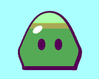
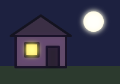
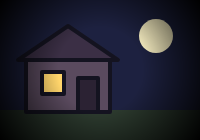
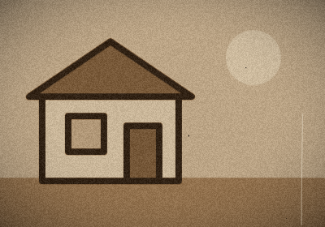
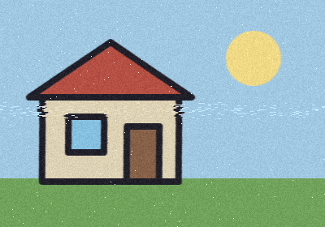
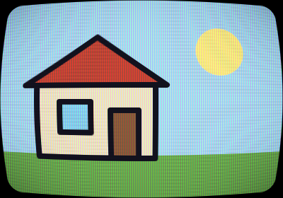
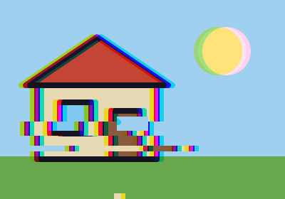
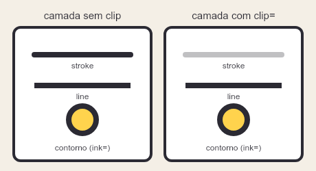
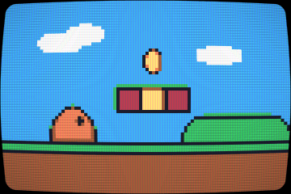

# 12. Acabamento

[← Efeitos e partículas](11-efeitos.md) · [Índice](README.md) · [Próximo: Estilos de arte →](13-estilos.md)

O acabamento é o último passo: depois de tudo pintado, a linha `finish` muda a imagem **inteira** de uma vez. Ela tira os contornos, pixela, reduz as cores, imita uma câmera de verdade (brilho, bordas escuras, granulado) ou imita uma tela antiga (filme, fita VHS, televisão de tubo, falha digital). Você precisa dos capítulos 1 a 11.

## Acabamento: `finish`

```
finish [game ou flat] [inner=…] [pixel=…] [posterize=…] [bloom=…] [vignette=…] [grain=…]
       [oldfilm=…] [vhs=…] [crt=…] [glitch=…]
```

A linha `finish` pode ficar em qualquer lugar do arquivo. O costume é logo depois do `canvas`. Quatro vezes a mesma gosma, mudando só a linha `finish`:

| `game` (o padrão) | `finish flat` | `pixel=4` | `posterize=4` |
|---|---|---|---|
|  |  |  |  |

<details>
<summary>Código dos quatro</summary>

<!-- gerar: img/04_finish_game.png -->
```weasel
canvas 200 160 bg=#cfe8f5
palette ink=#2b2a33 line=5
gradient verde linear 0,0 0,1 box : #9be38c #3f9a4a
shape corpo c=verde ink=line weight=0.3 : 100,24 160,96 152,138! 48,138! 40,96
ellipse olhoE 84,90 8,12 c=ink
ellipse olhoD 118,90 8,12 c=ink
ellipse brilho 76,60 11,6 rot=-35 c=#e6fadf
```

<!-- gerar: img/04_finish_flat.png -->
```weasel
canvas 200 160 bg=#cfe8f5
finish flat
palette ink=#2b2a33 line=5
gradient verde linear 0,0 0,1 box : #9be38c #3f9a4a
shape corpo c=verde ink=line weight=0.3 : 100,24 160,96 152,138! 48,138! 40,96
ellipse olhoE 84,90 8,12 c=ink
ellipse olhoD 118,90 8,12 c=ink
ellipse brilho 76,60 11,6 rot=-35 c=#e6fadf
```

<!-- gerar: img/04_finish_pixel.png -->
```weasel
canvas 200 160 bg=#cfe8f5
finish game pixel=4
palette ink=#2b2a33 line=5
gradient verde linear 0,0 0,1 box : #9be38c #3f9a4a
shape corpo c=verde ink=line weight=0.3 : 100,24 160,96 152,138! 48,138! 40,96
ellipse olhoE 84,90 8,12 c=ink
ellipse olhoD 118,90 8,12 c=ink
ellipse brilho 76,60 11,6 rot=-35 c=#e6fadf
```

<!-- gerar: img/04_finish_posterize.png -->
```weasel
canvas 200 160 bg=#cfe8f5
finish game posterize=4
palette ink=#2b2a33 line=5
gradient verde linear 0,0 0,1 box : #9be38c #3f9a4a
shape corpo c=verde ink=line weight=0.3 : 100,24 160,96 152,138! 48,138! 40,96
ellipse olhoE 84,90 8,12 c=ink
ellipse olhoD 118,90 8,12 c=ink
ellipse brilho 76,60 11,6 rot=-35 c=#e6fadf
```

</details>

Repare:

- `game` é o padrão: com ou sem a linha `finish game`, os contornos (`ink=`) são desenhados.
- `flat` tira o contorno de **todas** as formas e textos de uma vez, para um visual de recorte de papel. Os olhos continuam, porque são preenchimento (`c=ink`), não contorno. Os traços (`stroke` e `line`) também ficam: eles são o próprio traço.
- `pixel=4` desenha a imagem 4 vezes menor e depois aumenta sem suavizar: cada "pixel" vira um bloco de 4 × 4. Vai de 1 (sem blocos, se não escrever) a 32.
- `posterize=4` deixa só 4 tons em cada canal de cor (vermelho, verde e azul), de 2 a 64. O degradê suave da gosma vira faixas.

**Experimente:** no código do `pixel=4`, mude para `pixel=8`. Os blocos dobram de tamanho, e os olhos viram poucos quadradinhos.

**Cuidado:**
- Só a primeira palavra vale: em `finish game flat`, o `flat` fica de fora, e o Weasel avisa. Com duas linhas `finish` no mesmo arquivo, as opções se somam e vale o estilo da última (também com aviso).
- Várias linhas `finish` se somam, e cada opção fica com o último valor escrito.
- Com `flat`, uma forma com `ink=` e sem `c=` some inteira: ela não tem cor de dentro, só o contorno.
- O bloco do `pixel=` é medido na imagem exportada: com `-s 2`, `pixel=4` dá blocos de 4 pixels da imagem, que são 2 do desenho.
- O `pixel=` faz a média das cores de cada bloco, então as bordas ficam com tons misturados. Para pixel art nítida, com as cores do desenho e o contorno de um bloco, use a linha `art pixel` do [capítulo 13](13-estilos.md#pixel-art-art-pixel). Num arquivo com `art`, o `pixel=` do `finish` fica de fora (aviso).

No editor, **Janela › Acabamento e estilo** escreve a linha `finish` por você ([capítulo 23](23-editor.md#acabamento-e-estilo)).

## Só as cores da palette: `posterize=palette`

Com `posterize=palette`, cada ponto da imagem vira a cor **mais parecida** entre as cores da sua `palette`. Serve para garantir que o desenho inteiro use só as cores escolhidas, como numa pixel art de poucas cores.

<!-- gerar: img/04_finish_palette.png -->
```weasel
canvas 200 160 bg=#cfe8f5
finish game posterize=palette
palette ink=#2b2a33 line=5 ceu=#cfe8f5 claro=#9be38c escuro=#3f9a4a brilho=#e6fadf
gradient verde linear 0,0 0,1 box : claro escuro
shape corpo c=verde ink=line weight=0.3 : 100,24 160,96 152,138! 48,138! 40,96
ellipse olhoE 84,90 8,12 c=ink
ellipse olhoD 118,90 8,12 c=ink
ellipse brilho 76,60 11,6 rot=-35 c=brilho
```

| Sem `posterize` | `posterize=palette` |
|---|---|
|  |  |

Repare:

- A `palette` tem cinco cores: `ink`, `ceu`, `claro`, `escuro` e `brilho`. Os números (`line=5`) não contam.
- O degradê ia do `claro` ao `escuro`, passando por vários verdes do meio. Com `posterize=palette`, cada verde do meio virou o `claro` ou o `escuro`, o que estiver mais perto.
- Liste na `palette` todas as cores que você quer na imagem. Uma cor que não está lá vira a parecida mais próxima, que pode ser bem diferente.

**Experimente:** acrescente `meio=#6dbe6a` na linha `palette`. O degradê ganha uma terceira faixa, verde média.

Valem as cores escritas em `#hex` e as com nome do CSS (`pele=wheat`). Uma cor com transparência (`brilho=#ffffff66`) fica de fora: ela só aparece misturada com o que está embaixo, e é essa mistura que vira a cor mais parecida. Para um brilho continuar aparecendo, ponha na `palette` também a cor que ele dá, opaca. O que é transparente na imagem continua transparente.

## Acabamentos de cinema: `bloom=`, `vignette=` e `grain=`

Estes três imitam o que acontece numa câmera de verdade. Eles valem para a **imagem pronta**, então ficam bem em cenas inteiras (cenários, filmes) e quase não aparecem num personagem sozinho num fundo claro.

| Sem nada | `bloom=1.5` | `vignette=1` | `grain=0.15` |
|---|---|---|---|
|  |  |  |  |

<details>
<summary>Código dos quatro</summary>

<!-- gerar: img/04_finish_noite.png -->
```weasel
canvas 200 140 bg=#1d2140
palette ink=#141320 line=4
rect chao 0,110 200,30 c=#2c3a2e
ellipse lua 156,36 17 c=#fff6c8
rect casa 26,58 84,54 c=#5a4a5e ink=line
shape telhado c=#3b2f45 ink=line : 18,60! 68,26! 118,60!
rect janela 42,72 22,22 c=#ffd56b ink=line
rect porta 78,78 20,34 c=#2b2233 ink=line
```

<!-- gerar: img/04_finish_bloom.png -->
```weasel
canvas 200 140 bg=#1d2140
finish game bloom=1.5
palette ink=#141320 line=4
rect chao 0,110 200,30 c=#2c3a2e
ellipse lua 156,36 17 c=#fff6c8
rect casa 26,58 84,54 c=#5a4a5e ink=line
shape telhado c=#3b2f45 ink=line : 18,60! 68,26! 118,60!
rect janela 42,72 22,22 c=#ffd56b ink=line
rect porta 78,78 20,34 c=#2b2233 ink=line
```

<!-- gerar: img/04_finish_vignette.png -->
```weasel
canvas 200 140 bg=#1d2140
finish game vignette=1
palette ink=#141320 line=4
rect chao 0,110 200,30 c=#2c3a2e
ellipse lua 156,36 17 c=#fff6c8
rect casa 26,58 84,54 c=#5a4a5e ink=line
shape telhado c=#3b2f45 ink=line : 18,60! 68,26! 118,60!
rect janela 42,72 22,22 c=#ffd56b ink=line
rect porta 78,78 20,34 c=#2b2233 ink=line
```

<!-- gerar: img/04_finish_grain.png -->
```weasel
canvas 200 140 bg=#1d2140
finish game grain=0.15
palette ink=#141320 line=4
rect chao 0,110 200,30 c=#2c3a2e
ellipse lua 156,36 17 c=#fff6c8
rect casa 26,58 84,54 c=#5a4a5e ink=line
shape telhado c=#3b2f45 ink=line : 18,60! 68,26! 118,60!
rect janela 42,72 22,22 c=#ffd56b ink=line
rect porta 78,78 20,34 c=#2b2233 ink=line
```

</details>

| Opção | O que faz | Valores |
|---|---|---|
| `bloom=` | o que é muito claro (a lua, a janela) "vaza" num brilho suave em volta | de 0 a 3; 1 já é bem visível, e cada número a mais soma mais uma camada de brilho |
| `vignette=` | escurece as bordas e os cantos, e leva o olho para o meio | de 0 a 1: em 1, os cantos ficam pretos |
| `grain=` | granulado de filme, um chuvisco fino por cima de tudo | de 0 a 0.33: `0.03` é sutil, `0.15` é forte |

Os três começam em 0 (desligados). Fora da faixa, o Weasel avisa: no `bloom`, acima de 3, vale 3; no `vignette` e no `grain`, o número é aceito, mas acima de 1 e de 0.33 a imagem não muda mais.

Os três podem ir juntos na mesma linha: `finish game bloom=0.5 vignette=0.6 grain=0.03`. A [fogueira do capítulo 11](11-efeitos.md#partículas) usa assim. Eles combinam muito bem com a luz do [capítulo 10](10-luz.md): o `bloom` faz as lâmpadas, os halos (`glow=`) e as janelas com `emit=` vazarem de verdade.

**Experimente:** no código do `bloom`, mude a cor da lua para `c=#8a7a4a`, um amarelo apagado. O brilho em volta dela some: o `bloom` só pega o que é bem claro. A janela, que continua clara, continua brilhando.

**Cuidado:** o granulado é ruído, e ruído não comprime: um GIF ou um PNG com `grain=` fica bem maior.

## Efeitos de tela: `oldfilm=`, `vhs=`, `crt=` e `glitch=`

Estes quatro imitam o caminho da imagem até quem assiste: o filme antigo no projetor, a fita de vídeo, a televisão de tubo e o arquivo digital quebrando. Cada um vai de 0 a 1 (1 é o mais forte; se não escrever, 0) e muda a cada quadro, sempre do mesmo jeito: o vídeo sai igual toda vez.

| `oldfilm=1` | `vhs=1` | `crt=1` | `glitch=1` |
|---|---|---|---|
|  |  |  |  |

<details>
<summary>Código dos quatro</summary>

<!-- gerar: img/04_tela_oldfilm.png -s 2 -->
```weasel
canvas 200 140 bg=#9fd0f0
finish oldfilm=1
palette ink=#141320 line=4
rect chao 0,110 200,30 c=#6aa84f
ellipse sol 156,36 17 c=#ffe27a
rect casa 26,58 84,54 c=#e8d9b5 ink=line
shape telhado c=#c44536 ink=line : 18,60! 68,26! 118,60!
rect janela 42,72 22,22 c=#7fc8f0 ink=line
rect porta 78,78 20,34 c=#8a5a3c ink=line
```

<!-- gerar: img/04_tela_vhs.png -s 2 -->
```weasel
canvas 200 140 bg=#9fd0f0
finish vhs=1
palette ink=#141320 line=4
rect chao 0,110 200,30 c=#6aa84f
ellipse sol 156,36 17 c=#ffe27a
rect casa 26,58 84,54 c=#e8d9b5 ink=line
shape telhado c=#c44536 ink=line : 18,60! 68,26! 118,60!
rect janela 42,72 22,22 c=#7fc8f0 ink=line
rect porta 78,78 20,34 c=#8a5a3c ink=line
```

<!-- gerar: img/04_tela_crt.png -s 2 -->
```weasel
canvas 200 140 bg=#9fd0f0
finish crt=1
palette ink=#141320 line=4
rect chao 0,110 200,30 c=#6aa84f
ellipse sol 156,36 17 c=#ffe27a
rect casa 26,58 84,54 c=#e8d9b5 ink=line
shape telhado c=#c44536 ink=line : 18,60! 68,26! 118,60!
rect janela 42,72 22,22 c=#7fc8f0 ink=line
rect porta 78,78 20,34 c=#8a5a3c ink=line
```

<!-- gerar: img/04_tela_glitch.png -s 2 -->
```weasel
canvas 200 140 bg=#9fd0f0
finish glitch=1
palette ink=#141320 line=4
rect chao 0,110 200,30 c=#6aa84f
ellipse sol 156,36 17 c=#ffe27a
rect casa 26,58 84,54 c=#e8d9b5 ink=line
shape telhado c=#c44536 ink=line : 18,60! 68,26! 118,60!
rect janela 42,72 22,22 c=#7fc8f0 ink=line
rect porta 78,78 20,34 c=#8a5a3c ink=line
```

</details>

| Opção | O que faz |
|---|---|
| `oldfilm=` | filme antigo: sépia, a luz piscando, o quadro tremendo de leve, o grão, as bordas escuras, riscos que duram uns quadros, poeira e, às vezes, um fio de cabelo |
| `vhs=` | fita VHS: as linhas tremendo de lado, a cor borrada e atrasada, o preto lavado, o chiado, a faixa do tracking descendo devagar e a faixa torta embaixo |
| `crt=` | televisão de tubo: as linhas de varredura, a máscara de cor (vermelho, verde e azul lado a lado) e a imagem curva, com os cantos redondos e escuros. A curva cresce com o número; em 1, só uma faixa fina da borda some |
| `glitch=` | falha digital: em alguns quadros, em rajadas, faixas da imagem pulam de lado (algumas com as cores trocadas), o vermelho e o azul se separam e uns blocos se repetem fora do lugar. Quanto maior o número, mais vezes e mais forte |

Repare:

- Eles entram por último: depois do estilo (`art`), do `bloom`, do `vignette`, do `grain` e do `posterize`. Com `pixel=`, entram depois dos blocos.
- Podem ir juntos: `finish crt=0.6 vhs=0.4` é uma fita velha passando numa televisão de tubo.
- Na imagem transparente, eles mexem só no desenho: o que é transparente continua transparente.

**Experimente:** no código do `crt=1`, mude para `crt=0.3`. As linhas ficam leves, e a imagem quase não curva.

**Cuidado:**
- Eles são para o filme e o vídeo, e saem no PNG, no JPG, no GIF, no WebP, no vídeo e no filme. A folha de sprites e o Godot saem **sem eles** (um personagem de jogo não deve levar a televisão de tubo em cada quadro), e o Weasel avisa na janela de exportar e na linha de comando. O SVG e as folhas de conferência (`--contact`, `--trajectory`) também saem sem eles.
- No SVG, o `pixel=` e o `posterize=` também ficam de fora.
- Como no granulado, o chiado, o grão e a poeira não comprimem: o vídeo e o GIF ficam maiores.

## Os dois `inner`

A palavra `inner` aparece em **dois lugares** do Weasel, com sentidos diferentes. Os dois cuidam da mesma coisa, os traços **de dentro** do personagem (penas, rugas, dobras de roupa), por isso têm o mesmo nome. Mas um diz a **espessura** desses traços, e o outro diz **o quanto eles aparecem**.

| Nome | Onde se escreve | O que é | Exemplo |
|---|---|---|---|
| `inner` da `palette` | como valor de `w=` ou `ink=` (e, para mudar o número, numa linha `palette`) | um **número com nome**: uma espessura em pixels. Já vem pronto, valendo 5 | `stroke pena w=inner : …` |
| `inner=` do `finish` | só na linha `finish` | uma **opacidade**, de 0 (invisível) a 1 (normal; se não escrever). Vale só para os `stroke` de camadas com `clip=` | `finish game inner=0.4` |

**O `inner` da palette** foi apresentado no [capítulo 3](03-cores.md#a-cor-da-tinta-e-os-nomes-prontos): é um número pronto, como `line` e `edge`. Escrever `w=inner` é o mesmo que escrever `w=5`, com a vantagem de poder trocar o 5 de todos os traços numa linha só.

**O `inner=` do finish** deixa mais transparentes os traços de uma camada com `clip=`, para que pareçam um detalhe e não briguem com o contorno de fora.

Os dois exemplos abaixo desenham o mesmo passarinho. O primeiro gera duas imagens: a normal e a variante `fino`, que troca o `inner` da palette ([variantes, capítulo 6](06-componentes.md#variantes-variant)). O segundo só acrescenta a linha `finish game inner=0.4`.

<!-- gerar: img/04_inner_padrao.png -->
<!-- gerar: img/04_inner_fino.png --variant fino -->
```weasel
canvas 240 220 bg=#f4efe6
palette ink=#2b2a33 line=8
variant fino inner=2

layer corpo
ellipse bola 120,116 80 c=#ffb347 ink=line

# as penas: traços de dentro, numa camada recortada pela bola
layer penas clip=bola
stroke asa w=inner : 70,98 64,124 76,144 102,152
stroke p1 w=inner : 92,164 104,174 116,164
stroke p2 w=inner : 116,164 128,174 140,164
stroke p3 w=inner : 104,184 116,194 128,184

# o rosto e o topete: numa camada sem clip
layer rosto
stroke topete w=inner : 112,38 118,16 134,10
ellipse olhoE 102,100 7,10 c=ink
ellipse olhoD 142,100 7,10 c=ink
shape bico c=#e8743b ink=4 : 112,118! 132,118! 122,132!
```

<!-- gerar: img/04_inner_04.png -->
```weasel
canvas 240 220 bg=#f4efe6
finish game inner=0.4
palette ink=#2b2a33 line=8

layer corpo
ellipse bola 120,116 80 c=#ffb347 ink=line

layer penas clip=bola
stroke asa w=inner : 70,98 64,124 76,144 102,152
stroke p1 w=inner : 92,164 104,174 116,164
stroke p2 w=inner : 116,164 128,174 140,164
stroke p3 w=inner : 104,184 116,194 128,184

layer rosto
stroke topete w=inner : 112,38 118,16 134,10
ellipse olhoE 102,100 7,10 c=ink
ellipse olhoD 142,100 7,10 c=ink
shape bico c=#e8743b ink=4 : 112,118! 132,118! 122,132!
```

| Padrão | `--variant fino` (`inner=2` na palette) | `finish game inner=0.4` |
|---|---|---|
|  |  |  |

Repare:

- **No meio**, a variante troca o **número** `inner` da palette de 5 para 2. Todos os traços com `w=inner` afinam juntos: a asa, as penas **e** o topete. Nenhum fica mais transparente.
- **À direita**, `finish game inner=0.4` não mexe na espessura: a asa e as penas continuam com 5 pixels, mas aparecem só 40%. O topete **não muda**, porque está na camada `rosto`, que não tem `clip=`.
- O contorno da bola (`ink=line`) e o bico não mudam em nenhuma das três.

O Cavaleiro de exemplo ([`cavaleiro.weasel`](../../exemplos/cavaleiro.weasel)) usa os dois juntos: `palette … inner=7` deixa os traços de dentro com 7 pixels, e `finish game inner=0.6` deixa as dobras da capa, que estão na camada `cloakshade clip=cloak`, com 60%.

### Onde o `inner=` do finish vale

Este exemplo põe lado a lado as mesmas três coisas, com a mesma espessura (`inner`, da palette), numa camada **sem** recorte e numa camada **com** `clip=`:

<!-- gerar: img/04_inner_juntos.png -->
```weasel
canvas 460 250 bg=#f4efe6
finish game inner=0.3
palette ink=#2b2a33 line=4 inner=8

layer papeis
rect papelE 20,40 200,195 r=10 c=#ffffff ink=line
rect papelD 240,40 200,195 r=10 c=#ffffff ink=line

# à esquerda: camada sem clip
layer livre
stroke tracoE w=inner : 50,80 190,80
line linhaE w=inner : 50,125 190,125
ellipse bolaE 120,175 20 c=#ffd34d ink=inner

# à direita: a mesma coisa, numa camada com clip
layer recortada clip=papelD
stroke tracoD w=inner : 270,80 410,80
line linhaD w=inner : 270,125 410,125
ellipse bolaD 340,175 20 c=#ffd34d ink=inner

layer rotulos
text t1 120,28 "camada sem clip" size=15 align=center
text t2 340,28 "camada com clip=" size=15 align=center
text s 120,100 "stroke" size=12 align=center
text l 120,145 "line" size=12 align=center
text s2 340,100 "stroke" size=12 align=center
text l2 340,145 "line" size=12 align=center
text c 120,220 "contorno (ink=)" size=12 align=center
text c2 340,220 "contorno (ink=)" size=12 align=center
```



Repare:

- Os seis desenhos usam a mesma espessura: `w=inner` ou `ink=inner`, que nesta palette vale 8 pixels.
- Só **um** ficou transparente: o `stroke` da direita, que é um `stroke` **e** está numa camada com `clip=`.
- A `line` da direita está na mesma camada recortada, mas não muda. O contorno da bolinha também não.

O `inner=` do finish vale só para os `stroke` de uma camada com `clip=`. Uma camada só com `cut=` não conta. Ele não vale para a `line`, o texto, o preenchimento, o contorno (`ink=`) nem para os braços e as pernas com IK (o `stroke` com `limb=`, `hip=`, `foot=` ou `target=`, do [capítulo 8](08-ossos.md#pernas-e-braços-com-ik)).

A transparência do `finish` se multiplica com a do próprio traço: um `stroke` com `opacity=0.5` numa camada com `clip=` e `finish inner=0.4` aparece só 20% (0,5 × 0,4).

**Experimente:** mude `inner=0.3` para `inner=0` na linha `finish`. O traço da direita some de vez, e todo o resto fica igual.

## Opções do `finish`

| Opção | O que faz | Valores | Se não escrever |
|---|---|---|---|
| `game` ou `flat` | com ou sem os contornos (`ink=`) | uma das duas palavras | `game` |
| `inner=` | o quanto aparecem os `stroke` de uma camada com `clip=` | de 0 a 1 | 1 |
| `pixel=` | pixela em blocos quadrados | de 1 a 32, em pixels da imagem exportada | 1 (sem blocos) |
| `posterize=` | reduz as cores: tons por canal, ou só as cores da `palette` | de 2 a 64, ou `palette` | desligado |
| `bloom=` | o claro vaza num brilho | de 0 a 3 | 0 |
| `vignette=` | escurece as bordas | de 0 a 1 | 0 |
| `grain=` | granulado de filme | de 0 a 0.33 | 0 |
| `oldfilm=` `vhs=` `crt=` `glitch=` | efeitos de tela, que mudam a cada quadro | de 0 a 1 | 0 |

Nenhuma delas muda com a `key`. A ficha completa está na [referência do `finish`](20-referencia.md#finish).

## Juntando tudo

Uma fase de um videogame antigo, numa televisão de tubo: o herói pula, a moeda flutua em cima dos blocos. O desenho é feito com as formas de sempre. Quem faz o "jogo antigo" é só a linha `finish`.

<!-- gerar: img/12_fita.gif -a joga -->
```weasel
canvas 360 240 bg=ceu
finish pixel=4 posterize=palette crt=0.6
palette ink=#1a1c2c line=4 ceu=#41a6f6 nuvem=#f4f4f4 grama=#38b764 terra=#a05b3c tijolo=#b13e53 ouro=#ffcd75 heroi=#ef7d57

layer fundo
ellipse nuvemA 74,52 32,13 c=nuvem
ellipse nuvemB 104,42 24,13 c=nuvem
ellipse nuvemC 272,68 30,12 c=nuvem
rect morro 226,144 136,60 r=30 c=grama ink=line

layer fase
rect chao -8,186 376,62 c=terra ink=line
rect grama -8,177 376,14 c=grama ink=line
rect bloco1 144,108 30,30 c=tijolo ink=line
rect bloco2 174,108 30,30 c=ouro ink=line
rect bloco3 204,108 30,30 c=tijolo ink=line

bone giro pivot=189,76 bob=5,1
ellipse moeda 189,76 11,15 c=ouro ink=line bone=giro

bone pulo pivot=90,177
layer heroi
shape corpo c=heroi ink=line bone=pulo : 90,132 114,153 117,177! 63,177! 66,153
ellipse olho 99,150 4,6 c=ink bone=pulo

anim joga frames=24 fps=12
key 0 pulo=0,0
key 8 pulo=0,-60 ease=out
key 16 pulo=0,0 ease=in
```



- **`pixel=4`** desenha tudo em blocos de 4 × 4. As bordas ficam com tons misturados (a média de cada bloco): repare na beira dos blocos de tijolo.
- **`posterize=palette`** troca cada tom misturado pela cor mais parecida da `palette`. Por isso a imagem inteira só tem as 8 cores da linha `palette`, como num console antigo.
- **`crt=0.6`** põe a imagem pronta numa televisão de tubo: as linhas, a curva e os cantos escuros. Ele entra depois dos blocos, então as linhas da tela são mais finas que os blocos.
- A moeda sobe e desce sozinha (`bob=5,1`, [capítulo 8](08-ossos.md#movimentos-automáticos-sway-bob-e-jitter)), duas vezes em cada pulo do herói.

**Experimente:** troque a linha `finish` por `finish flat bloom=1 vignette=0.6 grain=0.05 oldfilm=0.5`. A mesma fase vira um filme antigo, sem contornos, com brilho e granulado.

## Resumo

- `finish` muda a imagem inteira, depois de tudo pintado. `flat` tira os contornos; `pixel=` pixela; `posterize=` reduz as cores (`posterize=palette`: só as cores da `palette`).
- `bloom=`, `vignette=` e `grain=` imitam uma câmera: o claro vaza, as bordas escurecem, aparece o granulado.
- `oldfilm=`, `vhs=`, `crt=` e `glitch=` imitam uma tela antiga e mudam a cada quadro. Eles saem nas imagens, nos GIFs, nos vídeos e nos filmes, mas não na folha de sprites nem no Godot.
- O `inner` da `palette` é uma espessura; o `inner=` do `finish` é o quanto aparecem os traços de uma camada com `clip=`.

[← Efeitos e partículas](11-efeitos.md) · [Índice](README.md) · [Próximo: Estilos de arte →](13-estilos.md)
