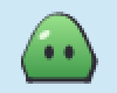
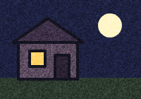

# 12. Acabamento

[← Efeitos e partículas (antigo)](08-luz-efeitos.md#efeitos-de-camada) · [Índice](README.md) · [Próximo: Estilos de arte (antigo) →](14-estilos.md)

> **Este capítulo ainda é o texto antigo.** Ele saiu do capítulo 4 (Camadas) e será reescrito numa das próximas versões do guia. Os títulos e as imagens são os mesmos de antes.

## Acabamento: `finish`

`finish` muda o estilo do desenho **inteiro** de uma vez. A linha `finish` pode ficar em qualquer lugar do arquivo (o costume é logo depois do `canvas`):

```
finish game|flat inner= pixel= posterize= bloom= vignette= grain= oldfilm= vhs= crt= glitch=
```

| | `game` (padrão) | `finish flat` | `pixel=4` | `posterize=4` |
|---|---|---|---|---|
| |  |  |  |  |

<details>
<summary>Código dos quatro</summary>

<!-- gerar: img/04_finish_game.png -->
```weasel
canvas 200 160 bg=#cfe8f5
palette ink=#2b2a33 line=5
gradient verde linear 0,0 0,1 box : #9be38c #3f9a4a
shape corpo c=verde ink=line weight=0.3 : 100,24 160,96 152,138! 48,138! 40,96
ellipse olhoE 84,90 8,12 c=ink
ellipse olhoD 118,90 8,12 c=ink
ellipse brilho 76,60 11,6 rot=-35 c=#e6fadf
```

<!-- gerar: img/04_finish_flat.png -->
```weasel
canvas 200 160 bg=#cfe8f5
finish flat
palette ink=#2b2a33 line=5
gradient verde linear 0,0 0,1 box : #9be38c #3f9a4a
shape corpo c=verde ink=line weight=0.3 : 100,24 160,96 152,138! 48,138! 40,96
ellipse olhoE 84,90 8,12 c=ink
ellipse olhoD 118,90 8,12 c=ink
ellipse brilho 76,60 11,6 rot=-35 c=#e6fadf
```

<!-- gerar: img/04_finish_pixel.png -->
```weasel
canvas 200 160 bg=#cfe8f5
finish game pixel=4
palette ink=#2b2a33 line=5
gradient verde linear 0,0 0,1 box : #9be38c #3f9a4a
shape corpo c=verde ink=line weight=0.3 : 100,24 160,96 152,138! 48,138! 40,96
ellipse olhoE 84,90 8,12 c=ink
ellipse olhoD 118,90 8,12 c=ink
ellipse brilho 76,60 11,6 rot=-35 c=#e6fadf
```

<!-- gerar: img/04_finish_posterize.png -->
```weasel
canvas 200 160 bg=#cfe8f5
finish game posterize=4
palette ink=#2b2a33 line=5
gradient verde linear 0,0 0,1 box : #9be38c #3f9a4a
shape corpo c=verde ink=line weight=0.3 : 100,24 160,96 152,138! 48,138! 40,96
ellipse olhoE 84,90 8,12 c=ink
ellipse olhoD 118,90 8,12 c=ink
ellipse brilho 76,60 11,6 rot=-35 c=#e6fadf
```

</details>

Os quatro códigos são iguais, menos a linha `finish`. Repare:

- `game` é o padrão: com ou sem a linha `finish game`, os contornos (`ink=`) são desenhados.
- `flat` tira **todos** os contornos de uma vez, para um visual de recorte de papel. Os olhos continuam, porque são preenchimento (`c=ink`), não contorno.
- `pixel=4` desenha a imagem 4 vezes menor e depois aumenta sem suavizar: cada "pixel" vira um bloco de 4×4.
- `posterize=4` deixa só 4 níveis em cada canal de cor (vermelho, verde e azul). O degradê suave da gosma vira faixas.

| Atributo | O que faz |
|---|---|
| `game` / `flat` | `game` desenha os contornos (`ink=`); `flat` tira todos, para um visual de recorte de papel. |
| `inner=0.6` | Opacidade dos **traços** (`stroke`) dentro de camadas com `clip`, de 0 a 1 (padrão 1). Deixa penas, rugas e dobras mais suaves que o contorno de fora ([os dois `inner`](#os-dois-inner)). |
| `pixel=4` | Desenha em blocos de 4×4 pixels (pixel art), de 1 a 32 (padrão 1, sem blocos). |
| `posterize=4` | Reduz cada canal de cor a 4 níveis (de 2 a 64). `posterize=palette` reduz às cores da `palette` ([exemplo](#só-as-cores-da-palette-posterizepalette)). |
| `bloom=` `vignette=` `grain=` | Brilho que vaza do claro, bordas escurecidas e granulado de filme (padrão 0 nos três). Cada um tem a sua faixa: `bloom` de 0 a 3, `vignette` de 0 a 1 e `grain` de 0 a 0.33 ([detalhes e exemplo](#acabamentos-de-cinema-bloom-vignette-e-grain)). |
| `oldfilm=` `vhs=` `crt=` `glitch=` | Efeitos de tela: filme antigo, fita VHS, televisão de tubo e falha digital, de 0 a 1 (padrão 0). Só no filme, no vídeo, no GIF e no PNG; a sprite sheet e o Godot saem sem eles ([detalhes e exemplo](#efeitos-de-tela-oldfilm-vhs-crt-e-glitch)). |

**Experimente:** no código do `pixel=4`, mude para `pixel=8`. Os blocos dobram de tamanho, e os olhos viram poucos quadradinhos.

**No editor:** **Janela › Acabamento e estilo** tem um controle deslizante para cada número do `finish` (e a escolha entre `game` e `flat`). Arrastar escreve na linha `finish`, com um Ctrl+Z por arraste; sem a linha, ela nasce logo depois do `canvas`. Veja [o painel no capítulo 14](14-estilos.md#pelo-editor-janela--acabamento-e-estilo).

O `pixel=` faz a média das cores de cada bloco, então as bordas ficam com tons misturados. Para pixel art nítido, com as cores do desenho, paletas de console e contorno de 1 bloco, use a linha `art pixel` do [capítulo 14](14-estilos.md#pixel-art-art-pixel).

### Só as cores da palette: `posterize=palette`

Com `posterize=palette`, cada ponto da imagem vira a cor **mais parecida** entre as cores da sua `palette`. Serve para garantir que o desenho inteiro use só as cores escolhidas, como numa pixel art de poucas cores.

<!-- gerar: img/04_finish_palette.png -->
```weasel
canvas 200 160 bg=#cfe8f5
finish game posterize=palette
palette ink=#2b2a33 line=5 ceu=#cfe8f5 claro=#9be38c escuro=#3f9a4a brilho=#e6fadf
gradient verde linear 0,0 0,1 box : claro escuro
shape corpo c=verde ink=line weight=0.3 : 100,24 160,96 152,138! 48,138! 40,96
ellipse olhoE 84,90 8,12 c=ink
ellipse olhoD 118,90 8,12 c=ink
ellipse brilho 76,60 11,6 rot=-35 c=brilho
```

| Sem `posterize` | `posterize=palette` |
|---|---|
|  |  |

Repare:

- A `palette` tem cinco cores: `ink`, `ceu`, `claro`, `escuro` e `brilho`. Os números (`line=5`) não contam.
- O degradê ia do `claro` ao `escuro`, passando por vários verdes do meio. Com `posterize=palette`, cada verde do meio virou o `claro` ou o `escuro`, o que estiver mais perto.
- Liste na `palette` todas as cores que você quer na imagem. Uma cor que não está lá vira a parecida mais próxima, que pode ser bem diferente.

**Experimente:** acrescente `meio=#6dbe6a` na linha `palette`. O degradê ganha uma terceira faixa, verde média.

### Acabamentos de cinema: `bloom=`, `vignette=` e `grain=`

Estes três imitam o que acontece numa câmera de verdade. Eles valem para a **imagem pronta**, então ficam bem em cenas inteiras (cenários, filmes) e quase não aparecem num personagem sozinho num fundo claro.

| Sem nada | `bloom=1.5` | `vignette=1` | `grain=0.15` |
|---|---|---|---|
|  |  |  |  |

<details>
<summary>Código dos quatro</summary>

<!-- gerar: img/04_finish_noite.png -->
```weasel
canvas 200 140 bg=#1d2140
palette ink=#141320 line=4
rect chao 0,110 200,30 c=#2c3a2e
ellipse lua 156,36 17 c=#fff6c8
rect casa 26,58 84,54 c=#5a4a5e ink=line
shape telhado c=#3b2f45 ink=line : 18,60! 68,26! 118,60!
rect janela 42,72 22,22 c=#ffd56b ink=line
rect porta 78,78 20,34 c=#2b2233 ink=line
```

<!-- gerar: img/04_finish_bloom.png -->
```weasel
canvas 200 140 bg=#1d2140
finish game bloom=1.5
palette ink=#141320 line=4
rect chao 0,110 200,30 c=#2c3a2e
ellipse lua 156,36 17 c=#fff6c8
rect casa 26,58 84,54 c=#5a4a5e ink=line
shape telhado c=#3b2f45 ink=line : 18,60! 68,26! 118,60!
rect janela 42,72 22,22 c=#ffd56b ink=line
rect porta 78,78 20,34 c=#2b2233 ink=line
```

<!-- gerar: img/04_finish_vignette.png -->
```weasel
canvas 200 140 bg=#1d2140
finish game vignette=1
palette ink=#141320 line=4
rect chao 0,110 200,30 c=#2c3a2e
ellipse lua 156,36 17 c=#fff6c8
rect casa 26,58 84,54 c=#5a4a5e ink=line
shape telhado c=#3b2f45 ink=line : 18,60! 68,26! 118,60!
rect janela 42,72 22,22 c=#ffd56b ink=line
rect porta 78,78 20,34 c=#2b2233 ink=line
```

<!-- gerar: img/04_finish_grain.png -->
```weasel
canvas 200 140 bg=#1d2140
finish game grain=0.15
palette ink=#141320 line=4
rect chao 0,110 200,30 c=#2c3a2e
ellipse lua 156,36 17 c=#fff6c8
rect casa 26,58 84,54 c=#5a4a5e ink=line
shape telhado c=#3b2f45 ink=line : 18,60! 68,26! 118,60!
rect janela 42,72 22,22 c=#ffd56b ink=line
rect porta 78,78 20,34 c=#2b2233 ink=line
```

</details>

| Atributo | O que faz | Valores |
|---|---|---|
| `bloom=` | o que é muito claro (a lua, a janela) "vaza" num brilho suave em volta | de 0 a 3; 1 já é bem visível, e cada número a mais soma mais uma camada de brilho |
| `vignette=` | escurece as bordas e os cantos, e leva o olho para o meio | de 0 a 1: em 1, os cantos ficam pretos (acima de 1 não escurece mais) |
| `grain=` | granulado de filme, um chuvisco fino por cima de tudo | de 0 a 0.33: `0.03` é sutil, `0.15` é forte (acima de 0.33 não aumenta mais) |

Fora da faixa, o Weasel avisa. No `bloom`, acima de 3, vale 3. No `vignette` e no `grain`, o valor é aceito, mas acima de 1 e de 0.33 a imagem não muda mais.

Os três podem ir juntos na mesma linha: `finish game bloom=0.5 vignette=0.6 grain=0.03`. O [capítulo 8](08-luz-efeitos.md#acabamentos-de-cinema) usa assim numa fogueira animada.

> O granulado é ruído, e ruído não comprime: um GIF ou PNG com `grain=` fica bem maior.

**Experimente:** no código do `bloom`, mude a cor da lua para `c=#8a7a4a`, um amarelo apagado. O brilho em volta dela some: o `bloom` só pega o que é bem claro. A janela, que continua clara, continua brilhando.

### Efeitos de tela: `oldfilm=`, `vhs=`, `crt=` e `glitch=`

Estes quatro imitam o caminho da imagem até quem assiste: o filme antigo no projetor, a fita de vídeo, a televisão de tubo e o arquivo digital quebrando. Cada um vai de 0 a 1 (1 é o mais forte) e muda a cada quadro, sempre do mesmo jeito: o vídeo sai igual toda vez.

| `oldfilm=1` | `vhs=1` | `crt=1` | `glitch=1` |
|---|---|---|---|
|  |  |  |  |

<details>
<summary>Código dos quatro</summary>

<!-- gerar: img/04_tela_oldfilm.png -s 2 -->
```weasel
canvas 200 140 bg=#9fd0f0
finish oldfilm=1
palette ink=#141320 line=4
rect chao 0,110 200,30 c=#6aa84f
ellipse sol 156,36 17 c=#ffe27a
rect casa 26,58 84,54 c=#e8d9b5 ink=line
shape telhado c=#c44536 ink=line : 18,60! 68,26! 118,60!
rect janela 42,72 22,22 c=#7fc8f0 ink=line
rect porta 78,78 20,34 c=#8a5a3c ink=line
```

<!-- gerar: img/04_tela_vhs.png -s 2 -->
```weasel
canvas 200 140 bg=#9fd0f0
finish vhs=1
palette ink=#141320 line=4
rect chao 0,110 200,30 c=#6aa84f
ellipse sol 156,36 17 c=#ffe27a
rect casa 26,58 84,54 c=#e8d9b5 ink=line
shape telhado c=#c44536 ink=line : 18,60! 68,26! 118,60!
rect janela 42,72 22,22 c=#7fc8f0 ink=line
rect porta 78,78 20,34 c=#8a5a3c ink=line
```

<!-- gerar: img/04_tela_crt.png -s 2 -->
```weasel
canvas 200 140 bg=#9fd0f0
finish crt=1
palette ink=#141320 line=4
rect chao 0,110 200,30 c=#6aa84f
ellipse sol 156,36 17 c=#ffe27a
rect casa 26,58 84,54 c=#e8d9b5 ink=line
shape telhado c=#c44536 ink=line : 18,60! 68,26! 118,60!
rect janela 42,72 22,22 c=#7fc8f0 ink=line
rect porta 78,78 20,34 c=#8a5a3c ink=line
```

<!-- gerar: img/04_tela_glitch.png -s 2 -->
```weasel
canvas 200 140 bg=#9fd0f0
finish glitch=1
palette ink=#141320 line=4
rect chao 0,110 200,30 c=#6aa84f
ellipse sol 156,36 17 c=#ffe27a
rect casa 26,58 84,54 c=#e8d9b5 ink=line
shape telhado c=#c44536 ink=line : 18,60! 68,26! 118,60!
rect janela 42,72 22,22 c=#7fc8f0 ink=line
rect porta 78,78 20,34 c=#8a5a3c ink=line
```

</details>

| Atributo | O que faz |
|---|---|
| `oldfilm=` | filme antigo: sépia, a luz piscando, o quadro tremendo de leve, o grão, as bordas escuras, riscos que duram uns quadros, poeira e, às vezes, um fio de cabelo |
| `vhs=` | fita VHS: as linhas tremendo de lado, a cor borrada e atrasada, o preto lavado, o chiado, a faixa do tracking descendo devagar e a faixa torta embaixo |
| `crt=` | televisão de tubo: as linhas de varredura, a máscara de cor (vermelho, verde e azul lado a lado) e a imagem curva, com os cantos redondos e escuros; a curva cresce com o valor, e em 1 só uma faixa fina da borda some |
| `glitch=` | falha digital: em alguns quadros, em rajadas, faixas da imagem pulam de lado (algumas com as cores trocadas), o vermelho e o azul se separam e uns blocos se repetem fora do lugar; quanto maior o valor, mais vezes e mais forte |

Repare:

- **São para o filme e o vídeo**, e valem também no GIF, no WebP e no PNG. A sprite sheet e o Godot saem **sem eles** (um personagem de jogo não deve levar a tela de tubo em cada quadro), e o Weasel avisa na janela de exportar e na linha de comando. O SVG também sai sem eles.
- Eles entram por último: depois do estilo (`art`), do `bloom`, do `vignette`, do `grain` e do `posterize`. Com `pixel=`, entram depois dos blocos.
- Podem ir juntos: `finish crt=0.6 vhs=0.4` é uma fita velha passando numa televisão de tubo.
- Na imagem transparente, eles mexem só no desenho: o que é transparente continua transparente.

> Como no granulado, o chiado, o grão e a poeira não comprimem: o vídeo e o GIF ficam maiores.

**Experimente:** no código do `crt=1`, mude para `crt=0.3`. As linhas ficam leves, e a imagem quase não curva.

### Os dois `inner`

A palavra `inner` aparece em **dois lugares** do Weasel, com sentidos diferentes. Os dois cuidam da mesma coisa, os traços **de dentro** do personagem (penas, rugas, dobras de roupa), por isso têm o mesmo nome. Mas um diz a **espessura** desses traços, e o outro diz **o quanto eles aparecem**.

| Nome | Onde se escreve | O que é | Exemplo |
|---|---|---|---|
| `inner` da `palette` | como valor de `w=` ou `ink=` (e, para mudar o número, numa linha `palette`) | um **número com nome**: uma espessura em pixels. Já vem pronto, valendo 5 | `stroke pena w=inner : …` |
| `inner=` do `finish` | só na linha `finish` | uma **opacidade**, de 0 (invisível) a 1 (normal). Padrão 1. Vale só para os `stroke` de camadas com `clip=` | `finish game inner=0.4` |

**O `inner` da palette** foi apresentado no [capítulo 3](03-cores.md#a-cor-da-tinta-e-os-nomes-prontos): é um número pronto, como `line` e `edge`. Escrever `w=inner` é o mesmo que escrever `w=5`, com a vantagem de poder trocar o 5 de todos os traços numa linha só.

**O `inner=` do finish** deixa mais claros os traços que ficam **dentro** de uma forma recortada, para que pareçam um detalhe e não briguem com o contorno de fora.

Os dois exemplos abaixo desenham o mesmo passarinho. O primeiro gera duas imagens: a normal e a variante `fino`, que troca o `inner` da palette. O segundo só acrescenta a linha `finish game inner=0.4`.

<!-- gerar: img/04_inner_padrao.png -->
<!-- gerar: img/04_inner_fino.png --variant fino -->
```weasel
canvas 240 220 bg=#f4efe6
palette ink=#2b2a33 line=8
variant fino inner=2

layer corpo
ellipse bola 120,116 80 c=#ffb347 ink=line

# as penas: traços de dentro, numa camada recortada pela bola
layer penas clip=bola
stroke asa w=inner : 70,98 64,124 76,144 102,152
stroke p1 w=inner : 92,164 104,174 116,164
stroke p2 w=inner : 116,164 128,174 140,164
stroke p3 w=inner : 104,184 116,194 128,184

# o rosto e o topete: numa camada sem clip
layer rosto
stroke topete w=inner : 112,38 118,16 134,10
ellipse olhoE 102,100 7,10 c=ink
ellipse olhoD 142,100 7,10 c=ink
shape bico c=#e8743b ink=4 : 112,118! 132,118! 122,132!
```

<!-- gerar: img/04_inner_04.png -->
```weasel
canvas 240 220 bg=#f4efe6
finish game inner=0.4
palette ink=#2b2a33 line=8

layer corpo
ellipse bola 120,116 80 c=#ffb347 ink=line

layer penas clip=bola
stroke asa w=inner : 70,98 64,124 76,144 102,152
stroke p1 w=inner : 92,164 104,174 116,164
stroke p2 w=inner : 116,164 128,174 140,164
stroke p3 w=inner : 104,184 116,194 128,184

layer rosto
stroke topete w=inner : 112,38 118,16 134,10
ellipse olhoE 102,100 7,10 c=ink
ellipse olhoD 142,100 7,10 c=ink
shape bico c=#e8743b ink=4 : 112,118! 132,118! 122,132!
```

| Padrão | `--variant fino` (`inner=2` na palette) | `finish game inner=0.4` |
|---|---|---|
|  |  |  |

Repare:

- **No meio**, a variante troca o **número** `inner` da palette de 5 para 2. Todos os traços com `w=inner` afinam juntos: a asa, as penas **e** o topete. Nenhum fica mais claro.
- **À direita**, `finish game inner=0.4` não mexe na espessura: a asa e as penas continuam com 5 pixels, mas aparecem só 40%. O topete **não muda**, porque está na camada `rosto`, que não tem `clip=`.
- O contorno da bola (`ink=line`) e o bico não mudam em nenhuma das três.

O Cavaleiro de exemplo ([`cavaleiro.weasel`](../../exemplos/cavaleiro.weasel)) usa os dois juntos: `palette … inner=7` deixa os traços de dentro com 7 pixels, e `finish game inner=0.6` deixa as dobras da capa, que estão na camada `cloakshade clip=cloak`, com 60%.

#### O que o `inner=` do finish deixa mais claro

Para não restar dúvida, este exemplo põe lado a lado as mesmas três coisas, com a mesma espessura (`inner`, da palette), numa camada **sem** recorte e numa camada **com** `clip=`:

<!-- gerar: img/04_inner_juntos.png -->
```weasel
canvas 460 250 bg=#f4efe6
finish game inner=0.3
palette ink=#2b2a33 line=4 inner=8

layer papeis
rect papelE 20,40 200,195 r=10 c=#ffffff ink=line
rect papelD 240,40 200,195 r=10 c=#ffffff ink=line

# à esquerda: camada sem clip
layer livre
stroke tracoE w=inner : 50,80 190,80
line linhaE w=inner : 50,125 190,125
ellipse bolaE 120,175 20 c=#ffd34d ink=inner

# à direita: a mesma coisa, numa camada com clip
layer recortada clip=papelD
stroke tracoD w=inner : 270,80 410,80
line linhaD w=inner : 270,125 410,125
ellipse bolaD 340,175 20 c=#ffd34d ink=inner

layer rotulos
text t1 120,28 "camada sem clip" size=15 align=center
text t2 340,28 "camada com clip=" size=15 align=center
text s 120,100 "stroke" size=12 align=center
text l 120,145 "line" size=12 align=center
text s2 340,100 "stroke" size=12 align=center
text l2 340,145 "line" size=12 align=center
text c 120,220 "contorno (ink=)" size=12 align=center
text c2 340,220 "contorno (ink=)" size=12 align=center
```


Repare:

- Os seis desenhos usam a mesma espessura: `w=inner` ou `ink=inner`, que nesta palette vale 8 pixels.
- Só **um** ficou claro: o `stroke` da direita, que é um `stroke` **e** está numa camada com `clip=`.
- A `line` da direita está na mesma camada recortada, mas não muda. O contorno da bolinha também não.

Resumindo, `finish inner=` só vale para:

- `stroke` (traços). Não vale para `line`, `text`, preenchimentos, nem para o contorno das formas (`ink=`);
- em camadas com `clip=`. Uma camada só com `cut=` não conta;
- e não vale para braços e pernas com IK (`stroke … limb=`, do [capítulo 8](08-ossos.md#pernas-e-braços-com-ik)).

A opacidade do `finish` se multiplica com a do próprio traço: um `stroke` com `opacity=0.5` numa camada com `clip=` e `finish inner=0.4` aparece só 20% (0,5 × 0,4).

**Experimente:** mude `inner=0.3` para `inner=0` na linha `finish`. O traço da direita some de vez, e todo o resto fica igual.

[← Efeitos e partículas (antigo)](08-luz-efeitos.md#efeitos-de-camada) · [Índice](README.md) · [Próximo: Estilos de arte (antigo) →](14-estilos.md)
