# 12. Referência rápida

[← Profundidade (2.5D)](11-profundidade.md) · [Índice](README.md) · [Próximo: Problemas comuns →](13-problemas.md)

Todas as instruções, com os atributos e os **valores padrão** (o que vale quando você não escreve o atributo). Entre colchetes, `[opção]` é uma palavra solta opcional. "Cor de tinta" é o `ink` da `palette` (padrão `#14141c`).

Cada seção termina com um **exemplo que usa quase tudo da tabela de uma vez**, com a imagem que ele gera. Ele serve para consultar a escrita certa de cada coisa. Para aprender com calma, siga o link "Para aprender" de cada seção, que leva ao capítulo com a explicação passo a passo.

## Escrita

| Item | Forma |
|---|---|
| Linha | `comando nome valores atributo=valor [opções] : pontos` |
| Comentário | `#` no começo da linha ou depois de um espaço (uma cor `#hex` não é comentário) |
| Ponto | `x,y` liso · `x,y!` canto vivo · `x,y~dx,dy` com alça |
| Cor | `#rgb` `#rgba` `#rrggbb` `#rrggbbaa` · nome da `palette` · `gradient` · `pattern` · nome do CSS · `none` ou `transparent` |
| Espessura | número · nome numérico da `palette` (`line`, `inner`…) · `none` (0) |
| Conta | `{expressão}` em qualquer número: `+ - * / % ^ ( )`, variáveis do `let`, de `def` e de `repeat`, `pi`, `sin cos tan atan2` (graus), `sqrt abs min max round floor ceil pow lerp clamp`, `dist(x1,y1,x2,y2)`, `rand(x)` e `rand(x,a,b)` |
| Ângulo | graus; 0 = direita, positivo = horário, 90 = para baixo |
| Texto | entre aspas: `"Olá"` |
| Tempo (filme) | `2s` `1.5` `500ms` `48f` `1m30s`; `+1s` = depois do anterior |

### Exemplo: a escrita

<!-- gerar: img/12_escrita.png -->
```weasel
# Linha que começa com # é comentário: o Weasel não lê
canvas 500 200 bg=#f4efe6
palette ink=#2b2a33 laranja=#f80 grosso=6
let cx=330

shape gota c=laranja ink=grosso : 70,30 110,150! 30,150!
stroke onda w=4 : 140,150! 200,40~50,0 260,150!
ellipse vidro {cx},80 45 c=#2f6fb580 ink=3
rect torto {cx + 60},100 60,40 rot=30 c=tomato
text frase 250,190 "texto vai entre aspas" size=18 align=center   # comentário no fim da linha
```

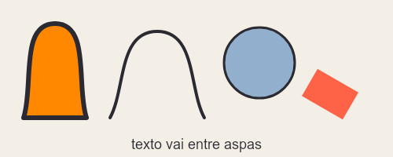

Repare:

- `laranja=#f80` é a cor curta: `#f80` vale `#ff8800`. `grosso=6` é uma espessura com nome, usada em `ink=grosso`.
- Na `gota`, `70,30` é um ponto **liso** (a ponta de cima sai redonda) e `110,150!` e `30,150!` são **cantos**.
- No `stroke onda`, `200,40~50,0` é um ponto com **alça**: a curva passa por ele na horizontal (50 para a direita, 0 para baixo).
- `{cx}` e `{cx + 60}` são **contas** com a variável do `let`. `#2f6fb580` tem `80` no fim: metade transparente.
- `rot=30` gira 30 graus no sentido do relógio. `tomato` é um nome de cor do CSS.

Para aprender: [capítulo 1](01-primeiros-passos.md) (a linha e os erros), [capítulo 2](02-formas.md) (pontos e alças) e [capítulo 5](05-componentes.md) (contas).

### A ordem das linhas

**Usar** um nome não depende da ordem. O Weasel lê o arquivo inteiro antes de ligar cada nome ao que ele aponta, então uma linha pode usar uma forma, uma camada, um osso, uma cor ou um componente que só aparece mais abaixo.

| Onde o nome é usado | O que pode estar mais abaixo no arquivo |
|---|---|
| `c=`, `ink=`, `inkc=`, `w=`, `bg=` do `canvas`, cores de `gradient`, `pattern`, `light` e `variant` | o nome da `palette`, o `gradient`, o `pattern` |
| `clip=` e `cut=` da camada | a forma ou a camada do molde |
| `cut=` e `back=` na forma | a forma |
| `mirror=` | a forma espelhada (num `def`, a do mesmo `def`) |
| `inkon=` | a camada |
| `bone=` (nas formas, no `use`, na `light` e no `cloth`) e `parent=` | o osso |
| `cloth=` | o tecido |
| `path=` do osso | a `line`, o traço ou a forma |
| `use` | o `def` |
| `key` e `expr` (`osso=…`, `forma.prop=…`, `above=`, `below=`) | os ossos e as formas |
| `only=` e `mix=` | as animações |
| `show=` e `hide=` da `variant` | as formas e as camadas |
| `cast=` e `from=` da camada | a `line` do chão, as camadas |
| `{conta}` | as variáveis do `let` |
| `at`, `follow=` da `camera` e `lips=` do `audio` (filme) | o `actor` do mesmo `shot` (ou do filme), o `mark` |

O que **depende** da posição:

| O quê | Regra |
|---|---|
| **Copiar** na `palette` (`sombra=cabelo`) | o original vem antes: numa linha `palette` de cima, ou mais à esquerda na mesma linha ([capítulo 3](03-cores.md#antes-ou-depois-onde-um-nome-da-palette-vale)) |
| O mesmo nome duas vezes na `palette` | vale o último valor, no arquivo todo |
| A ordem da pintura | as camadas são pintadas na ordem do arquivo e, dentro de cada camada, as formas também: o que vem mais abaixo no arquivo fica por cima no desenho |
| A camada de uma forma | a `layer` acima dela; antes da primeira `layer`, a camada `base` |
| `key` e `event` | valem para o `anim` acima |
| `def` … `end` | as linhas entre os dois são o componente |
| `actor`, `camera`, `audio`, `sub`, `mark` e `at` (filme) | valem para o `shot` acima, e o tempo conta do começo dele; antes do primeiro `shot`, valem para o filme todo. Um ator criado num `shot` só existe nele |
| `at +1s` | conta a partir do `at` anterior |
| `include` | o arquivo incluído entra no lugar da linha, como se estivesse escrito ali |

Em resumo: **usar** um nome pode ser feito de qualquer lugar. O que depende da ordem é o que fica **por cima** no desenho, a **que bloco** uma linha pertence e a **cópia** na `palette`.

<!-- gerar: img/12_ordem.png -->
```weasel
# as definições ficam no fim; os usos vêm antes delas
canvas 320 200 bg=fundo

layer corpo
ellipse bola 160,100 70 c=laranja ink=line inkon=contorno bone=cabeca

layer sombra clip=bola
ellipse s 205,145 85 c=escuro

layer rosto
use olho 135,85 bone=cabeca
use olho 185,85 bone=cabeca

layer contorno

anim pula frames=12
key 6 cabeca=0,-12

bone cabeca pivot=160,170

def olho
ellipse e 0,0 9 c=ink
end

palette ink=#2b2a33 fundo=#f4efe6 laranja=#ff8a3d escuro=#e0692e
```

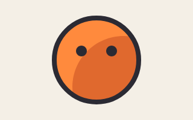

- `fundo`, `laranja`, `escuro` e `ink` só aparecem na `palette` da última linha.
- `inkon=contorno` usa uma camada que vem depois. `bone=cabeca` e o `key 6 cabeca=…` usam um osso que vem depois. Os dois `use olho` usam um `def` que vem depois.
- A ordem das camadas é a da pintura: a `sombra` vem depois do `corpo` para ficar por cima da bola, e o `rosto` vem depois da `sombra` para os olhos não ficarem embaixo dela.

Para aprender: [capítulo 3](03-cores.md#antes-ou-depois-onde-um-nome-da-palette-vale) (a `palette`), [capítulo 4](04-camadas.md) (a ordem das camadas, `clip=`, `cut=` e `inkon=`), [capítulo 7](07-animacao.md) (`anim` e `key`) e [capítulo 10](10-filme.md) (os `shot`).

## Configuração

| Instrução | Atributos (padrão) |
|---|---|
| `canvas L A` | `bg=` cor, gradiente ou `none` (`#ffffff`) · `light=x,y` direção da luz do contorno (`-0.6,-0.8`). Tamanho de 1 a 4096 (padrão 800×600; num filme, 1920×1080). |
| `finish [game\|flat]` | `inner=` opacidade dos traços em camadas com `clip`, 0–1 (1) · `pixel=` 1–32 (1) · `posterize=` 2–64 ou `palette` · `bloom=` 0–3 (0) · `vignette=` 0–1 (0) · `grain=` 0–0.33 (0); fora da faixa, o Weasel avisa (acima de 1 no `vignette` e de 0.33 no `grain`, a imagem não muda mais) |
| `palette nome=valor …` | cores e números. Já existem: `ink=#14141c` `line=8` `inner=5` `edge=3`. Usar um nome (`c=`, `ink=`, `bg=`, cores de `gradient`…) vale no arquivo todo; copiar (`b=a`) só depois do original: acima, ou à esquerda na mesma linha ([cap. 3](03-cores.md#antes-ou-depois-onde-um-nome-da-palette-vale)) |
| `let nome=valor …` | variáveis para as contas; lidas antes de tudo (um `let` pode usar outro, de cima ou de baixo) |
| `gradient nome linear x1,y1 x2,y2 [box] : cores` | cores com posição opcional `cor@0.5` |
| `gradient nome radial cx,cy raio [fx,fy] [box] : cores` | `fx,fy` = foco |
| `pattern nome [hatch\|dots] [cross]` | `c=` (cor de tinta) · `bg=` (nenhum) · `gap=` (6) · `w=` (1.2) · `r=` (1.4) · `angle=` (45) |
| `variant nome chave=valor …` | troca valores da `palette` nessa versão · `hide=nomes` esconde formas ou camadas · `show=nomes` mostra as que têm `hidden` |
| `include "arquivo.weasel"` | o outro arquivo entra nesta linha |
| `ref nome "imagem.png" x,y` | imagem guia, só no editor (nunca sai na exportação) · `scale=` (1) · `rot=` graus, em volta do centro (0) · `opacity=` 0–1 (0.5) · `only=` animações · `frames=a..b` · `lock` · `hidden` · `front` |
| `repeat i a..b` … `end` | repete as linhas, com `i` de `a` até `b` nas contas (até 1000 vezes) |
| `unity` | `unit=` pixels por unidade (100) · `root=x,y` (meio da base do canvas) · `collider=l,a[,dx,dy]` |

### Exemplo: a configuração

<!-- gerar: img/12_configuracao.png -->
<!-- gerar: img/12_configuracao_tarde.png --variant tarde -->
```weasel
canvas 460 220 bg=ceu
finish game vignette=0.5
palette ink=#2b2a33 grama=#7cb342 madeira=#c58a4c
gradient ceu linear 0,0 0,220 : #8fc9ee #f4efe6@0.8
gradient sol radial 0.4,0.4 0.6 box : #fff6c0 #ffb300
pattern tabuas hatch c=#6b4a30 gap=7 w=2 angle=90
let n=5
variant tarde grama=#9a8a3a madeira=#8a5a3a

rect chao 0,170 460,50 c=grama
ellipse astro 390,60 34 c=sol
repeat i 1..{n}
  ellipse nuvem{i} {i*70 - 20},{40 + i*6} 22,12 c=#ffffff
end
rect caixa 170,110 90,60 c=madeira ink=3
rect tampa 170,110 90,60 c=tabuas
```

| Padrão | Com `--variant tarde` |
|---|---|
| 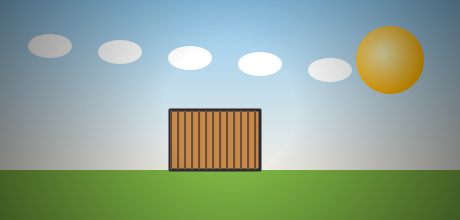 | 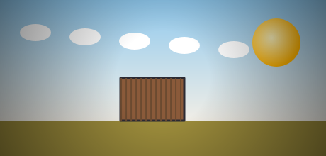 |

Repare:

- `bg=ceu` usa o `gradient ceu` como fundo. `#f4efe6@0.8` diz que essa cor chega a 80% da altura.
- `gradient sol radial … box`: com `box`, as medidas vão de 0 a 1 **dentro da forma** que usa o gradiente (aqui, o `astro`).
- `pattern tabuas` é uma hachura: `gap=7` é o espaço entre as linhas, `w=2` a grossura delas, `angle=90` as deixa em pé.
- `repeat i 1..{n}` repete a linha de dentro 5 vezes, com `i` valendo 1, 2, 3, 4 e 5.
- `finish game vignette=0.5` escurece de leve as bordas (vai de 0 a 1). A `variant tarde` troca as cores com nome.

Para aprender: [capítulo 3](03-cores.md) (palette, gradientes, hachuras e variantes), [capítulo 4](04-camadas.md) (`finish`) e [capítulo 5](05-componentes.md) (`let` e `repeat`).

## Camadas

`layer nome [guide] [hidden] [lit] [unlit] [screen] [front] [zsort] [floor]`

| Atributo | Padrão | O que faz |
|---|---|---|
| `clip=forma\|camada` | — | só aparece dentro (os buracos do molde continuam buracos) |
| `cut=forma\|camada` | — | só aparece fora (e pelos buracos do molde) |
| `only=anim,…` | todas | só nessas animações (`pose` = pose parada, a primeira opção do player; por isso, evite `anim pose`. No filme, também nomes de plano) |
| `opacity=` | 1 | transparência |
| `blend=` | `normal` | `multiply` `screen` `overlay` `darken` `lighten` `color-dodge` `color-burn` `hard-light` `soft-light` `difference` `exclusion` `hue` `saturation` `color` `luminosity` |
| `blur=` | 0 | desfoque (px) |
| `glow=cor,raio,força` | raio 12, força 1 | brilho em volta |
| `shadow=cor,dx,dy,desfoque` | 4, 6, 8 | sombra deslocada |
| `tint=cor,quanto` | quanto 0.5 | tingir |
| `brightness=` `saturate=` `contrast=` | 1 | ajustes de cor (0–10) |
| `hue=` | 0 | girar o matiz (graus) |
| `trail=quadros,queda,cor` | queda 0.5 | rastro (1–30 quadros) |
| `cast=chão,opacidade,desfoque` | 0.45, 6 | sombra projetada numa `line` |
| `from=camada,…` | a própria | de quem é a silhueta do `cast` |
| `rim=cor,largura` | largura 4 | fio de luz na borda |
| `shade=` | 0.5 | claro e escuro da luz (0–2) |
| `depth=` | 1 | profundidade no filme (0.05–1000) |
| `yaw=` `pitch=` | 0 | giro 3D da camada inteira (graus) |
| `persp=` | o dobro do lado maior | distância do olho (0 = sem perspectiva) |
| `pivot=x,y` | o meio (com `floor`: o meio da base) | centro do giro; com `floor`, a linha que fica parada |
| `horizon=` | 30% da altura | com `floor`: a altura do horizonte na tela |
| `iso=x,y` | em cima, no meio | mapa isométrico; `x,y` é onde fica o canto (0,0) |

`[zsort]` pinta de longe para perto a cada quadro · `[floor]` deita a camada como chão (sem `persp=`, 45°).

> `[lit]` é aceito, mas não muda nada: com qualquer luz na cena, toda camada já recebe luz. O que existe de verdade é o contrário, `[unlit]`.

### Exemplo: as camadas

<!-- gerar: img/12_camadas.png -->
```weasel
canvas 480 250 bg=#f4efe6
palette ink=#2b2a33 bola=#ff6b4a

layer normal
ellipse b1 60,70 36 c=bola ink=3
layer meia opacity=0.4
ellipse b2 180,70 36 c=bola ink=3
layer embacada blur=3
ellipse b3 300,70 36 c=bola ink=3
layer brilhante glow=#ffd34d,14
ellipse b4 420,70 36 c=bola ink=3
layer sombreada shadow=#00000066,6,6,4
ellipse b5 60,180 36 c=bola ink=3
layer tingida tint=#2f6fb5,0.6
ellipse b6 180,180 36 c=bola ink=3
layer cinza saturate=0
ellipse b7 300,180 36 c=bola ink=3
ellipse b8 420,180 36 c=bola ink=3
layer listra clip=b8
rect faixa 380,166 80,14 c=#ffffff

layer rotulos
text t1 60,125 "normal" size=14 align=center
text t2 180,125 "opacity=0.4" size=14 align=center
text t3 300,125 "blur=3" size=14 align=center
text t4 420,125 "glow=" size=14 align=center
text t5 60,235 "shadow=" size=14 align=center
text t6 180,235 "tint=" size=14 align=center
text t7 300,235 "saturate=0" size=14 align=center
text t8 420,235 "clip=b8" size=14 align=center
```

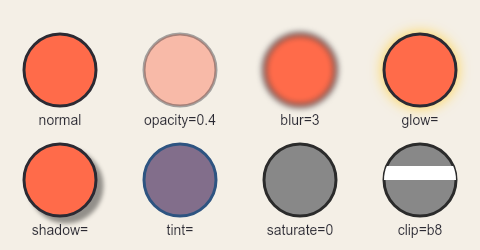

Repare:

- Cada efeito vale para a **camada inteira**: por isso cada bola está numa camada.
- A camada `cinza` tem duas bolas. A `b8` sai cinza também, e a `listra` recortada por ela (`clip=b8`) só aparece dentro da bola.
- Os textos ficam numa camada própria, por último, para não receber nenhum efeito.

Para aprender: [capítulo 4](04-camadas.md) (camadas, recortes, `blend=`) e [capítulo 8](08-luz-efeitos.md) (efeitos de camada).

## Formas

Todas aceitam: `c=` `opacity=` `bone=` `bones=a,b,…` (dobra com vários ossos; não em `text` e `emitter`) `cloth=` `cut=forma,…` (buracos: vale toda forma com esse nome, e buracos que se cruzam viram um só) `mirror=forma@x` (ou `@y300`) `emit=cor,força` e a opção `[hidden]`.

**2.5D** (todas, menos `emitter`, que só aceita `z=`): `z=` profundidade, positivo = perto (0) · `yaw=` `pitch=` giro 3D em volta do meio (0) · `persp=` (o dobro do lado maior) · `[billboard]` sempre de frente. Só nas fechadas (`shape`, `ellipse`, `rect`): `thick=` espessura (0) · `thickc=` cor dos lados (a da forma, mais escura) · `back=forma` o verso.

| Instrução | Valores e atributos (padrão) |
|---|---|
| `shape nome … : pontos` | 3 ou mais pontos · `ink=` (0, sem contorno) · `inkc=` (cor de tinta) · `weight=` 0–3 (0) · `inkon=camada` · `smooth=` 0–2 (1). Sem `c=` e sem `ink=`: pintada na cor de tinta. |
| `ellipse nome cx,cy r` ou `rx,ry` | `rot=` (0) · `ink=` `inkc=` `weight=` `inkon=` como no `shape` |
| `rect nome x,y l,a` | `r=` cantos (0) · `rot=` em volta do centro (0) · `ink=` `inkc=` `weight=` `inkon=` |
| `stroke nome … : pontos` | 2 ou mais pontos · `w=` (4) · `c=` (cor de tinta) · `taper=início,fim` 0–1 (0,0) · `cap=round\|butt\|square` (round) · `smooth=` (1) |
| `stroke nome limb=w1,w2 hip=x,y on=osso foot=chão,x` | perna com IK. `foot=x,y` também vale · `bend=` −3 a 3 (1): o sinal escolhe o lado da dobra; de 0 a 1, quanto dobra (acima de 1, igual a 1) |
| `stroke nome limb=w1,w2 hip=x,y on=osso target=osso` | braço com IK |
| `line nome … : pontos` | 2 ou mais pontos · `w=` (1) · `c=` (cor de tinta) · `dash=traço,vão,…` |
| `text nome x,y "texto"` | `size=` (24) · `font=` (`sans-serif`) · `align=left\|center\|right` (left) · `rot=` · `c=` (cor de tinta) · `ink=` (0) · `inkc=` · `[bold]` `[italic]` |
| `emitter nome x,y` | `rate=` (20) · `burst=` (0; soma ao `rate=`, então para só a rajada use `rate=0`) · `life=` (1) · `speed=` (80) · `angle=` (−90) · `spread=` (40) · `gravity=` (0) · `wind=` (0) · `drag=` (0) · `size=início,fim` (4) · `c=início,fim` (cor de tinta) · `shape=dot\|soft\|square\|streak\|star` (dot) · `area=l,a` (0) · `seed=` (1) |

### Exemplo: as formas

<!-- gerar: img/12_formas.png -->
```weasel
canvas 480 230 bg=#f4efe6
palette ink=#2b2a33

shape estrela c=#ffd34d ink=3 : 60,20! 72,52! 106,52! 78,72! 88,104! 60,84! 32,104! 42,72! 14,52! 48,52!
ellipse ovo 170,62 34,44 rot=20 c=#f1d9b5 ink=3
rect caixa 240,26 90,72 r=12 c=#4a90d9 ink=3
stroke pena w=14 taper=0,1 c=#6a4bc4 : 360,100 400,40 450,20
line regua c=#e8443a w=2 dash=8,5 : 20,150 460,150

text r1 60,130 "shape" size=14 align=center
text r2 170,130 "ellipse" size=14 align=center
text r3 285,130 "rect" size=14 align=center
text r4 405,130 "stroke" size=14 align=center
text r5 240,200 "line (a tracejada) e text (este)" size=18 align=center italic
```

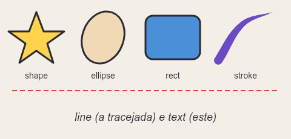

Repare:

- A estrela é um `shape` só de cantos (`!` em todos os pontos).
- O `ovo` tem dois raios (`34,44`) e `rot=20`. A `caixa` tem `r=12` nos cantos.
- `taper=0,1` afina o fim do traço até sumir (0 = sem afinar no começo, 1 = afinar tudo no fim).
- `dash=8,5` faz 8 pixels de traço e 5 de vão. `italic` deixa o texto inclinado.
- O `emitter` (partículas) também é uma forma; ele está no [capítulo 8](08-luz-efeitos.md), porque só se mexe numa animação.

Para aprender: [capítulo 2](02-formas.md).

## Componentes

| Instrução | Atributos |
|---|---|
| `def nome param=padrão …` … `end` | só formas, `use` e `repeat` dentro; desenho em volta de `0,0`; parâmetro numérico vira variável e espessura, os outros viram cor |
| `use nome x,y` | `scale=s` ou `sx,sy` · `rot=` · `flip=x\|y\|xy` · `bone=` · `cloth=` · `opacity=` · `z=` · `param=valor` · `[billboard]` (o componente fica de frente, de pé no ponto do `use`) |

### Exemplo: os componentes

<!-- gerar: img/12_componentes.png -->
```weasel
canvas 460 180 bg=#f4efe6
palette ink=#2b2a33

def flor cor=#ff6b4a tam=1
  stroke caule w=4 c=#4c9a3a : 0,0 0,-50
  ellipse folha 10,-24 10,5 rot=-30 c=#6cbf4a
  ellipse miolo 0,-58 {12*tam} c=cor ink=2
end

use flor 50,150
use flor 130,150 cor=#ffd34d
use flor 210,150 scale=1.5
use flor 290,150 rot=25
use flor 370,150 flip=x opacity=0.5 tam=1.6
```

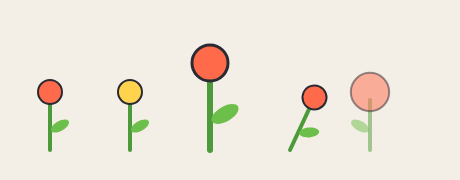

Repare:

- O desenho do `def` é feito em volta de `0,0`: esse é o ponto que vai para `x,y` em cada `use`.
- `cor=` é um parâmetro de cor; `tam=` é numérico e entra na conta `{12*tam}`.
- Na última flor, `flip=x` espelha (a folha passa para a esquerda) e `opacity=0.5` deixa a flor meio transparente.

Para aprender: [capítulo 5](05-componentes.md).

## Esqueleto e animação

| Instrução | Atributos (padrão) |
|---|---|
| `bone nome pivot=x,y` | `pivot=` obrigatório · `parent=` · `sway=graus,segundos[,fase]` · `bob=px,segundos[,fase]` · `jitter=px` 0–200 · `spring=` 0–1 (dura perto de 1) · `path=linha` (anda pelo caminho com `key osso.along=`) · `turn=1\|0` (1: vira com a curva) · `yaw=` `pitch=` giro 3D em volta do pivô (0) · `persp=` · `round=raio[,x,y]` as peças do osso viram uma bola (centro: o meio delas) |
| `cloth nome pivot=x,y` | `tension=` 0–1 (0.5) · `drag=` 0–10 (1) · `swing=` 0–10 (1) · `bone=` |
| `anim nome` | `frames=` 1–600 (24) · `fps=` 1–60 (12) · `[once]` (padrão: loop) · `mix=base,ação bones=ossos` (junta duas animações; o tempo é o da ação) |
| `key quadro …` | `osso=dx,dy,rot,sx,sy` (padrão `0,0,0,1,1`; 1 número = dx, 4 números = escala igual) · `alvo.prop=valor` · `ease=` (smooth) |
| `event quadro nome …` | um ou mais nomes |
| `expr nome …` | uma expressão: `osso=dx,dy,rot` e `forma.prop=valor`, como numa `key` sem quadro (para `at ator.expr=`) |

**`ease=`**: `smooth` (padrão), `linear`, `in`, `out`, `back`, `step`. Na `key`, diz como o movimento **sai** daquela key; no `at` do filme, como ele **chega** naquele `at`.

**O que a `key` anima** (`nome.propriedade=valor`):

| Alvo | Propriedades |
|---|---|
| osso | `along` (0 a 1, com `path=`) · `yaw` · `pitch` |
| forma | `opacity` · `c` · `inkc` · `w` · `ink` · `show` (1/0) · `shape` (morph: fechada com fechada, traço com traço) · `draw` (0 a 1, desenha aos poucos) · `above` / `below` (outra forma da mesma camada, ou `none`) · `yaw` · `pitch` · `z` |
| camada | `opacity` · `show` · `blur` · `glow` · `tint` · `brightness` · `saturate` · `contrast` · `hue` · `yaw` · `pitch` · `above` / `below` (outra camada, ou `none`) |
| luz | `power` · `radius` · `c` · `glow` · `aim` · `cone` |
| caixa | `show` |

### Exemplo: o esqueleto e a animação

<!-- gerar: img/12_esqueleto.gif -a vento -s 0.75 -->
```weasel
canvas 260 200 bg=#f4efe6
palette ink=#2b2a33

bone mastro pivot=60,190
bone bandeira parent=mastro pivot=66,40 sway=8,1
rect pau 56,30 10,160 c=#8d5a3b ink=2 bone=mastro
shape pano c=#e8443a ink=2 bone=bandeira : 66,40! 160,52 150,90 66,84!

anim vento frames=12 fps=12
key 0 mastro=0,0,-4
key 6 mastro=0,0,4 pano.c=#ff8a5c
key 12 mastro=0,0,-4 pano.c=#e8443a
event 6 rajada
```

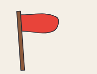

Repare:

- O osso `bandeira` é filho do `mastro` (`parent=`): vai junto com ele e ainda tem o próprio balanço, `sway=8,1` (8 graus, uma ida e volta por segundo).
- `key 0 mastro=0,0,-4` é a pose do osso: andar 0 em x, 0 em y e girar −4 graus.
- `pano.c=` anima a cor da forma. `event 6 rajada` marca o quadro 6 com um nome (aparece no player e vai para o jogo).

Para aprender: [capítulo 6](06-ossos.md) (ossos) e [capítulo 7](07-animacao.md) (animação).

## Luz

| Instrução | Atributos (padrão) |
|---|---|
| `ambient` | `c=` (#ffffff) · `power=` 0–5 (0.6) |
| `light nome point x,y` | `c=` (#ffffff) · `power=` 0–20 (1) · `radius=` (300) · `glow=` (0) · `flicker=` 0–1 (0) · `rim=` (0) · `bone=` |
| `light nome spot x,y` | os mesmos, mais `aim=` (90) · `cone=` 1–180 (30) |
| `light nome dir dx,dy` | `c=` · `power=` |

### Exemplo: a luz

<!-- gerar: img/12_luz.png -->
```weasel
canvas 480 240 bg=#1b2033
palette ink=#2b2a33

ambient c=#5866a0 power=0.4
light lampada point 120,70 c=#ffb860 power=1.5 radius=220 glow=40
light holofote spot 400,10 c=#9fe0ff power=2 aim=100 cone=18 radius=320

layer cena
rect chao 0,190 480,50 c=#7a7f8c
ellipse bola1 120,160 30 c=#f4efe6 ink=3
ellipse bola2 380,160 30 c=#f4efe6 ink=3
ellipse bola3 250,160 30 c=#f4efe6 ink=3
```

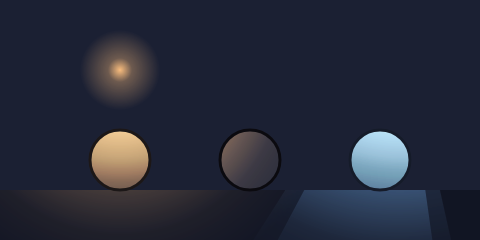

Repare:

- As três bolas são brancas no código. A cor que você vê é a luz que chega nelas.
- A `lampada` (`point`) ilumina em volta, até 220 pixels; `glow=40` desenha o halo.
- O `holofote` (`spot`) aponta para baixo (`aim=100`, quase 90) e abre 18 graus para cada lado.
- A bola do meio só recebe o `ambient`, a luz geral azulada e fraca.

Para aprender: [capítulo 8](08-luz-efeitos.md).

## Jogo

| Instrução | Atributos (padrão) |
|---|---|
| `box nome body\|hit\|hurt rect x,y l,a` | também `circle cx,cy r` e `capsule cx,cy l,a` · `bone=` · `only=` · `[off]` (padrão: `body`, `rect`, ligada) |
| `godot` | `body=character\|static\|area\|rigid\|node` (character) · `root=x,y` · `name=` · `normal=` 0–10 (1) · `rig=frames\|bones` (frames; `bones` = esqueleto de verdade, experimental) |
| `tileset` | `size=l` ou `l,a` (32) · `[auto]` · `[iso]` (losango largura × metade, embaixo da célula) |
| `tile nome coluna,linha` | `[solid]` · `[oneway]` · `collision=forma` |
| `point nome x,y` | `bone=` · vira `Marker2D` no Godot e `points` no JSON da sprite sheet |
| `mouth forma A=forma B=forma@0.3 …` | bocas A, B, C, D, E, F, G, H e X, por morph |

### Exemplo: o jogo

<!-- gerar: img/12_jogo.png --guides -->
```weasel
canvas 260 200 bg=#f4efe6
palette ink=#2b2a33

godot body=character root=100,190
bone braco pivot=120,100
rect corpo 70,60 60,130 r=16 c=#4a90d9 ink=3
rect arma 120,94 60,12 c=#9aa6b2 ink=3 bone=braco
box pes body rect 76,170 48,20
box dano hurt rect 70,60 60,130
box golpe hit rect 180,80 40,40 bone=braco
point cano 180,100 bone=braco

layer caixas guide
rect vpes 76,170 48,20 c=#3fbf5f55 ink=1 inkc=#2a8a40
rect vdano 70,60 60,130 c=#ffd34d33 ink=1 inkc=#b08a00
rect vgolpe 180,80 40,40 c=#e8443a44 ink=1 inkc=#b02a20 bone=braco
ellipse vcano 180,100 4 c=#8a4bd0
```

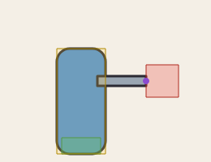

Repare:

- `box` e `point` **não aparecem** na imagem: no jogo eles viram colisões e marcadores. No editor, você os vê com **Guias** ligado.
- Para mostrar as caixas aqui, copiei cada uma numa camada `guide`. Essa camada só sai na exportação com `--guides`; esta imagem foi feita assim.
- Verde é o corpo que colide com o chão (`body`), amarelo é onde o boneco leva dano (`hurt`) e vermelho é o golpe (`hit`). O golpe e o `point` têm `bone=braco`: andam com o braço.
- `root=100,190` fica entre os pés do boneco: esse ponto vira a **origem** (0,0) da cena no Godot.

Para aprender: [capítulo 9](09-jogo-godot.md).

## Filme

| Instrução | Atributos (padrão) |
|---|---|
| `film` | `fps=` 1–120 (24) · `dur=` (só sem `shot`) · `lang=` (pt) · `subs=burn\|file` · `subsize=` · `subc=` (#ffffff) |
| `actor nome "arquivo" x,y` | `scale=` · `rot=` · `flip=x\|y\|xy\|none` · `depth=` (1) · `anim=` · `speed=` (1) · `opacity=` (1) · `origin=x,y` (o `root=` do `unity` do arquivo, ou 0,0) · `variant=` · `hide=camada,…` · `expr=` · `path=linha` · `turn=1\|0` · `[screen]` `[bg]` `[hidden]` `[unlit]` `[front]` |
| `shot nome` | `dur=` (obrigatório) · `in=fade\|wipe\|slide\|zoom\|iris[,duração]` (0.5s) |
| `camera x,y` | `zoom=` (1) · `rot=` (0) · `shake=` (0) · `follow=ator` · `offset=dx,dy` · `lag=` segundos (0) · `fade=` 0–1 (0) · `fadec=` (#000000) · `lens=` lente (1) · `fog=` cor da névoa (nenhuma) · `haze=` profundidade da meia névoa (6). Padrão: o centro do canvas. |
| `at tempo alvo.prop=valor …` | `ease=` (smooth) |
| `scene "arquivo"` | os planos de outro filme |
| `mark nome tempo` | um momento com nome (antes dos `shot`: do começo do filme; dentro de um: do começo dele); `at nome`, `at nome+0.3s` |
| `audio nome "arquivo"` | `at=` · `from=` · `dur=` · `vol=` 0–4 (1) · `lips=ator` · `cues="arquivo"` · `text="…"` · `lang=` · `[loop]` |
| `sub tempo "texto"` | `dur=` (o tempo de ler) · `lang=` |

**O que o `at` muda:** ator `pos x y scale rot opacity depth flip show anim speed variant expr along` · câmera `pos x y zoom rot shake follow offset lag fade fadec lens fog haze` · luz `power radius c glow aim cone` · camada `opacity show yaw pitch` e os efeitos · forma do filme `draw opacity show yaw pitch z`. Uma forma ou camada do filme com `hidden` começa escondida e aparece com `show=1`.

### Exemplo: o filme

<!-- gerar: img/12_filme.gif -->
```weasel
film fps=12
canvas 320 180 bg=#1b2633

layer fundo depth=4
ellipse lua 250,50 22 c=#f4efe6
layer palco
rect chao -200,150 900,30 c=#2f5a3a
ellipse arvore1 80,120 20,30 c=#4c9a3a
ellipse arvore2 300,120 20,30 c=#4c9a3a
ellipse arvore3 520,120 20,30 c=#4c9a3a
layer titulo screen
text nome 160,30 "Noite" size=20 align=center c=#f4efe6

shot a dur=2s
camera 160,90
at 0s titulo.opacity=0
at 0.6s titulo.opacity=1
at 2s camera.pos=360,90 camera.zoom=1.2 ease=out
```

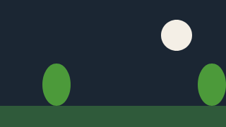

Repare:

- A lua está em `depth=4` (quatro vezes mais longe): quando a câmera anda, ela anda bem menos que as árvores. Isso é a **paralaxe**.
- A camada `titulo` é `screen`: fica presa na tela e não anda com a câmera.
- `at 0s` e `at 0.6s` fazem o título aparecer; `at 2s` leva a câmera de `160,90` para `360,90` durante os 2 segundos.

Para aprender: [capítulo 10](10-filme.md).

## Linha de comando

| Opção | O que faz |
|---|---|
| `-o arquivo` | saída; a extensão escolhe o formato (`.png .jpg .gif .svg .tres .tscn .zip`; filme: `.mp4 .mov .webm .mkv .wav .fcpxml .edl`) |
| `-f formato` | `png jpg gif svg sheet godot tscn build` (GIF da pintura passo a passo) |
| `-a anim` | animação (`all` = todas, na sprite sheet) |
| `--frame n` · `--frames` | um quadro · um arquivo por quadro |
| `--variant nome` | variante (`all` = todas) |
| `-s n` · `-t` · `--trim` | escala · fundo transparente · recortar ao desenho |
| `--rig` · `--no-rig` | `.tscn` com esqueleto de verdade · por quadros, mesmo com `rig=bones` |
| `--guides` | inclui as camadas `guide` (caixas, pontos e grade do tileset só aparecem no editor) |
| `--refs` | desenha as imagens guia (`ref`) por baixo, para conferir o traço |
| `--check` · `--info` | só procurar erros · mostrar camadas, ossos, animações e eventos |
| `--watch` | exportar de novo a cada mudança |
| `-e "código"` · `-` | código direto (`;` separa linhas) · ler da entrada padrão |
| `--help` | a lista completa |

### Exemplo: a linha de comando

Os comandos abaixo rodam na pasta do Weasel, com o arquivo `exemplos/bola.weasel`, que já vem com o projeto. Cada um faz uma coisa:

```bash
node cli/weasel.js exemplos/bola.weasel -o bola.png
```

Uma imagem PNG da pose parada.

```bash
node cli/weasel.js exemplos/bola.weasel -a quica -o quica.gif
```

O GIF da animação `quica`.

```bash
node cli/weasel.js exemplos/bola.weasel -a quica --frame 6 -s 2 -t -o quadro6.png
```

Só o quadro 6, no dobro do tamanho (`-s 2`) e com fundo transparente (`-t`).

```bash
node cli/weasel.js exemplos/bola.weasel -f sheet -a all --trim -o folha.png
```

Uma sprite sheet com todas as animações, cada quadro recortado ao desenho. Junto sai um `folha.json`, que diz onde está cada quadro dentro da imagem.

```bash
node cli/weasel.js exemplos/bola.weasel --info
```

Mostra o que tem dentro do arquivo, sem exportar nada:

```text
canvas   480 × 360, fundo #f4efe6
camadas  4
  chao             1 item(ns)
  sombra           1 item(ns)
  bola             1 item(ns)  trail
  brilho           1 item(ns)  clip=b
formas   4
ossos    sombra, bola
animações 1
  quica          24 quadros, 24 fps
```

```bash
node cli/weasel.js -e "canvas 200 120; ellipse sol 100,60 40 c=#ffd34d" -o sol.png
```

Desenha sem arquivo nenhum: o código vai entre aspas, e o `;` separa as linhas.

Para aprender: [capítulo 1](01-primeiros-passos.md) (a linha de comando) e [capítulo 9](09-jogo-godot.md) (exportar para o Godot).

[← Profundidade (2.5D)](11-profundidade.md) · [Índice](README.md) · [Próximo: Problemas comuns →](13-problemas.md)
