# 13. Estilos de arte

[← Acabamento](12-acabamento.md) · [Índice](README.md) · [Próximo: Profundidade (2.5D) →](14-profundidade.md)

O Weasel guarda o desenho como formas, e não como uma imagem pronta. Por isso a linha `art` consegue pintar o mesmo desenho em outro estilo: pixel art, letras, quadrinhos, gravura, aquarela, vitral, tricô e outros. São 26 estilos. Você precisa dos capítulos 1 a 12. As duas partes do fim, sobre o jogo e o filme, usam os capítulos 15 a 17.

## A linha `art`

```
art estilo [opções]
art none
```

Para comparar os estilos, quase todos os exemplos deste capítulo usam a mesma vila. Salve como `vila.weasel`:

<!-- arquivo: vila.weasel -->
<!-- gerar: img/14_vila.png -->
```weasel
canvas 240 160 bg=ceu
gradient ceu linear 0,0 0,160 : #0b1030@0 #3a4f9a@0.6 #f0b070@1
palette ink=#141320 line=3
ellipse lua 190,38 16 c=#fff3c4
shape morro c=#2b4a3a ink=line : 0,128! 70,104 140,120 200,100 240,112! 240,160! 0,160!
shape telhado c=#5a2a2a ink=line : 34,98! 62,74! 90,98!
rect casa 40,96 44,34 c=#c44536 ink=line
rect janela 54,106 12,12 c=#ffd34d
```

Agora a mesma vila em dois estilos. Cada exemplo traz a vila com `include` ([capítulo 6](06-componentes.md#vários-arquivos-include)) e acrescenta uma linha `art`:

<!-- gerar: img/14_vila_pixel.png -->
```weasel
include "vila.weasel"
art pixel
```

<!-- gerar: img/14_vila_ascii.png -->
```weasel
include "vila.weasel"
art ascii color
```

| Sem `art` | `art pixel` | `art ascii color` |
|---|---|---|
| 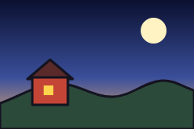 | 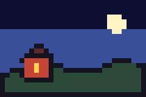 | 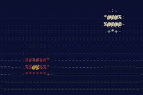 |

Repare:

- O desenho continua o mesmo: as formas, os ossos e as animações não mudam. Só a pintura final muda.
- A primeira palavra depois de `art` é o **estilo**. Depois vêm as opções dele, em qualquer ordem. Os nomes são em inglês.
- Cada desenho tem no máximo uma linha `art`. Sem ela, o desenho sai normal. `art none` é "sem estilo", e só faz diferença no filme (no fim do capítulo).
- O costume é pôr a linha `art` logo depois do `canvas`. Num desenho, o lugar não muda nada (aqui, ela veio depois do `include`).

**Experimente:** troque `art pixel` por `art pixel size=4`. Os blocos ficam com a metade do tamanho.

**Cuidado:**
- Uma opção ou uma palavra de outro estilo não faz nada. O Weasel avisa e diz em que estilos ela vale.
- Um número fora da faixa dá aviso, e vale a ponta da faixa.
- Um segundo `art` dá aviso, e vale o primeiro. O `art` de um arquivo trazido com `include` também conta.
- O estilo não muda com a `key`.
- Com `art`, o `pixel=` do `finish` fica de fora (aviso). O resto do `finish` entra por cima do estilo ([capítulo 12](12-acabamento.md#acabamento-finish)).
- O SVG é feito das formas, então sai sem o estilo.

No editor, **Janela › Acabamento e estilo** mostra uma miniatura de cada estilo, feita com o seu desenho, e escreve a linha `art` por você ([capítulo 22](22-editor.md#acabamento-e-estilo)).

### Os 26 estilos

| Grupo | Estilos | Como pintam |
|---|---|---|
| [Uma cor só](#uma-cor-só-silhouette-lines-e-neon) | `silhouette`, `lines`, `neon` | o desenho vira uma silhueta, um contorno ou um tubo de neon |
| [Pixel art](#pixel-art-art-pixel) e [letras](#letras-art-ascii) | `pixel`, `ascii` | o desenho vira blocos ou letras |
| [Luz em degraus](#luz-em-degraus-art-toon) | `toon` | cores lisas e uma sombra dura em cada forma, como num desenho animado |
| [Impressão](#impressão-engraving-woodcut-halftone-e-stencil) | `engraving`, `woodcut`, `halftone`, `stencil` | o tom de cada ponto vira linhas, sulcos, pontos ou tinta spray |
| [Quadrinhos](#quadrinhos-comic-manga-e-riso) | `comic` (com `old` e `bw`), `manga`, `riso` | HQ moderna, gibi antigo, tira de jornal, mangá e risografia |
| [À mão](#à-mão-sketch-marker-pencil-crayon-chalk-e-watercolor) | `sketch`, `marker`, `pencil`, `crayon`, `chalk`, `watercolor` | cada forma é desenhada à mão: lápis, marcador, giz, aquarela |
| [Peças](#peças-cutout-clay-glass-mosaic-e-embroidery) | `cutout`, `clay`, `glass`, `mosaic`, `embroidery` | cada forma vira papel, massinha, vidro, pastilhas ou bordado |
| [Pano](#pano-stitch-e-knit) | `stitch`, `knit` | o desenho vira uma grade de pontos de linha: ponto-cruz e tricô |

## Uma cor só: `silhouette`, `lines` e `neon`

```
art silhouette [c=…]
art lines [w=…] [c=…] [paper=…]
art neon [w=…] [c=…] [paper=…]
```

Os três estilos mais simples. Eles não têm luz nem textura.

<!-- gerar: img/14_vila_silhouette.png -->
```weasel
include "vila.weasel"
art silhouette c=#1a1226
```

<!-- gerar: img/14_vila_lines.png -->
```weasel
include "vila.weasel"
art lines
```

<!-- gerar: img/14_vila_neon.png -->
```weasel
include "vila.weasel"
art neon
```

| `art silhouette c=#1a1226` | `art lines` | `art neon` |
|---|---|---|
| 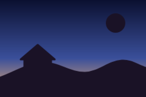 | 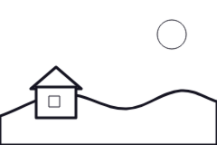 | 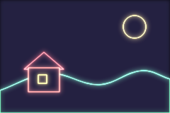 |

Repare:

- **`silhouette`:** tudo o que é forma vira uma cor só, a do `c=` (se não escrever, a `ink` da `palette`). O fundo do `canvas` fica como é. A lua também é uma forma, então também vira silhueta. Serve para pôr do sol, teatro de sombras e para conferir se uma pose se entende só pelo contorno.
- **`lines`:** as cores viram papel, e cada forma fica só com o contorno, na cor do `c=` (se não escrever, a `ink` da `palette`). É um livro de colorir. Cada contorno tem a espessura do `ink=` da forma; `w=` põe a mesma espessura em todos.
- **`neon`:** o contorno de cada forma vira um tubo de neon da cor dela, mais clara e mais forte, com o miolo quase branco e um brilho em volta. `c=` põe a mesma cor em todos os tubos.
- No `lines` e no `neon`, cada forma esconde o que está atrás dela, como no desenho de sempre. Um traço largo (um braço) vira o contorno dele, e um fino fica uma linha só.

| Opção | O que faz | Valores | Se não escrever |
|---|---|---|---|
| `c=` | a cor da silhueta, das linhas ou dos tubos | uma cor `#hex` ou um nome da `palette` | a `ink` da `palette` (no `neon`, a cor de cada forma) |
| `w=` | a espessura das linhas ou dos tubos (`lines` e `neon`) | de 0.5 a 64 | no `lines`, o contorno de cada forma; no `neon`, uma linha fina que cresce com o tamanho do desenho |
| `paper=` | o fundo, que troca o do `canvas` (`lines` e `neon`) | uma cor `#hex` | branco no `lines`; quase preto (`#0b0a14`) no `neon` |

**Experimente:** troque a vila para `art lines w=1.5`, ou para `art neon c=#40e0ff`.

**Cuidado:** uma forma sem contorno também aparece no `lines`, com uma linha fina, que cresce com o tamanho do desenho.

## Pixel art: `art pixel`

```
art pixel [size=…] [palette=…] [dither=…] [outline] [small]
```

### O voto por bloco

O `pixel=` do `finish` ([capítulo 12](12-acabamento.md#acabamento-finish)) também faz blocos, mas cada bloco fica com a **média** das cores. O `art pixel` faz um **voto**: cada bloco fica com a cor que mais aparece nele.

<details>
<summary>Código dos dois</summary>

<!-- gerar: img/14_gosma_finish.png -->
```weasel
canvas 200 160 bg=#cfe8f5
finish game pixel=8
palette ink=#2b2a33 line=5
gradient verde linear 0,0 0,1 box : #9be38c #3f9a4a
shape corpo c=verde ink=line weight=0.3 : 100,24 160,96 152,138! 48,138! 40,96
ellipse olhoE 84,90 8,12 c=ink
ellipse olhoD 118,90 8,12 c=ink
ellipse brilho 76,60 11,6 rot=-35 c=#e6fadf
```

<!-- gerar: img/14_gosma_art.png -->
```weasel
canvas 200 160 bg=#cfe8f5
art pixel size=8
palette ink=#2b2a33 line=5
gradient verde linear 0,0 0,1 box : #9be38c #3f9a4a
shape corpo c=verde ink=line weight=0.3 : 100,24 160,96 152,138! 48,138! 40,96
ellipse olhoE 84,90 8,12 c=ink
ellipse olhoD 118,90 8,12 c=ink
ellipse brilho 76,60 11,6 rot=-35 c=#e6fadf
```

</details>

| `finish game pixel=8` | `art pixel size=8` |
|---|---|
| 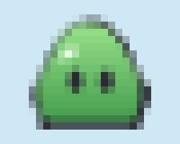 | 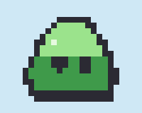 |

Repare:

- Com o `finish`, um bloco que pega o verde e o azul vira uma cor do meio, que não existe no desenho. No `art pixel`, cada bloco tem **uma cor do desenho**.
- O contorno tem 5 pixels, e o bloco tem 8: o contorno perderia quase todos os votos. Por isso a tinta (`ink`) ganha o bloco quando cobre só 1/4 dele. Assim o contorno não some. Os olhos, pintados com `c=ink`, também contam como tinta.
- `size=8` é o lado do bloco. A grade de blocos é fixa no canvas: quando a figura anda, os blocos não tremem.

### As paletas: `palette=`

Sem `palette=`, o pixel art usa as cores do seu desenho. As outras paletas imitam consoles antigos. Atenção: a opção `palette=` do `art` não é a linha `palette`.

<details>
<summary>Código dos três</summary>

<!-- gerar: img/14_vila_gameboy.png -->
```weasel
include "vila.weasel"
art pixel size=5 palette=gameboy dither=bayer
```

<!-- gerar: img/14_vila_pico8.png -->
```weasel
include "vila.weasel"
art pixel size=5 palette=pico8
```

<!-- gerar: img/14_vila_mono.png -->
```weasel
include "vila.weasel"
art pixel size=5 palette=mono dither=bayer
```

</details>

| `palette=gameboy dither=bayer` | `palette=pico8` | `palette=mono dither=bayer` |
|---|---|---|
| 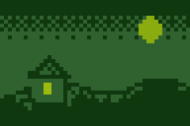 | 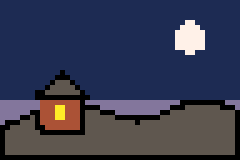 | 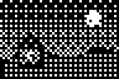 |

- Cada bloco fica com a cor mais parecida da paleta, do jeito que o olho vê.
- `dither=bayer` é o **pontilhado**: nos degradês, duas cores se misturam em pontinhos alternados, em vez de faixas. Onde a cor é lisa, fica lisa. Com só 2 cores (o `mono`), pontilha tudo.

**Experimente:** no código do `pico8`, troque para `palette=nes`, e depois para `size=10`.

### Contorno de 1 bloco: `outline`

<!-- gerar: img/14_outline.png -->
```weasel
canvas 200 160 bg=none
art pixel size=6 outline
palette ink=#2b2a33 line=5
gradient verde linear 0,0 0,1 box : #9be38c #3f9a4a
shape corpo c=verde weight=0.3 : 100,24 160,96 152,138! 48,138! 40,96
ellipse olhoE 84,90 8,12 c=ink
ellipse olhoD 118,90 8,12 c=ink
ellipse brilho 76,60 11,6 rot=-35 c=#e6fadf
```

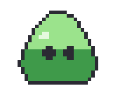

- O `corpo` não tem `ink=`. O `outline` contorna a figura toda por fora, com 1 bloco de espessura, na cor da `ink` (ou a mais parecida dela, com `palette=`).
- O contorno fica nos blocos vazios em volta: a figura cresce 1 bloco de cada lado. Ótimo para personagens de jogo, que precisam se destacar do cenário.
- Com fundo transparente, um bloco fica vazio quando tem mais vazio do que cor.

### Pixel art pequeno de verdade: `small`

Sem `small`, a folha de sprites ([capítulo 9](09-animacao.md#ver-e-exportar)) sai do tamanho do `canvas`, com cada bloco feito de vários pixels iguais. Funciona, mas a imagem fica bem maior. Com `small`, a folha sai com **1 pixel por bloco**:

<!-- gerar: img/14_small.png -f sheet -a all -s 3 -->
```weasel
canvas 160 160 bg=none
art pixel size=4 outline small
palette ink=#1d1b26 line=5 sombra=#9c8f7c
gradient brilho radial 66,70 60 : #ffd9c9@0 #ff6b4a@0.7 #c43c25@1
bone sombra pivot=80,148
bone bola pivot=80,146
ellipse s 80,148 34,7 c=sombra bone=sombra
ellipse b 80,112 34 c=brilho ink=line weight=0.3 bone=bola
anim quica frames=4 fps=8
key 0 bola=0,0,0,1.2,0.8 sombra=0,0,0,1.1 ease=out
key 2 bola=0,-60,0,1,1 sombra=0,0,0,0.6 ease=in
key 4 bola=0,0,0,1.2,0.8 sombra=0,0,0,1.1
```

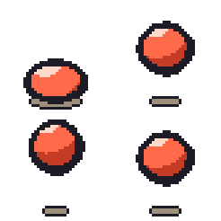

- O canvas tem 160×160, e o bloco tem 4. Com `small`, cada quadro sai com 40×40 pixels (160 ÷ 4).
- Com `small`, a escala `-s` conta **pixels por bloco**. A imagem acima saiu com `-s 3`: cada bloco virou 3×3 pixels.
- O recorte da folha (`--trim`) anda de bloco em bloco, para a grade não escorregar entre um quadro e outro, e conta com o `outline`.
- O PNG, o GIF e o vídeo saem sempre do tamanho do `canvas` (vezes a escala). O `small` vale só para o jogo. O Godot está [no fim do capítulo](#no-jogo).

| Opção | O que faz | Valores | Se não escrever |
|---|---|---|---|
| `size=` | o lado de cada bloco | de 1 a 64 (um número quebrado é arredondado) | 8 |
| `palette=` | troca cada cor pela mais parecida de uma paleta | `own` (as cores do desenho), `gameboy` (4 verdes), `nes` (55 cores), `pico8` (16 cores) ou `mono` (preto e branco) | `own` |
| `dither=` | o pontilhado nos degradês | `bayer` ou `none` | `none` |
| `outline` | contorno de 1 bloco por fora | palavra | desligado |
| `small` | folha de sprites e Godot com 1 pixel por bloco | palavra | desligado |

## Letras: `art ascii`

```
art ascii [size=largura,altura] [chars=…] [color]
```

O desenho é dividido em retângulos pequenos, e cada um vira uma letra: quanto mais diferente do fundo, mais cheia a letra. Os exemplos usam o Cavaleiro, que está em [`exemplos/cavaleiro.weasel`](../../exemplos/cavaleiro.weasel). O `include` traz o arquivo inteiro, e a linha `art` vale para ele todo.

<details>
<summary>Código dos dois</summary>

<!-- gerar: img/14_ascii.png -s 0.6 -->
<!-- gerar: img/14_ascii.txt -->
```weasel
include "cavaleiro.weasel"
art ascii
```

<!-- gerar: img/14_ascii_cor.png -s 0.6 -->
```weasel
include "cavaleiro.weasel"
art ascii size=4,8 color
```

</details>

| `art ascii` | `art ascii size=4,8 color` |
|---|---|
| 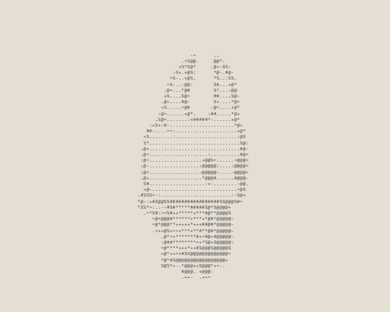 | 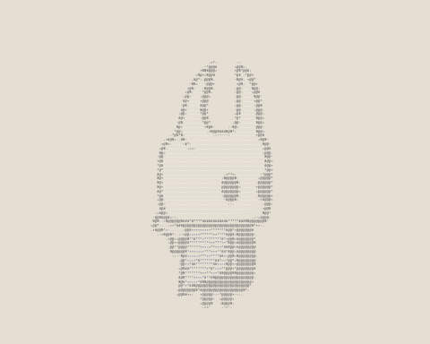 |

- O fundo do `canvas` é o **papel**: as letras marcam o que é diferente dele. Num fundo escuro, as letras saem claras.
- O ASCII também sai **em texto**: [este .txt](img/14_ascii.txt) é o mesmo desenho, uma linha de texto por linha de letras. Na linha de comando, dê um nome terminado em `.txt` (ou use `-f txt`). No editor, é o botão **Texto (ASCII)** da janela de exportar.

| Opção | O que faz | Valores | Se não escrever |
|---|---|---|---|
| `size=` | a largura e a altura de cada letra; um número só, `size=5`, vale `5,10` | de 2 a 64 cada um | `6,12` |
| `chars=` | as letras, da mais clara para a mais escura; com espaço no meio, use aspas | pelo menos 2 letras | `" .:-=+*#%@"` |
| `color` | cada letra fica com a cor daquele pedaço, e não com a da tinta | palavra | desligado |

**Experimente:** troque para `chars=" .oO@"`, ou use `size=8` para letras maiores.

## Luz em degraus: `art toon`

```
art toon [steps=…] [shadow=…]
```

O cel shading dos desenhos animados: cores lisas, com uma sombra dura em cada forma. A cena da noite está em [`exemplos/noite.weasel`](../../exemplos/noite.weasel): o Cavaleiro na chuva, com um lampião ([capítulo 10](10-luz.md)).

<details>
<summary>Código dos três</summary>

<!-- gerar: img/14_tom_toon.png -s 0.6 -->
```weasel
include "cavaleiro.weasel"
art toon
```

<!-- gerar: img/14_noite.png -s 0.5 -->
```weasel
include "noite.weasel"
```

<!-- gerar: img/14_toon_noite.png -s 0.5 -->
```weasel
include "noite.weasel"
art toon
```

</details>

| O Cavaleiro em `art toon` | A noite, sem `art` | A noite em `art toon` |
|---|---|---|
| 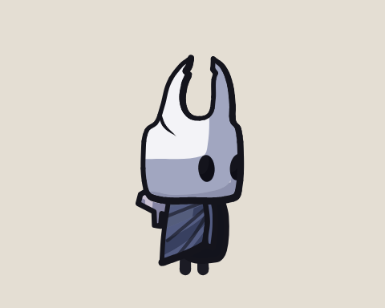 | 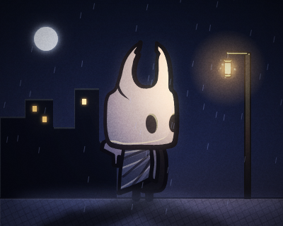 | 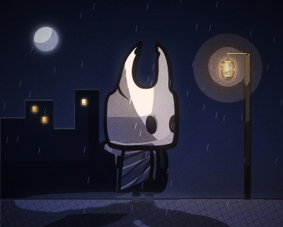 |

Repare:

- Cada forma ganha uma **faixa de sombra** dura, do lado oposto à luz do `canvas` (o `light=` do [capítulo 3](03-cores.md#contorno-que-engrossa-no-lado-da-sombra-weight)). Imagine a forma empurrada um pouco para o lado da luz: o pedaço que sobra do outro lado vira a sombra. Numa bola, parece uma lua.
- Com as luzes do capítulo 10 (`light` e `ambient`), a luz deixa de ser suave: ela vira poucos tons, em degraus. O halo do lampião vira um disco.
- Sem luzes, só a faixa de sombra muda o desenho (o Cavaleiro).

| Opção | O que faz | Valores | Se não escrever |
|---|---|---|---|
| `steps=` | os degraus da luz; mais degraus, luz mais suave (só com `light` ou `ambient`) | de 2 a 8 | 3 |
| `shadow=` | a largura da faixa de sombra, em fração do tamanho da forma; `0` tira a faixa | de 0 a 1 | 0.3 |

**Experimente:** na noite, troque para `art toon steps=6 shadow=0.5`.

**Cuidado:** uma forma que ocupa 90% (ou mais) da largura **ou** da altura do canvas fica sem faixa: o chão, o céu, mas também um poste da altura do desenho. As camadas `unlit` também ficam sem faixa.

## Impressão: `engraving`, `woodcut`, `halftone` e `stencil`

```
art engraving [gap=…] [levels=…] [paper=…]
art woodcut [gap=…] [levels=…] [paper=…]
art halftone [size=…] [angle=…] [color] [levels=…] [paper=…]
art stencil [tones=…] [c=…] [levels=…] [paper=…]
```

Estes quatro olham o **tom** de cada ponto, do preto ao branco, e o transformam em tinta, como nas técnicas de impressão.

<details>
<summary>Código dos quatro</summary>

<!-- gerar: img/14_tom_engraving.png -s 0.6 -->
```weasel
include "cavaleiro.weasel"
art engraving
```

<!-- gerar: img/14_hq_woodcut.png -s 0.6 -->
```weasel
include "cavaleiro.weasel"
art woodcut
```

<!-- gerar: img/14_tom_halftone.png -s 0.6 -->
```weasel
include "cavaleiro.weasel"
art halftone
```

<!-- gerar: img/14_tom_stencil.png -s 0.6 -->
```weasel
include "cavaleiro.weasel"
art stencil
```

</details>

| `art engraving` | `art woodcut` | `art halftone` | `art stencil` |
|---|---|---|---|
| 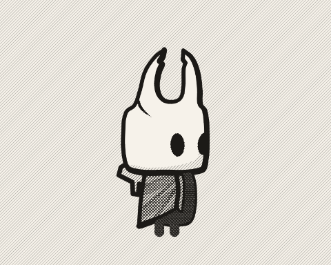 | 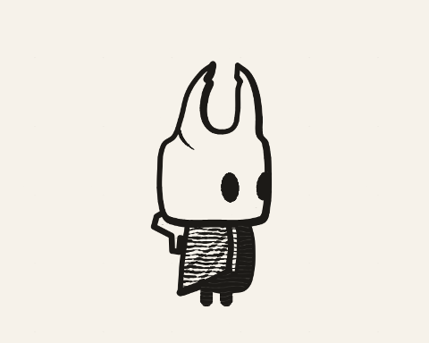 | 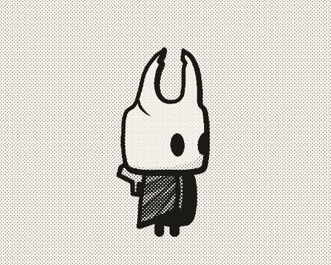 | 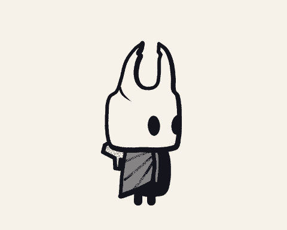 |

### Gravura e xilogravura: `engraving` e `woodcut`

<details>
<summary>Código dos dois</summary>

<!-- gerar: img/14_gravura_noite.png -s 0.5 -->
```weasel
include "noite.weasel"
art engraving levels=0.05,0.7
```

<!-- gerar: img/14_xilo_noite.png -s 0.5 -->
```weasel
include "noite.weasel"
art woodcut
```

</details>

| `art engraving levels=0.05,0.7` | `art woodcut` |
|---|---|
| 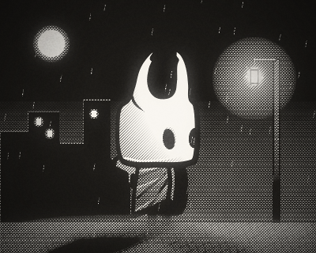 | 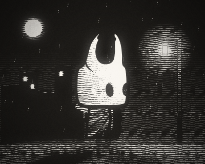 |

Repare:

- **Gravura:** o escuro é feito com linhas pretas, a **hachura**. Primeiro linhas a 45°, depois cruzadas, depois mais linhas, até o preto chapado. O contorno sai inteiro, em preto, por cima.
- **Xilogravura:** é o contrário. Tudo começa preto, e a luz é cavada em **sulcos brancos**, largos e toscos, como os cortes na madeira. Os sulcos seguem a forma e giram com ela.
- A noite é quase toda escura e sairia quase preta. O **`levels=`** clareia: em `levels=0.05,0.7`, o tom até 0.05 vira preto, e o tom a partir de 0.7 vira papel. Os tons vão de 0 (preto) a 1 (branco).

**Experimente:** na gravura, troque para `gap=3`; na xilogravura, para `levels=0,0.6` (mais papel).

### Retícula: `halftone`

<details>
<summary>Código dos três</summary>

<!-- arquivo: dia.weasel -->
<!-- gerar: img/14_dia.png -->
```weasel
canvas 240 160 bg=ceu
gradient ceu linear 0,0 0,160 : #5fb4ea@0 #bfe3f5@0.7 #fff2cc@1
palette ink=#141320 line=3
ellipse sol 190,38 16 c=#ffd84a
shape morro c=#5bb04a ink=line : 0,128! 70,104 140,120 200,100 240,112! 240,160! 0,160!
shape telhado c=#8a3a2a ink=line : 34,98! 62,74! 90,98!
rect casa 40,96 44,34 c=#e8604c ink=line
rect janela 54,106 12,12 c=#ffd34d
```

<!-- gerar: img/14_vila_halftone.png -->
```weasel
include "dia.weasel"
art halftone size=5
```

<!-- gerar: img/14_vila_halftone_cor.png -->
```weasel
include "dia.weasel"
art halftone size=5 color
```

</details>

| A vila de dia, sem `art` | `art halftone size=5` | `art halftone size=5 color` |
|---|---|---|
| 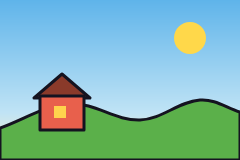 | 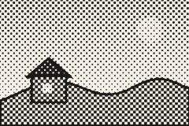 | 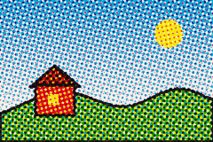 |

- Os pontos ficam numa grade inclinada e crescem onde é mais escuro, como nas fotos de jornal.
- Com `color`, são quatro grades: ciano, magenta, amarelo e preto, cada uma num ângulo. As cores se misturam no papel, como na impressão colorida.
- A vila de dia é o arquivo `dia.weasel`: a mesma vila, com outras cores. Os próximos exemplos também a usam.

**Experimente:** troque para `size=8 angle=0`.

### Estêncil: `stencil`

<!-- gerar: img/14_vila_stencil.png -->
```weasel
include "dia.weasel"
art stencil
```

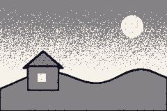

- O desenho vira de 2 a 6 tons lisos de uma só cor de tinta, como grafite de spray com molde. Aqui são 3: o papel, a tinta pela metade e a tinta.
- Na troca de um tom para o outro, o spray salpica um tom no outro (o degradê do céu).

**Experimente:** troque para `art stencil tones=4 c=#1a3a6a`.

| Opção | Estilos | O que faz | Valores | Se não escrever |
|---|---|---|---|---|
| `gap=` | `engraving`, `woodcut` | a distância entre as linhas ou os sulcos | de 2 a 64 | 5 na gravura, 8 na xilogravura |
| `size=` | `halftone` | o tamanho da célula de cada ponto | de 2 a 64 | 6 |
| `angle=` | `halftone` | o ângulo da grade, em graus (com `color`, cada cor tem o seu, e o `angle=` não vale) | de −360 a 360 | 45 |
| `color` | `halftone` | quatro cores em vez de só preto | palavra | desligado |
| `tones=` | `stencil` | quantos tons, contando o papel | de 2 a 6 | 3 |
| `c=` | `stencil` | a cor da tinta | uma cor `#hex` ou um nome da `palette` | a `ink` da `palette` |

O `levels=` e o `paper=` valem nos quatro: estão em [As opções que vários estilos têm](#as-opções-que-vários-estilos-têm).

## Quadrinhos: `comic`, `manga` e `riso`

```
art comic [old] [bw] [size=…] [shadow=…] [shift=…] [levels=…] [paper=…]
art manga [size=…] [tones=…] [shadow=…] [levels=…] [paper=…]
art riso [inks=…] [size=…] [shift=…] [levels=…] [paper=…]
```

<details>
<summary>Código dos cinco</summary>

<!-- gerar: img/14_hq_comic.png -s 0.6 -->
```weasel
include "cavaleiro.weasel"
art comic
```

<!-- gerar: img/14_hq_comic_old.png -s 0.6 -->
```weasel
include "cavaleiro.weasel"
art comic old
```

<!-- gerar: img/14_hq_comic_old_bw.png -s 0.6 -->
```weasel
include "cavaleiro.weasel"
art comic old bw
```

<!-- gerar: img/14_hq_manga.png -s 0.6 -->
```weasel
include "cavaleiro.weasel"
art manga
```

<!-- gerar: img/14_hq_riso.png -s 0.6 -->
```weasel
include "cavaleiro.weasel"
art riso
```

</details>

| `art comic` | `art comic old` | `art comic old bw` |
|---|---|---|
| 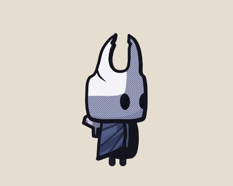 | 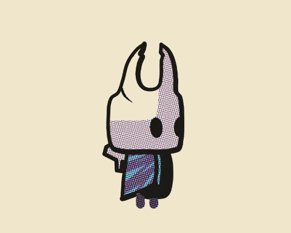 | 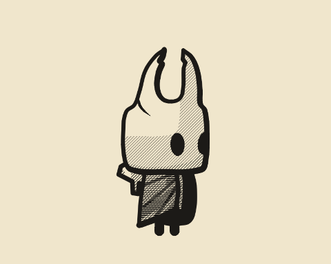 |

| `art manga` | `art riso` |
|---|---|
| 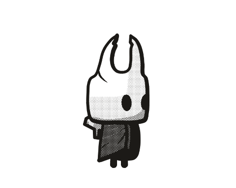 | 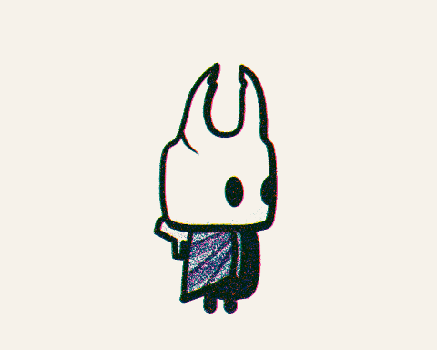 |

### HQ: `comic`, `comic old` e `comic old bw`

<details>
<summary>Código dos três</summary>

<!-- gerar: img/14_hq_noite.png -s 0.5 -->
```weasel
include "noite.weasel"
art comic
```

<!-- gerar: img/14_hq_noite_old.png -s 0.5 -->
```weasel
include "noite.weasel"
art comic old
```

<!-- gerar: img/14_hq_noite_bw.png -s 0.5 -->
```weasel
include "noite.weasel"
art comic old bw
```

</details>

| `art comic` | `art comic old` | `art comic old bw` |
|---|---|---|
| 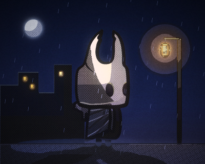 | 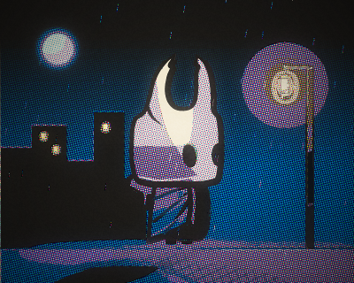 | 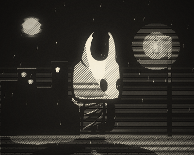 |

Repare:

- **`comic`, a HQ moderna:** é o `toon` (a faixa de sombra e a luz em degraus, sempre 3), com a cor um pouco mais forte e pontinhos pretos na sombra.
- **`comic old`, o gibi antigo:** as cores ficam limitadas, como na gráfica antiga: cada tinta só entra em 4 forças, e as fracas viram pontos, no papel-jornal amarelado. A cor sai um pouco do lugar, como na impressão barata (`shift=`).
- **`comic old bw`, a tira de jornal:** o mais escuro vira preto; o escuro, linhas deitadas; o meio, hachura em diagonal; o claro fica no papel. `comic bw`, sem o `old`, dá aviso e vale como `comic old bw`.
- Os três (e o `manga`) usam a faixa de sombra do `toon`: o Cavaleiro, sem nenhuma luz, também ganha sombra. `shadow=0` tira a faixa.

### Mangá e risografia: `manga` e `riso`

<details>
<summary>Código dos três</summary>

<!-- gerar: img/14_manga_noite.png -s 0.5 -->
```weasel
include "noite.weasel"
art manga
```

<!-- gerar: img/14_vila_riso.png -->
```weasel
include "dia.weasel"
art riso
```

<!-- gerar: img/14_vila_riso_duas.png -->
```weasel
include "dia.weasel"
art riso inks=#ff48b0,#0078bf
```

</details>

| `art manga` | `art riso` | `art riso inks=#ff48b0,#0078bf` |
|---|---|---|
| 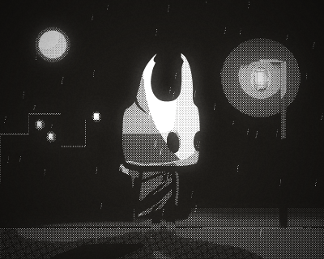 | 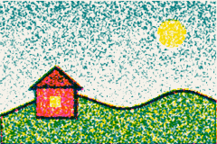 | 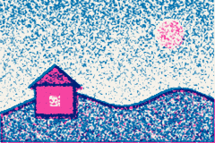 |

Repare:

- **Mangá:** o mais escuro vira preto, o claro fica no papel branco e, no meio, entram as **retículas**: cada área tem pontos de um tamanho só, como as folhas de retícula que o desenhista recorta e cola.
- **Risografia:** a impressora usa poucas tintas fortes, uma por vez. Cada cor do desenho vira a mistura mais parecida das tintas: o laranja da casa vira rosa com amarelo. Cada tinta sai em **grão** e um pouco fora do lugar.

**Experimente:** troque a risografia para `inks=#ff48b0` (uma tinta só), ou para `size=3`.

| Opção | Estilos | O que faz | Valores | Se não escrever |
|---|---|---|---|---|
| `old` | `comic` | o gibi antigo | palavra | a HQ moderna |
| `bw` | `comic old` | a tira de jornal, em preto e branco | palavra | colorido |
| `size=` | `comic`, `manga`, `riso` | a distância entre os pontos (na `old bw`, entre as linhas); no `riso`, o tamanho do grão | de 2 a 64; no `riso`, de 0.5 a 16 | 5 no `comic`, 4 no `manga`, 1 no `riso` |
| `shadow=` | `comic`, `manga` | a largura da faixa de sombra, como no `toon` | de 0 a 1 | 0.3 |
| `tones=` | `manga` | quantas retículas, sem contar o papel e o preto | de 1 a 5 | 3 |
| `shift=` | `comic old` (colorido), `riso` | o quanto a cor sai do lugar; `0` deixa no lugar | de 0 a 20 | 1.5 |
| `inks=` | `riso` | as tintas, separadas por vírgula | de 1 a 3 cores `#hex` | `#ff48b0,#00838a,#ffe800` (rosa, azul-petróleo e amarelo) |

## As opções que vários estilos têm

| Opção | O que faz | Valores | Se não escrever |
|---|---|---|---|
| `paper=` | a cor do papel: o "branco" do estilo | uma cor `#hex` | creme (`#f6f2ea`) na maioria; cada estilo diferente está na seção dele |
| `levels=` | estica os tons: `levels=a,b` faz o tom `a` virar preto e o tom `b` virar papel (impressão e quadrinhos) | dois números de 0 a 1, o primeiro menor | `0,1` (não muda nada) |
| `boil=` | como a textura se move numa animação (abaixo) | um número inteiro de 0 a 1000, ou `screen` | depende do estilo |
| `seed=` | sorteia outra versão da textura: outro lugar para as linhas, os pontos, os cortes | um número inteiro de 0 a 1000000000 | 0 |

O `paper=` não vale no `pixel`, no `ascii`, no `toon` e no `silhouette`, e no `comic` só com `old`. Numa imagem com fundo transparente (`-t`), na folha de sprites e no Godot, o papel nunca aparece fora das formas.

<!-- gerar: img/13_riso_seed.png -->
```weasel
include "dia.weasel"
art riso seed=3 paper=#f3e3c6
```

| `art riso` | `art riso seed=3 paper=#f3e3c6` |
|---|---|
|  | 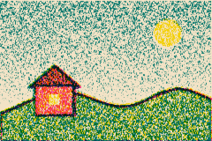 |

- O `seed=3` sorteia outro grão. Na risografia, ele também muda o lado para onde cada tinta sai do lugar.
- O `paper=#f3e3c6` é um papel amarelado, como um papel reciclado.

### A textura que se move: `boil=`

A hachura, os pontos, o grão, as passadas e os cortes dos estilos são uma **textura**. Numa animação, o `boil=` diz como ela se move:

| `boil=` | A textura | Se não escrever, vale em |
|---|---|---|
| `0` | presa às formas: anda e gira com o osso de cada uma | `engraving`, `woodcut`, `stencil`, `comic old bw`, `watercolor`, `cutout`, `clay`, `glass`, `mosaic`, `embroidery` |
| `screen` | parada na tela: o desenho passa por baixo dela, como um papel impresso | `halftone`, `comic`, `comic old`, `manga`, `riso` |
| um número, como `2` | presa às formas e sorteada de novo a cada 2 quadros: a linha "ferve", como num desenho à mão | `sketch`, `marker`, `pencil`, `crayon`, `chalk` |

<!-- gerar: img/14_boil.png -f sheet -a all -s 1 -->
```weasel
canvas 120 120 bg=#e9e2d4
art engraving gap=4
palette ink=#1d1b26
gradient bolaG radial 46,44 56 : #ffffff@0 #c09060@0.55 #3a2a20@1
bone bola pivot=60,60
ellipse b 60,60 40 c=bolaG ink=3 bone=bola
ellipse olho 76,52 6,9 c=ink bone=bola
anim gira frames=4 fps=8
key 0 bola=0,0,0
key 4 bola=0,0,90
```

<!-- gerar: img/13_boil_tela.png -f sheet -a all -s 1 -->
```weasel
canvas 120 120 bg=#e9e2d4
art engraving gap=4 boil=screen
palette ink=#1d1b26
gradient bolaG radial 46,44 56 : #ffffff@0 #c09060@0.55 #3a2a20@1
bone bola pivot=60,60
ellipse b 60,60 40 c=bolaG ink=3 bone=bola
ellipse olho 76,52 6,9 c=ink bone=bola
anim gira frames=4 fps=8
key 0 bola=0,0,0
key 4 bola=0,0,90
```

| `art engraving gap=4` (o padrão, `boil=0`) |
|---|
| 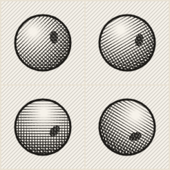 |
| **`art engraving gap=4 boil=screen`** |
| 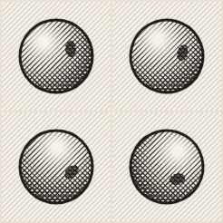 |

Repare:

- Com `boil=0`, a hachura **dentro** da bola gira com ela, junto com o olho.
- Com `boil=screen`, a hachura fica parada, e só o olho mostra que a bola gira.
- No fundo, nos traços (`stroke`, `line`) e nos textos, a textura fica sempre parada na tela.
- O `pixel`, o `ascii`, o `toon`, o `silhouette`, o `lines`, o `neon`, o `stitch` e o `knit` não têm textura: neles, `boil=` e `seed=` não mudam nada (o Weasel avisa).

**Experimente:** troque `boil=screen` por `boil=1`. A hachura é sorteada de novo a cada quadro.

## À mão: `sketch`, `marker`, `pencil`, `crayon`, `chalk` e `watercolor`

```
art sketch [paper=…] [boil=…] [seed=…]
```

Os seis têm as mesmas opções: troque `sketch` por `marker`, `pencil`, `crayon`, `chalk` ou `watercolor`. Eles pintam forma por forma, na ordem do desenho, como alguém que passa o lápis em cada uma. Por isso o contorno treme, a cor sai um pouco do lugar e cada forma ganha a sua textura.

<details>
<summary>Código dos seis</summary>

<!-- gerar: img/14_traco_sketch.png -s 0.6 -->
```weasel
include "cavaleiro.weasel"
art sketch
```

<!-- gerar: img/14_traco_marker.png -s 0.6 -->
```weasel
include "cavaleiro.weasel"
art marker
```

<!-- gerar: img/14_traco_pencil.png -s 0.6 -->
```weasel
include "cavaleiro.weasel"
art pencil
```

<!-- gerar: img/14_traco_crayon.png -s 0.6 -->
```weasel
include "cavaleiro.weasel"
art crayon
```

<!-- gerar: img/14_traco_chalk.png -s 0.6 -->
```weasel
include "cavaleiro.weasel"
art chalk
```

<!-- gerar: img/14_traco_watercolor.png -s 0.6 -->
```weasel
include "cavaleiro.weasel"
art watercolor
```

</details>

| `art sketch` | `art marker` | `art pencil` |
|---|---|---|
| 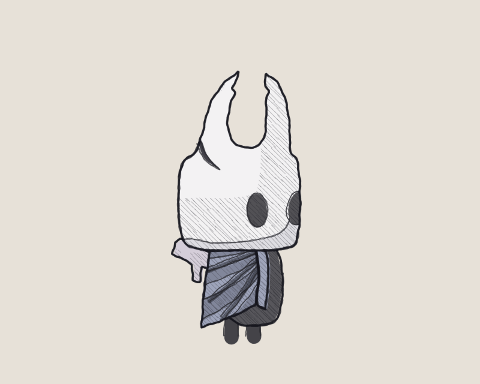 | 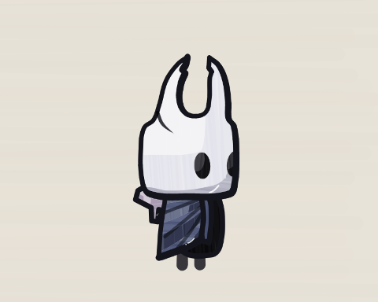 | 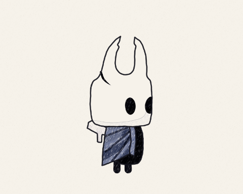 |
| **`art crayon`** | **`art chalk`** | **`art watercolor`** |
| 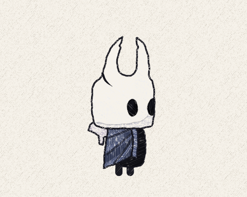 | 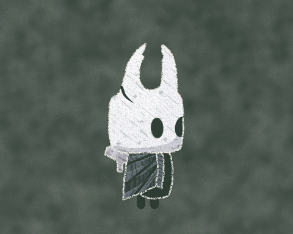 | 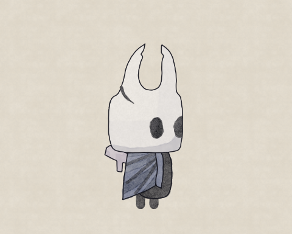 |

<details>
<summary>Código dos cinco</summary>

<!-- gerar: img/14_traco_noite_sketch.png -s 0.5 -->
```weasel
include "noite.weasel"
art sketch
```

<!-- gerar: img/14_traco_noite_pencil.png -s 0.5 -->
```weasel
include "noite.weasel"
art pencil
```

<!-- gerar: img/14_vila_crayon.png -s 1.5 -->
```weasel
include "vila.weasel"
art crayon
```

<!-- gerar: img/14_vila_chalk.png -s 1.5 -->
```weasel
include "vila.weasel"
art chalk
```

<!-- gerar: img/14_vila_watercolor.png -s 1.5 -->
```weasel
include "vila.weasel"
art watercolor
```

</details>

| A noite em `art sketch` | A noite em `art pencil` |
|---|---|
| 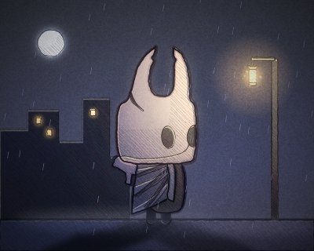 | 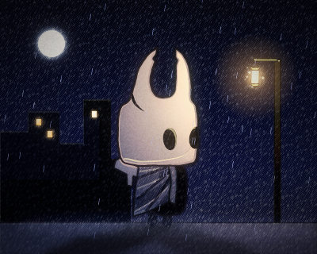 |

| A vila em `art crayon` | `art chalk` | `art watercolor` |
|---|---|---|
|  |  |  |

Repare:

- **`sketch` (esboço):** a cor fica mais clara e um pouco fora do lugar. Cada forma é passada duas vezes a lápis, tremida, e o lado da sombra ganha hachura.
- **`marker` (marcador):** a cor vai em passadas largas, que escurecem onde se cruzam. O contorno sai em nanquim, e as formas grandes ganham um brilho de caneta gel.
- **`pencil` (lápis de cor):** a cor vira hachura fina e inclinada, mais fechada onde a cor é mais forte. O papel aparece entre os traços.
- **`crayon` (giz de cera):** passadas largas de vai e vem, cada forma numa direção, com pontinhos do papel onde a cera não pegou.
- **`chalk` (giz no quadro):** o papel é um quadro-negro verde. As cores claras viram giz forte, e as escuras ficam quase só o quadro. O fundo do canvas vira giz bem fraco, quase só pó.
- **`watercolor` (aquarela):** a cor vira uma mancha de tinta aguada, transparente. A borda fica mais escura, onde a tinta seca, e a mancha vaza um pouco da linha.
- A sombra vem do `light=` do `canvas` e aparece mesmo sem as linhas `light` e `ambient`. Com elas, a luz da cena entra por cima do estilo. Os textos e as partículas saem como sempre.
- **Ferve:** cinco deles sorteiam a textura de novo a cada 2 quadros (`boil=2`), como o desenho à mão animado quadro a quadro. A `watercolor` fica parada (`boil=0`): uma aquarela não se refaz a cada quadro.

| Opção | O que faz | Se não escrever |
|---|---|---|
| `paper=` | o papel; no `chalk`, a cor do quadro | `#f6f2ea`; no `chalk`, `#29382f` (verde-escuro) |
| `boil=` | a cada quantos quadros a textura muda; `0` deixa parada | 2; na `watercolor`, 0 |
| `seed=` | outro sorteio | 0 |

**Experimente:** troque a vila para `art chalk paper=#202224` (um quadro preto), ou a noite para `art marker`.

## Peças: `cutout`, `clay`, `glass`, `mosaic` e `embroidery`

```
art cutout [paper=…] [boil=…] [seed=…]
art clay [paper=…] [boil=…] [seed=…]
art glass [size=…] [lead=…] [frame] [paper=…] [boil=…] [seed=…]
art mosaic [size=…] [grout=…] [paper=…] [boil=…] [seed=…]
art embroidery [paper=…] [boil=…] [seed=…]
```

Estes cinco montam o desenho com **peças**: cada forma vira papel recortado, massinha, vidro, pastilhas de cerâmica ou linha bordada num pano. As peças ficam presas às formas (`boil=0`): andam e giram com o osso, como num stop motion.

<details>
<summary>Código dos dez</summary>

<!-- gerar: img/14_pecas_cutout.png -s 0.6 -->
```weasel
include "cavaleiro.weasel"
art cutout
```

<!-- gerar: img/14_pecas_clay.png -s 0.6 -->
```weasel
include "cavaleiro.weasel"
art clay
```

<!-- gerar: img/14_pecas_glass.png -s 0.6 -->
```weasel
include "cavaleiro.weasel"
art glass
```

<!-- gerar: img/14_casas_mosaic.png -s 0.6 -->
```weasel
include "cavaleiro.weasel"
art mosaic
```

<!-- gerar: img/14_pecas_embroidery.png -s 0.6 -->
```weasel
include "cavaleiro.weasel"
art embroidery
```

<!-- gerar: img/14_vila_cutout.png -s 1.5 -->
```weasel
include "vila.weasel"
art cutout
```

<!-- gerar: img/14_vila_clay.png -s 1.5 -->
```weasel
include "vila.weasel"
art clay
```

<!-- gerar: img/14_vila_glass.png -s 1.5 -->
```weasel
include "vila.weasel"
art glass frame
```

<!-- gerar: img/14_vila_mosaic.png -s 1.5 -->
```weasel
include "vila.weasel"
art mosaic
```

<!-- gerar: img/14_vila_embroidery.png -s 1.5 -->
```weasel
include "vila.weasel"
art embroidery
```

</details>

| `art cutout` | `art clay` | `art glass` (na vila, `art glass frame`) |
|---|---|---|
|  |  |  |
|  |  |  |
| **`art mosaic`** | **`art embroidery`** | |
|  |  | |
|  |  | |

Repare:

- **`cutout` (recorte de papel):** cada forma vira um papel da cor dela, com a borda de tesoura e uma sombra embaixo, para o lado longe da luz. O contorno vira um papel escuro por baixo da peça. Um degradê vira três folhas, e o fundo vira folhas de borda rasgada. A forma que brilha (`emit=`) ganha anéis de papel em volta.
- **`clay` (massinha):** cada forma vira uma placa de massinha de borda redonda, com caroços e covinhas de dedo. O `light=` do `canvas` faz o volume de cada peça, e o fundo fica um pouco desfocado, como numa foto de stop motion.
- **`glass` (vitral):** cada forma e o fundo viram vidro, cortado em pedaços. O `size=` é o lado de cada pedaço. Entre as formas, um chumbo grosso (`lead=`); entre os pedaços da mesma forma, a metade. O contorno das formas vira chumbo: a cor e a espessura dele não importam aqui. Numa cena escura, as partes claras brilham, como a lua.
- **`mosaic` (mosaico):** como no vitral, cada forma vira pastilhas, em fileiras levemente onduladas, cortadas na borda da forma. Entre elas, o rejunte (`grout=`). O contorno vira uma fileira de pastilhas escuras.
- **`embroidery` (bordado):** o fundo vira linho, tingido na cor do fundo. Cada forma é bordada em ponto cheio, e o contorno vira um pesponto, pontos curtos um atrás do outro.
- A luz da cena entra por cima, e os textos e as partículas saem como sempre.

| Opção | Estilos | O que faz | Valores | Se não escrever |
|---|---|---|---|---|
| `size=` | `glass`, `mosaic` | o lado dos pedaços ou das pastilhas | de 4 a 400 no `glass`; de 2 a 200 no `mosaic` | cresce com o desenho: num canvas de 500, 40 no vidro e 12 no mosaico |
| `lead=` | `glass` | a largura do chumbo entre as formas | de 0.5 a 32 | cresce com o desenho: 4 num canvas de 500 |
| `frame` | `glass` | uma moldura de chumbo em volta do canvas | palavra | desligado |
| `grout=` | `mosaic` | a largura do rejunte | de 0 a 32 | 12% da pastilha |
| `paper=` | os cinco | onde não há forma nem fundo; no bordado, a cor do linho | uma cor `#hex` | `#f6f2ea`; no bordado, `#e6dccb` |
| `boil=` | os cinco | a cada quantos quadros as peças mudam | de 0 a 1000 | 0 (paradas) |

**Experimente:** ponha `size=40` no vitral da vila (pedaços maiores), ou `grout=0` no mosaico (as pastilhas encostadas).

## Pano: `stitch` e `knit`

```
art stitch [size=…] [paper=…]
art knit [size=…] [paper=…]
```

Como no pixel art, o desenho vira uma grade de quadradinhos iguais, presa ao canvas. No ponto-cruz, cada quadradinho é um X de linha bordado num pano; no tricô, um V de lã.

<details>
<summary>Código dos quatro</summary>

<!-- gerar: img/14_casas_stitch.png -s 0.6 -->
```weasel
include "cavaleiro.weasel"
art stitch size=10
```

<!-- gerar: img/14_casas_knit.png -s 0.6 -->
```weasel
include "cavaleiro.weasel"
art knit size=12
```

<!-- gerar: img/14_vila_stitch.png -s 1.5 -->
```weasel
include "vila.weasel"
art stitch
```

<!-- gerar: img/14_vila_knit.png -s 1.5 -->
```weasel
include "vila.weasel"
art knit
```

</details>

| `art stitch size=10` | `art knit size=12` |
|---|---|
|  |  |
|  |  |

Repare:

- **Ponto-cruz:** um quadradinho coberto pela metade (ou mais) vira um X, da cor que mais aparece nele. O contorno vira um pesponto fino por cima dos X. O fundo não é bordado: ele vira o pano, tingido na cor do fundo.
- **Tricô:** cada quadradinho, um pouco mais largo que alto, vira um V de lã. Aqui o fundo também é tricotado. Um contorno fino pinta o quadradinho quando cobre 1/3 dele: assim ele não some.
- A grade é a do canvas: quando o desenho anda, ele passa por baixo dela, e os quadradinhos mudam de cor. A luz da cena entra quadradinho por quadradinho.

| Opção | O que faz | Valores | Se não escrever |
|---|---|---|---|
| `size=` | o lado do X, ou a largura do V | de 2 a 64 | 6 no `stitch`, 8 no `knit` |
| `paper=` | onde não há forma nem fundo; no ponto-cruz, a cor do pano | uma cor `#hex` | `#f1ece0` no `stitch`, `#f6f2ea` no `knit` |

**Experimente:** na vila, troque para `art knit size=16` (pontos do dobro do tamanho).

## No jogo

Esta parte usa a exportação para o Godot ([capítulo 15](15-jogo-personagem.md)).

- A folha de sprites e o Godot saem com cada quadro pintado no estilo. Com `bg=none`, eles saem transparentes, e o `paper=` não aparece fora das formas (no PNG comum, aparece).
- Com qualquer `art pixel`, a cena do Godot sai com o filtro que deixa o pixel nítido: o Godot não borra a imagem quando a câmera aproxima. O mapa de relevo (o normal map) também sai em blocos.
- Com `small`, a folha, as caixas de colisão e o tileset saem na escala pequena. No tileset, o lado da célula precisa ser um múltiplo do `size=` (senão, é erro).
- O esqueleto de verdade do Godot (`rig=bones`) pinta cada peça uma vez, na pose de descanso. Se a peça gira no Godot, a textura gira junto, e os pixels de um `art pixel` ficam tortos. Para pixel art que gira, prefira a folha de quadros.

## No filme

Esta parte usa o filme ([capítulo 17](10-filme.md)). Se ainda não chegou lá, volte aqui depois.

No filme, o `art` vale em quatro níveis, e o lugar da linha decide qual. O mais específico ganha:

| Onde vale | Como escrever |
|---|---|
| O filme todo | `art` antes do primeiro `shot` |
| Uma cena | `art` antes do primeiro `shot` do arquivo da cena |
| Um plano | `art` dentro do bloco do `shot` |
| Um ou mais atores | `art … actor=nome,nome` (antes do primeiro `shot`, para o filme todo, ou dentro de um `shot`) |

<!-- gerar: img/14_filme_pixel.png --frame 6 -->
<!-- gerar: img/14_filme_letras.png --frame 18 -->
<!-- gerar: img/14_filme_ator.png --frame 30 -->
```weasel
film fps=12
canvas 480 270 bg=#1d2b53
art pixel size=6 palette=pico8

layer chao
rect grama 0,220 480,50 c=#008751
ellipse lua 400,60 26 c=#fff1e8

actor heroi "cavaleiro.weasel" 150,250 scale=0.35
actor fantasma "fantasma.weasel" 340,240 origin=240,350 scale=0.4 hide=ceu

# 1. o filme todo em pixel art
shot pixel dur=1s

# 2. este plano em letras
shot letras dur=1s
art ascii size=5,10

# 3. só o fantasma em letras; o resto continua em pixel art
shot fantasma dur=1s
art ascii actor=fantasma
```

| `shot pixel` | `shot letras` | `shot fantasma` |
|---|---|---|
|  |  |  |

- O `art` do arquivo de um personagem vale para o jogo e para as exportações dele, mas não no filme: lá, quem decide é o filme.
- `art none` num plano ou num ator desliga o estilo só ali.
- O tamanho da textura é o do filme: um ator pequeno tem a hachura do mesmo tamanho que um grande, e o bloco do pixel art não muda com o zoom da câmera.
- Num quadro todo em `ascii`, sai também o `.txt`: `node cli/weasel.js filme.weasel --frame 18 -o quadro.txt`.

**Cuidado:** depois de um `scene`, um `art` precisa de um `shot` antes dele; sem o `shot`, é erro.

## Opções de cada estilo

As opções de cada estilo estão nas seções acima. A [referência do `art`](19-referencia.md#art) tem todas elas, estilo por estilo, com as faixas e os padrões.

## Juntando tudo

Um gato de papel no telhado, numa noite de lua, como uma animação de recorte (stop motion). O desenho é feito com as formas e os ossos de sempre. Quem faz o papel é a linha `art`.

<!-- gerar: img/13_gato.gif -a noite -->
```weasel
canvas 320 240 bg=ceu
art cutout boil=3
gradient ceu linear 0,0 0,240 : #18264a@0 #34508a@0.55 #e0915e@1
palette ink=#1a1626 line=3 gato=#f2a24a listra=#c06a26 telha=#9a4038 cidade=#2a2f52

ellipse lua 250,54 24 c=#fbeec4 emit=#fbeec4,1
ellipse e1 36,36 2 c=#fbeec4
ellipse e2 132,22 2 c=#fbeec4
ellipse e3 190,74 2 c=#fbeec4

layer longe
shape predios c=cidade : -10,240! -10,176 30,176 30,160 64,160 64,182 92,182 92,150 120,150 120,184 200,184 200,166 236,166 236,178 280,178 280,156 330,156 330,240!
rect janela1 40,168 6,6 c=#ffd27a
rect janela2 100,158 6,6 c=#ffd27a
rect janela3 290,166 6,6 c=#ffd27a

layer casa
shape telhado c=telha ink=line : -10,214! 150,168! 330,214! 330,250! -10,250!
stroke t1 w=3 c=#7a2e2a : 20,220 150,182 290,220
stroke t2 w=3 c=#7a2e2a : 60,232 150,200 250,232
rect chamine 226,150 26,46 c=#6e4a3e ink=line

layer gato
bone corpo pivot=134,176 bob=2,2
bone rabo parent=corpo pivot=158,170 sway=22,2
bone cabeca parent=corpo pivot=118,142 sway=6,4
shape cauda c=gato ink=line bone=rabo : 158,172 180,154 188,124 197,128 188,160 162,180
ellipse tronco 138,160 30,24 c=gato ink=line bone=corpo
ellipse barriga 128,168 13,11 c=#f8e2c0 bone=corpo
ellipse pata 122,182 9,6 c=gato ink=line bone=corpo
ellipse cara 118,128 22,19 c=gato ink=line bone=cabeca
shape orelhaE c=gato ink=line bone=cabeca : 100,120! 102,98! 114,112!
shape orelhaD c=gato ink=line bone=cabeca : 122,112! 134,98! 136,120!
ellipse olhoE 111,126 3,5 c=ink bone=cabeca
ellipse olhoD 125,126 3,5 c=ink bone=cabeca
shape nariz c=#e0687a bone=cabeca : 115,133! 121,133! 118,137!
stroke listra1 w=3 c=listra bone=corpo : 140,142 144,156
stroke listra2 w=3 c=listra bone=corpo : 150,144 154,158

anim noite frames=24 fps=12
```


- **`art cutout`** transforma cada forma num papel recortado, com a borda de tesoura e uma sombra embaixo. O degradê do céu vira folhas de papel.
- **`boil=3`** recorta as peças de novo a cada 3 quadros. É o tremido de uma animação de recorte de verdade, em que as peças são remexidas a cada foto. Sem ele (`boil=0`, o padrão), as peças ficam paradas.
- A lua tem **`emit=`** ([capítulo 10](10-luz.md#coisas-que-brilham-emit)): no recorte, o brilho vira anéis de papel mais claro em volta dela.
- O rabo e a cabeça balançam sozinhos (`sway=`), e o corpo respira (`bob=`), com os movimentos automáticos do [capítulo 8](08-ossos.md#movimentos-automáticos-sway-bob-e-jitter). A animação `noite` só diz quantos quadros o GIF tem.

**Experimente:** troque `art cutout boil=3` por `art clay`, e depois por `art watercolor`. É o mesmo gato, em massinha e em aquarela.

## Resumo

- A linha `art` pinta o desenho pronto em outro estilo. O desenho, os ossos e as animações não mudam. Um `art` por desenho.
- `pixel` e `ascii` viram blocos e letras; `toon`, os de impressão e os de quadrinhos olham o tom e a luz; os à mão, os de peças e os de pano desenham cada forma com outro material.
- `paper=`, `levels=` e `seed=` valem em muitos estilos. O `boil=` diz se a textura fica presa às formas, parada na tela ou fervendo.
- No jogo, use `art pixel small` para pixel art pequeno de verdade. No filme, o `art` vale por filme, cena, plano ou ator.

[← Acabamento](12-acabamento.md) · [Índice](README.md) · [Próximo: Profundidade (2.5D) →](14-profundidade.md)
