# 13. Problemas comuns

[← Referência rápida](12-referencia.md) · [Índice](README.md)

O que costuma dar errado, por que acontece e como resolver. Cada problema tem três partes:

- **O que você vê:** o sintoma, do jeito que ele aparece na tela.
- **Por quê:** a regra do Weasel que causou aquilo.
- **Como resolver:** o código errado e o código certo, lado a lado, quase sempre com a imagem dos dois.

Copie os dois códigos e rode: ver o erro acontecer é a melhor forma de não cair nele de novo.

## Lendo uma mensagem de erro

Antes dos problemas, vale saber ler o que o Weasel diz quando algo está errado. Este arquivo tem um erro na linha 2:

```
canvas 300 200
ellipse sol 200, 120 40 c=#ffd34d
```

A linha de comando (`node cli/weasel.js desenho.weasel`) responde:

```
desenho.weasel:2:13: erro: esperado o centro no formato x,y
  2 | ellipse sol 200, 120 40 c=#ffd34d
    |             ^^^^
1 erro(s).
```

- `2:13` é a **linha 2, coluna 13**: o lugar exato do problema.
- `erro` impede o desenho de sair certo. `aviso` desenha mesmo assim, mas avisa que algo provavelmente não é o que você queria.
- Os `^^^^` apontam o pedaço errado: `200,` com um espaço depois da vírgula.
- No **editor web**, a linha ganha uma bolinha vermelha (erro) ou amarela (aviso) ao lado do número, e o pedaço errado fica sublinhado. O botão embaixo do código troca "sem erros" pelo número de erros; clique nele para ver as mensagens.

## Desenho

### A forma não aparece

**O que você vê:** você escreveu a forma, não há erro nenhum, mas ela não está no desenho.

**Por quê:** o Weasel pinta as linhas **na ordem do arquivo**, como camadas de tinta: o que vem depois cobre o que veio antes. O caso mais comum é uma forma grande (um céu, um fundo) escrita **depois** da pequena.

<!-- gerar: img/13_ordem_errada.png -->
```weasel
canvas 240 140
ellipse sol 170,50 26 c=#ffd34d
rect ceu 0,0 240,140 c=#8fc9ee
rect chao 0,110 240,30 c=#7cb342
```

<!-- gerar: img/13_ordem_certa.png -->
```weasel
canvas 240 140
rect ceu 0,0 240,140 c=#8fc9ee
rect chao 0,110 240,30 c=#7cb342
ellipse sol 170,50 26 c=#ffd34d
```

| Errado: o sol vem antes do céu | Certo: o sol vem por último |
|---|---|
| 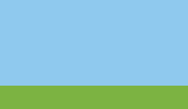 | 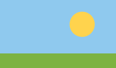 |

**Como resolver:** escreva primeiro o que fica **atrás** (céu, chão) e depois o que fica **na frente** (sol, personagem). Se não for isso, confira também:

- a camada da forma é `guide` (só aparece com **Guias** ligado), `hidden`, ou tem `only=` com outras animações;
- a forma tem `hidden`, `opacity=0`, ou `c=none` sem `ink=` (sem preenchimento e sem contorno, não sobra nada);
- a forma está fora do canvas. Lembre que o **y cresce para baixo**: `y=500` num canvas de 200 de altura fica fora, embaixo.

### A forma ficou atrás (ou na frente) da outra

**Por quê:** é a mesma regra de cima: o que vem depois no arquivo é pintado por cima, camada por camada. Um componente é pintado na linha do `use`, não na do `def`.

**Como resolver:** mude a linha de lugar, ou passe a forma para outra camada. Veja a [ordem de pintura](04-camadas.md#a-ordem-de-pintura).

### Quero que uma forma passe para a frente no meio da animação

Use `key quadro forma.above=outra` (passa para a frente da outra) ou `below=` (passa para trás). As duas formas precisam estar **na mesma camada**:

```
key 0 bracoD.below=corpo     # no quadro 0, o braço está atrás do corpo
key 6 bracoD.above=corpo     # no quadro 6, passa para a frente
```

O [capítulo 4](04-camadas.md#trocar-quem-fica-na-frente-durante-uma-animação-above-e-below) tem o exemplo completo, com a imagem.

### "não está na mesma camada" no `above=` ou `below=`

**O que você vê:**

```
erro: "chao" não está na mesma camada que "sol" (para trocar camadas inteiras, use os nomes das camadas)
```

**Por quê:** `above=` e `below=` só trocam a ordem **dentro** de uma camada.

**Como resolver:** ponha as duas formas na mesma camada, ou troque as camadas inteiras, usando os nomes das **camadas**: `key 8 bracoD.above=corpo`, em que `bracoD` e `corpo` são camadas.

### O contorno não aparece

**Por quê:** no Weasel, uma forma **não tem contorno** até você pedir. O `c=` só pinta o lado de dentro.

<!-- gerar: img/13_sem_contorno.png -->
```weasel
canvas 240 140 bg=#f4efe6
ellipse bola 120,70 50 c=#ff6b4a
```

<!-- gerar: img/13_com_contorno.png -->
```weasel
canvas 240 140 bg=#f4efe6
ellipse bola 120,70 50 c=#ff6b4a ink=line
```

| Sem `ink=` | Com `ink=line` |
|---|---|
| 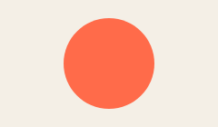 | 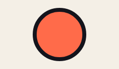 |

**Como resolver:** ponha `ink=` com a espessura do contorno: um número (`ink=4`) ou um nome da `palette` (`ink=line`, que vale 8; veja [nomes que já existem](03-cores.md#nomes-que-já-existem)). Se mesmo assim não aparece, procure `finish flat` no arquivo: ele tira todos os contornos de propósito.

### O contorno ficou fino de um lado

**O que você vê:** uma sombra ou um reflexo dentro da forma "come" a metade de dentro do contorno. Se a sombra encosta na borda toda (um sombreado que escurece as beiradas, por exemplo), o contorno fica fino na volta inteira e parece só um `line` menor.

**Por quê:** o contorno é pintado junto com a forma. A camada recortada (`clip=`) vem depois e é pintada por cima dele.

**Como resolver:** mande o contorno para uma camada que fica por cima de tudo, com `inkon=`:

```
layer bolas
ellipse bola 110,110 80 c=bola ink=line inkon=contorno

layer reflexo clip=bola
ellipse brilho 160,160 70 c=reflexo

layer contorno          # vazia: só recebe o contorno da bola
```

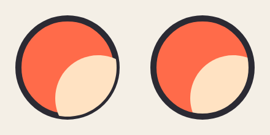

O exemplo completo está no [capítulo 4](04-camadas.md#o-contorno-por-cima-inkon).

### "esperado … no formato x,y"

**O que você vê:**

```
erro: esperado o centro no formato x,y
  2 | ellipse sol 200, 120 40 c=#ffd34d
    |             ^^^^
```

**Por quê:** um ponto é **uma palavra só**: `200,120`. O espaço depois da vírgula quebra o ponto em dois pedaços (`200,` e `120`), e nenhum deles é um ponto.

**Como resolver:** tire o espaço: `ellipse sol 200,120 40 c=#ffd34d`.

### "cor desconhecida"

**O que você vê:**

```
erro: cor desconhecida "amarelo"
  3 | ellipse sol 150,100 40 c=amarelo
    |                        ^^^^^^^^^
```

**Por quê:** `amarelo` não está na `palette` e não é um nome de cor do CSS. Os nomes do CSS são em inglês (`yellow`, `gold`, `tomato`).

**Como resolver:** escolha um dos três jeitos:

```
ellipse sol 150,100 40 c=#ffd34d      # o código da cor
ellipse sol 150,100 40 c=gold         # um nome do CSS, em inglês

palette amarelo=#ffd34d               # ou dê o nome você mesmo...
ellipse sol 150,100 40 c=amarelo      # ...e use-o
```

### O comentário virou "valor solto"

**O que você vê:**

```
aviso: valor solto "#cafe": parece cor, então não virou comentário (cor é c=#cafe; comentário é "# " com espaço depois)
  2 | ellipse xicara 150,100 40 c=#ffb000 #cafe com leite
    |                                     ^^^^^
```

**Por quê:** um `#` no meio da linha começa comentário, **a não ser** que pareça uma cor. `#cafe` tem quatro letras de 0 a 9 e de `a` a `f`: é uma cor (`#ccaaffee`, com transparência). Então o resto da linha (`#cafe com leite`) virou palavras soltas, que a forma ignora.

**Como resolver:** ponha um espaço depois do `#`:

```
ellipse xicara 150,100 40 c=#ffb000 #cafe com leite     # errado: "#cafe" é lido como cor
ellipse xicara 150,100 40 c=#ffb000 # cafe com leite    # certo: "# " começa o comentário
```

### O padrão não aparece no traço

**O que você vê:**

```
aviso: o padrão "listra" só preenche formas fechadas (shape, ellipse, rect): o traço sai sem o padrão, só na cor das linhas dele (#c44536)
```

**Por quê:** um `pattern` (hachura ou pontos) preenche o **lado de dentro** de uma forma. Um `stroke`, uma `line`, um `text` e o contorno (`inkc=`) não têm lado de dentro: eles saem lisos, na cor das linhas do padrão.

**Como resolver:** use o padrão no `c=` de uma forma fechada (`shape`, `ellipse`, `rect`). Para um traço tracejado, use `dash=` numa `line` ([capítulo 2](02-formas.md)).

### `cap=` não muda a ponta do traço

**O que você vê:**

```
aviso: cap= não vale junto com taper=: o traço afinado sai sempre com as pontas redondas
```

**Por quê:** `taper=` desenha o traço em pedaços de espessuras diferentes, e cada pedaço tem a ponta redonda. O `cap=` só vale para o traço de espessura igual.

**Como resolver:** escolha um dos dois: `taper=` para afinar as pontas, ou `cap=butt`/`cap=square` para uma ponta reta.

### A forma ficou redonda (ou fez uma volta) onde eu queria uma ponta

**O que você vê:** você queria um triângulo, e saiu uma gota ou um ovo.

**Por quê:** um ponto escrito só como `x,y` é **liso**: a linha passa por ele fazendo curva. Com todos os pontos lisos, nenhum lado fica reto. Um ponto com `!` no fim (`x,y!`) é um **canto vivo**: a linha chega e sai em reta.

<!-- gerar: img/13_curva_lisa.png -->
```weasel
canvas 240 150 bg=#f4efe6
line base c=#9a9a9a dash=6,4 : 0,110 240,110
shape morro c=#6cbf4a ink=4 : 30,110 120,30 210,110
```

<!-- gerar: img/13_curva_meio.png -->
```weasel
canvas 240 150 bg=#f4efe6
line base c=#9a9a9a dash=6,4 : 0,110 240,110
shape morro c=#6cbf4a ink=4 : 30,110! 120,30 210,110!
```

<!-- gerar: img/13_curva_cantos.png -->
```weasel
canvas 240 150 bg=#f4efe6
line base c=#9a9a9a dash=6,4 : 0,110 240,110
shape morro c=#6cbf4a ink=4 : 30,110! 120,30! 210,110!
```

| Os três pontos lisos | Cantos só embaixo | Os três com `!` |
|---|---|---|
| 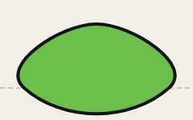 | 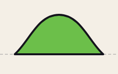 | 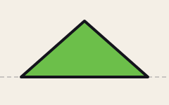 |

Repare na linha tracejada: com os pontos lisos, a forma passa **por baixo** do chão, porque a curva continua depois de cada ponto.

**Como resolver:** ponha `!` onde deve haver canto. Se a curva ainda fizer uma volta estranha, acrescente um ponto no meio do trecho, ou afaste dois pontos lisos que estão muito perto um do outro. Para controlar a curva de um ponto, use uma alça `x,y~dx,dy` ([capítulo 2](02-formas.md#alça-da-curva-xydxdy)).

### O recorte (`clip=`) apagou a camada inteira

**O que você vê:**

```
aviso: clip: "risco" é um traço aberto; o molde precisa ser uma forma fechada (shape, ellipse ou rect) ou uma camada
```

**Por quê:** o recorte mostra só o que fica **dentro** do molde. Um `stroke` ou uma `line` é um traço aberto: não tem lado de dentro, então nada aparece.

**Como resolver:** use como molde uma forma fechada (`shape`, `ellipse`, `rect`) ou o nome de uma camada.

### A variante não muda a cor

**O que você vê:** você criou a variante `noite`, mas o telhado continua igual nela.

**Por quê:** a variante troca **nomes da `palette`**. Uma cor escrita direto (`c=#c4512b`) não tem nome, então a variante não tem o que trocar.

<!-- gerar: img/13_variante_errada.png --variant noite -->
```weasel
canvas 240 140 bg=ceu
palette ceu=#bfe3f5 parede=#f1d9b5
rect casa 70,60 100,70 c=parede ink=4
shape telhado c=#c4512b ink=4 : 60,62! 120,20! 180,62!
variant noite ceu=#1b2140 parede=#8a7d70 telhado=#5a2a20
```

<!-- gerar: img/13_variante_certa.png --variant noite -->
```weasel
canvas 240 140 bg=ceu
palette ceu=#bfe3f5 parede=#f1d9b5 telhado=#c4512b
rect casa 70,60 100,70 c=parede ink=4
shape telhado c=telhado ink=4 : 60,62! 120,20! 180,62!
variant noite ceu=#1b2140 parede=#8a7d70 telhado=#5a2a20
```

| Errado: `c=#c4512b` | Certo: `c=telhado` |
|---|---|
| 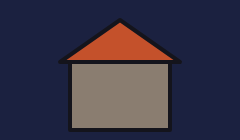 | 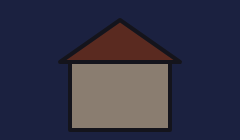 |

As duas imagens são a variante `noite` (`--variant noite`). **Como resolver:** dê um nome na `palette` a toda cor que você talvez queira trocar, e use o nome na forma.

### O texto sai diferente em outro computador

O texto usa as fontes instaladas na máquina. Use fontes que todo computador tem (`font=sans-serif`, `font=serif`, `font=monospace`) ou instale a mesma fonte nas duas.

## Ossos e animação

### Animei o osso e nada se mexe

**Por quê:** um osso sozinho não desenha nada. Ele só move as formas que dizem `bone=nome_do_osso`. É o erro mais comum.

<!-- gerar: img/13_sem_bone.gif -a acena -s 0.5 -->
```weasel
canvas 240 160 bg=#f4efe6
palette ink=#2b2a33
bone braco pivot=70,80
rect corpo 40,60 40,90 r=8 c=#4a90d9 ink=3
rect mao 70,74 100,12 r=6 c=#f2c9a0 ink=3
anim acena frames=12
key 0 braco=0,0,-30
key 6 braco=0,0,30
key 12 braco=0,0,-30
```

<!-- gerar: img/13_com_bone.gif -a acena -s 0.5 -->
```weasel
canvas 240 160 bg=#f4efe6
palette ink=#2b2a33
bone braco pivot=70,80
rect corpo 40,60 40,90 r=8 c=#4a90d9 ink=3
rect mao 70,74 100,12 r=6 c=#f2c9a0 ink=3 bone=braco
anim acena frames=12
key 0 braco=0,0,-30
key 6 braco=0,0,30
key 12 braco=0,0,-30
```

| Errado: o braço sem `bone=` | Certo: `bone=braco` |
|---|---|
| 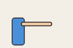 |  |

A única diferença é o `bone=braco` no fim da linha do `rect mao`. Se as formas já têm `bone=`, confira também:

- o player está na pose parada ou em outra animação: escolha a animação no player;
- a `key` está dentro de outra `anim` (cada `key` vale para o `anim` que veio antes dela).

### A parte gira em volta do lugar errado

**Por quê:** o osso gira em volta do `pivot=`. O pivô é a **articulação**: o ombro para o braço, o pescoço para a cabeça, o meio dos pés para o corpo inteiro.

<!-- gerar: img/13_pivo_errado.gif -a acena -s 0.5 -->
```weasel
canvas 240 160 bg=#f4efe6
palette ink=#2b2a33
bone braco pivot=120,80
rect corpo 40,60 40,90 r=8 c=#4a90d9 ink=3
rect mao 70,74 100,12 r=6 c=#f2c9a0 ink=3 bone=braco
ellipse pino 120,80 4 c=#e8443a
anim acena frames=12
key 0 braco=0,0,-30
key 6 braco=0,0,30
key 12 braco=0,0,-30
```

<!-- gerar: img/13_pivo_certo.gif -a acena -s 0.5 -->
```weasel
canvas 240 160 bg=#f4efe6
palette ink=#2b2a33
bone braco pivot=70,80
rect corpo 40,60 40,90 r=8 c=#4a90d9 ink=3
rect mao 70,74 100,12 r=6 c=#f2c9a0 ink=3 bone=braco
ellipse pino 70,80 4 c=#e8443a
anim acena frames=12
key 0 braco=0,0,-30
key 6 braco=0,0,30
key 12 braco=0,0,-30
```

| Errado: `pivot=120,80` (meio do braço) | Certo: `pivot=70,80` (ombro) |
|---|---|
| 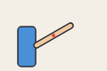 | 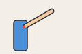 |

O pontinho vermelho marca o pivô. **Como resolver:** ponha o `pivot=` exatamente na articulação. No editor, ligue **Ossos** para ver onde ele está.

### O filho não acompanha o pai

**Por quê:** um osso só segue outro se disser `parent=`. Sem isso, o antebraço fica parado quando o braço gira.

<!-- gerar: img/13_sem_parent.gif -a acena -s 0.5 -->
```weasel
canvas 240 160 bg=#f4efe6
palette ink=#2b2a33
bone braco pivot=70,80
bone antebraco pivot=120,80
rect corpo 40,60 40,90 r=8 c=#4a90d9 ink=3
rect parte1 70,74 50,12 r=6 c=#f2c9a0 ink=3 bone=braco
rect parte2 120,74 50,12 r=6 c=#e0b088 ink=3 bone=antebraco
anim acena frames=12
key 0 braco=0,0,-30
key 6 braco=0,0,20
key 12 braco=0,0,-30
```

<!-- gerar: img/13_com_parent.gif -a acena -s 0.5 -->
```weasel
canvas 240 160 bg=#f4efe6
palette ink=#2b2a33
bone braco pivot=70,80
bone antebraco pivot=120,80 parent=braco
rect corpo 40,60 40,90 r=8 c=#4a90d9 ink=3
rect parte1 70,74 50,12 r=6 c=#f2c9a0 ink=3 bone=braco
rect parte2 120,74 50,12 r=6 c=#e0b088 ink=3 bone=antebraco
anim acena frames=12
key 0 braco=0,0,-30
key 6 braco=0,0,20
key 12 braco=0,0,-30
```

| Errado: sem `parent=` | Certo: `parent=braco` |
|---|---|
| 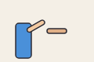 | 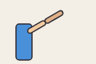 |

Só o osso `braco` é animado. Com `parent=braco`, o `antebraco` vai junto, e ainda pode ter o próprio giro por cima (dobrar o cotovelo).

### O loop dá um tranco quando recomeça

**Por quê:** uma animação com loop volta do último quadro para o primeiro. Se a última `key` não é igual à primeira, a figura **pula** de uma pose para a outra na emenda.

<!-- gerar: img/13_tranco.gif -a anda -s 0.5 -->
```weasel
canvas 240 100 bg=#f4efe6
bone b pivot=40,50
ellipse bola 40,50 16 c=#ff6b4a ink=3 bone=b
anim anda frames=12
key 0 b=0
key 12 b=160
```

<!-- gerar: img/13_sem_tranco.gif -a anda -s 0.5 -->
```weasel
canvas 240 100 bg=#f4efe6
bone b pivot=40,50
ellipse bola 40,50 16 c=#ff6b4a ink=3 bone=b
anim anda frames=12
key 0 b=0
key 6 b=160
key 12 b=0
```

| Errado: a última `key` é diferente da primeira | Certo: a última `key` repete a primeira |
|---|---|
| 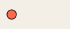 | 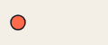 |

`key 0 b=0` é a bola no lugar (um número só é o deslocamento em x). **Como resolver:** numa animação de 12 quadros, ponha em `key 12` a mesma pose de `key 0`.

### A animação começa numa pose estranha

**Por quê:** numa animação com loop, **antes da primeira `key`** o valor vem da última `key`, dando a volta pela emenda.

```
anim pula frames=12
key 4 corpo=0,-30     # sem key 0: os quadros 0 a 3 vêm da key 4 "dando a volta"
```

**Como resolver:** ponha uma `key 0` com a pose inicial de tudo o que é animado:

```
anim pula frames=12
key 0 corpo=0,0
key 4 corpo=0,-30
key 12 corpo=0,0
```

### Uma transição (`once`) começa ou termina torta

**Por quê:** numa animação `once` (que toca uma vez só), antes da primeira `key` vale a primeira, e depois da última vale a última. Um osso que aparece só numa `key` do meio fica com essa pose no começo e no fim.

**Como resolver:** escreva a pose **completa** (todos os ossos que mudam em algum momento) na primeira e na última `key`:

```
anim levanta frames=8 once
key 0 corpo=0,20 braco=0,0,0
key 8 corpo=0,0 braco=0,0,-60
```

### Balanço, tremor ou partículas não se mexem

**Por quê:** `sway=`, `bob=`, `jitter=` e as partículas andam no tempo de uma animação. Sem nenhuma animação tocando, o desenho é uma foto.

```
bone galho pivot=120,140 sway=8,2     # balança 8 graus a cada 2 segundos...
anim parado frames=24 fps=12          # ...mas só com uma animação tocando
```

**Como resolver:** crie uma animação, mesmo sem nenhuma `key`, e escolha-a no player.

### A mola enlouquece numa transição rápida

**Por quê:** a mola (`spring=`) atrasa o osso quando o pai se mexe. Um movimento muito brusco sacode a mola demais.

**Como resolver:** deixe a mola mais dura, com o número mais perto de 1 (`spring=0.8` em vez de `spring=0.3`), ou tire a mola desse osso e anime-o com `key`.

### O `draw` desenha do lado errado

**Por quê:** `draw` (desenhar aos poucos) vai sempre **do primeiro ponto para o último**.

<!-- gerar: img/13_draw_errado.gif -a risca -s 0.5 -->
```weasel
canvas 240 100 bg=#f4efe6
stroke caminho w=6 c=#2b2a33 : 220,60 140,30 80,70 20,40
shape ponta c=#e8443a : 220,60! 205,48! 207,66!
anim risca frames=12 once
key 0 caminho.draw=0
key 12 caminho.draw=1
```

<!-- gerar: img/13_draw_certo.gif -a risca -s 0.5 -->
```weasel
canvas 240 100 bg=#f4efe6
stroke caminho w=6 c=#2b2a33 : 20,40 80,70 140,30 220,60
shape ponta c=#e8443a : 220,60! 205,48! 207,66!
anim risca frames=12 once
key 0 caminho.draw=0
key 12 caminho.draw=1
```

| Errado: o traço começa na seta | Certo: o traço termina na seta |
|---|---|
|  | 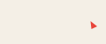 |

**Como resolver:** escreva os pontos na ordem contrária.

### "não combina" no morph

**O que você vê:**

```
erro: "b" não combina com "a": uma forma fechada só vira outra fechada, e um traço, outro traço
```

**Por quê:** o morph (`key … a.shape=b`) transforma uma forma em outra aos poucos. Uma forma fechada (`shape`, `ellipse`, `rect`) só vira outra fechada; um traço (`stroke`), outro traço. O número de pontos pode ser diferente.

**Como resolver:** use como alvo uma forma do mesmo tipo. Veja o morph no [capítulo 7](07-animacao.md).

### "key precisa vir depois de um anim" e "osso … não existe"

**O que você vê:**

```
erro: key precisa vir depois de um anim
erro: osso "braco" não existe (para formas use nome.propriedade=valor)
```

**Por quê:** toda `key` pertence ao `anim` que vem antes dela. E `key 0 braco=…` (sem ponto) é a pose de um **osso**: se não há `bone braco`, o Weasel não sabe o que mover.

**Como resolver:** escreva o `anim` antes das `key`. Para animar uma forma, use `nome.propriedade=` (`key 0 braco.opacity=0`); para um osso, declare o `bone` antes.

### "repeat sem end"

**O que você vê:**

```
erro: repeat sem end
```

**Como resolver:** todo `repeat` fecha com um `end`, como o `def`. Um `repeat` dentro de outro precisa de dois `end`:

```
repeat linha 0..2
  repeat coluna 0..3
    ellipse bola{linha}_{coluna} {40 + coluna*50},{40 + linha*50} 16
  end
end
```

### "o osso não tem caminho" no `along`

**O que você vê:**

```
erro: o osso "b" não tem caminho: use bone b … path=nome_de_uma_linha
```

**Como resolver:** `along` (andar pelo caminho, de 0 a 1) só existe num osso com `path=` na linha `bone`, com o nome de uma linha, traço ou forma: `bone b pivot=20,180 path=trilha`.

### O `mix=` dá erro

**O que você vê:**

```
erro: use mix=base,ação bones=osso1,osso2 (ex.: mix=walk_right,attack_right bones=braco)
```

**Como resolver:** escreva as **duas** animações separadas por vírgula, e em `bones=` os ossos que vêm da ação: `anim anda_atira mix=anda,atira bones=braco`.

### O `mix=` dá um pulo quando recomeça

**O que você vê:** a animação combinada anda bem e, de repente, as pernas (ou o corpo) voltam de uma vez para trás, sempre no mesmo ponto. No editor:

```
aviso: o loop de "anda_pisca" (1,8 s) recomeça no meio de "anda" (2,667 s): back_right_paw, back_left_paw e mais 3 ossos pulam de volta. Use um tempo que feche o ciclo de "anda" (ou um múltiplo dele), como frames=32 fps=12
```

**Por quê:** o `mix=` copia os quadros pelo tempo. Com `frames=36 fps=20`, a combinada dura 1,8 s, mas o `anda` (32 quadros a 12 fps) dura 2,667 s: quando a combinada recomeça, o `anda` estava só no quadro 21 de 32, e volta para o 0 de uma vez.

**Como resolver:** dê à combinada um tempo que feche o ciclo da animação de onde os ossos vêm: o mesmo (tire `frames=` e `fps=`, ou use `frames=32 fps=12`) ou um múltiplo (`frames=64 fps=12`, ou `frames=80 fps=20` se o andar tiver dois passos iguais, como esse). Quem só junta uma piscada pode escolher o tempo que fecha os dois ciclos: um andar de 2,667 s com uma piscada de 2 s fecha em 8 s.

### A `key` de opacidade não faz a forma aparecer

**Por quê:** a `opacity` da `key` **multiplica** a `opacity=` escrita na forma. Com `opacity=0` na forma, qualquer número vezes zero dá zero: ela fica invisível sempre.

```
ellipse bola 150,100 40 opacity=0      # errado: 1 × 0 = 0, nunca aparece
anim surge frames=12
key 0 bola.opacity=0
key 12 bola.opacity=1
```

**Como resolver:** tire o `opacity=0` da linha da forma e deixe a `key 0 bola.opacity=0` esconder a bola no começo.

### A `key` de `show` não faz a forma aparecer

**O que você vê:**

```
aviso: "bola" tem hidden e nunca aparece numa animação: show= não muda isso (para começar escondida, tire o hidden e use key 0 bola.show=0)
```

**Por quê:** numa animação, `hidden` quer dizer "nunca aparece": a forma só serve de molde (`cut=`, `clip=`, `back=`…). Nenhuma `key` muda isso, nem `show=1`, nem `opacity=`. (Num filme é diferente: lá, `at … bola.show=1` mostra uma forma com `hidden`, como no [capítulo 10](10-filme.md#aparecer-show-ou-opacity).)

```
ellipse bola 150,100 40 hidden      # errado: hidden ganha da key
anim surge frames=12
key 6 bola.show=1
```

**Como resolver:** tire o `hidden` e esconda a forma com uma `key` no quadro 0:

```
ellipse bola 150,100 40             # certo: sem hidden
anim surge frames=12
key 0 bola.show=0
key 6 bola.show=1
```

Para uma peça que aparece só numa versão do personagem, use `hidden` com `variant … show=` ([capítulo 3](03-cores.md)): aí a `key` funciona nessa versão.

### A `key` de `tint` não muda a cor

**O que você vê:**

```
aviso: a camada "corpo" não tem tint=cor,quanto: sem a cor, corpo.tint= não pinta nada
```

**Por quê:** a `key camada.tint=` muda só o **quanto** da cor (de 0 a 1). A cor vem do `tint=` escrito na linha da camada. Sem ele, não há cor para misturar.

**Como resolver:** ponha a cor na camada, com quanto 0 para começar sem mudança:

```
layer corpo tint=#ff0000,0          # a cor do piscar; 0 = nada no começo
anim dano frames=6
key 0 corpo.tint=0
key 2 corpo.tint=0.8
key 6 corpo.tint=0
```

### O tecido não balança a forma com `bones=`

**O que você vê:**

```
aviso: cloth= não vale junto com bones=: a forma dobra com os ossos e o tecido fica parado (use um dos dois)
```

**Por quê:** com `bones=`, cada ponto da forma segue o osso mais perto dele. O `cloth=` também quer mexer nos pontos; os dois não se juntam, e vale o `bones=`.

**Como resolver:** escolha um. `bones=` para uma peça que dobra com o corpo (uma manga, uma cauda com ossos); `cloth=` para uma peça solta que balança sozinha (uma capa, uma bandeira).

### A perna com IK estica ou dobra demais

O comprimento da perna é a distância do `hip=` ao pé **no desenho parado**. Se o corpo desce mais que isso, a dobra fica exagerada; se sobe mais que isso, a perna fica pendurada. Ajuste o quanto o corpo desce na animação, ou mude o `hip=`.

### O braço com `target=` não alcança a mão

A mão foi mais longe que o comprimento do braço (a distância do `hip=` ao pivô da mão no desenho parado). Mantenha a mão ao alcance: o braço não estica.

### "variável desconhecida" num componente

**O que você vê:**

```
erro: {alto}: variável desconhecida "alto"
```

**Por quê:** dentro de um `def`, uma conta só conhece os parâmetros declarados na linha `def`, com valor padrão **numérico**.

**Como resolver:** declare o parâmetro com um número: `def arvore alto=60 cor=#4caf50`. Na versão 1.6.1 ou anterior isso dava erro mesmo assim; atualize o Weasel.

Dentro de um `def`, os **limites** de um `repeat` são diferentes: eles são lidos uma vez só, antes de qualquer `use`, e não conhecem os parâmetros.

```
erro: variável desconhecida "n": dentro de def, os limites do repeat usam números ou variáveis do let (os parâmetros do def só valem nas contas das linhas de dentro)
```

Use um número (`repeat i 0..7`) ou uma variável do `let`. Nas contas das linhas de dentro do `repeat`, os parâmetros valem normalmente ([capítulo 5](05-componentes.md#repeat-dentro-do-componente)).

### "parâmetro desconhecido" num `use`

**O que você vê:**

```
aviso: parâmetro desconhecido "rr": o componente "bola" tem cor, r (e o use aceita scale, rot, flip, bone, cloth, opacity, z)
```

**Por quê:** o nome não é parâmetro do componente (os da linha `def`), nem uma opção do `use`. Quase sempre é erro de digitação: `rr=30` em vez de `r=30`. O valor não muda nada.

**Como resolver:** use um dos nomes da lista. Para o componente ter um parâmetro novo, acrescente-o na linha `def`, com o valor padrão: `def bola cor=#ff6b4a r=20 brilho=0.7`.

## Arquivos

### `include` não acha o arquivo

**O que você vê:**

```
desenho.weasel:2:9: erro: não achei o arquivo "cores.weasel"
```

**Como resolver:**

- No **editor web**, o arquivo precisa estar na lista de arquivos: abra-o com **Abrir…**.
- Na **linha de comando**, o caminho é relativo à pasta do arquivo que faz o `include`. Se `cores.weasel` está numa pasta `comum`, escreva `include "comum/cores.weasel"`.

### Um erro aparece na linha do `include`

O erro é **dentro** do arquivo incluído: a mensagem começa com o nome dele e a linha de lá. Abra esse arquivo e corrija a linha indicada.

### A imagem guia (`ref`) não aparece

- No **editor web**, a imagem precisa estar guardada no navegador: abra o painel **Referências** e use **abrir …** ao lado dela (ou **Adicionar imagem…**, ou arraste a imagem para a janela). O aviso "não achei a imagem" diz qual falta.
- Confira o `only=` e o `frames=`: com uma animação escolhida no player, só aparecem as imagens guia dela, e a pose parada se chama `pose`. Confira também o `hidden` e a caixa **mostrar** do painel.
- Na **linha de comando**, ela só aparece com `--refs`, e o caminho é relativo ao arquivo `.weasel`.
- Uma imagem guia escrita num arquivo incluído não aparece: o `ref` só vale no arquivo onde está.

### A imagem guia não arrasta

Ela está com `lock` (o cadeado no painel), ou a posição vem de uma `{conta}`: o editor não reescreve contas.

## Filme

### "o marcador fica fora do shot"

**O que você vê:**

```
aviso: o marcador "trovao" (3s) fica fora do shot "a"
```

**Por quê:** o `at` que usa um marcador precisa estar no `shot` em que o marcador cai. Aqui o shot `a` dura 2 s e o marcador está em 3 s, no shot seguinte.

**Como resolver:** mude o `at` para o plano certo, ou mude o tempo do `mark`.

### A expressão troca devagar demais

**Por quê:** `at 3s heroi.expr=bravo` muda **aos poucos**, desde o `at` anterior até os 3 s.

**Como resolver:** repita a expressão de antes um pouco antes da troca. Assim a mudança dura só esse pedacinho:

```
at 2s heroi.expr=feliz       # até 2 s, continua feliz
at 2.2s heroi.expr=bravo     # de 2 s a 2,2 s, fica bravo
```

### A transição (`in=`) mostra o plano anterior parado

É assim mesmo: durante a transição, o plano anterior fica parado no último quadro dele enquanto o novo já anda. Para os dois andarem juntos, faça a passagem dentro de um plano só, com `at`.

### O ator voltou para o lugar no plano seguinte

**Por quê:** cada `shot` começa com tudo como foi declarado no `actor`, e não onde o plano anterior terminou.

**Como resolver:** repita a posição no começo do plano:

```
shot a dur=3s
at 3s heroi.pos=900,560      # o herói termina em 900

shot b dur=3s
at 0s heroi.pos=900,560      # e o plano b começa com ele lá
```

### O ator ficou parado e depois "pulou" para o lugar

**Por quê:** o `at` muda aos poucos entre um `at` e o seguinte, e o valor do `actor` vale como `at 0s`. Um único `at 2s heroi.pos=…` faz o herói andar devagar desde 0 s, e não a partir de 2 s.

**Como resolver:** repita a posição num `at` antes do começo do movimento:

```
at 1.5s heroi.pos=400,560    # parado até 1,5 s
at 2s heroi.pos=700,560      # anda de 1,5 s a 2 s
```

### A câmera mostra o lugar errado

`camera x,y` é o ponto do mundo que fica **no centro** do quadro, e não o canto de cima. Para ver um canvas de 1920 × 1080 inteiro, a câmera fica em `camera 960,540`.

### O ator está deslocado

O ponto do arquivo dele que vai para `x,y` é o `root=` do `unity` (ou o canto `0,0`, se não houver `unity`). Use `origin=` para escolher outro ponto: `actor heroi "cavaleiro.weasel" 900,560 origin=240,400`.

### O vídeo não sai

Vídeo pela linha de comando precisa do ffmpeg instalado. No Windows:

```bash
winget install ffmpeg
```

Sem ele, dá para exportar PNGs (`--frames`) ou GIF.

## Profundidade (2.5D)

### Pus `z=` e nada mudou

**Por quê:** sem giro, o `z=` não tira nada do lugar. Ele vale quando a forma, o osso ou a camada **gira** (`yaw=`, `pitch=`, `floor`, `iso`), e para a ordem com `zsort`.

**Como resolver:** se você só quer pôr uma forma na frente de outra, mude a ordem das linhas. Para ver o efeito do `z=`, gire alguma coisa (veja o [capítulo 11](11-profundidade.md)).

### A carta virou e mostra a frente espelhada

**Por quê:** sem `back=`, o lado de trás é a própria frente vista por trás, como um papel contra a luz. E sem `zsort`, o desenho que fica na frente da carta continua por cima dela mesmo de costas.

<!-- gerar: img/13_sem_verso.png -->
```weasel
canvas 240 180 bg=#f4efe6
bone carta pivot=120,90 yaw=150
layer cartas
rect frente 70,20 100,140 r=10 c=#fff6e0 ink=4 bone=carta
text nome 120,100 "SOL" size=30 align=center c=#e8443a z=1 bone=carta bold
```

<!-- gerar: img/13_com_verso.png -->
```weasel
canvas 240 180 bg=#f4efe6
bone carta pivot=120,90 yaw=150
layer cartas zsort
rect frente 70,20 100,140 r=10 c=#fff6e0 ink=4 back=costas bone=carta
rect costas 70,20 100,140 r=10 c=#2e86ab ink=4 hidden
text nome 120,100 "SOL" size=30 align=center c=#e8443a z=1 bone=carta bold
```

| Errado: sem `back=` e sem `zsort` | Certo: `back=costas` e `zsort` |
|---|---|
| 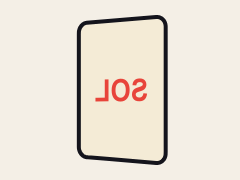 | 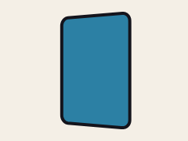 |

**Como resolver:** desenhe o verso numa forma com `hidden`, ligue-o com `back=verso` e ponha `zsort` na camada.

### O chão acaba antes do horizonte

**Por quê:** com `floor`, quanto mais para cima no código, mais longe. Um chão curto termina no meio do caminho.

<!-- gerar: img/13_chao_curto.png -->
```weasel
canvas 240 150 bg=#bfe3f5
layer chao floor horizon=40
rect grama -200,-300 640,450 c=#7cb342
rect estrada 100,-300 40,450 c=#5d5d5d
```

<!-- gerar: img/13_chao_comprido.png -->
```weasel
canvas 240 150 bg=#bfe3f5
layer chao floor horizon=40
rect grama -20000,-20000 40240,20150 c=#7cb342
rect estrada 100,-20000 40,20150 c=#5d5d5d
```

| Errado: o chão vai só até `y=-300` | Certo: até `y=-20000` |
|---|---|
| 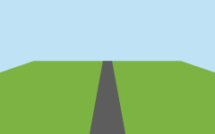 | 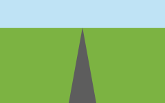 |

**Como resolver:** desenhe o chão bem comprido e bem largo (até `-20000`).

### O `horizon=` não muda nada

**O que você vê:**

```
aviso: horizon= não muda nada com persp= e pitch= juntos: o chão já fica decidido pelos dois (use só dois dos três)
```

**Por quê:** o chão (`floor`) precisa de duas coisas para deitar: o quanto ele deita (`pitch=`), a distância do olho (`persp=`) e onde fica o horizonte (`horizon=`) são três jeitos de dizer isso, e quaisquer **dois** decidem o terceiro. Com `persp=` e `pitch=`, o horizonte já está dado.

**Como resolver:** apague um dos três. Para escolher onde o chão some, fique com `horizon=` e um dos outros dois (ou só `horizon=`).

### No mapa `iso`, o chão cobre as caixas

**Por quê:** com `zsort`, cada forma é pintada na ordem do seu **meio**, de longe para perto. O meio do chão fica "na frente" das caixas do fundo, então ele é pintado por cima delas.

<!-- gerar: img/13_iso_errado.png -->
```weasel
canvas 240 150 bg=#20242e
layer tudo iso=120,20 zsort
rect piso 0,0 100,100 c=#9ccc65 ink=2
rect caixa 8,8 24,24 c=#d7a86e ink=2 thick=24
rect caixa2 64,64 24,24 c=#d7a86e ink=2 thick=24
```

<!-- gerar: img/13_iso_certo.png -->
```weasel
canvas 240 150 bg=#20242e
layer chao iso=120,20
rect piso 0,0 100,100 c=#9ccc65 ink=2
layer coisas iso=120,20 zsort
rect caixa 8,8 24,24 c=#d7a86e ink=2 thick=24
rect caixa2 64,64 24,24 c=#d7a86e ink=2 thick=24
```

| Errado: chão e caixas na mesma camada | Certo: o chão numa camada própria |
|---|---|
| 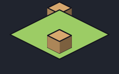 | 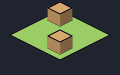 |

**Como resolver:** ponha o chão numa camada `iso` própria, **sem** `zsort`, antes da camada das coisas.

### As orelhas entram na cara quando a cabeça vira

**Por quê:** com `round=`, as peças do osso ficam na superfície de uma bola. Uma orelha fora do raio não tem onde ficar na bola e escorrega para dentro do rosto.

<!-- gerar: img/13_orelhas_erradas.png -->
```weasel
canvas 200 180 bg=#f4efe6
palette ink=#1c1f2b pele=#f2c9a0
bone rosto pivot=100,170 round=60,100,90 yaw=35
layer cabeca zsort
ellipse cranio 100,90 60 c=pele ink=3
ellipse orelhaE 40,95 10,15 c=pele ink=3 bone=rosto
ellipse orelhaD 160,95 10,15 c=pele ink=3 bone=rosto
ellipse olhoE 80,82 6,9 c=ink bone=rosto
ellipse olhoD 120,82 6,9 c=ink bone=rosto
```

<!-- gerar: img/13_orelhas_certas.png -->
```weasel
canvas 200 180 bg=#f4efe6
palette ink=#1c1f2b pele=#f2c9a0
bone rosto pivot=100,170 round=60,100,90 yaw=35
layer cabeca zsort
ellipse cranio 100,90 60 c=pele ink=3
ellipse orelhaE 40,95 10,15 c=pele ink=3 bone=rosto z=-20
ellipse orelhaD 160,95 10,15 c=pele ink=3 bone=rosto z=-20
ellipse olhoE 80,82 6,9 c=ink bone=rosto
ellipse olhoD 120,82 6,9 c=ink bone=rosto
```

| Errado: orelhas sem `z=` | Certo: orelhas com `z=-20` |
|---|---|
| 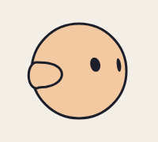 | 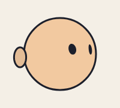 |

**Como resolver:** dê às orelhas um `z=` próprio (atrás do meio da cabeça) e ponha `zsort` na camada. Com `z=`, a peça vira um cartão chato e não vai para a bola.

### No Godot, a cabeça não vira

O esqueleto de verdade (`rig=bones`) não gira em 3D, e o Weasel avisa:

```
aviso: o esqueleto do Godot não gira em 3D: yaw, pitch, z e iso ficam parados (use rig=frames)
```

**Como resolver:** exporte com `rig=frames` (o padrão), que leva cada quadro pronto.

## Exportação

### O GIF ficou grande demais

Granulado (`grain=`), degradês e muitos quadros pesam. Diminua com `-s 0.5`, use menos quadros e tire o `grain`:

```bash
node cli/weasel.js bola.weasel -a quica -o quica.gif -s 0.5
```

Para filmes, prefira MP4.

### As bordas do GIF transparente ficam serrilhadas

O GIF só tem transparência de 1 bit: cada pixel é transparente ou não, sem meio-termo. Para transparência suave, use PNG ou a sprite sheet.

### O `.tres` do Godot não acha a imagem

O `.tres` aponta para o `.png` pelo nome do arquivo: os dois precisam ficar na mesma pasta do projeto do Godot.

[← Referência rápida](12-referencia.md) · [Índice](README.md)
