# 14. Estilos de arte

[← Problemas comuns](13-problemas.md) · [Índice](README.md)

O Weasel guarda o desenho como formas, e não como uma imagem pronta. Por isso ele pode pintar o mesmo desenho de outro jeito: em pixel art, em letras (ASCII), em cel shading, em gravura, em xilogravura, em retícula de jornal, em HQ, em mangá, em risografia, em estêncil, em silhueta, em esboço, em marcador, em lápis de cor, só nos contornos, em neon e, nas próximas versões, em outros estilos. Para isso serve a linha `art`.

| O desenho normal | `art pixel` | `art ascii color` |
|---|---|---|
| 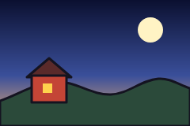 | 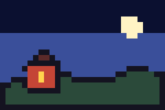 | 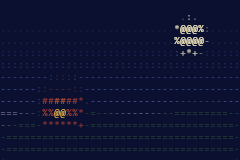 |

<details>
<summary>Código dos três</summary>

<!-- gerar: img/14_vila.png -->
```weasel
canvas 240 160 bg=ceu
gradient ceu linear 0,0 0,160 : #0b1030@0 #3a4f9a@0.6 #f0b070@1
palette ink=#141320 line=3
ellipse lua 190,38 16 c=#fff3c4
shape morro c=#2b4a3a ink=line : 0,128! 70,104 140,120 200,100 240,112! 240,160! 0,160!
shape telhado c=#5a2a2a ink=line : 34,98! 62,74! 90,98!
rect casa 40,96 44,34 c=#c44536 ink=line
rect janela 54,106 12,12 c=#ffd34d
```

<!-- gerar: img/14_vila_pixel.png -->
```weasel
canvas 240 160 bg=ceu
art pixel
gradient ceu linear 0,0 0,160 : #0b1030@0 #3a4f9a@0.6 #f0b070@1
palette ink=#141320 line=3
ellipse lua 190,38 16 c=#fff3c4
shape morro c=#2b4a3a ink=line : 0,128! 70,104 140,120 200,100 240,112! 240,160! 0,160!
shape telhado c=#5a2a2a ink=line : 34,98! 62,74! 90,98!
rect casa 40,96 44,34 c=#c44536 ink=line
rect janela 54,106 12,12 c=#ffd34d
```

<!-- gerar: img/14_vila_ascii.png -->
```weasel
canvas 240 160 bg=ceu
art ascii color
gradient ceu linear 0,0 0,160 : #0b1030@0 #3a4f9a@0.6 #f0b070@1
palette ink=#141320 line=3
ellipse lua 190,38 16 c=#fff3c4
shape morro c=#2b4a3a ink=line : 0,128! 70,104 140,120 200,100 240,112! 240,160! 0,160!
shape telhado c=#5a2a2a ink=line : 34,98! 62,74! 90,98!
rect casa 40,96 44,34 c=#c44536 ink=line
rect janela 54,106 12,12 c=#ffd34d
```

</details>

Os três códigos são iguais, menos a linha `art`. Repare:

- O desenho continua o mesmo: as formas, os ossos e as animações não mudam. Só a pintura final muda.
- A primeira palavra depois de `art` é o **estilo**; depois vêm as opções dele. Os nomes são em inglês.
- Um `art` por arquivo. Sem `art`, nada muda. `art none` desliga o estilo (serve no filme, mais abaixo).
- A linha pode ficar em qualquer lugar do arquivo; o costume é logo depois do `canvas`, como o `finish`.

Nesta versão existem dezesseis estilos: `pixel` e `ascii` (logo abaixo), os cinco [estilos de tom](#estilos-de-tom-toon-engraving-halftone-stencil-e-silhouette) (`toon`, `engraving`, `halftone`, `stencil` e `silhouette`), as quatro [combinações de tom](#as-combinações-de-tom-woodcut-comic-manga-e-riso) (`woodcut`, `comic`, `manga` e `riso`) e os cinco [estilos de traço](#os-estilos-de-traço-sketch-marker-pencil-lines-e-neon) (`sketch`, `marker`, `pencil`, `lines` e `neon`). Os outros do plano (`crayon`, `watercolor`, `cutout`…) entram nas próximas versões; por enquanto, um desses nomes dá erro dizendo que ainda não foi feito.

**No editor:** o desenho aparece no estilo, e as alças continuam nos pontos das formas, então você edita do mesmo jeito. Quando o arquivo tem `art`, aparece a chave **Estilo** (o ícone de quadradinhos, ao lado do papel vegetal) na barra de cima do desenho: desligada, ela mostra o desenho normal, que é mais fácil de ajustar.

## Pixel art: `art pixel`

```
art pixel size= palette= dither= outline small
```

### O voto por bloco

O `finish pixel=` (do [capítulo 4](04-camadas.md#acabamento-finish)) já pixelava o desenho, mas ele faz a **média** das cores de cada bloco. O `art pixel` faz um **voto**: cada bloco fica com a cor que mais aparece nele.

| `finish game pixel=8` | `art pixel size=8` |
|---|---|
| 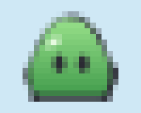 | 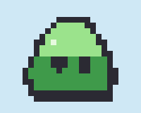 |

<details>
<summary>Código dos dois</summary>

<!-- gerar: img/14_gosma_finish.png -->
```weasel
canvas 200 160 bg=#cfe8f5
finish game pixel=8
palette ink=#2b2a33 line=5
gradient verde linear 0,0 0,1 box : #9be38c #3f9a4a
shape corpo c=verde ink=line weight=0.3 : 100,24 160,96 152,138! 48,138! 40,96
ellipse olhoE 84,90 8,12 c=ink
ellipse olhoD 118,90 8,12 c=ink
ellipse brilho 76,60 11,6 rot=-35 c=#e6fadf
```

<!-- gerar: img/14_gosma_art.png -->
```weasel
canvas 200 160 bg=#cfe8f5
art pixel size=8
palette ink=#2b2a33 line=5
gradient verde linear 0,0 0,1 box : #9be38c #3f9a4a
shape corpo c=verde ink=line weight=0.3 : 100,24 160,96 152,138! 48,138! 40,96
ellipse olhoE 84,90 8,12 c=ink
ellipse olhoD 118,90 8,12 c=ink
ellipse brilho 76,60 11,6 rot=-35 c=#e6fadf
```

</details>

Repare:

- Com o `finish pixel=`, a borda de um bloco que pega o verde e o azul vira uma cor do meio, que não existe no desenho. No `art pixel`, cada bloco tem **uma cor do desenho**.
- O contorno é fino (5 pixels) perto de um bloco de 8, então ele perderia quase todos os votos. Por isso a cor da tinta (`ink`) ganha com 1/4 do bloco: o contorno não se desfaz. Os olhos, pintados com `c=ink`, também contam como tinta, e por isso não somem.
- A cor de cada ponto é comparada do jeito que o olho vê (um azul-escuro fica perto de outro azul, e não de um verde-escuro de mesma claridade).
- Num desenho sem fundo, o bloco fica transparente quando o vazio é maior que a cor mais votada.
- `size=8` é o tamanho do bloco, de 1 a 64 (padrão 8). A grade começa no `0,0` do canvas, então o mesmo ponto cai sempre no mesmo bloco.

### As paletas: `palette=`

Sem `palette=`, as cores são as **do próprio desenho** (`palette=own`): as da `palette`, as das formas, as dos gradientes e o fundo. As outras paletas imitam consoles antigos:

| `palette=gameboy dither=bayer` | `palette=pico8` | `palette=mono dither=bayer` |
|---|---|---|
| 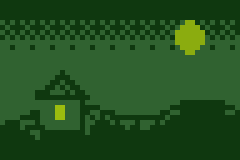 | 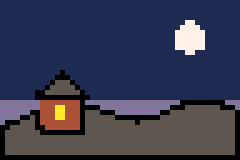 | 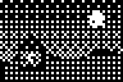 |

<details>
<summary>Código dos três</summary>

<!-- gerar: img/14_vila_gameboy.png -->
```weasel
canvas 240 160 bg=ceu
art pixel size=5 palette=gameboy dither=bayer
gradient ceu linear 0,0 0,160 : #0b1030@0 #3a4f9a@0.6 #f0b070@1
palette ink=#141320 line=3
ellipse lua 190,38 16 c=#fff3c4
shape morro c=#2b4a3a ink=line : 0,128! 70,104 140,120 200,100 240,112! 240,160! 0,160!
shape telhado c=#5a2a2a ink=line : 34,98! 62,74! 90,98!
rect casa 40,96 44,34 c=#c44536 ink=line
rect janela 54,106 12,12 c=#ffd34d
```

<!-- gerar: img/14_vila_pico8.png -->
```weasel
canvas 240 160 bg=ceu
art pixel size=5 palette=pico8
gradient ceu linear 0,0 0,160 : #0b1030@0 #3a4f9a@0.6 #f0b070@1
palette ink=#141320 line=3
ellipse lua 190,38 16 c=#fff3c4
shape morro c=#2b4a3a ink=line : 0,128! 70,104 140,120 200,100 240,112! 240,160! 0,160!
shape telhado c=#5a2a2a ink=line : 34,98! 62,74! 90,98!
rect casa 40,96 44,34 c=#c44536 ink=line
rect janela 54,106 12,12 c=#ffd34d
```

<!-- gerar: img/14_vila_mono.png -->
```weasel
canvas 240 160 bg=ceu
art pixel size=5 palette=mono dither=bayer
gradient ceu linear 0,0 0,160 : #0b1030@0 #3a4f9a@0.6 #f0b070@1
palette ink=#141320 line=3
ellipse lua 190,38 16 c=#fff3c4
shape morro c=#2b4a3a ink=line : 0,128! 70,104 140,120 200,100 240,112! 240,160! 0,160!
shape telhado c=#5a2a2a ink=line : 34,98! 62,74! 90,98!
rect casa 40,96 44,34 c=#c44536 ink=line
rect janela 54,106 12,12 c=#ffd34d
```

</details>

| Opção | O que faz |
|---|---|
| `size=8` | O tamanho do bloco, de 1 a 64 (padrão 8). |
| `palette=` | `own` (padrão, as cores do desenho), `gameboy` (4 verdes), `nes` (as cores do Nintendinho), `pico8` (16 cores) ou `mono` (preto e branco). Cada bloco fica com a cor mais parecida da paleta. |
| `dither=bayer` | Pontilhado: nos degradês, mistura duas cores em pontinhos alternados, em vez de faixas. Só entra onde a cor muda devagar (no `mono`, entra em tudo). `dither=none` é o padrão. |
| `outline` | Um contorno de 1 bloco, na cor da tinta (`ink`), em volta do desenho. Ótimo para personagens de jogo, que precisam se destacar do cenário. |
| `small` | A sprite sheet e o Godot saem no tamanho pequeno de verdade (veja abaixo). |

**Experimente:** no código do `pico8`, troque para `palette=nes`, e depois para `size=10`.

### Contorno de 1 bloco: `outline`

<!-- gerar: img/14_outline.png -->
```weasel
canvas 200 160 bg=none
art pixel size=6 outline
palette ink=#2b2a33 line=5
gradient verde linear 0,0 0,1 box : #9be38c #3f9a4a
shape corpo c=verde weight=0.3 : 100,24 160,96 152,138! 48,138! 40,96
ellipse olhoE 84,90 8,12 c=ink
ellipse olhoD 118,90 8,12 c=ink
ellipse brilho 76,60 11,6 rot=-35 c=#e6fadf
```

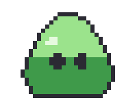

Repare:

- O `corpo` não tem `ink=` (sem contorno no código). O `outline` desenha o contorno pela borda do desenho inteiro, de 1 bloco, sempre nítido.
- O contorno fica **por fora** do desenho, nos blocos vazios em volta dele: a figura cresce 1 bloco de cada lado. Na sprite sheet com `--trim`, o recorte já conta com ele.
- A cor é a da `ink` da `palette` (ou a mais parecida dela, se houver `palette=`).

### Pixel art no jogo: `small`

Sem `small`, a sprite sheet sai do tamanho do `canvas`, com cada bloco feito de vários pixels iguais. Funciona, mas pesa muito mais. Com `small`, **a sprite sheet e o pacote do Godot** saem com 1 pixel por bloco:

<!-- gerar: img/14_small.png -f sheet -a all -s 3 -->
```weasel
canvas 160 160 bg=none
art pixel size=4 outline small
palette ink=#1d1b26 line=5 sombra=#9c8f7c
gradient brilho radial 66,70 60 : #ffd9c9@0 #ff6b4a@0.7 #c43c25@1
bone sombra pivot=80,148
bone bola pivot=80,146
ellipse s 80,148 34,7 c=sombra bone=sombra
ellipse b 80,112 34 c=brilho ink=line weight=0.3 bone=bola
anim quica frames=4 fps=8
key 0 bola=0,0,0,1.2,0.8 sombra=0,0,0,1.1 ease=out
key 2 bola=0,-60,0,1,1 sombra=0,0,0,0.6 ease=in
key 4 bola=0,0,0,1.2,0.8 sombra=0,0,0,1.1
```

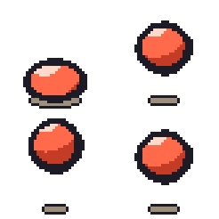

Repare:

- A bola tem 160×160 de canvas e blocos de 4: com `small`, cada quadro teria 40×40 pixels. A imagem acima usou `-s 3`, e com `small` a escala conta **pixels por bloco**: cada bloco virou 3×3 pixels.
- O recorte da folha (o `--trim`) também anda de bloco em bloco, para a grade não escorregar entre um quadro e outro.
- O **vídeo, o GIF e o PNG** saem sempre do tamanho do `canvas` (vezes a escala), com o pixel nítido: o `small` vale só para o jogo.

**No Godot** ([capítulo 9](09-jogo-godot.md)), com qualquer `art pixel`:

- a cena sai com `texture_filter = 1` (*nearest*): o Godot não suaviza a imagem, e o pixel continua nítido quando a câmera aproxima;
- o mapa de relevo (`godot normal=`) sai pixelado também, um tom por bloco;
- com `small`, a folha e as caixas de colisão saem na escala pequena, juntas;
- o esqueleto de verdade (`godot rig=bones`) desenha cada peça no estilo na pose parada. Quando a peça gira no Godot, os pixels giram junto e saem da grade. Para pixel art que gira, prefira a folha de quadros (`--no-rig`).

## ASCII: `art ascii`

```
art ascii size=largura,altura chars= color
```

O desenho vira uma grade de letras: cada célula vira a letra que tem mais ou menos a mesma "quantidade de tinta" que aquele pedaço do desenho.

| `art ascii` | `art ascii size=4,8 color` |
|---|---|
| 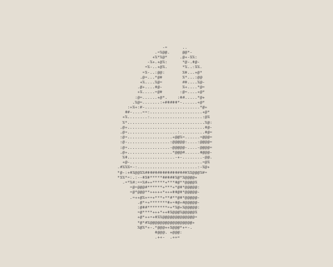 | 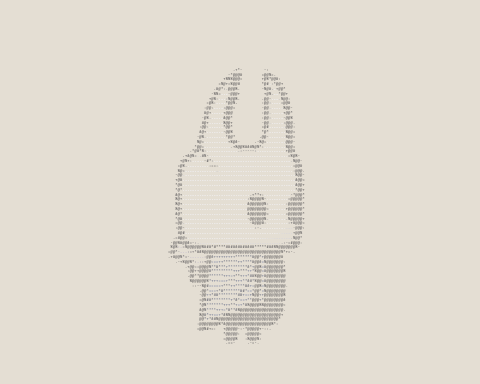 |

<details>
<summary>Código dos dois</summary>

<!-- gerar: img/14_ascii.png -s 0.6 -->
<!-- gerar: img/14_ascii.txt -->
```weasel
include "cavaleiro.weasel"
art ascii
```

<!-- gerar: img/14_ascii_cor.png -s 0.6 -->
```weasel
include "cavaleiro.weasel"
art ascii size=4,8 color
```

</details>

Repare:

- O `include` traz o Cavaleiro dos exemplos inteiro; a linha `art` de baixo vale para ele.
- O ASCII também sai **em texto**: [este .txt](img/14_ascii.txt) é o mesmo desenho, uma linha de texto por linha de letras. Na linha de comando, é só dar um nome terminado em `.txt` (ou usar `-f txt`); no editor, é o botão **Texto (ASCII)** da janela de exportar.
- O fundo do `canvas` é o **papel**: as letras marcam o que é diferente dele. Num fundo escuro, as letras saem claras.

| Opção | O que faz |
|---|---|
| `size=6,12` | A largura e a altura de cada letra, de 2 a 64 (padrão `6,12`). Um número só, `size=5`, vale `5,10` (a letra tem o dobro da altura). |
| `chars=" .:-=+*#%@"` | As letras, da mais clara para a mais escura (esse é o padrão). Com espaço no meio, use aspas. |
| `color` | Cada letra pega a cor daquele pedaço do desenho, em vez da cor da tinta. |

**Experimente:** troque para `chars=" .oO@"`, ou use `size=8` para letras maiores.

## Estilos de tom: `toon`, `engraving`, `halftone`, `stencil` e `silhouette`

Estes cinco estilos olham o **tom** de cada ponto (o claro e o escuro) e a luz da cena. Eles pintam na resolução da imagem final, sem blocos nem letras; o tamanho da hachura e dos pontos é medido em unidades do desenho, como todo o resto.

| `art toon` | `art engraving` | `art halftone` |
|---|---|---|
| 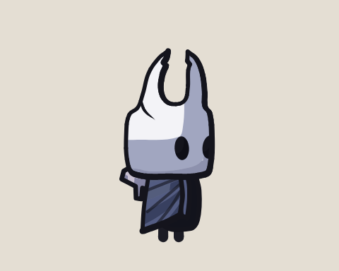 | 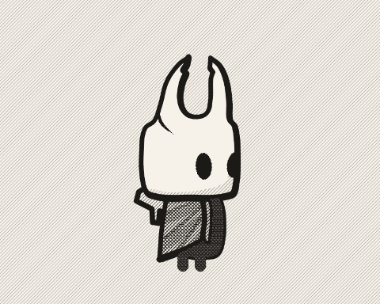 | 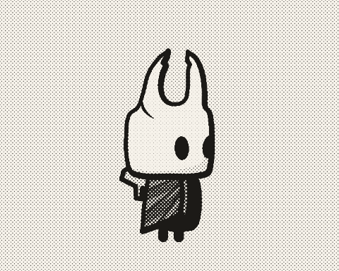 |

| `art stencil` | `art silhouette` |
|---|---|
| 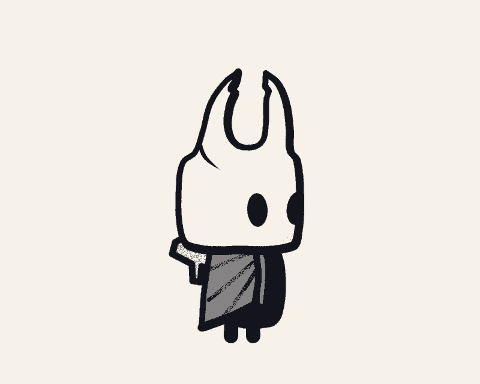 | 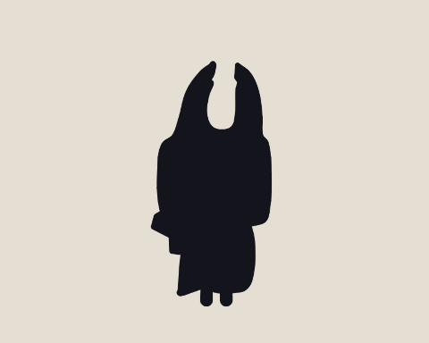 |

<details>
<summary>Código dos cinco</summary>

<!-- gerar: img/14_tom_toon.png -s 0.6 -->
```weasel
include "cavaleiro.weasel"
art toon
```

<!-- gerar: img/14_tom_engraving.png -s 0.6 -->
```weasel
include "cavaleiro.weasel"
art engraving
```

<!-- gerar: img/14_tom_halftone.png -s 0.6 -->
```weasel
include "cavaleiro.weasel"
art halftone
```

<!-- gerar: img/14_tom_stencil.png -s 0.6 -->
```weasel
include "cavaleiro.weasel"
art stencil
```

<!-- gerar: img/14_tom_silhouette.png -s 0.6 -->
```weasel
include "cavaleiro.weasel"
art silhouette
```

</details>

**No editor:** estes estilos (menos o `silhouette`) pesam mais que os outros. Enquanto você arrasta uma alça, o desenho aparece normal; quando você solta, o estilo volta.

### Cel shading: `art toon`

```
art toon steps= shadow=
```

| A noite, sem `art` | A noite com `art toon` |
|---|---|
| 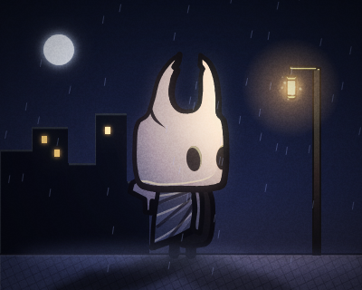 | 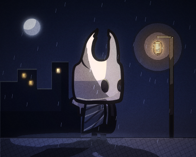 |

<details>
<summary>Código dos dois</summary>

<!-- gerar: img/14_noite.png -s 0.5 -->
```weasel
include "noite.weasel"
```

<!-- gerar: img/14_toon_noite.png -s 0.5 -->
```weasel
include "noite.weasel"
art toon
```

</details>

Repare:

- Cada forma ganha uma **faixa de sombra** dura, do lado oposto à luz do `canvas` (o `light=`, o mesmo que engrossa o contorno com `weight=`). A faixa é a forma menos ela mesma empurrada para a luz: numa bola, ela vira uma lua crescente.
- Formas quase do tamanho do canvas (o chão, o céu) e as camadas `unlit` ficam sem faixa.
- Com luzes (`light` e `ambient`, do [capítulo 4](04-camadas.md)), a luz também vira **degraus**: o Weasel desenha a cena com luz e sem luz e arredonda a diferença. O halo do lampião vira um disco, e a luz espalhada no Cavaleiro vira faixas.
- Sem luzes, só a faixa de sombra muda o desenho (o Cavaleiro de cima).

| Opção | O que faz |
|---|---|
| `steps=3` | Os degraus da luz, de 2 a 8 (padrão 3). Mais degraus, luz mais suave. Só vale com luzes. |
| `shadow=0.3` | A largura da faixa de sombra, em fração do tamanho da forma, de 0 a 1 (padrão 0.3). `shadow=0` tira a faixa. |

**Experimente:** na noite, troque para `art toon steps=6 shadow=0.5`.

### Gravura: `art engraving`

```
art engraving gap= levels= paper=
```

<!-- gerar: img/14_gravura_noite.png -s 0.5 -->
```weasel
include "noite.weasel"
art engraving levels=0.05,0.7
```

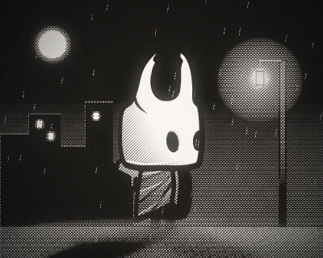

Repare:

- O tom de cada ponto vira hachura: primeiro linhas a 45°, depois cruzadas a −45°, depois horizontais, depois outras a 45° entre as primeiras. No mais escuro, preto chapado. As linhas engrossam aos poucos com o tom.
- O tom vem do desenho **sem o contorno**; o contorno (a `ink` das formas) sai inteiro, em preto, por cima da hachura.
- O papel é creme (`#f6f2ea`) e a tinta, quase preta. O `paper=` troca o papel.
- A noite é quase toda escura: com o padrão, ela sairia quase preta. O **`levels=escuro,claro`** abre os tons: o tom `0.05` (e o que for mais escuro) vira preto, e o tom `0.7` (e o que for mais claro) vira papel. Os tons vão de 0 (preto) a 1 (branco), e o padrão `levels=0,1` não muda nada.
- A hachura fica **presa às formas**: quando um osso gira, as linhas da forma giram junto (veja [`boil=`](#a-textura-presa-à-forma-boil-e-seed) mais abaixo).

| Opção | O que faz |
|---|---|
| `gap=5` | A distância entre as linhas, de 2 a 64 (padrão 5). |
| `levels=0,1` | O tom que vira preto e o tom que vira papel, de 0 a 1 (padrão `0,1`). |
| `paper=#f6f2ea` | A cor do papel. |

**Experimente:** troque para `gap=3`, ou para `levels=0.1,0.5`.

### Retícula: `art halftone`

```
art halftone size= angle= color levels= paper=
```

| A vila de dia, sem `art` | `art halftone size=5` | `art halftone size=5 color` |
|---|---|---|
| 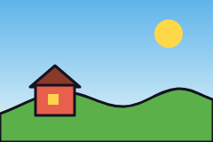 | 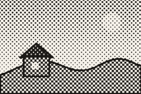 | 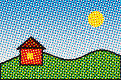 |

<details>
<summary>Código dos três</summary>

<!-- gerar: img/14_dia.png -->
```weasel
canvas 240 160 bg=ceu
gradient ceu linear 0,0 0,160 : #5fb4ea@0 #bfe3f5@0.7 #fff2cc@1
palette ink=#141320 line=3
ellipse sol 190,38 16 c=#ffd84a
shape morro c=#5bb04a ink=line : 0,128! 70,104 140,120 200,100 240,112! 240,160! 0,160!
shape telhado c=#8a3a2a ink=line : 34,98! 62,74! 90,98!
rect casa 40,96 44,34 c=#e8604c ink=line
rect janela 54,106 12,12 c=#ffd34d
```

<!-- gerar: img/14_vila_halftone.png -->
```weasel
canvas 240 160 bg=ceu
art halftone size=5
gradient ceu linear 0,0 0,160 : #5fb4ea@0 #bfe3f5@0.7 #fff2cc@1
palette ink=#141320 line=3
ellipse sol 190,38 16 c=#ffd84a
shape morro c=#5bb04a ink=line : 0,128! 70,104 140,120 200,100 240,112! 240,160! 0,160!
shape telhado c=#8a3a2a ink=line : 34,98! 62,74! 90,98!
rect casa 40,96 44,34 c=#e8604c ink=line
rect janela 54,106 12,12 c=#ffd34d
```

<!-- gerar: img/14_vila_halftone_cor.png -->
```weasel
canvas 240 160 bg=ceu
art halftone size=5 color
gradient ceu linear 0,0 0,160 : #5fb4ea@0 #bfe3f5@0.7 #fff2cc@1
palette ink=#141320 line=3
ellipse sol 190,38 16 c=#ffd84a
shape morro c=#5bb04a ink=line : 0,128! 70,104 140,120 200,100 240,112! 240,160! 0,160!
shape telhado c=#8a3a2a ink=line : 34,98! 62,74! 90,98!
rect casa 40,96 44,34 c=#e8604c ink=line
rect janela 54,106 12,12 c=#ffd34d
```

</details>

Repare:

- Os pontos ficam numa grade inclinada e crescem onde é mais escuro, como a foto do jornal. O quase branco fica papel, e o quase preto fica chapado.
- Com `color`, são quatro grades: ciano a 15°, magenta a 75°, amarelo a 0° e preto a 45°. As cores se misturam no papel, como na impressão colorida.
- A retícula fica **parada na tela** (o padrão dela é `boil=screen`): numa animação, o desenho anda por baixo dos pontos, como um papel impresso. `boil=0` prende os pontos às formas.

| Opção | O que faz |
|---|---|
| `size=6` | O tamanho da célula de cada ponto, de 2 a 64 (padrão 6). |
| `angle=45` | O ângulo da grade, em graus (padrão 45). Com `color`, cada cor tem o seu. |
| `color` | Quatro cores (ciano, magenta, amarelo e preto) em vez de só preto. |
| `levels=`, `paper=` | Como na gravura. |

**Experimente:** troque para `size=8 angle=0`.

### Estêncil: `art stencil`

```
art stencil tones= c= levels= paper=
```

<!-- gerar: img/14_vila_stencil.png -->
```weasel
canvas 240 160 bg=ceu
art stencil
gradient ceu linear 0,0 0,160 : #5fb4ea@0 #bfe3f5@0.7 #fff2cc@1
palette ink=#141320 line=3
ellipse sol 190,38 16 c=#ffd84a
shape morro c=#5bb04a ink=line : 0,128! 70,104 140,120 200,100 240,112! 240,160! 0,160!
shape telhado c=#8a3a2a ink=line : 34,98! 62,74! 90,98!
rect casa 40,96 44,34 c=#e8604c ink=line
rect janela 54,106 12,12 c=#ffd34d
```

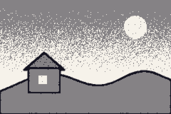

Repare:

- Poucos tons chapados de uma cor só (`c=`) sobre o papel, como tinta spray num molde recortado. Aqui são 3 (o padrão): o papel, a tinta pela metade e a tinta.
- Na troca de um tom para outro, o spray salpica um tom no outro (o degradê do céu). Os salpicos ficam presos às formas, e `boil=2` sorteia outros a cada 2 quadros.

| Opção | O que faz |
|---|---|
| `tones=3` | Quantos tons, de 2 a 6 (padrão 3), contando o papel. |
| `c=` | A cor da tinta (padrão: a `ink` da `palette`). |
| `levels=`, `paper=` | Como na gravura. |

### Silhueta: `art silhouette`

```
art silhouette c=
```

<!-- gerar: img/14_vila_silhouette.png -->
```weasel
canvas 240 160 bg=ceu
art silhouette c=#1a1226
gradient ceu linear 0,0 0,160 : #0b1030@0 #3a4f9a@0.6 #f0b070@1
palette ink=#141320 line=3
ellipse lua 190,38 16 c=#fff3c4
shape morro c=#2b4a3a ink=line : 0,128! 70,104 140,120 200,100 240,112! 240,160! 0,160!
shape telhado c=#5a2a2a ink=line : 34,98! 62,74! 90,98!
rect casa 40,96 44,34 c=#c44536 ink=line
rect janela 54,106 12,12 c=#ffd34d
```

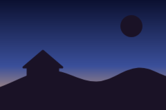

Repare:

- Tudo o que é desenho vira uma cor só (`c=`, que tem como padrão a `ink` da `palette`); o fundo do `canvas` fica como é. A lua também é uma forma, então também vira silhueta.
- A luz da cena não entra, e o estilo não tem textura.
- Serve para cena de pôr do sol e teatro de sombras, e para conferir se uma pose se entende só pelo contorno.

### A textura presa à forma: `boil=` e `seed=`

A hachura da gravura, os sulcos da xilogravura, os salpicos do estêncil, os pontos da retícula, das HQs e do mangá, o grão da risografia e o tremido, as passadas e a hachura dos estilos de traço são uma **textura**. O `boil=` diz como ela se move:

| `boil=` | A textura | Padrão de |
|---|---|---|
| `boil=0` | presa às formas: anda e gira com o osso de cada uma | `engraving`, `woodcut`, `stencil`, `comic old bw` |
| `boil=screen` | parada na tela: o desenho anda por baixo dela | `halftone`, `comic`, `comic old`, `manga`, `riso` |
| `boil=2` | presa às formas, e sorteada de novo a cada 2 quadros, como a linha que "ferve" num desenho à mão | `sketch`, `marker`, `pencil` |

<!-- gerar: img/14_boil.png -f sheet -a all -s 1 -->
```weasel
canvas 120 120 bg=#e9e2d4
art engraving gap=4
palette ink=#1d1b26
gradient bolaG radial 46,44 56 : #ffffff@0 #c09060@0.55 #3a2a20@1
bone bola pivot=60,60
ellipse b 60,60 40 c=bolaG ink=3 bone=bola
ellipse olho 76,52 6,9 c=ink bone=bola
anim gira frames=4 fps=8
key 0 bola=0,0,0
key 4 bola=0,0,90
```

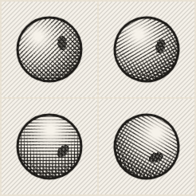

Repare:

- A hachura **dentro** da bola gira com ela, junto com o olho. A do fundo fica parada: onde não há forma (o fundo do `canvas`, os traços, os textos), a textura é sempre a da tela.
- A textura tem sempre o mesmo tamanho na tela: um ator pequeno no filme tem a hachura do mesmo tamanho que um grande.
- O `seed=` sorteia outra versão da textura (outro lugar para as linhas e os salpicos).
- O `toon`, o `silhouette`, o `lines`, o `neon`, o `pixel` e o `ascii` não têm textura: neles, `boil=` e `seed=` não mudam nada (o Weasel avisa).

**No jogo:** a sprite sheet e o Godot saem com cada quadro pintado no estilo. No esqueleto de verdade (`godot rig=bones`), cada peça sai pintada na pose parada, e a textura gira com ela no Godot.

## As combinações de tom: `woodcut`, `comic`, `manga` e `riso`

Estes quatro juntam as peças dos [estilos de tom](#estilos-de-tom-toon-engraving-halftone-stencil-e-silhouette): a faixa de sombra do `toon`, as linhas da gravura e os pontos da retícula. São a xilogravura, três jeitos de HQ, o mangá e a risografia.

| `art woodcut` | `art comic` | `art comic old` |
|---|---|---|
| 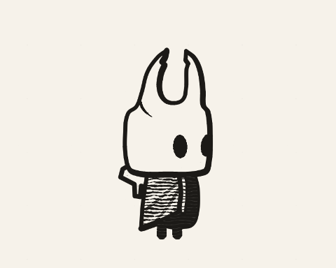 | 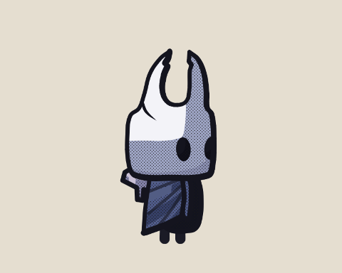 | 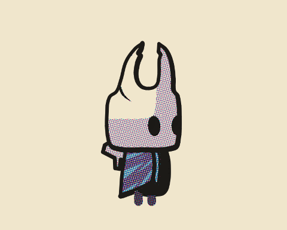 |

| `art comic old bw` | `art manga` | `art riso` |
|---|---|---|
| 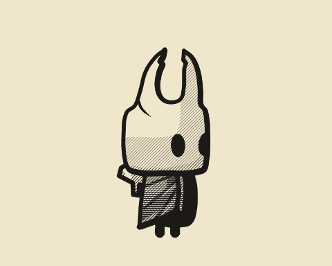 | 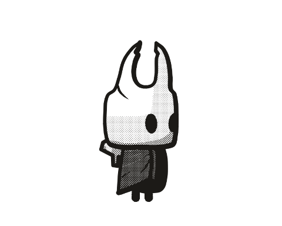 | 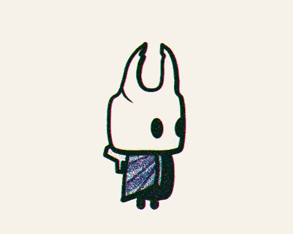 |

<details>
<summary>Código dos seis</summary>

<!-- gerar: img/14_hq_woodcut.png -s 0.6 -->
```weasel
include "cavaleiro.weasel"
art woodcut
```

<!-- gerar: img/14_hq_comic.png -s 0.6 -->
```weasel
include "cavaleiro.weasel"
art comic
```

<!-- gerar: img/14_hq_comic_old.png -s 0.6 -->
```weasel
include "cavaleiro.weasel"
art comic old
```

<!-- gerar: img/14_hq_comic_old_bw.png -s 0.6 -->
```weasel
include "cavaleiro.weasel"
art comic old bw
```

<!-- gerar: img/14_hq_manga.png -s 0.6 -->
```weasel
include "cavaleiro.weasel"
art manga
```

<!-- gerar: img/14_hq_riso.png -s 0.6 -->
```weasel
include "cavaleiro.weasel"
art riso
```

</details>

### Xilogravura: `art woodcut`

```
art woodcut gap= levels= paper=
```

<!-- gerar: img/14_xilo_noite.png -s 0.5 -->
```weasel
include "noite.weasel"
art woodcut
```

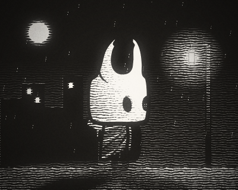

Repare:

- É o contrário da gravura: a tinta é preta, e a luz vira **sulcos brancos**, largos e toscos, como os cortes da goiva na madeira. O claro fica papel, e o mais escuro fica preto.
- Os sulcos ficam deitados na forma e ondulam um pouco; a borda de cada um engrossa e afina. Eles ficam presos às formas (o padrão é `boil=0`), como a hachura da gravura.
- O contorno sai preto, como na gravura.

| Opção | O que faz |
|---|---|
| `gap=8` | A distância entre os sulcos, de 2 a 64 (padrão 8). |
| `levels=`, `paper=` | Como na gravura. |

**Experimente:** troque para `gap=5`, ou para `levels=0,0.6` (mais papel).

### HQ: `art comic`, `comic old` e `comic old bw`

```
art comic [old] [bw] size= shadow= shift= levels= paper=
```

| `art comic` | `art comic old` | `art comic old bw` |
|---|---|---|
| 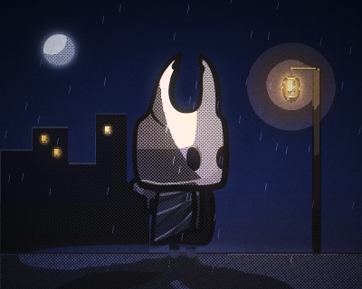 | 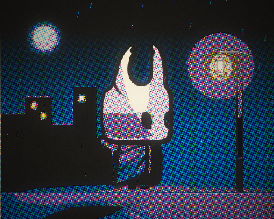 | 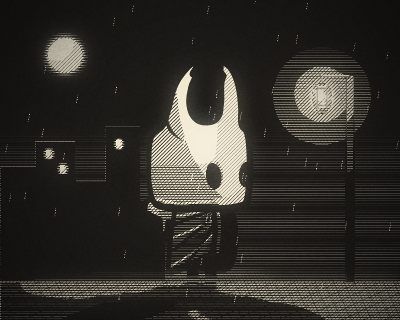 |

<details>
<summary>Código dos três</summary>

<!-- gerar: img/14_hq_noite.png -s 0.5 -->
```weasel
include "noite.weasel"
art comic
```

<!-- gerar: img/14_hq_noite_old.png -s 0.5 -->
```weasel
include "noite.weasel"
art comic old
```

<!-- gerar: img/14_hq_noite_bw.png -s 0.5 -->
```weasel
include "noite.weasel"
art comic old bw
```

</details>

Repare:

- **`comic`, a HQ moderna colorida:** é o `toon` (a faixa de sombra e a luz em degraus), com a cor um pouco mais forte e uma retícula leve de pontos pretos na sombra.
- **`comic old`, o gibi antigo colorido:** o colorista antigo não pintava degradê. Cada ponto vira a cor mais parecida de uma tabela de 64, em que o ciano, o magenta e o amarelo entram com 0, 25, 50 ou 100%. As tintas de 25% e de 50% viram pontos, cada uma num ângulo, no papel-jornal amarelado. O preto só aparece no contorno e no mais escuro (os prédios), e a cor sai um pouco do lugar, como na impressão barata (`shift=`).
- **`comic old bw`, a tira de jornal:** o mais escuro vira preto chapado; o escuro, linhas deitadas que engrossam até o preto (o céu); o meio, hachura em diagonal; o claro fica no papel.
- **A sombra sem luz:** as três (e o `manga`) usam a faixa de sombra do `toon`, então um desenho sem `light` nem `ambient`, como o Cavaleiro de cima, também ganha sombra. Ela vira cor mais escura, retícula ou hachura, conforme o estilo. `shadow=0` tira a faixa.
- **A textura:** os pontos da `comic` e da `comic old` ficam parados na tela (`boil=screen`), como a retícula da impressão. As linhas da `comic old bw` são do desenhista, e não da impressão, então ficam presas às formas (`boil=0`).
- `comic bw` sem o `old` avisa e vale como `comic old bw`.

| Opção | O que faz |
|---|---|
| `old` | O gibi antigo colorido. |
| `old bw` | A tira de jornal, em preto e branco. |
| `size=5` | A distância entre os pontos (e entre as linhas, na `old bw`), de 2 a 64 (padrão 5). |
| `shadow=0.3` | A largura da faixa de sombra, como no `toon` (padrão 0.3). `shadow=0` tira a faixa. |
| `shift=1.5` | Só na `comic old`: o quanto a cor sai do lugar, de 0 a 20 unidades (padrão 1.5). A direção vem do `seed=`. `shift=0` deixa a cor no lugar. |
| `levels=` | Como na gravura. |
| `paper=#f0e6cc` | Só nas `old`: a cor do papel (padrão: o papel-jornal). |

**No jogo:** para uma sprite de gibi antigo, `shift=0` deixa a cor dentro do contorno. Os pontos parados na tela ficam parados no quadro da sprite sheet: no jogo, eles andam junto com o personagem.

### Mangá: `art manga`

```
art manga size= tones= shadow= levels= paper=
```

<!-- gerar: img/14_manga_noite.png -s 0.5 -->
```weasel
include "noite.weasel"
art manga
```

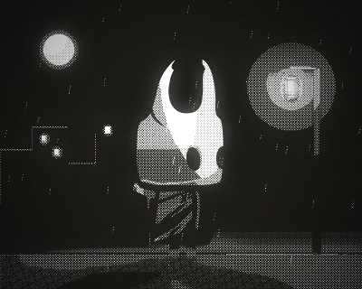

Repare:

- O mais escuro vira preto chapado, o claro fica no papel branco e, no meio, entram as **retículas de ponto fixo**: cada área tem pontos de um tamanho só, como as folhas de retícula que o desenhista recorta e cola. São 3 (o padrão): clara, média e escura.
- A retícula fica a 45° e parada na tela (`boil=screen`). O contorno sai preto.
- A faixa de sombra do `toon` vira retícula, como nas HQs.

| Opção | O que faz |
|---|---|
| `size=4` | A distância entre os pontos, de 2 a 64 (padrão 4). |
| `tones=3` | Quantas retículas, de 1 a 5 (padrão 3), sem contar o papel e o preto. |
| `shadow=0.3` | Como nas HQs. |
| `levels=` | Como na gravura. |
| `paper=#ffffff` | A cor do papel (padrão: branco). |

### Risografia: `art riso`

```
art riso inks= size= shift= levels= paper=
```

| `art riso` | `art riso inks=#ff48b0,#0078bf` |
|---|---|
| 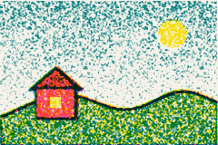 | 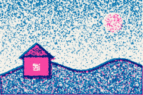 |

<details>
<summary>Código dos dois</summary>

<!-- gerar: img/14_vila_riso.png -->
```weasel
canvas 240 160 bg=ceu
art riso
gradient ceu linear 0,0 0,160 : #5fb4ea@0 #bfe3f5@0.7 #fff2cc@1
palette ink=#141320 line=3
ellipse sol 190,38 16 c=#ffd84a
shape morro c=#5bb04a ink=line : 0,128! 70,104 140,120 200,100 240,112! 240,160! 0,160!
shape telhado c=#8a3a2a ink=line : 34,98! 62,74! 90,98!
rect casa 40,96 44,34 c=#e8604c ink=line
rect janela 54,106 12,12 c=#ffd34d
```

<!-- gerar: img/14_vila_riso_duas.png -->
```weasel
canvas 240 160 bg=ceu
art riso inks=#ff48b0,#0078bf
gradient ceu linear 0,0 0,160 : #5fb4ea@0 #bfe3f5@0.7 #fff2cc@1
palette ink=#141320 line=3
ellipse sol 190,38 16 c=#ffd84a
shape morro c=#5bb04a ink=line : 0,128! 70,104 140,120 200,100 240,112! 240,160! 0,160!
shape telhado c=#8a3a2a ink=line : 34,98! 62,74! 90,98!
rect casa 40,96 44,34 c=#e8604c ink=line
rect janela 54,106 12,12 c=#ffd34d
```

</details>

Repare:

- A risografia imprime com poucas tintas fortes, uma por vez, que se sobrepõem no papel. O Weasel acha, para cada cor do desenho, a mistura das tintas que chega mais perto dela: o laranja da casa vira rosa com amarelo; o verde do morro, azul-petróleo com amarelo.
- Cada tinta sai em **grão**: pontinhos soltos, mais juntos onde a tinta é mais forte. O quase papel fica papel.
- Cada tinta sai um pouco do lugar, cada uma para um lado (`shift=`): o contorno ganha uma borda de cor.
- Com uma tinta só, é um desenho de uma cor; com duas, as cores do desenho viram o que dá para fazer com as duas.

| Opção | O que faz |
|---|---|
| `inks=#ff48b0,#00838a,#ffe800` | As tintas, de 1 a 3 cores, separadas por vírgula (padrão: rosa, azul-petróleo e amarelo). |
| `size=1` | O tamanho do grão, de 0.5 a 16 (padrão 1). |
| `shift=1.5` | O quanto cada tinta sai do lugar, de 0 a 20 unidades (padrão 1.5). A direção vem do `seed=`. `shift=0` deixa as tintas no lugar. |
| `levels=`, `paper=` | Como na gravura. |

**Experimente:** troque para `inks=#ff48b0` (uma tinta só) ou para `size=3`.

## Os estilos de traço: `sketch`, `marker`, `pencil`, `lines` e `neon`

Os estilos de tom olham para a imagem pronta, ponto a ponto. Estes cinco mudam o **traço**: pintam forma por forma, na ordem do desenho, como alguém que passa o lápis, o marcador ou a caneta em cada uma. Por isso o contorno treme, a cor sai do lugar e cada forma ganha a sua textura.

| `art sketch` | `art marker` | `art pencil` |
|---|---|---|
| 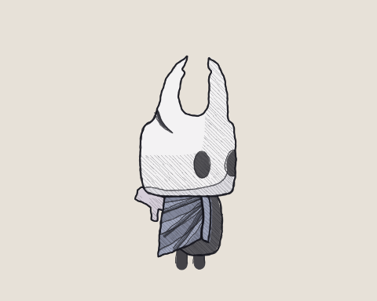 | 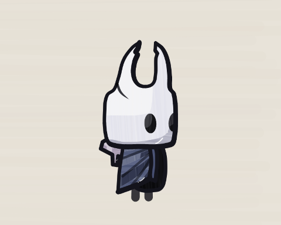 | 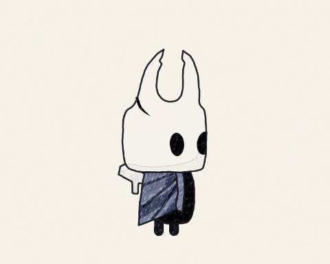 |

| `art lines` | `art neon` |
|---|---|
| 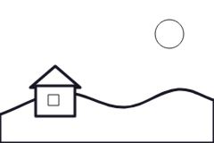 | 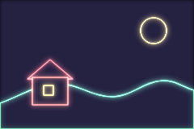 |

<details>
<summary>Código dos cinco</summary>

<!-- gerar: img/14_traco_sketch.png -s 0.6 -->
```weasel
include "cavaleiro.weasel"
art sketch
```

<!-- gerar: img/14_traco_marker.png -s 0.6 -->
```weasel
include "cavaleiro.weasel"
art marker
```

<!-- gerar: img/14_traco_pencil.png -s 0.6 -->
```weasel
include "cavaleiro.weasel"
art pencil
```

<!-- gerar: img/14_vila_lines.png -->
```weasel
canvas 240 160 bg=ceu
art lines
gradient ceu linear 0,0 0,160 : #0b1030@0 #3a4f9a@0.6 #f0b070@1
palette ink=#141320 line=3
ellipse lua 190,38 16 c=#fff3c4
shape morro c=#2b4a3a ink=line : 0,128! 70,104 140,120 200,100 240,112! 240,160! 0,160!
shape telhado c=#5a2a2a ink=line : 34,98! 62,74! 90,98!
rect casa 40,96 44,34 c=#c44536 ink=line
rect janela 54,106 12,12 c=#ffd34d
```

<!-- gerar: img/14_vila_neon.png -->
```weasel
canvas 240 160 bg=ceu
art neon
gradient ceu linear 0,0 0,160 : #0b1030@0 #3a4f9a@0.6 #f0b070@1
palette ink=#141320 line=3
ellipse lua 190,38 16 c=#fff3c4
shape morro c=#2b4a3a ink=line : 0,128! 70,104 140,120 200,100 240,112! 240,160! 0,160!
shape telhado c=#5a2a2a ink=line : 34,98! 62,74! 90,98!
rect casa 40,96 44,34 c=#c44536 ink=line
rect janela 54,106 12,12 c=#ffd34d
```

</details>

### Esboço, marcador e lápis: `art sketch`, `art marker` e `art pencil`

```
art sketch paper= boil= seed=
art marker paper= boil= seed=
art pencil paper= boil= seed=
```

| `art sketch` | `art pencil` |
|---|---|
| 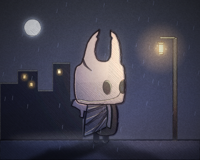 | 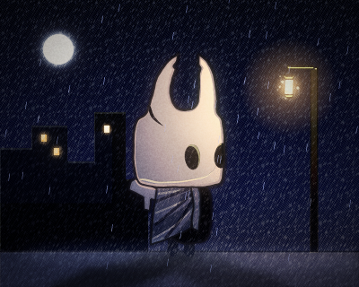 |

<details>
<summary>Código dos dois</summary>

<!-- gerar: img/14_traco_noite_sketch.png -s 0.5 -->
```weasel
include "noite.weasel"
art sketch
```

<!-- gerar: img/14_traco_noite_pencil.png -s 0.5 -->
```weasel
include "noite.weasel"
art pencil
```

</details>

Repare:

- **`sketch` (esboço):** a cor fica mais clara e um pouco fora do lugar, como uma cor posta depressa. Cada forma é passada duas vezes a lápis, tremida, começando num ponto qualquer e passando um pouco do fim. As cores escuras e o lado longe da luz ganham hachura a lápis.
- **`marker` (marcador):** o papel fica limpo sob cada cor; a cor vai em passadas largas, no comprimento da forma, e escurece onde elas se cruzam. A sombra é uma segunda passada da mesma cor. O contorno sai em nanquim, e as formas grandes ganham um brilho de caneta gel do lado da luz.
- **`pencil` (lápis de cor):** a cor vira hachura fina e inclinada, com uma camada leve cruzada; quanto mais forte a cor, mais fechada a hachura (no escuro, ela quase fecha). O papel aparece entre os traços e no grão. O contorno vira um lápis escuro, e a forma sem contorno ganha uma linha leve da cor dela.
- A sombra (o lado longe do `light=` do `canvas`) existe mesmo sem luz na cena, como nos estilos de tom.
- **A luz entra por cima:** com `light` na cena, o estilo pinta o desenho sem luz, e a luz vem depois, por cima. Onde ela escurece, a cor escurece na mesma medida; onde clareia, a cor vai para o branco. O brilho da lanterna fica suave, como na noite acima.
- **Ferve:** a textura (o tremido, as passadas, a hachura) é sorteada de novo a cada 2 quadros (o padrão é `boil=2`), como o desenho à mão animado quadro a quadro. Com `boil=0`, ela fica presa à forma, sem mudar. O fundo do `canvas` é pintado no estilo e não ferve.
- **`paper=`:** a cor do papel (padrão `#f6f2ea`). Com `bg=none`, o papel aparece onde não há forma.
- Os textos e as partículas saem como sempre.

| Opção | O que faz |
|---|---|
| `paper=#f6f2ea` | A cor do papel. |
| `boil=2` | A cada quantos quadros o desenho muda (padrão 2); `boil=0` deixa parado. Veja [A textura presa à forma](#a-textura-presa-à-forma-boil-e-seed). |
| `seed=` | Outro sorteio. |

**Experimente:** troque a noite para `art marker`, ou o Cavaleiro para `art pencil boil=0` e anime.

### Só o contorno: `art lines` e `art neon`

```
art lines w= c= paper=
art neon w= c= paper=
```

Repare:

- **`lines`:** as cores viram papel, e cada forma fica só com o contorno, em `c=` (padrão: a primeira cor `ink` da palette). É um livro de colorir. A espessura é a do contorno de cada forma; `w=` põe a mesma em todas.
- **`neon`:** o contorno de cada forma vira um tubo de neon da cor dela (mais clara e mais forte), com o miolo quase branco e um brilho em volta, num fundo escuro. `c=` põe a mesma cor em todos.
- Cada forma esconde o que está atrás dela, como no desenho de sempre.
- Os traços largos (um braço, uma perna, o galho) viram o contorno deles; os finos ficam uma linha só.
- Não têm luz nem textura: `boil=` e `seed=` não mudam nada (o Weasel avisa).

| Opção | O que faz |
|---|---|
| `w=3` | A espessura das linhas, de 0.5 a 64 (no `lines`, sem `w=`, a do contorno de cada forma). |
| `c=#000000` | A cor das linhas (no `neon`, sem `c=`, a cor de cada forma). |
| `paper=` | O papel: padrão branco no `lines` e quase preto (`#0b0a14`) no `neon`. |

**Experimente:** troque a vila para `art lines w=1.5`, ou para `art neon c=#40e0ff`.

## No filme: o filme, a cena, o plano e o ator

No filme ([capítulo 10](10-filme.md)), o `art` vale em quatro níveis. O mais específico ganha:

| Onde vale | Como escrever |
|---|---|
| O filme todo | `art` antes do primeiro `shot` |
| Uma cena | `art` no começo do arquivo da cena (o `scene "cena01.weasel"`) |
| Um plano | `art` dentro do bloco do `shot` |
| Um ator | `art … actor=nome` (antes do primeiro `shot`, para o filme todo, ou dentro de um `shot`) |

<!-- gerar: img/14_filme_pixel.png --frame 6 -->
<!-- gerar: img/14_filme_letras.png --frame 18 -->
<!-- gerar: img/14_filme_ator.png --frame 30 -->
```weasel
film fps=12
canvas 480 270 bg=#1d2b53
art pixel size=6 palette=pico8

layer chao
rect grama 0,220 480,50 c=#008751
ellipse lua 400,60 26 c=#fff1e8

actor heroi "cavaleiro.weasel" 150,250 scale=0.35
actor fantasma "fantasma.weasel" 340,240 origin=240,350 scale=0.4 hide=ceu

# 1. o filme todo em pixel art
shot pixel dur=1s

# 2. este plano em letras
shot letras dur=1s
art ascii size=5,10

# 3. só o fantasma em letras; o resto continua em pixel art
shot fantasma dur=1s
art ascii actor=fantasma
```

| `shot pixel` | `shot letras` | `shot fantasma` |
|---|---|---|
| 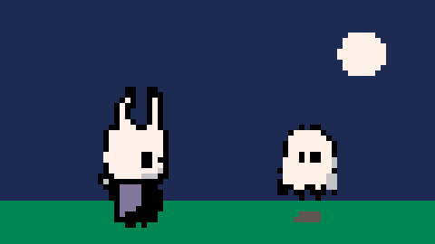 | 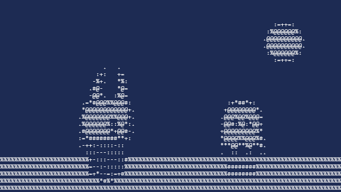 | 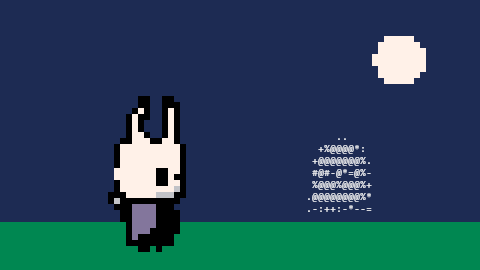 |

Repare:

- O `art` do arquivo do personagem vale para o jogo e para as exportações dele. No filme, quem decide é o filme: um `cavaleiro.weasel` com `art pixel` aparece normal num filme sem `art`.
- Quando o quadro inteiro tem o mesmo estilo, ele é aplicado de uma vez, numa grade só. Um ator com outro estilo é desenhado sozinho e encaixado na ordem de profundidade de sempre (o fantasma do terceiro plano).
- `art none` num plano ou num ator desliga o estilo só ali.
- Num quadro todo em `ascii`, a linha de comando também tira o `.txt`: `node cli/weasel.js filme.weasel --frame 18 -o quadro.txt`.
- O `--info` mostra o `art` do filme, de cada plano e de cada ator.

## Junto com o resto

- **`finish`:** o `bloom=`, o `vignette=`, o `grain=` e o `posterize=` entram **depois** do estilo, por cima da imagem pronta. O `finish pixel=` não entra junto com um `art` (o Weasel avisa): use o `size=` do `art pixel`.
- **SVG:** o SVG é feito das formas, então sai **sem o estilo** (a linha de comando avisa, e a janela de exportar diz isso).
- **`boil=` e `seed=`:** valem nos estilos com textura (`engraving`, `woodcut`, `halftone`, `comic`, `manga`, `riso`, `stencil`, `sketch`, `marker` e `pencil`, e nos das próximas versões); veja [A textura presa à forma](#a-textura-presa-à-forma-boil-e-seed). Nos outros, os dois não mudam nada (o Weasel avisa).

[← Problemas comuns](13-problemas.md) · [Índice](README.md)
