# 14. Profundidade (2.5D)

[← Estilos de arte](13-estilos.md) · [Índice](README.md) · [Próximo: Jogo: o personagem no Godot (antigo) →](09-jogo-godot.md)

O Weasel continua desenhando no plano, mas cada forma pode ter profundidade: ir para perto ou para longe, girar como uma carta, ter espessura, deitar como um chão. É o truque do **2.5D**: peças chatas, arrumadas em 3D. Dá para fazer uma carta que vira, uma cabeça que olha para os lados, uma estrada que some no horizonte e um mapa isométrico. Se você não usa estas opções, o desenho fica igual. Você precisa dos capítulos 1 a 9. A parte do fim, sobre o filme, usa o capítulo 17.

## Os três eixos e os dois giros

- **x** vai para a direita e **y** para baixo, como sempre.
- **z** sai da tela, na sua direção: `z=40` está 40 pixels **mais perto** de você; `z=-40`, mais longe.
- `yaw=` gira em volta de um eixo vertical, como uma porta. Positivo: a frente vira para a direita.
- `pitch=` gira em volta de um eixo deitado. Positivo: a parte de cima vai para longe.

Os giros são em graus. O `z=`, o `yaw=` e o `pitch=` valem em todas as formas: `shape`, `ellipse`, `rect`, `stroke`, `line` e `text`.

## Perto ou longe: `z=` e `zsort`

Sem `zsort`, as formas são pintadas **na ordem do código**: a forma que vem depois cobre as de antes, mesmo com `z=`. Com `zsort` na camada, o Weasel pinta de longe para perto, e o `z=` decide.

<!-- gerar: img/11_zsort.png -->
```weasel
canvas 640 300 bg=#f4efe6
palette ink=#1c1f2b line=4

layer sem
ellipse perto1 130,130 70 c=#e94f37 ink=line z=40
ellipse meio1 180,160 70 c=#ffd23f ink=line z=0
ellipse longe1 230,190 70 c=#2e86ab ink=line z=-40

layer com zsort
ellipse perto2 410,130 70 c=#e94f37 ink=line z=40
ellipse meio2 460,160 70 c=#ffd23f ink=line z=0
ellipse longe2 510,190 70 c=#2e86ab ink=line z=-40

layer nomes
text t1 180,290 "sem zsort" size=22 align=center c=ink
text t2 460,290 "com zsort" size=22 align=center c=ink
```

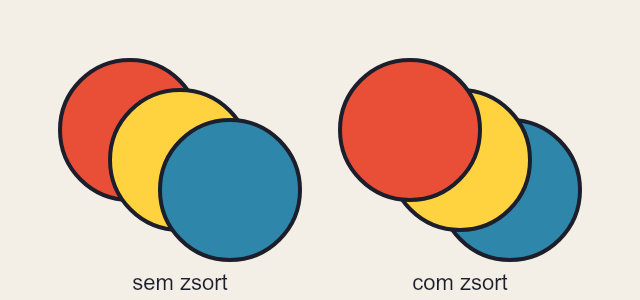

Repare:

- Nos dois grupos, o código é igual: o vermelho (`z=40`, perto) vem primeiro e o azul (`z=-40`, longe) por último.
- **sem zsort:** o azul é pintado por último e cobre os outros, mesmo estando longe.
- **com zsort:** o vermelho, o mais perto, fica por cima.
- Sem nenhum giro, o `z=` não muda o tamanho nem o lugar das formas: só a ordem, e só com `zsort`. O `zsort` refaz a ordem a cada quadro, então ela muda quando as formas giram.

**Experimente:** no grupo da direita, troque `z=40` do vermelho por `z=-80`. Ele vai para trás de todos.

## Girar uma forma: `yaw=` e `pitch=`

Numa forma, o giro acontece em volta do meio dela:

<!-- gerar: img/11_giro.png -->
```weasel
canvas 720 300 bg=#f4efe6
palette ink=#1c1f2b line=5 carta=#e94f37

rect parada 40,60 160,190 r=14 c=carta ink=line
rect deitada 280,60 160,190 r=14 c=carta ink=line pitch=55
rect virada 520,60 160,190 r=14 c=carta ink=line yaw=50

text t1 120,290 "parada" size=22 align=center c=ink
text t2 360,290 "pitch=55" size=22 align=center c=ink
text t3 600,290 "yaw=50" size=22 align=center c=ink
```

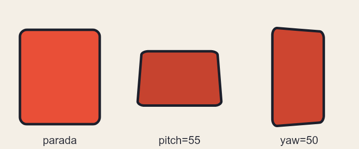

- O lado que vai para longe fica **menor**: é a **perspectiva**.
- A forma que vira de lado fica **mais escura**, como uma carta que sai da luz.

**Experimente:** troque `yaw=50` por `yaw=-50`. A carta vira para o outro lado: agora é a esquerda que fica menor.

No editor, as alças de uma forma girada ficam onde ela aparece na tela, e arrastar muda o número certo no código ([capítulo 22](22-editor.md#formas-em-3d)).

### Perto ou longe do olho: `persp=`

A perspectiva depende de **onde está o seu olho**. Olho perto da carta (um número pequeno) deforma muito, como uma foto tirada bem de perto. Olho longe deforma pouco. As três cartas abaixo têm o mesmo `yaw=50`:

<!-- gerar: img/11_persp.png -->
```weasel
canvas 720 300 bg=#f4efe6
palette ink=#1c1f2b line=5 carta=#e94f37

rect perto 40,60 160,190 r=14 c=carta ink=line yaw=50 persp=300
rect normal 280,60 160,190 r=14 c=carta ink=line yaw=50
rect plana 520,60 160,190 r=14 c=carta ink=line yaw=50 persp=0

text t1 120,290 "persp=300" size=22 align=center c=ink
text t2 360,290 "sem persp=" size=22 align=center c=ink
text t3 600,290 "persp=0" size=22 align=center c=ink
```

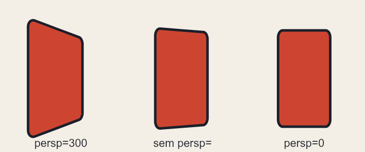

- `persp=300`: o olho está a 300 pixels da carta. O lado que vem para perto (a esquerda) **cresce**, e o que vai para longe encolhe bastante.
- Sem `persp=`, o olho fica no dobro do lado maior do desenho: aqui, 1440 pixels (2 × 720). Uma deformação suave.
- `persp=0` tira a perspectiva: a carta só fica mais estreita, com os dois lados da mesma altura. Serve para desenho técnico e jogos de estilo plano.

### Mais escuro de lado: `shade=`

O `shade=` da **camada** diz quanto uma forma virada escurece. Cada carta abaixo está numa camada diferente, todas com `yaw=60`:

<!-- gerar: img/11_shade.png -->
```weasel
canvas 720 300 bg=#f4efe6
palette ink=#1c1f2b line=5 carta=#e94f37

layer sem shade=0
rect c1 40,60 160,190 r=14 c=carta ink=line yaw=60
layer meio
rect c2 280,60 160,190 r=14 c=carta ink=line yaw=60
layer forte shade=1.5
rect c3 520,60 160,190 r=14 c=carta ink=line yaw=60

layer nomes
text t1 120,290 "shade=0" size=22 align=center c=ink
text t2 360,290 "sem shade= (0.5)" size=22 align=center c=ink
text t3 600,290 "shade=1.5" size=22 align=center c=ink
```

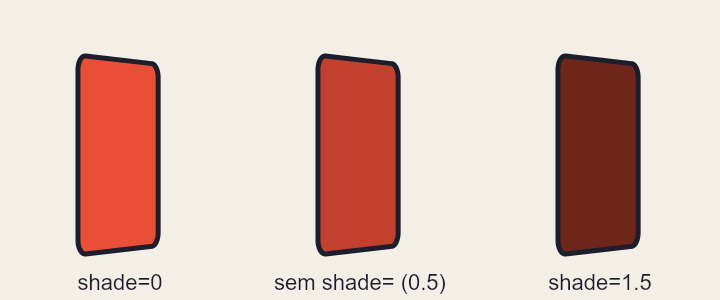

- O escuro aumenta quanto mais a carta vira: de frente, nada; de lado (`yaw=90`), o máximo.
- `shade=` vai de 0 (não escurece) a 2 (escurece muito). Se não escrever, 0.5.
- É o mesmo `shade=` que controla o claro e o escuro da luz ([capítulo 10](10-luz.md#claro-e-escuro-shade)).

## Espessura: `thick=` e `thickc=`

`thick=` dá espessura: a forma vira um bloco, que vai **para trás** dela. A frente fica onde a forma foi desenhada. Os lados ganham a cor da forma um pouco mais escura; `thickc=` escolhe outra cor. Os dois blocos abaixo têm 60 pixels de espessura e o mesmo giro:

<!-- gerar: img/11_thickc.png -->
```weasel
canvas 560 300 bg=#f4efe6
palette ink=#1c1f2b line=4 caixa=#2e86ab

rect bloco1 70,70 140,140 c=caixa ink=line thick=60 yaw=35 pitch=-25
rect bloco2 350,70 140,140 c=caixa ink=line thick=60 yaw=35 pitch=-25 thickc=#ffd23f

text t1 140,285 "thick=60" size=22 align=center c=ink
text t2 420,285 "thick=60 thickc=#ffd23f" size=22 align=center c=ink
```

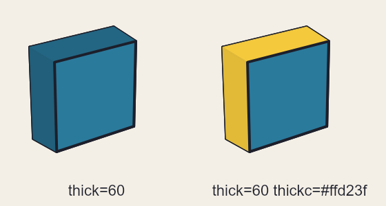

- `yaw=35 pitch=-25`: o bloco está virado para o lado, com a parte de cima mais perto de você. Assim os lados aparecem.
- Os lados não ficam todos iguais: o de cima é mais claro que o da esquerda, porque a luz vem de cima, à esquerda.
- `thick=` vai de 0 a 10000 e só vale nas formas fechadas (`shape`, `ellipse`, `rect`).

**Experimente:** troque `thick=60` do primeiro bloco por `thick=10`. Ele vira uma placa fina.

## Uma carta que vira: `back=`

Para girar **várias peças juntas**, ponha todas num osso e gire o osso: `yaw=` e `pitch=` também valem no `bone`, em volta do pivô. Aqui, uma carta com um sol desenhado gira e mostra o verso:

<!-- gerar: img/11_carta.gif -a gira -s 0.5 -->
```weasel
canvas 400 400 bg=#f4efe6
palette ink=#1c1f2b line=6 frente=#fff6e0 verso=#2e86ab sol=#ffd23f

bone carta pivot=200,200

layer cartas zsort
rect frente 100,60 200,280 r=18 c=frente ink=line thick=10 thickc=#d8cbb0 back=costas bone=carta
rect costas 100,60 200,280 r=18 c=verso ink=line hidden
ellipse sol 200,180 56 c=sol ink=5 z=1 bone=carta
text nome 200,300 "SOL" size=40 align=center c=ink z=1 bone=carta bold

anim gira frames=36
key 0 carta.yaw=0 ease=linear
key 36 carta.yaw=360
```

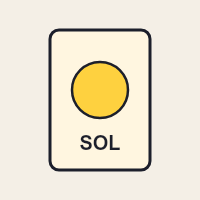

Repare:

- `back=costas` diz qual forma aparece quando a carta fica **de costas**. O verso tem que ser uma forma fechada, **no mesmo lugar** da frente: ele é desenhado onde está no código, virado em volta do meio da frente. Ponha `hidden` no verso, senão ele também aparece sozinho.
- O sol e o nome têm `z=1`: estão 1 pixel na frente da carta. Sem isso, eles empatam com ela. No empate, vale a ordem do código, e eles cobririam o verso.
- O `zsort` na camada faz o sol sumir atrás do verso quando a carta vira.
- `key 0 carta.yaw=0`: o giro do osso anima como qualquer outra coisa. Numa forma sem osso, use `nome.yaw=` (e `nome.pitch=`, `nome.z=`).
- O `ease=linear` na `key 0` faz a carta girar sempre na mesma velocidade, sem parar na frente a cada volta ([capítulo 7](07-movimento.md)).

**Cuidado:** sem `back=`, uma forma de costas mostra ela mesma, espelhada.

## Girar a camada inteira: `yaw=`, `pitch=` e `pivot=`

Às vezes o que gira é **tudo** de uma camada: uma placa, uma porta, um mapa. `yaw=` e `pitch=` na camada giram todas as formas dela juntas, sem osso. `pivot=x,y` diz onde fica o **eixo** do giro; se não escrever, o eixo passa pelo meio do `canvas`.

<!-- gerar: img/11_porta.gif -a gira -s 0.75 -->
```weasel
canvas 640 320 bg=#f4efe6
palette ink=#1c1f2b line=5

layer fundo
rect vao 400,40 160,250 c=#3b3355

layer placa pivot=160,165
rect p 80,90 160,150 r=12 c=#ffd23f ink=line
text pt 160,180 "ABERTO" size=30 align=center c=ink bold

layer porta pivot=400,165
rect folha 400,40 160,250 c=#c0392b ink=line
ellipse macaneta 535,170 9 c=#ffd23f ink=3

layer nomes
text t1 160,310 "pivot=160,165 (o meio)" size=20 align=center c=ink
text t2 480,310 "pivot=400,165 (a dobradiça)" size=20 align=center c=ink

anim gira frames=24
key 0 placa.yaw=0 ease=linear
key 24 placa.yaw=360
key 0 porta.yaw=0
key 12 porta.yaw=75
key 24 porta.yaw=0
```

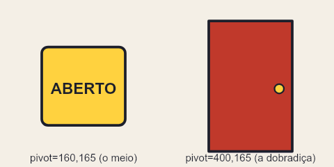

Repare:

- `layer placa pivot=160,165`: o eixo passa pelo meio da placa (o retângulo vai de `x=80` a `240`). A placa e o texto giram juntos.
- `layer porta pivot=400,165`: o eixo passa pela borda esquerda da porta, como uma dobradiça.
- `key 12 porta.yaw=75`: no meio da animação, a porta está aberta 75 graus. Positivo: o lado da maçaneta vai para longe (a porta abre para dentro).
- De costas, o texto da placa aparece **espelhado**. Para um verso de verdade, use `back=`.
- O giro da camada **não escurece** as formas: o `shade=` vale só para o giro das formas e dos ossos. A camada também aceita `persp=`.

**Experimente:** apague o `pivot=400,165` da porta. O eixo vai para o meio do desenho (`x=320`): a porta sai do batente e anda para o lado enquanto gira.

## Uma cabeça que olha para os lados: `round=`

Se uma cabeça desenhada de frente gira como uma carta, o rosto fica achatado. Com `round=raio` no osso, as peças dele ficam **na superfície de uma bola**: o olho do lado que vai embora chega mais perto da borda e encolhe, e o que passa para trás da bola some aos poucos. Assim a cabeça parece redonda, sem você desenhar a vista de lado.

<!-- gerar: img/11_cabeca.gif -a olha -s 0.5 -->
```weasel
canvas 400 400 bg=#f4efe6
palette ink=#1c1f2b line=5 pele=#f2c9a0 nariz=#e0a77e

bone pescoco pivot=200,360
bone rosto parent=pescoco pivot=200,330 round=110,200,200

layer cabeca zsort
ellipse cranio 200,200 110 c=pele ink=line bone=pescoco
ellipse orelhaE 92,210 18,28 c=pele ink=line bone=rosto z=-40
ellipse orelhaD 308,210 18,28 c=pele ink=line bone=rosto z=-40
ellipse olhoE 160,185 11,16 c=ink bone=rosto
ellipse olhoD 240,185 11,16 c=ink bone=rosto
shape nariz c=nariz ink=4 bone=rosto : 200,200 212,232 188,232
stroke boca w=5 bone=rosto : 165,262 200,278 235,262

anim olha frames=32
key 0 rosto.yaw=-35 rosto.pitch=0
key 8 rosto.yaw=0 rosto.pitch=-15
key 16 rosto.yaw=35 rosto.pitch=0
key 24 rosto.yaw=0 rosto.pitch=15
key 32 rosto.yaw=-35 rosto.pitch=0
```

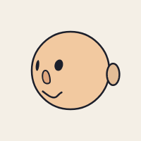

Repare:

- `round=110,200,200` é o raio e o centro da bola, os mesmos do crânio. Com `round=`, o osso gira em volta do **centro da bola**, e não do pivô.
- O **crânio** fica no osso `pescoco`, que não gira: ele é o fundo, sempre redondo. Só o **rosto** corre por cima dele.
- As **orelhas** ficam fora da bola: uma peça com `z=` próprio não vai para a superfície. Ela continua uma peça chata, aqui 40 pixels atrás do meio da cabeça. Com `zsort`, a orelha que vai para trás fica atrás do crânio, e a outra aparece na frente.
- O `round=` vale também para os ossos filhos do `rosto`: uma pálpebra num osso filho corre pela mesma bola. Os olhos podem piscar e a boca falar enquanto a cabeça vira.

**Experimente:** troque `round=110,200,200` por `round=60,200,200` (uma bola menor que o crânio). Nos giros, o olho que vai embora quase some, e o nariz se achata.

**Cuidado:**
- O raio tem que ser maior que 0. Escreva o raio sozinho (`round=110`) ou o raio e o centro (`round=110,200,200`): dois números é erro. Só com o raio, o centro é o meio das peças presas no osso.
- Uma peça maior que a bola não tem onde ficar na superfície: quando a cabeça vira, ela passa por cima do rosto. O cabelo e as orelhas vão numa peça com `z=` (como as orelhas aqui) ou no osso de cima.

## Chão em perspectiva: `floor`

`floor` **deita a camada** como um chão: a linha de baixo do desenho fica onde está, e quanto menor o `y`, mais longe. O que está muito longe encosta no **horizonte**:

<!-- gerar: img/11_chao.png -->
```weasel
canvas 640 360 bg=ceu
gradient ceu linear 0,0 0,110 : #8fc9ee #d9eef7
palette ink=#1c1f2b line=3 grama=#7cb342 asfalto=#5d5d5d faixa=#ffffff tronco=#8d5a3b folha=#4caf50

def arvore
  rect tronco -8,-60 16,60 c=tronco ink=line
  ellipse copa 0,-95 40,48 c=folha ink=line
end

layer chao floor horizon=110 zsort
rect campo -20000,-20000 40640,20360 c=grama
rect estrada 260,-20000 120,20360 c=asfalto
repeat i 0..7
  rect faixa{i} 314,{300 - i*170} 12,70 c=faixa
end
repeat i 0..5
  use arvore 180,{360 - i*300} billboard
  use arvore 460,{360 - i*300} billboard
end
```

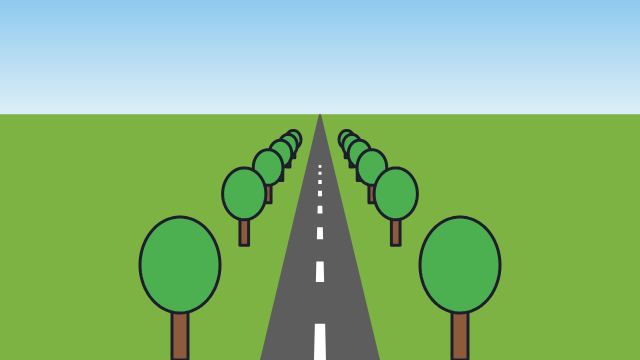

Repare:

- `horizon=110` é a altura do horizonte na tela. Se não escrever, 30% do desenho, de cima para baixo.
- Desenhe o chão **comprido**: a grama e a estrada vão até `y=-20000` para chegar no horizonte. Um chão curto acaba no meio do caminho.
- As árvores usam `billboard` (abaixo): ficam de pé, de frente para você, e diminuem com a distância.
- Sem `pitch=` e sem `persp=`, o chão deita 45°.

### De pé ou deitado: `billboard`

Uma forma num chão `floor` deita junto com ele, como um desenho pintado no asfalto. Com `billboard`, ela fica **de pé**, de frente para você, apoiada no meio da base dela. Os quatro pinheiros abaixo têm a mesma forma; dois estão na frente (`y=270`) e dois mais longe (`y=-130`):

<!-- gerar: img/11_billboard.png -->
```weasel
canvas 640 300 bg=#bfe3f5
palette ink=#1c1f2b line=3 pinho=#2f6e3a

layer chao floor horizon=90 zsort
rect grama -20000,-20000 40640,20300 c=#8bc34a
shape p1 c=pinho ink=line : 150,270! 150,250! 115,250! 160,150! 205,250! 170,250! 170,270!
shape p2 c=pinho ink=line : 150,-130! 150,-150! 115,-150! 160,-250! 205,-150! 170,-150! 170,-130!
shape p3 c=pinho ink=line billboard : 470,270! 470,250! 435,250! 480,150! 525,250! 490,250! 490,270!
shape p4 c=pinho ink=line billboard : 470,-130! 470,-150! 435,-150! 480,-250! 525,-150! 490,-150! 490,-130!

layer nomes
text t1 160,40 "sem billboard" size=22 align=center c=ink
text t2 480,40 "billboard" size=22 align=center c=ink
```

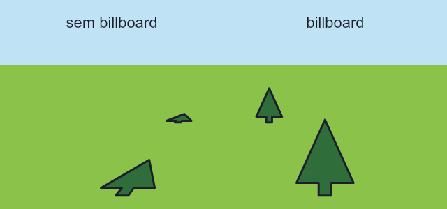

- **sem billboard:** o pinheiro deita com o chão. Bom para o que é mesmo do chão: faixas, poças, sombras, um tapete.
- **billboard:** o pinheiro fica de pé. Ele continua diminuindo com a distância, porque o ponto de apoio está no chão.
- O ponto de apoio é o **meio da base** da forma (aqui, o pé do tronco). Num `use … billboard`, é o próprio ponto do `use`.
- O `billboard` vale também numa camada girada e num osso girado. Uma forma `billboard` não tem espessura (`thick=`).

### Olhar de cima ou rente ao chão: `pitch=` e `pivot=` no `floor`

As três estradas abaixo são iguais e têm o mesmo horizonte; muda só o `pitch=` de cada chão. O círculo vermelho está sempre no mesmo lugar do chão: 300 pixels além da linha de baixo.

<details>
<summary>Código das três estradas</summary>

<!-- gerar: img/11_chao_pitch.png -->
```weasel
canvas 720 300 bg=#bfe3f5
palette faixa=#ffffff asfalto=#5d5d5d placa=#e94f37

layer grama
rect g 0,100 720,200 c=#8bc34a

layer estrada1 floor horizon=100 pivot=120,300 pitch=20
rect e1 75,-20000 90,20300 c=asfalto
repeat i 0..40
  rect f1_{i} 114,{270 - i*60} 12,30 c=faixa
end
ellipse p1 190,0 18 c=placa ink=3 billboard

layer estrada2 floor horizon=100 pivot=360,300
rect e2 315,-20000 90,20300 c=asfalto
repeat i 0..40
  rect f2_{i} 354,{270 - i*60} 12,30 c=faixa
end
ellipse p2 430,0 18 c=placa ink=3 billboard

layer estrada3 floor horizon=100 pivot=600,300 pitch=70
rect e3 555,-20000 90,20300 c=asfalto
repeat i 0..40
  rect f3_{i} 594,{270 - i*60} 12,30 c=faixa
end
ellipse p3 670,0 18 c=placa ink=3 billboard

layer nomes
text t1 120,40 "pitch=20" size=22 align=center c=#1c1f2b
text t2 360,40 "sem pitch= (45)" size=22 align=center c=#1c1f2b
text t3 600,40 "pitch=70" size=22 align=center c=#1c1f2b
```

</details>

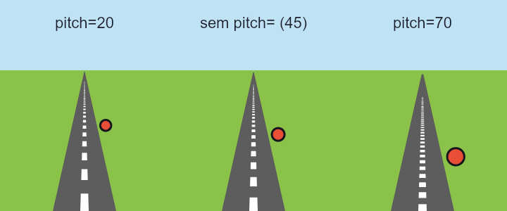

Repare:

- Cada chão tem o seu `pivot=` (120,300, 360,300 e 600,300): é a linha que fica parada. A estrada some no horizonte, acima do x do pivô. Se não escrever, o pivô é o meio da linha de baixo do `canvas`.
- `pitch=20`: o chão **foge depressa** para o horizonte. Aos 300 pixels, o círculo já parece longe e pequeno: é como olhar de cima.
- `pitch=70`: o chão foge devagar, e o círculo ainda parece perto: é como olhar rente ao chão.
- Também dá para usar `persp=` no lugar de `pitch=`: o Weasel calcula o ângulo para o chão chegar no horizonte. Use um ou outro.

**Cuidado:**
- O `horizon=` só vale com `floor` (sem ele, aviso).
- Se o horizonte ficar abaixo do pivô, o chão não deita, e o Weasel não avisa.

## Mapa isométrico: `iso`

`layer … iso=x,y` faz da camada um **mapa isométrico**: os quadrados do código viram losangos, e `thick=` levanta blocos. É o jeito dos jogos de estratégia e de fazenda vistos de cima e de lado.

<!-- gerar: img/11_iso.png -->
```weasel
canvas 560 290 bg=#20242e
palette ink=#1c1f2b line=3 grama=#9ccc65 caixa=#d7a86e pedra=#90a4ae agua=#4fc3f7 telhado=#c0392b parede=#f4efe6

layer chao iso=280,60
rect piso 0,0 200,200 c=grama ink=line
rect caminho 90,0 30,200 c=#d9c49a

layer coisas iso=280,60 zsort
rect caixa1 20,20 44,44 c=caixa ink=line thick=40
rect caixa2 20,68 30,30 c=caixa ink=line thick=24
rect torre 140,24 40,40 c=pedra ink=line thick=120
rect casa 130,120 56,50 c=parede ink=line thick=46
shape telhado c=telhado ink=line z=46 thick=14 : 126,116! 190,116! 190,174! 126,174!
ellipse poco 50,150 24 c=pedra ink=line thick=20
ellipse agua 50,150 16 c=agua z=20
```

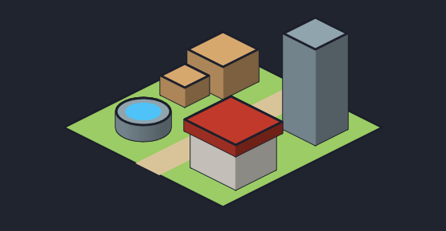

Repare:

- No código, **x e y são o mapa visto de cima**: o piso é um quadrado de 200×200. Na tela, x anda para a direita e para baixo; y, para a esquerda e para baixo.
- `iso=280,60` é onde fica o canto 0,0 do mapa. Com `iso` sozinho, ele fica em cima, no meio do `canvas`.
- No mapa, `thick=` **sobe**: a forma vira o tampo de um bloco daquela altura. Os lados ganham luz diferente.
- `z=` levanta sem fazer bloco: a água do poço está na altura da borda (`z=20`), e o telhado fica em cima das paredes da casa (`z=46`).
- O **chão vai numa camada própria**, sem `zsort`, embaixo da camada das coisas. Se o chão e as caixas estiverem na mesma camada com `zsort`, o chão cobre as caixas do fundo.

**Experimente:** troque `thick=120` da torre por `thick=200`. A torre fica mais alta, e a ponta sai do desenho por cima. Para caber, troque também o `canvas` para `560 370` e desça o mapa 80 pixels com `iso=280,140` nas duas camadas.

**Cuidado:** o `iso` não junta com `yaw=`, `pitch=` nem `floor` na mesma camada (aviso).

### Empilhar e escrever: `use … z=` e texto no mapa

Um componente com `use … z=` sobe inteiro: todas as formas dele ganham aquele `z=`. Assim dá para **empilhar caixas** sem desenhar cada uma. E um `text` numa camada `iso` fica pintado no chão.

<!-- gerar: img/11_iso_pilha.png -->
```weasel
canvas 480 340 bg=#20242e
palette ink=#1c1f2b line=3 caixa=#d7a86e grama=#9ccc65

def caixa
  rect tampa 0,0 40,40 c=caixa ink=line thick=40
end

layer chao iso=240,150
rect piso 0,0 180,180 c=grama ink=line
text placa 90,160 "DEPOSITO" size=22 align=center c=ink bold

layer pilha iso=240,150 zsort
use caixa 20,20
use caixa 20,20 z=40
use caixa 20,20 z=80
use caixa 110,30
use caixa 110,30 z=40
use caixa 60,100
text nome 40,40 "3 caixas" size=18 align=center c=#f4efe6 z=150 billboard
```

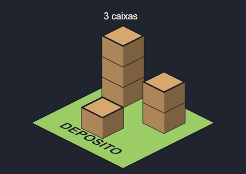

- `use caixa 20,20 z=40` põe a segunda caixa **em cima** da primeira: ela começa a 40 pixels do chão, onde a de baixo termina.
- `text placa … "DEPOSITO"` está na camada do chão: as letras deitam no mapa, como tinta no gramado.
- `text nome … z=150 billboard` fica **de pé**, a 150 pixels de altura, sempre de frente: uma etiqueta em cima da pilha.

### Tileset isométrico

Esta parte usa o tileset do Godot ([capítulo 16](09-jogo-godot.md#tileset-blocos-para-montar-fases)). Com `iso`, cada célula do `tileset` tem o losango na parte de baixo; a parte de cima sobra para a altura das caixas e das paredes. Cada bloco vai numa camada `iso=`, com o canto 0,0 na ponta de cima do losango da célula:

<!-- conferir -->
```weasel
canvas 128 64 bg=none
palette ink=#1c1f2b line=2 grama=#8bc34a caixa=#d7a86e

tileset size=64,64 iso

layer grama iso=32,32
rect g 0,0 32,32 c=grama ink=line
layer caixa iso=96,32
rect c 0,0 32,32 c=caixa ink=line thick=32

tile grama 0,0
tile caixa 1,0 solid
```

- Na célula de 64×64, o losango é de 64×32. Um quadrado de 32×32 no código vira esse losango, e `thick=32` faz uma caixa que enche a célula até em cima.
- O `.tres` sai no formato isométrico do Godot (*Isometric*, *Diamond Down*), e a colisão de `solid` é o losango. No Godot, use o `TileSet` num `TileMapLayer` e pinte o mapa normalmente.
- Para um chão sem caixas, `size=64,32` basta.

## Profundidade no filme

Esta parte usa o filme ([capítulo 17](10-filme.md)). Se ainda não chegou lá, pule para o [Juntando tudo](#juntando-tudo) e volte aqui depois.

### Paralaxe: `depth=` e `screen`

Quando a câmera anda, o que está **longe** deveria andar menos que o que está perto. Olhe pela janela de um carro: o poste passa voando, o morro anda devagar e a lua parece ir junto com você. Isso é a **paralaxe**, e no Weasel ela vem do `depth=` de cada camada ou de cada ator:

- `depth=1` (o padrão) é a distância da ação.
- `depth=2` está duas vezes mais longe: quando a câmera anda ou dá zoom, anda e cresce menos. Vai de 0.05 a 1000.
- `depth=0.5` está perto da câmera e passa mais rápido (as moitas da frente).
- `layer … screen` fica **preso na tela** (títulos, molduras): não anda com a câmera.
- Fora de um filme, `depth=` não muda nada.

Cada camada tem o número do `depth=` dela escrito em cima. A câmera anda 960 pixels para a direita:

<!-- gerar: img/10_paralaxe.gif -s 0.5 -->
```weasel
film fps=10 dur=3s
canvas 960 540 bg=#bfe3f5

layer longe depth=8
ellipse sol 300,80 45 c=#ffd34d
text t8 300,160 "8" size=34 align=center c=#1c1f2b bold

layer montes depth=4
shape serra c=#8fa9c7 : -300,540! -300,300 100,200 450,290 800,190 1150,280 1500,200 1800,300 1800,540!
repeat i 0..2
  text t4_{i} {i*700+100},300 "4" size=34 align=center c=#1c1f2b bold
end

layer morros depth=2
shape morro c=#6fae6a : -300,540! -300,360 300,320 900,370 1500,310 2100,370 2700,330 2700,540!
repeat i 0..4
  text t2_{i} {i*500+220},400 "2" size=34 align=center c=#1c1f2b bold
end

layer chao
rect terra -300,430 3000,110 c=#c9a66b
repeat i 0..9
  rect poste{i} {i*240+100},360 14,80 c=#6b4a30
  text t1_{i} {i*240+107},480 "1" size=34 align=center c=#1c1f2b bold
end

layer frente depth=0.5
repeat i 0..7
  ellipse moita{i} {i*420+150},575 130,70 c=#2f6e3a
  text t05_{i} {i*420+150},532 "0.5" size=34 align=center c=#f4efe6 bold
end

layer letreiro screen
text tela 940,40 "screen" size=34 align=right c=#c0392b bold

at 0.3s camera.x=480
at 2.7s camera.x=1440
```

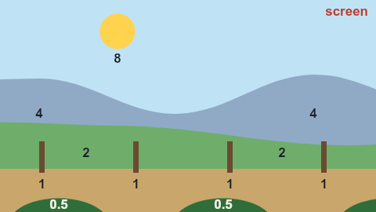

Repare, com a câmera andando 960 pixels:

- As **moitas** (`depth=0.5`) andam o **dobro**: 1920 pixels. Os **postes** (`depth=1`) andam os 960 da câmera.
- Os **morros** (`depth=2`) andam a metade (480), a **serra** (`depth=4`) um quarto (240) e o **sol** (`depth=8`) um oitavo (120).
- O letreiro `screen` fica sempre no canto: ele não está no mundo, está no vidro da câmera.
- Quanto mais perto (número menor), mais largo o desenho precisa ser: a câmera passa por mais coisa dele. Por isso as moitas se repetem até `x=3090`, e o sol é um só.

**Experimente:** ponha `depth=1` nas montanhas (`layer montes`). Elas passam a andar junto com os postes, e o fundo perde a distância.

### Andar ou aproximar: `zoom=` e `lens=`

Atenção aos nomes: no Weasel, `zoom=` **aproxima a câmera, andando**, e `lens=` é o zoom da lente, com a câmera parada. O mesmo filme tem dois planos: no primeiro só o `zoom=` muda, de 1 para 2; no segundo, só a `lens=`. As duas imagens saem do mesmo código, uma com cada plano (`--from` e `--to` escolhem o trecho do filme):

<details>
<summary>Código dos dois planos</summary>

<!-- gerar: img/11_zoom.gif --from 0s --to 2s -s 0.4 -->
<!-- gerar: img/11_lente.gif --from 2s --to 4s -s 0.4 -->
```weasel
film fps=12
canvas 960 540 bg=#cfe3ef

layer montanhas depth=8
shape monte c=#5b7c99 : 0,330 180,90 380,290 600,70 800,270 960,130 960,540 0,540
layer arvores depth=3
rect tronco1 160,200 20,140 c=#6b4a30
ellipse copa1 170,190 60 c=#2f6e3a
rect tronco2 780,200 20,140 c=#6b4a30
ellipse copa2 790,190 60 c=#2f6e3a
layer palco
rect chao 0,330 960,210 c=#7aa35a
ellipse heroi 480,270 40,64 c=#e94f37 ink=4

layer nome1 screen only=zoom
text n1 30,60 "zoom= de 1 a 2" size=40 c=#1c1f2b bold
layer nome2 screen only=lente
text n2 30,60 "lens= de 1 a 2" size=40 c=#1c1f2b bold

shot zoom dur=2s
at 0.3s camera.zoom=1
at 1.7s camera.zoom=2

shot lente dur=2s
at 0.3s camera.lens=1
at 1.7s camera.lens=2
```

</details>

| `zoom=` (a câmera anda) | `lens=` (a lente aproxima) |
|---|---|
| 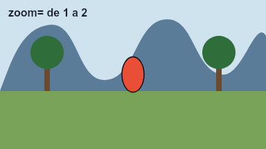 |  |

- Com `zoom=2`, o herói (`depth=1`) fica duas vezes maior, as árvores (`depth=3`) crescem só um pouco e as montanhas (`depth=8`) quase nada. É o que acontece quando você **anda** na direção do herói.
- Com `lens=2`, **tudo** fica duas vezes maior, até as montanhas. A `lens=` vai de 0.01 a 100 (se não escrever, 1).
- Os letreiros são camadas `screen`: não crescem com nenhum dos dois.

### A névoa da distância: `fog=` e `haze=`

Ao ar livre, o que está longe fica mais claro e apagado, da cor do céu. `fog=` é essa cor; `haze=` diz **a que distância** a névoa já cobriu metade. Este filme tem quatro planos, um com cada névoa; cada imagem é o primeiro quadro de um plano (`--time` escolhe o momento). As camadas têm todas a **mesma cor**, e o número em cada uma é o `depth=` dela.

<details>
<summary>Código dos quatro planos</summary>

<!-- gerar: img/11_nevoa_sem.png --time 0s -s 0.3 -->
<!-- gerar: img/11_nevoa_20.png --time 1s -s 0.3 -->
<!-- gerar: img/11_nevoa_6.png --time 2s -s 0.3 -->
<!-- gerar: img/11_nevoa_2.png --time 3s -s 0.3 -->
```weasel
film
canvas 960 540 bg=#dfe9f0

layer d12 depth=12
shape s12 c=#3d5a80 : 0,300 240,140 480,260 720,120 960,240 960,540 0,540
text t12 720,200 "12" size=44 align=center c=#ffffff bold
layer d6 depth=6
shape s6 c=#3d5a80 : 0,360 300,240 620,330 960,250 960,540 0,540
text t6 300,310 "6" size=44 align=center c=#ffffff bold
layer d3 depth=3
shape s3 c=#3d5a80 : 0,420 360,330 700,410 960,350 960,540 0,540
text t3 830,420 "3" size=44 align=center c=#ffffff bold
layer d15 depth=1.5
shape s15 c=#3d5a80 : 0,480 260,420 560,470 960,430 960,540 0,540
text t15 260,480 "1.5" size=44 align=center c=#ffffff bold
layer d1
rect chao 0,505 960,35 c=#3d5a80
text t1 600,535 "1" size=30 align=center c=#ffffff bold

layer nome0 screen only=sem
text n0 30,70 "sem fog=" size=50 c=#1c1f2b bold
layer nome1 screen only=pouca
text n1 30,70 "haze=20" size=50 c=#1c1f2b bold
layer nome2 screen only=normal
text n2 30,70 "haze=6 (padrão)" size=50 c=#1c1f2b bold
layer nome3 screen only=muita
text n3 30,70 "haze=2" size=50 c=#1c1f2b bold

shot sem dur=1s
shot pouca dur=1s
camera fog=#dfe9f0 haze=20
shot normal dur=1s
camera fog=#dfe9f0
shot muita dur=1s
camera fog=#dfe9f0 haze=2
```

</details>

| | |
|---|---|
| 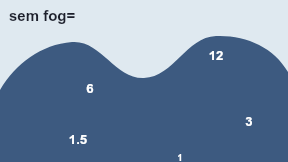 | 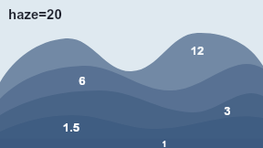 |
| 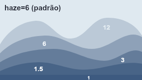 | 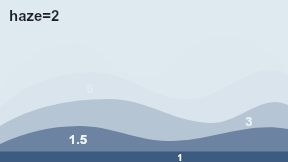 |

Repare:

- **sem fog=:** tudo da mesma cor. Os morros viram um bloco só, e não dá para saber o que está longe.
- `fog=#dfe9f0` é a **cor do céu** (a mesma do `bg=`). Use sempre a cor do fundo: assim o longe some no céu. `fog=none` tira a névoa.
- `haze=6` (o padrão): a camada `6` está meio apagada, e a `12`, bem mais. O `haze=` vai de 1.05 a 1000.
- `haze=2`: névoa forte. A `6` e a `12` quase desaparecem no céu.
- A névoa só pega o que tem `depth=` maior que 1. A camada da ação (`1`), as mais perto e as `screen` não recebem névoa.

### O efeito de vertigem

Juntando a lente e o zoom, sai o efeito de vertigem do cinema (o "dolly zoom", do filme *Um corpo que cai*): a câmera se afasta (`zoom=` diminui) enquanto a lente aproxima (`lens=` aumenta). O herói fica do mesmo tamanho, e o fundo cresce atrás dele:

<details>
<summary>Código do efeito</summary>

<!-- gerar: img/11_vertigo.gif -s 0.4 -->
```weasel
film fps=12
canvas 960 540 bg=#cfe3ef

layer montanhas depth=8
shape monte c=#5b7c99 : 0,420 180,170 380,380 600,150 800,360 960,210 960,540 0,540
layer morros depth=3
shape morro c=#4f8a56 : 0,470 240,330 520,450 760,320 960,440 960,540 0,540
layer arvores depth=1.6
rect tronco1 160,330 20,140 c=#6b4a30
ellipse copa1 170,320 60 c=#2f6e3a
rect tronco2 780,330 20,140 c=#6b4a30
ellipse copa2 790,320 60 c=#2f6e3a
layer palco depth=1
rect chao 0,460 960,80 c=#7aa35a
ellipse heroi 480,400 40,64 c=#e94f37 ink=4

shot vertigo dur=2s
camera fog=#cfe3ef haze=4
at 0s camera.zoom=1 camera.lens=1
at 2s camera.zoom=0.5 camera.lens=2 ease=linear
```

</details>

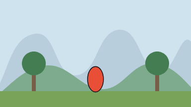

- O herói (`depth=1`) fica do mesmo tamanho porque `zoom=0.5` (metade) e `lens=2` (o dobro) se cancelam nele. Nas camadas de longe, o `zoom=` quase não muda nada, mas a `lens=` dobra tudo: elas crescem.
- `lens=`, `fog=` e `haze=` mudam com `at`, como o resto da câmera (`camera.lens=2`).

### Girar no filme: `at` com `yaw=` e `pitch=`

No filme, o giro muda com `at`, do mesmo jeito que a posição de um ator. Aqui um mapa deita para trás e uma carta vira de costas, ao mesmo tempo:

<!-- gerar: img/11_filme_giro.gif -s 0.75 -->
```weasel
film fps=12 dur=3s
canvas 640 360 bg=#f4efe6
palette ink=#1c1f2b line=5

layer mapa pivot=180,180
rect papel 60,60 240,240 c=#e8d9a8 ink=line
stroke rio w=10 c=#4fc3f7 : 90,100 160,170 120,240 200,290
ellipse vila 230,140 22 c=#e94f37 ink=4

layer carta zsort pivot=485,190
rect frente 400,80 170,220 r=14 c=#fff6e0 ink=line back=verso
rect verso 400,80 170,220 r=14 c=#2e86ab ink=line hidden
text sol 485,205 "SOL" size=40 align=center c=ink z=1 bold

at 0.5s mapa.pitch=0 carta.yaw=0
at 2.5s mapa.pitch=60 carta.yaw=180
```

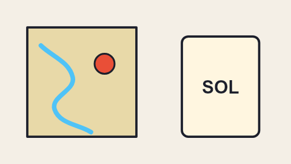

- `mapa.pitch=60`: a camada `mapa` inteira deita 60 graus para trás, em volta do `pivot=180,180`.
- `carta.yaw=180`: a camada `carta` dá meia volta. De costas, aparece o verso azul.
- O `at 0.5s` com os valores 0 segura tudo parado até 0,5 s; depois os dois giram até 2,5 s.
- Para girar uma forma só, use o nome dela: `at 2.5s frente.yaw=180`. Isso vale para as formas do próprio arquivo do filme: as formas de dentro de um ator não giram com `at`.

## Opções de profundidade

| Opção | Onde | O que faz | Valores | Se não escrever |
|---|---|---|---|---|
| `z=` | formas, `use`, `emitter` | a distância da tela; positivo é mais perto | qualquer número | 0 |
| `yaw=`, `pitch=` | formas, `layer`, `bone` | os giros em 3D | graus | 0 |
| `persp=` | formas, `layer`, `bone` | a distância do olho; `0` tira a perspectiva | de 0 a 100000 | o dobro do lado maior do `canvas` |
| `thick=` | formas fechadas | a espessura do bloco (no `iso`, a altura) | de 0 a 10000 | 0 |
| `thickc=` | formas fechadas | a cor dos lados do bloco | uma cor (`#hex` ou nome da `palette`) | a cor da forma, um pouco mais escura |
| `back=` | formas fechadas | a forma do verso | o nome de uma forma fechada | a própria forma, espelhada |
| `billboard` | formas, `use` | sempre de pé e de frente | palavra | desligado |
| `zsort` | `layer` | pinta de longe para perto | palavra | a ordem do código |
| `shade=` | `layer` | quanto uma forma virada escurece | de 0 a 2 | 0.5 |
| `pivot=` | `layer` | o eixo do giro; no `floor`, a linha parada | dois números | o meio do `canvas`; no `floor`, o meio da linha de baixo |
| `floor` | `layer` | deita a camada como um chão | palavra | desligado |
| `horizon=` | `layer` com `floor` | a altura do horizonte | pixels, de cima para baixo | 30% da altura |
| `iso` | `layer` | mapa isométrico; `iso=x,y` põe o canto 0,0 em x,y | palavra, ou dois números | desligado (com `iso` sozinho, o canto fica em cima, no meio) |
| `round=` | `bone` | as peças ficam numa bola | raio maior que 0, ou raio,x,y | desligado |
| `depth=` | `layer`, `actor` (filme) | a distância no filme | de 0.05 a 1000 | 1 |
| `screen` | `layer`, `actor` (filme) | preso na tela | palavra | desligado |
| `lens=` | `camera` (filme) | a lente | de 0.01 a 100 | 1 |
| `fog=` | `camera` (filme) | a cor da névoa | uma cor (`#hex` ou nome da `palette`), ou `none` | sem névoa |
| `haze=` | `camera` (filme) | a distância da meia névoa | de 1.05 a 1000 | 6 |

Na `key`, mudam aos poucos o `z=`, o `yaw=` e o `pitch=` das formas e o `yaw=` e o `pitch=` das camadas e dos ossos. As fichas completas estão na referência: [opções de todas as formas](19-referencia.md#opções-de-todas-as-formas), [`layer`](19-referencia.md#layer), [`bone`](19-referencia.md#bone) e [`camera`](19-referencia.md#camera).

**Cuidado:**
- É ilusão de peças chatas. Uma forma girada continua chata; o volume vem da espessura, da bola e da ordem. Para um objeto que muda de forma quando gira, desenhe as vistas e troque com `.show=` ([capítulo 9](09-animacao.md#animar-formas-formapropriedadevalor)).
- No Godot, o esqueleto de verdade (`rig=bones`) não gira em 3D. Com `yaw=`, `pitch=`, `z=` ou `iso`, exporte cada quadro pronto (`rig=frames`, o padrão; [capítulo 16](09-jogo-godot.md#esqueleto-de-verdade-rigbones-experimental)).

## Juntando tudo

Uma vila num mapa isométrico, com casas, uma torre, um poço, caixas empilhadas e árvores. Uma caixa vermelha pula no caminho.

<!-- gerar: img/14_vila_iso.gif -a vila -->
```weasel
canvas 480 330 bg=#26283b
palette ink=#1c1f2b line=3 grama=#9ccc65 terra=#d9c49a caixa=#d7a86e pedra=#90a4ae agua=#4fc3f7 parede=#f4efe6 folha=#4caf50 tronco=#8d5a3b

def caixa
  rect tampa 0,0 30,30 c=caixa ink=line thick=30
end

def arvore
  rect tronco -4,-26 8,26 c=tronco ink=line
  ellipse copa 0,-46 18,24 c=folha ink=line
end

layer chao iso=240,80
rect piso 0,0 220,220 c=grama ink=line
rect caminho 100,0 30,220 c=terra
text placa 172,206 "VILA" size=22 align=center c=ink bold

layer coisas iso=240,80 zsort
rect casa1 20,24 60,56 c=parede ink=line thick=48
shape telhado1 c=#c0392b ink=line z=48 thick=14 : 16,20! 84,20! 84,84! 16,84!
rect torre 150,14 34,34 c=pedra ink=line thick=96
rect casa2 150,120 50,50 c=parede ink=line thick=36
shape telhado2 c=#2e86ab ink=line z=36 thick=12 : 146,116! 204,116! 204,174! 146,174!
ellipse poco 56,176 20 c=pedra ink=line thick=16
ellipse agua 56,176 13 c=agua z=16
use caixa 20,106
use caixa 20,106 z=30
use caixa 56,112
rect pula 102,150 26,26 c=#e94f37 ink=line thick=26
use arvore 210,206 billboard
use arvore 200,80 billboard
use arvore 24,214 billboard

anim vila frames=16 fps=12
key 0 pula.z=0 ease=out
key 6 pula.z=50 ease=in
key 12 pula.z=0
```


- **O mapa:** duas camadas com o mesmo `iso=240,80`. O chão fica embaixo, sem `zsort`; as coisas ficam em cima, com `zsort`, para a torre esconder o que está atrás dela.
- **Os blocos:** as casas e a torre são retângulos com `thick=`. Os telhados são quadrados um pouco maiores, levantados com `z=` até o alto das paredes, com `thick=` próprio.
- **A pilha:** o `def caixa` é um bloco de 30 de altura, e `use caixa 20,106 z=30` põe uma caixa em cima da outra.
- **As árvores:** `use arvore … billboard` deixa cada árvore de pé, presa no ponto do `use`.
- **O pulo:** `key 6 pula.z=50` levanta a caixa vermelha 50 pixels no quadro 6. O `ease=out` e o `ease=in` fazem ela frear no alto e acelerar na descida.

**Experimente:** troque o `thick=96` da torre por `thick=140`, e ponha uma terceira caixa na pilha com `use caixa 20,106 z=60`.

## Resumo

- `z=` é a distância da tela, e o `zsort` da camada faz o mais perto ficar por cima.
- `yaw=` e `pitch=` giram formas, camadas e ossos em 3D. `persp=` é a distância do olho, e `shade=` escurece o que vira.
- `thick=` dá espessura, `back=` dá um verso, e `round=` faz um rosto correr por uma bola.
- `floor` deita a camada como um chão, com `billboard` para o que fica de pé. `iso` faz um mapa isométrico, em que `thick=` e `z=` sobem.
- No filme, `depth=` dá a paralaxe, `lens=` é a lente e `fog=` e `haze=` são a névoa da distância.

[← Estilos de arte](13-estilos.md) · [Índice](README.md) · [Próximo: Jogo: o personagem no Godot (antigo) →](09-jogo-godot.md)
