# 15. Jogo: o personagem no Godot

[← Profundidade (2.5D)](14-profundidade.md) · [Índice](README.md) · [Próximo: Jogo: fases e recursos avançados →](16-jogo-avancado.md)

Um personagem de jogo no Weasel é um arquivo `.weasel` comum, com desenho, ossos e animações. Aqui você vai ver o que falta para ele ir para um jogo: onde ele bate nas paredes, onde o golpe acerta, onde ele leva dano, de onde sai o tiro e como levar tudo para o **Godot**, um programa gratuito de fazer jogos. Você precisa dos capítulos 1 a 9.

Três palavras do Godot aparecem o tempo todo:

- **cena:** um pedaço do jogo salvo num arquivo `.tscn` (o personagem, uma moeda, uma fase). Uma fase pode ter várias cópias da mesma cena.
- **nó:** cada item de uma cena (a imagem, a colisão, o tocador de animações). Os nós ficam um dentro do outro, como pastas.
- **nó raiz:** o primeiro nó da cena, que segura todos os outros. É ele que anda pela fase.

## Do Weasel para o Godot

O mínimo para um personagem: a linha `godot`, uma caixa de colisão e as animações.

<!-- gerar: img/09_gosma.png -->
```weasel
canvas 128 128 bg=none light=-0.6,-0.8
palette ink=#1f2a1c line=4 gosma=#7bd36b

godot root=64,120 name=Gosma

bone corpo pivot=64,120

layer corpo
shape gosma c=gosma ink=line weight=0.3 bone=corpo : 64,52 100,84 106,118! 22,118! 28,84
ellipse olhoE 54,88 5,8 c=ink bone=corpo
ellipse olhoD 76,88 5,8 c=ink bone=corpo

box pes body rect 34,104 60,16

anim idle_right frames=8 fps=8
key 0 corpo=0,0,0,1,1
key 4 corpo=0,0,0,1.06,0.94
key 8 corpo=0,0,0,1,1
```

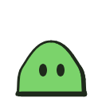

Repare:

- `godot root=64,120 name=Gosma`: no Godot, o personagem vai se chamar `Gosma`. O ponto 64,120, embaixo dele, é a **origem**: o ponto que encosta no chão.
- `box pes body rect 34,104 60,16`: a caixa de colisão do corpo, um retângulo nos pés. É ela que bate no chão e nas paredes. As caixas não aparecem no desenho: elas só vão para o jogo.
- A animação termina em `_right`: ela olha para a direita. O Weasel cria sozinho a `idle_left`, espelhando a `idle_right`.
- `bg=none`: o fundo transparente. No Godot, a imagem sai sempre transparente; o `bg=none` vale para a sprite sheet ([capítulo 16](16-jogo-avancado.md#para-outros-motores-sprite-sheet-e-unity)) e para você ver o desenho no editor como no jogo.

### Exportar

```bash
node cli/weasel.js gosma.weasel -o godot/gosma.tscn
```

```
salvo godot/gosma.png  344×266, 8 quadros de 112×86 · 20 KB
salvo godot/gosma_normal.png  344×266, normal map · 48 KB
salvo godot/gosma.tres  SpriteFrames do Godot 4 · 2 KB
salvo godot/gosma.tscn  cena do Godot 4 (1 caixa, espelhadas: idle_left) · 5 KB
salvo godot/weasel_anim.gd  ajudante do AnimationPlayer · 12 KB
```

| Arquivo | O que é |
|---|---|
| `gosma.png` | a folha com todos os quadros, de todas as animações |
| `gosma_normal.png` | o **normal map**, para a luz 2D do Godot ([abaixo](#o-relevo-para-a-luz-do-godot-normal)) |
| `gosma.tres` | a lista de animações e quadros, no formato do Godot (`SpriteFrames`) |
| `gosma.tscn` | a **cena pronta**: o personagem com a imagem, a colisão e as animações |
| `weasel_anim.gd` | o **ajudante**: o código que toca as animações ([abaixo](#no-jogo-o-ajudante-tocar)) |

A cena fica assim:

```
Gosma (CharacterBody2D)            ← o nó raiz; a origem é o root=
├── Sprite (AnimatedSprite2D)      ← a imagem, com o normal map
├── pes (CollisionShape2D)         ← box … body
└── AnimationPlayer                ← o tocador de animações, com o weasel_anim.gd
```

Na linha de comando, o `.tscn` sai sempre com todas as animações, com o fundo transparente e recortado em volta do desenho, com 8 pixels de folga. No editor, a mesma pasta sai pela janela **Exportar** ([capítulo 23](23-editor.md#jogo)).

### Abrir no Godot

1. Copie a pasta `godot` inteira para dentro do projeto do Godot (por exemplo, para `res://personagens/gosma/`). Os cinco arquivos precisam ficar juntos.
2. Abra a cena da fase e arraste o `gosma.tscn` para dentro dela.
3. Clique com o botão direito no nó `Gosma` da cena `gosma.tscn` e escolha **Attach Script**. Um script de jogo visto de lado:

```gdscript
extends CharacterBody2D

@onready var anim: AnimationPlayer = $AnimationPlayer

func _physics_process(delta: float) -> void:
	if not is_on_floor():
		velocity += get_gravity() * delta
	var dir := Input.get_axis("ui_left", "ui_right")
	velocity.x = dir * 120.0
	move_and_slide()
	anim.tocar("idle", Vector2(dir, 0))
```

- As setas ← e → andam. A gravidade puxa a gosma para baixo até ela encostar num chão com colisão.
- `anim.tocar("idle", Vector2(dir, 0))` toca a `idle_right` ou a `idle_left`, conforme o lado para onde ela anda. Parada, ela continua virada para o último lado.

**Experimente:** troque `120.0` por `300.0`. A gosma anda mais depressa, mas a animação continua igual. Para o passo acompanhar o chão, use o `feet=` ([abaixo](#andar-sem-escorregar-feet)).

## O nó do Godot: `godot`

```
godot [body=character|static|area|rigid|node] [root=x,y] [name=Nome] [normal=força] [rig=frames|bones]
```

### Que tipo de objeto: `body=`

`body=` diz ao Godot **que tipo de coisa** o desenho é. Uma moeda, por exemplo, não bate em nada: o jogador passa por ela e ela some. Isso é uma **área** (`area`):

<!-- gerar: img/09_moeda.png -s 2 -->
```weasel
canvas 48 48 bg=none
palette ink=#5a3a10 line=3

godot body=area name=Moeda

ellipse moeda 24,24 18 c=#ffd34d ink=line
rect brilho 20,14 6,20 r=3 c=#fff2b0

box pega body circle 24,24 18
```

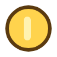

Exportada com `-o godot/moeda.tscn`, a cena começa assim:

```
[node name="Moeda" type="Area2D"]
…
[node name="pega" type="CollisionShape2D" parent="."]
position = Vector2(0, -24)
```

No jogo, o sinal `body_entered` da `Area2D` avisa quando o jogador encosta na moeda.

| `body=` | O nó raiz | Bom para |
|---|---|---|
| `character` | `CharacterBody2D` | o herói e os inimigos: andam pelo código e param nas paredes |
| `static` | `StaticBody2D` | o que não se mexe, mas bloqueia: parede, caixote, porta fechada |
| `area` | `Area2D` | o que só percebe quem encosta: moeda, armadilha, porta de saída |
| `rigid` | `RigidBody2D` | o que a física do Godot move sozinha: bola, caixa que cai e rola |
| `node` | `Node2D` | enfeite sem física. Um enfeite não bate em nada, então as caixas `body` vão para uma área chamada `Corpo`, que só percebe quem encosta |

### A origem e o nome: `root=` e `name=`

A **origem** é o ponto 0,0 do nó raiz. É ele que fica na posição que o jogo dá ao objeto, e é em volta dele que o objeto gira. Num personagem, ela fica nos pés. Numa moeda que gira no ar, fica melhor no meio.

Sem `root=`, a origem fica no meio da base do **recorte**: o desenho mais os 8 pixels de folga, sem passar da borda do `canvas`. A moeda enche o `canvas` de 48×48, então a origem fica em 24,48. Com `root=24,24`, ela passa para o meio da moeda. No `.tscn`:

| Sem `root=` (origem em 24,48) | Com `root=24,24` |
|---|---|
| `offset = Vector2(-24, -48)` | `offset = Vector2(-24, -24)` |
| `pega` em `position = Vector2(0, -24)` | `pega` em `position = Vector2(0, 0)` |

- O `offset` é o quanto o Godot empurra a imagem para a esquerda e para cima, para o ponto `root=` ficar na origem.
- No Godot, como no Weasel, `y` negativo é para cima: a caixa `pega` fica 24 pixels acima da origem no primeiro caso, e em cima dela no segundo.

**Cuidado:** num personagem que não enche o `canvas`, a origem padrão fica uns 8 pixels **abaixo** dos pés (a folga do recorte). Escreva sempre o `root=` no ponto em que ele pisa.

`name=` é o nome do nó raiz. Sem ele, o Weasel usa o nome do arquivo **exportado**, juntando as palavras com maiúsculas: `-o godot/moeda_de_ouro.tscn` vira o nó `MoedaDeOuro`. O nome só pode ter letras sem acento, números e `_`, e não pode começar com número.

### O relevo para a luz do Godot: `normal=`

O **normal map** é uma segunda imagem, em tons de azul e roxo, que diz para onde cada pedacinho do desenho está virado. A luz 2D do Godot (`PointLight2D`) usa essa imagem para iluminar o personagem com **relevo**: o lado virado para a lâmpada fica claro, o outro fica escuro, como no [capítulo 10](10-luz.md), mas calculado dentro do jogo.

- O `.tscn` já vem com o normal map (o `gosma_normal.png` acima).
- `normal=` é a força do relevo, de 0 a 10. Se não escrever, 1. Com 0, o desenho fica chapado; com números maiores, mais estufado.
- `--no-normal` na linha de comando exporta sem o normal map.

| Opção | O que faz | Valores | Se não escrever |
|---|---|---|---|
| `body=` | o tipo do nó raiz | `character`, `static`, `area`, `rigid` ou `node` | `character` |
| `root=` | o ponto do desenho que vira a origem | dois números | o meio da base do recorte |
| `name=` | o nome do nó raiz | letras sem acento, números e `_`; não começa com número | o nome do arquivo exportado |
| `normal=` | a força do relevo do normal map | de 0 a 10 | 1 |
| `rig=` | por quadros ou com esqueleto ([capítulo 16](16-jogo-avancado.md#esqueleto-de-verdade-rigbones-experimental)) | `frames` ou `bones` | `frames` |

A ficha completa está na [referência do `godot`](20-referencia.md#godot). Duas linhas `godot` no mesmo arquivo dão aviso, e vale a última.

## Caixas de colisão: `box`

```
box nome [body|hit|hurt] [rect] x,y largura,altura   [bone=osso] [only=animações] [off]
box nome [body|hit|hurt] circle cx,cy raio
box nome [body|hit|hurt] capsule cx,cy largura,altura
```

| Tipo | Para quê | No Godot vira |
|---|---|---|
| `body` | a colisão do corpo com o chão e as paredes | uma `CollisionShape2D` no nó raiz |
| `hit` | o **golpe** (a *hitbox*): onde o ataque acerta | uma forma dentro da área `Hitbox` |
| `hurt` | onde o personagem **leva dano** (a *hurtbox*) | uma forma dentro da área `Hurtbox` |

Se não escrever o tipo nem o formato, a caixa é `body rect`: `box pe 10,10 20,8` é um retângulo de corpo.

### Os três formatos: `rect`, `circle` e `capsule`

Uma caixa de colisão não precisa ser um retângulo. Uma cabeça cabe melhor num **círculo**. Um corpo fica melhor numa **cápsula** (um retângulo de pontas redondas), que escorrega em degraus e quinas em vez de enganchar. Na imagem, uma camada `guide` desenha cada caixa por cima, nas cores do editor, para você vê-las. No seu arquivo, ela não é necessária: o editor mostra as caixas sozinho.

<!-- gerar: img/09_caixas.png --guides -s 2 -->
```weasel
canvas 160 140 bg=#e8eef5
palette ink=#2a2433 line=3 pele=#9fd36b metal=#c8ccd8

godot root=64,132 name=Guarda

layer guarda
ellipse cabeca 64,40 20 c=pele ink=line
ellipse olho 72,38 3,4 c=ink
rect tronco 44,58 40,74 r=16 c=pele ink=line
rect espada 84,82 56,8 r=2 c=metal ink=line

box corpo body capsule 64,95 40,74
box cabecinha hurt circle 64,40 20
box lamina hit rect 84,78 56,16

# para ver as caixas na imagem: um desenho de cada uma, nas cores do editor
layer caixas guide
rect verCorpo 44,58 40,74 r=20 c=#3fcf8e26 ink=2 inkc=#3fcf8e
ellipse verCabeca 64,40 20 c=#ffd16626 ink=2 inkc=#ffd166
rect verLamina 84,78 56,16 c=#ff5a5a26 ink=2 inkc=#ff5a5a
text nomeCorpo 6,100 "body" size=11 c=#1f8a5a
text nomeCabeca 90,20 "hurt" size=11 c=#a07a10
text nomeLamina 112,110 "hit" size=11 c=#c03030
```

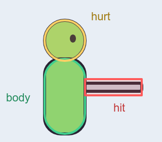

Repare:

- `box corpo body capsule 64,95 40,74`: uma cápsula com o **centro** em 64,95, 40 pixels de largura e 74 de altura. Mais alta que larga, ela fica em pé. O raio das pontas é metade da largura: 20.
- `box cabecinha hurt circle 64,40 20`: um círculo com centro em 64,40 e raio 20, o mesmo da `ellipse cabeca`. Só a cabeça leva dano.
- `box lamina hit rect 84,78 56,16`: no `rect`, o x,y é o **canto de cima à esquerda**, como no `rect` de desenho. No `circle` e na `capsule`, é o centro.

**Experimente:** troque a cápsula por `box corpo body capsule 64,110 74,40`. Mais larga que alta, ela fica deitada, como a de um bicho de quatro patas.

No `.tscn` exportado, cada formato vira a forma de colisão do Godot de mesmo nome, contada a partir da origem (`root=64,132`):

```
[sub_resource type="CapsuleShape2D" id="Shape_0"]
radius = 20
height = 74
…
[node name="corpo" type="CollisionShape2D" parent="."]
position = Vector2(0, -37)
```

O centro da cápsula (64,95) fica 37 pixels acima da origem. Para conferir as caixas sem abrir o Godot, use `--info` (`node cli/weasel.js guarda.weasel --info`):

```
godot    character, raiz 64,132, nó Guarda
caixas   3
  corpo          body capsule
  cabecinha      hurt circle
  lamina         hit rect
```

### Uma caixa que segue o braço e só liga no golpe

Um golpe de espada só deve acertar **enquanto a espada passa**, e a área do golpe precisa **acompanhar a espada**. Para isso servem `bone=`, `only=` e `off`, juntos:

<!-- gerar: img/09_golpe.gif -a attack_right --guides -->
```weasel
canvas 170 140 bg=#e8eef5
palette ink=#2a2433 line=3 pele=#9fd36b metal=#c8ccd8

godot root=64,132 name=Guarda

bone braco pivot=70,84

layer guarda
ellipse cabeca 64,40 20 c=pele ink=line
ellipse olho 72,38 3,4 c=ink
rect tronco 44,58 40,74 r=16 c=pele ink=line
layer arma
rect espada 70,80 60,8 r=2 c=metal ink=line bone=braco
ellipse mao 72,84 8 c=pele ink=line bone=braco

box lamina hit rect 84,76 48,16 bone=braco only=attack_right off

# para ver a caixa na imagem: o mesmo retângulo, nas cores do editor
layer caixas guide
rect verLamina 84,76 48,16 c=#ff5a5a26 ink=2 inkc=#ff5a5a bone=braco

anim idle_right frames=4 fps=4
key 0 braco=0,0,-60 verLamina.show=0

anim attack_right frames=8 fps=10 once
key 0 braco=0,0,-60 verLamina.show=0
key 2 braco=0,0,20 lamina.show=1 verLamina.show=1
key 4 lamina.show=0 verLamina.show=0
key 8 braco=0,0,-60
```

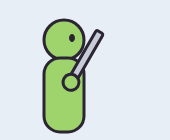

Repare:

- `bone=braco`: a caixa anda e gira com o osso do braço, como a espada. Ela não estica nem encolhe com a escala do osso.
- `only=attack_right`: a caixa **só existe** nessa animação. Para ela existir também no desenho parado, ponha `pose` na lista (`only=attack_right,pose`).
- `off`: a caixa começa **desligada**.
- `key 2 … lamina.show=1` liga a caixa no quadro 2 (espada esticada), e `key 4 lamina.show=0` desliga no quadro 4. O golpe só acerta nos quadros 2 e 3. O `show` é a única coisa da caixa que muda numa `key`.

**Experimente:** troque `key 4 lamina.show=0 verLamina.show=0` por `key 6 lamina.show=0 verLamina.show=0`. O golpe passa a acertar também na volta da espada.

No Godot, quem liga e desliga a caixa é o tocador de animações (o `AnimationPlayer`): a caixa fica `disabled` (desligada) e muda nos tempos certos. No `attack_right`, a 10 quadros por segundo, o quadro 2 é 0,2 s:

```
tracks/6/path = NodePath("Hitbox/lamina:disabled")
…
"times": PackedFloat32Array(0, 0.2, 0.4),
…
"values": [true, false, true]
```

| Opção | O que faz | Valores | Se não escrever |
|---|---|---|---|
| tipo | corpo, golpe ou dano | `body`, `hit` ou `hurt` | `body` |
| formato | retângulo, círculo ou cápsula | `rect`, `circle` ou `capsule` | `rect` |
| tamanho | no `rect` e na `capsule`, largura e altura; no `circle`, o raio | números maiores que 0 | (obrigatório) |
| `bone=` | o osso que a caixa segue (posição e giro) | o nome de um osso | parada |
| `only=` | as animações em que a caixa existe | nomes de `anim`, separados por vírgula; `pose` é o desenho parado | em todas |
| `off` | começa desligada (ligue com `key nome.show=1`) | palavra | ligada |

A ficha completa está na [referência do `box`](20-referencia.md#box).

**Cuidado:**
- Evite dar à caixa o nome de uma forma. Se der, o Weasel avisa, e numa `key` vale a caixa.
- Duas caixas, ou uma caixa e um ponto (`point`), não podem ter o mesmo nome: no Godot, todos viram nós da mesma cena.
- Os nomes `Sprite`, `AnimationPlayer`, `Hitbox`, `Hurtbox` e `Corpo` já são de nós da cena: uma caixa com um deles vira `Hitbox_caixa`, por exemplo.

## Pontos de encaixe: `point`

```
point nome x,y [bone=osso]
```

Um **ponto de encaixe** é um ponto com nome: de onde sai o tiro, onde a mão segura a arma, onde nasce a poeira do passo. Ele não aparece no desenho, mas vai para o jogo quadro a quadro, então o jogo sabe onde ele está em cada momento da animação.

<!-- gerar: img/09_ponto.gif -a shoot_right --guides -->
```weasel
canvas 160 128 bg=#e8eef5
palette ink=#2a2433 line=4 pele=#7cc4e8 arma=#5b5f6e fogo=#ffcf4d

godot body=character root=64,122 name=Atirador

bone corpo pivot=64,122
bone braco pivot=74,74 parent=corpo

layer corpo
ellipse tronco 60,90 26,32 c=pele ink=line bone=corpo
ellipse olho 70,76 4,6 c=ink bone=corpo
layer braco
rect cano 74,68 46,10 r=3 c=arma ink=line bone=braco
ellipse mao 76,76 8 c=pele ink=line bone=braco
ellipse clarao 130,73 10,6 c=fogo bone=braco

point saida 122,73 bone=braco
point pe 64,122

# só para ver onde o ponto está (as camadas guide não vão para o jogo)
layer mira guide
ellipse alvo 122,73 3 c=#c77dff bone=braco

anim shoot_right frames=12 fps=12
key 0 braco=0,0,0 clarao.show=0
key 4 braco=0,0,-30
key 6 clarao.show=1
key 8 clarao.show=0
key 12 braco=0,0,0
event 6 tiro
```

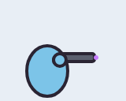

- `point saida 122,73 bone=braco` fica na ponta do cano e anda e gira com o braço, como as caixas. A bolinha roxa da camada `guide` mostra onde ele está.
- `point pe 64,122` não tem osso: fica parado entre os pés.
- `event 6 tiro` manda o aviso `tiro` para o jogo no quadro 6, o do clarão ([capítulo 9](09-animacao.md#eventos-event)).

No Godot, cada ponto vira um **`Marker2D`** com o nome do ponto, que o tocador de animações move quadro a quadro. O eixo x do marcador aponta para onde o osso aponta. No `shoot_left`, o ponto vai para o outro lado e passa a apontar para a esquerda. No script do jogo, quando chega o evento `tiro`:

```gdscript
const BALA := preload("res://bala.tscn")

func _quando_evento(nome: StringName) -> void:
	if nome == &"tiro":
		var bala := BALA.instantiate()
		bala.global_position = $saida.global_position
		bala.direcao = $saida.global_transform.x  # para onde o cano aponta
		get_parent().add_child(bala)
```

O `bala.tscn` e a `direcao` são do seu jogo. O `_quando_evento` recebe os eventos pelo sinal `evento` do ajudante ([abaixo](#no-jogo-o-ajudante-tocar)).

## No jogo: o ajudante, `tocar()`

O `weasel_anim.gd` vai no nó `AnimationPlayer` da cena. O tocador tem uma animação para cada `anim`, mais as espelhadas, e cada uma troca a imagem, move as caixas e os pontos e manda os eventos, quadro a quadro. **Toque as animações por ele**, com estas funções:

| Função | O que faz |
|---|---|
| `tocar("anda", velocity)` | toca a animação `anda` virada para onde o personagem vai: `anda_right`, `anda_left` (e `_up`, `_down` e as diagonais, se existirem). Só recomeça quando a animação muda. Sem a direção, continua virada para a última |
| sinal `evento(nome)` | os `event` da animação, na hora certa. Dois no mesmo quadro chegam um depois do outro, na ordem do código |
| `velocidade()` | com `feet=`, quantos pixels por segundo o personagem anda na animação tocando agora ([abaixo](#no-jogo-a-velocidade-dos-pés)) |
| `quadros("ataque")` e `fps("ataque")` | quantos quadros a animação tem e quantos toca por segundo, com a direção escolhida como no `tocar()`. Sem nome, valem para a animação tocando agora |
| `mostrar_quadro("ataque", 3, velocity)` | para a animação no quadro 3 (de 0 a `quadros() - 1`). Os eventos não chegam, e o próximo `tocar()` da mesma animação continua dali. Serve quando o jogo escolhe o quadro: uma barra de força que enche, uma porta que abre conforme o jogador empurra |
| `nome_com_direcao("anda", dir)` | o nome que o `tocar()` escolheria, sem tocar |
| `trocar("parado", velocity)` | troca com as peças de transição ([capítulo 16](16-jogo-avancado.md#no-jogo-trocar)) |

- **A direção do começo é para baixo.** Num personagem que só tem `_right` e `_left` (visto de lado), o `tocar()` escolhe o lado para onde ele anda. Parado, ou andando reto para cima ou para baixo, ele continua no lado em que estava, e começa na `_right`.
- O jogo não precisa copiar os quadros e o fps à mão: se a animação mudar no Weasel, basta exportar de novo.
- Para virar o personagem, deixe o `tocar()` escolher a animação `_left`. Não vire a imagem com `flip_h`: ela espelha, mas o `offset` não, e o desenho pula para o lado.

## Direções (jogos vistos de cima)

Num jogo visto de cima, o personagem tem uma vista para cada direção: de frente, de costas, de lado. A convenção:

- anime `walk_down`, `walk_up` e `walk_right` (e, se quiser, as diagonais `walk_down_right` e `walk_up_right`);
- o lado que falta sai **espelhado**, com as caixas e os pontos espelhados também: `_right` vira `_left`, `_down_right` vira `_down_left`, `_up_right` vira `_up_left` (e o contrário, se você desenhou o lado esquerdo). `_up` e `_down` não espelham;
- uma animação `_left` desenhada à mão vale no lugar da espelhada;
- cada vista fica numa camada com `only=` ([capítulo 9](09-animacao.md#camadas-que-só-aparecem-em-certas-animações-only)), e a de frente inclui `pose` para aparecer no desenho parado.

Este é o mínimo para um personagem andar em **oito direções**: cinco animações desenhadas, e as outras três saem espelhadas.

<!-- gerar: img/09_direcoes.png -f sheet -a all --layout rows -->
```weasel
canvas 64 64 bg=none
palette ink=#2a2433 line=3 pelo=#f0b060 claro=#ffe0b0

godot root=32,58 name=Bolinha

# pula de leve em todas as animações (2 pixels, a cada meio segundo)
bone corpo pivot=32,58 bob=2,0.5

layer corpo
ellipse bola 32,36 20,22 c=pelo ink=line bone=corpo

# cada direção tem a sua cara
layer baixo only=walk_down,pose
ellipse barriga 32,42 11,10 c=claro bone=corpo
ellipse olhoE 25,31 3,4 c=ink bone=corpo
ellipse olhoD 39,31 3,4 c=ink bone=corpo
layer cima only=walk_up
shape rabo c=pelo ink=2 bone=corpo : 32,52 38,60 32,62 26,60
layer direita only=walk_right
ellipse focinho 50,38 7,6 c=claro ink=2 bone=corpo
ellipse olho 42,30 3,4 c=ink bone=corpo
layer baixoDireita only=walk_down_right
ellipse barriga2 37,42 10,10 c=claro bone=corpo
ellipse olhoE2 31,31 3,4 c=ink bone=corpo
ellipse olhoD2 44,31 3,4 c=ink bone=corpo
layer cimaDireita only=walk_up_right
shape rabo2 c=pelo ink=2 bone=corpo : 22,50 22,60 16,60 14,54

anim walk_down frames=4 fps=8
anim walk_up frames=4 fps=8
anim walk_right frames=4 fps=8
anim walk_down_right frames=4 fps=8
anim walk_up_right frames=4 fps=8
```

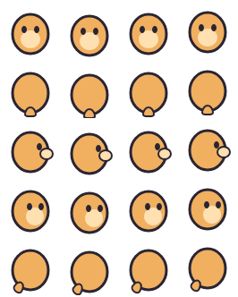

Repare:

- A imagem é a sprite sheet com uma linha por animação, na ordem do arquivo.
- O corpo (`layer corpo`) não tem `only=`: aparece em todas as vistas. Só a cara muda, uma camada por direção.
- As animações não têm `key`: o pulinho vem do `bob=2,0.5` do osso ([capítulo 8](08-ossos.md#movimentos-automáticos-sway-bob-e-jitter)), que funciona em qualquer animação.

Na exportação para o Godot, as três direções da esquerda aparecem sozinhas:

```
salvo godot/bolinha.tscn  cena do Godot 4 (0 caixas, espelhadas: walk_left, walk_down_left, walk_up_left) · 12 KB
```

No jogo, `anim.tocar("walk", velocity)` olha para onde o personagem anda e escolhe uma das oito. Com as diagonais, ele divide o círculo em oito fatias de 45 graus; sem elas, usa só as quatro direções retas. Um script de jogo visto de cima lê as quatro setas:

```gdscript
func _physics_process(_delta: float) -> void:
	velocity = Input.get_vector("ui_left", "ui_right", "ui_up", "ui_down") * 120.0
	move_and_slide()
	anim.tocar("walk", velocity)
```

**Experimente:** apague as duas linhas `anim` das diagonais. A bolinha passa a ter quatro direções, e na diagonal o `tocar()` escolhe a reta mais perto. `--no-mirror` na linha de comando exporta sem os lados espelhados.

Com ossos, dá para escrever cada animação uma vez só: as vistas usam o mesmo esqueleto, e o Weasel gera a `walk_down`, a `walk_right` e a `walk_up` a partir da `walk` ([capítulo 17](17-jogo-tres-vistas.md)).

## Andar sem escorregar: `feet=`

```
anim nome … feet=ponto[,ponto…]
```

Num jogo, o personagem anda **no lugar**, como numa esteira: o corpo fica parado no quadro, e cada pé vai para trás enquanto está no chão. Quem leva o personagem pela fase é o código do jogo. Se o jogo move o personagem mais depressa que o pé vai para trás, o pé **escorrega**. `feet=` diz ao Weasel quais pontos são os pés, e ele mede quantos pixels por segundo o personagem tem de andar para os pés no chão ficarem parados.

<!-- gerar: img/09_passada.gif -a anda_right --guides -->
<!-- gerar: img/09_passada_trajetoria.png -a anda_right --trajectory -->
<!-- gerar: img/09_passada_conferencia.png --contact -->
```weasel
canvas 200 200 bg=#e8eef5
palette ink=#2a2433 line=4 pele=#7cc4e8

godot body=character root=100,180 name=Andador

bone corpo pivot=100,110
bone perna_e pivot=106,130 parent=corpo
bone perna_d pivot=94,128 parent=corpo

layer chao guide
line linha_chao c=#9aa5b1 w=1 : 0,180 200,180

layer perna_atras
stroke coxa_d w=8 c=ink bone=perna_d : 94,128 94,172
ellipse sapato_d 98,173 9,4 c=ink bone=perna_d
layer corpo
ellipse tronco 100,105 28,30 c=pele ink=line bone=corpo
ellipse olho 112,96 3,4 c=ink bone=corpo
layer perna_frente
stroke coxa_e w=8 c=ink bone=perna_e : 106,130 106,176
ellipse sapato_e 110,177 9,4 c=ink bone=perna_e

# os pés: um ponto na sola de cada um, preso ao osso da perna (a de trás pisa um
# pouco mais alto, no lado de longe)
point pe_e 106,180 bone=perna_e
point pe_d 94,176 bone=perna_d

# cada pé vai 10 px para trás por quadro enquanto pisa e volta pelo ar
anim anda_right frames=8 fps=12 feet=pe_e,pe_d
key 0 perna_e=20,0,0 perna_d=-20,0,0 ease=linear
key 2 perna_d=0,-12,0 ease=linear
key 4 perna_e=-20,0,0 perna_d=20,0,0 ease=linear
key 6 perna_e=0,-12,0 ease=linear
key 8 perna_e=20,0,0 perna_d=-20,0,0 ease=linear
event 0 passo
event 4 passo
```

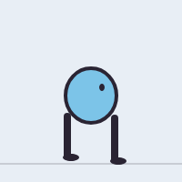

Repare:

- Um `point` na sola de cada pé, preso ao osso da perna.
- `feet=pe_e,pe_d` no `anim`: os nomes dos pontos, separados por vírgula (um ou mais). Ponha nas animações em que o personagem anda: passo, trote, corrida. Numa animação parada, a medida dá zero.
- **Como ele mede:** para cada pé, o chão é o ponto mais baixo a que aquele pé chega. O Weasel mede quanto o pé anda para trás entre dois quadros no chão e usa o valor do meio, para um quadro torto não estragar a conta. Aqui, 10 pixels por quadro a 12 fps: o personagem anda 120 pixels por segundo.
- Vale para personagens vistos **de lado**, andando para a direita ou para a esquerda.

O `--info` mostra a medida em cada animação com `feet=` (com `-s`, já na escala da exportação):

```
  anda_right     8 quadros, 12 fps
                 eventos: passo@0, passo@4
                 pés: anda 120 px/s para a direita (10 px por quadro a 12 fps)
```

**Experimente:** troque `key 4 perna_e=-20,0,0 perna_d=20,0,0` por `key 4 perna_e=-40,0,0 perna_d=20,0,0`. O pé da frente passa a andar 15 pixels por quadro, e o de trás continua com 10. Não dá para os dois ficarem parados no chão, e o `--info` avisa que os dois escorregam.

### A trajetória dos pés: `--trajectory`

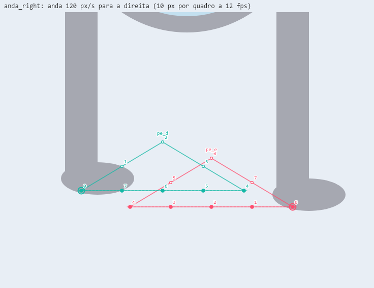

`--trajectory` desenha o caminho de cada pé em todos os quadros, numerado, por cima do personagem clarinho. As bolinhas cheias são os quadros no chão, e a linha tracejada é onde o pé pisa. No chão, as bolinhas têm de ficar **em linha e igualmente espaçadas**: uma fora do lugar é um escorregão. `--trajectory=mao,pe_e` segue outros pontos (os que não são pés mostram só o caminho).

```bash
node cli/weasel.js andador.weasel -a anda_right --trajectory -o pes.png
```

Quando um pé, no chão, anda diferente dos outros, o `--info` e o `--trajectory` avisam:

```
                 aviso: pe_d escorrega: no chão vai para trás de 6 a 14 px por quadro (os outros, 10)
```

### A folha de conferência: `--contact`

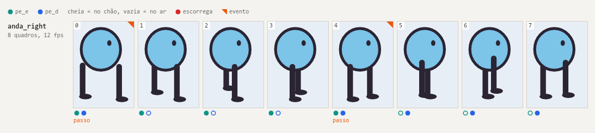

Para achar o quadro em que o pé escorrega, use `--contact`. Ele monta uma folha com todos os quadros numerados, uma linha por animação. Embaixo de cada quadro ficam as marcas:

- uma bolinha por pé, na cor do pé: **cheia** no chão, **vazia** no ar;
- **vermelha** (e o quadro com borda vermelha) quando o pé escorrega;
- o nome dos eventos, em laranja, com um canto laranja no quadro.

```bash
node cli/weasel.js andador.weasel --contact -o folha.png
```

- Sem `-a`, entram todas as animações; `-a "parado anda_right"` escolhe quais, nessa ordem.
- Todos os quadros têm o mesmo recorte, para comparar as posições. Uma animação longa quebra em linhas de 12 quadros (`--cols` muda), e `-s` escolhe a escala.
- A folha serve para conferir e não vai para o jogo. Ela também serve sem `feet=`: os números e os eventos aparecem do mesmo jeito.

### No jogo: a velocidade dos pés

A cena do Godot guarda a medida de cada animação (já na escala da exportação; as espelhadas andam o mesmo). `velocidade()` diz a da animação que está tocando, e `velocidade("anda")` a da `anda`. O jogo escolhe o que fazer com ela:

```gdscript
	# o personagem anda na velocidade dos pés
	anim.tocar("anda" if dir else "parado", Vector2(dir, 0))
	velocity.x = dir * anim.velocidade()
```

```gdscript
	# ou: o jogo manda na velocidade, e o passo acompanha
	anim.speed_scale = absf(velocity.x) / anim.velocidade() if velocity.x else 1.0
```

- `tocar()` recomeça a animação do quadro 0 quando ela muda. Entre dois jeitos de andar (de `anda` para `trote`), isso faz o pé que estava no chão aparecer de repente no ar. `tocar("trote", velocity, true)` continua no mesmo ponto da passada: com `feet=` nas duas, o pé que está no chão continua no chão. Só vale entre animações em loop.
- No filme, `speed=auto` usa a mesma medida ([capítulo 19](19-filme-atuacao.md#andar-sem-escorregar-speedauto)).

## Opções do personagem de jogo

| Linha | Opção | O que faz | Valores | Se não escrever |
|---|---|---|---|---|
| `godot` | `body=` | o tipo do nó raiz | `character`, `static`, `area`, `rigid` ou `node` | `character` |
| `godot` | `root=` | a origem | dois números | o meio da base do recorte |
| `godot` | `name=` | o nome do nó raiz | letras sem acento, números e `_` | o nome do arquivo exportado |
| `godot` | `normal=` | a força do relevo | de 0 a 10 | 1 |
| `box` | tipo e formato | corpo, golpe ou dano; retângulo, círculo ou cápsula | `body`, `hit`, `hurt`; `rect`, `circle`, `capsule` | `body rect` |
| `box` | `bone=`, `only=`, `off` | segue um osso, só em certas animações, começa desligada | um osso; nomes de `anim` e `pose`; palavra | parada, em todas, ligada |
| `point` | `bone=` | o osso que o ponto segue | o nome de um osso | parado |
| `anim` | `feet=` | os pontos que são os pés | um ou mais nomes de `point` | sem medida |

As fichas completas estão na referência: [`godot`](20-referencia.md#godot), [`box`](20-referencia.md#box), [`point`](20-referencia.md#point) e [`anim`](20-referencia.md#anim). As opções de exportar estão na [linha de comando](22-linha-de-comando.md).

**No editor:** as caixas aparecem por cima do desenho (**Exibir › Hitboxes**), os pontos aparecem com **Exibir › Guias**, e **Exibir › Trajetória** mostra o caminho dos pés. A janela **Exportar** tem a aba **Godot** ([capítulo 23](23-editor.md#jogo)).

## Juntando tudo

Um herói de jogo de plataforma: ele fica parado, anda sem escorregar e dá um golpe de espada. A cápsula é o corpo, a caixa de dano segue o tronco, a caixa do golpe segue a espada e só liga no golpe, e um ponto marca a ponta da espada.

<!-- gerar: img/15_heroi.gif -a parado_right,anda_right*2,ataque_right -->
<!-- gerar: img/15_heroi_folha.png --contact -->
```weasel
canvas 200 200 bg=none
palette ink=#2a2433 line=4 pele=#f2c9a0 roupa=#4a7bd0 metal=#d8dce6 cabo=#8a5a30

godot root=100,180 name=Heroi

bone corpo pivot=100,110
bone perna_e pivot=106,130 parent=corpo
bone perna_d pivot=94,128 parent=corpo
bone braco pivot=104,98 parent=corpo

layer perna_atras
stroke coxa_d w=8 c=ink bone=perna_d : 94,128 94,172
ellipse sapato_d 98,173 9,4 c=ink bone=perna_d
layer corpo
ellipse tronco 100,108 22,28 c=roupa ink=line bone=corpo
ellipse cabeca 100,64 18 c=pele ink=line bone=corpo
ellipse olho 108,62 3,4 c=ink bone=corpo
layer perna_frente
stroke coxa_e w=8 c=ink bone=perna_e : 106,130 106,176
ellipse sapato_e 110,177 9,4 c=ink bone=perna_e
layer braco
rect lamina 114,94 52,8 r=2 c=metal ink=3 bone=braco
rect guarda 108,88 6,20 r=2 c=cabo ink=3 bone=braco
ellipse mao 106,98 7 c=pele ink=3 bone=braco

box colisao body capsule 100,128 40,104
box dano hurt rect 78,46 44,90 bone=corpo
box corte hit rect 114,90 52,16 bone=braco only=ataque_right off

point pe_e 106,180 bone=perna_e
point pe_d 94,176 bone=perna_d
point ponta 166,98 bone=braco

anim parado_right frames=8 fps=8
key 0 corpo=0,0,0 braco=0,0,-60
key 4 corpo=0,2,0
key 8 corpo=0,0,0

anim anda_right frames=8 fps=12 feet=pe_e,pe_d
key 0 perna_e=20,0,0 perna_d=-20,0,0 braco=0,0,-60 ease=linear
key 2 perna_d=0,-12,0 ease=linear
key 4 perna_e=-20,0,0 perna_d=20,0,0 ease=linear
key 6 perna_e=0,-12,0 ease=linear
key 8 perna_e=20,0,0 perna_d=-20,0,0 ease=linear
event 0 passo
event 4 passo

anim ataque_right frames=8 fps=12 once
key 0 braco=0,0,-60
key 2 braco=0,0,25 corte.show=1
key 4 corte.show=0
key 8 braco=0,0,-60
event 2 golpe
```

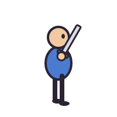

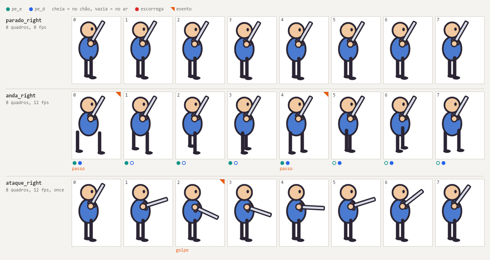

- **O corpo:** a cápsula `colisao` é mais alta que larga, em pé, do quadril à cabeça. Ela escorrega nas quinas da fase.
- **O dano:** a caixa `dano` segue o osso `corpo`, então sobe e desce com a respiração.
- **O golpe:** a caixa `corte` segue o braço, só existe no `ataque_right` e só liga nos quadros 2 e 3, quando a espada está esticada. O `event 2 golpe` avisa o jogo no mesmo quadro.
- **Os pés:** `feet=pe_e,pe_d` mede o andar: 120 pixels por segundo.
- **A ponta:** o ponto `ponta` segue a espada, para o jogo pôr ali uma faísca ou um som.

O script do jogo, no nó raiz da cena exportada:

<details>
<summary>O script do herói</summary>

```gdscript
extends CharacterBody2D

@onready var anim: AnimationPlayer = $AnimationPlayer

func _ready() -> void:
	anim.evento.connect(_quando_evento)
	$Hitbox.area_entered.connect(_quando_acerta)

func _physics_process(delta: float) -> void:
	if not is_on_floor():
		velocity += get_gravity() * delta
	var dir := Input.get_axis("ui_left", "ui_right")
	var atacando := anim.current_animation.begins_with("ataque") and anim.is_playing()
	if atacando:
		velocity.x = 0.0
	elif Input.is_action_just_pressed("ui_accept"):
		anim.tocar("ataque", Vector2(dir, 0))
		velocity.x = 0.0
	elif dir:
		anim.tocar("anda", Vector2(dir, 0))
		velocity.x = dir * anim.velocidade()
	else:
		anim.tocar("parado")
		velocity.x = 0.0
	move_and_slide()

func _quando_acerta(area: Area2D) -> void:
	if area.owner != self:  # o golpe também encosta na própria Hurtbox
		print("acertou ", area.owner.name)

func _quando_evento(nome: StringName) -> void:
	if nome == &"golpe":
		print("golpe na ponta da espada: ", $ponta.global_position)
	elif nome == &"passo":
		pass  # toque o som do passo aqui
```

</details>

- As setas andam, na velocidade dos pés. **Enter** (ou **Espaço**) dá o golpe, e o herói fica parado até o golpe acabar.
- `$Hitbox.area_entered` avisa quando a caixa do golpe encosta na `Hurtbox` de outro personagem.

**Experimente:** ponha `event 6 passo` e um `key 6 corpo=0,-3,0` no `ataque_right`, e um `key 8 corpo=0,0,0`. O herói dá um pulinho no fim do golpe, e o jogo ouve o pé voltar ao chão.

## Resumo

- A linha `godot` faz da exportação `-o nome.tscn` uma cena pronta: `body=` é o tipo do objeto, `root=` a origem e `name=` o nome.
- `box` é a caixa de colisão: `body` bate nas paredes, `hit` é o golpe e `hurt` é onde leva dano. `bone=`, `only=`, `off` e `key nome.show=` fazem o golpe seguir a arma e ligar na hora certa.
- `point` é um ponto que o jogo acompanha quadro a quadro, como a saída do tiro.
- No Godot, `tocar("anda", velocity)` escolhe a direção, e os `event` chegam pelo sinal `evento`. O lado `_left` sai espelhado.
- `feet=` mede quanto o personagem anda sem escorregar; `--trajectory` e `--contact` mostram onde ele escorrega.

[← Profundidade (2.5D)](14-profundidade.md) · [Índice](README.md) · [Próximo: Jogo: fases e recursos avançados →](16-jogo-avancado.md)
