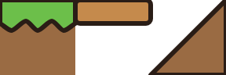
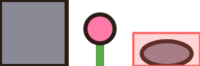
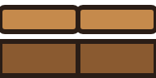
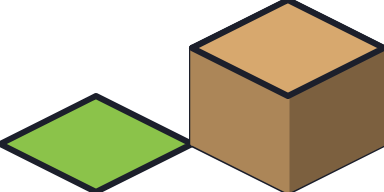
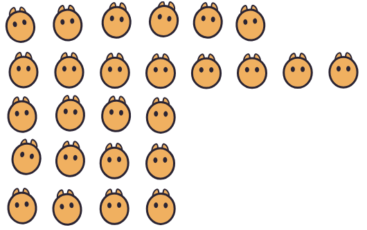
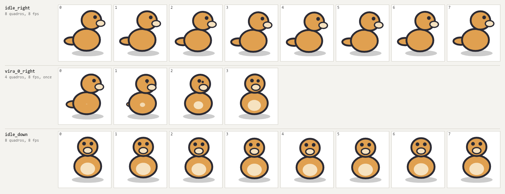
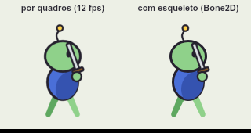
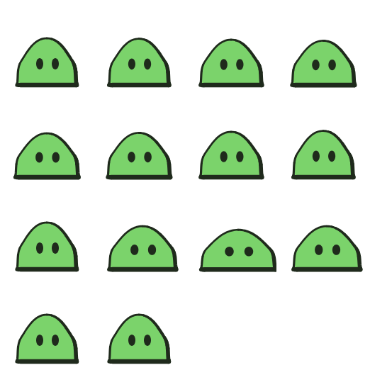
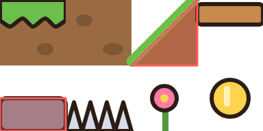
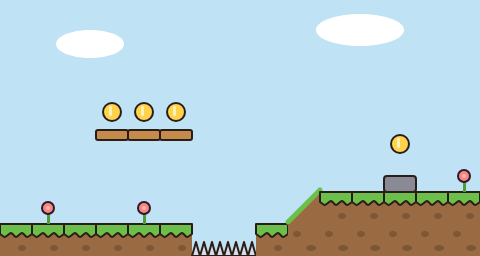

# 16. Jogo: fases e recursos avançados

[← Jogo: o personagem no Godot](15-jogo-personagem.md) · [Índice](README.md) · [Próximo: Filme: atores, planos e câmera (antigo) →](10-filme.md)

Este capítulo continua o [capítulo 15](15-jogo-personagem.md). Ele mostra os blocos para montar as fases (`tileset`), as transições entre animações, a virada de lado para a frente, o esqueleto de verdade no Godot e a sprite sheet para outros motores de jogo, como a Unity. Cada parte vale sozinha: leia a que o seu jogo precisa.

## Tileset: blocos para montar fases

```
tileset [size=lado | size=largura,altura] [auto] [iso]
tile nome coluna,linha [solid] [oneway] [collision=forma]
```

Com `tileset`, o `canvas` vira uma **folha de blocos**, uma grade de quadrados do mesmo tamanho. Cada `tile` diz qual célula da grade vira bloco e como ela colide. No Godot, o editor de fases pinta o mapa com esses blocos.

<!-- gerar: img/09_tileset.png -s 3 -->
```weasel
canvas 96 32 bg=none
palette ink=#2a1d16 line=2 grama=#6cbf4a terra=#9a6b43 madeira=#c58a4c

tileset size=32

rect terraA 0,6 32,26 c=terra
shape gramaA c=grama ink=line smooth=0.6 : 0,0! 32,0! 32,10! 27,13 22,9 16,13 11,9 5,13 0,10!
rect tabua 32,0 32,10 r=2 c=madeira ink=line
shape rampa c=terra ink=line : 64,32! 96,0! 96,32!

tile chao 0,0 solid
tile plataforma 1,0 oneway
tile rampa 2,0 collision=rampa
```



Repare:

- `tileset size=32`: blocos de 32×32. O `canvas` de 96×32 tem três colunas e uma linha.
- `tile chao 0,0 solid`: a célula da coluna 0, linha 0 vira o bloco `chao`, que colide no quadrado inteiro. Coluna e linha começam em 0.
- `tile plataforma 1,0 oneway`: colide só por cima. O personagem pula por baixo e para em cima.
- `tile rampa 2,0 collision=rampa`: colide no formato da forma `rampa`, um triângulo.
- Um `tile` sem nenhuma dessas palavras não colide: ele só dá o nome ao bloco.

**Experimente:** troque `tile plataforma 1,0 oneway` por `tile plataforma 1,0 solid`. A tábua vira um bloco sólido: o personagem bate a cabeça nela ao pular.

Exporte com `-f godot` (ou um nome terminado em `.tres`):

```bash
node cli/weasel.js blocos.weasel -f godot -o godot/blocos.tres
```

Saem dois arquivos, que precisam ficar na mesma pasta: a imagem (`blocos.png`) e o **TileSet** do Godot (`blocos.tres`), a lista de blocos que o editor de fases do Godot usa. `--normal` acrescenta o normal map. Dentro do `.tres`, cada célula tem a colisão e o nome:

```
0:0/0/physics_layer_0/polygon_0/points = PackedVector2Array(-16, -16, 16, -16, 16, 16, -16, 16)
0:0/0/custom_data_0 = "chao"
1:0/0/physics_layer_0/polygon_0/points = PackedVector2Array(-16, -16, 16, -16, 16, 16, -16, 16)
1:0/0/physics_layer_0/polygon_0/one_way = true
1:0/0/custom_data_0 = "plataforma"
2:0/0/physics_layer_0/polygon_0/points = PackedVector2Array(-16, 16, 16, -16, 16, 16)
2:0/0/custom_data_0 = "rampa"
```

- `0:0` é a coluna 0, linha 0. Os pontos são contados a partir do **meio** do bloco: `-16,-16` é o canto de cima à esquerda de um bloco de 32.
- O nome vai como dado do bloco. No Godot, `tile_data.get_custom_data("nome")` diz se o bloco é `espinhos`, `moeda`… e o jogo decide o que fazer.

### Enfeites e colisão sob medida: `auto`

Numa fase, muita coisa é só enfeite (flores, pedrinhas, nuvens) e não precisa de `tile`. Com `auto`, toda célula desenhada que não tem `tile` vira um bloco **sem colisão**. E a forma do `collision=` pode ficar numa camada `guide`: ela dá o formato da colisão sem aparecer no bloco.

<!-- gerar: img/09_auto.png -s 3 --guides -->
```weasel
canvas 96 32 bg=none
palette ink=#2a1d16 line=2 pedra=#8a8a96 flor=#ff7aa8 folha=#5ca84a

tileset size=32 auto

layer blocos
rect pedraGrande 0,0 32,32 c=pedra ink=line
rect caule 46,16 4,16 c=folha
ellipse petala 48,14 7 c=flor ink=line
ellipse pedrinha 80,26 12,6 c=pedra ink=line

# a colisão do último bloco: meio bloco, só a metade de baixo
layer colisoes guide
rect meio 64,16 32,16 c=#ff5a5a40 ink=1 inkc=#ff5a5a

tile pedra 0,0 solid
tile pedrinha 2,0 collision=meio
```



Repare:

- A flor (coluna 1) **não tem `tile`**. Com `auto`, ela vira um bloco mesmo assim, sem colisão, com o nome `bloco_1_0` (coluna 1, linha 0). Uma célula vazia não vira bloco.
- `tile pedrinha 2,0 collision=meio` usa o `rect meio` como colisão: a pedrinha colide só na metade de baixo do bloco, de y=0 (o meio) até y=16 (a borda).
- O `meio` está numa camada `guide`, então **não aparece** no bloco do jogo. Na imagem, as camadas `guide` aparecem para você ver onde ele fica.

### Blocos retangulares: `size=largura,altura`

Com dois números, `size=` faz blocos que não são quadrados. Meio bloco de altura é bom para pontes, prateleiras e degraus:

<!-- gerar: img/09_tabuas.png -s 3 -->
```weasel
canvas 64 32 bg=none
palette ink=#2a1d16 line=2 madeira=#c58a4c escura=#8a5a30

tileset size=32,16

rect tabuaA 0,3 32,10 r=2 c=madeira ink=line
rect tabuaB 32,3 32,10 r=2 c=madeira ink=line
rect vigaA 0,17 32,14 c=escura ink=line
rect vigaB 32,17 32,14 c=escura ink=line

tile ponteE 0,0 oneway
tile ponteD 1,0 oneway
tile vigaE 0,1 solid
tile vigaD 1,1 solid
```



- `size=32,16`: 32 de largura e 16 de altura. O `canvas` de 64×32 tem duas colunas e **duas linhas**. A linha 1 (`0,1` e `1,1`) é a de baixo: as vigas.
- No `.tres`, o tamanho e a colisão seguem o retângulo: `texture_region_size = Vector2i(32, 16)`, e os pontos vão de `-16,-8` a `16,8`.

### Tileset isométrico

Com `iso`, cada célula tem um **losango** na parte de baixo, com a metade da altura da largura; a parte de cima sobra para a altura das caixas e das paredes. Cada bloco vai numa camada `iso=` ([capítulo 14](14-profundidade.md#mapa-isométrico-iso)), com o canto 0,0 na ponta de cima do losango da célula:

<!-- gerar: img/16_tileset_iso.png -s 3 -->
```weasel
canvas 128 64 bg=none
palette ink=#1c1f2b line=2 grama=#8bc34a caixa=#d7a86e

tileset size=64,64 iso

layer grama iso=32,32
rect g 0,0 32,32 c=grama ink=line
layer caixa iso=96,32
rect c 0,0 32,32 c=caixa ink=line thick=32

tile grama 0,0
tile caixa 1,0 solid
```



- Na célula de 64×64, o losango é de 64×32. Um quadrado de 32×32 no código vira esse losango, e `thick=32` faz uma caixa que enche a célula até em cima.
- O `.tres` sai no formato isométrico do Godot (*Isometric*, *Diamond Down*), e a colisão de `solid` é o losango. No Godot, use o TileSet num `TileMapLayer` e pinte o mapa normalmente.
- Para um chão sem caixas, `size=64,32` basta. Uma célula mais baixa que a metade da largura dá aviso.

| Linha | Opção | O que faz | Valores | Se não escrever |
|---|---|---|---|---|
| `tileset` | `size=` | o tamanho do bloco | um número (quadrado) ou dois (largura e altura), inteiros, de 2 para cima | 32 |
| `tileset` | `auto` | célula desenhada sem `tile` vira bloco sem colisão | palavra | desligado |
| `tileset` | `iso` | blocos em losango | palavra | desligado |
| `tile` | `coluna,linha` | a célula | inteiros a partir de 0, dentro da grade | (obrigatório) |
| `tile` | `solid` | colide no bloco inteiro | palavra | sem colisão |
| `tile` | `oneway` | colide só por cima; sozinho, no bloco inteiro | palavra | desligado |
| `tile` | `collision=` | colide no formato de uma forma | o nome de uma forma fechada | sem colisão |

As fichas completas estão na referência: [`tileset`](19-referencia.md#tileset) e [`tile`](19-referencia.md#tile).

**Cuidado:**
- Um arquivo tem um `tileset` só (o segundo é erro), e o `canvas` precisa caber pelo menos um bloco.
- Cada célula vira um bloco só, e dois blocos não podem ter o mesmo nome. Uma célula fora da grade é erro.
- `oneway` com `collision=` faz um bloco que colide só por cima no formato da forma: uma rampa ou um meio bloco em que dá para pular por baixo. `solid` com `collision=` dá aviso, e vale o `collision=`.
- Com `-s`, o bloco tem de dar um número inteiro de pixels: `size=32` com `-s 0.3` é erro.

## Sair de uma animação sem corte: `from=` e `to=`

```
anim nome from=animação to=animação [frames=n] [fps=n] [every=n]
```

Trocar de animação no jogo é um corte seco: num quadro a bolinha está inclinada no meio da corrida; no seguinte, está parada. Uma **transição** gera os quadros do meio:

<!-- gerar: img/09_transicao.png -f sheet -a all --layout rows -->
```weasel
canvas 64 64 bg=none
palette ink=#2a2433 line=3 pelo=#f0b060

godot root=32,58 name=Bolinha

bone corpo pivot=32,58
bone orelha pivot=32,18 parent=corpo

layer corpo
shape orelhas c=pelo ink=2 bone=orelha : 22,22 26,8 32,18 38,8 42,22
ellipse bola 32,36 20,22 c=pelo ink=line bone=corpo
ellipse olhoE 25,31 3,4 c=ink bone=corpo
ellipse olhoD 39,31 3,4 c=ink bone=corpo

anim run frames=6 fps=12
key 0 corpo=0,0,-12 orelha=0,0,10
key 3 corpo=0,-8,12 orelha=0,0,-10
key 6 corpo=0,0,-12 orelha=0,0,10

anim idle frames=8 fps=6
key 0 corpo=0,0,0
key 4 corpo=0,1,0,1.03,0.97
key 8 corpo=0,0,0

anim stop from=run to=idle
```



Repare:

- `anim stop` não vira uma animação. No lugar dela, o Weasel gera as **peças** `stop_0`, `stop_2` e `stop_4`.
- Cada peça começa num quadro do `run` (o número no nome) e termina no primeiro quadro do `idle`. Ela tem 4 quadros (mude com `frames=`), no fps do `run` (mude com `fps=`).
- O `run` é um loop: o jogo pode parar em qualquer quadro. Por isso há uma peça a cada 2 quadros (mude com `every=`). Um `every=` maior gera menos peças, com uma transição menos exata.
- Uma animação `once` (um ataque) sempre acaba no mesmo quadro, então gera uma peça só, a do último quadro. Com `every=` escrito, ela gera também peças ao longo do caminho, para quando o golpe é interrompido.
- Nas peças, ossos e cores mudam aos poucos, e um giro vai pelo caminho mais curto. O que liga e desliga (o `show`, as caixas, o `only=`) troca no meio da peça.
- As peças tocam uma vez e aparecem em toda lista de animações: a folha, o `.tres`, a cena do Godot, o GIF e o player do editor.

**Experimente:** acrescente `every=3` na linha `anim stop`. Saem só duas peças, `stop_0` e `stop_3`.

Com direções, `from=walk to=idle` acha sozinho `walk_right` → `idle_right`, `walk_down` → `idle_down`…, e as peças levam a direção no fim (`stop_0_right`). O nome exato também serve: `from=walk_right to=idle_right`.

| Opção | O que faz | Valores | Se não escrever |
|---|---|---|---|
| `from=`, `to=` | de que animação a peça sai e em qual chega | nomes de `anim`, com ou sem a direção | (obrigatórios) |
| `frames=` | quantos quadros cada peça tem | de 1 a 600 | 4 |
| `fps=` | quantos quadros por segundo | de 1 a 60 | o fps do `from=` |
| `every=` | uma peça a cada quantos quadros do `from=` | de 1 a 600 | 2; numa `once`, só a do último quadro |

**Cuidado:**
- Cada peça custa `frames=` quadros na folha: um `run` de 12 quadros com `every=2` dá 6 peças de 4 quadros, 24 quadros a mais.
- Uma transição não junta com `mix=`, e o `from=` e o `to=` não podem ser peças de outra transição. `loop` numa transição dá aviso: as peças tocam uma vez.

### No jogo: `trocar()`

No Godot, troque de animação com `trocar()` em vez de `tocar()`, e o ajudante escolhe a peça sozinho:

```gdscript
func _physics_process(_delta: float) -> void:
	velocity = Input.get_vector("ui_left", "ui_right", "ui_up", "ui_down") * 120.0
	move_and_slide()
	if velocity:
		anim.trocar("run", velocity)
	else:
		anim.trocar("idle", velocity)
```

- **A ida:** quando o personagem para no meio do `run`, o `trocar("idle")` toca a peça do quadro em que o `run` está, arredondando para baixo até uma peça que existe (no quadro 3, a `stop_2`). No fim dela, toca o `idle`.
- **A volta:** quando ele volta a correr, o `trocar("run")` toca a mesma peça **de trás para a frente**, e o `run` continua do quadro em que ela termina. Se o `idle` estava longe do quadro 0, a volta pode dar um pulinho.
- **Sem peças para o par:** entre dois loops, a nova animação continua no mesmo ponto da passada, como no `tocar(acao, dir, true)` ([capítulo 15](15-jogo-personagem.md#no-jogo-a-velocidade-dos-pés)). Na cena por quadros, a troca é seca. Com esqueleto (`rig=bones`), as duas se misturam em 0,2 s; o terceiro parâmetro muda o tempo (`trocar("idle", velocity, 0.4)`; com 0, corta seco).
- Pode chamar o `trocar()` a cada quadro, como o `tocar()`: ele só começa uma troca quando a animação muda. Enquanto a peça toca, não chame `tocar()`: ele corta a peça.

## Virar de lado para a frente: `turn`

```
anim nome from=animação to=animação turn [pairs=parte->parte,…] [born=parte->parte,…]
```

Num jogo visto de cima, cada vista é outro desenho, em camadas com `only=`. Uma transição comum não ajuda aqui: ela mistura as poses, mas as partes de uma vista não existem na outra, e a troca acontece de uma vez no meio da peça. Com `turn`, a peça é uma **virada**: as partes da vista de lado se transformam nas da vista de frente.

<!-- gerar: img/09_virada.png --contact -a idle_right,vira_0_right,idle_down -->
```weasel
canvas 120 120 bg=none
palette ink=#2b2a33 pelo=#e0a050 claro=#f6e2c0 sombra=#00000033

godot root=60,110
bone corpo pivot=60,100
bone cabeca pivot=60,66 parent=corpo

layer chao
ellipse sombra 60,106 26,5 c=sombra

layer lado only=idle_right
ellipse caudaL 34,86 12,6 c=pelo ink=3 bone=corpo
ellipse corpoL 58,84 22,18 c=pelo ink=3 bone=corpo
ellipse cabecaL 66,52 16,15 c=pelo ink=3 bone=cabeca
ellipse focinhoL 81,57 7,5 c=claro ink=2 bone=cabeca
ellipse olhoL 72,47 3,3 c=ink bone=cabeca

layer frente only=idle_down
ellipse corpo 60,84 22,18 c=pelo ink=3 bone=corpo
ellipse barriga 60,88 12,10 c=claro bone=corpo
ellipse cabeca 60,52 16,15 c=pelo ink=3 bone=cabeca
ellipse focinho 60,58 7,5 c=claro ink=2 bone=cabeca
ellipse olhoE 54,47 3,3 c=ink bone=cabeca
ellipse olhoD 66,47 3,3 c=ink bone=cabeca

anim idle_right frames=8 fps=8
key 0 corpo=0,0,0 cabeca=0,0,0
key 4 corpo=0,2,0 cabeca=0,0,4
key 8 corpo=0,0,0 cabeca=0,0,0

anim idle_down frames=8 fps=8
key 0 corpo=0,0,0
key 4 corpo=0,2,0
key 8 corpo=0,0,0

anim vira from=idle_right to=idle_down frames=4 every=4 turn pairs=olhoL->olhoE born=olhoD->cabecaL
```



Repare:

- **Cada parte acha o seu par** na outra vista, pelo nome (`corpoL` vira `corpo`), pelo osso e pelo lugar. O contorno de uma se transforma no da outra, e as cores se misturam.
- **`pairs=` casa à mão** quando o Weasel escolhe errado. Sozinho, ele casaria o olho de lado com o olho direito, que está mais perto. `pairs=olhoL->olhoE` diz que o olho de lado vira o esquerdo. Vários pares vão separados por vírgula.
- **Uma parte que só existe numa vista nasce ou some.** Ela cresce de dentro de uma parte da outra vista (a barriga nasce do corpo) ou encolhe para dentro dela (a cauda some no corpo).
- **`born=` diz de onde ela nasce** (ou para onde some): em `born=olhoD->cabecaL`, `olhoD` só existe na vista de frente, e nasce da `cabecaL`. A parte que nasce aparece atrás da outra; se couber dentro dela (o olho na cabeça), aparece na frente.
- Na primeira metade da peça, a ordem de pintura é a da vista de lado; na segunda, a da vista de frente. O que aparece nas duas vistas (a sombra) fica como está.
- O resto é como numa transição: `frames=`, `every=`, `fps=`, as peças `vira_0_right`…, o lado espelhado e o `trocar()`. Sem `turn`, o `pairs=` e o `born=` dão aviso.

**Experimente:** apague o `pairs=olhoL->olhoE`. Na virada, o olho de lado corre para o olho direito, e o esquerdo nasce da cabeça.

### Conferir o que casou: `--info`

O `--info` mostra o que o Weasel decidiu:

```
  vira_0_right   4 quadros, 8 fps, once, virada vira: de idle_right (depois do quadro 0) para idle_down
                 vira: olhoL->olhoE, corpoL->corpo, cabecaL->cabeca, focinhoL->focinho
                 nascem: barriga->corpoL, olhoD->cabecaL
                 somem: caudaL->corpo
```

- `vira:` lista os pares. As partes de mesmo nome nas duas vistas também casam, mas não entram na lista.
- `nascem:` e `somem:` dizem de onde cada parte nasce e para onde some.
- As linhas usam a escrita do `pairs=` e do `born=`: para corrigir, copie o par para a linha `anim` e troque a parte.

### A virada no Godot

As peças da virada são quadros como os outros, e o `trocar()` toca a virada de lado para a frente, e de trás para a frente na volta. Com esqueleto (`rig=bones`), os ossos do Godot não sabem trocar uma forma por outra: a virada sai quadro a quadro, numa imagem só, e a exportação avisa. No filme, um ator inteiro também pode virar outro, com as mesmas regras ([capítulo 18](10-filme.md#um-ator-vira-outro-morph)).

## Esqueleto de verdade: `rig=bones` (experimental)

A cena por quadros guarda **imagens prontas**: o Godot troca de uma para a outra no `fps` de cada animação. Com esqueleto, o Godot recebe os **ossos** e as **peças** do desenho, e calcula o movimento sozinho:

```
godot body=character root=100,190 name=Lagarto rig=bones
```

Sem mudar o arquivo, `--rig` na linha de comando exporta com esqueleto, e `--no-rig` exporta por quadros mesmo com `rig=bones`.



| | Por quadros (`rig=frames`, o padrão) | Com esqueleto (`rig=bones`) |
|---|---|---|
| Movimento | pula de quadro em quadro | liso, também em câmera lenta |
| Tamanho | uma imagem por quadro | uma imagem por peça: um personagem grande cai de 1,6 MB para 52 KB |
| No Godot | o tocador troca os quadros | dá para misturar animações e girar ossos pelo código |
| Bom para | pixel art, inimigos pequenos, personagens que mudam muito de forma | o herói, chefes, personagens grandes e macios |

Com o atirador do [capítulo 15](15-jogo-personagem.md#pontos-de-encaixe-point), as duas exportações ficam assim:

```bash
node cli/weasel.js atirador.weasel -o godot/atirador.tscn
node cli/weasel.js atirador.weasel --rig -o godot/atirador.tscn
```

```
salvo godot/atirador.png  490×290, 12 quadros de 120×94 · 25 KB
…
salvo godot/atirador.png  87×94, 3 imagens de peças · 4 KB
…
salvo godot/atirador.tscn  cena do Godot 4 com esqueleto (2 ossos, 3 peças presas aos ossos, 2 pontos, espelhadas: shoot_left) · 12 KB
```

Por quadros, a folha tem os 12 quadros da animação. Com `--rig`, ela tem só **3 peças** (o tronco, o cano e o clarão), e a cena fica assim:

```
Atirador (CharacterBody2D)
├── Visual (Node2D)               ← vira de lado nas animações espelhadas
│   ├── Esqueleto (Skeleton2D)
│   │   └── corpo (Bone2D)        ← um Bone2D para cada bone, um dentro do outro, como o parent=
│   │       └── braco (Bone2D)
│   └── Pecas (Node2D)
│       ├── tronco_0 (Sprite2D)   ← as formas de um mesmo osso viram uma imagem só, que anda com o osso
│       ├── cano_1 (Sprite2D)
│       └── clarao_2 (Sprite2D)
├── saida · pe (Marker2D)         ← os pontos, como na cena por quadros
└── AnimationPlayer
```

- O que **dobra** (uma perna com IK, um tecido, uma forma com `bones=`) vira uma malha que entorta com os ossos.
- O que **muda de forma** (um morph, o `draw`, uma cor animada) troca de imagem, presa ao osso. Partículas, rastro e sombra no chão viram imagens que trocam a cada quadro, fora dos ossos.
- O `ik` é calculado no Weasel: no Godot, o pé não procura o chão sozinho durante o jogo.
- O normal map sai junto, uma imagem por peça. O `above=` e o `below=` também funcionam.
- Um osso que nenhuma animação mexe fica livre para o código do jogo: `$Visual/Esqueleto/corpo/cabeca.rotation = …` faz a cabeça olhar para o mouse.
- Caixas, pontos, eventos, `tocar()` e as animações espelhadas funcionam como na cena por quadros.

**Cuidado:** os giros em 3D do [capítulo 14](14-profundidade.md) (`yaw=`, `pitch=`, `z=` e `iso`) não cabem nos ossos do Godot. Com eles, `rig=bones` dá aviso: exporte por quadros.

## Para outros motores: sprite sheet e `unity`

Uma **sprite sheet** é uma imagem só com todos os quadros, mais um arquivo de texto que diz onde está cada um. Quase todo motor de jogo lê. Esta é a gosma do capítulo 15, agora com o golpe e as caixas de dano:

<!-- gerar: img/09_folha.png -f sheet -a all -->
```weasel
canvas 128 128 bg=none light=-0.6,-0.8
palette ink=#1f2a1c line=4 gosma=#7bd36b

godot body=character root=64,120 name=Gosma

bone corpo pivot=64,120

layer corpo
shape gosma c=gosma ink=line weight=0.3 bone=corpo : 64,52 100,84 106,118! 22,118! 28,84
ellipse olhoE 54,88 5,8 c=ink bone=corpo
ellipse olhoD 76,88 5,8 c=ink bone=corpo

box pes body rect 34,104 60,16
box dano hurt rect 26,56 76,64
box golpe_right hit rect 98,66 28,44 only=attack_right off

anim idle_right frames=8 fps=8
key 0 corpo=0,0,0,1,1
key 4 corpo=0,0,0,1.06,0.94
key 8 corpo=0,0,0,1,1

anim attack_right frames=6 fps=12 once
key 0 corpo=0,0,0,1,1
key 2 corpo=10,0,0,1.25,0.85 golpe_right.show=1
key 4 corpo=0,0,0,1,1 golpe_right.show=0
event 2 golpe
```



```bash
node cli/weasel.js gosma.weasel -f sheet -a all --trim -t -o sprites/gosma.png
```

A folha sai em PNG, mais um JSON no formato do TexturePacker e do Phaser: a posição de cada quadro, a duração, as animações (`frameTags`), os eventos, as caixas ligadas e os pontos de encaixe em cada quadro. Veja o [JSON da gosma](img/09_folha.json). O quadro do golpe, com `--trim`:

```json
"attack_right_02": {
  "frame": { "x": 246, "y": 178, "w": 120, "h": 86 },
  …
  "duration": 83,
  "events": ["golpe"],
  "boxes": [
    { "name": "pes", "kind": "body", "shape": "rect", "x": 56, "y": 70, "w": 60, "h": 16 },
    { "name": "dano", "kind": "hurt", "shape": "rect", "x": 56, "y": 46, "w": 76, "h": 64 },
    { "name": "golpe_right", "kind": "hit", "shape": "rect", "x": 104, "y": 46, "w": 28, "h": 44 }
  ]
}
```

- `frame` é onde o quadro está dentro do PNG. `duration` é quanto ele dura, em milissegundos (a 12 quadros por segundo, 83 ms).
- `events` traz o `event 2 golpe`, e `boxes` as caixas ligadas nesse quadro: a `golpe_right` só aparece nos quadros 2 e 3.
- Cada caixa vem pelo **centro** (`x`,`y`, em pixels do quadro) e pelo tamanho (`w`,`h`, ou `r` no círculo). Uma caixa presa a um osso girado traz também o `rot`, o giro em graus.
- Os pontos vão em `points`, com `x`,`y` e o `rot` do osso, só quando ele está girado: `{ "name": "saida", "x": 115.069, "y": 49.134, "rot": -30 }`.
- Nas animações com `feet=`, `meta.frameTags` traz o `groundSpeed`: a velocidade dos pés, em pixels por segundo, na escala da folha.

| Opção da linha de comando | O que faz | Se não escrever |
|---|---|---|
| `-f sheet` (ou `-o x.json`, `-o x.zip`) | a folha e o JSON; com `.zip`, os dois num arquivo só | — |
| `-a idle_right` ou `-a all` | as animações da folha | todas |
| `--trim [folga]` | recorta o espaço vazio em volta, igual em todos os quadros, deixando uma folga (de 0 a 1000 pixels) | sem recorte; com `--trim`, folga de 8 |
| `-t` | fundo transparente | o `bg=` do `canvas` |
| `-s 0.5` | escala | 1 |
| `--layout rows` | uma linha por animação (`grid` é a grade) | `grid` |
| `--cols n` | colunas da grade | automático |
| `--padding n` | o espaço entre os quadros, de 0 a 1000 pixels | 2 |
| `--variant all` | uma folha para cada variante de cor | a cor normal |

`-f godot` num personagem (sem o `.tscn`) salva só a folha e o `.tres` das animações, sem a cena; `--normal` acrescenta o normal map. A lista completa está na [linha de comando](21-linha-de-comando.md).

**Pixel art:** com `art pixel` ([capítulo 13](13-estilos.md#pixel-art-art-pixel)), a cena do Godot já vem sem suavizar a imagem (`texture_filter` em *nearest*). Com `small`, a folha e a cena saem com 1 pixel por quadrado do pixel art.

### Para a Unity: `unity`

```
unity [unit=n] [root=x,y] [collider=largura,altura[,dx[,dy]]]
```

`unity` acrescenta ao JSON três dados para a Unity: o tamanho da unidade, o pivô e um colisor.

<!-- conferir -->
```weasel
canvas 48 48 bg=none
palette ink=#5a3a10 line=3

unity unit=48 root=24,48 collider=0.75,0.75,0,0.5

ellipse moeda 24,24 18 c=#ffd34d ink=line
rect brilho 20,14 6,20 r=3 c=#fff2b0
```

Com `-f sheet -o sprites/moeda.png`, o fim do `moeda.json` fica assim:

```json
"unity": {
  "pixelsPerUnit": 48,
  "pivotBottomLeft": { "x": 0.5, "y": 0 },
  "collider": [0.75, 0.75, 0, 0.5]
}
```

Repare:

- `unit=48`: 48 pixels valem **uma unidade** da Unity. A moeda inteira tem 1 unidade.
- `root=24,48` é o meio da base. No JSON, ele vira `pivotBottomLeft`, contado como na Unity: de 0 a 1, a partir do canto de **baixo** à esquerda (0,5 é o meio, 0 é embaixo).
- `collider=0.75,0.75,0,0.5` é medido **em unidades**, a partir do `root=`: 0,75 × 0,75 de tamanho (36 × 36 pixels), com o centro 0 para o lado e 0,5 **para cima** (24 pixels acima da base, o meio da moeda).
- Sem nenhuma caixa `body`, a cena do Godot também usa esse colisor como corpo. E o `root=` vira a origem da cena do Godot, quando o `godot` não tem `root=`, e do ator num filme.

| Opção | O que faz | Valores | Se não escrever |
|---|---|---|---|
| `unit=` | quantos pixels valem uma unidade | de 1 a 100000 | 100 |
| `root=` | o pivô | dois números | o meio da base do `canvas` |
| `collider=` | o colisor: largura e altura, e o centro para o lado e para cima | de 2 a 4 números, em unidades (os que faltam valem 0) | sem colisor |

## Opções dos recursos avançados

| Linha | Opção | O que faz | Valores | Se não escrever |
|---|---|---|---|---|
| `tileset` | `size=`, `auto`, `iso` | o tamanho do bloco, os enfeites automáticos, os losangos | 1 ou 2 inteiros de 2 para cima; palavras | 32; desligados |
| `tile` | `solid`, `oneway`, `collision=` | como o bloco colide | palavras; o nome de uma forma fechada | sem colisão |
| `anim` | `from=`, `to=` | uma transição | nomes de `anim` | — |
| `anim` | `frames=`, `fps=`, `every=` | os quadros, o fps e o espaço entre as peças | 1 a 600; 1 a 60; 1 a 600 | 4; o do `from=`; 2 |
| `anim` | `turn`, `pairs=`, `born=` | a virada e o casamento das partes | palavra; pares `parte->parte` | casamento automático |
| `godot` | `rig=` | por quadros ou com esqueleto | `frames` ou `bones` | `frames` |
| `unity` | `unit=`, `root=`, `collider=` | os dados da Unity | 1 a 100000; dois números; 2 a 4 números | 100; o meio da base; nenhum |

As fichas completas estão na referência: [`tileset`](19-referencia.md#tileset), [`tile`](19-referencia.md#tile), [`anim`](19-referencia.md#anim), [`godot`](19-referencia.md#godot) e [`unity`](19-referencia.md#unity).

**No editor:** com **Exibir › Guias**, o tileset mostra a grade, o nome de cada bloco e a colisão ([capítulo 22](22-editor.md#jogo)).

## Juntando tudo

Um conjunto de blocos para uma fase de plataforma, e uma fase de teste montada com eles. Os blocos ficam num arquivo de componentes, o `pecas.weasel`, e dois arquivos usam esse arquivo com `include` ([capítulo 6](06-componentes.md)): o tileset, que vai para o Godot, e a fase de teste, para ver os blocos juntos antes de abrir o Godot.

<!-- arquivo: pecas.weasel -->
<!-- conferir -->
```weasel
palette ink=#2a1d16 line=2 grama=#6cbf4a terra=#9a6b43 pedra=#8a8a96 madeira=#c58a4c ouro=#ffd34d flor=#ff7aa8 folha=#4f9a3c

def chao
  rect solo 0,6 32,26 c=terra
  ellipse pedrinha 22,24 4,3 c=#7d5634
  shape topo c=grama ink=line smooth=0.6 : 0,0! 32,0! 32,10! 27,13 22,9 16,13 11,9 5,13 0,10!
end

def terra
  rect solo 0,0 32,32 c=terra
  ellipse pedrinha1 9,10 4,3 c=#7d5634
  ellipse pedrinha2 23,24 5,3 c=#7d5634
end

def rampa
  shape solo c=terra : 0,32! 32,0! 32,32!
  stroke topo w=5 c=grama : 0,30 32,-2
end

def tabua
  rect prancha 0,2 32,10 r=2 c=madeira ink=line
end

def meio
  rect laje 0,16 32,16 r=3 c=pedra ink=line
end

def espinhos
  shape pontas c=#d8dce6 ink=line : 0,32! 4,18! 8,32! 12,18! 16,32! 20,18! 24,32! 28,18! 32,32!
end

def flor
  rect caule 15,18 3,14 c=folha
  ellipse petala 16,16 6 c=flor ink=line
  ellipse miolo 16,16 2 c=ouro
end

def moeda
  ellipse disco 16,16 9 c=ouro ink=line
  rect brilho 13,10 3,10 r=1 c=#fff2b0
end
```

O tileset põe um componente em cada célula:

<!-- gerar: img/16_blocos.png -s 3 --guides -->
```weasel
canvas 128 64 bg=none
include "pecas.weasel"

tileset size=32 auto

layer blocos
use chao 0,0
use terra 32,0
use rampa 64,0
use tabua 96,0
use meio 0,32
use espinhos 32,32
use flor 64,32
use moeda 96,32

layer colisoes guide
shape colRampa c=#ff5a5a40 ink=1 inkc=#ff5a5a : 64,32! 96,0! 96,32!
rect colMeio 0,48 32,16 c=#ff5a5a40 ink=1 inkc=#ff5a5a

tile chao 0,0 solid
tile terra 1,0 solid
tile rampa 2,0 collision=colRampa
tile tabua 3,0 oneway
tile meio 0,1 oneway collision=colMeio
tile espinhos 1,1
tile moeda 3,1
```



E a fase de teste usa os mesmos componentes, com `repeat` ([capítulo 5](05-contas.md)):

<!-- gerar: img/16_fase.png -->
```weasel
canvas 480 256 bg=#bfe3f5
include "pecas.weasel"

layer nuvens
ellipse nuvem1 90,44 34,14 c=#ffffff
ellipse nuvem2 360,30 44,16 c=#ffffff

layer fase
repeat i 0..5
  use chao {i*32},224
end
use espinhos 192,224
use espinhos 224,224
use chao 256,224
use rampa 288,192
use terra 288,224
repeat i 10..14
  use chao {i*32},192
  use terra {i*32},224
end
repeat i 3..5
  use tabua {i*32},128
  use moeda {i*32},96
end
use meio 384,160
use moeda 384,128
use flor 32,192
use flor 128,192
use flor 448,160
```



- **Os blocos sólidos:** `chao` e `terra` colidem no bloco inteiro.
- **A rampa:** colide no triângulo `colRampa`, desenhado numa camada `guide`.
- **As plataformas:** a `tabua` é `oneway`. O `meio` é `oneway` com `collision=`: colide só por cima, e só na metade de baixo.
- **Os blocos sem colisão:** `espinhos` e `moeda` só têm o nome. No Godot, o jogo lê o nome do bloco em que o personagem encosta e decide: espinho machuca, moeda soma ponto. A flor vira o bloco `bloco_2_1`, com o `auto`.
- **A fase de teste** não vai para o jogo: no Godot, você pinta a fase com o TileSet. Ela serve para ver se os blocos combinam, e muda sozinha quando você muda um componente do `pecas.weasel`.

**Experimente:** no `pecas.weasel`, troque a cor `grama=#6cbf4a` por `grama=#c9a227`. A grama vira palha no tileset e na fase de teste ao mesmo tempo.

## Resumo

- `tileset` faz do `canvas` uma folha de blocos; cada `tile` dá o nome e a colisão (`solid`, `oneway`, `collision=`). `auto` faz os enfeites, e `iso` faz blocos em losango.
- `from=` e `to=` geram as peças de transição entre animações, e `trocar()` as toca no Godot. Com `turn`, a peça é uma virada entre duas vistas.
- `rig=bones` exporta os ossos e as peças, para um movimento liso e uma folha menor.
- `-f sheet` faz a sprite sheet com o JSON de quadros, eventos, caixas e pontos, para qualquer motor; `unity` acrescenta os dados da Unity.

[← Jogo: o personagem no Godot](15-jogo-personagem.md) · [Índice](README.md) · [Próximo: Filme: atores, planos e câmera (antigo) →](10-filme.md)
