# 17. Filme: atores, planos e câmera

[← Jogo: fases e recursos avançados](16-jogo-avancado.md) · [Índice](README.md) · [Próximo: Filme: atuação, som e legendas →](18-filme-atuacao.md)

Um arquivo que começa com `film` é um **filme**. Ele põe em cena desenhos que você já fez: os **atores**. Ele divide o tempo em **planos**. E diz o que muda em cada momento. Se você corrigir o personagem no arquivo dele, todo filme que usa esse arquivo muda junto.

O arquivo do filme também desenha: um cenário, um título, uma seta. Tudo o que você aprendeu nos capítulos anteriores vale nele.

Os exemplos deste capítulo usam os personagens da pasta [`exemplos/`](../../exemplos/): o fantasma, o Cavaleiro, a coruja e o cenário de morros. Para rodar um exemplo, salve o arquivo nessa pasta.

## O menor filme: `film` e `canvas`

```
film [fps=n] [dur=tempo]
canvas largura altura [bg=cor]
```

Para testar um personagem em cena, um filme de três linhas basta:

<!-- gerar: img/10_sem_shot.gif -->
```weasel
film fps=12 dur=2s
canvas 480 270 bg=#20263a

# o fantasma tocando a animação "flutua" (hide=ceu tira o céu do arquivo dele)
actor fantasma "fantasma.weasel" 96,20 scale=0.6 anim=flutua hide=ceu
```


Linha por linha:

- `film fps=12 dur=2s`: um filme de 2 segundos, com 12 quadros por segundo (24 quadros ao todo). Um **quadro** é uma imagem do vídeo.
- `canvas 480 270`: o quadro do vídeo tem 480 pixels de largura e 270 de altura. Para testar, um quadro pequeno é mais rápido. `bg=` é a cor do fundo.
- `actor fantasma …`: põe o arquivo `fantasma.weasel` em cena. As opções do `actor` estão logo abaixo.

**Experimente:** troque `fps=12` por `fps=4`. O filme continua com 2 segundos, mas agora com só 8 quadros: o fantasma anda aos trancos.

O desenho do filme pode ser maior que o quadro: a [câmera](#câmera-camera) escolhe o pedaço que aparece.

| Linha | Opção | O que faz | Valores | Se não escrever |
|---|---|---|---|---|
| `film` | `fps=` | quadros por segundo do vídeo | de 1 a 120 | 24 |
| `film` | `dur=` | quanto o filme dura, num filme sem planos | um tempo (`2s`, `48f`…) | até o último `at`; sem nenhum, 3 s, com um aviso |
| `canvas` | largura, altura | o tamanho do quadro do vídeo | de 1 a 4096 | 1920×1080 |
| `canvas` | `bg=` | a cor do fundo | uma cor, ou `none` | branco |

As opções das legendas (`lang=`, `subs=`, `subsize=` e `subc=`) estão no [capítulo 18](18-filme-atuacao.md#legendas-sub). Um arquivo tem uma linha `film` só.

## Atores: `actor`

```
actor nome "arquivo.weasel" [x,y] [opções]
```

Um **ator** é outro arquivo posto em cena, com tudo o que ele tem: camadas, ossos, animações e luzes.

- `x,y` é o lugar do ator no filme. Sem ele, `0,0`.
- Qual ponto do desenho vai para esse lugar? Se o arquivo tem `unity root=` ([capítulo 16](16-jogo-avancado.md#para-a-unity-unity)), é esse ponto (em geral, entre os pés). Se não tem, é o canto de cima à esquerda do desenho (`0,0`). `origin=` escolhe outro ponto.
- Um ator escrito **antes** do primeiro plano vale para todos os planos. Dentro de um plano, só para aquele.

Os exemplos a seguir mostram cada opção, uma de cada vez.

### O mesmo ator de vários jeitos: `scale=`, `rot=`, `flip=` e `opacity=`

Estas quatro opções mudam **como o ator aparece**, sem mexer no arquivo dele. Aqui, o mesmo Cavaleiro aparece cinco vezes:

<!-- gerar: img/10_ator_jeitos.png -s 0.5 -->
```weasel
film dur=1s
canvas 1800 620 bg=#f4efe6

layer nomes
text t1 180,600 "normal" size=40 align=center c=#1c1f2b
text t2 540,600 "scale=0.5" size=40 align=center c=#1c1f2b
text t3 900,600 "rot=-30" size=40 align=center c=#1c1f2b
text t4 1260,600 "flip=x" size=40 align=center c=#1c1f2b
text t5 1620,600 "opacity=0.35" size=40 align=center c=#1c1f2b

actor a "cavaleiro.weasel" 180,540
actor b "cavaleiro.weasel" 540,540 scale=0.5
actor c "cavaleiro.weasel" 900,540 rot=-30
actor d "cavaleiro.weasel" 1260,540 flip=x
actor e "cavaleiro.weasel" 1620,540 opacity=0.35
```

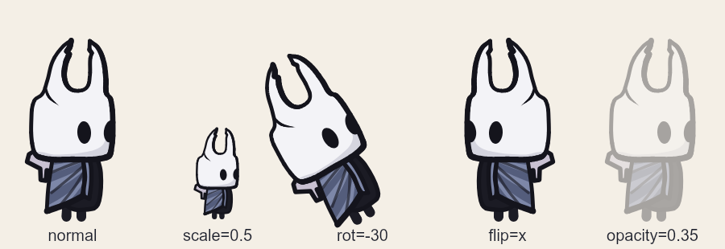

Repare:

- Os cinco estão com os pés na linha `y=540`. O Cavaleiro tem `unity root=400,560` no arquivo dele: é esse ponto, entre os pés, que vai para o `x,y` do `actor`.
- `scale=0.5` é metade do tamanho (1 é o normal, 2 é o dobro). Com dois números, `scale=1,0.5` muda a largura e a altura separadas.
- `rot=-30` inclina 30 graus. Positivo gira no sentido do relógio; negativo, ao contrário. O giro é em volta do ponto dos pés.
- `flip=x` espelha da esquerda para a direita: o Cavaleiro olha para o outro lado. `flip=y` vira de cabeça para baixo, `flip=xy` faz os dois e `flip=none` desfaz.
- `opacity=0.35` é a transparência, de 0 (invisível) a 1 (normal).

**Experimente:** troque `rot=-30` por `rot=90`. O Cavaleiro deita, com os pés no mesmo lugar.

### O ponto que vai para o `x,y`: `origin=`

O fantasma não tem `unity` no arquivo dele. Sem `origin=`, é o canto de cima à esquerda do desenho que vai para o `x,y`. As cruzes vermelhas marcam o `x,y` de cada um:

<!-- gerar: img/10_ator_origin.png -->
```weasel
film dur=1s
canvas 900 420 bg=#20263a

# front: as cruzes ficam na frente dos atores
layer marcas front
line m1 c=#e94f37 w=4 : 100,90 140,90
line m2 c=#e94f37 w=4 : 120,70 120,110
line m3 c=#e94f37 w=4 : 600,330 640,330
line m4 c=#e94f37 w=4 : 620,310 620,350
text t1 240,400 "sem origin=" size=26 align=center c=#f4efe6
text t2 620,400 "origin=240,350" size=26 align=center c=#f4efe6

actor a "fantasma.weasel" 120,90 scale=0.5 hide=ceu
actor b "fantasma.weasel" 620,330 scale=0.5 hide=ceu origin=240,350
```

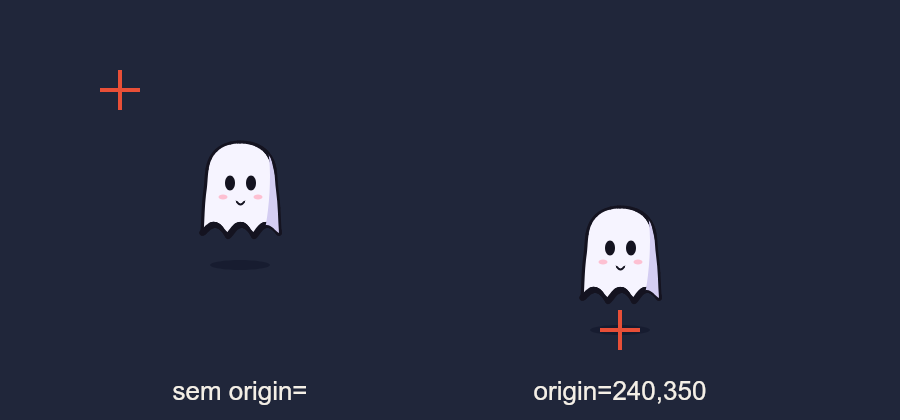

Repare:

- **Sem `origin=`**, a cruz fica longe do fantasma, no canto do desenho (onde estaria o céu, que foi escondido). Para pôr esse fantasma no chão, você teria que fazer contas.
- **Com `origin=240,350`**, a cruz fica na sombra embaixo dele. O número é um ponto **do arquivo do fantasma**: lá, a sombra é `ellipse sombra 240,350 …`. Agora o `x,y` é o lugar onde ele pisa.
- As camadas do arquivo do filme ficam atrás dos atores. `front` põe a camada `marcas` na frente deles ([capítulo 18](18-filme-atuacao.md#na-frente-do-ator-front)).

### Esconder camadas e mostrar o fundo: `hide=` e `bg`

Às vezes o arquivo de um personagem traz um cenário próprio: a coruja tem um céu com lua e um galho. `hide=` esconde camadas do ator: os nomes das camadas do arquivo dele, separados por vírgula. `bg` acrescenta o fundo do arquivo do ator (o `bg=` do `canvas` dele).

<!-- gerar: img/10_ator_hide.png -->
```weasel
film dur=1s
canvas 1000 320 bg=#f4efe6

layer nomes
text t1 125,312 "normal" size=22 align=center c=#1c1f2b
text t2 375,312 "hide=ceu" size=22 align=center c=#1c1f2b
text t3 625,312 "hide=ceu,galho" size=22 align=center c=#1c1f2b
text t4 875,312 "bg" size=22 align=center c=#1c1f2b

actor a "coruja.weasel" 125,250 origin=240,404 scale=0.5
actor b "coruja.weasel" 375,250 origin=240,404 scale=0.5 hide=ceu
actor c "coruja.weasel" 625,250 origin=240,404 scale=0.5 hide=ceu,galho
actor d "coruja.weasel" 875,250 origin=240,404 scale=0.5 bg
```

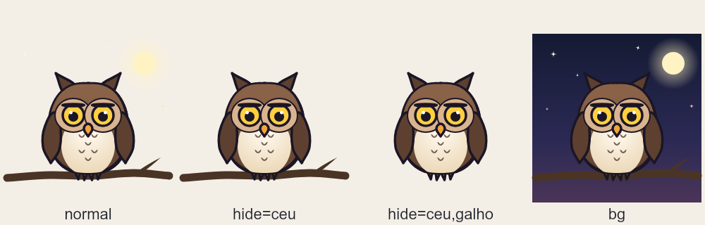

Repare:

- **normal**: o fundo do arquivo da coruja não aparece, mas as **camadas** dele aparecem. A lua e as estrelas estão na camada `ceu`; o galho, na camada `galho`.
- `hide=ceu` tira a lua e as estrelas; `hide=ceu,galho` tira o galho também. Fica só a coruja, pronta para pousar em qualquer cenário.
- `bg` pinta o fundo do arquivo dela (o degradê da noite), do tamanho do `canvas` dela: um quadrado atrás da coruja.
- Um nome que não é de nenhuma camada do arquivo dá aviso.

### Outras cores: `variant=`

Se o arquivo do ator tem variantes de cor ([capítulo 6](06-componentes.md)), `variant=` escolhe uma. A coruja tem duas, `neve` e `fogo`:

<!-- gerar: img/10_ator_variant.png -->
```weasel
film dur=1s
canvas 750 280 bg=#f4efe6

layer nomes
text t1 125,270 "sem variant" size=22 align=center c=#1c1f2b
text t2 375,270 "variant=neve" size=22 align=center c=#1c1f2b
text t3 625,270 "variant=fogo" size=22 align=center c=#1c1f2b

actor a "coruja.weasel" 125,235 origin=240,404 scale=0.5 hide=ceu,galho
actor b "coruja.weasel" 375,235 origin=240,404 scale=0.5 hide=ceu,galho variant=neve
actor c "coruja.weasel" 625,235 origin=240,404 scale=0.5 hide=ceu,galho variant=fogo
```

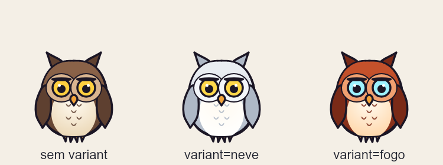

As três vêm do mesmo arquivo; só a `palette` muda. `variant=none` volta às cores normais.

### Animação e velocidade: `anim=` e `speed=`

`anim=` diz qual animação do arquivo o ator toca. `speed=` muda a velocidade dela: 1 é o normal, 0.5 é a metade, 2 é o dobro e 0 congela.

<!-- gerar: img/10_ator_speed.gif -s 0.4 -->
```weasel
film fps=10 dur=3.2s
canvas 1000 560 bg=#f4efe6

layer chao
rect piso 0,500 1000,60 c=#d8cbb0
text t1 250,545 "anim=jump" size=34 align=center c=#1c1f2b
text t2 750,545 "anim=jump speed=0.5" size=34 align=center c=#1c1f2b

actor a "cavaleiro.weasel" 250,500 scale=0.7 anim=jump
actor b "cavaleiro.weasel" 750,500 scale=0.7 anim=jump speed=0.5
```

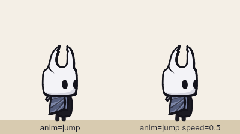

- A animação `jump` do Cavaleiro dura 1,6 segundo (24 quadros a 15 por segundo). Em 3,2 segundos, o da esquerda pula **duas vezes**; o da direita, com `speed=0.5`, pula **uma**.
- Cada ator toca no `fps` da animação dele. Uma animação de 12 fps num filme de 24 fps mostra cada desenho em 2 quadros do vídeo.
- A animação repete até o fim do plano. Uma animação com `once` toca uma vez e para no último desenho.
- Sem `anim=`, o ator fica na pose do desenho, sem animação.

**Experimente:** troque `speed=0.5` por `speed=0`. O Cavaleiro da direita fica parado no primeiro quadro do pulo.

Num ator que anda, `speed=auto` acerta o ritmo das pernas com o andar ([capítulo 18](18-filme-atuacao.md#andar-sem-escorregar-speedauto)).

| Opção | O que faz | Valores | Se não escrever |
|---|---|---|---|
| `x,y` | o lugar do ator no filme | dois números | `0,0` |
| `origin=` | o ponto do desenho que vai para o `x,y` | um ponto do arquivo do ator | o `unity root=` do arquivo; sem ele, `0,0` |
| `scale=` | o tamanho | um número, ou dois (largura, altura) | 1 |
| `rot=` | o giro, em graus, em volta do `origin=` | um número | 0 |
| `flip=` | o espelho | `x`, `y`, `xy` ou `none` | `none` |
| `opacity=` | a transparência | de 0 a 1 | 1 |
| `anim=` | a animação que ele toca | uma `anim` do arquivo, ou `none` | nenhuma: a pose parada |
| `speed=` | a velocidade da animação | de 0 a 100, ou `auto` ([capítulo 18](18-filme-atuacao.md#andar-sem-escorregar-speedauto)) | 1 |
| `variant=` | as cores | uma `variant` do arquivo, ou `none` | as cores normais |
| `hide=` | esconde camadas do arquivo do ator | nomes de camada, separados por vírgula | nenhuma |
| `depth=` | a distância da câmera ([capítulo 14](14-profundidade.md#paralaxe-depth-e-screen)) | de 0,05 a 1000 | 1 |
| `expr=`, `path=`, `turn=` | a expressão e o caminho ([capítulo 18](18-filme-atuacao.md)) | — | — |
| `hidden` | começa invisível ([abaixo](#aparecer-show-ou-opacity)) | palavra | aparece |
| `bg` | desenha o fundo do arquivo do ator | palavra | sem o fundo |
| `screen` | prende o ator na tela: ele não anda com a câmera | palavra | anda com a câmera |
| `unlit` | ignora a luz do filme ([abaixo](#luz-no-filme)) | palavra | recebe a luz |
| `front` | fica na frente das camadas `front` ([capítulo 18](18-filme-atuacao.md#na-frente-do-ator-front)) | palavra | atrás delas |

A ficha completa está na referência: [`actor`](19-referencia.md#actor).

**Cuidado:**
- Dois atores não podem ter o mesmo nome, e `camera` não pode ser nome de ator. Um ator escrito antes dos planos não pode ser escrito de novo dentro de um plano: dê outro nome.
- O arquivo do ator não pode ser um filme. Para juntar filmes, use `scene` ([capítulo 18](18-filme-atuacao.md#filmes-longos-scene)).

## Mudanças no tempo: `at`

```
at tempo alvo.propriedade=valor [alvo.propriedade=valor …] [ease=…]
```

`at` diz o que muda num momento do filme. `at 2s heroi.x=500` põe o herói em `x=500` aos 2 segundos. Ele muda atores, a câmera, luzes, camadas e formas.

**O tempo** se escreve assim: `2s` ou `1.5` (segundos), `500ms` (milissegundos), `48f` (quadros do filme), `1m30s` ou `1m` (minutos). Ele conta do começo do plano; num filme sem planos, do começo do filme.

**Como os valores mudam:**

- O valor escrito na linha `actor` (ou `camera`) é o valor no começo do plano.
- De um `at` para o seguinte, a mudança é **gradual**. O `ease=` diz como ela chega no `at`.
- Para algo ficar parado e só depois andar, repita o valor num `at` anterior: ele fica ali até esse `at`.

### Uma bolinha para os testes

Os próximos exemplos precisam de algo que ande. Este arquivo pequeno é só uma bolinha vermelha:

<!-- arquivo: bolinha.weasel -->
```weasel
canvas 40 40 bg=none
unity root=20,20
ellipse bola 20,20 16 c=#e94f37 ink=3
```

`unity root=20,20` diz que o ponto que vai para o `x,y` do ator é o **meio da bolinha** (sem isso, seria o canto `0,0`).

### Como o valor chega: `ease=`

Seis bolinhas saem do mesmo lugar ao mesmo tempo e chegam na linha tracejada ao mesmo tempo, cada uma com um `ease=`:

<!-- gerar: img/10_ease.gif -->
```weasel
film fps=12 dur=2.5s
canvas 480 300 bg=#f4efe6

layer nomes
text n1 20,47 "smooth" size=20 c=#1c1f2b
text n2 20,92 "linear" size=20 c=#1c1f2b
text n3 20,137 "in" size=20 c=#1c1f2b
text n4 20,182 "out" size=20 c=#1c1f2b
text n5 20,227 "back" size=20 c=#1c1f2b
text n6 20,272 "step" size=20 c=#1c1f2b
line fim c=#b9ab95 w=2 dash=6,6 : 440,15 440,295

actor b1 "bolinha.weasel" 130,40
actor b2 "bolinha.weasel" 130,85
actor b3 "bolinha.weasel" 130,130
actor b4 "bolinha.weasel" 130,175
actor b5 "bolinha.weasel" 130,220
actor b6 "bolinha.weasel" 130,265

at 0.3s b1.x=130 b2.x=130 b3.x=130 b4.x=130 b5.x=130 b6.x=130
at 2s b1.x=440 ease=smooth
at 2s b2.x=440 ease=linear
at 2s b3.x=440 ease=in
at 2s b4.x=440 ease=out
at 2s b5.x=440 ease=back
at 2s b6.x=440 ease=step
```

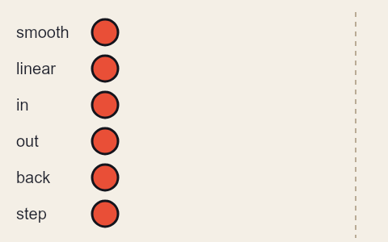

Repare:

- Todas ficam paradas até 0,3 s (o `at 0.3s` repete o lugar de partida) e chegam em `x=440` em 2 s.
- `smooth` (o padrão) sai devagar, acelera e freia. `linear` vai sempre na mesma velocidade.
- `in` sai devagar e chega rápido; `out` sai rápido e **chega freando**.
- `back` passa um pouco da linha e volta.
- `step` fica parada e pula de uma vez quando chega o tempo do `at`.
- `b1.x=440` muda só o `x`; o `y` continua o que estava. Para mudar os dois, `b1.pos=440,40`.
- O `ease=` vale para tudo o que está naquele `at`. Para eases diferentes no mesmo tempo, escreva um `at` para cada um, como aqui.

> **Se você já usa a `key`** ([capítulo 7](07-movimento.md)): na `key`, o `ease` diz como o movimento **sai** daquele quadro. No `at`, ele diz como o valor **chega** naquele tempo.

### Contando a partir do anterior: `+`

Com `+` na frente, o tempo conta **do `at` de cima**. Assim, para atrasar a sequência inteira, basta mudar o primeiro tempo.

<!-- gerar: img/10_at_mais.gif -->
```weasel
film fps=12 dur=3s
canvas 480 200 bg=#f4efe6

layer pontos
ellipse p1 60,150 5 c=#b9ab95
ellipse p2 180,60 5 c=#b9ab95
ellipse p3 300,150 5 c=#b9ab95
ellipse p4 420,60 5 c=#b9ab95

actor bola "bolinha.weasel" 60,150

at 0.5s bola.pos=60,150
at +0.5s bola.pos=180,60
at +500ms bola.pos=300,150
at +6f bola.pos=420,60
```

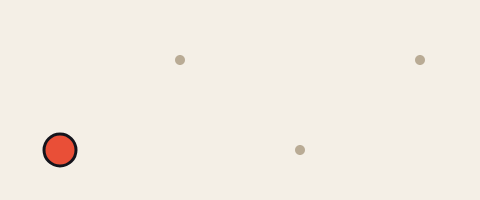

Repare:

- `at 0.5s` é o tempo de verdade: a bolinha espera até 0,5 s.
- `at +0.5s` é 0,5 s **depois do anterior**: 1 s. O seguinte é 1,5 s, e o último, 2 s.
- `+0.5s`, `+500ms` e `+6f` são o mesmo intervalo aqui: 500 ms são meio segundo, e 6 quadros (`f`) num filme de 12 quadros por segundo também.

**Experimente:** troque o primeiro `at 0.5s` por `at 1.5s`. A sequência inteira começa um segundo mais tarde, sem mudar mais nada.

### Aparecer: `show` ou `opacity`

Um ator com `hidden` começa invisível. `show=1` faz ele aparecer **de uma vez**. Para aparecer **aos poucos**, use `opacity` de 0 a 1.

<!-- gerar: img/10_aparece.gif -s 0.6 -->
```weasel
film fps=12 dur=2.5s
canvas 800 360 bg=#20263a

layer nomes
text t1 200,345 "hidden + show=1" size=26 align=center c=#f4efe6
text t2 600,345 "opacity de 0 a 1" size=26 align=center c=#f4efe6

actor a "fantasma.weasel" 200,300 origin=240,350 scale=0.6 hide=ceu hidden
actor b "fantasma.weasel" 600,300 origin=240,350 scale=0.6 hide=ceu opacity=0

at 0.5s b.opacity=0
at 1s a.show=1
at 2s b.opacity=1
```

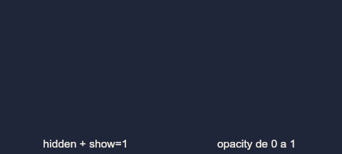

- `at 1s a.show=1`: o `show` troca de uma vez, como um interruptor. 1 aparece, 0 some.
- `b.opacity` vai de 0 (em 0,5 s) até 1 (em 2 s): o fantasma da direita vai ficando visível.

Uma **forma** ou uma **camada** do arquivo do filme funciona do mesmo jeito: com `hidden`, ela começa invisível, e `at … nome.show=1` faz ela aparecer.

<!-- gerar: img/10_aparece_forma.gif -s 0.6 -->
```weasel
film fps=12 dur=2s
canvas 800 300 bg=#20263a

ellipse lua 200,150 70 c=#f4efe6 hidden

layer placa hidden
rect fundo 460,100 280,100 r=16 c=#e94f37
text fim 600,168 "Fim" size=48 align=center bold c=#ffffff

at 0.5s lua.show=1
at 1.2s placa.show=1
```


- `lua` é uma forma com `hidden`: ela some até `at 0.5s lua.show=1`.
- `placa` é uma camada com `hidden`: a camada inteira (o retângulo e o texto) aparece em 1,2 s.
- Sem nenhum `show=1`, uma forma com `hidden` nunca aparece: ela só serve para outras formas usarem (em `cut=`, `clip=`…). Se um `at` muda a `opacity` ou o `draw` dela sem `show=1`, o Weasel avisa.
- Também dá para fazer sem `hidden`: `at 0s nome.show=0` esconde no começo.
- Isso vale para o filme. Numa animação (`key`), `hidden` quer dizer "nunca aparece" ([capítulo 9](09-animacao.md)).

### Camadas e formas do filme

O arquivo do filme também desenha: um mapa, uma seta, um título. Essas formas e camadas mudam com `at`, sem precisar de outro arquivo.

<!-- gerar: img/10_rota.gif -->
```weasel
film fps=10 dur=2.8s
canvas 480 270 bg=#9fd3ef

layer mapa
shape ilha c=#e8d9a8 ink=4 inkc=#8d6e4a : 40,210 90,90 220,50 360,40 440,120 420,230 250,250
ellipse lago 250,150 40,26 c=#9fd3ef

layer caminho
stroke rota w=5 c=#e94f37 : 90,200 150,130 250,200 330,110 390,80
shape bandeira c=#e94f37 : 390,80! 390,40! 420,50! 390,60!

layer titulo
text nome 240,262 "A ilha do tesouro" size=26 align=center c=#1c1f2b bold

at 0s titulo.opacity=0 titulo.blur=10 rota.draw=0 bandeira.show=0
at 1s titulo.opacity=1 titulo.blur=0
at 0.5s rota.draw=0
at 2.4s rota.draw=1 bandeira.show=1
```

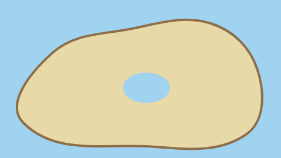

Repare:

- `titulo` é uma **camada**: `titulo.opacity` e `titulo.blur` (o desfoque, em pixels) mudam a camada inteira. O título aparece desfocado e fica nítido em 1 s.
- `rota` é uma **forma** (um `stroke`): `rota.draw` vai de 0 (nada desenhado) até 1 (inteira), entre 0,5 s e 2,4 s ([capítulo 9](09-animacao.md#desenhar-aos-poucos-draw)).
- `bandeira.show=0` em 0 s esconde a bandeira; `bandeira.show=1` em 2,4 s mostra de uma vez.
- Os `at` não precisam estar em ordem de tempo: cada propriedade junta os tempos dela. Mas os que usam `+` contam a partir da linha de cima.

**Experimente:** no `at 2.4s`, troque `rota.draw=1` por `rota.draw=0.5`. A linha para na metade do caminho, e a bandeira aparece sozinha no fim.

### O que o `at` muda

| Alvo | Muda aos poucos | Troca de uma vez |
|---|---|---|
| ator | `pos`, `x`, `y`, `scale`, `rot`, `opacity`, `depth`; `expr`, `along` e `morph` ([capítulo 18](18-filme-atuacao.md)) | `anim`, `speed`, `flip`, `show`, `variant` |
| câmera ([abaixo](#câmera-camera)) | `pos`, `x`, `y`, `zoom`, `rot`, `shake`, `offset`, `fade`, `fadec`, `lens`, `fog`, `haze` | `follow`, `lag` |
| luz do filme ([abaixo](#luz-no-filme)) | `power`, `radius`, `glow`, `aim`, `cone`, `c` | — |
| camada do filme | `opacity`, `blur`, `glow`, `tint`, `brightness`, `saturate`, `contrast`, `hue`, `yaw`, `pitch` | `show` |
| forma do filme | `draw`, `opacity`, `yaw`, `pitch`, `z` | `show` |

- Trocar `anim` recomeça a animação nova do primeiro quadro. Para misturar uma animação na outra, ou continuar no mesmo ponto do passo, veja o [capítulo 18](18-filme-atuacao.md#trocar-de-animação-blend-e-phase).
- O `tint` de uma camada só muda com `at` se a camada já tem `tint=cor,quanto`. A ordem das camadas (`above=`, `below=`) não muda com `at`.
- A luz muda a força, o tamanho e a cor, mas não muda de lugar.
- O giro em 3D (`yaw`, `pitch`, `z`) está no [capítulo 14](14-profundidade.md#girar-no-filme-at-com-yaw-e-pitch).
- As formas de dentro dos atores não mudam com `at`: elas mudam pelas animações dos atores.

A ficha completa está na referência: [`at`](19-referencia.md#at).

**Cuidado:**
- Num filme com planos, o `at` fica dentro de um plano. Um `at` antes do primeiro `shot` dá erro.
- Um `at` depois do fim do plano dá aviso.

## Câmera: `camera`

```
camera [x,y] [opções]
```

A câmera escolhe o pedaço do filme que aparece no quadro. O ponto `x,y` fica **no centro do quadro**. Sem `x,y`, a câmera olha para o centro do `canvas` do filme, e com `zoom=1` mostra o desenho exatamente como foi feito.

- Uma `camera` **antes** dos planos vale para todos.
- Uma `camera` dentro de um plano começa igual à do filme e muda só o que a linha diz.

### Um cenário para filmar

Para ver a câmera trabalhar, é bom ter um desenho **mais largo que o quadro**. Este arquivo é um desenho comum (não é filme): uma rua com quatro casas numeradas, com 1920 pixels de largura. Os exemplos da câmera põem esta rua em cena como um ator.

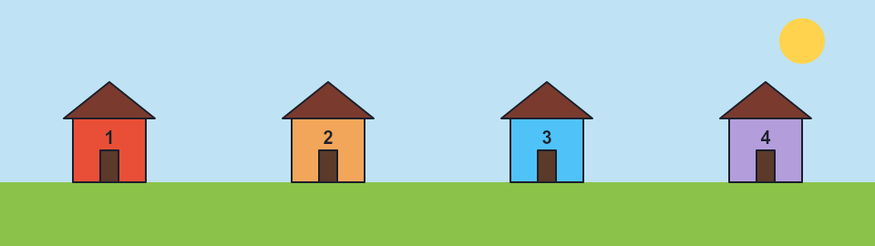

<details>
<summary>O <code>vila.weasel</code></summary>

<!-- arquivo: vila.weasel -->
<!-- gerar: img/10_vila.png -s 0.5 -->
```weasel
canvas 1920 540 bg=#bfe3f5
palette ink=#1c1f2b line=4

def casa cor=#e94f37
  rect parede -80,-140 160,140 c=cor ink=line
  shape telhado c=#7a3b2e ink=line : -100,-140! 0,-220! 100,-140!
  rect porta -20,-70 40,70 c=#5b3a29 ink=line
end

layer chao
ellipse sol 1760,90 50 c=#ffd34d
rect grama -800,400 3520,400 c=#8bc34a

layer casas
use casa 240,400 cor=#e94f37
use casa 720,400 cor=#f2a65a
use casa 1200,400 cor=#4fc3f7
use casa 1680,400 cor=#b39ddb
text n1 240,315 "1" size=40 align=center c=ink bold
text n2 720,315 "2" size=40 align=center c=ink bold
text n3 1200,315 "3" size=40 align=center c=ink bold
text n4 1680,315 "4" size=40 align=center c=ink bold
```

</details>

- A grama vai além das bordas (de `x=-800` até `x=2720`), para não aparecer um buraco quando a câmera inclina ou passa do fim da rua.
- Os filmes usam um quadro de 960×540, a metade da largura da rua. A câmera mostra só um pedaço de cada vez.

### Olhar e aproximar: `x,y` e `zoom=`

<!-- gerar: img/10_camera_zoom.gif -s 0.5 -->
```weasel
film fps=12
canvas 960 540 bg=#bfe3f5
actor vila "vila.weasel" 0,0

shot perto dur=3s
camera 480,270
at 0.5s camera.pos=480,270 camera.zoom=1
at 1.5s camera.pos=720,320 camera.zoom=2
at 2.2s camera.pos=720,320 camera.zoom=2
at 3s camera.pos=480,270 camera.zoom=1
```

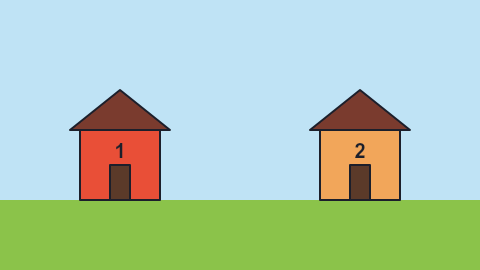

Linha por linha:

- `actor vila "vila.weasel" 0,0`: a rua inteira, com o canto `0,0` dela no `0,0` do filme.
- `shot perto dur=3s`: um plano de 3 segundos ([abaixo](#planos-shot)). Num filme com planos, a câmera e os `at` ficam dentro deles.
- `camera 480,270`: a câmera olha para o ponto `480,270`, que fica no centro do quadro. Como o quadro tem 960×540, ela mostra de `x=0` até `x=960`: as casas 1 e 2.
- `at 0.5s camera.pos=480,270 camera.zoom=1`: em 0,5 s, a câmera ainda está onde começou. Assim ela fica parada até 0,5 s e só depois anda.
- `at 1.5s camera.pos=720,320 camera.zoom=2`: em 1,5 s, ela olha para a casa 2 (`x=720`), com tudo **duas vezes maior**.
- `at 2.2s …` repete o mesmo valor: a câmera espera ali até 2,2 s. Depois volta ao começo em 3 s.

**Experimente:** troque `camera.zoom=2` por `camera.zoom=0.5`. A câmera se afasta e mostra quase a rua toda.

### Inclinar e tremer: `rot=` e `shake=`

`rot=` inclina o quadro, em graus. `shake=` faz a câmera tremer, em pixels: bom para um tombo, uma explosão, um pouso.

<!-- gerar: img/10_camera_rot.gif -s 0.5 -->
```weasel
film fps=12
canvas 960 540 bg=#bfe3f5
actor vila "vila.weasel" 0,0

shot inclina dur=3s
camera 480,270
at 0.5s camera.rot=0
at 1.2s camera.rot=15
at 1.6s camera.rot=15 camera.shake=0
at 1.7s camera.shake=20 ease=linear
at 2.4s camera.shake=20
at 2.5s camera.shake=0 camera.rot=15
at 3s camera.rot=0
```

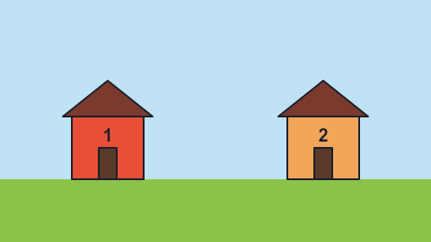

Repare:

- `camera.rot=15` inclina **a câmera** 15 graus. Por isso o desenho aparece torto para o outro lado, como numa foto tirada com a câmera torta.
- O tremor liga rápido (de 1,6 a 1,7 s, com `ease=linear`), fica em 20 pixels até 2,4 s e desliga em 0,1 s. O tremor é macio: a câmera balança, mas não pula de um lugar para outro.

### Seguir um ator: `follow=`, `offset=` e `lag=`

Em vez de dizer a posição da câmera a cada momento, ela pode **seguir um ator**. Aqui o fantasma atravessa a rua duas vezes: no primeiro plano, a câmera vai grudada nele; no segundo, um pouco atrás.

<!-- gerar: img/10_camera_segue.gif -s 0.5 -->
```weasel
film fps=10
canvas 960 540 bg=#bfe3f5
actor vila "vila.weasel" 0,0
actor fantasma "fantasma.weasel" 150,470 origin=240,350 scale=0.5 hide=ceu

layer placa1 screen only=junto
text p1 480,50 "follow=fantasma" size=36 align=center c=#1c1f2b bold
layer placa2 screen only=atrasado
text p2 480,50 "follow=fantasma lag=0.6" size=36 align=center c=#1c1f2b bold

shot junto dur=2s
camera follow=fantasma offset=0,-200
at 0.2s fantasma.pos=150,470
at 1.8s fantasma.pos=1750,470

shot atrasado dur=2s
camera follow=fantasma offset=0,-200 lag=0.6
at 0.2s fantasma.pos=150,470
at 1.8s fantasma.pos=1750,470
```

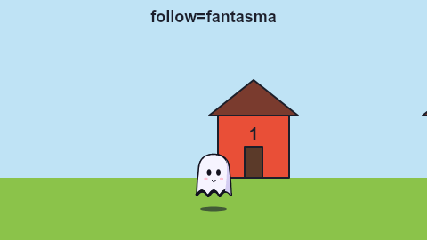

Repare:

- `follow=fantasma`: o ponto do fantasma (a base da sombra, por causa do `origin=`) fica no centro do quadro.
- `offset=0,-200`: a câmera olha 200 pixels **acima** desse ponto. Sem isso, o chão ficaria no meio do quadro, e o céu ocuparia metade da imagem.
- `lag=0.6`: a câmera vai atrás do fantasma com atraso, sem trancos. O número é em segundos: quanto maior, maior o atraso. Em 0,6 s, ela anda uns dois terços do caminho até ele.
- `layer placa1 screen only=junto`: um letreiro **preso na tela** (`screen`), que não anda com a câmera e só aparece no plano `junto` (o `only=` com o nome do plano).
- `at 2s camera.follow=coruja` troca de ator no meio do plano, de uma vez, e `follow=none` para de seguir.

**Experimente:** troque `lag=0.6` por `lag=2`. A câmera fica tão atrasada que o fantasma sai do quadro antes de ela chegar.

### Escurecer e clarear: `fade=` e `fadec=`

`fade=` cobre o quadro com uma cor: 0 é a imagem normal; 1 é só a cor. `fadec=` é essa cor: preto, se você não disser outra.

<!-- gerar: img/10_camera_fade.gif -s 0.5 -->
```weasel
film fps=12
canvas 960 540 bg=#bfe3f5
actor vila "vila.weasel" 0,0

shot apaga dur=2s
at 0.5s camera.fade=0
at 1.5s camera.fade=1 ease=linear

shot clarao dur=2s
camera fade=1 fadec=#ffffff
at 0.2s camera.fade=1
at 1.2s camera.fade=0
```

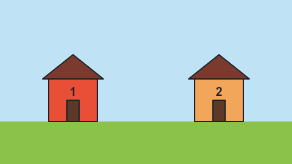

- No plano `apaga`, a imagem escurece de 0,5 s até 1,5 s: o fim de uma cena.
- No plano `clarao`, a `camera` do plano já começa com `fade=1` e `fadec=#ffffff` (tudo branco) e volta ao normal até 1,2 s: um clarão, um raio, um susto.

### Longe e perto: `depth=`

Quando a câmera anda, o que está **longe** deveria andar menos que o que está perto: é a **paralaxe**. No Weasel, ela vem do `depth=` de cada camada ou de cada ator. `depth=1` é a distância da ação, `depth=2` está duas vezes mais longe, e `depth=0.5` passa mais rápido, perto da câmera. Num ator, o `depth=` multiplica o das camadas dele: uma camada `depth=2` num ator `depth=3` fica a 6. A paralaxe, a lente (`lens=`) e a névoa da distância (`fog=` e `haze=`) estão no [capítulo 14](14-profundidade.md#profundidade-no-filme).

| Opção | O que faz | Valores | Se não escrever |
|---|---|---|---|
| `x,y` | o ponto que fica no centro do quadro | dois números | o centro do `canvas` |
| `zoom=` | aproxima (2 é tudo duas vezes maior) ou afasta (0.5) | de 0,01 a 100 (no `at`, até 1000) | 1 |
| `rot=` | inclina o quadro, em graus | um número | 0 |
| `shake=` | o tremor, em pixels | de 0 a 1000 | 0 |
| `follow=` | segue um ator | o nome de um ator, ou `none` | não segue |
| `offset=` | desloca o ponto seguido | `dx,dy` | `0,0` |
| `lag=` | o atraso ao seguir, em segundos | de 0 a 10 (no `at`, até 100) | 0 |
| `fade=` | cobre o quadro com a cor do `fadec=` | de 0 a 1 | 0 |
| `fadec=` | a cor do `fade=` | uma cor | preto |
| `lens=`, `fog=`, `haze=` | a lente e a névoa ([capítulo 14](14-profundidade.md#andar-ou-aproximar-zoom-e-lens)) | — | — |

A ficha completa está na referência: [`camera`](19-referencia.md#camera).

## Planos: `shot`

```
shot nome dur=tempo [in=tipo[,duração]]
```

Um **plano** é um trecho do filme com a sua câmera e as suas mudanças. Os planos tocam um depois do outro. Tudo o que vem depois de um `shot`, até o próximo, é desse plano.

Cada plano começa do zero: os atores e a câmera voltam ao que está escrito nas linhas `actor` e `camera`. O que um `at` mudou num plano não passa para o seguinte. No plano `ida`, o fantasma anda até a direita. No plano `volta`, ele **começa de novo na esquerda**:

<!-- gerar: img/10_planos.gif -->
```weasel
film fps=10
canvas 480 270 bg=#cfe8f5

layer chao
rect grama 0,220 480,50 c=#7cc56a
layer nome1 only=ida
text t1 240,40 "plano ida" size=26 align=center c=#1c1f2b
layer nome2 only=volta
text t2 240,40 "plano volta" size=26 align=center c=#1c1f2b

actor fantasma "fantasma.weasel" 80,230 origin=240,350 scale=0.4 hide=ceu

shot ida dur=1.5s
at 1.5s fantasma.pos=400,230

shot volta dur=1.5s
actor coruja "coruja.weasel" 400,225 origin=240,404 scale=0.3 hide=ceu,galho
at 1.5s fantasma.pos=240,230
```

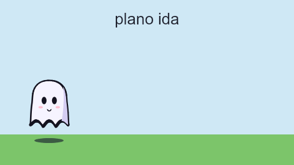

Repare:

- `shot ida dur=1.5s`: um plano chamado `ida`, de 1,5 segundo.
- O fantasma está escrito **antes** dos planos: ele está nos dois. Cada plano o põe de novo em `80,230`.
- A coruja está escrita **dentro** do plano `volta`: só existe nele.
- `layer nome1 only=ida`: no arquivo do filme, o `only=` de uma camada aceita **nomes de plano**. O letreiro `plano ida` só aparece no plano `ida`.

**Experimente:** acrescente `at 0s fantasma.pos=400,230` no plano `volta`. Agora o fantasma começa onde o plano `ida` o deixou e volta até o meio.

### Transições: `in=`

Sem `in=`, a troca de um plano para o outro é instantânea: um corte. `in=tipo,duração` faz o plano **entrar** com uma transição:

<!-- gerar: img/10_transicoes.gif -s 0.5 -->
```weasel
film fps=12
canvas 480 270 bg=#14182a

layer manha only=manha
rect ceu1 0,0 480,270 c=#9fd3ef
ellipse sol1 380,70 36 c=#ffd34d
rect chao1 0,200 480,70 c=#7cc56a
layer tarde only=tarde
rect ceu2 0,0 480,270 c=#f2a65a
ellipse sol2 130,160 54 c=#ff7a45
rect chao2 0,200 480,70 c=#5c8f4a
layer noite only=noite
rect ceu3 0,0 480,270 c=#1b2140
ellipse lua 360,70 30 c=#f4efe6
rect chao3 0,200 480,70 c=#2f5a3a

shot manha dur=1.5s in=fade,0.8s
shot tarde dur=1.5s in=wipe,0.6s
shot noite dur=2s in=iris,1s
```

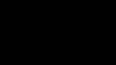

| Tipo | O que faz |
|---|---|
| `fade` | dissolve: o plano novo aparece por cima do anterior |
| `wipe` | cortina: o plano novo entra da esquerda para a direita |
| `slide` | o plano novo empurra o anterior para fora, para a esquerda |
| `zoom` | o plano anterior cresce e some, mostrando o novo |
| `iris` | um círculo fecha sobre o plano anterior e abre sobre o novo, com preto em volta, como no fim dos desenhos animados antigos |

- Durante a transição, o plano anterior fica parado no último quadro dele, e o plano novo já está andando.
- A transição usa o começo do plano novo. Ela não deixa o filme mais longo e não atrasa sons nem legendas.
- No primeiro plano do filme, a transição vem do preto: é o `fade` da manhã.
- Para escurecer até o preto no meio de um plano, use o [`fade=` da câmera](#escurecer-e-clarear-fade-e-fadec).

Agora os outros dois tipos, `slide` e `zoom`. Os números grandes mostram qual plano sai e qual entra:

<!-- gerar: img/10_transicoes2.gif -->
```weasel
film fps=12
canvas 480 270 bg=#14182a

layer um only=um
rect fundo1 0,0 480,270 c=#9fd3ef
text n1 240,160 "1" size=120 align=center c=#1c1f2b bold
layer dois only=dois
rect fundo2 0,0 480,270 c=#f2a65a
text n2 240,160 "2" size=120 align=center c=#1c1f2b bold
layer tres only=tres
rect fundo3 0,0 480,270 c=#b39ddb
text n3 240,160 "3" size=120 align=center c=#1c1f2b bold

shot um dur=1s
shot dois dur=1.5s in=slide,0.8s
shot tres dur=1.5s in=zoom,0.8s
```

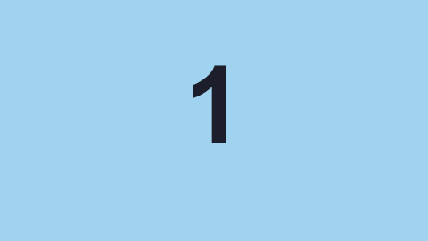

- `in=slide,0.8s`: em 0,8 segundo, o plano `dois` entra pela direita e empurra o `um` para fora.
- `in=zoom,0.8s`: o plano `dois` cresce e fica transparente, e o `tres` aparece por trás.
- O plano `um` não tem `in=`: o filme começa nele de uma vez, sem vir do preto.

**Experimente:** troque `in=slide,0.8s` por `in=slide,0.2s`. A troca fica rápida, quase um corte.

| Opção | O que faz | Valores | Se não escrever |
|---|---|---|---|
| `nome` | o nome do plano | letras, números e `_`; um nome por plano | (obrigatório) |
| `dur=` | quanto o plano dura | um tempo, de 1 quadro para cima | (obrigatório: sem ele, 3 s, com erro) |
| `in=tipo` | a transição de entrada | `fade`, `wipe`, `slide`, `zoom` ou `iris` | um corte |
| `in=tipo,duração` | quanto a transição dura | um tempo, sem `+`; 0 é um corte | 0,5 s |

A ficha completa está na referência: [`shot`](19-referencia.md#shot).

**Cuidado:**
- Uma transição mais longa que o plano é cortada no fim dele, com um aviso.
- Num filme com planos, o `film dur=` não vale (dá aviso): a duração é a soma dos planos.

## Luz no filme

As `light` e o `ambient` do arquivo do filme ([capítulo 10](10-luz.md)) iluminam **o cenário e todos os atores**: o lampião esquenta a cor do Cavaleiro quando ele chega perto.

- As `light` do arquivo de cada ator continuam valendo para ele. O `ambient` não: vale o do filme.
- Se o filme tem uma `light` e nenhum `ambient`, a luz de fundo é branca, com força 0,6: os atores ficam mais escuros do que no arquivo deles. Escreva um `ambient` no filme para escolher.
- `unlit` no `actor` faz o ator ignorar a luz do filme. As luzes do arquivo dele continuam.

Aqui uma lâmpada acende aos poucos entre duas corujas. A da direita tem `unlit`:

<!-- gerar: img/10_luz.gif -s 0.5 -->
```weasel
film fps=10 dur=2.5s
canvas 960 400 bg=#141a33

ambient c=#5866a0 power=0.4
light lampada point 480,120 c=#ffb860 power=0 radius=420 glow=60

layer poste
rect haste 474,120 12,250 c=#24242e
rect chao 0,370 960,30 c=#2b2c42
text n1 240,395 "coruja" size=24 align=center c=#c9c3d8
text n2 720,395 "coruja unlit" size=24 align=center c=#c9c3d8

actor a "coruja.weasel" 240,370 origin=240,404 scale=0.55 hide=ceu,galho
actor b "coruja.weasel" 720,370 origin=240,404 scale=0.55 hide=ceu,galho unlit

at 0.3s lampada.power=0
at 1.8s lampada.power=2
```

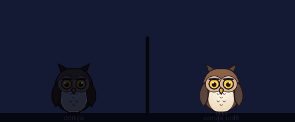

Repare:

- `ambient c=#5866a0 power=0.4` é a luz de fundo, fraca e azulada: a noite. Ela deixa a coruja da esquerda escura.
- `light lampada point 480,120 … power=0`: uma lâmpada no alto do poste, começando **apagada**. `radius=420` é até onde ela chega, em pixels; `glow=60` é o halo em volta dela.
- `at 1.8s lampada.power=2`: a lâmpada acende até a força 2. A coruja da esquerda ganha o laranja da luz.
- A coruja com `unlit` fica com as cores do arquivo dela, nem escura nem alaranjada. Use `unlit` em letreiros, fantasmas que brilham sozinhos e coisas "fora" da cena.

**Experimente:** acrescente `lampada.c=#7fd3ff` no `at 1.8s`. A luz muda de cor enquanto acende, e a coruja fica azulada.

## Ver e exportar o filme

No editor, o player toca o filme inteiro ou um plano, e a linha do tempo mostra os planos ([capítulo 22](22-editor.md#filme)). Na linha de comando, o vídeo precisa do [ffmpeg](https://ffmpeg.org) instalado:

| Quero… | Comando |
|---|---|
| vídeo MP4 | `node cli/weasel.js filme.weasel -o filme.mp4` |
| prévia rápida, na metade do tamanho | `node cli/weasel.js filme.weasel -o previa.mp4 -s 0.5` |
| um quadro (uma capa, uma miniatura) | `node cli/weasel.js filme.weasel -o capa.png --time 4s` |
| um GIF (filmes curtos) | `node cli/weasel.js filme.weasel -o filme.gif -s 0.25` |
| só um plano, ou um trecho | `--shot susto` · `--from 10s --to 20s` |
| ver os planos, os tempos e os atores | `node cli/weasel.js filme.weasel --info` |

A folha de conferência, o vídeo para o editor de vídeo e o som estão no [capítulo 18](18-filme-atuacao.md#exportar-o-filme). A lista completa das opções está na [linha de comando](21-linha-de-comando.md#filme).

## Opções do filme

| Linha | O que é | Opções |
|---|---|---|
| `film` | o filme: uma linha por arquivo | `fps=` (de 1 a 120; 24), `dur=` (sem planos); as legendas no [capítulo 18](18-filme-atuacao.md#legendas-sub) |
| `canvas` | o tamanho do quadro e o fundo | largura e altura (de 1 a 4096; 1920×1080), `bg=` |
| `actor` | um ator | `x,y`, `origin=`, `scale=`, `rot=`, `flip=`, `opacity=`, `anim=`, `speed=`, `variant=`, `hide=`, `depth=`; `hidden`, `bg`, `screen`, `unlit`, `front` |
| `at` | uma mudança no tempo | `alvo.propriedade=valor`, `ease=` (`smooth`, `linear`, `in`, `out`, `back` ou `step`) |
| `camera` | a câmera | `x,y`, `zoom=`, `rot=`, `shake=`, `follow=`, `offset=`, `lag=`, `fade=`, `fadec=`, `lens=`, `fog=`, `haze=` |
| `shot` | um plano | `nome`, `dur=`, `in=` (`fade`, `wipe`, `slide`, `zoom` ou `iris`) |

As fichas completas estão na referência: [`film`](19-referencia.md#film), [`actor`](19-referencia.md#actor), [`at`](19-referencia.md#at), [`camera`](19-referencia.md#camera) e [`shot`](19-referencia.md#shot).

## Juntando tudo

Um filme curto, com o cenário de morros, o Cavaleiro e o fantasma. Ele tem dois planos de 3 segundos: a chegada do fantasma, com o título, e o susto do Cavaleiro, que foge.

<!-- gerar: img/10_filme.gif -s 0.25 -->
```weasel
film fps=12
canvas 1920 1080 bg=ceu
gradient ceu linear 0,0 0,1080 : #060916 #131a3a@0.62 #26284a

ambient c=#5866a0 power=0.5
light lampiao point 2000,566 c=#ffb860 power=1.6 radius=720 glow=130

actor cenario "cenario.weasel" 0,0
actor heroi "cavaleiro.weasel" 1500,900 scale=0.9 anim=stand
actor fantasma "fantasma.weasel" 3000,880 origin=240,350 scale=1.1 anim=flutua hide=ceu

layer titulo screen unlit only=chegada
text nome 720,250 "O encontro" size=110 c=#f4efe6 align=center font=serif bold

shot chegada dur=3s
camera 1750,600 zoom=1.1 fade=1
at 0s titulo.opacity=1
at 1s camera.fade=0 ease=linear
at 2s titulo.opacity=1
at 2.6s titulo.opacity=0
at 3s fantasma.pos=2350,880 ease=out

shot susto dur=3s
camera 1850,700 zoom=1.4
at 0s fantasma.pos=2350,880
at 0.3s heroi.anim=jump
at 1.5s heroi.anim=dash heroi.flip=x
at 1.8s heroi.pos=1500,900 camera.pos=1850,700
at 2.4s heroi.pos=1000,900 camera.pos=1500,700 ease=out
at 2.4s camera.fade=0
at 3s camera.fade=1 ease=linear
```

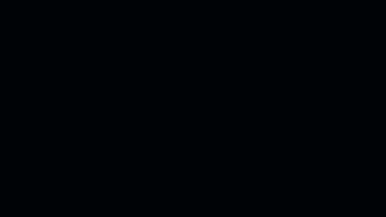

- **O que vale para o filme todo** vem antes do primeiro `shot`: o quadro e o fundo (um degradê), a luz da noite e do lampião, os três atores e o título.
- **O cenário** é um ator também: o `cenario.weasel` tem o céu, a serra, os morros e as moitas, cada um com o seu `depth=`.
- **O título** fica numa camada `screen` (presa na tela), `unlit` (sem a luz da noite) e `only=chegada` (só no primeiro plano). Ele some aos poucos de 2 s a 2,6 s.
- **A chegada:** a câmera começa preta (`fade=1`) e clareia em 1 s. O fantasma, que começa fora do quadro (`3000,880`), chega em 3 s, freando (`ease=out`).
- **O susto:** o plano começa do zero, então o `at 0s fantasma.pos=2350,880` põe o fantasma de novo onde a chegada o deixou. O Cavaleiro pula (`jump`), vira (`flip=x`) e corre (`dash`) de 1,8 s a 2,4 s, com a câmera indo junto. No fim, tudo escurece.

**Experimente:** no plano `susto`, troque `camera 1850,700 zoom=1.4` por `camera follow=heroi offset=0,-200 zoom=1.4` e apague o `camera.pos` dos dois `at`. A câmera segue o Cavaleiro sozinha.

## Resumo

- Um arquivo com `film` é um filme; `canvas` é o tamanho do quadro do vídeo.
- `actor` põe outro arquivo em cena: `x,y`, `origin=`, `scale=`, `anim=`, `hide=`, `variant=`…
- `at tempo alvo.prop=valor` muda as coisas com o tempo; `ease=` diz como o valor chega, e `+` conta do `at` de cima.
- `camera` escolhe o pedaço que aparece: `zoom=`, `rot=`, `shake=`, `follow=`, `lag=` e `fade=`.
- `shot` divide o filme em planos, que começam do zero; `in=` faz a transição.

[← Jogo: fases e recursos avançados](16-jogo-avancado.md) · [Índice](README.md) · [Próximo: Filme: atuação, som e legendas →](18-filme-atuacao.md)
