# 17. Jogo: três vistas

[← Jogo: fases e recursos avançados](16-jogo-avancado.md) · [Índice](README.md) · [Próximo: Filme: atores, planos e câmera →](18-filme.md)

Num jogo visto de cima, o personagem anda para baixo, para os lados e para cima. Por isso ele precisa de um desenho para cada lado: de frente, de lado e de costas. Este capítulo ensina a desenhar cada lado **uma vez**, a usar **um esqueleto só** para todos eles e a escrever **cada animação uma vez**. O Weasel gera a animação de cada lado.

O capítulo tem quatro partes:

- **Como escrever:** um bicho pequeno, passo a passo.
- **Como o Weasel faz:** a conta que monta um boneco em 3D a partir dos desenhos.
- **Os personagens de verdade:** o guarda, o herói, o homem, o herói de plataforma e o furão.
- **O editor e os limites:** como conferir e mexer no editor, e o que ainda não dá para fazer.

Você precisa dos ossos e das animações (capítulos [7](07-movimento.md), [8](08-ossos.md) e [9](09-animacao.md)) e do personagem no Godot ([capítulo 15](15-jogo-personagem.md)). Os cinco personagens grandes estão na pasta [`exemplos/`](../../exemplos/) e no editor, em **Arquivo › Exemplos**.

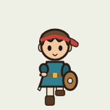

## O problema: uma animação para cada lado

Sem as vistas, cada lado do personagem é uma camada com `only=`, e cada animação é escrita uma vez para cada lado: `walk_down`, `walk_right` e `walk_up` ([capítulo 15](15-jogo-personagem.md#direções-jogos-vistos-de-cima)). São três animações para o mesmo passo. Para mudar o passo, é preciso mudar as três, e é fácil uma ficar diferente da outra.

Com as **vistas**, a ideia é a de um boneco de verdade:

1. **Um esqueleto só.** Os ossos são os mesmos em todos os lados.
2. **Um desenho por lado.** Cada lado é uma camada com `view=`, e as peças dela seguem os ossos de sempre (`bone=`).
3. **Uma animação por movimento.** A `walk` é escrita uma vez, sem a direção no nome. Ela mexe nos ossos **em 3D**: para os lados, para cima e para baixo, como sempre, e também para a frente e para trás (`osso.z=`).
4. **O Weasel faz o resto.** Para cada lado desenhado, ele calcula como o movimento aparece dali e escreve a animação daquele lado: `walk_down`, `walk_right`, `walk_up`. O Godot recebe as três, como se você as tivesse escrito à mão.

## O primeiro bicho: `views` e `view=`

```
layer nome view=vista [angle=graus]
views [tilt=graus]
bone nome pivot=x,y [side=x] [lat=x] [tip=x,y[,z]] [shorten=off|mín[,máx]] [turns]
key quadro osso.z=pixels osso.pitch=graus osso.yaw=graus
```

O bicho abaixo tem seis ossos e três desenhos. A animação `walk` é escrita uma vez:

<!-- gerar: img/17_vistas.png --contact -a walk_down,walk_right,walk_up -->
```weasel
canvas 120 120 bg=none
palette ink=#2b2a33 pelo=#e0a050 claro=#f6e2c0 escuro=#b07a3a

godot root=60,110
# a câmera do jogo: 30 graus
views tilt=30

# os ossos são desenhados na frente
bone corpo pivot=60,110
bone cabeca parent=corpo pivot=60,72
bone peE pivot=50,106
bone peD pivot=70,106
bone bracoE parent=corpo pivot=42,82
bone bracoD parent=corpo pivot=78,82

# de frente (virado para baixo)
layer frente view=down
ellipse peE 50,106 8,5 c=escuro ink=2 bone=peE
ellipse peD 70,106 8,5 c=escuro ink=2 bone=peD
ellipse corpo 60,88 20,18 c=pelo ink=3 bone=corpo
ellipse barriga 60,92 11,10 c=claro bone=corpo
ellipse bracoE 42,88 5,8 c=escuro ink=2 bone=bracoE
ellipse bracoD 78,88 5,8 c=escuro ink=2 bone=bracoD
ellipse cabeca 60,56 17,15 c=pelo ink=3 bone=cabeca
ellipse olhoE 54,53 3,3 c=ink bone=cabeca
ellipse olhoD 66,53 3,3 c=ink bone=cabeca

# de lado (virado para a direita): o x de cada peça é a profundidade do osso
layer lado view=right
ellipse bracoDl 60,88 5,8 c=escuro ink=2 bone=bracoD
ellipse peDl 60,106 8,5 c=escuro ink=2 bone=peD
ellipse corpoL 60,88 17,18 c=pelo ink=3 bone=corpo
ellipse peEl 60,106 8,5 c=escuro ink=2 bone=peE
ellipse cabecaL 64,56 15,15 c=pelo ink=3 bone=cabeca
ellipse focinhoL 78,60 6,4 c=claro ink=2 bone=cabeca
ellipse olhoL 70,52 3,3 c=ink bone=cabeca
ellipse bracoEl 60,88 5,8 c=escuro ink=2 bone=bracoE

# de costas (virado para cima): a esquerda e a direita trocam de lado
layer costas view=up
ellipse peEc 70,106 8,5 c=escuro ink=2 bone=peE
ellipse peDc 50,106 8,5 c=escuro ink=2 bone=peD
ellipse corpoC 60,88 20,18 c=pelo ink=3 bone=corpo
ellipse bracoEc 78,88 5,8 c=escuro ink=2 bone=bracoE
ellipse bracoDc 42,88 5,8 c=escuro ink=2 bone=bracoD
ellipse cabecaC 60,56 17,15 c=pelo ink=3 bone=cabeca

# anda: escrita uma vez só, sem direção no nome
anim walk frames=8 fps=12
key 0 corpo=0,0 peE=0,-3 peE.z=8 peD=0,0 peD.z=-8 bracoD.z=5 bracoE.z=-5
key 2 corpo=0,-2 peE=0,0 peE.z=0 peD=0,-4 peD.z=0 bracoD.z=0 bracoE.z=0
key 4 corpo=0,0 peE=0,0 peE.z=-8 peD=0,-3 peD.z=8 bracoD.z=-5 bracoE.z=5
key 6 corpo=0,-2 peE=0,-4 peE.z=0 peD=0,0 peD.z=0 bracoD.z=0 bracoE.z=0
key 8 corpo=0,0 peE=0,-3 peE.z=8 peD=0,0 peD.z=-8 bracoD.z=5 bracoE.z=-5
```

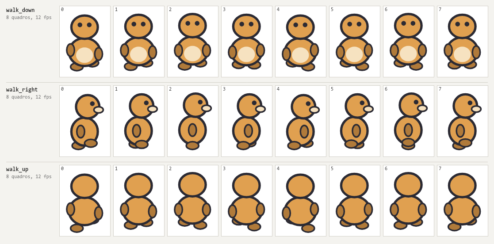

Repare:

- **Cada vista é uma camada com `view=`:** `down` (de frente: o personagem olha para baixo na tela, para quem joga), `right` (de lado, olhando para a direita) e `up` (de costas). As peças de todas as vistas usam os mesmos ossos.
- **A frente é a vista principal.** Os `pivot=` dos ossos são medidos nela, e a pose parada (`pose`) mostra a frente.
- **A vista de lado dá a profundidade.** O x de cada peça na vista de lado diz o quanto o osso dela fica na frente da raiz (o `root=` do `godot`, aqui x=60). A cabeça de lado está em x=64, e o focinho e o olho, na frente dela, puxam um pouco: o centro das peças da cabeça fica em x=65,5, e ela fica 5,5 pixels na frente do corpo.
- **A altura tem que bater.** Uma peça de lado fica na mesma altura que a peça do mesmo osso de frente: o y é o mesmo nas duas vistas. Se a diferença passa de 8 pixels, o Weasel avisa que as vistas estão desalinhadas.
- **De costas, a esquerda e a direita trocam de lado.** O pé esquerdo (`peE`) fica em x=50 de frente e em x=70 de costas, como num boneco que gira. Uma peça do lado errado ganha um aviso.
- **`osso.z=` anda para a frente** (positivo) ou para trás (negativo), em pixels, a partir do desenho. O pé que vai para a frente desce na tela de frente, vai para a direita de lado e sobe de costas.
- **A animação não tem direção no nome.** A `walk` vira `walk_down`, `walk_right` e `walk_up`, e a `walk` some da lista. No Godot, a `walk_left` sai espelhada, como sempre, e o `tocar("walk", velocity)` escolhe a vista ([capítulo 15](15-jogo-personagem.md#no-jogo-o-ajudante-tocar)).
- **Quem fica na frente troca sozinho.** De frente, o pé que vem para a frente passa por cima do outro. De lado, o pé do lado da câmera cobre o do outro lado.
- **`views tilt=` é a câmera:** quantos graus ela olha de cima, de 0 a 80. Com 30 (o padrão), o que anda 8 pixels para a frente desce 4 na tela de frente. Com `tilt=0`, nada desce.
- O resto funciona nas animações geradas como nas outras: as caixas e os pontos seguem os ossos em cada vista, os `event` vão junto, e uma transição (`from=` e `to=`) sai em cada vista.

**Experimente:** troque `views tilt=30` por `views tilt=60`. De frente, o pé que vai para a frente desce mais. Depois, com o tilt de volta em 30, troque `peE.z=8` por `peE.z=16` nos quadros 0 e 8: o passo do pé esquerdo fica mais comprido. De lado, ele vai 16 pixels para a direita; de frente, ele desce 8.

## Como o Weasel monta o 3D

Por dentro, o Weasel faz uma conta, uma vez, quando lê o arquivo (no código do Weasel, ela fica em `js/views.js`). Entender essa conta ajuda a desenhar as vistas do jeito que ela espera e a ler o `--info` e os avisos.

```
os desenhos (camadas view=)                 a animação base (walk)
            │                                          │
            ▼                                          ▼
 1. o esqueleto em 3D                       3. cada quadro, em 3D
    o pivô da frente + a profundidade          osso=dx,dy · osso.z= · giro · pitch · yaw
    a grossura e a direção de cada osso        (os filhos vão junto com o pai)
            │                                          │
            └────────────────►  4. cada vista  ◄───────┘
                                   o ângulo dela + a câmera (tilt)
                                   a ordem das peças · o turns
                                          │
                                          ▼
                      walk_down, walk_right, walk_up: key comuns
```

### 1. O esqueleto em 3D: o pivô e a profundidade

Cada osso ganha um lugar em 3D: o **x** para o lado, o **y** para baixo (como na tela) e o **z** para a frente.

- **O x e o y são o `pivot=`**, medido na vista principal. A vista principal é a frente (`view=down`). Sem a frente, num jogo de plataforma, é o lado direito (veja [mais abaixo](#num-jogo-de-plataforma)).
- **A raiz é o meio.** O x do `root=` do `godot` (sem ele, o meio do papel) é o eixo em volta do qual o personagem gira. É a partir dele que a profundidade é contada.
- **O z é a profundidade.** Na vista de lado, o personagem olha para a direita, e o que fica na frente dele fica à direita na tela. Por isso o Weasel lê a profundidade de cada osso no **x do centro das peças dele na vista de lado**, contado a partir da raiz. O centro junta todas as peças do osso, e cada uma pesa pela área: o focinho e o olho puxam um pouco, a orelha pequena quase nada.

No furão do fim do capítulo, a raiz está em x=80. A régua vermelha mostra a profundidade de alguns ossos, lida na vista de lado:

<!-- gerar: img/17_regua.png -a idle_right --guides -s 3 -->
```weasel
include "furao3d.weasel"

# a régua: uma camada guide só da vista de lado (sai com --guides)
layer regua guide view=right
palette regua=#d0402c
line raiz c=regua w=0.8 dash=3,2 : 80,14 80,150
text raizT 80,157 "raiz" size=6 c=regua ink=2.5 inkc=#eef0e6
line cabecaR c=regua w=1.2 : 80,70 87.2,70
ellipse cabecaP 87.2,70 1.6 c=regua
text cabecaT 89,58 "+7,2" size=7 c=regua ink=2.5 inkc=#eef0e6
line corpoR c=regua w=1.2 : 80,106 79.7,106
ellipse corpoP 79.7,106 1.6 c=regua
text corpoT 68,99 "−0,3" size=7 c=regua ink=2.5 inkc=#eef0e6
line peER c=regua w=1.2 : 80,138 90,138
text peET 92,144 "+10" size=7 c=regua ink=2.5 inkc=#eef0e6
line peDR c=regua w=1.2 : 80,142 72,142
text peDT 58,148 "−8" size=7 c=regua ink=2.5 inkc=#eef0e6
line caudaR c=regua w=1.2 : 80,118 58,118
ellipse caudaP 58,118 1.6 c=regua
text caudaT 34,126 "−22 (side=)" size=6 c=regua ink=2.5 inkc=#eef0e6
```

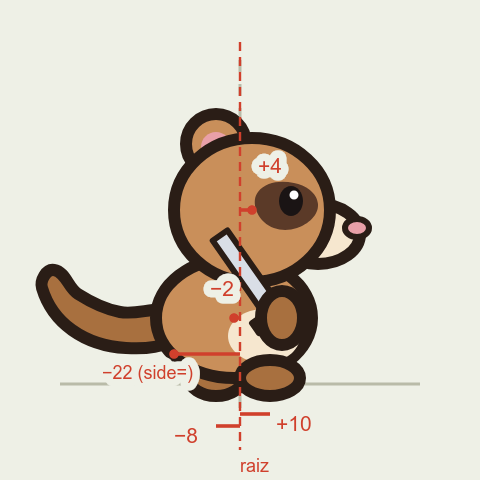

Repare:

- A cabeça está 7,2 pixels na frente da raiz, e o corpo, quase nela (0,3 atrás). O focinho, o olho e o nariz puxam o centro da cabeça para a frente; a barriga, o do corpo. O pé esquerdo (o de perto, de lado) está 10 na frente, e o direito, 8 atrás: o furão está parado com um pé na frente do outro.
- A régua é uma camada `guide` com `view=right`: ela só aparece na vista de lado, e só com `--guides` (no editor, com **Exibir › Guias**). O `include` traz o furão inteiro de `exemplos/`.

Quando a vista de lado não diz a profundidade de um osso, o Weasel procura em outro lugar, nesta ordem:

| De onde | Quando | No `--info` |
|---|---|---|
| `side=x` no `bone` | sempre que estiver escrito: é o x do osso na vista de lado | `(side=)` |
| a vista de lado | o centro das peças do osso de lado (com os dois lados desenhados, a média dos dois; se eles discordam mais de 4 pixels, um aviso) | `(lado)`, `(os dois lados)` |
| uma diagonal | o osso não tem peça de lado, mas tem numa diagonal (o ângulo dela entra na conta) | `(diagonal down_right)` |
| o osso espelhado | o osso não aparece de lado, mas na frente há outro na mesma altura, do outro lado da raiz: o braço esquerdo usa a profundidade do direito | `(par de bracoD)` |
| o pai | nenhum dos de cima: o osso fica na profundidade do pai, com um aviso | `(pai, corpo)` |

O `side=` serve quando o centro das peças engana. A cauda do furão é comprida e vai para trás: o meio dela não é o lugar do osso. Uma espada também engana, porque a lâmina vai longe da mão.

### 2. A grossura e para onde o osso aponta

Para trocar a ordem das peças e para girar em 3D, o Weasel precisa de mais duas medidas de cada osso:

- **Para onde ele aponta.** Vale o `tip=` do `bone`, se estiver escrito. Sem ele, vale o osso filho (quando o osso tem um só), ou o centro das peças do osso, de frente e de lado. Um osso curto demais para medir (um pé redondo) aponta para baixo.
- **A grossura.** O Weasel corta as peças do osso de través, em cinco lugares, da junta até a ponta, e mede da primeira à última peça que o corte pega. De frente, o corte dá a grossura de lado a lado; de lado, a de frente para trás.

O `--info` mostra as duas, nas linhas `aponta` e `grossura`.

### 3. Cada quadro, em 3D

Em cada quadro da animação base, cada osso anda e gira em 3D:

- `osso=dx,dy` anda para os lados e para cima e para baixo, como sempre, e o terceiro número (o giro) gira o osso na tela da frente;
- `osso.z=` anda para a frente ou para trás;
- `osso.pitch=` gira para a frente ou para trás, e `osso.yaw=` gira de um lado para o outro, em volta do eixo de pé.

O giro vem primeiro, depois o `pitch`, depois o `yaw`. Os filhos vão junto com o pai, como no 2D: o braço que gira leva a mão e a espada.

### 4. Cada vista é uma pose 2D comum

Cada vista olha o boneco de um ângulo: a frente de 0°, a 3/4 de uns 35°, o lado de 90°, as costas de 180°. Para cada quadro e cada vista, o Weasel leva cada osso para a tela com duas contas:

```
x na tela = raiz + (x − raiz) · cos(ângulo) + z · sen(ângulo)
y na tela = y + sen(tilt) · (o quanto o osso andou na direção da câmera, desde o desenho)
```

Veja com o pé esquerdo do bicho, que fica em x=50 (a raiz está em x=60) e anda `peE.z=8`:

| Vista | Ângulo | x na tela | y na tela |
|---|---|---|---|
| de frente | 0° | 60 + (50 − 60) · 1 + 8 · 0 = **50**: não sai do lugar | ele andou 8 para a câmera: **desce 4** (sen 30° = 0,5) |
| de lado | 90° | 60 + (50 − 60) · 0 + 8 · 1 = **68**: 8 para a direita | ele andou de lado, sem chegar mais perto da câmera: **não desce** |
| de costas | 180° | 60 + (50 − 60) · (−1) + 8 · 0 = **70**: do outro lado | ele andou 8 para longe da câmera: **sobe 4** |

Depois, as peças de cada osso **giram** o quanto o osso parece ter girado naquela vista e **encurtam** ao longo dele: uma espada que aponta para a câmera fica curta. A largura da peça fica igual. Uma peça que encurta torta **inclina** em vez de afinar, e por isso as `key` geradas têm um sexto número, a inclinação (o `skew` do Godot).

O resultado de cada vista é uma **animação comum**, com uma `key` por quadro. O resto do Weasel não sabe que ela foi gerada: a imagem, o GIF, a sprite sheet, o Godot, as caixas, os pontos e os `event` funcionam como em qualquer animação.

### 5. Quem fica na frente

Num desenho 2D, a ordem das peças é a ordem das linhas. Nas vistas, a ordem muda com o movimento: o pé que vem para a frente passa por cima do outro. O Weasel decide assim:

1. Cada osso vira um **bastão** em 3D, com a grossura medida no desenho.
2. Onde dois bastões se cobrem na tela, o Weasel compara qual está mais perto da câmera, **agora** e **no desenho parado**.
3. Duas peças só trocam de ordem quando uma passou para o outro lado da outra **mais do que a grossura média** das duas (no mínimo 2 pixels). Assim, um pé que balança um pouquinho não fica piscando na frente e atrás do outro.

Algumas peças nunca trocam:

- as do mesmo osso e as sem osso ficam na ordem do desenho;
- uma peça só troca com as da **mesma camada**. Por isso, o mais simples é desenhar cada vista numa camada só.

O `--info` diz, em `ordem troca`, em quantos quadros a ordem muda e quem passa na frente de quem, em que quadros (`capa na frente de bracoE (0–2, 6–7)`).

### 6. O desenho que vira: `turns`

Um desenho chapado não mostra um osso girando em volta do próprio comprimento: uma cabeça de frente que gira 90° para o lado continua mostrando o rosto de frente. Com `turns` no `bone`, as peças desse osso nas outras vistas entram em cada vista como cópias escondidas. Em cada quadro, o Weasel vê para onde a frente do osso aponta e mostra o desenho da vista mais perto disso. A cabeça virada 90° para a direita mostra, de frente, o desenho de lado.

### 7. O pé no chão

O Weasel também confere se o pé não afunda. O chão é a altura do pé mais baixo no desenho parado, e só contam os ossos que tocam o chão parados (até 6 pixels acima dele): a espada que desce no golpe não é um pé. Em cada quadro da animação base, o `--info` diz quanto o pé mais baixo fica acima do chão. Abaixo de −1 pixel, o pé afundou, e o Weasel avisa.

## Girar em 3D: `pitch=`, `yaw=`, `tip=` e `turns`

O `osso.z=` só anda. Para **girar** um osso como em 3D (a espada que desce para a frente, a cabeça que olha para o lado), a `key` tem `osso.pitch=` e `osso.yaw=`, em graus. Cada vista mostra o giro como ele seria visto dali:

<!-- gerar: img/17_giro.png --contact -a attack_down,attack_right,attack_up,look_down -->
```weasel
canvas 120 120 bg=none
palette ink=#2b2a33 pelo=#e0a050 claro=#f6e2c0 escuro=#b07a3a metal=#d9dee6

godot root=60,110
views tilt=30

bone corpo pivot=60,110
# turns: quando a cabeça gira para outra vista, ela troca de desenho
bone cabeca parent=corpo pivot=60,72 turns
bone bracoD parent=corpo pivot=78,82
# tip=: a espada aponta para cima e 8 pixels para trás
bone espada parent=bracoD pivot=84,96 tip=84,70,-8 side=66

# de frente
layer frente view=down
ellipse corpo 60,90 20,18 c=pelo ink=3 bone=corpo
ellipse cabeca 60,56 17,15 c=pelo ink=3 bone=cabeca
ellipse olhoE 54,53 3,3 c=ink bone=cabeca
ellipse olhoD 66,53 3,3 c=ink bone=cabeca
rect lamina 82,70 4,26 c=metal ink=2 bone=espada
ellipse bracoD 83,96 5,6 c=escuro ink=2 bone=bracoD

# de lado
layer lado view=right
ellipse corpoL 60,90 17,18 c=pelo ink=3 bone=corpo
ellipse cabecaL 64,56 15,15 c=pelo ink=3 bone=cabeca
ellipse focinhoL 78,60 6,4 c=claro ink=2 bone=cabeca
ellipse olhoL 70,52 3,3 c=ink bone=cabeca
shape laminaL c=metal ink=2 bone=espada : 64,96 68,96 60,70 56,70
ellipse bracoDl 66,96 5,6 c=escuro ink=2 bone=bracoD

# de costas
layer costas view=up
rect laminaC 34,70 4,26 c=metal ink=2 bone=espada
ellipse bracoDc 37,96 5,6 c=escuro ink=2 bone=bracoD
ellipse corpoC 60,90 20,18 c=pelo ink=3 bone=corpo
ellipse cabecaC 60,56 17,15 c=pelo ink=3 bone=cabeca

# golpe: a espada gira para a frente (pitch negativo) e volta
anim attack frames=6 fps=12 once
key 0 espada.pitch=0
key 2 espada.pitch=-100 ease=out
key 4 espada.pitch=-100
key 6 espada.pitch=0

# olha para o lado: a cabeça gira 90 graus (yaw) e volta
anim look frames=8 fps=8
key 0 cabeca.yaw=0
key 3 cabeca.yaw=90
key 5 cabeca.yaw=90
key 8 cabeca.yaw=0
```


Repare:

- **`osso.pitch=` gira para a frente ou para trás**, em volta do eixo que vai de um ombro ao outro. O negativo leva para a frente o que está **acima** da junta e para trás o que está **abaixo**: a espada, que aponta para cima, desce para a frente com `pitch=-100`. Num osso que aponta para baixo (uma perna, um braço, uma capa), é o positivo que leva a ponta para a frente.
- **`osso.yaw=` gira de um lado para o outro**, em volta do eixo de pé, como quem vira a cabeça. O giro da `key` (o terceiro número) continua girando na tela da vista principal.
- **Cada vista mostra o giro de um jeito.** De lado, a espada faz o arco inteiro. De frente, ela vem na direção de quem olha e **encurta** (até 10% do tamanho, quando aponta para a câmera; o `shorten=` do `bone` muda isso). De costas, ela também encurta, indo para longe de quem olha.
- **`tip=x,y,z` no `bone` diz para onde o osso aponta:** o x,y desenhados na frente e, com o terceiro número, quantos pixels ele vai para a frente (positivo) ou para trás. A espada aponta para cima e 8 pixels para trás; é em volta dessa direção que ela encurta.
- **`turns` no `bone` troca o desenho:** quando o osso gira mais da metade do caminho até outra vista, as peças dele saem e entram as dessa vista. A cabeça que vira 90 graus aparece de perfil na frente, de costas no lado e de perfil para o outro lado nas costas (a vista que falta sai espelhada). Sem uma 3/4 desenhada, a troca é seca, aos 45°.
- **Quem fica na frente continua trocando sozinho**, agora também com o giro: um osso que gira para a frente pode passar na frente de outro.
- As caixas e os pontos presos ao osso giram junto, em cada vista. Uma transição (`from=` e `to=`) mistura o giro pelo caminho mais curto.

**Experimente:** apague o `turns` da linha `bone cabeca`. No `look_down`, a cabeça fica de frente o tempo todo. Depois troque `espada.pitch=-100` por `espada.yaw=-100`: o `yaw` gira em volta da vertical, e a espada quase em pé só leva a ponta para o lado.

## O guarda: a lança, a capa e a cabeça que vira

O guarda é o primeiro personagem de verdade. Ele usa os giros em três lugares:

- **A lança** é um osso filho do braço direito, com `tip=61,8` (ela aponta para cima) e `side=80` (de lado, ela fica no meio). Na estocada, o braço sobe para a frente (`bracoD.pitch=80`) e a lança gira na mão (`lanca.pitch=-170`). Os giros se somam: 80 − 170 = −90, e a lança fica deitada, apontando para a frente. De lado ela aparece deitada; de frente ela vem para quem olha e fica curta.
- **A capa** é um osso filho do corpo, com `tip=80,172` (ela aponta para baixo) e `side=72` (8 pixels atrás do corpo). Andando, `capa.pitch=-20` leva a ponta da capa para trás (a capa aponta para baixo, então o negativo vai para trás). De frente, ela fica atrás do corpo; de costas, ela fica por cima, e é ela que cobre as costas.
- **As pernas e os braços balançam com `pitch`:** `pernaD.pitch=24` leva a perna direita para a frente, e `bracoE.pitch=20` leva o braço esquerdo junto, como quem anda. O braço direito, com a lança, quase não balança (`bracoD.pitch=-4`).
- **A cabeça** tem `turns`. Na animação `look`, ele anda e vira a cabeça 80° (`cabeca.yaw=80`): de frente aparece o perfil, e de lado aparecem as costas da cabeça.

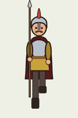

<details>
<summary>O arquivo inteiro: <code>exemplos/guarda3d.weasel</code></summary>

<!-- gerar: img/17_guarda.png --contact -a walk_down,walk_right,walk_up,look_down,attack_down,attack_right -->
<!-- gerar: img/17_guarda.gif -a look_down,attack_down,attack_right -->
```weasel
# Guarda em três vistas — lança, capa e cabeça que vira, para o Godot
# Desenhado de frente (view=down), de lado (view=right) e de costas (view=up); o lado esquerdo sai
# espelhado no Godot. Mostra os giros em 3D:
# - lanca.pitch= deita a lança para a frente na estocada (de frente, ela vem para quem olha e encurta);
# - capa.pitch= leva a capa para trás quando ele anda (de costas, ela fica por cima do corpo);
# - cabeca.yaw= vira a cabeça, e o turns no bone cabeca troca o desenho: virada 80°, a cabeça de
#   frente mostra o perfil.
# tip=x,y no bone diz para onde o osso aponta; side=x, o x dele na vista de lado.
# Veja as profundidades e as trocas de ordem com:  weasel guarda3d.weasel --info

canvas 160 240 bg=#eef0e6
palette ink=#2a1d16 line=2.5 thin=1.2
palette pele=#e8b48c metal=#b9c1cc metald=#8d96a3 capa=#7d1f2a capad=#5e1620 tunica=#c9a23a tunicad=#a8852a
palette calca=#4a4038 bota=#2b2420 haste=#8a5a32 crina=#c8433a olho=#1a1414 bigode=#5a3a22

godot body=character root=80,205
views tilt=30

layer guia guide
line chao c=#b9bba8 w=1 : 20,205 140,205

# ---------- ossos ----------
bone corpo pivot=80,128
bone cabeca parent=corpo pivot=80,72 turns
bone capa parent=corpo pivot=80,80 tip=80,172 side=72
bone pernaD pivot=73,128 tip=73,205
bone pernaE pivot=87,128 tip=87,205
bone bracoD parent=corpo pivot=63,84
bone lanca parent=bracoD pivot=61,119 tip=61,8 side=80
bone bracoE parent=corpo pivot=97,84

# ---------- de frente ----------
layer frente view=down
shape capaF c=capad ink=line bone=capa : 64,80 96,80 108,172! 52,172!
rect pernaDf 67,128 12,62 c=calca ink=thin bone=pernaD
rect botaDf 65,186 15,19 r=3 c=bota ink=thin bone=pernaD
rect pernaEf 81,128 12,62 c=calca ink=thin bone=pernaE
rect botaEf 80,186 15,19 r=3 c=bota ink=thin bone=pernaE
shape tunicaF c=tunica ink=line bone=corpo : 65,84! 95,84! 102,142! 58,142!
shape peitoF c=metal ink=line bone=corpo : 66,84 94,84 93,110 80,116 67,110
rect cintoF 61,112 38,6 c=haste bone=corpo
ellipse bracoEf 99,101 6,18 c=tunicad ink=line bone=bracoE
ellipse maoEf 99,120 5 c=pele ink=thin bone=bracoE
ellipse bracoDf 61,101 6,18 c=tunicad ink=line bone=bracoD
rect hasteF 59.5,8 3,192 c=haste ink=thin bone=lanca
shape pontaF c=metal ink=thin bone=lanca : 61,-6! 65,8! 61,12! 57,8!
ellipse maoDf 61,120 5 c=pele ink=thin bone=bracoD
ellipse rostoF 80,54 15,17 c=pele ink=line bone=cabeca
shape elmoF c=metal ink=line bone=cabeca : 64,54! 65,41 72,34 80,32 88,34 95,41 96,54! 90,46 80,44 70,46
rect protecaoF 78,44 4,14 c=metald ink=thin bone=cabeca
shape crinaF c=crina ink=thin bone=cabeca : 77,34 79,16 81,16 83,34
ellipse olhoDf 74,55 1.8,2.2 c=olho bone=cabeca
ellipse olhoEf 86,55 1.8,2.2 c=olho bone=cabeca
shape bigodeF c=bigode bone=cabeca : 72,62 80,60 88,62 86,65 80,63 74,65

# ---------- de lado (virado para a direita: a lança fica perto) ----------
layer lado view=right
shape capaL c=capad ink=line bone=capa : 66,80 76,82 74,172! 50,174! 58,120
ellipse bracoEl 81,101 6,18 c=tunicad ink=line bone=bracoE
ellipse maoEl 82,120 5 c=pele ink=thin bone=bracoE
rect pernaEl 74,128 12,62 c=calca ink=thin bone=pernaE
rect botaEl 73,186 18,19 r=3 c=bota ink=thin bone=pernaE
rect pernaDl 74,128 12,62 c=calca ink=thin bone=pernaD
rect botaDl 73,186 18,19 r=3 c=bota ink=thin bone=pernaD
shape tunicaL c=tunica ink=line bone=corpo : 69,84! 91,84! 96,142! 64,142!
shape peitoL c=metal ink=line bone=corpo : 70,84 90,84 94,104 88,114 72,114
rect cintoL 66,112 28,6 c=haste bone=corpo
ellipse rostoL 81,54 15,17 c=pele ink=line bone=cabeca
shape narizL c=pele ink=thin bone=cabeca : 94,50! 98,57! 93,58!
shape elmoL c=metal ink=line bone=cabeca : 64,58! 64,42 72,34 84,32 93,38 97,47! 86,46 78,48 76,58
rect protecaoL 93,44 4,10 c=metald ink=thin bone=cabeca
shape crinaL c=crina ink=thin bone=cabeca : 66,40 70,28 80,22 92,24 90,30 80,30 72,36
ellipse olhoL 90,54 1.6,2.2 c=olho bone=cabeca
shape bigodeL c=bigode bone=cabeca : 88,61 95,60 95,63 89,64
ellipse bracoDl 80,101 6,18 c=tunicad ink=line bone=bracoD
rect hasteL 78.5,8 3,192 c=haste ink=thin bone=lanca
shape pontaL c=metal ink=thin bone=lanca : 80,-6! 84,8! 80,12! 76,8!
ellipse maoDl 80,120 5 c=pele ink=thin bone=bracoD

# ---------- de costas (a capa cobre as costas) ----------
layer costas view=up
rect pernaDc 81,128 12,62 c=calca ink=thin bone=pernaD
rect botaDc 80,186 15,19 r=3 c=bota ink=thin bone=pernaD
rect pernaEc 67,128 12,62 c=calca ink=thin bone=pernaE
rect botaEc 65,186 15,19 r=3 c=bota ink=thin bone=pernaE
shape tunicaC c=tunica ink=line bone=corpo : 65,84! 95,84! 102,142! 58,142!
shape capaC c=capa ink=line bone=capa : 66,80 94,80 106,174! 54,174!
stroke dobraC1 w=thin c=capad bone=capa : 74,90 70,170
stroke dobraC2 w=thin c=capad bone=capa : 86,90 90,170
ellipse bracoEc 61,101 6,18 c=tunicad ink=line bone=bracoE
ellipse maoEc 61,120 5 c=pele ink=thin bone=bracoE
ellipse bracoDc 99,101 6,18 c=tunicad ink=line bone=bracoD
rect hasteC 97.5,8 3,192 c=haste ink=thin bone=lanca
shape pontaC c=metal ink=thin bone=lanca : 99,-6! 103,8! 99,12! 95,8!
ellipse maoDc 99,120 5 c=pele ink=thin bone=bracoD
ellipse nucaC 80,54 15,17 c=pele ink=line bone=cabeca
shape elmoC c=metal ink=line bone=cabeca : 64,60! 65,41 72,34 80,32 88,34 95,41 96,60! 80,64
shape crinaC c=crina ink=thin bone=cabeca : 77,34 79,16 81,16 83,34 82,52 78,52

# ---------- animações: cada uma escrita uma vez ----------
anim idle frames=8 fps=8
key 0 corpo=0,0,0,1,1 capa.pitch=0
key 4 corpo=0,1.5,0,1.02,0.98 capa.pitch=-3
key 8 corpo=0,0,0,1,1 capa.pitch=0

# andar: a lança fica de pé (o braço quase não balança), a capa vai para trás. Nos quadros
# ímpares, a perna que está no chão desce 1,6 px: inclinada, ela fica mais curta na altura
anim walk frames=8 fps=10
key 0 corpo=0,2 pernaD.pitch=24 pernaE.pitch=-24 pernaD=0,6.5 pernaE=0,6.5 bracoE.pitch=20 bracoD.pitch=-4 capa.pitch=-14
key 1 pernaD=0,1.6
key 2 corpo=0,-1 pernaD.pitch=0 pernaE.pitch=0 pernaD=0,0 pernaE=0,-4 bracoE.pitch=0 bracoD.pitch=0 capa.pitch=-20
key 3 pernaD=0,1.6
key 4 corpo=0,2 pernaD.pitch=-24 pernaE.pitch=24 pernaD=0,6.5 pernaE=0,6.5 bracoE.pitch=-20 bracoD.pitch=4 capa.pitch=-14
key 5 pernaE=0,1.6
key 6 corpo=0,-1 pernaD.pitch=0 pernaE.pitch=0 pernaD=0,-4 pernaE=0,0 bracoE.pitch=0 bracoD.pitch=0 capa.pitch=-20
key 7 pernaE=0,1.6
key 8 corpo=0,2 pernaD.pitch=24 pernaE.pitch=-24 pernaD=0,6.5 pernaE=0,6.5 bracoE.pitch=20 bracoD.pitch=-4 capa.pitch=-14

# andar olhando para o lado: o mesmo andar, duas vezes, e a cabeça vira 80° para a esquerda dele e volta
anim look frames=16 fps=10
key 0 corpo=0,2 pernaD.pitch=24 pernaE.pitch=-24 pernaD=0,6.5 pernaE=0,6.5 bracoE.pitch=20 bracoD.pitch=-4 capa.pitch=-14 cabeca.yaw=0
key 1 pernaD=0,1.6
key 2 corpo=0,-1 pernaD.pitch=0 pernaE.pitch=0 pernaD=0,0 pernaE=0,-4 bracoE.pitch=0 bracoD.pitch=0 capa.pitch=-20
key 3 pernaD=0,1.6
key 4 corpo=0,2 pernaD.pitch=-24 pernaE.pitch=24 pernaD=0,6.5 pernaE=0,6.5 bracoE.pitch=-20 bracoD.pitch=4 capa.pitch=-14 cabeca.yaw=80
key 5 pernaE=0,1.6
key 6 corpo=0,-1 pernaD.pitch=0 pernaE.pitch=0 pernaD=0,-4 pernaE=0,0 bracoE.pitch=0 bracoD.pitch=0 capa.pitch=-20
key 7 pernaE=0,1.6
key 8 corpo=0,2 pernaD.pitch=24 pernaE.pitch=-24 pernaD=0,6.5 pernaE=0,6.5 bracoE.pitch=20 bracoD.pitch=-4 capa.pitch=-14
key 9 pernaD=0,1.6
key 10 corpo=0,-1 pernaD.pitch=0 pernaE.pitch=0 pernaD=0,0 pernaE=0,-4 bracoE.pitch=0 bracoD.pitch=0 capa.pitch=-20 cabeca.yaw=80
key 11 pernaD=0,1.6
key 12 corpo=0,2 pernaD.pitch=-24 pernaE.pitch=24 pernaD=0,6.5 pernaE=0,6.5 bracoE.pitch=-20 bracoD.pitch=4 capa.pitch=-14
key 13 pernaE=0,1.6
key 14 corpo=0,-1 pernaD.pitch=0 pernaE.pitch=0 pernaD=0,-4 pernaE=0,0 bracoE.pitch=0 bracoD.pitch=0 capa.pitch=-20
key 15 pernaE=0,1.6
key 16 corpo=0,2 pernaD.pitch=24 pernaE.pitch=-24 pernaD=0,6.5 pernaE=0,6.5 bracoE.pitch=20 bracoD.pitch=-4 capa.pitch=-14 cabeca.yaw=0

# estocada: a lança deita para a frente, recua e vai
anim attack frames=8 fps=12 once
key 0 corpo.z=0 bracoD.pitch=0 lanca.pitch=0 pernaD.pitch=0 pernaD=0,0 capa.pitch=0
key 1 corpo.z=-2 bracoD.pitch=20 lanca.pitch=-85 capa.pitch=-4 ease=out
key 2 corpo.z=-4 bracoD.pitch=5 lanca.pitch=-95 pernaD.pitch=-6 pernaD=0,0.4 capa.pitch=-2
key 3 corpo.z=8 bracoD.pitch=80 lanca.pitch=-170 pernaD.pitch=22 pernaD=0,3 capa.pitch=-22 ease=out
key 5 corpo.z=8 bracoD.pitch=78 lanca.pitch=-168 pernaD.pitch=22 pernaD=0,3 capa.pitch=-18
key 8 corpo.z=0 bracoD.pitch=0 lanca.pitch=0 pernaD.pitch=0 pernaD=0,0 capa.pitch=0
event 3 golpe
```

</details>

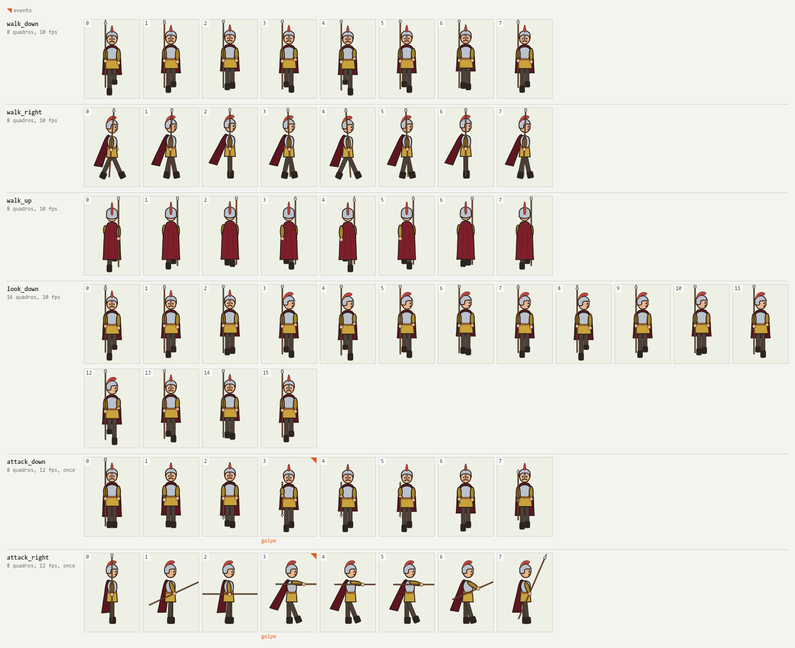

Repare:

- **Uma perna inclinada fica mais curta na altura.** A perna do guarda tem 77 pixels (do `pivot=` ao `tip=`). Inclinada 24°, no quadro 0, a ponta dela sobe 77 × (1 − cos 24°) ≈ 6,6 pixels: por isso as duas pernas descem 6,5 (`pernaD=0,6.5`), e o pé fica no chão.
- **Nos quadros ímpares, a perna que está no chão desce só 1,6 pixel** (`key 1 pernaD=0,1.6`). No quadro 1, ela está no meio do caminho, inclinada 12°, e a ponta sobe 77 × (1 − cos 12°) ≈ 1,6. Sem essa `key`, ela ficaria no meio das `key` 0 e 2, descendo 3,25, e o pé afundaria 1,6 pixel no chão: o Weasel avisaria. Com ela, o `--info` mostra, em `pé no chão`, no máximo 0,2 pixel de folga.
- **A ordem troca em todos os quadros de costas** (`walk_up`), porque a capa balança por cima dos braços. De frente, na estocada, o braço passa na frente da lança (no `--info`, `bracoD na frente de lanca (2–6)`).
- **O `look` repete o andar duas vezes**, com as mesmas `key` das pernas, e só a cabeça muda. O `--info` mostra o desenho escolhido em cada quadro: `vira look_down: cabeca - - - right right…` (o `-` é o desenho da própria vista).

## As diagonais e o lado esquerdo: o herói

O herói tem seis vistas: de frente, de 3/4 para cada lado, de lado para cada lado e de costas. Com elas, ele anda em oito direções no Godot e não troca a espada de mão.

<details>
<summary>O arquivo inteiro: <code>exemplos/heroi3d.weasel</code></summary>

<!-- gerar: img/17_heroi.png --contact -a walk_down,walk_down_right,walk_right,walk_up,walk_left,walk_down_left,attack_down_left -->
<!-- gerar: img/17_heroi.gif -a walk_down*2,walk_down_right*2,walk_right*2,walk_up*2,walk_left*2,walk_down_left*2 -->
```weasel
# Herói em três vistas — com as diagonais e os dois lados desenhados, para o Godot
# O herói é desenhado de frente (view=down), de 3/4 para os dois lados (view=down_right e
# view=down_left), de lado (view=right e view=left) e de costas (view=up). O ângulo de cada diagonal
# é medido no desenho, pelo lugar das peças. Com os dois lados desenhados, nada sai espelhado: a
# espada fica sempre na mão direita, e o escudo na esquerda.
# Cada animação é escrita uma vez, sem direção no nome, e o Weasel gera uma por vista (walk_down,
# walk_down_right, walk_right…). osso.pitch= balança as pernas e os braços para a frente e para trás.
# Veja os ângulos medidos e as profundidades com:  weasel heroi3d.weasel --info
# Exporte com:  weasel heroi3d.weasel -o godot/heroi3d.tscn

canvas 160 160 bg=#eef0e6
palette ink=#2a1d16 line=3 thin=1.5
palette pele=#f2c9a0 tunica=#2f7f8f tunicad=#24626e cabelo=#6b4a2e cabelod=#553a22 couro=#8a5a32 faixa=#c8433a
palette bota=#5b3a22 calca=#efe6d0 calcad=#cfc4aa metal=#d9dee6 cabo=#7a5232 ouro=#e0b84a madeira=#a8763f madeirad=#86592c olho=#1a1414

godot body=character root=80,146
views tilt=30

layer guia guide
line chao c=#b9bba8 w=1 : 20,146 140,146

# ---------- ossos (na frente: x de quem olha, y para baixo) ----------
bone corpo pivot=80,116
bone cabeca parent=corpo pivot=80,86
bone pernaD pivot=73,116 tip=73,146
bone pernaE pivot=87,116 tip=87,146
bone bracoD parent=corpo pivot=66,92
bone bracoE parent=corpo pivot=94,92
bone espada parent=bracoD pivot=64,112 tip=57,140,8 side=80
bone escudo parent=bracoE pivot=96,111 tip=96,124 side=80

# ---------- de frente ----------
layer frente view=down
rect calcaD 68,114 10,24 c=calca ink=thin bone=pernaD
rect botaD 66,134 13,12 r=3 c=bota ink=thin bone=pernaD
rect calcaE 82,114 10,24 c=calca ink=thin bone=pernaE
rect botaE 81,134 13,12 r=3 c=bota ink=thin bone=pernaE
shape tunica c=tunica ink=line bone=corpo : 68,88! 92,88! 97,106 102,124! 58,124! 63,106
rect cinto 63,105 34,5 c=couro bone=corpo
rect fivela 77,104 6,7 r=1 c=ouro bone=corpo
shape lamina c=metal ink=thin bone=espada : 62,116! 66,117! 58,141! 55,139!
rect guarda 58,112 12,3 r=1 c=cabo ink=thin bone=espada
ellipse mangaD 64,101 6,10 c=tunicad ink=line bone=bracoD
ellipse maoD 64,112 4.5 c=pele ink=thin bone=bracoD
ellipse mangaE 96,101 6,10 c=tunicad ink=line bone=bracoE
ellipse maoE 96,111 4.5 c=pele ink=thin bone=bracoE
ellipse escudo 102,113 10,12 c=madeira ink=line bone=escudo
ellipse bossa 102,113 3.5 c=metal ink=thin bone=escudo
shape pontas c=faixa ink=thin bone=cabeca : 96,52 113,60 111,66 97,58
ellipse orelhaD 60,67 4,6 c=pele ink=thin bone=cabeca
ellipse orelhaE 100,67 4,6 c=pele ink=thin bone=cabeca
ellipse rosto 80,65 20,20 c=pele ink=line bone=cabeca
shape cabelo c=cabelo ink=line bone=cabeca : 60,63 61,50 70,43 80,41 90,43 99,50 100,63 94,55 86,58 80,53 74,58 66,55
stroke faixa w=5 c=faixa bone=cabeca : 61,56 80,51 99,56
ellipse olhoD 72,68 2.8,4 c=olho bone=cabeca
ellipse olhoE 88,68 2.8,4 c=olho bone=cabeca
stroke boca w=thin c=ink bone=cabeca : 77,77 80,79 83,77

# ---------- de lado (virado para a direita: o braço da espada fica perto) ----------
layer lado view=right
ellipse mangaEl 80,101 6,10 c=tunicad ink=line bone=bracoE
ellipse escudoL 93,113 3.5,12 c=madeira ink=line bone=escudo
rect calcaEl 75,114 10,24 c=calcad ink=thin bone=pernaE
rect botaEl 74,134 15,12 r=3 c=bota ink=thin bone=pernaE
rect calcaDl 75,114 10,24 c=calca ink=thin bone=pernaD
rect botaDl 74,134 15,12 r=3 c=bota ink=thin bone=pernaD
shape tunicaL c=tunica ink=line bone=corpo : 72,88! 88,88! 91,106 96,124! 64,124! 68,106
rect cintoL 67,105 26,5 c=couro bone=corpo
shape pontasL c=faixa ink=thin bone=cabeca : 64,52 46,60 48,66 64,58
ellipse rostoL 82,65 20,20 c=pele ink=line bone=cabeca
ellipse narizL 101,69 3 c=pele ink=thin bone=cabeca
shape cabeloL c=cabelo ink=line bone=cabeca : 62,66 63,50 72,43 84,42 96,47 100,55 90,52 80,53 74,58 70,72
stroke faixaL w=5 c=faixa bone=cabeca : 63,55 82,50 99,55
ellipse orelhaL 75,66 4,6 c=pele ink=thin bone=cabeca
ellipse olhoL 93,67 2.5,4 c=olho bone=cabeca
shape laminaL c=metal ink=thin bone=espada : 79,116! 82,115! 89,139! 86,141!
rect guardaL 75,112 11,3 r=1 c=cabo ink=thin bone=espada
ellipse mangaDl 80,101 6,10 c=tunicad ink=line bone=bracoD
ellipse maoDl 81,112 4.5 c=pele ink=thin bone=bracoD

# ---------- de costas (o braço da espada fica à direita de quem olha) ----------
layer costas view=up
ellipse escudoC 57,113 6,12 c=madeirad ink=line bone=escudo
ellipse mangaEc 64,101 6,10 c=tunicad ink=line bone=bracoE
ellipse maoEc 64,111 4.5 c=pele ink=thin bone=bracoE
rect calcaEc 68,114 10,24 c=calca ink=thin bone=pernaE
rect botaEc 66,134 13,12 r=3 c=bota ink=thin bone=pernaE
rect calcaDc 82,114 10,24 c=calca ink=thin bone=pernaD
rect botaDc 81,134 13,12 r=3 c=bota ink=thin bone=pernaD
shape tunicaC c=tunica ink=line bone=corpo : 68,88! 92,88! 97,106 102,124! 58,124! 63,106
rect cintoC 63,105 34,5 c=couro bone=corpo
shape laminaC c=metal ink=thin bone=espada : 94,117! 98,116! 105,139! 102,141!
rect guardaC 90,112 12,3 r=1 c=cabo ink=thin bone=espada
ellipse mangaDc 96,101 6,10 c=tunicad ink=line bone=bracoD
ellipse maoDc 96,112 4.5 c=pele ink=thin bone=bracoD
ellipse orelhaDc 100,67 4,6 c=pele ink=thin bone=cabeca
ellipse orelhaEc 60,67 4,6 c=pele ink=thin bone=cabeca
ellipse nuca 80,65 20,20 c=cabelo ink=line bone=cabeca
shape cabeloC c=cabelod bone=cabeca : 68,72 73,64 80,68 87,64 92,72 80,82
stroke faixaC w=5 c=faixa bone=cabeca : 61,56 80,59 99,56
shape pontasC c=faixa ink=thin bone=cabeca : 77,57 83,57 87,78 80,82 73,78
ellipse no 80,58 4,3 c=faixa ink=thin bone=cabeca

# ---------- do outro lado (virado para a esquerda: o escudo fica perto) ----------
layer esquerda view=left
shape laminaLe c=metal ink=thin bone=espada : 81,116! 78,115! 71,139! 74,141!
ellipse mangaDle 80,101 6,10 c=tunicad ink=line bone=bracoD
rect calcaDle 75,114 10,24 c=calcad ink=thin bone=pernaD
rect botaDle 71,134 15,12 r=3 c=bota ink=thin bone=pernaD
rect calcaEle 75,114 10,24 c=calca ink=thin bone=pernaE
rect botaEle 71,134 15,12 r=3 c=bota ink=thin bone=pernaE
shape tunicaLe c=tunica ink=line bone=corpo : 72,88! 88,88! 92,106 96,124! 64,124! 69,106
rect cintoLe 67,105 26,5 c=couro bone=corpo
shape pontasLe c=faixa ink=thin bone=cabeca : 96,52 114,60 112,66 96,58
ellipse rostoLe 78,65 20,20 c=pele ink=line bone=cabeca
ellipse narizLe 59,69 3 c=pele ink=thin bone=cabeca
shape cabeloLe c=cabelo ink=line bone=cabeca : 98,66 97,50 88,43 76,42 64,47 60,55 70,52 80,53 86,58 90,72
stroke faixaLe w=5 c=faixa bone=cabeca : 97,55 78,50 61,55
ellipse orelhaLe 85,66 4,6 c=pele ink=thin bone=cabeca
ellipse olhoLe 67,67 2.5,4 c=olho bone=cabeca
ellipse mangaEle 80,101 6,10 c=tunicad ink=line bone=bracoE
ellipse maoEle 80,111 4.5 c=pele ink=thin bone=bracoE
ellipse escudoLe 69,113 6,12 c=madeira ink=line bone=escudo
ellipse bossaLe 68,113 2.2,3.5 c=metal ink=thin bone=escudo

# ---------- de 3/4 (de frente, virado 35° para a direita) ----------
layer diagonal view=down_right
ellipse mangaEd 93,101 5,10 c=tunicad ink=line bone=bracoE
ellipse maoEd 94,111 4.5 c=pele ink=thin bone=bracoE
rect calcaEd 81,114 10,24 c=calcad ink=thin bone=pernaE
rect botaEd 80,134 14,12 r=3 c=bota ink=thin bone=pernaE
rect calcaDd 69,114 10,24 c=calca ink=thin bone=pernaD
rect botaDd 68,134 14,12 r=3 c=bota ink=thin bone=pernaD
shape tunicaD c=tunica ink=line bone=corpo : 69,88! 91,88! 96,106 101,124! 60,124! 64,106
rect cintoD 64,105 32,5 c=couro bone=corpo
rect fivelaD 81,104 6,7 r=1 c=ouro bone=corpo
ellipse escudoD 104,113 7,12 c=madeira ink=line bone=escudo
ellipse bossaD 105,113 3,3.5 c=metal ink=thin bone=escudo
shape pontasD c=faixa ink=thin bone=cabeca : 70,52 56,60 58,66 72,58
ellipse rostoD 81,65 20,20 c=pele ink=line bone=cabeca
ellipse orelhaDd 65,67 3.5,6 c=pele ink=thin bone=cabeca
shape cabeloD c=cabelo ink=line bone=cabeca : 61,66 62,50 72,43 83,41 93,44 100,51 101,62 96,55 88,58 82,53 76,58 68,56 66,70
stroke faixaD w=5 c=faixa bone=cabeca : 62,56 84,51 101,57
ellipse olhoDd 80,68 2.5,4 c=olho bone=cabeca
ellipse olhoEd 94,68 2.5,4 c=olho bone=cabeca
stroke bocaD w=thin c=ink bone=cabeca : 85,77 88,79 91,77
shape laminaD c=metal ink=thin bone=espada : 65,116! 69,116! 67,141! 63,141!
rect guardaD 61,112 11,3 r=1 c=cabo ink=thin bone=espada
ellipse mangaDd 67,101 6,10 c=tunicad ink=line bone=bracoD
ellipse maoDd 67,112 4.5 c=pele ink=thin bone=bracoD

# ---------- de 3/4 para o outro lado (o escudo vem para perto, a espada vai para longe) ----------
layer diagonalE view=down_left
ellipse mangaDde 67,101 5,10 c=tunicad ink=line bone=bracoD
ellipse maoDde 66,111 4.5 c=pele ink=thin bone=bracoD
shape laminaDe c=metal ink=thin bone=espada : 63,116! 67,116! 62,140! 58,139!
rect guardaDe 60,112 11,3 r=1 c=cabo ink=thin bone=espada
rect calcaDde 69,114 10,24 c=calcad ink=thin bone=pernaD
rect botaDde 66,134 14,12 r=3 c=bota ink=thin bone=pernaD
rect calcaEde 81,114 10,24 c=calca ink=thin bone=pernaE
rect botaEde 78,134 14,12 r=3 c=bota ink=thin bone=pernaE
shape tunicaDe c=tunica ink=line bone=corpo : 91,88! 69,88! 64,106 59,124! 100,124! 96,106
rect cintoDe 64,105 32,5 c=couro bone=corpo
rect fivelaDe 73,104 6,7 r=1 c=ouro bone=corpo
shape pontasDe c=faixa ink=thin bone=cabeca : 90,52 104,60 102,66 88,58
ellipse rostoDe 79,65 20,20 c=pele ink=line bone=cabeca
ellipse orelhaEde 95,67 3.5,6 c=pele ink=thin bone=cabeca
shape cabeloDe c=cabelo ink=line bone=cabeca : 99,66 98,50 88,43 77,41 67,44 60,51 59,62 64,55 72,58 78,53 84,58 92,56 94,70
stroke faixaDe w=5 c=faixa bone=cabeca : 98,56 76,51 59,57
ellipse olhoEde 80,68 2.5,4 c=olho bone=cabeca
ellipse olhoDde 66,68 2.5,4 c=olho bone=cabeca
stroke bocaDe w=thin c=ink bone=cabeca : 75,77 72,79 69,77
ellipse mangaEde 93,101 6,10 c=tunicad ink=line bone=bracoE
ellipse maoEde 93,112 4.5 c=pele ink=thin bone=bracoE
ellipse escudoDe 91,113 8,12 c=madeira ink=line bone=escudo
ellipse bossaDe 90,113 3,3.5 c=metal ink=thin bone=escudo

# ---------- animações: cada uma escrita uma vez ----------
anim idle frames=8 fps=8
key 0 corpo=0,0,0,1,1
key 4 corpo=0,1.5,0,1.03,0.97 bracoD.pitch=4 bracoE.pitch=-4
key 8 corpo=0,0,0,1,1 bracoD.pitch=0 bracoE.pitch=0

# andar: as pernas e os braços balançam para a frente e para trás (pitch)
anim walk frames=8 fps=12
key 0 corpo=0,2 pernaD=0,3.5 pernaE=0,3.5 pernaD.pitch=28 pernaE.pitch=-28 bracoD.pitch=-24 bracoE.pitch=24
key 2 corpo=0,-1 pernaD=0,0 pernaE=0,-4 pernaD.pitch=0 pernaE.pitch=0 bracoD.pitch=0 bracoE.pitch=0
key 4 corpo=0,2 pernaD=0,3.5 pernaE=0,3.5 pernaD.pitch=-28 pernaE.pitch=28 bracoD.pitch=24 bracoE.pitch=-24
key 6 corpo=0,-1 pernaD=0,-4 pernaE=0,0 pernaD.pitch=0 pernaE.pitch=0 bracoD.pitch=0 bracoE.pitch=0
key 8 corpo=0,2 pernaD=0,3.5 pernaE=0,3.5 pernaD.pitch=28 pernaE.pitch=-28 bracoD.pitch=-24 bracoE.pitch=24
event 0 passo
event 4 passo

# ataque: a espada vem da direita do herói, passa pela frente e vai para a esquerda
anim attack frames=6 fps=12 once
key 0 corpo.yaw=0 bracoD.pitch=0 bracoD.yaw=0
key 1 corpo.yaw=-15 bracoD.pitch=75 bracoD.yaw=-75 ease=out
key 2 corpo.yaw=5 bracoD.pitch=85 bracoD.yaw=0 ease=out
key 3 corpo.yaw=20 bracoD.pitch=80 bracoD.yaw=70
key 4 corpo.yaw=20 bracoD.pitch=78 bracoD.yaw=75
key 6 corpo.yaw=0 bracoD.pitch=0 bracoD.yaw=0
event 2 golpe
```

</details>

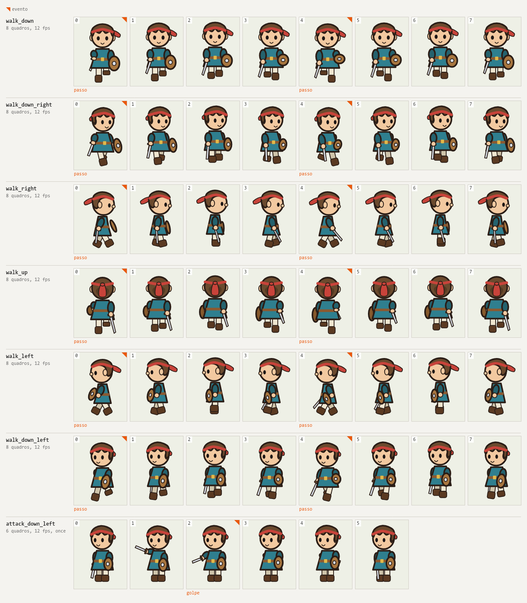

### As diagonais: `down_right`, `down_left`, `up_right` e `up_left`

- **`view=down_right`** é a 3/4 de frente, virada para a direita, e **`view=down_left`** a virada para a esquerda. **`up_right`** e **`up_left`** são as 3/4 de costas.
- **O ângulo de cada diagonal é medido no desenho.** O Weasel procura o ângulo que melhor explica o lugar das peças: o x de cada peça na diagonal tem que ser o x dela de frente e a profundidade dela de lado, misturados pelo ângulo. No herói, a `down_right` sai com 34,5° e a `down_left` com 35,5°. O `--info` mostra o ângulo e o erro médio: `down_right 34.5° da frente, medido (8 ossos, erro médio 0.4 px)`.
- **`angle=` na `layer` diz o ângulo à mão**, de 1 a 89 graus a partir da frente (ou das costas), quando a medida não serve.

A mesma conta ajuda a **desenhar** uma diagonal. A raiz do herói está em x=80. O escudo está em x=102 de frente, 22 pixels à direita da raiz. De lado, ele está uns 12 pixels na frente (em x=93 no lado direito e em x=69 no esquerdo; com os dois lados, vale a média). Numa 3/4 de 35°:

```
x = 22 · cos 35° + 12 · sen 35° = 18 + 6,9 ≈ 25   →   80 + 25 = 105
```

Na `down_right`, o escudo foi desenhado em x=104. Na `down_left`, a profundidade entra com o sinal trocado: 18 − 6,9 ≈ 11, e o escudo fica em x=91. Desenhe a diagonal assim, peça por peça, e depois confira o ângulo e o erro médio no `--info`.

### O golpe de um lado ao outro: `yaw` no braço

O golpe do herói usa os dois giros no braço da espada:

```weasel
key 1 corpo.yaw=-15 bracoD.pitch=75 bracoD.yaw=-75 ease=out
key 2 corpo.yaw=5 bracoD.pitch=85 bracoD.yaw=0 ease=out
key 3 corpo.yaw=20 bracoD.pitch=80 bracoD.yaw=70
```

- `bracoD.pitch=75` levanta o braço para a frente, quase na horizontal (o braço aponta para baixo, então o positivo vai para a frente).
- `bracoD.yaw=` varre o braço levantado de um lado ao outro: −75 para a direita do herói, 0 na frente, 70 para a esquerda.
- `corpo.yaw=` torce o corpo junto, como quem dá o golpe com o corpo inteiro.
- Cada vista mostra o mesmo golpe de um jeito: de frente, a espada passa de um lado ao outro, na frente do corpo; de lado, ela vem de perto de quem olha e termina atrás do corpo. A ordem das peças acompanha: no `--info`, `ordem troca` aparece no golpe de quase todas as vistas.

### O lado esquerdo desenhado: `view=left`

- Sem `view=left`, o Godot espelha o lado direito, e a espada passa para a outra mão. Com o lado esquerdo desenhado, **nada sai espelhado**: a espada fica sempre na mão direita.
- Com os dois lados desenhados, **cada diagonal precisa da diagonal do outro lado**. Espelhar a `down_right` trocaria a mão do herói só na diagonal, então, sem a `down_left`, o Weasel avisa e não gera as animações `_down_left`.
- Com os dois lados, a profundidade de cada osso é a média dos dois. Se eles discordam mais de 4 pixels, o Weasel avisa, e o `side=` decide.

### No jogo

O ajudante `tocar("walk", velocity)` escolhe entre oito direções quando há diagonais ([capítulo 15](15-jogo-personagem.md#direções-jogos-vistos-de-cima)). O herói só tem as diagonais de baixo: andando na diagonal para cima, o `tocar()` usa a reta mais perto (`walk_up` ou o lado).

## O homem: joelho, cotovelo e pé

O homem tem a proporção de uma pessoa (sete cabeças de altura). Cada perna tem três ossos (coxa, canela e pé) e cada braço tem três (braço, antebraço e mão). Ele mostra que as vistas também servem para um corpo realista.

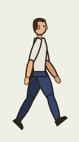

<details>
<summary>O arquivo inteiro: <code>exemplos/homem3d.weasel</code></summary>

<!-- gerar: img/17_homem.png --contact -a walk_down,walk_right,walk_up,run_down,run_right,run_up -->
<!-- gerar: img/17_homem.gif -a walk_right*2,run_right*3,walk_down*2 -->
```weasel
# Homem em três vistas — proporção realista, com joelho, cotovelo e pé, para o Godot
# Desenhado de frente (view=down), de lado (view=right) e de costas (view=up); o lado esquerdo sai
# espelhado no Godot. Cada perna tem três ossos (coxa, canela e pé) e cada braço três (braço,
# antebraço e mão): o pitch de cada um dobra o joelho, o tornozelo e o cotovelo, e o yaw do quadril e
# do tronco faz o corpo torcer a cada passo. tip=x,y,z no pé diz que ele aponta 16 px para a frente.
# As animações foram calculadas por um programa (um quadro por key, ease=linear): andar e correr.
# Veja as profundidades e as trocas de ordem com:  weasel homem3d.weasel --info

canvas 160 285 bg=#eef0e6
palette ink=#2a1d16 line=2.5 thin=1.2
palette pele=#e8b48c peled=#cf9a72 camisa=#e9e4d8 camisad=#c9c2b2 calca=#34466b calcad=#26344f sapato=#2b2420 cabelo=#3b2a1e olho=#1a1414

godot body=character root=80,250
views tilt=30

layer guia guide
line chao c=#b9bba8 w=1 : 20,250 140,250

# ---------- ossos ----------
bone quadril pivot=80,135 tip=80,146
bone tronco parent=quadril pivot=80,135
bone cabeca parent=tronco pivot=80,64
bone coxaD parent=quadril pivot=69,135
bone canelaD parent=coxaD pivot=69,193
bone peD parent=canelaD pivot=69,244 tip=69,250,16 side=80
bone coxaE parent=quadril pivot=91,135
bone canelaE parent=coxaE pivot=91,193
bone peE parent=canelaE pivot=91,244 tip=91,250,16 side=80
bone bracoD parent=tronco pivot=52,74
bone antebracoD parent=bracoD pivot=50,120
bone maoD parent=antebracoD pivot=49,152
bone bracoE parent=tronco pivot=108,74
bone antebracoE parent=bracoE pivot=110,120
bone maoE parent=antebracoE pivot=111,152

# ---------- de frente ----------
layer frente view=down
shape coxaDf c=calca ink=line bone=coxaD : 60,134 79,134 76,196 63,196
shape canelaDf c=calca ink=line bone=canelaD : 63,190 76,190 74,244 65,244
shape peDf c=sapato ink=thin bone=peD : 62,241! 76,241! 78,250! 60,250!
shape coxaEf c=calca ink=line bone=coxaE : 81,134 100,134 97,196 84,196
shape canelaEf c=calca ink=line bone=canelaE : 84,190 97,190 95,244 86,244
shape peEf c=sapato ink=thin bone=peE : 84,241! 98,241! 100,250! 82,250!
shape bacia c=calca ink=line bone=quadril : 62,126! 98,126! 101,146! 80,150 59,146!
shape camisaF c=camisa ink=line bone=tronco : 56,69! 104,69! 110,77 105,112 99,136! 61,136! 55,112 50,77
stroke golaF w=thin c=camisad bone=tronco : 72,70 80,78 88,70
rect pescocoF 74,57 12,14 c=peled ink=thin bone=cabeca
ellipse cabecaF 80,46 13,16 c=pele ink=line bone=cabeca
shape cabeloF c=cabelo bone=cabeca : 67,44 67,34 74,29 86,29 93,34 93,44 89,36 80,35 71,37
ellipse olhoDf 75,46 1.6,2 c=olho bone=cabeca
ellipse olhoEf 85,46 1.6,2 c=olho bone=cabeca
stroke narizF w=thin c=peled bone=cabeca : 80,47 79,53 81,54
stroke bocaF w=thin c=ink bone=cabeca : 76,57 80,58 84,57
shape bracoDf c=camisa ink=line bone=bracoD : 46,74 58,72 57,122 46,122
shape antebracoDf c=pele ink=line bone=antebracoD : 45,118 56,118 53,154 46,154
ellipse maoDf 49,159 5,8 c=pele ink=thin bone=maoD
shape bracoEf c=camisa ink=line bone=bracoE : 102,72 114,74 114,122 103,122
shape antebracoEf c=pele ink=line bone=antebracoE : 104,118 115,118 114,154 107,154
ellipse maoEf 111,159 5,8 c=pele ink=thin bone=maoE

# ---------- de lado (virado para a direita: o lado direito do homem fica perto) ----------
layer lado view=right
shape bracoEl c=camisad ink=line bone=bracoE : 75,72 86,72 85,122 76,122
shape antebracoEl c=peled ink=line bone=antebracoE : 76,118 85,118 84,154 77,154
ellipse maoEl 80,159 5,8 c=peled ink=thin bone=maoE
shape coxaEl c=calcad ink=line bone=coxaE : 71,134 90,134 86,196 74,196
shape canelaEl c=calcad ink=line bone=canelaE : 74,190 86,190 84,244 76,244
shape peEl c=sapato ink=thin bone=peE : 74,240! 84,240 97,245 98,250! 72,250!
shape coxaDl c=calca ink=line bone=coxaD : 71,134 90,134 86,196 74,196
shape canelaDl c=calca ink=line bone=canelaD : 74,190 86,190 84,244 76,244
shape peDl c=sapato ink=thin bone=peD : 74,240! 84,240 97,245 98,250! 72,250!
shape baciaL c=calca ink=line bone=quadril : 67,126! 92,126! 94,146! 66,146!
shape camisaL c=camisa ink=line bone=tronco : 70,69! 90,69! 95,88 93,112 91,136! 68,136! 66,112 67,88
rect pescocoL 75,57 10,14 c=peled ink=thin bone=cabeca
ellipse cabecaL 81,46 13,16 c=pele ink=line bone=cabeca
shape narizL c=pele ink=thin bone=cabeca : 93,41! 97,50! 92,51!
shape cabeloL c=cabelo bone=cabeca : 68,52 67,36 74,29 86,29 93,34 88,37 78,36 76,46 71,56
ellipse orelhaL 78,47 2.5,4 c=peled ink=thin bone=cabeca
ellipse olhoL 89,45 1.4,2 c=olho bone=cabeca
stroke bocaL w=thin c=ink bone=cabeca : 89,57 92,57
shape bracoDl c=camisa ink=line bone=bracoD : 75,72 86,72 85,122 76,122
shape antebracoDl c=pele ink=line bone=antebracoD : 76,118 85,118 84,154 77,154
ellipse maoDl 80,159 5,8 c=pele ink=thin bone=maoD

# ---------- de costas ----------
layer costas view=up
shape coxaDc c=calca ink=line bone=coxaD : 81,134 100,134 97,196 84,196
shape canelaDc c=calca ink=line bone=canelaD : 84,190 97,190 95,244 86,244
shape peDc c=sapato ink=thin bone=peD : 84,240! 98,240! 98,250! 84,250!
shape coxaEc c=calca ink=line bone=coxaE : 60,134 79,134 76,196 63,196
shape canelaEc c=calca ink=line bone=canelaE : 63,190 76,190 74,244 65,244
shape peEc c=sapato ink=thin bone=peE : 62,240! 76,240! 76,250! 62,250!
shape baciaC c=calca ink=line bone=quadril : 62,126! 98,126! 101,146! 80,150 59,146!
shape camisaC c=camisa ink=line bone=tronco : 56,69! 104,69! 110,77 105,112 99,136! 61,136! 55,112 50,77
stroke costuraC w=thin c=camisad bone=tronco : 80,72 80,132
rect pescocoC 74,57 12,14 c=peled ink=thin bone=cabeca
ellipse cabecaC 80,46 13,16 c=cabelo ink=line bone=cabeca
ellipse orelhaDc 93,47 2.5,4 c=peled ink=thin bone=cabeca
ellipse orelhaEc 67,47 2.5,4 c=peled ink=thin bone=cabeca
shape bracoDc c=camisa ink=line bone=bracoD : 102,74 114,72 114,122 103,122
shape antebracoDc c=pele ink=line bone=antebracoD : 104,118 115,118 114,154 107,154
ellipse maoDc 111,159 5,8 c=pele ink=thin bone=maoD
shape bracoEc c=camisa ink=line bone=bracoE : 46,72 58,74 57,122 46,122
shape antebracoEc c=pele ink=line bone=antebracoE : 45,118 56,118 53,154 46,154
ellipse maoEc 49,159 5,8 c=pele ink=thin bone=maoE

# ---------- animações: cada uma escrita uma vez (uma key por quadro) ----------
anim walk frames=8 fps=10
key 0 quadril=0,7.77 quadril.yaw=5.0 tronco.yaw=-9.0 tronco.pitch=0 coxaD.pitch=22 canelaD.pitch=-4 peD.pitch=18 coxaE.pitch=-18 canelaE.pitch=-12 peE.pitch=-15 bracoD.pitch=-19.8 antebracoD.pitch=8.0 bracoE.pitch=16.2 antebracoE.pitch=17.7 ease=linear
key 1 quadril=0,1.24 quadril.yaw=3.0 tronco.yaw=-5.4 tronco.pitch=0 coxaD.pitch=12 canelaD.pitch=-14 peD.pitch=0 coxaE.pitch=-12 canelaE.pitch=-40 peE.pitch=-20 bracoD.pitch=-10.8 antebracoD.pitch=8.0 bracoE.pitch=10.8 antebracoE.pitch=14.5 ease=linear
key 2 quadril=0,0.12 quadril.yaw=-2.5 tronco.yaw=4.5 tronco.pitch=0 coxaD.pitch=0 canelaD.pitch=-4 peD.pitch=0 coxaE.pitch=20 canelaE.pitch=-55 peE.pitch=5 bracoD.pitch=0.0 antebracoD.pitch=8.0 bracoE.pitch=-18.0 antebracoE.pitch=8.0 ease=linear
key 3 quadril=0,2.27 quadril.yaw=-4.8 tronco.yaw=8.6 tronco.pitch=0 coxaD.pitch=-10 canelaD.pitch=-2 peD.pitch=-5 coxaE.pitch=28 canelaE.pitch=-25 peE.pitch=12 bracoD.pitch=9.0 antebracoD.pitch=13.4 bracoE.pitch=-25.2 antebracoE.pitch=8.0 ease=linear
key 4 quadril=0,7.77 quadril.yaw=-5.0 tronco.yaw=9.0 tronco.pitch=0 coxaD.pitch=-18 canelaD.pitch=-12 peD.pitch=-15 coxaE.pitch=22 canelaE.pitch=-4 peE.pitch=18 bracoD.pitch=16.2 antebracoD.pitch=17.7 bracoE.pitch=-19.8 antebracoE.pitch=8.0 ease=linear
key 5 quadril=0,1.24 quadril.yaw=-3.0 tronco.yaw=5.4 tronco.pitch=0 coxaD.pitch=-12 canelaD.pitch=-40 peD.pitch=-20 coxaE.pitch=12 canelaE.pitch=-14 peE.pitch=0 bracoD.pitch=10.8 antebracoD.pitch=14.5 bracoE.pitch=-10.8 antebracoE.pitch=8.0 ease=linear
key 6 quadril=0,0.12 quadril.yaw=2.5 tronco.yaw=-4.5 tronco.pitch=0 coxaD.pitch=20 canelaD.pitch=-55 peD.pitch=5 coxaE.pitch=0 canelaE.pitch=-4 peE.pitch=0 bracoD.pitch=-18.0 antebracoD.pitch=8.0 bracoE.pitch=0.0 antebracoE.pitch=8.0 ease=linear
key 7 quadril=0,2.27 quadril.yaw=4.8 tronco.yaw=-8.6 tronco.pitch=0 coxaD.pitch=28 canelaD.pitch=-25 peD.pitch=12 coxaE.pitch=-10 canelaE.pitch=-2 peE.pitch=-5 bracoD.pitch=-25.2 antebracoD.pitch=8.0 bracoE.pitch=9.0 antebracoE.pitch=13.4 ease=linear
key 8 quadril=0,7.77 quadril.yaw=5.0 tronco.yaw=-9.0 tronco.pitch=0 coxaD.pitch=22 canelaD.pitch=-4 peD.pitch=18 coxaE.pitch=-18 canelaE.pitch=-12 peE.pitch=-15 bracoD.pitch=-19.8 antebracoD.pitch=8.0 bracoE.pitch=16.2 antebracoE.pitch=17.7 ease=linear
event 0 passo
event 4 passo

anim run frames=8 fps=12
key 0 quadril=0,2.80 quadril.yaw=7.2 tronco.yaw=-13.0 tronco.pitch=-10 coxaD.pitch=18 canelaD.pitch=-20 peD.pitch=10 coxaE.pitch=-30 canelaE.pitch=-40 peE.pitch=-25 bracoD.pitch=-21.6 antebracoD.pitch=82.0 bracoE.pitch=36.0 antebracoE.pitch=82.0 ease=linear
key 1 quadril=0,1.48 quadril.yaw=2.2 tronco.yaw=-4.0 tronco.pitch=-10 coxaD.pitch=15 canelaD.pitch=-45 peD.pitch=0 coxaE.pitch=0 canelaE.pitch=-100 peE.pitch=-10 bracoD.pitch=-18.0 antebracoD.pitch=82.0 bracoE.pitch=0.0 antebracoE.pitch=82.0 ease=linear
key 2 quadril=0,-2.76 quadril.yaw=-9.0 tronco.yaw=16.2 tronco.pitch=-10 coxaD.pitch=-15 canelaD.pitch=-20 peD.pitch=-35 coxaE.pitch=45 canelaE.pitch=-80 peE.pitch=0 bracoD.pitch=18.0 antebracoD.pitch=82.0 bracoE.pitch=-40.0 antebracoE.pitch=82.0 ease=linear
key 3 quadril=0,4.64 quadril.yaw=-7.8 tronco.yaw=14.0 tronco.pitch=-10 coxaD.pitch=-22 canelaD.pitch=-60 peD.pitch=-15 coxaE.pitch=30 canelaE.pitch=-20 peE.pitch=5 bracoD.pitch=26.4 antebracoD.pitch=82.0 bracoE.pitch=-36.0 antebracoE.pitch=82.0 ease=linear
key 4 quadril=0,2.80 quadril.yaw=-7.2 tronco.yaw=13.0 tronco.pitch=-10 coxaD.pitch=-30 canelaD.pitch=-40 peD.pitch=-25 coxaE.pitch=18 canelaE.pitch=-20 peE.pitch=10 bracoD.pitch=36.0 antebracoD.pitch=82.0 bracoE.pitch=-21.6 antebracoE.pitch=82.0 ease=linear
key 5 quadril=0,1.48 quadril.yaw=-2.2 tronco.yaw=4.0 tronco.pitch=-10 coxaD.pitch=0 canelaD.pitch=-100 peD.pitch=-10 coxaE.pitch=15 canelaE.pitch=-45 peE.pitch=0 bracoD.pitch=0.0 antebracoD.pitch=82.0 bracoE.pitch=-18.0 antebracoE.pitch=82.0 ease=linear
key 6 quadril=0,-2.76 quadril.yaw=9.0 tronco.yaw=-16.2 tronco.pitch=-10 coxaD.pitch=45 canelaD.pitch=-80 peD.pitch=0 coxaE.pitch=-15 canelaE.pitch=-20 peE.pitch=-35 bracoD.pitch=-40.0 antebracoD.pitch=82.0 bracoE.pitch=18.0 antebracoE.pitch=82.0 ease=linear
key 7 quadril=0,4.64 quadril.yaw=7.8 tronco.yaw=-14.0 tronco.pitch=-10 coxaD.pitch=30 canelaD.pitch=-20 peD.pitch=5 coxaE.pitch=-22 canelaE.pitch=-60 peE.pitch=-15 bracoD.pitch=-36.0 antebracoD.pitch=82.0 bracoE.pitch=26.4 antebracoE.pitch=82.0 ease=linear
key 8 quadril=0,2.80 quadril.yaw=7.2 tronco.yaw=-13.0 tronco.pitch=-10 coxaD.pitch=18 canelaD.pitch=-20 peD.pitch=10 coxaE.pitch=-30 canelaE.pitch=-40 peE.pitch=-25 bracoD.pitch=-21.6 antebracoD.pitch=82.0 bracoE.pitch=36.0 antebracoE.pitch=82.0 ease=linear
event 0 passo
event 4 passo
```

</details>

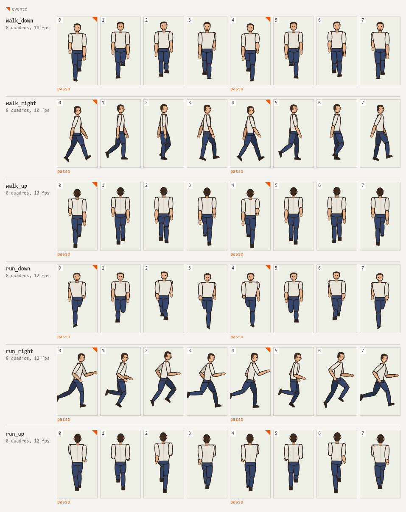

Repare:

- **O joelho, o tornozelo e o cotovelo dobram com `pitch`.** No quadro 0, `coxaD.pitch=22` leva a coxa para a frente, `canelaD.pitch=-4` dobra um pouco o joelho e `peD.pitch=18` levanta a ponta do pé: é o calcanhar chegando no chão. Como cada osso é filho do anterior, os giros se somam, como num braço de robô: a canela gira 22 − 4 = 18° no total.
- **O corpo torce:** `quadril.yaw=` e `tronco.yaw=` giram ao contrário um do outro a cada passo, como numa pessoa andando. De frente, o tronco não muda de largura (o Weasel não estreita as peças), mas os ombros e os braços, que vão junto, andam para a frente e para trás.
- **`tip=69,250,16` no pé** diz que ele aponta 16 pixels para a frente, rente ao chão. É em volta dessa direção que ele encurta de frente.
- **`shorten=` no `bone` diz quanto as peças encurtam.** Um pé desenhado de frente já está curto no desenho: a bota de frente é a ponta dela. Quando ele gira, o Weasel ainda encurta (e estica) a peça, e uma bota grande pode ficar achatada num quadro e comprida no outro. `shorten=off` deixa a peça com o tamanho do desenho: ela só gira. `shorten=0.6` deixa encurtar até 60%, e `shorten=0.6,1.2` também estica só até 1,2 vez. Os pés do homem são pequenos e ficam sem `shorten=`.
- **O quadril sobe e desce em cada quadro** (`quadril=0,7.77` no quadro 0) para o pé de apoio ficar no chão: no `--info`, o `pé no chão` do `walk` é 0 em todos os quadros. Na corrida, ele diz `0 8 18 3.9 0 8 18 3.9`: nos quadros 1 a 3, o homem está no ar.
- **As animações têm uma `key` por quadro**, com `ease=linear`. Elas foram calculadas por um programa, mas poderiam ser escritas à mão, com menos `key`.
- Para as pernas, os giros (`pitch`) são mais seguros que o `ik`: o `ik` não é resolvido nas outras vistas (veja [os limites](#os-limites)).

## Num jogo de plataforma

Num jogo de plataforma, o personagem só anda para os lados. Não há frente: a vista principal é o lado direito (`view=right`), e as outras vistas (o lado esquerdo e, se você quiser, a frente e as costas) usam os mesmos ossos.

<details>
<summary>O arquivo inteiro: <code>exemplos/plataforma3d.weasel</code></summary>

<!-- gerar: img/17_plataforma.png --contact -a walk_right,walk_left,jump_right,attack_right,attack_left -->
```weasel
# Herói de plataforma — os dois lados desenhados, sem a frente, para o Godot
# Num jogo de plataforma, o personagem só anda para os lados. Sem a vista de frente, a principal é o
# lado direito (view=right): os pivot= e a pose são os dele. O lado esquerdo (view=left) também é
# desenhado, então nada sai espelhado: o escudo fica perto da câmera de um lado, a espada do outro.
# lat=x no bone diz o x que o osso teria de frente (de que lado do corpo ele fica). A câmera fica de
# lado: views tilt=0. As animações são escritas no lado direito (o giro, o terceiro número da key,
# é no plano da tela) e saem walk_right e walk_left.
# Veja as vistas com:  weasel plataforma3d.weasel --info

canvas 160 160 bg=#eef0e6
palette ink=#2a1d16 line=3 thin=1.5
palette pele=#f2c9a0 tunica=#2f7f8f tunicad=#24626e cabelo=#6b4a2e cabelod=#553a22 couro=#8a5a32 faixa=#c8433a
palette bota=#5b3a22 calca=#efe6d0 calcad=#cfc4aa metal=#d9dee6 cabo=#7a5232 ouro=#e0b84a madeira=#a8763f madeirad=#86592c olho=#1a1414

godot body=character root=80,146
views tilt=0

layer guia guide
line chao c=#b9bba8 w=1 : 20,146 140,146

# ---------- ossos (no lado direito: x para a frente; lat= diz quem fica perto no lado direito) ----------
bone corpo pivot=80,116
bone cabeca parent=corpo pivot=80,86 lat=80
bone pernaD pivot=80,116 tip=80,146 lat=73
bone pernaE pivot=80,116 tip=80,146 lat=87
bone bracoD parent=corpo pivot=80,92 lat=66
bone espada parent=bracoD pivot=81,112 tip=88,140 lat=66
bone bracoE parent=corpo pivot=80,92 lat=94
bone escudo parent=bracoE pivot=80,111 tip=80,124 lat=94

# ---------- de lado (virado para a direita: o braço da espada fica perto) ----------
layer lado view=right
ellipse mangaEl 80,101 6,10 c=tunicad ink=line bone=bracoE
ellipse escudoL 93,113 3.5,12 c=madeira ink=line bone=escudo
rect calcaEl 75,114 10,24 c=calcad ink=thin bone=pernaE
rect botaEl 74,134 15,12 r=3 c=bota ink=thin bone=pernaE
rect calcaDl 75,114 10,24 c=calca ink=thin bone=pernaD
rect botaDl 74,134 15,12 r=3 c=bota ink=thin bone=pernaD
shape tunicaL c=tunica ink=line bone=corpo : 72,88! 88,88! 91,106 96,124! 64,124! 68,106
rect cintoL 67,105 26,5 c=couro bone=corpo
shape pontasL c=faixa ink=thin bone=cabeca : 64,52 46,60 48,66 64,58
ellipse rostoL 82,65 20,20 c=pele ink=line bone=cabeca
ellipse narizL 101,69 3 c=pele ink=thin bone=cabeca
shape cabeloL c=cabelo ink=line bone=cabeca : 62,66 63,50 72,43 84,42 96,47 100,55 90,52 80,53 74,58 70,72
stroke faixaL w=5 c=faixa bone=cabeca : 63,55 82,50 99,55
ellipse orelhaL 75,66 4,6 c=pele ink=thin bone=cabeca
ellipse olhoL 93,67 2.5,4 c=olho bone=cabeca
shape laminaL c=metal ink=thin bone=espada : 79,116! 82,115! 89,139! 86,141!
rect guardaL 75,112 11,3 r=1 c=cabo ink=thin bone=espada
ellipse mangaDl 80,101 6,10 c=tunicad ink=line bone=bracoD
ellipse maoDl 81,112 4.5 c=pele ink=thin bone=bracoD

# ---------- do outro lado (virado para a esquerda: o escudo fica perto) ----------
layer esquerda view=left
shape laminaLe c=metal ink=thin bone=espada : 81,116! 78,115! 71,139! 74,141!
ellipse mangaDle 80,101 6,10 c=tunicad ink=line bone=bracoD
rect calcaDle 75,114 10,24 c=calcad ink=thin bone=pernaD
rect botaDle 71,134 15,12 r=3 c=bota ink=thin bone=pernaD
rect calcaEle 75,114 10,24 c=calca ink=thin bone=pernaE
rect botaEle 71,134 15,12 r=3 c=bota ink=thin bone=pernaE
shape tunicaLe c=tunica ink=line bone=corpo : 72,88! 88,88! 92,106 96,124! 64,124! 69,106
rect cintoLe 67,105 26,5 c=couro bone=corpo
shape pontasLe c=faixa ink=thin bone=cabeca : 96,52 114,60 112,66 96,58
ellipse rostoLe 78,65 20,20 c=pele ink=line bone=cabeca
ellipse narizLe 59,69 3 c=pele ink=thin bone=cabeca
shape cabeloLe c=cabelo ink=line bone=cabeca : 98,66 97,50 88,43 76,42 64,47 60,55 70,52 80,53 86,58 90,72
stroke faixaLe w=5 c=faixa bone=cabeca : 97,55 78,50 61,55
ellipse orelhaLe 85,66 4,6 c=pele ink=thin bone=cabeca
ellipse olhoLe 67,67 2.5,4 c=olho bone=cabeca
ellipse mangaEle 80,101 6,10 c=tunicad ink=line bone=bracoE
ellipse maoEle 80,111 4.5 c=pele ink=thin bone=bracoE
ellipse escudoLe 69,113 6,12 c=madeira ink=line bone=escudo
ellipse bossaLe 68,113 2.2,3.5 c=metal ink=thin bone=escudo

# ---------- animações (escritas no lado direito) ----------
anim idle frames=8 fps=8
key 0 corpo=0,0,0,1,1
key 4 corpo=0,1.5,0,1.03,0.97
key 8 corpo=0,0,0,1,1

anim walk frames=8 fps=12
key 0 corpo=0,2 pernaD=0,0,-26 pernaE=0,0,26 bracoD=0,0,22 bracoE=0,0,-22
key 2 corpo=0,-1 pernaD=0,0,0 pernaE=0,-4,0 bracoD=0,0,0 bracoE=0,0,0
key 4 corpo=0,2 pernaD=0,0,26 pernaE=0,0,-26 bracoD=0,0,-22 bracoE=0,0,22
key 6 corpo=0,-1 pernaD=0,-4,0 pernaE=0,0,0 bracoD=0,0,0 bracoE=0,0,0
key 8 corpo=0,2 pernaD=0,0,-26 pernaE=0,0,26 bracoD=0,0,22 bracoE=0,0,-22
event 0 passo
event 4 passo

# pulo: agacha, sobe, no ar com as pernas dobradas, cai
anim jump frames=8 fps=12 once
key 0 corpo=0,0 pernaD=0,0,0 pernaE=0,0,0
key 1 corpo=0,6,0,1.04,0.94 pernaD=0,0,-12 pernaE=0,0,12 bracoD=0,0,30 bracoE=0,0,30
key 2 corpo=0,-18 pernaD=0,-20,-30 pernaE=0,-20,10 bracoD=0,-18,-60 bracoE=0,-18,-40 ease=out
key 4 corpo=0,-30 pernaD=0,-32,-45 pernaE=0,-30,-20 bracoD=0,-30,-80 bracoE=0,-30,-60
key 6 corpo=0,-10 pernaD=0,-12,-10 pernaE=0,-10,10 bracoD=0,-10,-20 bracoE=0,-10,-20 ease=in
key 7 corpo=0,5,0,1.04,0.95 pernaD=0,0,-10 pernaE=0,0,10 bracoD=0,0,10 bracoE=0,0,10
key 8 corpo=0,0 pernaD=0,0,0 pernaE=0,0,0 bracoD=0,0,0 bracoE=0,0,0

# ataque: a espada sobe por trás e desce na frente
anim attack frames=6 fps=12 once
key 0 bracoD=0,0,0 corpo=0,0,0
key 1 bracoD=0,0,150 corpo=0,0,-6 ease=out
key 2 bracoD=0,0,-80 corpo=0,0,8 ease=out
key 4 bracoD=0,0,-70 corpo=0,0,6
key 6 bracoD=0,0,0 corpo=0,0,0
event 2 golpe
```

</details>

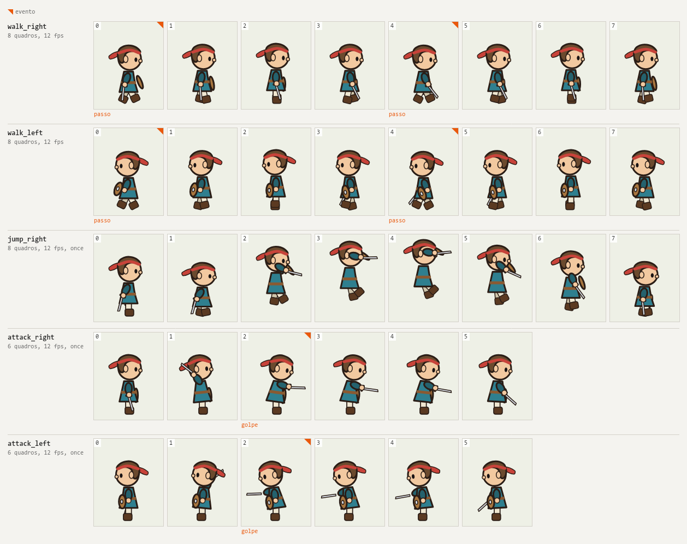

Repare:

- **Os `pivot=` e a pose são os do lado direito.** O x de cada osso aqui é a frente do personagem, e as `key` são escritas como se vê de lado: o giro (o terceiro número) gira na tela do lado direito. Por isso o andar balança as pernas com `pernaD=0,0,-26`, sem `pitch`.
- **`lat=x` no `bone` diz o x que o osso teria de frente**, de que lado do corpo ele fica. A raiz está em x=80: `pernaD … lat=73` fica 7 pixels para a direita do personagem (o lado da câmera, quando ele olha para a direita), e `escudo … lat=94` fica 14 para a esquerda dele.
- **Sem `lat=`, o Weasel adivinha** pela ordem do desenho: o que vem antes do corpo fica do outro lado, e o que vem depois fica perto da câmera (8 pixels). O `--info` mostra a adivinhação. **Experimente:** apague o `lat=80` da cabeça. O `--info` diz `cabeca -8 (perto: desenhado na frente do corpo)`: a cabeça foi desenhada depois do corpo e saiu 8 pixels para perto, o que só importaria se uma frente fosse desenhada.
- **`views tilt=0`:** num jogo de plataforma, a câmera fica de lado, na altura do personagem.
- **Com `view=left` desenhado, o personagem vira sem espelhar:** o escudo fica perto da câmera indo para a esquerda, e a espada, indo para a direita.

## O furão no Godot: caixas, pontos e `tocar()`

O furão é o exemplo completo de um personagem de jogo com as vistas: três animações (`idle`, `walk` e `attack`), as caixas do jogo, um ponto em cima da cabeça e a espada que gira com `espada.pitch=`.

<details>
<summary>O arquivo inteiro: <code>exemplos/furao3d.weasel</code></summary>

<!-- gerar: img/17_furao.png --contact -a attack_down,attack_right,attack_up -->
```weasel
# Furão em três vistas — personagem de jogo top-down, para o Godot
# O furão é desenhado de frente (view=down), de costas (view=up) e de lado (view=right), cada vista na
# sua camada. Cada animação é escrita uma vez só, sem direção no nome: o Weasel gera uma por vista
# (idle_down, idle_right, idle_up…). Na cena do Godot, o lado esquerdo sai espelhado do direito, e o
# ajudante tocar("walk", velocity) escolhe a vista pela direção.
# Os ossos são desenhados na frente; a profundidade de cada um vem da vista de lado (a cabeça fica
# 4 px para a frente, o pé esquerdo 10). osso.z= anda para a frente (positivo) ou para trás, e de
# frente o que vai para a frente desce um pouco na tela (views tilt=30). osso.pitch= gira o osso para a
# frente ou para trás, e osso.yaw= de um lado para o outro: em cada vista a peça gira, encurta e inclina.
# Veja as vistas, as profundidades e o pé no chão com:  weasel furao3d.weasel --info
# Exporte com:  weasel furao3d.weasel -o godot/furao3d.tscn

canvas 160 160 bg=#eef0e6 light=-0.6,-0.8
palette ink=#2a1d16 line=4 thin=2
palette pelo=#c98f5a pelod=#a8703f barriga=#f6e7cf mascara=#5b3a28 rosa=#e9a0a8
palette olho=#1a1414 metal=#d9dee6 cabo=#7a5232

# a raiz fica entre os pés: é a origem do nó no Godot e o meio das vistas
godot body=character root=80,128

# a câmera do jogo: 30 graus (o pé que vai 8 px para a frente desce 4 px na tela de frente)
views tilt=30

# Construção: o chão e o centro (só aparecem no editor)
layer guia guide
line chao c=#b9bba8 w=1 : 20,128 140,128
line meio c=#b9bba8 w=1 dash=4,4 : 80,20 80,140

# ---------- ossos (um esqueleto só para as três vistas) ----------
bone corpo pivot=80,128
bone cabeca parent=corpo pivot=80,92
bone peE pivot=68,126
bone peD pivot=92,126
# o braço esquerdo não aparece de lado: a profundidade vem do direito (o par espelhado)
bone bracoE parent=corpo pivot=58,100
bone bracoD parent=corpo pivot=102,100
# side= diz o x do osso na vista de lado, quando o centro das peças dele engana; tip= diz para onde ele aponta
# (o x,y na frente e quantos px para a frente ou para trás): a cauda vai para trás, a espada para cima
bone cauda parent=corpo pivot=80,118 side=58 tip=80,118,-30
bone espada parent=bracoD pivot=104,108 side=94 tip=119,75,-21

# ---------- frente (virado para baixo) ----------
layer frente view=down
ellipse peE 68,126 9,6 c=pelod ink=line bone=peE
ellipse peD 92,126 9,6 c=pelod ink=line bone=peD
ellipse corpo 80,106 24,22 c=pelo ink=line bone=corpo
ellipse barriga 80,111 14,13 c=barriga bone=corpo
ellipse bracoE 57,106 7,9 c=pelod ink=line bone=bracoE
ellipse orelhaE 58,48 10 c=pelo ink=line bone=cabeca
ellipse orelhaD 102,48 10 c=pelo ink=line bone=cabeca
ellipse orelhaEi 58,49 5 c=rosa bone=cabeca
ellipse orelhaDi 102,49 5 c=rosa bone=cabeca
ellipse cabeca 80,72 30,26 c=pelo ink=line bone=cabeca
shape mascara c=mascara bone=cabeca : 54,70 64,62 80,67 96,62 106,70 96,77 80,73 64,77
ellipse focinho 80,84 13,9 c=barriga bone=cabeca
ellipse olhoE 68,69 4,5 c=olho bone=cabeca
ellipse olhoD 92,69 4,5 c=olho bone=cabeca
ellipse brilhoE 69,67 1.5 c=#ffffff bone=cabeca
ellipse brilhoD 93,67 1.5 c=#ffffff bone=cabeca
ellipse nariz 80,80 4,3 c=rosa ink=thin bone=cabeca
stroke boca w=thin c=ink bone=cabeca : 75,86 80,89 85,86
shape laminaF c=metal ink=thin bone=espada : 116.5,74.1! 121.9,76.6! 108.4,105.6! 103.0,103.1!
shape guardaF c=cabo ink=thin bone=espada : 99.3,99.2! 113.8,105.9! 112.1,109.6! 97.6,102.8!
shape punhoF c=cabo ink=thin bone=espada : 103.0,105.3! 106.7,107.0! 102.9,115.2! 99.2,113.5!
ellipse bracoD 103,106 7,9 c=pelod ink=line bone=bracoD

# ---------- costas (virado para cima) ----------
# de costas, a esquerda e a direita trocam de lado: o pé esquerdo (peE) fica em x=92
layer costas view=up
ellipse peEc 92,126 9,6 c=pelod ink=line bone=peE
ellipse peDc 68,126 9,6 c=pelod ink=line bone=peD
ellipse corpoC 80,106 24,22 c=pelo ink=line bone=corpo
ellipse bracoEc 103,104 7,9 c=pelod ink=line bone=bracoE
ellipse bracoDc 57,104 7,9 c=pelod ink=line bone=bracoD
shape caudaC c=pelod ink=line bone=cauda : 80,116 92,124 110,120 124,104 126,92 120,92 114,106 98,114 84,110
ellipse orelhaEc 58,48 10 c=pelod ink=line bone=cabeca
ellipse orelhaDc 102,48 10 c=pelod ink=line bone=cabeca
ellipse cabecaC 80,72 30,26 c=pelo ink=line bone=cabeca
shape nuca c=pelod bone=cabeca : 70,52 80,49 90,52 86,76 80,80 74,76
shape laminaC c=metal ink=thin bone=espada : 38.1,76.6! 43.5,74.1! 57.0,103.1! 51.6,105.6!
shape guardaC c=cabo ink=thin bone=espada : 46.2,105.9! 60.7,99.2! 62.4,102.8! 47.9,109.6!
shape punhoC c=cabo ink=thin bone=espada : 53.3,107.0! 57.0,105.3! 60.8,113.5! 57.1,115.2!

# ---------- lado (virado para a direita; o esquerdo é espelhado) ----------
# o x de cada peça aqui é a profundidade do osso: a cabeça em x=84 está 4 px na frente da raiz
layer lado view=right
shape caudaL c=pelod ink=line bone=cauda : 60,112 42,116 24,110 14,96 18,90 26,98 40,104 58,104
ellipse peDl 72,126 9,6 c=pelod ink=line bone=peD
ellipse corpoL 78,106 26,20 c=pelo ink=line bone=corpo
ellipse barrigaL 88,112 12,9 c=barriga bone=corpo
ellipse peEl 90,126 10,6 c=pelod ink=line bone=peE
ellipse orelhaL 72,48 10 c=pelo ink=line bone=cabeca
ellipse orelhaLi 72,49 5 c=rosa bone=cabeca
ellipse focinhoL 106,78 14,10 c=barriga ink=line bone=cabeca
ellipse cabecaL 84,70 26,24 c=pelo ink=line bone=cabeca
shape mascaraL c=mascara bone=cabeca : 86,64 98,61 106,68 99,76 88,74
ellipse olhoL 97,67 4,5 c=olho bone=cabeca
ellipse brilhoL 98,65 1.5 c=#ffffff bone=cabeca
ellipse narizL 119,76 4,3 c=rosa ink=thin bone=cabeca
shape laminaL c=metal ink=thin bone=espada : 70.9,80.2! 75.8,76.8! 94.2,103.0! 89.2,106.4!
shape guardaL c=cabo ink=thin bone=espada : 84.0,107.7! 97.1,98.5! 99.4,101.8! 86.3,111.0!
shape punhoL c=cabo ink=thin bone=espada : 91.2,107.5! 94.5,105.2! 99.7,112.6! 96.4,114.9!
ellipse bracoL 94,106 7,9 c=pelod ink=line bone=bracoD

# ---------- o jogo: colisão, dano e um ponto em cima da cabeça ----------
box corpo_pes body rect 66,116 28,14
box dano hurt rect 54,42 52,90
# o ponto segue a cabeça em cada vista (ali aparece o "!" de susto)
point susto 80,36 bone=cabeca

# ---------- animações: cada uma escrita uma vez ----------
# respira: o corpo desce e achata um pouco (a cabeça e os braços vão junto)
anim idle frames=8 fps=8
key 0 corpo=0,0,0,1,1 cabeca=0,0
key 4 corpo=0,1.5,0,1.03,0.97 cabeca=0,1
key 8 corpo=0,0,0,1,1 cabeca=0,0

# anda: o pé que vai para a frente (z positivo) sobe, e os braços vão ao contrário dos pés.
# De frente, o pé da frente desce na tela; de lado, ele vai para a direita; de costas, sobe.
anim walk frames=8 fps=12
key 0 corpo=0,0 peE=0,-3 peE.z=8 peD=0,0 peD.z=-8 bracoD.z=5 bracoE.z=-5
key 2 corpo=0,-2 peE=0,0 peE.z=0 peD=0,-4 peD.z=0 bracoD.z=0 bracoE.z=0
key 4 corpo=0,0 peE=0,0 peE.z=-8 peD=0,-3 peD.z=8 bracoD.z=-5 bracoE.z=5
key 6 corpo=0,-2 peE=0,-4 peE.z=0 peD=0,0 peD.z=0 bracoD.z=0 bracoE.z=0
key 8 corpo=0,0 peE=0,-3 peE.z=8 peD=0,0 peD.z=-8 bracoD.z=5 bracoE.z=-5
event 0 passo
event 4 passo

# ataca: a espada vai um pouco para trás e desce para a frente (pitch negativo vem para a frente). De lado
# ela faz o arco inteiro; de frente e de costas ela encurta e vira, como em 3D.
anim attack frames=6 fps=12 once
key 0 espada.pitch=0 corpo=0,0
key 1 espada.pitch=35 corpo=0,-1 ease=out
key 2 espada.pitch=-140 corpo=0,2 ease=out
key 4 espada.pitch=-145 corpo=0,1
key 6 espada.pitch=0 corpo=0,0
event 2 golpe
```

</details>

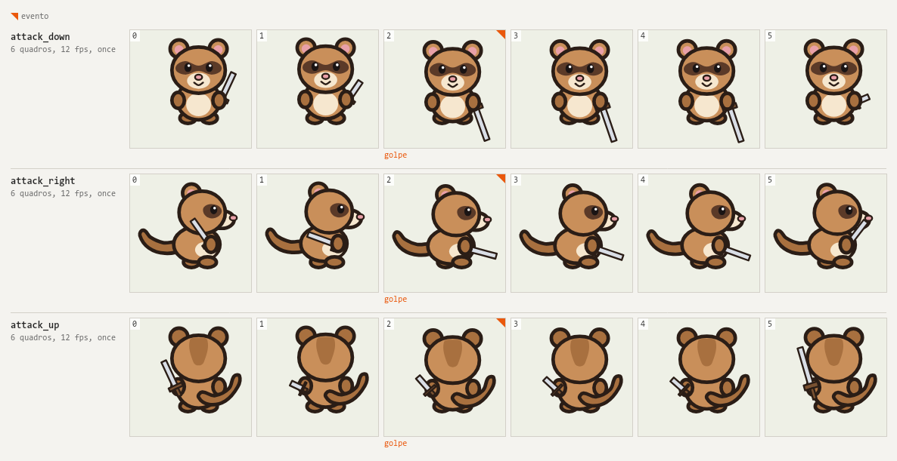

Repare:

- **As caixas e os pontos são desenhados uma vez, na frente**, sem `view=`. Presos a um osso (`bone=`), eles vão para o lugar do osso em cada vista e giram com ele. O `point susto … bone=cabeca` fica em cima da cabeça de frente, de lado e de costas.
- **O braço esquerdo não aparece de lado.** A profundidade dele vem do braço direito, o osso espelhado (no `--info`, `bracoE 14 (par de bracoD)`).
- **Para exportar,** é o de sempre:

```bash
node cli/weasel.js furao3d.weasel -o godot/furao3d.tscn
```

A cena tem a `walk_down`, a `walk_right`, a `walk_up` e a `walk_left` (espelhada da direita), e o mesmo para o `idle` e o `attack`. No jogo, `$AnimationPlayer.tocar("walk", velocity)` escolhe a vista pela direção ([capítulo 15](15-jogo-personagem.md#no-jogo-o-ajudante-tocar)).

- **Com `rig=bones`** ([capítulo 16](16-jogo-avancado.md#esqueleto-de-verdade-rigbones-experimental)), o Godot recebe os ossos: a inclinação das `key` vira o `skew` do `Bone2D`, a ordem que troca vira o `z_index` das peças, e as cópias do `turns` são peças que aparecem e somem (`visible`). Cada peça ganha essas trilhas em cada animação, então a cena fica maior: a do guarda tem uns 870 KB.
- **Uma animação escrita à mão numa vista** (`anim walk_up`) vale no lugar da gerada. Ela conta como `walk` no `only=` das caixas e das camadas. Nela, `osso.z=`, `osso.pitch=` e `osso.yaw=` não fazem nada (aviso): o 3D vale nas animações sem direção no nome.
- **Uma animação combinada (`mix=`)** não sai em cada vista: escreva uma para cada vista, com os nomes gerados (`anim walk_atk_right mix=walk_right,attack_right bones=espada`).

## Conferir as vistas: `--info`

O `--info` mostra o que o Weasel mediu no desenho. Com o furão:

```bash
node cli/weasel.js furao3d.weasel --info
```

```
vistas   down, right, up (principal: down), câmera tilt=30 (o que vai para a frente desce 0.5 px por px)
  profundidade corpo -0.3 (lado) · cabeca 7.2 (lado) · peE 10 (lado) · peD -8 (lado) · bracoE 14 (par de bracoD) · bracoD 14 (lado) · cauda -22 (side=) · espada 14 (side=)
  grossura     corpo 48/52 · cabeca 59.3/51.8 · peE 16.9/18.8 · peD 16.9/16.9 · bracoE 14/14 · bracoD 14.1/14 · cauda 11.8/11.8 · espada 6/6  [de lado a lado / de frente para trás]
  aponta       corpo (as peças, de frente e de lado) · cabeca (as peças, de frente e de lado) · peE (para baixo: curto demais para medir) · peD (para baixo: curto demais para medir) · bracoE (as peças) · bracoD (filho espada) · cauda (tip=) · espada (tip=)
  pé no chão   idle: 0 0 0 0 0 0 0 0
  pé no chão   walk: 0 1.5 0 0 0 1.5 0 0
  pé no chão   attack: 0 0 0 0 0 0
  geradas      idle → idle_down, idle_right, idle_up
  geradas      walk → walk_down, walk_right, walk_up
  geradas      attack → attack_down, attack_right, attack_up
```

- `profundidade` diz a profundidade de cada osso e de onde ela veio: do lado, do `side=`, de uma diagonal, do osso espelhado (`par de`) ou do pai. Num jogo de plataforma, a linha mostra o `lat=` (ou a adivinhação).
- `grossura` é a largura de cada osso, de lado a lado e de frente para trás, medida nas peças. Duas peças só trocam de ordem quando uma passa da outra mais do que essa grossura.
- `aponta` diz de onde veio a direção de cada osso, a que o `pitch=` e o `yaw=` encurtam: do `tip=`, do filho, das peças (o centro delas) ou, num osso curto demais, para baixo. Quando um osso encurta errado, um `tip=` resolve.
- `pé no chão` diz, em cada quadro, quantos pixels o pé mais baixo fica acima do chão. Um número negativo é o pé afundando: abaixo de −1, o Weasel avisa. No quadro 1 do `walk` do furão, um pé desce e o outro sobe, e os dois estão no ar: o mais baixo fica 1,5 pixel acima do chão, um pulinho.
- `geradas` lista as animações de cada vista.
- Com diagonais, uma linha para cada uma diz o ângulo e de onde ele veio (`34.5° da frente, medido (8 ossos, erro médio 0.4 px)`, ou `angle=`). Um erro médio grande quer dizer que as peças da diagonal não estão onde a conta espera.

O furão não troca a ordem nem usa `turns`. No guarda, o `--info` tem mais estas linhas:

```
  ordem troca  walk_up: em 8 de 8 quadros: capa na frente de bracoE (0–2, 6–7), capa na frente de bracoD (1–7), capa na frente de lanca (1–7)
  ordem troca  attack_down: em 6 de 8 quadros: bracoD na frente de lanca (2–6), lanca na frente de bracoD (7)
  vira         look_down: cabeca - - - right right right right right right right right right right - - -
  vira         look_right: cabeca - - - up up up up up up up up up up - - -
```

- `ordem troca` diz em quantos quadros a ordem das peças muda e, para cada par de ossos que troca, quem passa na frente de quem e em que quadros.
- `vira` diz, para cada quadro, o desenho que um osso com `turns` usa: `-` é o da própria vista, e `right`, `up`… o de outra. No `look_down`, a cabeça usa o desenho de lado do quadro 3 ao 12.

## No editor

Abra um dos exemplos em **Arquivo › Exemplos** (o furão, o herói, o guarda, o homem ou o herói de plataforma) e escolha uma animação no player.

### O player: os botões de direção


- **O menu mostra cada animação uma vez** (`walk`), e os **botões de direção** ao lado dele escolhem a vista: **↓ → ↑ ←**, oito com as diagonais, ou **→ ←** num jogo de plataforma.
- **Um botão apagado** é uma vista que não existe. Parado em cima dele, o mouse diz por quê.
- **A ← sem `view=left`** mostra a direita espelhada, como o Godot faz. É só para ver: para mexer nos ossos, use a →.
- A direção escolhida fica quando você troca de animação.

### A linha do tempo da animação base

Com uma animação gerada no player (`walk_right`), a linha do tempo mostra as `key` da animação base (`walk`). Mexer nela muda a `walk`, e todas as vistas mudam junto ([capítulo 23](23-editor.md#linha-do-tempo)). O cursor numa linha `key` da `walk` leva o player para aquele quadro, na vista que está tocando.

### Vistas em 3D

**Exibir › Vistas em 3D** (ou o botão de camadas na ponta direita da barra de baixo) mostra o boneco que o Weasel montou em 3D, com as vistas desenhadas em volta dele. É a conta da [seção acima](#como-o-weasel-monta-o-3d), para ver:

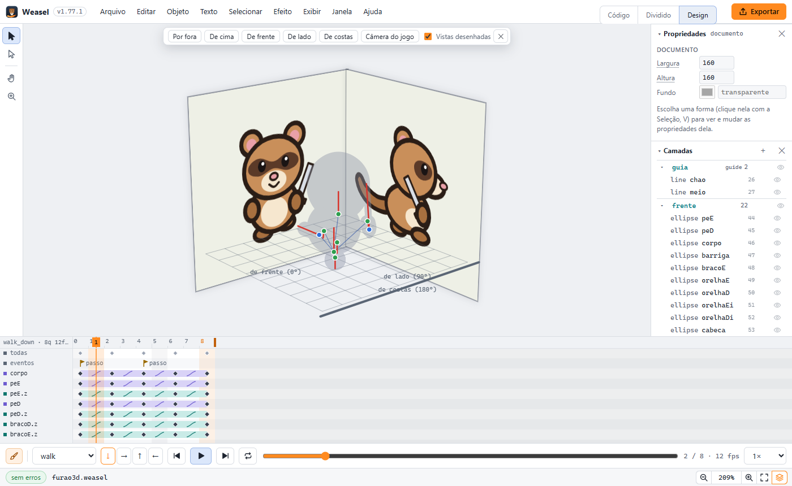

- **As vistas desenhadas** ficam em pé em volta do boneco, como placas. Cada uma fica atrás dele, do lado contrário ao da câmera dela, como o fundo de um palco: a placa de frente fica atrás das costas do boneco, virada para a frente. Assim, de qualquer lado, o boneco aparece na frente do desenho daquele lado, e dá para comparar os dois. Só aparecem as placas viradas para quem olha.
- **O boneco:** o corpo em cinza (a grossura medida), os ossos em vermelho e uma bolinha em cada junta. A cor da bolinha diz de onde veio a profundidade: **verde**, lida nas peças; **azul**, escrita (`side=` ou `lat=`); **vermelha**, adivinhada (a do pai, ou 0). Uma bolinha vermelha é um osso que talvez precise de `side=`.
- **O chão** é uma grade na altura do pé mais baixo.
- **A barra de cima:** **Por fora** (de lado e de cima), **De cima**, um botão para cada vista desenhada (alinha com ela: as bolinhas têm que cair em cima das peças) e **Câmera do jogo** (com a inclinação do `tilt=`). **Ctrl+0** alinha com a vista principal.
- **Clique num osso:** a barra diz a profundidade dele e de onde ela veio, o código vai até a linha do `bone`, e a vista desenha em amarelo o caminho da ponta dele na animação do player, com o número de cada quadro.


**De cima** é a melhor vista para conferir a profundidade. Nela, a frente do furão fica para baixo na imagem: a cauda vai para cima (para trás), e a espada vem para baixo no golpe (para a frente). As placas aparecem de lado, como linhas; a placa de frente fica no alto, atrás dele.

### Testar ossos nas três vistas

O **Testar ossos** (**O**) mexe nos ossos só na tela ([capítulo 23](23-editor.md#testar-ossos)). Num arquivo com vistas, o teste mexe na animação base (`walk`), e a vista do player mostra o que o Weasel gera dela, com a ordem das peças e os `turns` como ficariam:

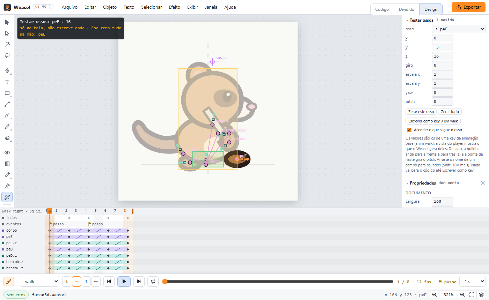

- O painel ganha **z** (`osso.z=`, para a frente), **yaw** e **pitch**.
- Arrastar a **bolinha** move o osso no plano da vista. De frente, para os lados e para cima e para baixo. De lado, para a frente e para trás: é o `z`. De costas, com o lado invertido, como a vista.
- A **ponta da haste** gira em volta do eixo que aponta para a câmera: de frente e de costas, o giro; de lado, o `pitch`. Numa diagonal, ela não gira: use os campos.
- **Escrever como key** grava na `anim walk`, não na `walk_right` (o botão diz `Escrever como key 0 em walk`), com `osso.z=`, `osso.pitch=` e `osso.yaw=`. Depois de escrito, as três vistas mudam juntas.
- **Trocar a direção mantém o teste.** Ele é da animação base, então o mesmo teste aparece de frente, de lado e de costas: mexa de lado e aperte **↓** para ver de frente. Trocar de quadro ou de animação recomeça o teste.

### Prender: arrastar a profundidade

No **Prender** (**Shift+P**), na vista de lado (o botão **→** do player), arrastar a bolinha de um osso para os lados escreve o `side=` dele enquanto você arrasta ([capítulo 23](23-editor.md#prender)):

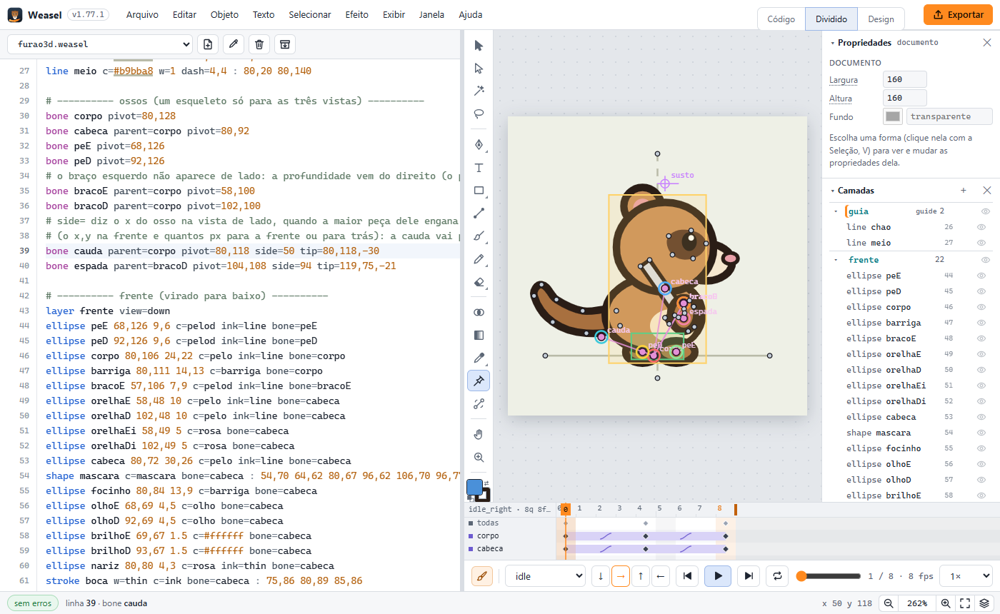

- Com **Shift**, de 1 em 1 pixel. Um **Ctrl+Z** desfaz o arraste inteiro.
- As outras vistas e a ordem das peças mudam junto.
- O **duplo clique** na bolinha apaga o `side=`, e a profundidade volta a ser a lida nas peças.
- Num jogo de plataforma, é o `lat=`, arrastado de frente ou de costas.

### Para treinar

Com o furão aberto (**Arquivo › Exemplos › Furão em três vistas**):

1. No player, escolha `walk`, aperte **→** e toque (▶): o furão anda de lado.
2. Abra **Exibir › Vistas em 3D** e clique em **De cima**: os pés vão para a frente e para trás.
3. Clique no osso da cauda: a barra diz `-22` e que veio do `side=`. O código vai até a linha `bone cauda`.
4. Feche a Vistas em 3D, escolha a ferramenta **Prender** (**Shift+P**) e arraste a bolinha da cauda para a esquerda: o `side=58` do código diminui enquanto você arrasta. Abra a Vistas em 3D de novo: a bolinha da cauda foi mais para trás. Um **Ctrl+Z** desfaz.
5. Aperte **O** (Testar ossos), pause o player no quadro 0 e arraste a bolinha do `peE` para a direita: o pé vai para a frente, e o campo **z** do painel cresce.
6. Aperte **↓**: o teste continua, e de frente o pé que foi para a frente desce na tela.
7. Clique em **Escrever como key 0 em walk** para gravar o teste (um **Ctrl+Z** desfaz), ou aperte **Esc** para zerar.

## Opções das três vistas

| Linha | Opção | O que faz | Valores | Se não escrever |
|---|---|---|---|---|
| `layer` | `view=`, `angle=` | a vista da camada e o ângulo da diagonal | `down`, `down_right`, `right`, `up_right`, `up`, `up_left`, `left`, `down_left`; 1 a 89 | sem vista; o ângulo medido |
| `views` | `tilt=` | quantos graus a câmera olha de cima | 0 a 80 | 30 |
| `bone` | `side=`, `lat=` | o x do osso de lado; o x do osso de frente (jogo de plataforma) | números, em pixels | medidos no desenho |
| `bone` | `tip=x,y[,z]` | para onde o osso aponta | dois ou três números, em pixels | o filho, ou o centro das peças |
| `bone` | `shorten=` | o quanto as peças do osso encurtam e esticam | `off`; mínimo de 0.01 a 1; máximo de 1 a 4 | `0.1,1.4` |
| `bone` | `turns` | troca as peças do osso pelas da vista para onde ele virou | palavra solta | não troca |
| `key` | `osso.z=` | o osso anda para a frente ou para trás | qualquer número, em pixels | 0 |
| `key` | `osso.pitch=`, `osso.yaw=` | o osso gira para a frente ou para trás; de um lado para o outro | graus, qualquer número | 0 |

As fichas completas estão na referência: [`layer`](20-referencia.md#layer), [`views`](20-referencia.md#views), [`bone`](20-referencia.md#bone) e [`key`](20-referencia.md#key).

## Os limites

As vistas são um jeito de **desenhar menos**, não um 3D completo. Estes são os limites que ficaram, cada um com o que fazer:

| Limite | O que acontece | O que fazer |
|---|---|---|
| O `ik` não é resolvido nas outras vistas | um aviso; a perna com `ik` só fica certa na vista principal | gire os ossos com `pitch=` (como no homem) |
| A ordem só troca dentro de uma camada | uma peça de outra camada fica sempre na frente (ou atrás) | desenhe cada vista numa camada só |
| Uma peça fica inteira na frente ou inteira atrás | não dá para a metade de uma peça passar na frente de outra | divida a peça em duas, em ossos diferentes |
| O `mix=` não sai em cada vista | `mix=walk,attack` dá erro: a `walk` não existe mais | escreva uma por vista: `anim walk_atk_right mix=walk_right,attack_right` |
| Numa animação escrita à mão numa vista, o 3D não vale | `osso.z=`, `osso.pitch=` e `osso.yaw=` em `anim walk_up` só avisam | escreva o 3D na animação sem direção no nome |
| `_left` sem `view=left` | a animação mostra só as camadas sem `view=` (aviso) | deixe o Godot espelhar (não escreva `_left`), ou desenhe o lado esquerdo |
| Com os dois lados, uma diagonal sem a do outro lado | aviso, e as animações da diagonal que falta não saem | desenhe as duas (`down_right` e `down_left`) |
| O `feet=` só vale de lado | nas geradas de frente e de costas, ele não conta | confira o passo na `walk_right` |
| Uma peça encurta até 10% | a espada apontada para a câmera fica um tracinho, nunca some | é de propósito: um osso não desaparece; para um osso, `shorten=` muda o limite (`shorten=off`: não encurta) |
| Um osso que aponta para a câmera no desenho | naquela vista, ele não gira nem encurta | desenhe-o de outro jeito naquela vista, ou use `turns` |
| Um osso que aponta **quase** para a câmera (um pé de frente, com o `tip=` na ponta da bota) | um giro pequeno muda muito a direção dele na tela: a peça vira de ponta-cabeça num quadro, mesmo com `shorten=off` | ponha o `tip=` a meio caminho (o z igual à distância na tela, 45°) e use `shorten=off` |
| Um desenho chapado não mostra o giro em volta do próprio comprimento | a cabeça que vira com `yaw` continua de frente | `turns` no `bone` |
| Sem uma 3/4 desenhada, o `turns` troca seco | a cabeça pula de frente para o perfil aos 45° | desenhe a 3/4 |
| A escala de um osso estica também a profundidade dos filhos | um filho longe da raiz anda uma fração de pixel quando o pai respira | nada: é menos de meio pixel |
| No jogo de plataforma, sem `lat=`, o lado é adivinhado | pela ordem do desenho, 8 pixels para perto ou para longe | escreva `lat=` |
| Sem nenhuma camada `view=` | nada muda: `views` sozinho e `osso.z=` avisam | desenhe as vistas |
| `rig=bones` com `turns` | cada peça ganha trilhas em cada animação, e a cena cresce (o guarda: 870 KB) | use `rig=frames`, ou poucos `turns` |

E no editor:

| Limite | O que acontece |
|---|---|
| A Vistas em 3D não mostra o Testar ossos | ela segue o player e o código; escreva a `key` para ver o teste em 3D |
| A ponta da haste gira em volta do eixo da vista | com o pai girado em 3D, o giro é aproximado; os campos do painel são exatos |
| No teste, o `sway`, o `bob`, o `jitter` e o `spring` ficam de fora | as `key` da vista saem só das `key` da base |
| Não dá para ver a pose parada de lado | os botões de direção precisam de uma animação: crie uma `anim parado frames=1` sem `key` |

## Resumo

- Cada lado é uma camada com `view=` (`down`, `right`, `up`, as diagonais e `left`), e as peças de todas usam os mesmos ossos.
- A frente é a vista principal: os `pivot=` e a pose são dela. Num jogo de plataforma, é o lado direito, e `lat=` diz o lado de cada osso.
- A profundidade de cada osso vem da vista de lado (o x do centro das peças dele, a partir da raiz); `side=` corrige.
- A animação é escrita uma vez, sem direção no nome, com `osso.z=`, `osso.pitch=` e `osso.yaw=`; o Weasel gera uma para cada vista, com `key` comuns.
- `views tilt=` é a câmera: o que vai para a frente desce na tela.
- A ordem das peças troca sozinha, dentro de cada camada; `turns` troca o desenho do osso que gira; `tip=` diz para onde ele aponta.
- O `--info` mostra a profundidade, a grossura, a direção, o pé no chão, as geradas e a ordem que troca.
- No editor: os botões de direção no player, a **Vistas em 3D**, o **Testar ossos** com `z`, `yaw` e `pitch`, e o `side=` arrastado no **Prender**.

[← Jogo: fases e recursos avançados](16-jogo-avancado.md) · [Índice](README.md) · [Próximo: Filme: atores, planos e câmera →](18-filme.md)
