# 18. Filme: atuação, som e legendas

[← Filme: atores, planos e câmera](17-filme.md) · [Índice](README.md) · [Próximo: Referência completa →](19-referencia.md)

Este capítulo continua o [capítulo 17](17-filme.md). Nele, os personagens atuam: mudam de cara, andam por caminhos, trocam de animação sem tranco, viram outro bicho, falam com a boca mexendo e ganham legendas. No fim, o filme longo, dividido em cenas, e a exportação para o editor de vídeo.

## Expressões: `expr`

```
expr nome osso=dx,dy,giro forma.propriedade=valor …
```

Num filme longo, o personagem reage o tempo todo: fica bravo, feliz, assustado. Em vez de criar uma animação para cada reação, dê nome às **expressões** no arquivo do personagem:

<!-- arquivo: rosto.weasel -->
<!-- gerar: img/10_rosto.png -->
```weasel
canvas 200 200 bg=none
palette ink=#2b2a33 line=4 pele=#ffcf8a

unity root=100,190
bone cabeca pivot=100,150
bone sobE pivot=80,82 parent=cabeca
bone sobD pivot=120,82 parent=cabeca

layer rosto
ellipse cara 100,110 60,56 c=pele ink=line bone=cabeca
ellipse olhoE 80,102 6,9 c=ink bone=cabeca
ellipse olhoD 120,102 6,9 c=ink bone=cabeca
stroke sobrancelhaE w=5 c=ink bone=sobE : 66,84 94,80
stroke sobrancelhaD w=5 c=ink bone=sobD : 106,80 134,84
shape boca c=#c44536 ink=3 bone=cabeca : 84,130 116,130 112,138 88,138
shape sorriso c=#c44536 ink=3 bone=cabeca hidden : 76,124 100,132 124,124 116,144 100,150 84,144
ellipse grito c=#c44536 ink=3 bone=cabeca hidden 100,138 12,16

expr bravo sobE=0,4,25 sobD=0,4,-25 cara.c=#ff9a7a
expr feliz sobE=0,-6,-10 sobD=0,-6,10 boca.shape=sorriso
expr susto sobE=0,-12 sobD=0,-12 boca.shape=grito cabeca=0,-6
```

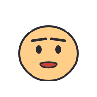

- `expr nome …` se escreve como uma `key` ([capítulo 7](07-movimento.md)), mas sem o número do quadro.
- Um osso leva de 1 a 5 números: `dx,dy,giro,sx,sy`. `sobE=0,4,25` desce a sobrancelha 4 pixels e gira 25 graus. Os que faltam ficam como estão.
- Uma forma leva as mesmas propriedades da `key`: `boca.shape=sorriso` troca a boca pela forma `sorriso`, e `cara.c=#ff9a7a` muda a cor.
- Fora do filme, a carinha fica sempre neutra: a expressão só aparece quando um filme pede.

No filme, `expr=` no `actor` escolhe a expressão do começo, e `at 3s heroi.expr=bravo` troca no meio. Aqui estão as três:

<!-- gerar: img/10_expressoes.png -->
```weasel
film dur=1s
canvas 800 230 bg=#f4efe6

layer nomes
text n1 100,220 "sem expr" size=22 align=center c=#1c1f2b
text n2 300,220 "expr=feliz" size=22 align=center c=#1c1f2b
text n3 500,220 "expr=bravo" size=22 align=center c=#1c1f2b
text n4 700,220 "expr=susto" size=22 align=center c=#1c1f2b

actor a "rosto.weasel" 100,190
actor b "rosto.weasel" 300,190 expr=feliz
actor c "rosto.weasel" 500,190 expr=bravo
actor d "rosto.weasel" 700,190 expr=susto
```

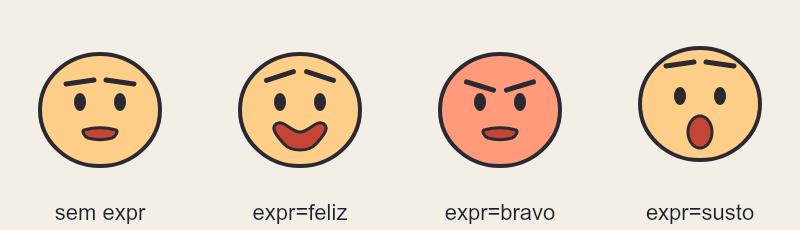

Repare como cada expressão usa uma coisa diferente:

- `feliz` levanta as sobrancelhas (os ossos `sobE` e `sobD` sobem 6 pixels e giram 10 graus) e troca a boca pela forma `sorriso`.
- `bravo` abaixa e inclina as sobrancelhas e muda a **cor** da cara.
- `susto` sobe as sobrancelhas, abre a boca (a forma `grito`) e levanta a cabeça inteira 6 pixels.

**A troca é aos poucos**, como a posição: do `at` anterior até este. Para a troca ser rápida, escreva a expressão antiga 0,2 s antes da nova: `at 2s heroi.expr=feliz` e `at 2.2s heroi.expr=bravo`. `expr=none` tira a expressão.

- Os ossos da expressão tomam o lugar dos da animação que o ator está tocando. Os outros ossos continuam na animação.
- Duas expressões não podem ter o mesmo nome. A linha `expr` não tem `ease=`: o ritmo da troca vem do `ease=` do `at`.

## Marcadores: `mark`

```
mark nome tempo
```

`mark` dá nome a um momento do filme, e os `at` usam o nome no lugar do tempo. Um trovão de verdade: o clarão vem no marcador, e o susto 0,3 segundo depois.

<!-- gerar: img/10_trovao.gif -->
```weasel
film fps=12 dur=3s
canvas 480 270 bg=#1b2140

layer chuva
line l1 c=#5866a0 w=2 : 60,20 40,80
line l2 c=#5866a0 w=2 : 200,40 180,100
line l3 c=#5866a0 w=2 : 340,10 320,70
line l4 c=#5866a0 w=2 : 430,60 410,120

actor heroi "rosto.weasel" 240,260 expr=feliz
camera fadec=#ffffff

mark trovao 1.5s

at trovao-0.1s camera.fade=0
at trovao camera.fade=0.9 ease=linear
at trovao+0.3s camera.fade=0
at trovao heroi.expr=feliz
at trovao+0.3s heroi.expr=susto
```

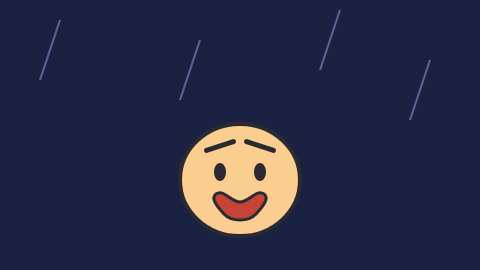

Repare:

- `mark trovao 1.5s`: o momento do trovão. Todos os `at` contam a partir dele: `at trovao`, `at trovao+0.3s`, `at trovao-0.1s`.
- O clarão: `fade=0` um pouquinho antes (`trovao-0.1s`), `fade=0.9` em branco no trovão (o `fadec=#ffffff` está na `camera`) e de volta a 0 em `trovao+0.3s`.
- O susto: a expressão continua `feliz` até o trovão e vira `susto` em 0,3 s. Sem o `at trovao heroi.expr=feliz`, a carinha ficaria assustada aos poucos, desde o começo do filme.

**Experimente:** troque `mark trovao 1.5s` por `mark trovao 0.8s`. O clarão e o susto mudam de lugar juntos, sem mexer nos `at`.

- Antes dos planos, o tempo do `mark` conta do começo do **filme**. Dentro de um `shot`, do começo dele.
- O `at` com um marcador precisa ficar no plano em que o marcador cai. Num outro plano, a linha dá aviso e não vale.
- O tempo do `mark` não aceita `+`, e dois marcadores não podem ter o mesmo nome.
- Os marcadores também vão para o `--info` e para a linha do tempo do editor de vídeo ([abaixo](#exportar-o-filme)).

## Andar por um caminho: `path=`

```
actor nome "arquivo.weasel" x,y path=forma [turn=0]
at tempo nome.along=n
```

Um ator com `path=` anda por uma forma do arquivo do filme: uma `line`, um `stroke`, um `shape`, uma `ellipse` ou um `rect`. `ator.along=` diz quanto do caminho ele já andou: 0 é o começo, e 1 é o fim. Duas carinhas sobem e descem morros iguais:

<!-- gerar: img/10_turn.gif -->
```weasel
film fps=10 dur=2.5s
canvas 480 240 bg=#f4efe6

layer morros
stroke morro1 w=3 c=#9fc5e8 : 50,200 130,70 210,200
stroke morro2 w=3 c=#9fc5e8 : 290,200 370,70 450,200
text n1 130,232 "path=morro1" size=18 align=center c=#1c1f2b
text n2 370,232 "path=morro2 turn=0" size=18 align=center c=#1c1f2b

actor a "rosto.weasel" 50,200 scale=0.4 path=morro1
actor b "rosto.weasel" 290,200 scale=0.4 path=morro2 turn=0

at 0.2s a.along=0 b.along=0
at 2.3s a.along=1 b.along=1 ease=linear
```

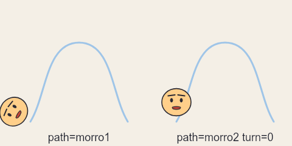

Repare:

- Com `path=`, o lugar do ator vem do caminho: o `pos` deixa de valer.
- A carinha da esquerda **vira junto com a curva**: inclina na subida e na descida. Com `turn=0`, a da direita fica sempre de pé.
- O caminho aqui está numa camada comum, para você ver os morros. No filme de verdade, ponha o caminho numa camada `guide`: ele continua valendo, mas não aparece no vídeo.

**Experimente:** troque o `morro2` por `ellipse morro2 370,140 70,60 c=none ink=3 inkc=#9fc5e8` e o `b.along=1` por `b.along=2`. Num caminho fechado, a carinha dá **duas voltas**: `along=1` é uma volta, e `along=2` são duas.

- Num caminho aberto, o `along=` vai de 0 a 1. Num fechado, ele passa de 1 e dá voltas.
- Ossos de um personagem também andam por caminhos, dentro de uma animação ([capítulo 9](09-animacao.md#andar-por-um-caminho-path)).

## Trocar de animação: `blend=` e `phase`

```
at tempo ator.anim=nova [blend=tempo] [phase]
```

### Misturar uma animação na outra: `blend=`

Trocar `anim` é um corte: num quadro, a capivara (o arquivo `chefe.weasel`) está esticada no galope; no seguinte, está parada. Com `blend=` na mesma linha, a troca vira uma **mistura**: a animação de antes continua tocando e vai virando a nova durante o tempo do `blend=`.

<!-- gerar: img/10_blend.gif -s 0.6 -->
```weasel
film fps=12 dur=3s
canvas 900 330 bg=#f4efe6

layer chao
rect piso 0,290 900,40 c=#d8cbb0
text t1 225,322 "sem blend=" size=24 align=center c=#1c1f2b
text t2 675,322 "blend=0.6s" size=24 align=center c=#1c1f2b

actor a "chefe.weasel" 225,290 origin=180,256 anim=run
actor b "chefe.weasel" 675,290 origin=180,256 anim=run

at 1.2s a.anim=idle
at 1.2s b.anim=idle blend=0.6s
```

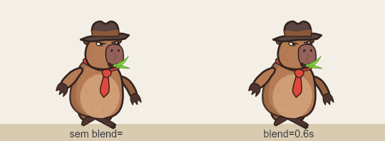

- A da esquerda para de uma vez em 1,2 s. A da direita leva 0,6 s, de 1,2 s a 1,8 s, para ir do galope à pose parada. O `ease=` da linha diz o ritmo da mistura (o padrão é `smooth`).
- Ossos, posições e cores mudam aos poucos. Um osso que gira pega o caminho mais curto: de 350° para 10°, ele passa por 0°. Uma troca de forma (`boca.shape=`) também vai aos poucos, quando as duas animações usam as mesmas formas.
- Algumas coisas não se misturam: elas trocam na metade. São o `show`, a ordem (`above=`, `below=`), as caixas do jogo e a troca para uma forma diferente. As partículas também trocam na metade e podem dar um pulo.
- Se outra troca com `blend=` chegar antes do fim, ela parte de onde a mistura estava.

**Experimente:** troque `blend=0.6s` por `blend=1.5s`. A capivara da direita leva mais tempo para parar.

### Trocar sem perder o passo: `phase`

Trocar `anim` recomeça a animação nova do primeiro quadro. Entre dois jeitos de andar, isso faz as pernas pularem. Com `phase` na mesma linha, a animação nova **continua no mesmo ponto do passo**:

<!-- conferir -->
```weasel
film fps=12 dur=3s
canvas 900 330 bg=#f4efe6

actor a "chefe.weasel" 225,290 origin=180,256 anim=run
actor b "chefe.weasel" 675,290 origin=180,256 anim=run

# a capivara da esquerda recomeça o run4 do primeiro quadro; a da direita continua no mesmo ponto
at 1.2s a.anim=run4
at 1.2s b.anim=run4 phase
```

- Com `feet=` nas duas animações ([capítulo 15](15-jogo-personagem.md#andar-sem-escorregar-feet)), o Weasel olha o primeiro pé da lista `feet=`. A nova animação começa no ponto em que esse pé está no chão, como estava na de antes.
- Sem `feet=` (como na capivara), vale a porcentagem: se a animação de antes estava em 40%, a nova começa em 40%.
- `phase` só alinha duas animações em loop. Se uma delas toca uma vez (`once`), a nova começa do primeiro quadro, com um aviso.
- Junto com `blend=`, a mistura começa com as duas já no mesmo ponto: `at 1.2s b.anim=run4 phase blend=0.4s`.
- No Godot, a mesma troca é `tocar("run4", velocity, true)` ([capítulo 15](15-jogo-personagem.md#no-jogo-a-velocidade-dos-pés)).

| Opção | O que faz | Valores | Se não escrever |
|---|---|---|---|
| `blend=` | mistura a troca de `anim=` da mesma linha | um tempo maior que 0, sem `+` | a troca é um corte |
| `phase` | a animação nova continua no mesmo ponto do passo | palavra | começa do primeiro quadro |

`blend=` e `phase` valem só para o `anim=` da mesma linha. Sem `anim=` na linha, eles dão aviso.

## Andar sem escorregar: `speed=auto`

Quando um ator anda (com `at … ator.x=` ou com `path=`), as pernas têm um ritmo, e o corpo tem outro. Se os dois não batem, os pés escorregam. Com `speed=auto`, a animação **acompanha o ator**: anda mais depressa quando ele anda mais depressa, e para quando ele para.

O personagem precisa de `feet=` na animação ([capítulo 15](15-jogo-personagem.md#andar-sem-escorregar-feet)). Aqui ele é o Andador, que anda 120 pixels por segundo:

<details>
<summary>O <code>andador.weasel</code></summary>

<!-- arquivo: andador.weasel -->
```weasel
canvas 200 200 bg=#e8eef5
palette ink=#2a2433 line=4 pele=#7cc4e8

bone corpo pivot=100,110
bone perna_e pivot=106,130 parent=corpo
bone perna_d pivot=94,128 parent=corpo

layer perna_atras
stroke coxa_d w=8 c=ink bone=perna_d : 94,128 94,172
ellipse sapato_d 98,173 9,4 c=ink bone=perna_d
layer corpo
ellipse tronco 100,105 28,30 c=pele ink=line bone=corpo
ellipse olho 112,96 3,4 c=ink bone=corpo
layer perna_frente
stroke coxa_e w=8 c=ink bone=perna_e : 106,130 106,176
ellipse sapato_e 110,177 9,4 c=ink bone=perna_e

point pe_e 106,180 bone=perna_e
point pe_d 94,176 bone=perna_d

anim anda_right frames=8 fps=12 feet=pe_e,pe_d
key 0 perna_e=20,0,0 perna_d=-20,0,0 ease=linear
key 2 perna_d=0,-12,0 ease=linear
key 4 perna_e=-20,0,0 perna_d=20,0,0 ease=linear
key 6 perna_e=0,-12,0 ease=linear
key 8 perna_e=20,0,0 perna_d=-20,0,0 ease=linear
```

</details>

Os dois andam juntos: saem devagar, aceleram e param em 3 s.

<!-- gerar: img/10_speed_auto.gif -s 0.5 -->
```weasel
film fps=12 dur=4s
canvas 900 400 bg=#e8eef5

layer chao
rect piso1 0,170 900,30 c=#c9d3dd
rect piso2 0,360 900,40 c=#c9d3dd
text t1 450,194 "speed=1: os pés escorregam" size=24 align=center c=#1c1f2b
text t2 450,388 "speed=auto: os pés ficam no chão" size=24 align=center c=#1c1f2b

actor a "andador.weasel" 80,170 origin=100,180 anim=anda_right
actor b "andador.weasel" 80,360 origin=100,180 anim=anda_right speed=auto

at 3s a.x=640 b.x=640
```

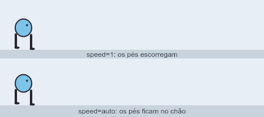

- O de cima toca a animação no ritmo dela o tempo todo. Ele desliza na aceleração e, parado, continua andando no lugar.
- O de baixo, com `speed=auto`, mexe as pernas no ritmo em que anda e para no quadro em que estava. Para ele ficar de pé, troque para uma animação parada: `at 3s b.anim=parado blend=0.3s`.
- **A conta:** ritmo = quanto o ator anda por segundo ÷ (passada × `scale=`). Conta só o andar na direção em que o desenho olha (com o `rot=` e o giro do `path=`). Subir ou descer não muda o passo, e a câmera andando também não.
- **De ré** (andando para o lado contrário ao que o desenho olha), a animação toca ao contrário, com os pés presos no chão. Para virar o personagem, use `flip=x`.
- **No máximo 3 vezes** a velocidade normal. Mais rápido que isso, os pés escorregam, e um aviso na linha do `speed=auto` diz em que trecho: troque para uma animação de correr.
- Uma animação **sem `feet=`** (uma parada, um voo) toca na velocidade 1. Se o ator anda com ela, um aviso diz.
- `at 2s b.speed=auto` liga no meio do plano, e `at 4s b.speed=1` volta ao número. Com `blend=`, cada animação da mistura anda no próprio passo.
- A animação continua mostrando os desenhos dela. Num filme de 24 fps com uma animação de 12 fps, o pé pode tremer um pouco entre dois desenhos.

O `--info` do filme mostra, embaixo de cada plano, a passada de cada animação e o ritmo dela enquanto o ator anda (negativo é de ré): `speed=auto b: anda_right (passada 120 px/s): de 0.01× a 2.33×`.

**Experimente:** troque `at 3s` por `at 1.5s`. Os dois andam duas vezes mais depressa, e o Weasel avisa que o de baixo passa de 3 vezes a passada no meio do caminho.

## Um ator vira outro: `morph=`

```
at tempo ator.morph=outro [dur=tempo] [pairs=parte->parte,…] [born=parte->parte,…]
```

Com `morph=`, um ator **se transforma** em outro: cada parte de um vai virando uma parte do outro. Aqui, a capivara correndo vira um furão andando, sem parar de correr:

<!-- gerar: img/10_morph.gif -s 0.6 -->
```weasel
film fps=12 dur=3.5s
canvas 900 330 bg=#f4efe6

layer chao
rect piso 0,290 900,40 c=#d8cbb0

actor capivara "chefe.weasel" 120,290 origin=180,256 anim=run
actor furao "furao.weasel" 120,290 origin=80,128 scale=2.2 anim=walk_right hidden

at 1s capivara.morph=furao dur=1.5s
at 3.5s capivara.pos=780,290 furao.pos=780,290 ease=linear
```

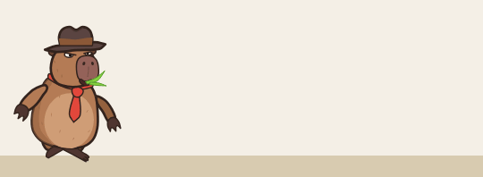

Repare:

- `at 1s capivara.morph=furao dur=1.5s`: a troca começa em 1 s e dura 1,5 s. O `ease=` da linha diz o ritmo (o padrão é `smooth`).
- O ator que chega começa com `hidden`. No fim da troca, a capivara some e o furão aparece **sozinhos**, sem `show=`. Se o furão não tiver `hidden`, o Weasel avisa, porque os dois apareceriam juntos antes da troca.
- Os dois continuam tocando a animação de cada um durante a troca: a capivara correndo vira um furão andando.
- Cada parte vai de onde está num ator até onde está no outro. Aqui os dois andam juntos (o mesmo `pos=`), e a troca acontece no lugar. Com o furão em outro lugar, a troca anda até ele. O tamanho, a profundidade, a transparência e a luz também vão de um ator ao outro.
- Na metade da troca, a ordem (quem fica na frente de quem) e o estilo de arte (`art`) passam a ser os do ator que chega.
- Para voltar, outra linha: `at 5s furao.morph=capivara dur=0.5s`. Um ator entra numa troca de cada vez: uma troca que começa antes da outra acabar fica de fora, com um aviso.

### Quem vira quem: `pairs=` e `born=`

As partes casam sozinhas: pelo nome, pelo osso de mesmo nome, pela cor e pelo lugar dentro do desenho de cada um (a cabeça na frente casa com a cabeça na frente, mesmo que um bicho seja maior que o outro). Uma parte que só existe no ator que sai encolhe até sumir dentro de uma parte vizinha. Uma parte que só existe no ator que chega nasce de dentro de uma parte vizinha.

O `--info` do filme mostra o que casou, embaixo do plano. Com a capivara e o furão (a lista do `somem:` é longa e foi cortada):

```
    metamorfose capivara -> furao em 1s (1.5s)
      vira: olhoL->olhoL, cabeca->cabecaL, focinho->focinhoL, orelhaL->orelhaL, lamina->lamina, orelhaP->orelhaLi, bracoL->bracoL, narinaL->narizL, corpo->corpoL, barriga->barrigaL, peP->peDl, peL->peEl, narinaP->brilhoL, aba->mascaraL
      nascem: caudaL->corpo, guarda->corpo, punho->bracoL
      somem: pernaL->peEl, maoL->corpoL, pernaP->corpoL, sombra->corpoL, …
```

- `vira:` são os pares: a parte do ator que sai e a do ator que chega. `aba->mascaraL`: a aba do chapéu vira a máscara do furão.
- `nascem:` diz de onde nasce cada parte nova: a cauda do furão (`caudaL`) nasce do corpo da capivara.
- `somem:` diz onde some cada parte que sobra.

Para corrigir, na mesma linha do `morph=`:

- `pairs=narinaP->focinhoL` casa uma parte do ator que sai com uma do ator que chega, nessa ordem. Vários pares vão separados por vírgula.
- `born=caudaL->barriga` diz de onde nasce uma parte nova (a cauda nasce da barriga). Com uma parte que só existe no ator que sai, é o contrário: `born=sombra->peEl` faz a sombra sumir no pé.
- O `born=` também desfaz um par automático: `born=narinaP->focinhoL` faz a narina de trás sumir no focinho, em vez de virar o brilho do olho.
- Um nome que não existe no arquivo do ator dá erro, dizendo de qual arquivo ele deveria ser.

**Experimente:** acrescente `born=narinaP->focinhoL` na linha do `morph=` e rode com `--info`. A narina de trás some no focinho, e o brilho do olho do furão passa a vir de outra parte.

- O casamento é feito uma vez, com os dois atores como estão no começo da troca. As partes que só aparecem depois (numa camada com `only=` de outra animação) ficam de fora.
- Com partes muito diferentes (patas finas virando um rabo), o meio da troca "derrete" de um desenho no outro: é o visual clássico da metamorfose. Um clarão ou partículas por cima ajudam a esconder.
- A virada de um personagem de jogo usa o mesmo casamento ([capítulo 16](16-jogo-avancado.md#virar-de-lado-para-a-frente-turn)).

| Opção | O que faz | Valores | Se não escrever |
|---|---|---|---|
| `morph=` | o ator em que este vira | outro ator do plano | — |
| `dur=` | quanto a troca dura | um tempo maior que 0, sem `+` | 1 s |
| `pairs=` | casa partes à mão | `parte->parte`, separados por vírgula | o casamento automático |
| `born=` | de onde nasce (ou onde some) uma parte | `parte->parte`, separados por vírgula | o casamento automático |

## Na frente do ator: `front`

As camadas do arquivo do filme ficam **atrás** dos atores da mesma profundidade. `front` numa camada põe a camada na frente deles. E `front` num ator põe o ator na frente até das camadas `front`.

<!-- gerar: img/10_front.png -s 0.5 -->
```weasel
film dur=1s
canvas 1500 600 bg=#cfe8f5

layer chao
rect terra 0,520 1500,80 c=#c9a66b
text n1 250,60 "moita" size=36 align=center c=#1c1f2b
text n2 750,60 "moita front" size=36 align=center c=#1c1f2b
text n3 1250,60 "moita front + ator front" size=36 align=center c=#1c1f2b

layer moita1
ellipse m1 250,540 170,150 c=#2f6e3a
layer moita2 front
ellipse m2 750,540 170,150 c=#2f6e3a
layer moita3 front
ellipse m3 1250,540 170,150 c=#2f6e3a

actor a "cavaleiro.weasel" 250,520 scale=0.8
actor b "cavaleiro.weasel" 750,520 scale=0.8
actor c "cavaleiro.weasel" 1250,520 scale=0.8 front
```

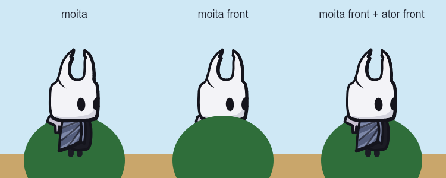

- **moita**: sem `front`, a moita é pintada antes do ator. O Cavaleiro aparece por cima dela.
- **moita front**: a moita é pintada depois do ator e esconde as pernas dele. É o jeito de pôr um personagem atrás de um arbusto.
- **ator front**: o Cavaleiro com `front` volta para a frente, mesmo da moita `front`.
- `front` só decide a ordem entre coisas da **mesma profundidade**. Uma camada com `depth=0.5` fica na frente de tudo o que tem `depth=1`, com ou sem `front` ([capítulo 14](14-profundidade.md#paralaxe-depth-e-screen)).

## Som, legendas e lip sync

O vídeo já sai com os sons misturados. Para a versão final, com música e efeitos, use um editor de vídeo ([abaixo](#exportar-o-filme)). No Weasel, o som serve para animar no tempo certo: a boca segue a fala, e o susto vem no trovão.

### Som: `audio`

```
audio nome "arquivo" [at=tempo] [from=tempo] [dur=tempo] [vol=n] [loop] [lips=ator] [cues="arquivo"] [text="…"] [lang=código]
```

- Dentro de um plano, `at=` conta do começo dele. Fora dos planos, do começo do filme.
- `from=` pula o começo do arquivo. `dur=` toca só esse tempo. Sem `dur=`, o som toca até o fim do arquivo, mesmo depois do fim do plano.
- `loop` repete até o fim do plano (ou do filme, num som fora dos planos).
- `vol=` é o volume: 1 é o normal, 0.5 é a metade.
- `text=` mostra uma legenda enquanto o som toca. `\n` quebra a linha.

### Legendas: `sub`

```
sub tempo "texto" [dur=tempo] [lang=código]
film … [lang=código] [subs=burn] [subsize=n] [subc=cor]
```

- `sub 0.65s "Boa noite!"` mostra a legenda em 0,65 s. Com `+` (`sub +0.2s …`), ela começa 0,2 s depois do fim da legenda anterior.
- Sem `dur=`, a legenda fica o tempo de ler: 0,5 s mais um quinze avos de segundo por letra, de 1,2 a 7 segundos.
- `lang=en` diz a língua da legenda. Sem ele, vale o `film lang=` (o padrão é `pt`).
- As legendas saem num arquivo `.srt` ao lado do vídeo, uma língua em cada arquivo. Com `film subs=burn`, elas também são **desenhadas** no vídeo: `subsize=` é o tamanho da letra e `subc=` a cor.

### A boca que fala: `mouth` e `lips=`

A boca é feita no arquivo do personagem, com `mouth`. Cada letra aponta para outra forma, e a boca vira essa forma aos poucos. Na coruja:

```
shape bico c=bico ink=line bone=cabeca : 240,256 252,270 240,292! 228,270
shape bicoAberto c=bico ink=line bone=cabeca hidden : 240,254 255,270 240,304! 225,270
mouth bico A=bico B=bicoAberto@0.3 C=bicoAberto@0.6 D=bicoAberto E=bicoAberto@0.45 F=bicoAberto@0.2
```

- `mouth bico` diz qual forma é a boca. Cada letra diz o formato daquela boca: `B=bicoAberto@0.3` é 30% do caminho até a forma `bicoAberto`.
- As duas formas precisam ser fechadas, ou as duas abertas. Com o mesmo tipo e o mesmo número de pontos, elas se misturam ponto a ponto; senão, pelo contorno.
- As letras seguem as bocas clássicas da animação: **A** fechada (M, B, P), **B** pouco aberta, **C** aberta, **D** bem aberta, **E** arredondada (O), **F** biquinho (U), **G** dentes no lábio (F, V), **H** língua (L) e **X** descanso. Sem uma letra, vale a mais parecida que existe.
- No filme, `audio … lips=coruja` faz a boca da coruja seguir o som. A boca vale por cima da expressão (`expr`).
- Sem `cues=`, o Weasel ouve o `.wav` e estima: o volume diz o quanto a boca abre, e o timbre diz qual vogal. É bom para rascunho. Para voz de verdade, use o programa Rhubarb Lip Sync e `cues="fala.json"`, que acerta mais as consoantes. O `cues=` também aceita um texto com uma linha por boca: o tempo e a letra.
- Num jogo, `mouth` não muda nada.

### A coruja fala

Um GIF não tem som, mas mostra o **bico** seguindo a voz e as **legendas** desenhadas na imagem:

<!-- gerar: img/10_fala.gif -s 0.75 -->
```weasel
film fps=8 subs=burn subsize=24 subc=#ffe08a
canvas 480 270 bg=#141a33

actor coruja "coruja.weasel" 240,120 origin=240,260 scale=0.8 hide=ceu,galho,fala

shot conversa dur=3.4s
audio fala "som/coruja_fala.wav" at=0.4s lips=coruja
sub 0.65s "Uh-uuh! Boa noite, Cavaleiro." dur=1.6s
sub +0.2s "Cuidado com\no fantasma…" dur=0.95s
```

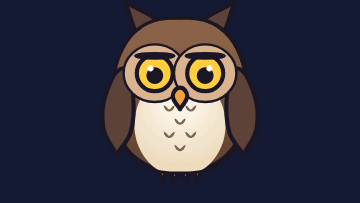

Linha por linha:

- `film … subs=burn subsize=24 subc=#ffe08a`: as legendas são desenhadas no vídeo, com letra de 24 pixels, em amarelo.
- `actor coruja … origin=240,260 scale=0.8`: o ponto `240,260` do arquivo da coruja (o bico) fica em `240,120` do quadro, e a coruja fica grande: um close.
- `audio fala "som/coruja_fala.wav" at=0.4s lips=coruja`: a voz começa 0,4 s depois do começo do plano, e o bico segue a voz.
- `sub 0.65s "…" dur=1.6s`: a primeira legenda aparece em 0,65 s e fica 1,6 s.
- `sub +0.2s "Cuidado com\no fantasma…"`: a segunda começa 0,2 s depois do fim da primeira. O `\n` quebra a linha.

**Experimente:** troque `subc=#ffe08a` por `subc=#ffffff` e `subsize=24` por `subsize=16`. As legendas ficam brancas e menores, como as de um filme.

### Duas línguas e mais sons

Este exemplo não tem imagem no guia: o que importa nele é o som. Rode com `--info` para ver os tempos, ou exporte em vídeo para ouvir:

<!-- conferir -->
```weasel
film fps=24 lang=pt
canvas 1920 1080 bg=#141a33

audio grilos "som/grilos.wav" loop vol=0.35

actor coruja "coruja.weasel" 960,900 origin=240,404 hide=ceu,galho,fala

shot conversa dur=6s
audio fala "som/coruja_fala.wav" at=0.4s lips=coruja
sub 0.65s "Uh-uuh! Boa noite, Cavaleiro." dur=2s
sub +0.2s "Cuidado com o fantasma…" dur=1.6s
sub 0.65s "Hoo-hoo! Good evening, Knight." dur=2s lang=en
sub +0.2s "Watch out for the ghost…" dur=1.6s lang=en
audio eco "som/coruja_fala.wav" at=4.6s from=0.4s dur=1s vol=0.5 text="(eco)"
```

Linha por linha:

- `film … lang=pt`: as legendas sem `lang=` são em português.
- `audio grilos … loop vol=0.35`: fora dos planos, então toca desde o começo do filme. O arquivo tem 3 segundos; `loop` repete até o fim. `vol=0.35` é um pouco mais de um terço do volume.
- `audio fala … at=0.4s lips=coruja`: a fala da coruja, 0,4 s depois do começo do plano.
- As duas legendas com `lang=en` são a versão em inglês das mesmas falas. O `+` conta da legenda anterior do bloco, em qualquer língua: por isso cada língua tem o seu primeiro tempo escrito.
- `audio eco … at=4.6s from=0.4s dur=1s vol=0.5 text="(eco)"`: o mesmo arquivo de novo, em 4,6 s, **pulando** os primeiros 0,4 s dele (`from=`), tocando só 1 segundo (`dur=`), na metade do volume, com a legenda `(eco)` enquanto toca.

Salve como `conversa.weasel` dentro de `exemplos/` e rode `node cli/weasel.js conversa.weasel --info`:

```
filme    1920 × 1080, 24 fps, 6s (144 quadros, 00:06:00), fundo #141a33
atores   coruja (coruja.weasel)
sons     3
  fala             00:00:10    4.2s  som/coruja_fala.wav · boca de coruja
  eco              00:04:14      1s  som/coruja_fala.wav · vol 0.5
  grilos           00:00:00      6s  som/grilos.wav · loop · vol 0.35
legendas 5 (pt, en)
planos   1
  conversa         00:00:00      6s    144 quadros  câmera 960,540
```

Os tempos como `00:04:14` são **minutos:segundos:quadro**: o eco começa em 4 segundos e 14 quadros (4,6 s, a 24 quadros por segundo).

Ao exportar em vídeo (`-o conversa.mp4`), as legendas saem em arquivos ao lado, uma língua em cada: `conversa.srt` (português) e `conversa.en.srt` (inglês). O `conversa.srt` fica assim:

```
1
00:00:00,650 --> 00:00:02,650
Uh-uuh! Boa noite, Cavaleiro.

2
00:00:02,850 --> 00:00:04,450
Cuidado com o fantasma…

3
00:00:04,600 --> 00:00:05,600
(eco)
```

O `.srt` é o formato de legenda que os players de vídeo e o YouTube aceitam.

| Linha | Opção | O que faz | Valores | Se não escrever |
|---|---|---|---|---|
| `audio` | `at=` | quando o som começa | um tempo | 0 |
| `audio` | `from=` | pula o começo do arquivo | um tempo | 0 |
| `audio` | `dur=` | quanto o som toca | um tempo | até o fim do arquivo |
| `audio` | `vol=` | o volume | de 0 a 4 | 1 |
| `audio` | `loop` | repete até o fim do plano (ou do filme) | palavra | toca uma vez |
| `audio` | `lips=` | o ator cuja boca segue o som | um ator com `mouth` | — |
| `audio` | `cues=` | as bocas prontas do Rhubarb | um `.json`, ou um texto com "tempo letra" por linha | o Weasel estima pelo som |
| `audio` | `text=`, `lang=` | a legenda enquanto o som toca, e a língua dela | um texto; um código de língua | sem legenda; o `film lang=` |
| `sub` | `dur=` | quanto a legenda fica | um tempo | o tempo de ler (de 1,2 a 7 s) |
| `sub` | `lang=` | a língua | um código: `pt`, `en`… | o `film lang=` |
| `film` | `lang=` | a língua das legendas sem `lang=` | um código | `pt` |
| `film` | `subs=` | `burn` desenha as legendas no vídeo | `burn` ou `file` | `file`: só o `.srt` |
| `film` | `subsize=` | o tamanho da letra da legenda desenhada | de 6 a 400 pixels | 5% da altura do quadro |
| `film` | `subc=` | a cor da legenda desenhada | uma cor | branco, com contorno preto |
| `mouth` | `A=` … `H=`, `X=` | o formato de cada boca | `forma` ou `forma@n` (n de 0 a 1) | a letra mais parecida |

As fichas completas estão na referência: [`audio`](19-referencia.md#audio), [`sub`](19-referencia.md#sub) e [`mouth`](19-referencia.md#mouth).

**Cuidado:**
- Um `lips=` sem `mouth` no arquivo do ator dá aviso. Sem `.wav` e sem `cues=`, também: o Weasel não tem o que ouvir.
- Com dois `mouth` no mesmo arquivo, vale o último, com um aviso.

## Filmes longos: `scene`

```
scene "arquivo.weasel"
```

Para um filme de 20 minutos, um arquivo só fica enorme. Divida o filme em cenas, uma por arquivo, e junte as cenas num arquivo principal. Um exemplo pequeno, com duas cenas:

<details>
<summary>As duas cenas: <code>cena01.weasel</code> e <code>cena02.weasel</code></summary>

A primeira é de dia (ela usa a `bolinha.weasel` do [capítulo 17](17-filme.md#uma-bolinha-para-os-testes)):

<!-- arquivo: bolinha.weasel -->
```weasel
canvas 40 40 bg=none
unity root=20,20
ellipse bola 20,20 16 c=#e94f37 ink=3
```

<!-- arquivo: cena01.weasel -->
```weasel
film fps=12
canvas 480 270 bg=#9fd3ef

layer dia
ellipse sol 400,60 34 c=#ffd34d
rect grama 0,210 480,60 c=#7cc56a
text nome 20,40 "cena01" size=24 c=#1c1f2b bold

actor bola "bolinha.weasel" 60,190

shot rola dur=1.5s
at 1.5s bola.pos=420,190
```

A segunda, de noite, com dois planos:

<!-- arquivo: cena02.weasel -->
```weasel
film fps=12
canvas 480 270 bg=#1b2140

layer noite
ellipse lua 400,60 26 c=#f4efe6
rect grama 0,210 480,60 c=#2f5a3a
text nome 20,40 "cena02" size=24 c=#f4efe6 bold

actor bola "bolinha.weasel" 420,190

shot volta dur=1s in=fade
at 1s bola.pos=240,190

shot pula dur=1s
at 0s bola.pos=240,190
at 0.5s bola.pos=240,90 ease=out
at 1s bola.pos=240,190 ease=in
```

</details>

E o filme que junta as duas:

<!-- gerar: img/10_cenas.gif -->
```weasel
film fps=12
canvas 480 270

scene "cena01.weasel"
scene "cena02.weasel"
```

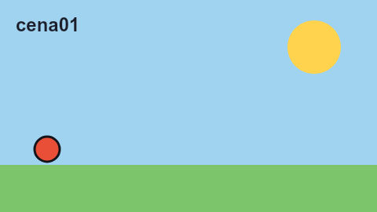

- `scene` acrescenta, naquele ponto, os planos do outro arquivo. Cada cena é um filme completo: você pode abrir e exportar `cena02.weasel` sozinha para conferir.
- O filme principal tem só o `canvas` (o tamanho do vídeo) e os `scene`. Uma cena de outro tamanho é encolhida ou aumentada para caber no quadro, no meio dele.
- O `in=fade` do plano `volta` faz a passagem de uma cena para a outra.
- Personagens e cenários ficam em arquivos próprios, que as cenas põem em cena com `actor`.
- Os planos ganham o nome da cena na frente: `cena01/rola`, `cena02/volta`, `cena02/pula`. Para exportar só um, `--shot volta` também acha o `cena02/volta`.

**Cuidado:**
- O arquivo de uma `scene` precisa ser um filme (com `film`). Uma cena pode ter outras cenas, até 8 níveis, mas não pode chamar a si mesma.
- O `fps=` que vale é o do filme principal. O da cena só serve para contar os tempos escritos em quadros (`48f`).
- Os atores, as luzes e as camadas do filme principal não entram nos planos das cenas: cada cena traz o seu cenário.
- Depois de um `scene`, uma linha `actor`, `camera`, `audio`, `sub` ou `art` precisa de um `shot` antes.

## Exportar o filme

Os comandos do [capítulo 17](17-filme.md#ver-e-exportar-o-filme) fazem o vídeo, um quadro e um GIF. Estes servem para conferir e para terminar o filme:

| Quero… | Comando |
|---|---|
| uma folha para achar um momento (um quadro a cada segundo, uma linha por plano) | `node cli/weasel.js filme.weasel --contact -o folha.png` |
| um vídeo menor, para mandar por WhatsApp ou e-mail, com as legendas desenhadas | `node cli/weasel.js filme.weasel -o para_mandar.mp4 --small --burn-subs` |
| um vídeo por plano e a linha do tempo, para o editor de vídeo | `node cli/weasel.js filme.weasel -o render/filme.mov --shots --fcpxml --edl` |
| só o som misturado | `node cli/weasel.js filme.weasel -o som.wav` |
| o vídeo sem as legendas ao lado | `--subs none` |

- Para o editor de vídeo (DaVinci Resolve, Final Cut, Premiere), o `.edl` e o `.fcpxml` são a **linha do tempo** pronta: o editor abre os vídeos e os sons já no lugar, cada som na sua trilha, com os marcadores (`mark`) e os começos dos planos. Com eles, o vídeo sai sem o som misturado.
- O `.srt` sai ao lado do vídeo, com ou sem `subs=burn`. Só não sai com `--subs none` e no GIF.

Todas as opções, com o que a linha de comando responde, estão na [linha de comando](21-linha-de-comando.md#filme). O filme todo, uma cena, um plano ou um ator também podem sair em outro estilo, como pixel art ou letras: veja a linha `art` no [capítulo 13](13-estilos.md#no-filme).

## Opções da atuação

| Linha | Opção | O que faz | Valores | Se não escrever |
|---|---|---|---|---|
| `expr` | `osso=`, `forma.prop=` | a pose da expressão | como na `key` | — |
| `actor`, `at` | `expr=` | a expressão do ator (aos poucos) | uma `expr` do arquivo, ou `none` | nenhuma |
| `mark` | nome, tempo | um momento com nome | um tempo, sem `+` | — |
| `actor` | `path=` | o caminho | uma `line`, `stroke`, `shape`, `ellipse` ou `rect` do filme | nenhum |
| `actor` | `turn=` | vira com a curva do caminho | `0` desliga | liga |
| `at` | `along=` | quanto do caminho ele andou | de 0 a 1; num caminho fechado, passa de 1 | 0 |
| `at` | `blend=`, `phase` | a troca de `anim=` sem tranco | um tempo; palavra | um corte |
| `actor`, `at` | `speed=auto` | as pernas no ritmo do andar | `auto` | 1 |
| `at` | `morph=`, `dur=`, `pairs=`, `born=` | um ator vira outro | outro ator; um tempo; pares `parte->parte` | 1 s; o casamento automático |
| `layer`, `actor` | `front` | na frente dos atores (ou das camadas `front`) | palavra | atrás |
| `audio`, `sub`, `mouth` | [acima](#som-legendas-e-lip-sync) | o som, as legendas e a boca | — | — |
| `scene` | `"arquivo"` | junta os planos de outro filme | um arquivo com `film` | — |

As fichas completas estão na referência: [`expr`](19-referencia.md#expr), [`mark`](19-referencia.md#mark), [`at`](19-referencia.md#at), [`actor`](19-referencia.md#actor) e [`scene`](19-referencia.md#scene).

**No editor:** a linha do tempo mostra os sons com a forma de onda, as legendas e os marcadores, e arrastar um marcador muda o `mark` ([capítulo 22](22-editor.md#filme)).

## Juntando tudo

Uma cena curta, com dois planos: a carinha chega pela trilha, feliz; a coruja avisa do fantasma, e a carinha se assusta. O susto vem num marcador, e a fala tem legenda desenhada.

<!-- gerar: img/18_aviso.gif -s 0.75 -->
```weasel
film fps=8 subs=burn subsize=18 subc=#ffe08a
canvas 480 270 bg=#141a33

layer ceu
ellipse lua 410,50 22 c=#f4efe6
layer chao
rect grama 0,226 480,44 c=#2f5a3a
layer guia guide
stroke trilha : 30,240 140,236 230,240
layer moita front
ellipse m1 70,252 64,52 c=#24452e

actor coruja "coruja.weasel" 380,232 origin=240,404 scale=0.35 hide=ceu,galho,fala
actor heroi "rosto.weasel" 30,240 scale=0.5 path=trilha turn=0 expr=feliz

mark aviso 2.6s

shot chega dur=2s
at 0.2s heroi.along=0
at 2s heroi.along=1 ease=out

shot fala dur=3s in=fade,0.4s
camera 305,190 zoom=1.6
at 0s heroi.along=1
audio voz "som/coruja_fala.wav" at=0.1s dur=2.4s lips=coruja
sub 0.3s "Cuidado com o fantasma…" dur=2s
at aviso-0.2s heroi.expr=feliz
at aviso heroi.expr=susto
```

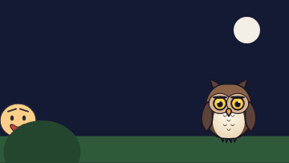

- **A trilha** está numa camada `guide`: ela guia a carinha (`path=trilha`) e não aparece. `turn=0` deixa a carinha de pé.
- **A moita** é uma camada `front`: a carinha sai de trás dela, no começo da trilha.
- **O marcador** `aviso` está antes dos planos, então conta do começo do filme: 2,6 s cai no plano `fala`, que começa em 2 s.
- **A fala:** o bico da coruja segue o som (`lips=coruja`), e a legenda é desenhada na imagem (`subs=burn`).
- **O susto:** a carinha fica feliz até `aviso-0.2s` e se assusta no `aviso`, em 0,2 s.
- **O segundo plano** começa do zero: `at 0s heroi.along=1` põe a carinha no fim da trilha, onde o primeiro plano a deixou.

**Experimente:** troque `mark aviso 2.6s` por `mark aviso 4s`. A carinha só se assusta no fim da fala.

## Resumo

- `expr` dá nome a uma cara no arquivo do personagem; `expr=` e `at … ator.expr=` usam a cara no filme.
- `mark` dá nome a um momento, e os `at` contam a partir dele.
- `path=` faz o ator andar por uma forma, e `along=` diz quanto ele andou.
- `blend=` mistura uma animação na outra, `phase` troca sem perder o passo, e `speed=auto` acerta as pernas com o andar.
- `morph=` transforma um ator em outro; `pairs=` e `born=` corrigem quem vira quem.
- `audio`, `sub` e `mouth` fazem o som, as legendas e a boca que fala; `scene` junta filmes longos.

[← Filme: atores, planos e câmera](17-filme.md) · [Índice](README.md) · [Próximo: Referência completa →](19-referencia.md)
