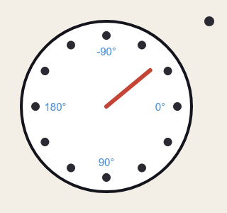
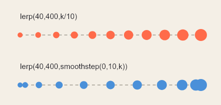
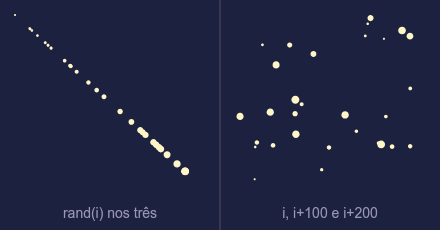

# 20. Funções das contas

[← Referência completa](19-referencia.md) · [Índice](README.md) · [Próximo: Linha de comando →](21-linha-de-comando.md)

Este capítulo é para consulta. Ele mostra onde uma conta pode aparecer, quais variáveis valem dentro dela, as operações, o `pi` e todas as funções, cada uma com exemplos. Para aprender `let` e `repeat` desde o começo, veja o [capítulo 5](05-componentes.md).

Os resultados aparecem como o Weasel escreve os números: com ponto, como em `2.5`.

## Onde cabe uma conta

Onde vai um número, você pode escrever uma conta entre chaves. O Weasel faz a conta e usa o resultado no lugar dela.

- Num ponto: `{cx-20},{cy}`.
- Num raio ou num tamanho: `ellipse bola 100,100 {r*1.5}`.
- Numa opção com número: `opacity={0.2+0.3}`, `rot={360/8}`, `w={r/4}`.
- Nos pontos depois do `:`: `stroke boca : {cx-30},{cy} {cx+30},{cy}`.
- No `canvas` (`canvas {w} {h}`), na `palette` (`palette line={r/10}`) e no quadro de uma `key` (`key {n/2} …`).

<!-- conferir -->
```weasel
canvas {w} {h} bg=#cfe8f5
let w=320 h=200 lado=120
# a parede fica no meio: o canto esquerdo está em (largura − lado) ÷ 2
rect parede {(w-lado)/2},{h-lado} {lado},{lado} c=#f1d9b5 ink=3
# o telhado: três cantos, calculados a partir da parede
shape telhado c=#c44536 ink=3 : {(w-lado)/2-15},{h-lado}! {w/2},{h-lado-60}! {(w+lado)/2+15},{h-lado}!
# o sol tem um quinto do lado da parede
ellipse sol {w-45},45 {lado/5} c=#ffd34d
```

Mude `lado=120` para `lado=80`: a casa encolhe e continua no meio, com o telhado no lugar.

**Cuidado:**
- Dentro das chaves, pode haver espaços: `{cx - 20}`. Fora delas, não: `{cx}, {cy}` vira dois valores separados.
- Os números usam ponto: `2.5`. A forma `1e3` (mil) não vale.
- No `let` e nos limites do `repeat`, as chaves podem faltar: `let lado=r*2`, `repeat i 0..n-1`.
- Uma conta sempre dá um número. Ela não vira cor. Num texto entre aspas, ela não é feita: `text t 10,20 "{w}"` escreve `{w}` na imagem.

## As variáveis

Dentro das chaves, valem três tipos de variável:

| De onde vem | Onde vale | Exemplo |
|---|---|---|
| um `let` | no arquivo inteiro, até nas linhas acima do `let` | `let r=40` |
| um parâmetro de um `def`, quando o valor é um número | só entre o `def` e o `end` dele | `def bola tam=20` |
| a variável de um `repeat` | só entre o `repeat` e o `end` dele | `repeat i 0..4` |

<!-- conferir -->
```weasel
canvas 400 140 bg=#f4efe6
# n e passo vêm do let: valem no arquivo inteiro
let n=5 passo=75
# tam é um parâmetro: vale só dentro do def
def bola tam=20
ellipse b 0,0 {tam} c=#ff6b4a ink=3
ellipse brilho {-tam*0.35},{-tam*0.35} {tam*0.25} c=#ffffff
end
# i é a variável do repeat: vale só até o end
repeat i 0..{n-1}
use bola {50+i*passo},70 tam={12+i*7}
end
```

As regras:

- A ordem dos `let` não importa: `let a=b*2` pode vir antes de `let b=10`. O `a` vale 20 do mesmo jeito.
- Se o mesmo nome aparece em dois `let`, vale o último do arquivo, em todo lugar. O Weasel não avisa.
- Dentro de um `def`, um parâmetro ganha de um `let` com o mesmo nome. Dentro de um `repeat`, a variável dele também ganha.
- Um parâmetro de cor (`def bola cor=#ff6b4a`) não é variável das contas: ele só vale onde vai uma cor.
- O `let` não enxerga a variável do `repeat`. Um `let x=i*2` dentro de um `repeat` não muda a cada volta: ele procura um `i` de outro `let` e, se não houver, dá erro. Escreva a conta direto na linha: `{i*2}`.
- O nome de uma variável começa com letra ou `_`. Depois, vêm letras sem acento, números ou `_`: `r`, `olho`, `altura_porta`.
- Maiúsculas contam: `R` e `r` são variáveis diferentes.
- O `let` aceita um `-` no nome (`let a-b=5`), mas numa conta o `-` é o sinal de menos: `{a-b}` procura uma variável `a` e outra `b`. Não use `-` em nome de variável.
- O nome `pi` é do Weasel: um `let pi=3` não muda o `pi` das contas.

## Quando a conta dá errado

Se uma conta não dá certo, o Weasel mostra um erro na linha dela. Com este `teste.weasel`:

```
canvas 300 200
let r=40
ellipse bola 150,100 {raio}
```

a linha de comando (`node cli/weasel.js teste.weasel --check`) responde:

```
teste.weasel:3:22: erro: {raio}: variável desconhecida "raio"
  3 | ellipse bola 150,100 {raio}
    |                      ^^^^^^
teste.weasel:3:22: erro: use: ellipse nome cx,cy rx,ry (ou um raio só)
  3 | ellipse bola 150,100 {raio}
    |                      ^^^^^^
2 erro(s).
```

O primeiro erro diz qual conta falhou e por quê. O segundo é consequência dele: sem o número, a elipse ficou sem raio.

As mensagens possíveis:

| Mensagem | Quando aparece | Exemplo |
|---|---|---|
| `variável desconhecida "raio"` | nenhum `let`, parâmetro ou `repeat` tem esse nome | `{raio}` |
| `função desconhecida "seno"` | não existe função com esse nome | `{seno(30)}` |
| `o resultado não é um número` | a conta não tem resultado: divisão por zero, raiz de número negativo, função com números de menos | `{r/0}`, `{sqrt(-4)}`, `{lerp(0,10)}` |
| `dist precisa de 4 números: dist(x1,y1,x2,y2)` | `dist`, `smoothstep` ou `mod` com números de mais ou de menos | `{dist(0,0,3)}` |
| `para comparar, use == (dois iguais)` | um `=` sozinho | `{r=40 ? 1 : 0}` |
| `falta ")"` | um parêntese sem par | `{(2+3}` |
| `falta ":" (use c ? a : b)` | um `?` sem o `:` | `{r>5 ? 1}` |
| `expressão incompleta` | a conta acaba no meio | `{2+}` |
| `símbolo inesperado "e"` | um sinal que o Weasel não conhece, ou dois números sem nada entre eles | `{1e3}`, `{2 3}` |
| `falta fechar "}"` | a chave não foi fechada | `{5` |

- Num `let`, a mensagem diz o nome da variável: `let r: variável desconhecida "raio"`.
- Nos limites de um `repeat`, a mensagem não diz qual conta falhou. Ela mostra só como escrever: `use: repeat i 0..9  (as linhas até o end se repetem, com i = 0, 1, … 9)`.
- Só o `dist`, o `smoothstep` e o `mod` conferem quantos números receberam. Nas outras funções, um número a menos dá `o resultado não é um número`, e um número a mais é ignorado sem aviso: `{sin(30,99)}` é o mesmo que `{sin(30)}`.

## As operações

A tabela vai de quem é feito primeiro até quem é feito por último. Os exemplos usam `r=80`.

| Ordem | Operação | O que faz | Exemplo | Dá |
|---|---|---|---|---|
| 1 | `( )` | a conta de dentro dos parênteses é feita antes | `{(2+3)*4}` | `20` |
| 2 | `^` | potência: `2^3` é 2 × 2 × 2 | `{2^3}` | `8` |
| 3 | `-` ou `+` na frente de um número | o sinal: `-` troca o sinal | `{-r}` | `-80` |
| 4 | `*` `/` `%` | vezes, dividido e o resto da divisão | `{2+3*4}` | `14` |
| 5 | `+` `-` | mais e menos | `{r-20}` | `60` |
| 6 | `<` `<=` `>` `>=` | menor, menor ou igual, maior, maior ou igual: dá `1` quando é verdade e `0` quando não é | `{r>50}` | `1` |
| 7 | `==` `!=` | igual e diferente: dá `1` ou `0` | `{r==50}` | `0` |
| 8 | `c ? a : b` | escolhe: se `c` não é 0, dá `a`; se é 0, dá `b` | `{r>50 ? 10 : 20}` | `10` |

Duas operações da mesma linha da tabela são feitas da esquerda para a direita: `{10-4-3}` dá `3`, e `{12/2/3}` dá `2`. A exceção é o `^`, que vai da direita para a esquerda: `{2^3^2}` é `2^9`, que dá `512`.

**A divisão e o resto:**
- `{10/4}` dá `2.5`. Dividir por zero dá erro.
- `{7%3}` dá `1`: 7 dividido por 3 dá 2 e sobra 1.
- Com número negativo, o resto fica com o sinal do número da esquerda: `{-7%3}` dá `-1`, e `{7%-3}` dá `1`. Para um resto que nunca fica negativo, use o [`mod`](#mod).
- O resto também vale com números quebrados: `{5.5%2}` dá `1.5`.

**A potência e o sinal:**
- A potência vem antes do sinal: `{-2^2}` dá `-4`. Para elevar o `-2`, use parênteses: `{(-2)^2}` dá `4`.
- O expoente pode ter sinal ou ser quebrado: `{2^-1}` dá `0.5`, e `{9^0.5}` dá `3`.

**Comparar e escolher:**
- As comparações são feitas depois das contas: `{r-20>50}` é o mesmo que `{(r-20)>50}`.
- Um `=` sozinho dá erro. Para perguntar se é igual, use dois: `==`.
- Uma comparação em fila não faz o que parece: `{3>2>1}` dá `0`. Primeiro, `3>2` dá `1`; depois, `1>1` dá `0`.
- Um `? :` pode ficar dentro de outro: `{i<4 ? 10 : i<8 ? 20 : 30}` dá 10, 20 ou 30.
- As duas contas do `? :` são lidas. Uma variável que não existe dá erro mesmo do lado que não foi escolhido.
- Não existem `&&`, `||` nem `!`. Para juntar condições, use contas: **e** é multiplicar (`{(i>2)*(i<8)}` dá `1` só de 3 a 7); **ou** é o `max` (`{max(i<2,i>9)}`); **não** é `1-` (`{1-(i<5)}`).

**Cuidado:** contas com números quebrados podem deixar uma sobra minúscula. `{0.1+0.2==0.3}` dá `0`, porque a soma dá `0.30000000000000004`. O mesmo acontece com `/`, `sqrt`, `sin` e `cos`. Para comparar resultados assim, use `<` ou `>`, ou arredonde antes: `{round(x*100)==30}`.

## `pi`

`pi` vale 3,14159… (no Weasel, `3.141592653589793`). A volta de um círculo de raio `r` mede `2*pi*r`.

- Escreva só `pi`, em minúsculas e sem parênteses. `PI` é uma variável que não existe, e `pi(2)` é uma função que não existe.
- Os ângulos das funções são em graus. Você só precisa do `pi` para medir voltas e áreas (a área de um círculo é `pi*r^2`).
- Exemplos: `{2*pi*40}` dá `251.32741228718345`; `{pi*10^2}` dá `314.1592653589793`.

**No desenho:** uma roda que rola uma volta inteira anda `2*pi*r`.

<!-- conferir -->
```weasel
canvas 440 200 bg=#f4efe6
let r=40 x0=60 chao=140
line solo w=3 c=#2b2a33 : 0,{chao} 440,{chao}
# a roda antes e depois de uma volta inteira: ela andou 2*pi*r
ellipse roda1 {x0},{chao-r} {r} c=#ffd34d ink=4
ellipse roda2 {x0+2*pi*r},{chao-r} {r} c=#ffd34d ink=4
# a fita é a borda da roda desenrolada no chão: 251 pixels
rect fita {x0},{chao+12} {2*pi*r},12 c=#4a90d9
```

## Ângulos: `sin`, `cos`, `tan` e `atan2`

Os ângulos são em **graus**. O 0 aponta para a direita, e os ângulos crescem no sentido do relógio: 90 é para baixo (no Weasel, o y cresce para baixo), 180 é para a esquerda, e 270 (ou −90) é para cima. É o mesmo sentido do `rot=`.

<!-- gerar: img/20_angulos.png -->
```weasel
canvas 320 300 bg=#f4efe6
let cx=150 cy=150 r=100
# a mosca, e o ângulo do meio do relógio até ela
let mx=295 my=30 a={atan2(my-cy,mx-cx)}

ellipse mostrador {cx},{cy} 120 c=#ffffff ink=4
# 12 marcas, uma a cada 30 graus, a r pixels do meio
repeat k 0..11
ellipse marca {cx+cos(k*30)*r},{cy+sin(k*30)*r} 6 c=#2b2a33
end
# o ponteiro anda 80 pixels na direção da mosca
stroke ponteiro w=6 c=#c44536 : {cx},{cy} {cx+cos(a)*80},{cy+sin(a)*80}
ellipse mosca {mx},{my} 7 c=#2b2a33

# as etiquetas dos ângulos
text t0 {cx+r-24},{cy+6} "0°" size=15 c=#4a90d9 align=center
text t90 {cx},{cy+r-16} "90°" size=15 c=#4a90d9 align=center
text t180 {cx-r+28},{cy+6} "180°" size=15 c=#4a90d9 align=center
text t270 {cx},{cy-r+28} "-90°" size=15 c=#4a90d9 align=center
```



### `sin` e `cos`

`cos(a)` diz quanto andar na horizontal, e `sin(a)` quanto andar na vertical, para dar um passo de tamanho 1 na direção `a`. Por isso, o ponto que fica a `r` pixels do meio, na direção `a`, é `{cx+cos(a)*r},{cy+sin(a)*r}`.

- **Escrita:** `sin(a)` e `cos(a)`, com o ângulo `a` em graus.
- **Dá:** de −1 a 1.
- **Exemplos:** `{cos(0)}` dá `1`; `{sin(90)}` dá `1`; `{cos(180)}` dá `-1`; `{sin(30)}` dá `0.49999999999999994` (meio, com uma sobra minúscula); `{cos(90)}` dá quase 0 (uma sobra de `0.00000000000000006`).
- **No desenho:** pôr coisas em volta de um círculo: as marcas do relógio acima, pétalas, os raios de uma roda. Com `repeat k 0..11` e o ângulo `k*30`, são 12 posições, a 30 graus uma da outra (360 ÷ 12).

### `tan`

`tan(a)` diz quanto uma rampa com o ângulo `a` sobe para cada pixel que anda. Uma rampa de `base` pixels sobe `base*tan(a)`.

- **Escrita:** `tan(a)`, com o ângulo `a` em graus.
- **Dá:** qualquer número. Perto de 90 (e de 270), cresce sem parar: `{tan(90)}` dá `16331239353195370`, um número enorme, e não um erro.
- **Exemplos:** `{tan(45)}` dá `0.9999999999999999` (1, com uma sobra); `{tan(30)}` dá `0.5773502691896257`; `{tan(-45)}` dá `-0.9999999999999999`.
- **No desenho:** uma rampa com o ângulo certo.

<!-- conferir -->
```weasel
canvas 300 200 bg=#f4efe6
let base=200 chao=180 angulo=25
# o topo da rampa fica base*tan(angulo) acima do chão (subir é diminuir o y)
shape rampa c=#ff9a4a ink=3 : 50,{chao}! {50+base},{chao}! {50+base},{chao-base*tan(angulo)}!
```

### `atan2`

`atan2(y,x)` faz o caminho contrário do `sin` e do `cos`: ele recebe um passo e diz o ângulo dele. O passo anda `x` na horizontal e `y` na vertical. Atenção à ordem: primeiro o `y`, depois o `x`.

- **Escrita:** `atan2(y,x)`.
- **Dá:** um ângulo de −180 a 180 graus.
- **Exemplos:** `{atan2(1,1)}` dá `45`; `{atan2(-1,0)}` dá `-90` (para cima); `{atan2(0,-1)}` dá `180`; `{atan2(0,0)}` dá `0`.
- **No desenho:** fazer uma coisa apontar para outra. Para o ponteiro olhar para a mosca, o passo vai do meio até ela: `atan2(my-cy,mx-cx)`. Depois, o ângulo entra num `cos` e num `sin`, como no relógio acima, ou num `rot=`.

## Potência, raiz e sinal: `pow`, `sqrt` e `abs`

### `pow`

`pow(a,b)` é a potência: `b` números `a` multiplicados, como em `pow(2,3)` = 2 × 2 × 2. É o mesmo que `a^b`. O `b` também pode ser quebrado ou negativo.

- **Escrita:** `pow(a,b)`.
- **Dá:** qualquer número. Com `a` negativo e `b` quebrado, a conta não tem resultado e dá erro: `{pow(-8,1/3)}`.
- **Exemplos:** `{pow(2,10)}` dá `1024`; `{pow(9,0.5)}` dá `3`; `{pow(2,-1)}` dá `0.5`; `{pow(0.6,2)}` dá `0.36`.
- **No desenho:** algo que diminui pela mesma fração a cada passo. Uma bola que quica e, a cada pulo, sobe 60% do pulo anterior: o pulo `i` tem `120*pow(0.6,i)` pixels.

### `sqrt`

`sqrt(v)` é a raiz quadrada: o número que, multiplicado por ele mesmo, dá `v`.

- **Escrita:** `sqrt(v)`.
- **Dá:** 0 ou mais. Com `v` negativo, dá erro.
- **Exemplos:** `{sqrt(16)}` dá `4`; `{sqrt(2)}` dá `1.4142135623730951`; `{sqrt(-4)}` dá o erro `o resultado não é um número`.
- **No desenho:** a altura de um triângulo de lados iguais é `lado*sqrt(3)/2`; a diagonal de um quadrado é `lado*sqrt(2)`.

### `abs`

`abs(v)` tira o sinal de menos. É o tamanho do número, sem o sinal.

- **Escrita:** `abs(v)`.
- **Dá:** 0 ou mais.
- **Exemplos:** `{abs(-3)}` dá `3`; `{abs(3)}` dá `3`; `{abs(0)}` dá `0`.
- **No desenho:** a forma de V. Com `i` de 0 a 8, `abs(i-4)` dá 4, 3, 2, 1, 0, 1, 2, 3, 4: desce até o meio e volta a subir.

<!-- conferir -->
```weasel
canvas 420 240 bg=#cfe8f5
# abs: um bando em V; o pássaro do meio (i=4) fica mais embaixo, e os das pontas, 56 pixels acima
repeat i 0..8
line ave w=3 c=#2b2a33 : {70+i*35-9},{96-abs(i-4)*14-5} {70+i*35},{96-abs(i-4)*14} {70+i*35+9},{96-abs(i-4)*14-5}
end
# pow: a bola quica, e cada pulo tem 60% da altura do anterior
line chao w=3 c=#2b2a33 : 0,220 420,220
repeat i 0..5
ellipse bola {40+i*65},{208-120*pow(0.6,i)} 12 c=#ff6b4a
end
# sqrt: um triângulo de lados iguais (60 pixels); a altura é 60*sqrt(3)/2
shape triangulo c=#ffd34d ink=3 : 330,215! 390,215! 360,{215-60*sqrt(3)/2}!
```

## Arredondar: `floor`, `ceil` e `round`

As três tiram as casas depois do ponto: 2.7 vira 2 ou 3. O resultado é sempre um número inteiro.

| Número | `floor` (para baixo) | `ceil` (para cima) | `round` (o mais perto) |
|---|---|---|---|
| 2.4 | `2` | `3` | `2` |
| 2.5 | `2` | `3` | `3` |
| 2.7 | `2` | `3` | `3` |
| -2.3 | `-3` | `-2` | `-2` |
| -2.5 | `-3` | `-2` | `-2` |

### `floor`

`floor(v)` arredonda para baixo: fica com o inteiro que vem antes.

- **Escrita:** `floor(v)`.
- **Dá:** um número inteiro, nunca maior que `v`.
- **Exemplos:** `{floor(2.7)}` dá `2`; `{floor(-2.3)}` dá `-3` (para baixo, num número negativo, é para longe do zero).
- **No desenho:** encaixar numa grade. `{floor(x/40)*40}` leva o `x` para o começo da casa de 40 pixels onde ele está. E, numa grade feita com um `repeat` só, `floor(i/colunas)` é a linha (veja o exemplo abaixo).

### `ceil`

`ceil(v)` arredonda para cima: qualquer pedacinho já sobe.

- **Escrita:** `ceil(v)`.
- **Dá:** um número inteiro, nunca menor que `v`.
- **Exemplos:** `{ceil(2.1)}` dá `3`; `{ceil(-2.7)}` dá `-2`.
- **No desenho:** contar quantas fileiras são necessárias. Para 14 ladrilhos em fileiras de 5, são `{ceil(14/5)}` = 3 fileiras: a última fica incompleta, mas existe.

### `round`

`round(v)` arredonda para o inteiro mais perto. No meio do caminho (`.5`), sobe.

- **Escrita:** `round(v)`.
- **Dá:** um número inteiro.
- **Exemplos:** `{round(2.4)}` dá `2`; `{round(2.5)}` dá `3`; `{round(-2.5)}` dá `-2` (sobe, isto é, vai para o lado do zero); `{round(-2.6)}` dá `-3`.
- **No desenho:** levar um ponto para o cruzamento mais perto de uma grade. Com casas de 20 pixels, `ellipse bola {round(x/20)*20},{round(y/20)*20} 6` põe a bola no cruzamento mais perto de `x,y`: com `x=137`, ela vai para 140.
- Os limites do `repeat` já são arredondados assim: `repeat i 0..{n/3}` funciona mesmo quando `n/3` é quebrado.

<!-- conferir -->
```weasel
canvas 340 220 bg=#f4efe6
let n=14 colunas=5
# a moldura tem a altura de ceil(n/colunas) fileiras: 3, com a última incompleta
rect moldura 10,10 {colunas*62+8},{ceil(n/colunas)*62+8} r=12 c=#e4ded3
# 14 ladrilhos com um repeat só: i%colunas é a coluna, floor(i/colunas) é a linha
repeat i 0..{n-1}
rect ladrilho {20+(i%colunas)*62},{20+floor(i/colunas)*62} 54,54 r=8 c=#4a90d9 ink=3 opacity={0.15+i*0.06}
end
```

Os ladrilhos são contados como se lê um livro: o primeiro fica em cima, à esquerda, e o mais forte, embaixo. Mude `n=14` para `n=10`: ficam duas fileiras cheias, e a moldura encolhe junto. Com `n=11`, a terceira fileira volta, com um ladrilho só.

## Menor, maior e prender: `min`, `max` e `clamp`

### `min`

`min(a,b,…)` fica com o menor dos números.

- **Escrita:** `min(a,b,…)`, com um número ou mais.
- **Dá:** um dos números dados: o menor. Sem nenhum número, `{min()}` dá erro.
- **Exemplos:** `{min(3,1,2)}` dá `1`; `{min(40,90)}` dá `40`; `{min(5)}` dá `5`.
- **No desenho:** um teto. `{min(i*20,100)}` cresce de 20 em 20, mas não passa de 100.

### `max`

`max(a,b,…)` fica com o maior dos números.

- **Escrita:** `max(a,b,…)`, com um número ou mais.
- **Dá:** um dos números dados: o maior. Sem nenhum número, `{max()}` dá erro.
- **Exemplos:** `{max(3,1,2)}` dá `3`; `{max(4,80/10)}` dá `8`.
- **No desenho:** um piso. `ink={max(2,r/10)}` deixa o contorno com um décimo do raio, mas nunca mais fino que 2.

### `clamp`

`clamp(v,a,b)` prende `v` entre `a` e `b`. Se `v` é menor que `a`, dá `a`; se é maior que `b`, dá `b`; no meio, dá o próprio `v`. É o mesmo que `min(max(v,a),b)`.

- **Escrita:** `clamp(v,a,b)`, com o menor limite antes: `a` menor que `b`.
- **Dá:** de `a` a `b`.
- **Exemplos:** `{clamp(5,0,10)}` dá `5`; `{clamp(-5,0,10)}` dá `0`; `{clamp(50,0,10)}` dá `10`.
- **Cuidado:** com os limites trocados, o resultado é sempre o `b`: `{clamp(5,10,0)}` dá `0`.
- **No desenho:** uma escada com chão e plataforma. A altura sobe de 20 em 20, mas fica presa entre 0 (o chão) e 100 (a plataforma).

<!-- conferir -->
```weasel
canvas 400 200 bg=#cfe8f5
# a altura de cada coluna: 0 nas quatro primeiras, depois sobe 20 por coluna e para em 100
repeat i 0..14
rect degrau {i*26+5},{170-clamp((i-3)*20,0,100)} 26,{clamp((i-3)*20,0,100)+30} c=#c58a4c ink=2
end
```

Troque as duas contas `clamp((i-3)*20,0,100)` por `max((i-3)*20,0)`. Sem o teto, a escada não para mais de subir.

## Misturar e suavizar: `lerp` e `smoothstep`

As duas servem para coisas que mudam aos poucos: uma posição, um tamanho, uma opacidade.

<!-- gerar: img/20_suave.png -->
```weasel
canvas 440 210 bg=#f4efe6
line trilho1 w=2 c=#b8b2a8 dash=6,5 : 40,70 400,70
line trilho2 w=2 c=#b8b2a8 dash=6,5 : 40,170 400,170
# 11 posições de uma bolinha, como 11 fotos seguidas
repeat k 0..10
# em cima: o lerp com t=k/10 dá passos iguais, e a bolinha cresce aos poucos
ellipse reta {lerp(40,400,k/10)},70 {lerp(5,12,k/10)} c=#ff6b4a
# embaixo: o t passa pelo smoothstep antes; a bolinha sai devagar, corre no meio e chega devagar
ellipse suave {lerp(40,400,smoothstep(0,10,k))},170 {lerp(5,12,k/10)} c=#4a90d9
end
text t1 40,38 "lerp(40,400,k/10)" size=15
text t2 40,138 "lerp(40,400,smoothstep(0,10,k))" size=15
```



### `lerp`

`lerp(a,b,t)` acha um valor entre `a` e `b`. Com `t=0`, dá `a`; com `t=1`, dá `b`; com `t=0.5`, dá o meio. A conta é `a+(b-a)*t`.

- **Escrita:** `lerp(a,b,t)`.
- **Dá:** de `a` a `b`, quando `t` vai de 0 a 1. Com `t` fora disso, o resultado passa das pontas: `{lerp(0,100,1.5)}` dá `150`, e `{lerp(0,100,-0.5)}` dá `-50`.
- **Exemplos:** `{lerp(0,100,0.25)}` dá `25`; `{lerp(100,300,0.25)}` dá `150`; `{lerp(10,20,0.5)}` dá `15`.
- **No desenho:** espalhar coisas entre dois pontos e fazer o tamanho e a opacidade mudarem aos poucos. Com `repeat k 0..10`, o `t=k/10` vai de 0 a 1 em 11 passos. O mesmo `t` pode entrar em vários `lerp`: um para o x, um para o y, um para o raio.

### `smoothstep`

`smoothstep(a,b,x)` dá 0 enquanto `x` não chegou em `a`, e 1 depois que `x` passou de `b`. Entre os dois, sobe de 0 a 1: devagar no começo, rápido no meio, devagar no fim.

- **Escrita:** `smoothstep(a,b,x)`, sempre com três números.
- **Dá:** de 0 a 1.
- **Exemplos:** `{smoothstep(10,20,15)}` dá `0.5`; `{smoothstep(0,10,2.5)}` dá `0.15625`; `{smoothstep(10,20,5)}` dá `0`; `{smoothstep(10,20,25)}` dá `1`.
- Com `a` maior que `b`, vai de 1 a 0: `{smoothstep(20,10,12.5)}` dá `0.84375`.
- Com `a` igual a `b`, vira um degrau: dá 0 antes de `a` e 1 a partir dele.
- **No desenho:** dentro de um `lerp`, troca os passos iguais por um começo e um fim suaves, como na fileira azul acima.

## Distância e resto: `dist` e `mod`

### `dist`

`dist(x1,y1,x2,y2)` mede a distância em linha reta entre dois pontos: um em `x1,y1` e o outro em `x2,y2`.

- **Escrita:** `dist(x1,y1,x2,y2)`, sempre com quatro números.
- **Dá:** 0 ou mais.
- **Exemplos:** `{dist(0,0,30,40)}` dá `50`; `{dist(30,40,0,0)}` também dá `50` (a ordem dos pontos não importa); `{dist(10,10,10,10)}` dá `0`.
- É a mesma conta que `sqrt((x2-x1)^2+(y2-y1)^2)`, mais curta de escrever.
- **No desenho:** o comprimento de uma corda, até onde uma coisa alcança, ou um tamanho que muda com a distância até um ponto.

<!-- conferir -->
```weasel
canvas 300 300 bg=#1d2140
let cx=150 cy=150
# uma grade de 11 × 11 bolinhas: quanto mais longe do meio, menor (mas nunca menos que 1)
repeat lin 0..10
repeat col 0..10
ellipse ponto {25+col*25},{25+lin*25} {max(1,10-dist(25+col*25,25+lin*25,cx,cy)/14)} c=#ffd34d
end
end
```

### `mod`

`mod(x,n)` é o resto da divisão de `x` por `n`, mas sem ficar negativo. O `%` fica com o sinal do `x`; o `mod`, não.

- **Escrita:** `mod(x,n)`, sempre com dois números.
- **Dá:** de 0 até `n`, sem chegar no `n` (com `n` positivo). Com `n` negativo, fica entre `n` e 0: `{mod(7,-3)}` dá `-2`. Com `n` igual a 0, dá erro.
- **Exemplos:** `{mod(7,3)}` dá `1`, como `{7%3}`; `{mod(-7,3)}` dá `2`, e `{-7%3}` dá `-1`; `{mod(-3,12)}` dá `9`; `{mod(-0.5,1)}` dá `0.5`.
- **No desenho:** dar a volta. Uma coisa que sai por um lado do desenho volta pelo outro.

<!-- conferir -->
```weasel
canvas 400 160 bg=#cfe8f5
let vento=-150
# 4 nuvens, da menor para a maior, a cada 100 pixels, empurradas 150 pixels para a esquerda pelo vento;
# as duas que saem pela esquerda voltam pela direita
repeat i 0..3
ellipse nuvem {mod(i*100+vento,400)},60 {25+i*6},{12+i*3} c=#ffffff
end
rect grama 0,120 400,40 c=#7cc56a
```

Mude `vento=-150` para `vento=0`: as nuvens voltam para a ordem, da menor (à esquerda) para a maior. Depois, com `vento=-150` de novo, troque `mod(i*100+vento,400)` por `(i*100+vento)%400`. Com o `%`, duas contas ficam negativas, e duas nuvens somem para fora do desenho, à esquerda.

## Sorteio: `rand`

### `rand`

`rand(x)` dá um número que parece sorteado. Mas ele depende só do `x`: o mesmo `x` dá sempre o mesmo número. O desenho sai igual em toda exportação, no editor e no computador de outra pessoa.

- **Escrita:** `rand(x)` ou `rand(x,a,b)`.
- **Dá:** de 0 até 1, sem chegar no 1, no `rand(x)`; de `a` até `b`, sem chegar no `b`, no `rand(x,a,b)`.
- **Exemplos:** `{rand(1)}` dá `0.17858863854780793`, sempre; `{rand(2)}` dá `0.12126577971503139`; `{rand(1,10,20)}` dá `11.78588638547808` (o mesmo sorteio do `rand(1)`, levado para de 10 a 20).
- **No desenho:** dar um ar natural a coisas repetidas: estrelas, flores, pedras, alturas de prédios.

**Espalhar coisas com o `repeat`.** Dentro de um `repeat i`, `rand(i)` dá um número diferente para cada volta. Para sortear duas coisas na mesma volta (o x e o y, por exemplo), use números diferentes dentro do `rand`: `rand(i)` para uma e `rand(i+100)` para a outra. Com o mesmo número nos dois, o x e o y saem do mesmo sorteio, e as coisas caem numa linha:

<!-- gerar: img/20_rand.png -->
```weasel
canvas 440 230 bg=#1d2140
# à esquerda: o mesmo sorteio no x, no y e no tamanho; as estrelas caem numa linha
repeat i 0..29
ellipse errada {rand(i,15,200)},{rand(i,15,185)} {rand(i,1,4)} c=#fff6c8
end
# à direita: um sorteio para cada coisa (i, i+100 e i+200)
repeat i 0..29
ellipse certa {rand(i,240,425)},{rand(i+100,15,185)} {rand(i+200,1,4)} c=#fff6c8
end
rect divisa 219,0 2,230 c=#3b3550
text t1 110,218 "rand(i) nos três" size=14 c=#9a96b8 align=center
text t2 330,218 "i, i+100 e i+200" size=14 c=#9a96b8 align=center
```



Escolha números somados maiores que o total de voltas. Com 30 voltas, `i` vai de 0 a 29, e `i+100` vai de 100 a 129: nenhum sorteio se repete.

**Usar o mesmo sorteio duas vezes.** O mesmo número dentro do `rand` dá o mesmo resultado em qualquer lugar. Isso serve para duas formas que precisam combinar. Com uma comparação, o sorteio também escolhe entre duas coisas: `{rand(i+300)<0.7}` dá `1` em umas 7 de cada 10 voltas.

<!-- conferir -->
```weasel
canvas 400 200 bg=#cfe8f5
rect grama 0,110 400,90 c=#7cc56a
repeat i 0..24
# um sorteio para cada coisa: x (i), y (i+100), tamanho (i+200) e cor (i+300)
# as duas flores usam os mesmos sorteios de lugar e tamanho; a cor decide qual aparece
ellipse vermelha {rand(i,10,390)},{rand(i+100,120,190)} {rand(i+200,4,9)} c=#ff6b4a opacity={rand(i+300)<0.7}
ellipse amarela {rand(i,10,390)},{rand(i+100,120,190)} {rand(i+200,4,9)} c=#ffd34d opacity={rand(i+300)>=0.7}
end
```

Troque os dois `i+300` por `i+400`. As flores ficam nos mesmos lugares, mas algumas trocam de cor.

**Cuidado:**
- Com dois números, `rand(x,a)`, o `a` é ignorado sem aviso, e o resultado fica de 0 a 1. Escreva os três: `rand(x,a,b)`.
- Com `a` maior que `b`, o sorteio vai de `b` a `a`, ao contrário: `{rand(1,20,10)}` dá `18.21411361452192`.
- Números muito perto uns dos outros dão o mesmo sorteio: o `x` é arredondado para 3 casas depois do ponto. `rand(0.0001)` é o mesmo que `rand(0)`. Use números inteiros: `rand(i)`, `rand(i+100)`.
- `rand()`, sem nenhum número, não dá erro: é o mesmo que `rand(0)`.
- O sorteio não muda com o tempo: numa animação, o número é o mesmo em todos os quadros.
- Dentro de um `def`, um parâmetro pode entrar no sorteio (`rand(semente)`). Assim, cada `use` com um valor diferente (`semente=1`, `semente=2`…) sai diferente.

## Resumo

- Onde vai um número, vai uma conta entre chaves: `{cx+20}`. Dentro dela valem as variáveis do `let`, os parâmetros do `def` e a variável do `repeat`.
- As operações, de quem é feito primeiro para quem é feito por último: parênteses, `^`, o sinal, `* / %`, `+ -`, as comparações (que dão 1 ou 0) e o `? :`.
- Os ângulos são em graus: 0 aponta para a direita e 90 para baixo. `sin` e `cos` levam do ângulo ao ponto; `atan2(y,x)` leva do passo ao ângulo.
- `floor`, `ceil` e `round` arredondam; `min`, `max` e `clamp` põem limites; `lerp` e `smoothstep` misturam; `dist` mede; `mod` dá a volta.
- `rand(x)` sorteia, mas o mesmo `x` dá sempre o mesmo número: use `rand(i)`, `rand(i+100)`… para cada coisa sorteada.

[← Referência completa](19-referencia.md) · [Índice](README.md) · [Próximo: Linha de comando →](21-linha-de-comando.md)
