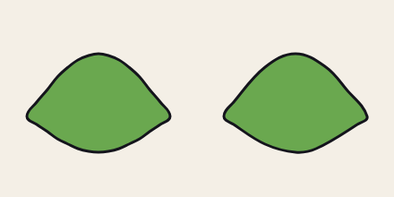
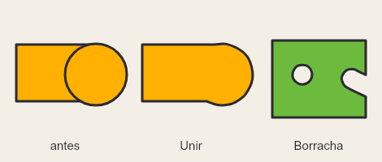

# 23. O editor

[← Linha de comando](22-linha-de-comando.md) · [Índice](README.md) · [Próximo: Atalhos do teclado →](24-atalhos.md)

O editor escreve o código por você: cada ferramenta, painel e ponto de arrastar muda as linhas do arquivo. Este capítulo é para consultar, por assunto. As teclas, todas juntas, estão nos [atalhos do teclado](24-atalhos.md).

## Abrir e rodar

- Abra o `index.html` no navegador. O código fica à esquerda, o desenho à direita, e o player, embaixo do desenho.
- **Arquivo › Novo** cria um arquivo, que já vem com um desenho de exemplo. Cole o seu código no lugar dele.
- O desenho muda enquanto você digita.
- O botão no canto de baixo, à esquerda, diz "sem erros" ou conta os erros e os avisos. Clique nele para ver a lista; um clique numa mensagem leva à linha dela. O que cada mensagem quer dizer está nos [problemas comuns](25-problemas.md#achar-pela-mensagem).
- Uma linha com erro ganha uma marca na margem, e a barra de baixo mostra a mensagem.
- Os desenhos com `anim` tocam no player.

## Vistas

Os três botões no alto, à direita (ou o menu **Exibir**), escolhem o que aparece na tela:

- **Código**: só o código.
- **Dividido** (o padrão): o código à esquerda e o desenho à direita.
- **Design**: só o desenho, para quem desenha sem programar. O código continua lá, escondido: um clique num erro ou no nome de um painel abre o Dividido na linha dele.

**Ctrl+'** passa para a vista seguinte: Código → Dividido → Design → Código. Com **Shift**, volta uma. É a tecla à esquerda do 1 (no teclado americano, a do acento grave), e vale também com o cursor no código. Ao chegar no Código, o cursor vai para o código. A vista escolhida fica guardada **neste navegador**.

## Tema

**Exibir › Tema** escolhe as cores do editor:

- **Claro** (o padrão): fundo branco, letras escuras.
- **Escuro**: fundo escuro, letras claras.
- **Do sistema**: segue o modo claro ou escuro do computador, e troca sozinho quando ele troca.

O tema muda só a moldura em volta do desenho: os painéis, o código, as réguas, os menus e as linhas do tempo. O desenho, e o que aparece por cima dele (pontos, ossos, caixas e linhas guia), fica igual nos dois, e a exportação também. A escolha fica guardada **neste navegador**.

## Coordenadas e pontos

- **Ctrl+clique** num lugar do desenho escreve a coordenada daquele lugar no código, onde está o cursor de texto. É o jeito mais fácil de descobrir o número de um lugar.
- Com a **Seleção direta** (A), os pontos da linha do cursor aparecem no desenho. Arraste um ponto, e o número muda no código.
- Um clique numa forma do desenho leva o cursor até a linha dela. Só conta clicar e soltar: arrastar move a vista.
- Com formas uma em cima da outra, clique de novo no mesmo lugar para pegar a de baixo.
- Numa cópia de um componente, o clique leva à linha do `use`.

## Números no código

- Segure **Alt** e arraste um número do código para os lados: ele muda, e o desenho acompanha. Com **Shift**, ele muda 10 vezes mais rápido.
- Os pontos que vêm de uma conta (`{cx-20},{cy}`) aparecem **cinza** no desenho e não se movem com o mouse: o editor não sabe reescrever a conta. Para ajustar, mude a variável do `let`, ou use o Alt+arrastar no número.
- Os pontos de uma linha dentro de um `repeat` também ficam cinza: mexer num mudaria todas as cópias.

## As ferramentas

A barra de ferramentas fica à esquerda do desenho.

- **Retângulo** (M), **Elipse** (L), **Polígono**, **Estrela** e **Linha** (`\`): aperte e arraste.
  - Com **Shift**, sai um quadrado, um círculo, uma linha de 45 em 45 graus, ou o polígono e a estrela em pé.
  - Com **Alt**, a forma cresce a partir do meio.
  - No Polígono e na Estrela, as setas **↑** e **↓** (sem soltar o mouse) mudam o número de lados ou de pontas.
  - **Esc** desiste.
- Um clique sem arrastar põe ali uma forma de tamanho padrão. O **Texto** (T) já abre uma caixinha para você escrever as letras.
- O Retângulo, a Elipse, o Polígono e a Estrela dividem a mesma casa da barra. Segure o botão (ou clique com o botão direito) para escolher outra. O triangulinho no canto marca as casas com mais de uma ferramenta.
- A forma nova entra **na frente** de tudo, na camada da linha do cursor. Ela ganha um nome novo em inglês (`rect1`, `ellipse1`, `polygon1`…) e já vem escolhida, pronta para mover, girar e mudar de tamanho.
- Num grupo aberto com duplo clique, a forma nova entra no grupo. Uma camada travada não aceita formas novas.
- A cor vem das [caixinhas de cor](#caixinhas-de-cor).
- O **botão direito** no desenho abre o menu do objeto (copiar, organizar, agrupar…). **Inserir forma** põe uma forma pronta onde você clicou. O menu **Objeto › Inserir** põe no meio da tela, e tem também o `shape`, o `stroke` e o `text` prontos.

## Elipse e retângulo

**Elipse:** com o cursor na linha de uma `ellipse`:
- a bolinha do centro muda o `cx,cy`;
- os **quadradinhos** na borda, ligados ao centro por uma linha tracejada, mudam o tamanho. Num círculo há um só, que muda o raio. Numa elipse há dois: o da direita muda o raio da largura, e o de baixo, o da altura. Com **Shift**, os dois mudam juntos, sem deformar a elipse;
- os quadradinhos giram junto com o `rot=` e ficam sempre na ponta de cada raio.

**Retângulo:** com o cursor na linha de um `rect`:
- a bolinha do canto de cima move o retângulo;
- o **quadradinho** do canto de baixo, à direita, muda a `largura,altura`. Com **Shift**, a proporção não muda (um quadrado continua quadrado);
- o **losango azul** na borda de cima, perto do canto, muda o `r=`. Arraste para a direita, e o canto arredonda. Volte até o canto, e o `r=` vira 0. Se a linha não tem `r=`, arrastar escreve um.

**O giro (nos dois):** a bolinha **verde**, presa numa haste em cima da forma, muda o `rot=`. Se a linha não tem `rot=`, arrastar escreve um. Com **Shift**, o giro vai de 15 em 15 graus, e um **duplo clique** na bolinha verde volta a `rot=0`. O círculo não tem essa bolinha, porque girá-lo não muda nada.

## Linha, Caneta e Lápis

- **Linha** (`\`): aperte e arraste. Com **Shift**, a linha anda de 45 em 45 graus.
- **Caneta** (P): ponto a ponto. O clique põe um canto; apertar e arrastar puxa as alças da curva. Com **Alt** no meio do arraste, só a alça de saída anda.
- **Curvatura** (Shift+~): cada clique põe um ponto liso; o duplo clique, um canto.
- Na Caneta e na Curvatura, clicar no primeiro ponto fecha um `shape`. **Enter** ou **Esc** termina um `stroke`, e **Backspace** (ou **Delete**) tira o último ponto.
- **Lápis** (N) e **Pincel** (B): à mão livre. O traço do mouse vira um `stroke` com poucos pontos (quem escolhe os pontos é o [Simplificar](#simplificar)). Onde o traço vira de repente, sai um canto (`!`).
- O Lápis que termina perto do começo fecha um `shape`. O Pincel sai com as pontas afinando (`taper=`).
- No Lápis e no Pincel, `[` e `]` mudam a grossura.

**No traço pronto:** os pontos se editam como no `shape` ([abaixo](#pontos-e-alças)). Numa `line` de dois pontos, a bolinha para criar um ponto novo fica no meio, e o ✥ desce um pouco para não ficar em cima dela. Numa `line` em pé ou deitada, a caixa de esticar só tem os dois quadradinhos das pontas. O traço precisa de pelo menos 2 pontos, e esticar não muda o `w=`.

## Pontos e alças

Com o cursor na linha de um `shape`, de um `stroke` ou de uma `line`, os pontos aparecem no desenho.

**Os pontos:**
- **Arrastar** um ponto muda o número dele no código.
- **Duplo clique** num ponto liga e desliga o `!`.
- Para **apagar** um ponto, clique nele (ele fica laranja) e aperte **Delete**. A alça dele sai junto. O `shape` não pode ficar com menos de 3 pontos.
- Para pôr um **ponto novo** entre dois, use a bolinha clara e menor no meio de cada lado. Arraste (ou só clique), e ela vira um ponto de verdade. Num lado curvo, o desenho não muda: o ponto novo e os vizinhos ganham as alças de como a curva já estava. Entre dois cantos, o ponto novo também ganha `!`, e o lado continua reto.

**As alças:**
- Com a **Seleção direta** (A), clique num ponto liso: aparecem clarinhas as **alças automáticas** (as que o Weasel calcula). Arraste uma delas: as duas vão para o código do jeito que a curva já está (`~ax,ay~bx,by`), sem pular, e o outro lado gira junto, para o ponto continuar liso.
- Uma alça escrita aparece como dois **losangos azuis**, um de cada lado do ponto. Na alça inteira (`~dx,dy`), arrastar um losango muda os dois lados. Com **Alt**, só aquele lado anda, e a alça quebra.
- **Duplo clique** num losango de uma alça quebrada junta os dois lados de novo (fica o lado do clique). Numa alça inteira, o duplo clique (no losango ou no ponto) tira a alça, e a curva volta a ser automática.
- Soltar um losango em cima do próprio ponto também tira a alça. Na quebrada, só aquele lado sai, e fica `0,0`.
- A ferramenta **Ponto de ancoragem** (Shift+C, na casa da Caneta): o clique num ponto troca canto e liso; arrastar um ponto puxa uma alça nova; arrastar um losango mexe só naquele lado.

Um Ctrl+Z desfaz cada arraste.

## Escolher, mover, girar e esticar

**Escolher:**
- Com a **Seleção** (V), um clique escolhe a forma. **Shift** + clique soma ou tira formas da escolha.
- No painel [Camadas](#painel-camadas), **Ctrl** + clique soma ou tira uma linha, e **Shift** + clique pega um trecho. Clicar no nome de uma camada escolhe todas as linhas dela.
- **Esc**, um clique fora das formas ou o cursor numa linha de fora soltam a escolha.

**Mover:**
- Arraste a forma, ou o **✥** (a bolinha com quatro setas no meio dela). Num `shape` ou num traço, **Shift** + arrastar um ponto também move a forma inteira, com os `!` e as alças.
- Com duas linhas ou mais escolhidas, as formas ganham um contorno azul e uma caixa tracejada em volta. Arraste qualquer uma, e todas andam juntas.

**Girar:** a bolinha **verde** em cima da caixa gira tudo em volta do meio da caixa (com **Shift**, de 15 em 15 graus).
- Os pontos do `shape`, do `stroke` e da `line` giram: o editor reescreve os números, e as alças giram junto.
- A `ellipse`, o `rect`, o `text` e o `use` mudam de lugar e ganham `rot=` (ou têm o `rot=` somado).
- O círculo só muda de lugar.

**Esticar:** os quadradinhos **azuis** nos cantos e no meio dos lados da caixa esticam tudo junto.
- O de um canto muda a largura e a altura; o do meio de um lado, só uma delas.
- O lado oposto fica parado (com **Alt**, o meio fica parado). **Shift** mantém a proporção. Arrastar além do lado oposto espelha a forma.
- Cada linha muda do seu jeito:
  - os pontos e as alças do `shape`, do `stroke` e da `line` esticam;
  - a `ellipse` muda o raio, e o círculo vira elipse (`rx,ry`) quando a largura e a altura mudam diferente;
  - o `rect` muda a largura e a altura;
  - o `text` muda o `size=` pela altura: esticar só para o lado leva as letras junto, sem mudar o tamanho delas;
  - o `use` ganha `scale=` e, quando espelha, `flip=`.
- Uma forma girada, esticada de lado, não entorta: ganha um giro e um tamanho novos, o mais perto possível do que você arrastou.
- O `w=`, o `ink=` e o `r=` dos cantos não mudam.
- Algumas linhas ficam paradas, e o painel Camadas mostra o motivo quando o mouse para em cima: as que têm `{conta}` na posição (ou, ao esticar, no tamanho e no `rot=`), as cópias de um `repeat`, o que vem de um `include`, os espelhos (`mirror=`) e os membros com IK.

**Copiar:**
- Com a **Seleção** (V), segure **Alt** e arraste: a cópia nasce no lugar e vai com o mouse. Na **Seleção direta** (A), **Alt** + arrastar um ponto também leva uma cópia da forma inteira.
- Depois, **Ctrl+D** no desenho repete o último passo: cópias em fila, com a mesma distância. No código, o **Ctrl+D** duplica a linha.
- A cópia ganha um nome novo: `asa` vira `asa_1`, e copiar de novo dá `asa_2`. Vale para tudo o que tem nome: formas, `ref`, `layer`, `bone`, `anim`, `def`…
- Copiando várias linhas de uma vez, o que usa esses nomes muda junto: a forma copiada com `bone=braco` fica presa no `braco_1` copiado, e as `key` da animação copiada mexem nas cópias. As cores (`c=asa` da `palette`) não mudam. Num `def … end` copiado inteiro, só o componente ganha nome novo.
- Para a cópia continuar no mesmo recorte de várias formas com o mesmo nome (como os gomos do [capítulo 4](04-camadas.md#recortar-com-uma-camada-inteira)), apague o `_1` do nome.

Um arraste inteiro se desfaz com um Ctrl+Z só.

## Simplificar

Desenhos que vêm de outro programa (um vetorizador, um SVG convertido) costumam ter pontos demais. Como o Weasel faz as curvas lisas sozinho, quase sempre dá para ter o mesmo desenho com bem menos pontos.

<!-- gerar: img/02_simplificar.png -->
```weasel
canvas 440 220 bg=#f4efe6
shape antes c=#6aa84f ink=3 : 30,130 41,114 53,100 64,86 76,75 87,67 99,62 110,60 121,62 133,67 144,75 156,86 167,100 179,114 190,130 179,139 167,147 156,155 144,161 133,166 121,169 110,170 99,169 87,166 76,161 64,155 53,147 41,139
shape depois c=#6aa84f ink=3 : 250,130 261,114 296,75 330,60 364,75 387,100 410,130 399,139 353,166 330,170 296,161 261,139
```



As duas folhas são iguais. A da esquerda tem 28 pontos; a da direita, 12. Foi o Simplificar que escolheu quais ficavam.

- Escolha a forma (ou várias) e use **Objeto › Caminho › Simplificar**.
- A **tolerância** diz quanto cada forma pode se afastar da de antes, em pixels do desenho.
- Enquanto você mexe, a forma de antes aparece cinza, e a nova, azul por cima, com os pontos. O painel mostra quantos pontos havia e quantos ficam.
- **Enter** aplica (um Ctrl+Z desfaz); **Esc** desiste.
- Os pontos que ficam são os da forma, sem mudar nada, com o `@osso` e as alças. Onde a curva vira de repente (uma ponta fina), o ponto ganha `!`.
- Ficam como estão: os pontos com `{contas}` e os membros (`limb=`).
- Uma forma usada na troca de forma (`x.shape=`, `mouth`) com outro número de pontos deixa de trocar ponto a ponto. O editor avisa.
- Na linha de comando, o `--simplify` faz o mesmo no arquivo inteiro ([capítulo 22](22-linha-de-comando.md)).

## Pathfinder, Pincel de bolha e Borracha

Três ferramentas mexem na **área** das formas fechadas e escrevem os pontos novos no código.

<!-- gerar: img/02_caminhos.png -->
```weasel
canvas 470 200 bg=#f4efe6
palette ink=#2b2a33

# antes: um retângulo e um círculo
rect a1 20,55 90,70 c=#ffb000 ink=3
ellipse b1 118,92 38 c=#ffb000 ink=3

# Unir: os dois viraram um shape só, com o nome da forma de cima
shape b2 c=#ffb000 ink=3 : 278.6,54.4 298.2,63.6 307.8,76.8 310.6,97.6 301.7,116.9 289.5,126.2 280.4,129.3 267.4,129.6 254.1,125! 175,125! 175,55! 264.3,55!

# Borracha: um clique abriu um furo (cut=), e um arraste mordeu a borda
shape c3 c=#6cbb3c ink=3 cut=c3_hole1 : 335,50! 450,50! 450,92.4! 440.4,87.9 435.1,85.4 426.4,86.8 420.6,94.7 420.9,100 424.6,106.5 450,119.3! 450,145! 335,145!
shape c3_hole1 hidden : 363.9,83 359.9,93.3 365,101.9 373.8,104 381.6,99.3 383.8,90.2 378.7,81.9 371,80.2

text t1 80,185 "antes" size=15 align=center
text t2 235,185 "Unir" size=15 align=center
text t3 392,185 "Borracha" size=15 align=center
```



Os dois primeiros desenhos têm as mesmas formas: o do meio é o resultado do **Unir**. O da direita era um retângulo verde, e a **Borracha** fez o resto.

- **Objeto › Caminho › Unir, Subtrair, Interseção e Excluir** (o *Pathfinder*): escolha duas formas ou mais (`shape`, `rect` ou `ellipse`, na mesma camada) e a conta.
  - **Unir** junta tudo.
  - **Subtrair** tira da forma de trás as que estão na frente.
  - **Interseção** deixa só o que todas têm em comum.
  - **Excluir** tira o que se sobrepõe.
  - O resultado fica na linha da forma de cima (no Subtrair, na de trás), e as outras linhas saem.
- **Pincel de bolha** (Shift+B): o arraste pinta uma área cheia, com a cor da caixinha do preenchimento. Se ele encosta numa forma da **mesma cor** (o mesmo `c=`), na mesma camada, as duas viram uma forma só. Senão, nasce um `shape` novo.
- **Borracha** (Shift+E): tira área das formas escolhidas. Sem escolha, tira das formas da camada do cursor, para não apagar sem querer o que está embaixo. Num `stroke` ou numa `line`, corta o traço em pedaços.
- `[` e `]` mudam o tamanho do Pincel de bolha e da Borracha, e um círculo no mouse mostra o tamanho. **Esc**, no meio do arraste, desiste.
- Um pedaço que se solta vira uma linha nova logo abaixo, com o nome numerado (`c3_1`, `c3_2`…). O maior fica com o nome. A forma que some inteira sai do código.
- Um buraco no meio vira um `shape` escondido (`hidden`), com o nome terminado em `_hole1`, que entra no `cut=` da forma (o `cut=` é do [capítulo 4](04-camadas.md#recortar-por-fora-cut)).
- O `rect` e a `ellipse` que a conta muda viram `shape` (o editor avisa).
- As retas continuam retas, e os cantos onde duas bordas se cruzam ficam no lugar exato (como o `264.3,55!` acima). Os pontos que a conta não tocou ficam como estavam. Os da beira da mudança ganham alças (`~`), para o resto da forma não mexer. A curva nova passa pelo [Simplificar](#simplificar).
- Um Ctrl+Z desfaz o gesto inteiro.

## Tesoura, Faca, Junção, Suavizar e Construtor de formas

Mais seis ferramentas mexem nos caminhos e escrevem o resultado no código.

<!-- gerar: img/02_cortar.png -->
```weasel
canvas 470 200 bg=#f4efe6
palette ink=#2b2a33

# Faca: um círculo cortado por um arraste ondulado (o pedaço de baixo foi puxado um pouco para baixo)
shape a c=#ff6b4a ink=3 : 72.2,30.1 93,33.3 110.7,45 122,62.8 124.9,77.2 124.8,84.1! 96.9,75.1 43,92.7 26,89.9! 25.1,83.8 26.2,68.9 35.3,49.6 51.3,36
shape a_1 c=#ff6b4a ink=3 : 124.8,98.1! 123.3,106.9 120.2,115.3 110,129.7 95.5,139.6 77.8,143.9 60.4,141.8 44.6,133.7 32.8,120.8 28.7,112.8 26,103.9! 43,106.7 96.9,89.1

# Construtor de formas: dois círculos; um clique na região do meio a separou (e ela ganhou outra cor)
shape b1 c=#4a90d9 ink=3 : 216.8,46.2 231.6,50.3 238,54.3! 233,58.6 225.3,69.4 221,88 225.3,106.6 233,117.4 238,121.7! 231.6,125.7 216.8,129.8 194.4,125.7 177.5,110.5 171,88 177.5,65.5 194.4,50.3
shape b2 c=#ffb000 ink=3 : 238,54.3! 247,63.3 251.1,70.2 255,88 251.1,105.8 247,112.7 238,121.7! 229,112.7 224.9,105.8 221,88 224.9,70.2 229,63.3
shape b2_1 c=#4a90d9 ink=3 : 281.6,50.3 298.5,65.5 305,88 298.5,110.5 281.6,125.7 259.2,129.8 244.4,125.7 238,121.7! 243,117.4 250.7,106.6 255,88 250.7,69.4 243,58.6 238,54.3! 244.4,50.3 259.2,46.2

# Tesoura: um stroke cortado num clique (o pedaço da direita ganhou outra cor)
stroke s w=8 c=#6cbb3c : 330,120 365,50~28.2,0~16.2,0 383.3,92.1~2.3,19.5
stroke s_1 w=8 c=#8e5bd1 : 383.3,92.1~1.7,14.4 400,120~11.9,0.8~27.4,1.8 440,55

text t1 75,185 "Faca" size=15 align=center
text t2 238,185 "Construtor de formas" size=15 align=center
text t3 385,185 "Tesoura" size=15 align=center
```


- **Tesoura** (C), na casa da Borracha: um clique num `stroke` ou numa `line` corta o traço ali. Os dois pedaços continuam com a mesma curva de antes (o ponto do corte ganha as alças, como o `383.3,92.1~2.3,19.5` acima). Numa forma fechada, são **dois cliques na borda**: ela se divide em duas numa reta entre eles. **Esc** desiste depois do primeiro.
- **Faca**, na casa da Borracha: o arraste corta as formas fechadas que ele atravessa de um lado ao outro (as escolhidas; sem escolha, as da camada). O corte segue o arraste, e os dois lados ficam com os mesmos pontos.
- **Junção**, na casa do Lápis: aperte na ponta de um `stroke` e solte na ponta de outro, e eles viram um traço só. **Objeto › Caminho › Juntar** (Ctrl+J) faz o mesmo com os dois traços escolhidos, pelas pontas mais perto. Pontas que se encostam viram um ponto; senão, uma reta liga as duas. Fica a linha de cima, com a cor e a grossura dela (juntando `s` e `s_1`, volta o nome `s`).
- **Borracha de caminho**, na casa do Lápis: apaga o pedaço do traço (`stroke` ou `line`) por onde passa, sem mexer no resto. Para tirar área de uma forma fechada, use a Borracha (Shift+E).
- **Suavizar**, na casa do Lápis: com um `shape` ou um `stroke` escolhido, passe o arraste por cima de um trecho tremido. Ali a curva fica mais lisa e com menos pontos, e o resto não muda. Cada vez que você passa, alisa mais.
- **Construtor de formas** (Shift+M): escolha duas formas fechadas ou mais que se cruzam. O mouse acende a **região** debaixo dele (cada pedaço que as bordas separam). Arraste por cima de várias regiões, e elas viram uma forma só, com a cor da forma onde o arraste começou. Um clique numa região só a separa das outras (como a do meio, acima). Com **Alt**, o arraste apaga as regiões.
- Como na Borracha: um pedaço que se solta vira `nome_1`, o `rect` e a `ellipse` cortados viram `shape` (o editor avisa), e um Ctrl+Z desfaz o gesto inteiro.

## Texto

Com o cursor na linha de um `text`, uma caixa tracejada mostra onde as letras estão.

- A bolinha do ponto de apoio move o texto.
- O **quadradinho** no canto de cima da caixa muda o tamanho das letras: arraste para fora, e o `size=` cresce; para dentro, ele diminui. O ponto de apoio fica parado. Se a linha não tem `size=`, arrastar escreve um. Com **Shift**, o tamanho vai de 4 em 4. No `align=right`, o quadradinho fica no canto da esquerda, que é para onde o texto cresce.
- A bolinha **verde** em cima das letras gira o texto em volta do ponto de apoio e muda o `rot=`. Com **Shift**, o giro vai de 15 em 15 graus; um duplo clique na bolinha verde volta a `rot=0`.
- **Duplo clique nas letras** abre uma caixinha por cima delas para trocar o texto. **Enter** (ou clicar fora) grava, **Esc** desiste, e um Ctrl+Z desfaz. Uma aspa (`"`) escrita ali vira `”`, porque a aspa reta fecharia o texto no código.
- As fontes genéricas `serif` e `monospace` funcionam no editor. Na linha de comando, podem sair iguais à `sans-serif`, conforme as fontes do computador.

## Referências

O menu **Janela › Referências** abre o painel das imagens guia (o `ref`, do [capítulo 2](02-formas.md#desenhar-por-cima-de-uma-imagem-ref)):

- **Adicionar imagem…** escolhe um arquivo do computador e escreve a linha `ref`, com a imagem cabendo no desenho. A imagem fica guardada **neste navegador** (como os sons dos filmes); o código só tem o nome dela.
- **Arrastar e soltar** faz o mesmo sem abrir o painel: traga a imagem do computador e solte na janela do Weasel. A linha `ref` entra abaixo do `canvas`, depois das outras imagens guia. Solta no **desenho**, o meio da imagem fica onde ela caiu; solta no **código**, fica no meio do desenho. Várias de uma vez viram uma linha cada, uma um pouco abaixo da outra.
- Em cada imagem guia: a caixa liga e desliga (`hidden`), o controle muda a transparência (`opacity=`) e o cadeado trava (`lock`). Clicar no nome leva à linha dela no código. **mostrar** esconde todas de uma vez, sem mexer no código.
- No desenho, uma imagem sem `lock` tem uma moldura tracejada: arraste por dentro para mover, e pelo quadradinho do canto para mudar o tamanho. O Weasel reescreve o `x,y` e o `scale=`. Uma imagem travada não se mexe: arrastar por cima dela move a vista.
- Se o código tem um `ref` com uma imagem que este navegador ainda não guardou, o painel mostra **abrir …** ao lado dele.

## Traçado de imagem

**Objeto › Traçado de imagem…** transforma a imagem de um `ref` em formas, como a [linha de comando](02-formas.md#traçar-uma-imagem) faz com um arquivo. A imagem é a do `ref` da linha do cursor (ou do escolhido); se só uma imagem guia está aberta, é ela. No desenho, o botão direito também mostra o item quando há uma imagem para traçar.

O painel mostra a imagem e o traçado lado a lado:

- **Cores** é quantas cores o traçado procura na imagem (o `--colors`): menos cores, menos formas.
- **Detalhe** é quanto a curva segue a borda da imagem. O número é quanto ela pode se afastar, em pixels (o `--tol`): mais detalhe, mais pontos.
- **Fundo**: a caixa *tirar o fundo chapado* (o `--no-bg`) deixa de fora a cor que ocupa a maior parte da borda da imagem. Ao lado aparece a cor que saiu; sem um fundo chapado na imagem, aparece *nenhum*, com um aviso, e o traçado fica com tudo.
- A conta roda **em segundo plano**, com uma barra de progresso, e o desenho continua respondendo. Mexer num controle começa de novo. Uma imagem de 1 Mpx leva de 1 a 3 segundos.
- Embaixo aparece o que saiu: formas, pontos, cores na `palette` e degradês. Acima de 2.000 formas, o painel avisa que o código fica grande e o editor, mais lento.
- **Enter** (ou **Traçar**) aplica; **Esc** desiste.

O traçado vira uma **camada nova**, com o nome do `ref` e `_trace`. Ela entra logo antes da primeira `layer` do arquivo (sem nenhuma, no fim): é a mais de trás que uma camada pode ficar, logo na frente da [automática](04-camadas.md).

```
# traçado da imagem do ref raposa (Objeto › Traçado de imagem: Cores 48, Detalhe 0,5 px)
palette color1=#501b06f5 color2=#7e210df3 color3=#6b1e0cf4 …
layer raposa_trace
shape c=color5 : 436.15,150.65 442.49,159.34 …
```

- As formas já ficam **no lugar da imagem**: na posição, no tamanho (`scale=`) e no giro (`rot=`) do `ref`.
- A imagem é traçada no tamanho em que aparece no desenho: com `scale=0.5`, na metade (até o tamanho dela e até 4 Mpx).
- Uma cor igual (o mesmo `#hex`) a uma que a `palette` já tem usa o nome de lá. As outras ganham nomes livres (`color1`…), e os degradês e os buracos também (`gradient1`…, `_hole1`…).
- Com a caixa **Fundo** marcada, o comentário termina com a cor que saiu (`…, Detalhe 0,5 px, sem o fundo #ffffff)`).
- A linha `ref` fica como estava. Um **Ctrl+Z** desfaz o traçado inteiro.
- Os limites são os da linha de comando ([capítulo 2](02-formas.md#traçar-uma-imagem)): uma figura parada, numa camada só, sem ossos.

## Réguas, linhas guia e Medir

Para alinhar formas (os olhos na mesma altura, o pé em cima do chão), o editor tem réguas e linhas guia. Nada disso entra no código nem na exportação: são só ajudas na tela.

- **Réguas:** ligue **Exibir › Réguas** (ou **Ctrl+R**). As réguas, em cima e à esquerda, contam os pixels do desenho. O `0` é o canto de cima, à esquerda, do `canvas`, e a parte do papel fica mais clara. Os números acompanham o zoom.
- **Linha guia:** arraste de uma régua para dentro do desenho. Da régua de cima sai uma linha **deitada** (marca um `y`); da régua da esquerda, uma linha **em pé** (marca um `x`). Enquanto você arrasta, a linha gruda nas bordas e no meio do papel e nos pontos da forma do cursor, e um aviso embaixo do desenho mostra onde ela está (`linha guia em pé: x = 400`).
- **Mudar e apagar:** arraste uma linha para mudá-la de lugar. Para apagar, solte em cima de uma régua. Duplo clique no quadradinho do canto das réguas apaga todas as linhas do arquivo.
- **Grudar:** com as réguas ligadas, o que você arrasta gruda nas linhas guia quando passa a menos de 6 pixels (da tela) delas, e a linha fica branca enquanto segura. Um ponto gruda nele mesmo; a forma inteira gruda pelas bordas e pelo meio; ao esticar, gruda o lado que anda. Segure **Ctrl** durante o arraste para não grudar.
- **Medir:** a ferramenta **Medir** liga a régua de medir. Arraste de um ponto a outro: ela mostra a distância, o ângulo e quanto anda em x e em y (`100 px · -53,1° · dx 60 · dy -80`). O ângulo é como no `rot=`: positivo gira no sentido do relógio, e `0°` aponta para a direita. As pontas grudam nos pontos da forma do cursor e nas linhas guia; com **Shift**, a régua anda de 45 em 45 graus. Arraste uma ponta para ajustar; um clique (sem arrastar) ou **Esc** tira a medida. Para voltar a editar, escolha a Seleção (V) ou a Seleção direta (A).
- As linhas guia ficam guardadas **neste navegador**, uma lista para cada arquivo. **Exibir › Réguas** desliga tudo de uma vez: réguas, linhas e o grude. Em filmes, não há réguas nem Medir.

Não confunda com **Exibir › Guias**, que mostra as camadas `guide` do seu código ([abaixo](#guias)).

## Seletor de cor

Há três jeitos de escolher uma cor sem escrever o código `#`:

- No código, **Alt** + clique num código de cor (`#ff8800`) abre o seletor de cor do sistema. A cor escolhida entra no lugar, e a transparência do fim (`80` em `#ff880080`) continua.
- Nas [caixinhas de cor](#caixinhas-de-cor), um duplo clique abre o seletor.
- No painel **Propriedades**, cada campo de cor tem um quadradinho que abre o seletor. Ao lado, o campo de texto aceita um `#hex`, um nome da `palette`, um nome de cor em inglês, um nome de gradiente ou `none` (**Enter** grava).

## Caixinhas de cor

No pé da barra de ferramentas ficam duas caixinhas: o **preenchimento** (o quadrado cheio, que vira o `c=`) e o **contorno** (o quadrado vazado, que vira o `inkc=`). A grossura, no campo de baixo, vira o `ink=`. As formas que você desenha saem com elas; na `line` e no `stroke`, o contorno é a cor do traço.

- Com uma forma escolhida, as caixinhas mostram a pintura dela, e mudar uma caixinha pinta a forma.
- Clique numa caixinha para trazê-la para a frente; clique de novo (ou duplo clique) para escolher a cor.
- As teclas, com o foco no desenho:
  - **X** troca qual caixinha fica na frente;
  - **Shift+X** troca as duas cores;
  - **/** tira a cor da caixinha da frente;
  - **D** volta ao padrão (azul, com o contorno da cor da tinta e grossura 4);
  - **Shift+D** faz as formas novas nascerem atrás de tudo na camada (de novo, na frente).
- O **Conta-gotas** (I) copia a pintura de uma forma clicada para as escolhidas (sem escolha, para as caixinhas). Com **Alt** + clique, faz o contrário: pinta a forma clicada com as caixinhas.

## Amostras

As cores e os números da `palette` aparecem no painel **Amostras**, na coluna da direita do desenho (**Janela › Amostras**).

- Escolha uma forma e clique numa cor: ela vira o `c=` da forma. Sem forma escolhida, a cor vai para as [caixinhas](#caixinhas-de-cor).
- Com **Contorno** marcado em cima (ou com **Alt** + clique), a cor vira o `inkc=`. No `stroke` e na `line`, vira a cor do traço.
- Os números (as grossuras) vão para o `ink=`, ou para o `w=` do traço.
- Os gradientes e as texturas também estão lá.
- **+ nova** guarda na `palette` a cor da forma escolhida, com um nome livre (`color1`, `color2`…), e a forma passa a usar o nome.
- Duplo clique numa amostra leva à linha dela no código.
- As variantes (`variant`) trocam com um clique no painel, ou no seletor de variante da barra da vista do desenho.

## Degradê

**A ferramenta Degradê** (G) cria um gradiente sem escrever nada. Escolha a forma, aperte num ponto e arraste até outro: o começo e o fim do arraste viram o começo e o fim do gradiente.

- Se a forma ainda não tem gradiente, nasce um novo (`gradient1`), logo depois da `palette`. Ele vai da cor da forma bem clara até a própria cor, e o `c=` da forma passa a ser ele.
- Se ela já tem um, e só as formas escolhidas o usam, ele muda. Se outras formas também usam, nasce uma cópia com as mesmas cores, e as outras ficam como estavam.
- Com **Alt**, troca o linear pelo redondo (`radial`, do centro até a ponta do arraste) e vice-versa. Com **Shift**, a direção anda de 45 em 45 graus.
- Sem escolha, o arraste vale para a forma onde você apertou. Um clique sem arrastar faz um gradiente deitado, de um lado ao outro da forma.

**O painel do gradiente** abre com o cursor numa linha `gradient`, ou numa forma pintada com um gradiente (`c=` ou `inkc=`), no canto de cima, à esquerda, do desenho:

- A **barra** mostra o gradiente. Cada cor é uma **marca** embaixo dela: arraste a marca para mudar a posição (com **Shift**, de 0.05 em 0.05). Ela pode passar por outra, e a ordem na linha acompanha.
- **Clique na barra** para pôr uma cor nova ali, com a cor que já estava naquele ponto. **Botão direito** numa marca tira a cor (ou o botão **Tirar**).
- Embaixo ficam a cor, a transparência e a posição da marca escolhida. No campo de texto vale também um nome da `palette` (**Enter** grava). Mudar a cor ou a transparência de um nome da palette troca o nome por um `#hex`.
- Em cima, `linear`/`radial` troca o tipo, e `box` liga e desliga o 0 a 1. Ligar ou desligar o `box` faz a conta na primeira forma que usa o gradiente (ou na forma da linha do cursor), e ela continua igual.
- No desenho, a linha do gradiente aparece tracejada, com uma bolinha de cada cor. No linear, os pontos de arrastar são o começo e o fim (com **Shift**, a direção anda de 45 em 45 graus); no radial, o centro, o raio e o foco. Com `box`, um retângulo tracejado mostra onde o 0 e o 1 caem.
- Cada arraste é um Ctrl+Z só. Quando você mexe nas posições, todas passam a ficar escritas na linha (menos o `@0` da primeira e o `@1` da última, que já são o padrão). Assim nenhuma cor muda de lugar sozinha.

## A luz do contorno

O `light=` do `canvas` (a direção da luz do `weight=`, do [capítulo 3](03-cores.md)) não tem um ponto para arrastar, porque é uma direção, não um lugar.

- Com o cursor na linha do `canvas`, uma **seta** amarela sai do centro do quadro e aponta para a luz, com um sol na ponta.
- Arraste o sol em volta, e o lado grosso dos contornos gira junto. O `light=` muda no código.
- Com **Shift**, a seta gira de 15 em 15 graus (fica fácil acertar `0,-1`, a luz bem em cima).
- Se a linha do `canvas` não tem `light=`, a seta mostra o padrão (`-0.6,-0.8`), e arrastar escreve o `light=`.
- A barra de baixo diz, em palavras, de que lado a luz vem.

## Luzes no desenho

Com o cursor na linha de uma `light` ([capítulo 10](10-luz.md#luz-de-verdade)), a luz aparece no desenho para você ajustar com o mouse.

- A `point` e a `spot` têm um **ponto** no lugar da lâmpada: arraste para mudar o `x,y`.
- A `dir` não tem lugar, só direção. Por isso ela tem uma **seta** amarela que sai do centro do quadro e aponta para o sol. Arraste o sol da ponta para girar o `dx,dy`; com **Shift**, de 15 em 15 graus.
- É a mesma seta do `light=` do `canvas` ([acima](#a-luz-do-contorno)).

## Painel Camadas

O painel **Camadas** fica na coluna da direita, entre as Propriedades e as Amostras (**Janela › Camadas**). Ele mostra cada camada, na ordem do código, com as linhas que desenham nela. O título de cada parte da coluna dobra e desdobra; numa janela estreita, o painel aparece por cima do desenho.

- Clique numa linha para escolhê-la. **Ctrl** + clique soma ou tira uma linha, e **Shift** + clique pega um trecho. Clicar no nome de uma camada escolhe todas as linhas dela.
- Com o cursor numa forma, a barra de baixo diz em que camada ela está (`ellipse iris na camada olhos`). Os nomes das camadas aparecem nas sugestões de `clip=`, `cut=`, `inkon=` e `hide=`.
- **Arrastar uma linha** muda o lugar dela no código. Solte entre duas linhas, ou em cima do nome de uma camada para levar a linha para a frente dessa camada (o fim dela). Com várias escolhidas, todas vão juntas, com os comentários logo acima de cada uma. **Objeto › Mandar para a camada** faz o mesmo com a escolha.
- **Arrastar o nome de uma camada** muda a ordem das camadas. O bloco dela (os comentários de cima, a linha `layer` e as linhas até a última forma dela) muda de lugar no código. A camada automática (`base`) fica sempre no fundo.
- O **＋** cria uma camada (`layer layer1`) logo acima da camada onde se desenha. Ela passa a ser a camada onde se desenha, marcada com uma barrinha laranja no nome. Escolher uma forma, ou clicar no nome de uma camada, também muda a camada onde se desenha.
- **Duplo clique num nome** renomeia a linha e as palavras que apontam para ele (`clip=`, `cut=`, `inkon=`, `hide=`, a `key forma.prop=`…). Se o mesmo nome aparece em duas formas (como dois furos), o editor renomeia só a linha clicada.
- A **lixeira**, que aparece com o mouse no nome da camada, apaga a camada e as formas dela. As `anim` e as `key` ficam.
- O **olho** no fim de cada linha (e de cada camada) esconde e mostra: ele escreve ou apaga o `hidden` daquela linha. Quando o olho está fechado (laranja), a linha está escondida e aparece em itálico. As linhas de uma camada escondida ficam apagadas. O `use` e o `include` não têm `hidden`, então não têm olho.
- **Ctrl+3** esconde e mostra as linhas escolhidas (ou, sem escolha, a linha do cursor; no código, também o **Ctrl+H**). Se alguma aparece, todas somem; se todas já estão escondidas, todas voltam. Uma forma escondida não se clica no desenho: é pelo painel que ela volta a aparecer.
- O **cadeado** de cada linha (e de cada camada) põe e tira o `lock` ([abaixo](#travar-e-agrupar)).

## Organizar

- **Ctrl+]** traz a forma escolhida uma linha para cima (para a frente), e **Ctrl+[** a manda uma linha para baixo (para trás). Com **Shift**, ela vai para a frente ou para trás de tudo da camada.
- Os mesmos comandos estão em **Objeto › Organizar**.
- É o mesmo que mudar a linha de lugar no código: o editor muda por você, e os comentários logo acima da linha vão junto.
- Um grupo vai inteiro, do `group` ao `end`. Dentro de um grupo aberto com duplo clique, organizar muda a ordem dentro do grupo.

## Camadas em 3D

**Exibir › Camadas em 3D** (ou o botão de camadas na ponta direita da barra de baixo) mostra a [ordem de pintura](04-camadas.md#a-ordem-de-pintura) do desenho inteiro. As camadas se afastam no espaço, a de baixo no fundo e a de cima mais perto de você, e cada linha do painel Camadas vira uma peça.

- Arraste para girar. **Espaço**, a **Mão** ou o botão do meio movem a vista, e a roda aproxima.
- Clique numa peça para escolher a linha dela (**Shift** soma ou tira). As setas, **Ctrl+3**, **Ctrl+D**, **Ctrl+Z** e as teclas de Agrupar, Travar, Organizar, Recortar, Copiar, Colar, Tudo e Nada valem como no desenho.
- A barra de cima tem os botões **Explodir**, **De frente**, **De lado** e **Juntar**, um controle de quanto as camadas (e as formas de uma mesma camada) se afastam, e outro para as molduras com os nomes.
- O olho de cada nome esconde a camada só nessa vista.
- Passe o mouse numa linha do painel Camadas, e as outras peças se apagam.
- A vista mostra o mesmo quadro do player, sem o estilo de arte e sem o halo das luzes.
- Com mais de 1.500 peças (um [traçado de imagem](#traçado-de-imagem) grande, por exemplo), as camadas com mais linhas viram **uma peça só**, a camada inteira: peças demais travam o navegador. O clique nela ainda escolhe a forma que está embaixo do mouse.
- Num filme, o mesmo botão abre o **Palco em 3D**, com cada camada e cada ator na sua distância (`depth=`) ([Palco em 3D](#palco-em-3d)).
- Num desenho com [três vistas](17-jogo-tres-vistas.md) (`layer … view=`), o mesmo botão abre as **Vistas em 3D** (veja abaixo).

## Vistas em 3D

Num desenho com três vistas ([capítulo 17](17-jogo-tres-vistas.md)), **Exibir › Vistas em 3D** (ou o mesmo botão da barra de baixo) mostra o boneco que o Weasel montou em 3D, com as vistas desenhadas em volta dele. Serve para conferir o que ele entendeu do desenho: a profundidade de cada osso, para onde ele aponta e o caminho da espada no golpe.

- **As vistas desenhadas** ficam em pé em volta do boneco, cada uma atrás dele, do lado contrário ao da câmera dela, como o fundo de um palco: a de frente fica atrás das costas do boneco, virada para a frente. Assim, de qualquer lado, o boneco aparece na frente do desenho daquele lado. De cada lado, só aparece a vista virada para quem olha (as duas mais perto, com uma passagem suave entre elas). Uma vista escondida deixa a marca no chão. A caixinha **Vistas desenhadas** tira todas.
- **O esqueleto:** o corpo em cinza (a grossura de cada osso medida nas peças), os ossos em vermelho e uma bolinha em cada junta. A cor da bolinha diz de onde veio a profundidade: verde, lida nas peças (do lado, de uma diagonal ou do osso espelhado); azul, escrita (`side=`, ou `lat=` num jogo de plataforma); vermelha, adivinhada (a do pai, ou 0).
- **O chão** é uma grade na altura do pé mais baixo.
- **A barra de cima:** **Por fora** olha de lado e de cima; **De cima** mostra para onde cada osso vai (a espada que desce para a frente, o pé que avança); um botão para cada vista desenhada (**de frente**, **de lado**, **de costas**, **3/4**…) gira até ela e mostra só aquela vista, com as bolinhas em cima das peças; **Câmera do jogo** olha com a inclinação do `views tilt=`, na vista que o player está tocando. **Ctrl+0** alinha com a vista principal.
- **Clique num osso:** a barra diz a profundidade dele, de onde ela veio e para onde ele aponta; o código vai até a linha do `bone`, e a vista desenha em amarelo o caminho da ponta dele na animação do player, com os números dos quadros.
- O boneco segue o player: a animação base (`walk`) do que está tocando, no mesmo quadro.

## Efeitos da camada

Os efeitos de camada ([capítulo 11](11-efeitos.md#efeitos-de-camada)) se ligam sem escrever:

- Escolha uma forma da camada e use o menu **Efeito**: ele liga e desliga cada efeito, com um valor de partida.
- A parte **Camada** do painel **Propriedades** mostra a opacidade, a mistura (`blend=`) e os efeitos ligados, com os números de cada um.
- O que você muda lá é escrito na linha `layer`.
- Uma camada sem linha `layer` (a automática) não tem efeitos: escreva `layer nome` antes das formas.

## Acabamento e estilo

**Janela › Acabamento e estilo** abre, na coluna da direita, o painel que escreve as linhas `finish` ([capítulo 12](12-acabamento.md#acabamento-finish)) e `art` ([capítulo 13](13-estilos.md)) por você, no desenho e no filme. O botão **linha N**, ao lado de cada título, leva o código à linha. Com o player andando, o painel não escreve: pause antes.

**Acabamento:**

- A escolha entre `game` e `flat` e um controle deslizante para cada número do `finish` (`bloom=`, `vignette=`, `grain=`, `posterize=`, `pixel=`, `inner=` e os efeitos de tela). A caixinha **só as cores da palette** escreve o `posterize=palette`.
- Arrastar escreve na linha `finish`, com um Ctrl+Z por arraste. A caixa ao lado aceita o número digitado.
- Voltar ao padrão (0; no `pixel=` e no `inner=`, 1) tira a opção da linha. Sem a linha `finish`, ela nasce logo depois do `canvas`.

**Estilo de arte:**

- Uma miniatura de cada um dos 26 estilos, e **nenhum**, feita com o seu desenho (na pose do player; no filme, no quadro do player). Num desenho grande, a miniatura é um pedaço do meio, para o estilo aparecer.
- Um clique escreve a linha `art` (sem ela, a linha nasce logo depois do `finish`) e liga **Exibir › Estilo de arte**. A miniatura **nenhum** tira a linha. Trocar de estilo mantém as opções que valem no novo, e o `boil=`, o `seed=` e o `actor=`.
- As opções do estilo ficam embaixo das miniaturas: um campo para cada número (vazio, ele mostra o padrão apagado; apagar o que tem nele tira a opção da linha), uma lista para o `palette=` e o `dither=` e uma caixinha para cada palavra (`outline`, `color`, `old`, `bw`…).
- **No filme:** quando o plano do player tem um `art` próprio, o painel muda esse `art` (o título diz "do plano …", e **nenhum** vira `art none`). Senão, muda o do filme todo ("do filme todo"). O `art` de uma cena ou de um ator só muda no código.
- As miniaturas são feitas fora da página, no mesmo ajudante da exportação, então digitar continua leve. Enquanto o código muda, as velhas ficam apagadas até as novas chegarem.

**O desenho com estilo:**

- O desenho aparece no estilo, e as alças continuam nos pontos das formas: você edita do mesmo jeito.
- Quando o arquivo tem `art`, aparece **Exibir › Estilo de arte**. Desligada, ela mostra o desenho normal, mais fácil de ajustar.
- Os estilos mais pesados (todos, menos `pixel`, `ascii`, `silhouette` e `lines`) mostram o desenho normal enquanto você arrasta uma alça. Quando você solta, o estilo volta.
- Na janela de exportar, o botão **Texto (ASCII)** salva o `.txt` de um desenho com `art ascii` ([capítulo 13](13-estilos.md#letras-art-ascii)).

## Formas em 3D

As alças das formas giradas (`yaw=`, `pitch=`), dos chãos (`floor`) e dos mapas isométricos (`iso`) ficam onde a forma aparece na tela, e arrastar muda o número certo no código ([capítulo 14](14-profundidade.md)).

## Guias

**Exibir › Guias** liga e desliga as camadas `guide` do seu código: as linhas de construção que você desenha de propósito ([capítulo 4](04-camadas.md#camada-de-construção-guide)). Elas aparecem no editor com o menu ligado e nunca saem na exportação, a não ser com `--guides` na linha de comando.

Não confunda com as [linhas guia das réguas](#réguas-linhas-guia-e-medir), que não estão no código.

## Travar e agrupar

**Travar (`lock`):**
- **Ctrl+2** trava a escolha. Num grupo inteiro, o `lock` vai na linha do `group`.
- **Ctrl+Alt+2** destrava tudo, menos as camadas.
- No painel Camadas, o cadeado de cada linha (e de cada camada) põe e tira o `lock`.
- Uma forma travada não se escolhe nem se arrasta no desenho: o clique passa para o que está embaixo.

**Agrupar (`group`, do [capítulo 6](06-componentes.md#grupos-group)):**
- **Ctrl+G** agrupa as formas escolhidas: o editor escreve o `group group1` e o `end` em volta delas. Se as formas estavam espalhadas no código, o editor as junta onde estava a primeira.
- **Ctrl+Shift+G** desfaz o grupo, um nível por vez. Os dois também estão no menu **Objeto**.
- Com a **Seleção** (V), um clique numa forma do grupo escolhe o grupo inteiro. A **Seleção direta** (A) pega uma forma só.
- **Duplo clique** numa forma de um grupo **entra nele**: o resto do desenho fica apagado e parado, e o clique escolhe só as formas de dentro. **Esc** (ou um duplo clique fora) sai.
- Copiar, colar, apagar, organizar e o Alt+arrastar levam o grupo inteiro, do `group` ao `end`.

**Alinhar:** **Objeto › Alinhar** (e o grupo **Alinhar** do painel Propriedades) alinha as formas escolhidas à esquerda, ao centro, à direita, em cima, no meio ou embaixo. Com três ou mais, distribui com a mesma distância entre os meios. Um grupo anda inteiro. Com uma forma (ou um grupo) só, ela se alinha no papel, o `canvas`.

## Prévia do componente

Com o cursor em qualquer linha entre o `def` e o `end` ([capítulo 6](06-componentes.md#componentes-def-e-use)), o editor mostra o componente sozinho. Dá para experimentar valores para os parâmetros sem mudar o código.

- Se o `def` não tem nenhum `use`, o editor mostra só o componente, sozinho, enquanto o cursor estiver nele. Saindo do `def`, o desenho volta.
- Num `def` que já tem `use`, o desenho continua. Ligue a chave **Prévia do def**, que aparece na barra de baixo com o cursor num `def`. A mesma chave desliga a prévia de um `def` sem `use`.
- A **cruz rosa** marca a origem `0,0`: o ponto que vai parar no `x,y` do `use`.
- O painel **Prévia**, embaixo à direita, tem uma linha para cada parâmetro, começando no valor padrão:
  - **número:** escreva no campo, ou arraste o nome para os lados (com **Shift**, 10 vezes mais rápido);
  - **cor:** o quadradinho abre o seletor; o campo aceita `#hex`, um nome da `palette`, um nome de cor ou `none`;
  - **gradiente:** uma lista com os do arquivo.
- O painel **não muda o código**: os valores ficam só enquanto a página está aberta. O ↺ de uma linha volta aquele parâmetro ao padrão, e **Voltar ao padrão** volta todos.
- **Copiar como use** copia uma linha pronta com o que você mudou (por exemplo, `use botao 0,0 borda=10`). Cole no código e troque o `0,0` pela posição.
- Os pontos de arrastar continuam valendo: arrastar um muda a linha do `def`, nas coordenadas dele.
- A prévia não mostra animação, luzes nem o que vem de fora do `def`. Um erro que só acontece com um valor do painel aparece no painel, não no código.
- **Pintar** pinta só o componente.

## Painel Símbolos

O editor chama o `def` de **símbolo**, e cada `use` de **instância**. O painel **Símbolos**, na coluna da direita (**Janela › Símbolos**), mostra cada `def` do arquivo com uma miniatura, desenhada com os valores padrão. O número no canto conta os `use`.

- **Arraste uma miniatura para o desenho:** o editor escreve `use nome x,y` na camada onde se desenha, com a origem do símbolo onde você soltou. **Colocar** faz o mesmo no meio da vista.
- **Criar símbolo** (**F8**, ou o ＋ do painel): as formas escolhidas viram um `def` novo (`symbol1`, `symbol2`…), com a origem no meio delas. No lugar delas fica um `use`, e o desenho não muda. O `def` entra depois do último `def` do arquivo (sem nenhum, antes da primeira camada). Os comentários logo acima das formas vão junto.
- **Duplo clique num `use`** (ou na miniatura, ou **Editar**) entra no símbolo: o desenho mostra só ele, com a prévia. Lá dentro, as formas se escolhem, se mexem, esticam e giram como no desenho, e dá para apagar, agrupar e criar outro símbolo (um dentro do outro). **Esc**, ou um duplo clique no vazio, sai e escolhe de novo o `use` de onde você entrou.
- **Quebrar vínculo** troca os `use` escolhidos pelas formas do `def`, no mesmo lugar, tamanho, giro e espelho. Os parâmetros viram os valores do `use`, as contas viram números, o `ink=` e o `w=` engrossam junto com o `scale=`, e o `opacity=` e o `z=` do `use` passam para cada forma. Um `rect` girado, numa cópia esticada só para um lado, vira o `rect` mais parecido, porque o `rect` não entorta.
- Não dá para quebrar o vínculo de um `def` com `repeat`, de um `use` com `bone=`, `cloth=` ou `billboard`, nem de um `use` com conta na posição.
- **Duplo clique no nome** de uma miniatura renomeia o `def` e todos os `use` dele. **Apagar** apaga um `def` sem nenhum `use`, com os comentários de cima.
- Cada gesto vira uma única mudança no código. Um **Ctrl+Z** desfaz o gesto inteiro.

## Vários arquivos

- Para o `include` ([capítulo 6](06-componentes.md#vários-arquivos-include)) funcionar no editor, o arquivo incluído precisa estar aberto numa aba (**Arquivo › Abrir…**). O editor acha o arquivo pelo nome.
- Num arquivo só de peças, que não desenha nada, ponha o cursor num `def`: a prévia mostra o componente, e dá para conferir as peças sem sair do arquivo.

## Variantes

- O seletor de variante fica na barra da vista do desenho. Ele mostra a versão escolhida da `variant` ([capítulo 6](06-componentes.md#variantes-variant)), sem mudar o código.

## Player

O player fica embaixo do desenho e mostra as animações ([capítulo 7](07-movimento.md#ver-a-animação)).

- O menu escolhe a animação. A primeira opção é a **pose parada**, sem animação (a mesma que se chama `pose` no `only=`).
- Com o foco no desenho, **Espaço** ou **Enter** toca e pausa, e **,** e **.** vão para o quadro anterior e o seguinte. Num botão que você escolheu com **Tab**, o Espaço e o Enter apertam o botão. As setas, no desenho, empurram a forma escolhida; para trocar de quadro com elas, clique antes na [linha do tempo](#linha-do-tempo).
- Com o cursor numa linha `key` ou `event`, o player vai para aquele quadro.
- Uma animação com `once` toca uma vez e para no último quadro; as outras repetem. O botão ao lado de ▶ troca entre **repetir** e **tocar uma vez**, só no player: o código não muda.
- Os quadros com `event` aparecem com ⚑.
- **Três vistas** ([capítulo 17](17-jogo-tres-vistas.md)): o menu mostra cada animação uma vez (`walk`), e os botões de direção ao lado dele escolhem a vista: **↓ → ↑ ←**, oito com as diagonais, ou **→ ←** num jogo de plataforma. A esquerda sem `view=left` aparece como o Godot faz, a direita espelhada: só para ver (para mexer, use **→**). Um botão apagado diz, ao parar o mouse nele, por que aquela vista não existe.
- **Exibir › Papel vegetal** mostra os quadros vizinhos por transparência, como na mesa de luz do animador.
- **Exibir › Trajetória** desenha o caminho dos pontos (`point`) em todos os quadros. Com `feet=` no `anim`, mostra também quanto o personagem anda por segundo sem os pés escorregarem ([capítulo 15](15-jogo-personagem.md#andar-sem-escorregar-feet)).
- **Adicionar imagem…** com uma animação escolhida já escreve o `only=` dela na linha `ref`.

### Exportar uma animação

Na janela **Exportar**:

- o botão **Vídeo** grava um vídeo sem precisar do ffmpeg;
- a origem **Sequência de animações** põe várias animações em seguida, como o `-a "idle walk*3"` da linha de comando;
- no WebP animado, **Figurinha do WhatsApp** faz o WebP do jeito que o WhatsApp pede: 512 × 512, fundo transparente e até 500 KB. Ela só fica animada se entrar pelo celular, por um aplicativo de figurinhas que importa `.webp`. O WhatsApp do computador a deixa parada, tanto arrastando o arquivo quanto pelo **Criar figurinha**, e o visualizador de fotos do Windows mostra só o primeiro quadro. Para mandar a animação no chat, use o vídeo.

## Ossos no desenho

**Exibir › Ossos** mostra os ossos: cada um ganha uma **bolinha** no pivô e uma **haste** verde-água, com uma ponta redonda. Com uma animação escolhida e **pausada** no player, dá para posar arrastando, e o editor escreve a `key` daquele quadro:

- arrastar a **ponta da haste** gira o osso em volta do pivô;
- arrastar a **bolinha** move o osso (o `dx,dy`). Num osso filho, o deslocamento é medido na direção do pai, como em qualquer `key`;
- se o quadro já tem uma linha `key`, o editor troca só o valor daquele osso nela (ou acrescenta o osso no fim da linha). Se não tem, cria a linha, na ordem dos quadros;
- os números saem com uma casa decimal. A escala (`sx,sy`) fica como estava: arrastar não estica;
- com o player tocando, não dá para arrastar os ossos. **Ctrl+Z** desfaz, e **Exibir › Papel vegetal** mostra os quadros vizinhos enquanto você posa.

Para treinar, cole este boneco num arquivo novo:

<!-- conferir -->
```weasel
canvas 300 240 bg=#f4efe6
palette ink=#2b2a33 line=5 pele=#ffcf9e

bone corpo pivot=150,220
bone braco parent=corpo pivot=172,120

shape tronco c=#4a90d9 ink=line bone=corpo : 150,90 186,120 190,220! 110,220! 114,120
rect bracoR 166,112 70,16 r=8 c=pele ink=line bone=braco

anim acena frames=24 fps=12
key 0 braco=0,0,0
```

1. Ligue **Exibir › Ossos**.
2. No player, escolha a animação `acena` e deixe-a pausada.
3. Vá para o quadro 12: arraste a barra do player, ou clique no desenho e aperte **.** doze vezes.
4. Arraste a ponta da haste do `braco` para cima. O braço gira em volta do ombro.
5. Olhe o código: apareceu uma linha nova depois da `key 0`, algo como `key 12 braco=0,0,-41.5` (o número depende de quanto você arrastou).
6. Toque a animação: o braço sobe até o quadro 12 e volta, porque o loop leva de volta para a `key 0`.

**O `ik` no desenho** ([capítulo 8](08-ossos.md#ik-nos-ossos-ik)): a raiz e o meio de um `ik` não giram arrastando a bolinha, porque quem os gira é o `ik`; mexa no alvo ou no corpo. Arrastar a bolinha da ponta move o **alvo** (`target=`): o editor escreve a `key` do osso alvo naquele quadro, e a ponta vai junto. Com `foot=`, a ponta fica no chão, e a bolinha dela não arrasta (para animar o pé, use `target=` com um osso de alvo). A haste da ponta ainda gira o pé ou a mão.

## Prender

A ferramenta **Prender** (o botão da tachinha na barra de ferramentas, ou **Shift+P**) escreve os `@osso` dos pontos para você ([capítulo 8](08-ossos.md#pontos-presos-a-um-osso-osso)):

1. Com ela ligada, aparecem os pontos de todos os `shape`, `stroke` e `line`. Cada osso ganha uma cor (um anel em volta da bolinha dele). Um ponto preso fica com a cor do osso dele, mais apagada se o peso for menor que 1; um ponto solto fica cinza.
2. Escolha os pontos. Um clique escolhe um ponto; **Shift**+clique soma; **Alt**+clique tira. Arrastar no fundo faz uma caixa e escolhe os pontos de dentro (com **Shift**, soma; com **Alt**, tira). Os escolhidos ganham um anel laranja, e os que já estão presos, um fio tracejado até o osso.
3. Clique com o botão direito. O menu mostra os ossos, o mais perto dos pontos primeiro, e quantos pontos já estão em cada um. Escolher um osso (ou apertar o número dele, de 1 a 9) escreve `@osso` depois de cada ponto escolhido, com o **Peso** do campo (`0.5` escreve `@osso:0.5`); um ponto que já tinha outro osso troca. **Soltar** tira o `@`. Um **Ctrl+Z** desfaz tudo.

- **Cada um no osso mais perto** prende cada ponto ao osso mais próximo. É um palpite: confira as cores e troque o que não ficou bom.
- Parando o mouse num ponto, a barra do desenho diz de que forma ele é e a que osso está preso.
- **Um clique na bolinha de um osso** escolhe todos os pontos presos a ele (com **Shift**, soma; com **Alt**, tira). Assim dá para ver de uma vez o que já está naquele osso, e trocar pelo botão direito.
- **A profundidade, nas três vistas:** na vista de lado (o botão **→** do player), arrastar a bolinha de um osso para os lados escreve o `side=` dele, o x do osso de lado ([capítulo 17](17-jogo-tres-vistas.md)); com **Shift**, de 1 em 1. As outras vistas e a ordem das peças mudam junto. O **duplo clique** na bolinha apaga o `side=`, e a profundidade volta a ser a lida das peças. Num jogo de plataforma, é o `lat=`, arrastado de frente ou de costas.
- **Esc** tira a escolha dos pontos.
- O Prender só prende: nele, os ossos não mexem. Para ver o resultado, troque para o [Testar ossos](#testar-ossos) (**O**).

**Formas uma por cima da outra:**

- Duas formas coladas costumam dividir um ponto (o mesmo `x,y` nas duas). Um clique ali escolhe os dois, porque eles precisam ir juntos: se só um anda, a forma abre no meio. Clique de novo no mesmo lugar para pegar só o da forma de cima; de novo, só o da de baixo; e mais uma vez, os dois.
- A caixa pega os pontos de todas as formas dentro dela. Para mexer só em algumas, abra o painel **Camadas** e escolha as formas lá: enquanto ele está aberto, só os pontos delas aparecem.

Não aparecem: as cópias de um `use` e as linhas de `repeat` e de `include` (escreva o `@` no código delas), as formas com `bones=` (os `@` não valem junto) e as pernas feitas com `stroke … hip=`.

## Testar ossos

A ferramenta **Testar ossos** (o botão dos dois ossos na barra de ferramentas, logo depois do Prender, ou **O**) mexe nos ossos **só na tela**, para ver se tudo está conectado: o que vai junto com cada osso, e onde a forma abre ou sobra. Nada vai para o código (só com **Escrever como key**, mais abaixo), e o **Ctrl+Z** não guarda o teste.

Cada osso aparece com a bolinha no pivô e a haste, como em [Ossos no desenho](#ossos-no-desenho), e mais um quadradinho no meio da haste:

- arrastar a **bolinha** move o osso (o `dx,dy`, na direção do pai, como numa `key`);
- arrastar a **ponta da haste** gira o osso em volta do pivô; com **Shift**, de 15 em 15 graus;
- arrastar o **quadradinho** estica o osso ao longo da haste (o `sx` ou o `sy`, o que estiver mais na direção dela); com **Shift**, os dois por igual. Puxando para o outro lado do pivô, espelha;
- o **duplo clique** numa alça volta aquele osso.

O osso na mão fica laranja, e uma nota no canto diz o que está mexido (`Testar ossos: canelaP 30° · corpo 4,-2`).

**De onde o teste parte:** do quadro mostrado no player. Com uma animação pausada, os ossos começam na pose daquele quadro; sem animação, na pose parada. Mudar de quadro ou de animação recomeça o teste. O `sway`, o `bob`, o `jitter`, o `spring` e o `cloth` dependem do tempo: no teste, eles ficam como no quadro de partida.

**O `ik` continua valendo** ([capítulo 8](08-ossos.md#ik-nos-ossos-ik)): girando o corpo, a perna dobra e o pé fica no chão. A raiz e o meio de um `ik` não giram pela haste, porque quem os gira é o `ik`: mexa no osso de cima (esticar, pode). A bolinha da ponta de um `ik` com `target=` move o alvo; com `foot=`, ela não arrasta, porque o pé fica no chão.

**O que vai junto acende.** Com o mouse numa alça, ou com um osso na mão, o que vai junto com ele fica aceso, e o resto do desenho fica apagado (como num grupo aberto). Vai junto:

- as formas com `bone=` nele ou num osso filho dele (e nos filhos dos filhos);
- as formas com algum ponto preso (`@osso`) a um desses ossos. Os pontos presos aparecem como bolinhas na cor do osso, para você ver quais são;
- as formas com `bones=` que passam por um deles, e as pernas com `on=` ou `target=` num deles;
- num `ik` com `target=` num desses ossos, os ossos do `ik` (eles giram para alcançar o alvo).

Uma forma que fica apagada quando devia acender não está presa ao osso: confira o `bone=` ou os `@` dela. Para desligar o destaque, desmarque **Acender o que segue o osso** no painel.

**Clicar numa forma diz a que osso ela segue.** Um clique numa forma, fora das alças, mostra na nota e na barra de aviso o `bone=` dela e quantos pontos estão presos a cada osso (`bicho: bone=corpo · 2 pontos em canela · 1 ponto em ombro`), com o contorno tracejado em laranja. O osso dela vai para a mão, com o que vai junto aceso, e o código vai até a linha dela. Clique de novo no mesmo lugar para a forma de baixo; no vazio, solta tudo. Uma forma sem nada diz `não segue nenhum osso (fica parada)`.

**Alças uma em cima da outra:** dois ossos com o mesmo pivô (o braço de perto e o de longe, por exemplo) têm as alças no mesmo lugar. Clique de novo no mesmo lugar para pegar o osso de baixo. A nota diz qual está na mão, e o mouse parado em cima mostra, na barra do desenho, os ossos que estão ali.

**O painel Testar ossos** aparece na coluna da direita junto com a ferramenta:

- **osso:** o osso na mão (clique na bolinha dele, ou escolha na lista; os mexidos têm um •);
- **x**, **y**, **giro**, **escala x** e **escala y:** os valores do osso, como numa `key`, para digitar (**Enter** grava). Arrastar o nome de um campo para os lados muda o valor (com **Shift**, 10 vezes mais);
- **along**, num osso que anda num caminho (`path=`), e **yaw** e **pitch**, num desenho em 3D;
- **Zerar este osso** e **Zerar tudo**;
- **Escrever como key**: grava o teste no código (veja abaixo);
- **Acender o que segue o osso**, ligado de começo;
- a forma clicada e a que osso ela segue.

**Escrever como key.** Quando o teste ficou bom, o botão **Escrever como key** do painel grava os ossos mexidos numa `key`, com os valores do painel (`corpo=0,0,20`; `along`, `yaw` e `pitch` como `osso.along=…`):

- com uma animação pausada no player, na `key` do quadro mostrado. Se o quadro já tem a linha `key`, o editor troca só os ossos mexidos nela; se não tem, cria a linha, na ordem dos quadros. O botão diz onde vai escrever (`Escrever como key 6 em agacha`);
- sem animação, numa `anim teste` nova (ou `teste2`, `teste3`…) no fim do arquivo, na `key 0`, e o player passa a mostrar essa animação.

Um **Ctrl+Z** desfaz tudo o que foi escrito. Depois de escrever, o teste recomeça do quadro, que agora já tem os valores.

**Nas três vistas** ([capítulo 17](17-jogo-tres-vistas.md)), o teste mexe na animação base (`walk`), e a vista do player mostra o que o Weasel gera dela, com a ordem das peças e os `turns` como ficariam:

- o painel tem também **z** (`osso.z=`, para a frente), **yaw** e **pitch**;
- arrastar a **bolinha** move o osso no plano da vista: de frente, para os lados e para cima e para baixo; de lado, para a frente e para trás (o `z`); de costas, o lado fica invertido, como a vista;
- a **ponta da haste** gira em volta do eixo que aponta para a câmera: de frente e de costas, o giro; de lado, o `pitch`. Numa diagonal, ela não gira: use os campos;
- **Escrever como key** grava na `anim walk`, não na `walk_right` (o botão diz `Escrever como key 2 em walk`), com `osso.z=`, `osso.pitch=` e `osso.yaw=`. Sem animação no player, nasce uma `anim teste`, que também ganha uma animação por vista;
- trocar a direção no player mantém o teste: o mesmo teste aparece de frente, de lado e de costas (trocar de quadro ou de animação recomeça).

Numa animação escrita à mão numa vista (`anim walk_up`), o teste é o de sempre, sem o `z`.

**Para sair**, escolha outra ferramenta: tudo volta como estava. O **Esc** zera o teste sem sair da ferramenta. Não aparece em filmes.

Para treinar, use o boneco de [Ossos no desenho](#ossos-no-desenho), sem animação no player:

1. Aperte **O**.
2. Arraste a ponta da haste do `braco`: o braço gira em volta do ombro, e o código não muda.
3. Arraste o quadradinho do `corpo` para longe do pivô: o tronco e o braço esticam juntos.
4. Pare o mouse na bolinha do `braco`: só o braço fica aceso.
5. Clique no tronco: a nota diz `tronco: bone=corpo`.
6. Aperte **Esc**: tudo volta.
7. Gire o `braco` de novo e clique em **Escrever como key**: o código ganha `anim teste` e `key 0 braco=…`. Um **Ctrl+Z** tira.

## Linha do tempo

Com uma animação escolhida no player, o editor mostra a **linha do tempo** dela embaixo do desenho, como no Adobe Animate. Ela lê as linhas `key` e `event` do código. Quando você mexe nela, ela reescreve essas linhas: o código continua sendo o que vale, e cada gesto se desfaz com um **Ctrl+Z**.

- **Uma linha por alvo.** Cada osso ou `forma.propriedade` que aparece nas `key` ganha uma linha (`bola`; num personagem, `corpo`, `cabeca`, `olho.opacity`…).
- **Losangos e barras.** Cada quadro com `key` ganha um **losango**. Entre dois losangos há uma **barra**: roxa para osso, verde-água para propriedade, cinza para `ease=step`. O desenho pequeno na barra é a curva do `ease`. Numa animação em loop, uma barra mais apagada depois da última `key` mostra a volta para a primeira.
- **As linhas de cima.** A linha **todas** junta as `key` de cada quadro. A linha **eventos** mostra cada `event` com uma bandeirinha.
- **A régua.** Ela numera os quadros, e o quadro do player é a faixa laranja. Clique ou arraste na régua (ou num quadro vazio) para levar o player até lá. A coluna de outra cor no fim é o quadro `frames=`, o mesmo que o 0 da volta seguinte.

| Gesto | O que muda no código |
|---|---|
| Clicar num losango | nada: o player vai até o quadro, e o código, até a linha da `key` |
| Arrastar um losango | o número da `key` (`key 12` vira `key 14`). Se a linha tem outros alvos, só o arrastado sai para uma linha nova |
| **Alt**+arrastar | uma cópia da `key` no quadro onde você soltar |
| Arrastar na linha **todas** | todas as `key` daquele quadro, juntas |
| **Shift**+clique, ou clique no nome da linha | escolhe mais de uma (o nome escolhe todas as `key` da linha); **Ctrl+A** escolhe todas |
| **←** e **→** | empurram as escolhidas um quadro (com **Shift**, cinco); sem nada escolhido, trocam de quadro |
| **Delete** | apaga as escolhidas: só aquele alvo sai da linha `key`, e a linha some quando fica vazia |
| Botão direito | o menu com os seis `ease` (cada um com o desenho da curva) e as ações abaixo |
| **F6** | uma `key` no quadro do player, com o valor que o player mostra ali, na linha escolhida (clicando num quadro da linha **todas**, em todas) |
| **Shift+F6** | tira as `key` desse quadro |
| **F5** / **Shift+F5** | um quadro a mais (ou a menos) depois do quadro do player: as `key` e os `event` seguintes andam junto, e o `frames=` muda |
| Arrastar o puxador laranja no fim da régua | o `frames=`; as `key` do último quadro vão junto |
| Arrastar a bandeirinha | o quadro do `event` (**Delete** apaga) |
| Roda do mouse | anda pela linha do tempo; **Ctrl**+roda aproxima e afasta; duplo clique num quadro vazio volta a caber tudo |

Bom saber:

- O `ease` vale para a linha `key` inteira. Se você muda o `ease` de um alvo só, ele ganha uma linha `key` própria.
- O F6 sabe o valor de ossos e de propriedades de número (`opacity`, `w`, `glow`…). Uma cor ou uma forma (`c=`, `shape=`) ele não inventa: escreva a `key` no código ou copie uma com **Alt**+arrastar.
- Uma `key` que chega a um quadro onde o mesmo alvo já tinha `key` toma o lugar da antiga.
- O **Shift+F5** não tira um quadro que tem `key`: tire a `key` antes (**Shift+F6**).
- As teclas valem com o foco na linha do tempo: clique nela antes. Fora dela, o F5 recarrega a página. Com o player tocando, ela só mostra; pause para mexer.
- O botão da linha do tempo no player (ou **Exibir › Linha do tempo**) esconde e mostra.
- Uma transição (`from=` e `to=`) não tem `key`, nem uma combinada (`mix=`) sem `key` própria: nelas, a linha do tempo só avisa isso.
- Numa animação gerada pelas [três vistas](17-jogo-tres-vistas.md) (`walk_right`), a linha do tempo mostra as `key` da animação base (`walk`), e mexer nela muda a `walk`: todas as vistas mudam junto.

## Jogo

As dicas dos capítulos [15](15-jogo-personagem.md) e [16](16-jogo-avancado.md).

**As caixas (`box`):** com **Exibir › Hitboxes** ligado (o padrão), elas aparecem por cima do desenho: a do corpo (`body`) em verde, a do golpe (`hit`) em vermelho e a do dano (`hurt`) em amarelo. Uma caixa desligada naquele quadro (`off`, ou `.show=0` numa `key`) fica tracejada e mais apagada. Com **Hitboxes** desligado, o desenho fica limpo, e só aparece a caixa da linha onde está o cursor. As caixas nunca saem nas imagens exportadas: elas só vão para o jogo.

**Com Exibir › Guias:**

- os pontos (`point`) aparecem em roxo, com o nome e uma seta para onde o osso aponta;
- num `tileset`, aparece a grade das células, com o nome de cada bloco no canto de baixo. A colisão (`solid` ou `collision=`) tem um contorno verde, e um traço verde grosso em cima marca o `oneway`;
- com `unity`, o colisor aparece tracejado, e o `root=` ganha uma cruz.

**Exibir › Trajetória** mostra o caminho dos pés e a velocidade deles (veja o [Player](#player)).

**Exportar para o jogo:** na janela **Exportar**, o botão **Godot** salva um `.zip` para pôr numa pasta do projeto do Godot. Ele tem a folha (`.png`) e o `.tres` e, com as caixas de marcar, o resto:

| Caixa | O que acrescenta | Na linha de comando |
|---|---|---|
| **Cena pronta (.tscn)** | a cena com as caixas, os pontos, o AnimationPlayer e o `weasel_anim.gd` | `-o x.tscn` |
| **Normal map (luz 2D)** | o relevo para a luz do Godot | `--normal` (com `-o x.tscn`, ele já vem) |
| **Espelhar direções** | as animações `_right` ganham a `_left` espelhada (e vice-versa) | desligado: `--no-mirror` |
| **Esqueleto (Bone2D)** | os ossos e as peças, em vez dos quadros ([capítulo 16](16-jogo-avancado.md#esqueleto-de-verdade-rigbones-experimental)); com `godot rig=bones` no arquivo, fica sempre ligado | `--rig` |

Num arquivo com `tileset`, o botão **Godot** salva o TileSet. O botão **Sprite sheet** salva a folha e o JSON para outros motores; **Arranjo**, **Colunas** e **Espaço entre quadros** são o `--layout`, o `--cols` e o `--padding`, e **Recortar ao desenho**, com a **Margem do recorte**, é o `--trim` ([capítulo 16](16-jogo-avancado.md#para-outros-motores-sprite-sheet-e-unity)).

## Filme

As dicas dos capítulos [17](18-filme.md) e [18](19-filme-atuacao.md). O editor também muda o filme sem escrever, no jeito do Adobe Animate: arrastando na linha do tempo, num painel e em alças no desenho. Tudo isso reescreve as linhas do código (`at`, `actor`, `camera`, `shot`, `mark`), e cada gesto se desfaz com um **Ctrl+Z**.

**O player:** num filme, o menu escolhe o filme inteiro ou um plano, e o player repete o trecho; o botão ao lado de ▶ troca para **tocar uma vez**, que para no fim. **Exibir › Câmera** alterna entre o que a câmera filma e o cenário inteiro, com a moldura da câmera em laranja.

### A linha do tempo do filme

Embaixo do desenho, a linha do tempo mostra os **planos**, os **sons** (com a forma de onda) e as **legendas**. Arrastar um bloco muda o tempo dele no código.

- A transição de entrada (`in=`) aparece como uma **cunha** clara no começo do plano.
- Os marcadores (`mark`) aparecem na régua, em roxo, com uma linha tracejada descendo pelos sons. **Arraste** um marcador para cima da forma de onda da narração: o `mark` é reescrito, e tudo o que usa o nome vai junto.

### As faixas dos `at`

Embaixo dos planos, a linha do tempo ganha uma **faixa** para cada ator, uma para a **câmera** e uma para cada luz, camada ou forma que aparece nas linhas `at`. Cada `at` vira um **losango** na faixa de cada alvo dele. Uma linha clara liga os losangos do mesmo plano.

| Gesto | O que muda no código |
|---|---|
| Clicar num losango | nada: o player vai até o momento, e o código, até a linha do `at` |
| Arrastar um losango | o tempo do `at` (`at 1.5s` vira `at 2.5s`). Se a linha tem outros alvos, só o arrastado sai para uma linha nova |
| **Alt**+arrastar | uma cópia, no tempo onde você soltar |
| **Shift**+clique, ou clique no nome da faixa | escolhe mais de um (o nome escolhe todos os da faixa); **Ctrl+A** escolhe todos |
| **←** e **→** | empurram os escolhidos um quadro (com **Shift**, cinco) |
| **Delete** | apaga os escolhidos: só aquele alvo sai da linha, e a linha some quando fica vazia |
| Botão direito num losango | o menu com os seis `ease` (no `at`, é como o valor **chega** nele), **Ir para a linha** e **Apagar** |
| Botão direito num plano | a **transição** de entrada, com uma prévia de cada uma |

Bom saber:

- O losango arrastado cai num quadro e gruda no player e no começo dos planos. Um `at` não sai do plano dele.
- Um `at +0.5s` conta do anterior. Quando o anterior anda, ele anda junto, e o código continua com `+`. Quando o anterior é apagado, ele ganha o tempo escrito, para ficar onde estava.
- Um `at` com o tempo de um marcador (`at trovao+0.3s`) não arrasta: ele anda com o marcador (arraste o marcador na régua).
- Se o `at` chega a um tempo onde outro `at` do plano já mudava o mesmo alvo, o que chegou fica, e o outro sai daquela linha.

### O painel Filme

Num filme, a coluna da direita mostra o painel **Filme** (**Janela › Filme** abre e fecha). Ele mostra o momento do player e tem três partes.

- **Plano.** A **duração** (`dur=`) e a **entrada** (`in=`). São seis botões, **corte**, **dissolver** (`fade`), **cortina** (`wipe`), **empurrar** (`slide`), **zoom** e **íris**, cada um com uma prévia pequena: o fim do plano anterior virando este. Com o mouse em cima, a prévia anda. O campo ao lado de **Entrada** é a duração da transição.
- **Câmera.** `zoom=`, o giro (`rot=`), o tremor (`shake=`) e o escurecer (`fade=`) no momento do player.
- **Ator.** Escolha um ator na lista, ou clique nele no desenho. O painel mostra a **animação** dele numa lista (`anim=`), a velocidade, o tamanho (`scale=`), o giro, o espelho (`flip=`), a opacidade e se ele aparece.

**Onde o painel escreve.** O topo do painel diz onde vai cada mudança:

- Com o cursor do código numa linha `at` do plano, a mudança vai **nela**, como `alvo.prop=` (`at 2s heroi.anim=dash`). A lista ao lado escolhe o `ease=` dela.
- Fora de um `at`, a mudança vai na linha do ator (`actor heroi …`) ou na `camera` do plano. Se o plano não tem uma linha `camera`, ela nasce logo depois do `shot`.
- Se o valor muda num `at` antes do player, escrever na linha do ator não mudaria o que se vê. Aí o editor avisa, e não escreve.
- **+ at aqui** cria uma linha `at` no momento do player e põe o cursor nela. O painel e as alças passam a escrever ali. Assim se anima pela tela: leve o player a um momento, aperte **+ at aqui** e mude o que quiser.

### As alças no desenho

Com a Seleção (**V**) e o painel Filme aberto:

- O ator escolhido ganha uma **caixa tracejada**. Os **cantos** mudam o `scale=` a partir do ponto dele (com **Shift**, de 0.05 em 0.05). A **bolinha verde** em cima gira (`rot=`; com **Shift**, de 15 em 15 graus). O ponto do meio move o `x,y`.
- Com **Exibir › Câmera** desligado, os **cantos** da moldura laranja mudam o `zoom=` da câmera: para dentro aproxima, para fora afasta.
- Clicar num ator escolhe ele. O cursor do código vai para a linha dele, menos quando está num `at`: aí fica no `at`, para o painel continuar escrevendo nele.

As alças escrevem onde o painel escreve, com um **Ctrl+Z** por arraste. Enquanto o filme toca, elas somem.

### Palco em 3D

O botão de camadas na ponta direita da barra de baixo (ou **Exibir › Palco em 3D**) mostra o filme **de fora**, no quadro do player. Cada camada e cada ator vira uma **placa**, na distância do `depth=` dela ([capítulo 14](14-profundidade.md#profundidade-no-filme)), e a câmera do filme aparece como uma **pirâmide** amarela que sai do olho dela.

- **Por fora** olha o filme um pouco de lado e de cima. **De lado** mostra as distâncias em fila. **Da câmera** olha pelo olho da câmera e mostra o quadro do player; o que fica fora do quadro aparece escurecido.
- Cada placa diz o nome e a profundidade: `cenario › serra · 5` é a camada `serra` do ator `cenario`, na profundidade 5. Uma camada `screen` diz `tela` e fica perto do olho, no vidro da câmera.
- **Distâncias** aperta as distâncias para tudo caber. No `exemplos/filme.weasel`, o céu (`depth=12`) ficaria 20 vezes mais longe que as moitas da frente (`depth=0.6`); toda à direita, as distâncias são as de verdade. Da câmera, o quadro não muda.
- **Mesma distância** afasta as placas que estão na mesma profundidade (o chão e os atores no plano da ação), para dar para ver e clicar em cada uma.
- Clicar numa placa escolhe o ator (o painel Filme mostra ele) e leva o código à linha dele. Numa camada do arquivo do filme, leva à linha da camada.
- O olho em cada nome esconde a placa só nessa vista. Arrastar gira, a roda aproxima e **Ctrl+0** volta para a câmera. O player muda o quadro, e tocando a vista acompanha.
- É só para olhar: para mudar a distância, mude o `depth=` no código. A vista mostra o plano do quadro sem a transição, sem o estilo de arte (`art`), sem o acabamento (`finish`) e sem o escurecer da câmera.

[← Linha de comando](22-linha-de-comando.md) · [Índice](README.md) · [Próximo: Atalhos do teclado →](24-atalhos.md)
