# 24. Problemas comuns

[← Atalhos do teclado](23-atalhos.md) · [Índice](README.md) · [Próximo: Glossário →](25-glossario.md)

O que costuma dar errado, por que acontece e como resolver. Se o Weasel mostrou uma mensagem, procure o começo dela na tabela [Achar pela mensagem](#achar-pela-mensagem). Se não há mensagem nenhuma (a forma sumiu, o braço não mexe), procure pelo assunto: [escrever as linhas](#escrever-as-linhas), [desenho](#desenho), [ossos e animação](#ossos-e-animação), [componentes e arquivos](#componentes-e-arquivos), [filme](#filme), [profundidade](#profundidade-25d), [jogo e exportação](#jogo-e-exportação).

Cada problema tem três partes:

- **O que você vê:** o sintoma, como ele aparece na tela.
- **Por quê:** a regra do Weasel que causou aquilo.
- **Como resolver:** o que mudar no código.

Quando o problema tem os dois códigos, o errado e o certo, rode os dois e compare. Os blocos sem imagem são pedaços de um desenho: eles mostram só as linhas que importam.

## Lendo uma mensagem de erro

Este arquivo tem um problema na linha 2:

```
canvas 300 200
ellipse sol 200, 120 40 c=#ffd34d
```

Salvo como `desenho.weasel`, a linha de comando (`node cli/weasel.js desenho.weasel`) responde:

```
desenho.weasel:2:13: erro: esperado o centro no formato x,y
  2 | ellipse sol 200, 120 40 c=#ffd34d
    |             ^^^^
desenho.weasel:2:22: aviso: valor solto "40" (atributos usam nome=valor)
  2 | ellipse sol 200, 120 40 c=#ffd34d
    |                      ^^
weasel: 1 erro(s); nada foi exportado (use --force para exportar ignorando as linhas com erro).
```

- `2:13` é a **linha 2, coluna 13**: o lugar exato do problema. Os `^^^^` embaixo apontam o pedaço.
- Uma linha só pode dar mais de uma mensagem. Aqui, o espaço depois da vírgula quebrou o ponto: `200,` não é um ponto (erro), o `120` virou o raio, e o `40` sobrou (aviso).
- Um **erro** impede a linha de valer. Na linha de comando, com um erro, nada é exportado. Com `--force`, o Weasel exporta pulando as linhas com erro.
- Um **aviso** deixa o desenho sair, mas diz que algo provavelmente não é o que você queria.
- No **editor**, a linha ganha uma bolinha vermelha (erro) ou amarela (aviso) ao lado do número, e o pedaço errado fica sublinhado. A linha com erro é pulada, e o resto é desenhado. O botão no canto de baixo, à esquerda, diz "sem erros" ou quantos erros e avisos há: clique nele para ver a lista.

O [capítulo 1](01-primeiros-passos.md#quando-algo-dá-errado) mostra os erros e os avisos com mais calma, e o `--check`, que só procura problemas.

## Achar pela mensagem

As mensagens trazem os nomes do seu arquivo. Aqui, eles aparecem como `…`.

| A mensagem começa com… | Veja |
|---|---|
| `@osso nos pontos não vale junto com bones=` | [`@osso` e `bones=` juntos](#osso-nos-pontos-não-vale-junto-com-bones) |
| `@osso só vale nos pontos de shape, stroke e line` | [`@osso` numa elipse](#osso-numa-elipse-ou-num-retângulo) |
| `a camada "…" não tem tint=cor,quanto` | [a `key` de `tint`](#a-key-de-tint-não-muda-a-cor) |
| `at precisa ficar dentro de um shot`, `at só vale num filme` | [o `at` fora do lugar](#at-só-vale-num-filme-e-at-precisa-ficar-dentro-de-um-shot) |
| `atributo desconhecido` | [atributo desconhecido](#atributo-desconhecido) |
| `cap= não vale junto com taper=` | [`cap=` e `taper=`](#cap-não-muda-a-ponta-do-traço) |
| `clip: "…" é um traço aberto` | [o recorte apagou a camada](#o-recorte-clip-apagou-a-camada-inteira) |
| `cloth= não vale junto com bones=` | [o tecido e o `bones=`](#o-tecido-não-balança-a-forma-com-bones) |
| `componente "…" não existe` | [componente que não existe](#componente--não-existe) |
| `cor desconhecida` | [cor desconhecida](#cor-desconhecida) |
| `def "…" sem end`, `repeat sem end` | [sem `end`](#sem-end) |
| `esperado … no formato x,y` | [no formato x,y](#no-formato-xy) |
| `falta pivot=x,y` | [falta o pivô](#falta-pivotxy) |
| `horizon= não muda nada`, `horizon= só vale junto com floor` | [o `horizon=`](#o-horizon-não-muda-nada) |
| `instrução desconhecida` | [instrução desconhecida](#instrução-desconhecida) |
| `key precisa vir depois de um anim` | [a `key` sem `anim`](#key-precisa-vir-depois-de-um-anim-e-osso--não-existe) |
| `não achei o arquivo` | [o `include` não acha o arquivo](#include-não-acha-o-arquivo) |
| `nome inválido` | [nome inválido](#nome-inválido) |
| `o esqueleto do Godot não gira em 3D` | [no Godot, a cabeça não vira](#no-godot-a-cabeça-não-vira) |
| `o loop de "…" recomeça no meio de` | [o `mix=` dá um pulo](#o-mix-dá-um-pulo-quando-recomeça) |
| `o marcador "…" fica fora do shot` | [o marcador fora do plano](#o-marcador-fica-fora-do-shot) |
| `o osso "…" não tem caminho` | [o osso sem caminho](#o-osso-não-tem-caminho-no-along) |
| `o padrão "…" só preenche formas fechadas` | [o padrão no traço](#o-padrão-não-aparece-no-traço) |
| `os ossos do ik fazem uma corrente` | [a corrente do `ik`](#os-ossos-do-ik-fazem-uma-corrente) |
| `osso "…" já existe` (ou camada, animação, luz, ator…) | [já existe](#já-existe) |
| `osso "…" não existe` | [o osso que não existe](#key-precisa-vir-depois-de-um-anim-e-osso--não-existe) |
| `parâmetro desconhecido` | [parâmetro desconhecido](#parâmetro-desconhecido) |
| `ponto inválido`, `shape precisa de pelo menos 3 pontos` | [os pontos da forma](#ponto-inválido-e-pelo-menos-3-pontos) |
| `quadro … passa do fim` | [a `key` depois do fim](#quadro--passa-do-fim) |
| `speed=auto: o ator "…" anda mais rápido que 3×` | [os pés escorregam no filme](#os-pés-escorregam-no-filme) |
| `"…" não combina com "…"` | [o morph que não combina](#não-combina-no-morph) |
| `"…" não está na mesma camada` | [a mesma camada](#não-está-na-mesma-camada-no-above-ou-below) |
| `"…" tem hidden e nunca aparece` | [a `key` de `show`](#a-key-de-show-não-faz-a-forma-aparecer) |
| `use mix=base,ação` | [o `mix=` dá erro](#o-mix-dá-erro) |
| `use uma cor #hex aqui` | [só `#hex`](#use-uma-cor-hex-aqui) |
| `valor solto` | [valor solto](#valor-solto) |
| `variável desconhecida` | [variável desconhecida](#variável-desconhecida) |
| `… deve ficar entre … e …` | [fora da faixa](#deve-ficar-entre) |

## Escrever as linhas

### "instrução desconhecida"

**O que você vê:**

```
erro: instrução desconhecida "elipse"
  2 | elipse sol 150,100 40 c=#ffd34d
    | ^^^^^^
```

**Por quê:** a primeira palavra da linha diz o que ela é (`ellipse`, `rect`, `layer`…). As palavras do Weasel são em inglês, e `elipse` não é uma delas.

**Como resolver:** corrija a palavra: `ellipse`. Todas as palavras estão na [referência](19-referencia.md).

### "atributo desconhecido"

**O que você vê:**

```
aviso: atributo desconhecido "cor" em ellipse
  2 | ellipse sol 150,100 40 cor=#ffd34d
    |                        ^^^^^^^^^^^
```

**Por quê:** a linha não tem a opção `cor=`. A cor é `c=`. É só um aviso: o desenho sai, mas sem a opção (aqui, o sol sai quase preto).

**Como resolver:** use o nome certo. As opções de cada linha estão na ficha dela, na [referência](19-referencia.md). Com uma opção escrita duas vezes na mesma linha (`atributo repetido`), vale a última.

### "valor solto"

**O que você vê:**

```
aviso: valor solto "escondida" (atributos usam nome=valor)
  4 | ellipse lua 320,60 30 c=#dddddd escondida
    |                                 ^^^^^^^^^
```

**Por quê:** a linha tem uma palavra ou um número que ela não sabe usar. As opções com valor levam `=` (`c=#dddddd`), e as palavras soltas são as do Weasel (`hidden`, não `escondida`). Um número a mais também sobra, como o `40` em [Lendo uma mensagem de erro](#lendo-uma-mensagem-de-erro).

**Como resolver:** escreva a opção com `=`, troque a palavra pela do Weasel, ou apague o que sobrou.

**Um comentário que virou valor solto:**

```
aviso: valor solto "#cafe": parece cor, então não virou comentário (cor é c=#cafe; comentário é "# " com espaço depois)
  2 | ellipse xicara 150,100 40 c=#ffb000 #cafe com leite
    |                                     ^^^^^
```

Um `#` no meio da linha começa um comentário, **a não ser** que pareça uma cor. `#cafe` tem quatro sinais que existem numa cor (de 0 a 9 e de `a` a `f`): é a cor `#ccaaffee`. Então ele não virou comentário, e o resto da linha sobrou. Ponha um espaço depois do `#`:

```
ellipse xicara 150,100 40 c=#ffb000 #cafe com leite     # errado: "#cafe" é lido como cor
ellipse xicara 150,100 40 c=#ffb000 # cafe com leite    # certo: "# " começa o comentário
```

### "no formato x,y"

**O que você vê:**

```
erro: esperado o centro no formato x,y
  2 | ellipse sol 200, 120 40 c=#ffd34d
    |             ^^^^
```

O começo muda com o que a linha esperava: `esperado o centro`, `esperado o tamanho (largura,altura)`…

**Por quê:** um ponto é **uma palavra só**: `200,120`. O espaço depois da vírgula quebra o ponto em dois pedaços. Há dois outros casos:

- os `^^^^` apontam para o **nome** da forma (`ellipse 2sol 150,100 40`): o nome começa com um número, e o Weasel não o leu como nome (veja [nome inválido](#nome-inválido)). Com acento (`ellipse coração 150,100 40`), a mensagem já diz que o problema é o nome;
- o ponto tem uma conta (`10,{alto}`) e a conta deu outro erro na mesma linha: corrija a conta primeiro.

**Como resolver:** tire o espaço: `ellipse sol 200,120 40 c=#ffd34d`.

### "nome inválido"

**O que você vê:**

```
erro: o nome "céu" tem acento ou letra de fora do a-z: um nome usa só letras sem acento, números, _ e -
  2 | layer céu
    |       ^^^
```

Um nome que começa com um número (`layer 2ceu`) dá `nome inválido "2ceu"`.

**Por quê:** um nome usa só letras **sem acento**, números, `_` e `-`, e começa com uma letra ou `_`. Numa forma, o nome que começa com um número aparece como [no formato x,y](#no-formato-xy), apontando o nome.

Até a versão 1.67.12, o nome com acento também dava `nome inválido` (e, numa forma, `esperado o centro no formato x,y`).

**Como resolver:** tire o acento (`ceu`, `cabeca`, `coracao`), ou troque o número do começo de lugar (`sol2`, e não `2sol`).

### "ponto inválido" e "pelo menos 3 pontos"

**O que você vê:**

```
erro: ponto inválido "20,x" (use x,y  x,y!  x,y~dx,dy  x,y~ax,ay~bx,by  ou  x,y@osso)
  2 | shape s c=#e8443a : 10,10 20,x 30,30
    |                           ^^^^
```

```
erro: shape precisa de pelo menos 3 pontos depois do ":"
  2 | shape s c=#e8443a : 10,10 20,20
    | ^^^^^
```

**Por quê:** depois do `:`, cada ponto é `x,y` com números (ou com uma conta `{…}`), e pode ter `!`, `~` ou `@` no fim. Um `shape` fecha a forma e precisa de pelo menos 3 pontos válidos. Um ponto inválido não conta: no primeiro exemplo, sobram só 2, e as duas mensagens aparecem juntas.

**Como resolver:** corrija o ponto. Para uma linha de 2 pontos, use `stroke` ou `line` ([capítulo 2](02-formas.md)).

### "cor desconhecida"

**O que você vê:**

```
erro: cor desconhecida "amarelo"
  3 | ellipse sol 150,100 40 c=amarelo
    |                        ^^^^^^^^^
```

**Por quê:** `amarelo` não está na `palette` e não é um nome de cor do CSS. Os nomes do CSS são em inglês (`yellow`, `gold`, `tomato`).

**Como resolver:** escolha um dos três jeitos:

```
ellipse sol 150,100 40 c=#ffd34d      # o código da cor
ellipse sol 150,100 40 c=gold         # um nome do CSS, em inglês

palette amarelo=#ffd34d               # ou dê o nome você mesmo...
ellipse sol 150,100 40 c=amarelo      # ...e use-o
```

### "use uma cor #hex aqui"

**O que você vê:**

```
aviso: use uma cor #hex aqui ("gold")
  2 | layer a glow=gold,8
    |         ^^^^^^^^^^^
```

**Por quê:** alguns lugares só aceitam uma cor simples, escrita com `#`: as luzes, os efeitos de camada (`glow=`, `shadow=`, `tint=`…), os padrões (`pattern`), as partículas, a espessura (`thickc=`), as tintas e o papel do `art`, as cores da câmera e das legendas e as do `at`. Neles, um nome do CSS não vale. Um nome da `palette` vale, se a cor dele é um `#`.

**Como resolver:** escreva o código (`glow=#ffd700,8`) ou dê um nome na `palette` (`palette ouro=#ffd700` e `glow=ouro,8`). Um degradê ou um padrão nesses lugares dá outra mensagem: `aqui só vale cor simples`.

### "deve ficar entre"

**O que você vê:**

```
aviso: opacity= deve ficar entre 0 e 1
  2 | ellipse sol 150,100 40 c=#ffd34d opacity=2
    |                                  ^^^^^^^^^
```

**Por quê:** cada número tem uma faixa. Fora dela, o Weasel avisa e usa o limite mais perto: aqui, 1.

**Como resolver:** use um número dentro da faixa. A faixa de cada opção está na [referência](19-referencia.md).

### "já existe"

**O que você vê:**

```
erro: osso "b" já existe
  3 | bone b pivot=2,2
    |      ^
```

**Por quê:** ossos, camadas, animações, componentes, luzes, gradientes, caixas, pontos, atores e expressões precisam de nomes diferentes: a outra linha não teria como saber de qual você fala.

**Como resolver:** dê outro nome a um dos dois, ou apague a linha repetida.

### "sem end"

**O que você vê:**

```
erro: def "arvore" sem end
erro: repeat sem end
```

**Por quê:** o `def` e o `repeat` juntam as linhas de dentro até um `end`. Sem o `end`, o Weasel não sabe onde eles terminam.

**Como resolver:** feche cada um com `end`. Um `repeat` dentro de outro precisa de dois:

```
repeat linha 0..2
  repeat coluna 0..3
    ellipse bola{linha}_{coluna} {40 + coluna*50},{40 + linha*50} 16
  end
end
```

## Desenho

### A forma não aparece

**O que você vê:** você escreveu a forma, não há erro nenhum, mas ela não está no desenho.

**Por quê:** o Weasel pinta as linhas **na ordem do arquivo**, como tinta sobre tinta: o que vem depois cobre o que veio antes. O caso mais comum é uma forma grande (um céu, um fundo) escrita **depois** da pequena.

<!-- gerar: img/13_ordem_errada.png -->
```weasel
canvas 240 140
ellipse sol 170,50 26 c=#ffd34d
rect ceu 0,0 240,140 c=#8fc9ee
rect chao 0,110 240,30 c=#7cb342
```

<!-- gerar: img/13_ordem_certa.png -->
```weasel
canvas 240 140
rect ceu 0,0 240,140 c=#8fc9ee
rect chao 0,110 240,30 c=#7cb342
ellipse sol 170,50 26 c=#ffd34d
```

| Errado: o sol vem antes do céu | Certo: o sol vem por último |
|---|---|
| 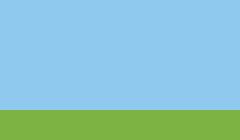 | 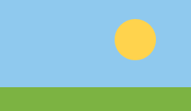 |

**Como resolver:** escreva primeiro o que fica **atrás** (céu, chão) e depois o que fica **na frente** (sol, personagem). Se não for isso, confira também:

- a camada da forma é `guide` (só aparece com **Guias** ligado), `hidden`, ou tem `only=` com outras animações;
- a forma tem `hidden`, `opacity=0`, ou `c=none` sem `ink=` (sem preenchimento e sem contorno, não sobra nada);
- a forma está fora do `canvas`. Lembre que o **y cresce para baixo**: `y=500` num `canvas` de 200 de altura fica fora, embaixo.

### A forma ficou atrás (ou na frente) da outra

**O que você vê:** duas formas se cobrem ao contrário do que você queria.

**Por quê:** cada camada é pintada inteira, na ordem do arquivo. Dentro dela, as formas também seguem a ordem do arquivo. Um componente é pintado na linha do `use`, não na do `def`.

**Como resolver:** mude a linha de lugar, ou passe a forma para outra camada. Veja a [ordem de pintura](04-camadas.md#a-ordem-de-pintura).

### "não está na mesma camada" no `above=` ou `below=`

**O que você vê:**

```
erro: "chao" não está na mesma camada que "sol" (para trocar camadas inteiras, use os nomes das camadas)
```

**Por quê:** numa animação, `key 6 braco.above=corpo` passa o braço para a frente do corpo no quadro 6. O `above=` e o `below=` só trocam a ordem **dentro** de uma camada.

**Como resolver:** ponha as duas formas na mesma camada:

```
key 0 bracoD.below=corpo     # no quadro 0, o braço está atrás do corpo
key 6 bracoD.above=corpo     # no quadro 6, passa para a frente
```

Ou troque as camadas inteiras, com os nomes delas: `key 8 frente.above=fundo`, em que `frente` e `fundo` são camadas. O [capítulo 9](09-animacao.md#trocar-quem-fica-na-frente-above-e-below) tem o exemplo completo, com a imagem.

### O contorno não aparece

**O que você vê:** a forma sai lisa, sem a linha em volta.

**Por quê:** no Weasel, uma forma **não tem contorno** até você pedir. O `c=` só pinta o lado de dentro.

<!-- gerar: img/13_sem_contorno.png -->
```weasel
canvas 240 140 bg=#f4efe6
ellipse bola 120,70 50 c=#ff6b4a
```

<!-- gerar: img/13_com_contorno.png -->
```weasel
canvas 240 140 bg=#f4efe6
ellipse bola 120,70 50 c=#ff6b4a ink=line
```

| Sem `ink=` | Com `ink=line` |
|---|---|
| 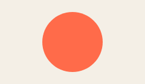 | 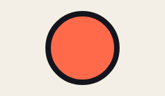 |

**Como resolver:** ponha `ink=` com a grossura do contorno: um número (`ink=4`) ou um nome da `palette` (`ink=line`, que vale 8; veja os [nomes que já existem](03-cores.md#a-cor-da-tinta-e-os-nomes-prontos)). Se mesmo assim não aparece, procure `finish flat` no arquivo: ele tira todos os contornos de propósito.

### O contorno ficou fino de um lado

**O que você vê:** uma sombra ou um reflexo dentro da forma "come" a metade de dentro do contorno. Se a sombra encosta na borda toda (um sombreado nas beiradas, por exemplo), o contorno fica fino na volta inteira, como se fosse mais fino do que você escreveu.

**Por quê:** o contorno é pintado junto com a forma. A camada recortada (`clip=`) vem depois e é pintada por cima dele.

**Como resolver:** mande o contorno para uma camada que fica por cima de tudo, com `inkon=`:

```
layer bolas
ellipse bola 110,110 80 c=bola ink=line inkon=contorno

layer reflexo clip=bola
ellipse brilho 160,160 70 c=reflexo

layer contorno          # vazia: só recebe o contorno da bola
```

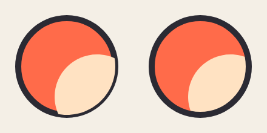

O exemplo completo está no [capítulo 4](04-camadas.md#o-contorno-por-cima-inkon).

### O padrão não aparece no traço

**O que você vê:**

```
aviso: o padrão "listra" só preenche formas fechadas (shape, ellipse, rect): o traço sai sem o padrão, só na cor das linhas dele (#c44536)
```

**Por quê:** um `pattern` (hachura ou pontos) preenche o **lado de dentro** de uma forma. Um `stroke`, uma `line`, um `text` e o contorno (`inkc=`) não têm lado de dentro: eles saem lisos, na cor das linhas do padrão.

**Como resolver:** use o padrão no `c=` de uma forma fechada (`shape`, `ellipse`, `rect`). Para um traço tracejado, use `dash=` numa `line` ([capítulo 2](02-formas.md)).

### `cap=` não muda a ponta do traço

**O que você vê:**

```
aviso: cap= não vale junto com taper=: o traço afinado sai sempre com as pontas redondas
```

**Por quê:** `taper=` desenha o traço em pedaços de grossuras diferentes, e cada pedaço tem a ponta redonda. O `cap=` só vale para o traço de grossura igual.

**Como resolver:** escolha um dos dois: `taper=` para afinar as pontas, ou `cap=butt`/`cap=square` para uma ponta reta.

### A forma ficou redonda (ou fez uma volta) onde eu queria uma ponta

**O que você vê:** você queria um triângulo, e saiu uma gota ou um ovo.

**Por quê:** um ponto escrito só como `x,y` é **liso**: a linha passa por ele fazendo curva. Com todos os pontos lisos, nenhum lado fica reto. Um ponto com `!` no fim (`x,y!`) é um **canto vivo**: a linha chega e sai em reta.

<!-- gerar: img/13_curva_lisa.png -->
```weasel
canvas 240 150 bg=#f4efe6
line base c=#9a9a9a dash=6,4 : 0,110 240,110
shape morro c=#6cbf4a ink=4 : 30,110 120,30 210,110
```

<!-- gerar: img/13_curva_meio.png -->
```weasel
canvas 240 150 bg=#f4efe6
line base c=#9a9a9a dash=6,4 : 0,110 240,110
shape morro c=#6cbf4a ink=4 : 30,110! 120,30 210,110!
```

<!-- gerar: img/13_curva_cantos.png -->
```weasel
canvas 240 150 bg=#f4efe6
line base c=#9a9a9a dash=6,4 : 0,110 240,110
shape morro c=#6cbf4a ink=4 : 30,110! 120,30! 210,110!
```

| Os três pontos lisos | Cantos só embaixo | Os três com `!` |
|---|---|---|
| 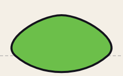 | 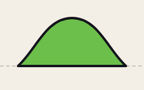 | 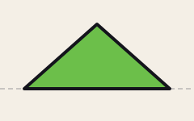 |

Repare na linha tracejada: com os pontos lisos, a forma passa **por baixo** do chão, porque a curva continua depois de cada ponto.

**Como resolver:** ponha `!` onde deve haver canto. Se a curva ainda fizer uma volta estranha, acrescente um ponto no meio do trecho, ou afaste dois pontos lisos que estão muito perto um do outro. Para controlar a curva de um ponto, use uma alça `x,y~dx,dy` ([capítulo 2](02-formas.md#curvas-sob-medida-alças)).

### O recorte (`clip=`) apagou a camada inteira

**O que você vê:**

```
aviso: clip: "risco" é um traço aberto; o molde precisa ser uma forma fechada (shape, ellipse ou rect) ou uma camada
```

**Por quê:** o recorte mostra só o que fica **dentro** do molde. Um `stroke` ou uma `line` é um traço aberto: não tem lado de dentro, então nada aparece.

**Como resolver:** use como molde uma forma fechada (`shape`, `ellipse`, `rect`) ou o nome de uma camada.

### A variante não muda a cor

**O que você vê:** você criou a variante `noite`, mas o telhado continua igual nela.

**Por quê:** a variante troca **nomes da `palette`**. Uma cor escrita direto (`c=#c4512b`) não tem nome, então a variante não tem o que trocar. O nome da forma também não serve: com `telhado=#5a2a20` na variante, o Weasel avisa `"telhado" não está na palette`.

<!-- gerar: img/13_variante_errada.png --variant noite -->
```weasel
canvas 240 140 bg=ceu
palette ceu=#bfe3f5 parede=#f1d9b5
rect casa 70,60 100,70 c=parede ink=4
shape telhado c=#c4512b ink=4 : 60,62! 120,20! 180,62!
variant noite ceu=#1b2140 parede=#8a7d70
```

<!-- gerar: img/13_variante_certa.png --variant noite -->
```weasel
canvas 240 140 bg=ceu
palette ceu=#bfe3f5 parede=#f1d9b5 telhado=#c4512b
rect casa 70,60 100,70 c=parede ink=4
shape telhado c=telhado ink=4 : 60,62! 120,20! 180,62!
variant noite ceu=#1b2140 parede=#8a7d70 telhado=#5a2a20
```

| Errado: `c=#c4512b` (as duas na variante `noite`) | Certo: `c=telhado` |
|---|---|
| 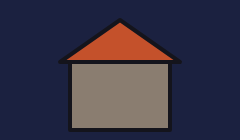 | 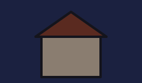 |

**Como resolver:** dê um nome na `palette` a toda cor que você talvez queira trocar, e use o nome na forma.

### O texto sai diferente em outro computador

**O que você vê:** o mesmo arquivo mostra outra letra em outra máquina.

**Por quê:** o `text` usa as fontes instaladas no computador. Uma fonte que não existe lá é trocada por outra.

**Como resolver:** use fontes que todo computador tem (`font=sans-serif`, `font=serif`, `font=monospace`), ou instale a mesma fonte nos dois computadores.

## Ossos e animação

### Animei o osso e nada se mexe

**O que você vê:** a animação toca, mas a forma fica parada.

**Por quê:** um osso sozinho não desenha nada. Ele só move as formas que dizem `bone=nome_do_osso`. É o erro mais comum.

<!-- gerar: img/13_sem_bone.gif -a acena -s 0.5 -->
```weasel
canvas 240 160 bg=#f4efe6
palette ink=#2b2a33
bone braco pivot=70,80
rect corpo 40,60 40,90 r=8 c=#4a90d9 ink=3
rect mao 70,74 100,12 r=6 c=#f2c9a0 ink=3
anim acena frames=12
key 0 braco=0,0,-30
key 6 braco=0,0,30
key 12 braco=0,0,-30
```

<!-- gerar: img/13_com_bone.gif -a acena -s 0.5 -->
```weasel
canvas 240 160 bg=#f4efe6
palette ink=#2b2a33
bone braco pivot=70,80
rect corpo 40,60 40,90 r=8 c=#4a90d9 ink=3
rect mao 70,74 100,12 r=6 c=#f2c9a0 ink=3 bone=braco
anim acena frames=12
key 0 braco=0,0,-30
key 6 braco=0,0,30
key 12 braco=0,0,-30
```

| Errado: o braço sem `bone=` | Certo: `bone=braco` |
|---|---|
| 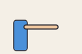 |  |

**Como resolver:** a única diferença é o `bone=braco` no fim da linha do `rect mao`. Se as formas já têm `bone=`, confira também:

- o player está na pose parada ou em outra animação: escolha a animação no player;
- a `key` está dentro de outra `anim` (cada `key` vale para o `anim` que veio antes dela).

### "falta pivot=x,y"

**O que você vê:**

```
erro: falta pivot=x,y
  2 | bone braco
    | ^^^^
```

**Por quê:** todo osso gira em volta de um ponto, o pivô. Sem `pivot=`, o Weasel não sabe onde fica a articulação.

**Como resolver:** escreva o ponto da articulação: `bone braco pivot=70,80` (o ombro).

### A parte gira em volta do lugar errado

**O que você vê:** o braço gira como uma hélice, pelo meio, em vez de girar no ombro.

**Por quê:** o osso gira em volta do `pivot=`. O pivô é a **articulação**: o ombro para o braço, o pescoço para a cabeça, o meio dos pés para o corpo inteiro.

<!-- gerar: img/13_pivo_errado.gif -a acena -s 0.5 -->
```weasel
canvas 240 160 bg=#f4efe6
palette ink=#2b2a33
bone braco pivot=120,80
rect corpo 40,60 40,90 r=8 c=#4a90d9 ink=3
rect mao 70,74 100,12 r=6 c=#f2c9a0 ink=3 bone=braco
ellipse pino 120,80 4 c=#e8443a
anim acena frames=12
key 0 braco=0,0,-30
key 6 braco=0,0,30
key 12 braco=0,0,-30
```

<!-- gerar: img/13_pivo_certo.gif -a acena -s 0.5 -->
```weasel
canvas 240 160 bg=#f4efe6
palette ink=#2b2a33
bone braco pivot=70,80
rect corpo 40,60 40,90 r=8 c=#4a90d9 ink=3
rect mao 70,74 100,12 r=6 c=#f2c9a0 ink=3 bone=braco
ellipse pino 70,80 4 c=#e8443a
anim acena frames=12
key 0 braco=0,0,-30
key 6 braco=0,0,30
key 12 braco=0,0,-30
```

| Errado: `pivot=120,80` (meio do braço) | Certo: `pivot=70,80` (ombro) |
|---|---|
| 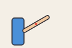 | 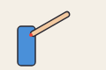 |

**Como resolver:** o pontinho vermelho marca o pivô. Ponha o `pivot=` exatamente na articulação. No editor, ligue **Ossos** para ver onde ele está.

### O filho não acompanha o pai

**O que você vê:** a primeira metade do braço gira, e a segunda fica parada no ar.

**Por quê:** um osso só segue outro se disser `parent=`. Sem isso, o antebraço fica parado quando o braço gira.

<!-- gerar: img/13_sem_parent.gif -a acena -s 0.5 -->
```weasel
canvas 240 160 bg=#f4efe6
palette ink=#2b2a33
bone braco pivot=70,80
bone antebraco pivot=120,80
rect corpo 40,60 40,90 r=8 c=#4a90d9 ink=3
rect parte1 70,74 50,12 r=6 c=#f2c9a0 ink=3 bone=braco
rect parte2 120,74 50,12 r=6 c=#e0b088 ink=3 bone=antebraco
anim acena frames=12
key 0 braco=0,0,-30
key 6 braco=0,0,20
key 12 braco=0,0,-30
```

<!-- gerar: img/13_com_parent.gif -a acena -s 0.5 -->
```weasel
canvas 240 160 bg=#f4efe6
palette ink=#2b2a33
bone braco pivot=70,80
bone antebraco pivot=120,80 parent=braco
rect corpo 40,60 40,90 r=8 c=#4a90d9 ink=3
rect parte1 70,74 50,12 r=6 c=#f2c9a0 ink=3 bone=braco
rect parte2 120,74 50,12 r=6 c=#e0b088 ink=3 bone=antebraco
anim acena frames=12
key 0 braco=0,0,-30
key 6 braco=0,0,20
key 12 braco=0,0,-30
```

| Errado: sem `parent=` | Certo: `parent=braco` |
|---|---|
| 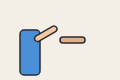 | 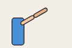 |

**Como resolver:** dê ao filho o `parent=` do pai. Só o osso `braco` é animado: com `parent=braco`, o `antebraco` vai junto, e ainda pode ter o próprio giro por cima (dobrar o cotovelo).

### O loop dá um tranco quando recomeça

**O que você vê:** a animação anda bem e, no fim de cada volta, a figura pula de uma pose para outra.

**Por quê:** uma animação com loop volta do último quadro para o primeiro. Se a última `key` não é igual à primeira, a figura **pula** na emenda.

<!-- gerar: img/13_tranco.gif -a anda -s 0.5 -->
```weasel
canvas 240 100 bg=#f4efe6
bone b pivot=40,50
ellipse bola 40,50 16 c=#ff6b4a ink=3 bone=b
anim anda frames=12
key 0 b=0
key 12 b=160
```

<!-- gerar: img/13_sem_tranco.gif -a anda -s 0.5 -->
```weasel
canvas 240 100 bg=#f4efe6
bone b pivot=40,50
ellipse bola 40,50 16 c=#ff6b4a ink=3 bone=b
anim anda frames=12
key 0 b=0
key 6 b=160
key 12 b=0
```

| Errado: a última `key` é diferente da primeira | Certo: a última `key` repete a primeira |
|---|---|
| 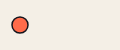 | 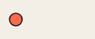 |

**Como resolver:** `key 0 b=0` é a bola no lugar (um número só é o deslocamento em x). Numa animação de 12 quadros, ponha em `key 12` a mesma pose de `key 0`.

### A animação começa numa pose estranha

**O que você vê:** no quadro 0, o personagem já está no meio de um movimento.

**Por quê:** num loop, os quadros antes da primeira `key` fazem a passagem da última `key` para a primeira, como no fim da volta anterior. Aqui, os quadros 0 a 3 vão da `key 8` (no chão) até a `key 4` (no alto): no quadro 0, o corpo já está no meio do caminho.

```
anim pula frames=12
key 4 corpo=0,-30     # sem key 0: os quadros 0 a 3 fazem a passagem da key 8 para a key 4
key 8 corpo=0,0
```

**Como resolver:** ponha uma `key 0` com a pose inicial de tudo o que é animado:

```
anim pula frames=12
key 0 corpo=0,0
key 4 corpo=0,-30
key 8 corpo=0,0
```

### "quadro … passa do fim"

**O que você vê:**

```
aviso: quadro 14 passa do fim (frames=12)
  6 | key 14 b=100
    |     ^^
```

**Por quê:** uma animação com `frames=12` tem os quadros de 0 a 12 (o 12 é o mesmo que o 0 da volta seguinte). Uma `key` depois do fim vai para o último quadro.

**Como resolver:** mude o número da `key`, ou aumente o `frames=`.

### Uma animação `once` começa ou termina torta

**O que você vê:** numa animação que toca uma vez (`once`), um osso já começa (ou termina) numa pose do meio.

**Por quê:** numa animação `once`, antes da primeira `key` vale a primeira, e depois da última vale a última. Um osso que aparece só numa `key` do meio fica com essa pose no começo e no fim.

**Como resolver:** escreva a pose **completa** (todos os ossos que mudam em algum momento) na primeira e na última `key`:

```
anim levanta frames=8 once
key 0 corpo=0,20 braco=0,0,0
key 8 corpo=0,0 braco=0,0,-60
```

### Balanço, tremor ou partículas não se mexem

**O que você vê:** você pôs `sway=`, `bob=` ou `jitter=` num osso (ou um `emitter`), e o desenho fica parado.

**Por quê:** num desenho ou personagem, eles andam no tempo de uma animação. Sem nenhuma animação tocando, o desenho é uma foto. (Num filme é diferente: lá, o `sway=`, o `bob=` e o `jitter=` andam mesmo sem `anim`.)

```
bone galho pivot=120,140 sway=8,2     # balança 8 graus a cada 2 segundos...
anim parado frames=24 fps=12          # ...mas só com uma animação tocando
```

**Como resolver:** crie uma animação, mesmo sem nenhuma `key`, e escolha-a no player.

### A mola enlouquece numa troca rápida

**O que você vê:** um osso com `spring=` sacode demais quando o pai se mexe de repente.

**Por quê:** a mola atrasa o osso quando o pai se mexe. Um movimento muito brusco sacode a mola demais.

**Como resolver:** deixe a mola mais dura, com o número mais perto de 1 (`spring=0.8` em vez de `spring=0.3`), ou tire a mola desse osso e anime-o com `key`.

### A virada (`turn`) parece derreter no meio

**O que você vê:** nos quadros do meio de uma virada, as formas ficam moles, como se uma parte escorresse para a outra.

**Por quê:** cada contorno vai, ponto a ponto, do desenho de lado ao de frente. No meio do caminho, ele não é nenhum dos dois desenhos: é uma média deles. Quanto mais diferentes as duas formas (um focinho comprido que vira um focinho curto), mais mole fica o meio.

**Como resolver:**

- Use poucos quadros: o padrão é 4; tente 3. O meio passa rápido, e no jogo o olho lê a virada como um giro.
- Confira os pares no `--info` ([capítulo 16](16-jogo-avancado.md#conferir-o-que-casou---info)). Uma parte casada com outra muito diferente derrete mais: case com outra (`pairs=`) ou desfaça o par com `born=`. Em `born=focinhoL->cabeca`, o focinho de lado some na cabeça, e o de frente nasce sozinho.

### O `draw` desenha do lado errado

**O que você vê:** o traço que se desenha aos poucos começa pela ponta que devia ser o fim.

**Por quê:** `draw` (desenhar aos poucos) vai sempre **do primeiro ponto para o último**.

<!-- gerar: img/13_draw_errado.gif -a risca -s 0.5 -->
```weasel
canvas 240 100 bg=#f4efe6
stroke caminho w=6 c=#2b2a33 : 220,60 140,30 80,70 20,40
shape ponta c=#e8443a : 220,60! 205,48! 207,66!
anim risca frames=12 once
key 0 caminho.draw=0
key 12 caminho.draw=1
```

<!-- gerar: img/13_draw_certo.gif -a risca -s 0.5 -->
```weasel
canvas 240 100 bg=#f4efe6
stroke caminho w=6 c=#2b2a33 : 20,40 80,70 140,30 220,60
shape ponta c=#e8443a : 220,60! 205,48! 207,66!
anim risca frames=12 once
key 0 caminho.draw=0
key 12 caminho.draw=1
```

| Errado: o traço começa na seta | Certo: o traço termina na seta |
|---|---|
|  | 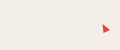 |

**Como resolver:** escreva os pontos na ordem contrária.

### "não combina" no morph

**O que você vê:**

```
erro: "b" não combina com "a": uma forma fechada só vira outra fechada, e um traço, outro traço
```

**Por quê:** o morph (`key … a.shape=b`) transforma uma forma em outra aos poucos. Uma forma fechada (`shape`, `ellipse`, `rect`) só vira outra fechada; um traço (`stroke`), outro traço. O número de pontos pode ser diferente.

**Como resolver:** use como alvo uma forma do mesmo tipo. Veja o morph no [capítulo 9](09-animacao.md#morph-uma-forma-vira-outra).

### "key precisa vir depois de um anim" e "osso … não existe"

**O que você vê:**

```
erro: key precisa vir depois de um anim
erro: osso "braco" não existe (para formas use nome.propriedade=valor)
```

**Por quê:** toda `key` pertence ao `anim` que vem antes dela. E `key 0 braco=…` (sem ponto) é a pose de um **osso**: se não há nenhum `bone braco` no arquivo, o Weasel não sabe o que mover.

**Como resolver:** escreva o `anim` antes das `key`. Para animar uma forma, use `nome.propriedade=` (`key 0 braco.opacity=0`). Para um osso, escreva a linha `bone`: ela pode vir antes ou depois da `key`, a ordem não importa.

### "o osso não tem caminho" no `along`

**O que você vê:**

```
erro: o osso "b" não tem caminho: use bone b … path=nome_de_uma_linha
```

**Por quê:** `along` (andar pelo caminho, de 0 a 1) só existe num osso que tem um caminho.

**Como resolver:** ponha `path=` na linha `bone`, com o nome de uma linha, traço ou forma: `bone b pivot=20,180 path=trilha`.

### O `mix=` dá erro

**O que você vê:**

```
erro: use mix=base,ação bones=osso1,osso2 (ex.: mix=walk_right,attack_right bones=braco)
```

**Por quê:** a animação combinada precisa das **duas** animações e dos ossos que vêm da segunda.

**Como resolver:** escreva as duas animações separadas por vírgula, e em `bones=` os ossos que vêm da ação: `anim anda_atira mix=anda,atira bones=braco`.

### O `mix=` dá um pulo quando recomeça

**O que você vê:** a animação combinada anda bem e, de repente, as pernas (ou o corpo) voltam de uma vez para trás, sempre no mesmo ponto. No editor:

```
aviso: o loop de "anda_pisca" (1,8 s) recomeça no meio de "anda" (2,667 s): back_right_paw, back_left_paw e mais 3 ossos pulam de volta. Use um tempo que feche o ciclo de "anda" (ou um múltiplo dele), como frames=32 fps=12
```

**Por quê:** o `mix=` copia os quadros pelo tempo. Com `frames=36 fps=20`, a combinada dura 1,8 s, mas o `anda` (32 quadros a 12 fps) dura 2,667 s: quando a combinada recomeça, o `anda` estava só no quadro 21 de 32, e volta para o 0 de uma vez.

**Como resolver:** dê à combinada um tempo que feche o ciclo da animação de onde os ossos vêm: o mesmo (tire `frames=` e `fps=`, ou use `frames=32 fps=12`) ou um múltiplo (`frames=64 fps=12`).

- Se o andar tem dois passos iguais (meio ciclo de 1,333 s), 4 s também fecha: `frames=80 fps=20`.
- Se a ação é só uma piscada, escolha um tempo que feche os dois ciclos. Um andar de 2,667 s e uma piscada de 2 s fecham juntos em 8 s.

### A `key` de opacidade não faz a forma aparecer

**O que você vê:** a `key` vai de `opacity=0` a `opacity=1`, e a forma continua invisível.

**Por quê:** a `opacity` da `key` **multiplica** a `opacity=` escrita na forma. Com `opacity=0` na forma, qualquer número vezes zero dá zero: ela fica invisível sempre.

```
ellipse bola 150,100 40 opacity=0      # errado: 1 × 0 = 0, nunca aparece
anim surge frames=12
key 0 bola.opacity=0
key 12 bola.opacity=1
```

**Como resolver:** tire o `opacity=0` da linha da forma e deixe a `key 0 bola.opacity=0` esconder a bola no começo.

### A `key` de `show` não faz a forma aparecer

**O que você vê:**

```
aviso: "bola" tem hidden e nunca aparece numa animação: show= não muda isso (para começar escondida, tire o hidden e use key 0 bola.show=0)
```

**Por quê:** numa animação, `hidden` quer dizer "nunca aparece": a forma só serve de molde (`cut=`, `clip=`, `back=`…). Nenhuma `key` muda isso, nem `show=1`, nem `opacity=`. (Num filme é diferente: lá, `at … bola.show=1` mostra uma forma com `hidden`, como no [capítulo 17](17-filme.md#aparecer-show-ou-opacity).)

```
ellipse bola 150,100 40 hidden      # errado: hidden ganha da key
anim surge frames=12
key 6 bola.show=1
```

**Como resolver:** tire o `hidden` e esconda a forma com uma `key` no quadro 0:

```
ellipse bola 150,100 40             # certo: sem hidden
anim surge frames=12
key 0 bola.show=0
key 6 bola.show=1
```

Para uma peça que aparece só numa versão do personagem, use `hidden` com `variant … show=` ([capítulo 6](06-componentes.md#trocar-peças-show-e-hide)): aí a `key` funciona nessa versão.

### A `key` de `tint` não muda a cor

**O que você vê:**

```
aviso: a camada "corpo" não tem tint=cor,quanto: sem a cor, corpo.tint= não pinta nada
```

**Por quê:** a `key camada.tint=` muda só o **quanto** da cor (de 0 a 1). A cor vem do `tint=` escrito na linha da camada. Sem ele, não há cor para misturar.

**Como resolver:** ponha a cor na camada, com quanto 0 para começar sem mudança:

```
layer corpo tint=#ff0000,0          # a cor do piscar; 0 = nada no começo
anim dano frames=6
key 0 corpo.tint=0
key 2 corpo.tint=0.8
key 6 corpo.tint=0
```

### O tecido não balança a forma com `bones=`

**O que você vê:**

```
aviso: cloth= não vale junto com bones=: a forma dobra com os ossos e o tecido fica parado (use um dos dois)
```

**Por quê:** com `bones=`, cada ponto da forma segue uma média dos ossos da lista, com mais peso para os mais perto. O `cloth=` também quer mexer nos pontos. Os dois não se juntam, e vale o `bones=`.

**Como resolver:** escolha um. `bones=` para uma peça que dobra com o corpo (uma manga, uma cauda com ossos); `cloth=` para uma peça solta que balança sozinha (uma capa, uma bandeira).

### A perna com IK estica ou dobra demais

**O que você vê:** com o `ik`, a perna fica dobrada demais, ou estica e o pé sai do chão.

**Por quê:** o comprimento da perna é a distância do `hip=` ao pé **no desenho parado**. Se o corpo desce muito, a perna dobra demais. Se ele sobe mais do que a perna alcança, a perna estica e o pé sai do chão.

**Como resolver:** ajuste o quanto o corpo sobe e desce na animação, ou mude o `hip=`.

### O braço com `target=` não alcança a mão

**O que você vê:** o braço estica todo e mesmo assim não chega ao alvo.

**Por quê:** o alvo foi mais longe que o comprimento do braço: a distância do `hip=` (no braço, o ombro) ao pivô da mão, no desenho parado. O braço não estica.

**Como resolver:** mantenha o alvo ao alcance do braço.

### `@osso` numa elipse ou num retângulo

**O que você vê:**

```
erro: @osso só vale nos pontos de shape, stroke e line (depois do ":"): para o ellipse inteiro seguir um osso, use bone=; para ele esticar, reescreva como shape
```

**Por quê:** `@osso` prende um **ponto escrito** a um osso. Uma `ellipse` e um `rect` não têm pontos escritos: o centro e o canto deles não são pontos do contorno.

**Como resolver:** para a forma inteira seguir o osso, use `bone=`. Para só um lado dela esticar, reescreva a forma como `shape`, com os pontos do contorno, e prenda os que devem andar ([capítulo 8](08-ossos.md#pontos-presos-a-um-osso-osso)):

```
ellipse barriga 200,150@corpo 40,30                                  # errado
shape barriga : 160,150 200,120 240,150@pata 200,180                 # certo: só o lado direito estica
```

### "@osso nos pontos não vale junto com bones="

**O que você vê:**

```
aviso: @osso nos pontos não vale junto com bones=: a forma dobra pelos ossos da lista e os @ ficam parados (use um dos dois)
```

**Por quê:** com `bones=`, todos os pontos já seguem os ossos da lista, misturados pela distância. Os `@osso` não entram nessa conta.

**Como resolver:** escolha um. `bones=` para uma peça que dobra inteira (uma cauda, uma cobra); `@osso` para prender só alguns pontos e deixar o resto parado ou com o `bone=` da forma.

### "os ossos do ik fazem uma corrente"

**O que você vê:**

```
erro: os ossos do ik fazem uma corrente: o osso canela precisa de parent=coxa
```

**Por quê:** o `ik` gira a raiz e o meio, e a ponta vai junto porque é filha do meio. Se os ossos não são pai e filho, girar um não leva o outro.

**Como resolver:** escreva os três em ordem, da raiz para a ponta, e dê o `parent=` a cada um:

```
bone coxa pivot=240,160 parent=corpo
bone canela pivot=256,198 parent=coxa
bone pe pivot=248,240 parent=canela
ik pata bones=coxa,canela,pe foot=chao,248
```

### A perna do `ik` não gira quando arrasto o osso no editor

**O que você vê:** você arrasta a coxa no editor, e o editor avisa em vez de escrever a `key`.

**Por quê:** a raiz e o meio de um `ik` são girados pelo `ik` em todo quadro. Uma `key` de giro neles não apareceria.

**Como resolver:** mexa no que o `ik` segue: o corpo (o pé fica no chão) ou o osso do `target=`. A ponta continua girando pelas `key` dela.

## Componentes e arquivos

### "variável desconhecida"

**O que você vê:**

```
erro: {alto}: variável desconhecida "alto"
```

**Por quê:** a conta usa um nome que o Weasel não conhece. Dentro de um `def`, uma conta conhece os parâmetros da linha `def` (com o valor padrão) e as variáveis do `let`. Um parâmetro sem valor (`def arvore alto`) não conta.

**Como resolver:** declare o parâmetro com um número: `def arvore alto=60 cor=#4caf50`, ou crie a variável com `let alto=60`.

Os limites de um `repeat` dentro de um `def` dão outra mensagem:

```
erro: variável desconhecida "n": dentro de def, os limites do repeat usam números ou variáveis do let (os parâmetros do def só valem nas contas das linhas de dentro)
```

Os números do `repeat` (o `0..n`) não podem usar os parâmetros do `def`. Use um número (`repeat i 0..7`) ou uma variável do `let`. Nas contas das linhas de dentro do `repeat`, os parâmetros valem normalmente ([capítulo 6](06-componentes.md#repeat-dentro-do-componente)).

### "parâmetro desconhecido"

**O que você vê:**

```
aviso: parâmetro desconhecido "rr": o componente "bola" tem cor, r (e o use aceita scale, rot, flip, bone, cloth, opacity, z)
```

**Por quê:** o nome não é parâmetro do componente (os da linha `def`), nem uma opção do `use`. Quase sempre é erro de digitação: `rr=30` em vez de `r=30`. O Weasel ignora esse parâmetro.

**Como resolver:** use um dos nomes da lista. Para o componente ter um parâmetro novo, acrescente-o na linha `def`, com o valor padrão: `def bola cor=#ff6b4a r=20 brilho=0.7`.

### "componente … não existe"

**O que você vê:**

```
erro: componente "arvore" não existe
  2 | use arvore 10,10
    |     ^^^^^^
```

**Por quê:** o `use` chama um componente pelo nome, e não há nenhum `def arvore` no arquivo, nem num `include`.

**Como resolver:** confira o nome (letra por letra, sem acento). Se o componente está em outro arquivo, traga-o com `include` ([capítulo 6](06-componentes.md)).

### `include` não acha o arquivo

**O que você vê:**

```
desenho.weasel:1:9: erro: não achei o arquivo "cores.weasel"
```

**Por quê:** o Weasel procura o arquivo num lugar que depende de onde você roda.

**Como resolver:**

- Escreva o nome inteiro, com o `.weasel`: `include "cores"` não acha o `cores.weasel`.
- No **editor**, o arquivo incluído precisa estar aberto numa aba (**Arquivo › Abrir…**): o editor o acha pelo nome.
- Na **linha de comando**, o caminho é relativo à pasta do arquivo que faz o `include`. Se `cores.weasel` está numa pasta `comum`, escreva `include "comum/cores.weasel"`.

### Um erro aparece na linha do `include`

**O que você vê:**

```
desenho.weasel:1:9: erro: cores.weasel:2: esperado o centro no formato x,y
  1 | include "cores.weasel"
    |         ^^^^^^^^^^^^^^
```

**Por quê:** o erro está **dentro** do arquivo incluído. A mensagem aponta a linha do `include`, e depois de `erro:` vem o nome do arquivo de dentro e a linha de lá.

**Como resolver:** abra o arquivo de dentro e corrija a linha indicada: aqui, a linha 2 do `cores.weasel`.

### A imagem guia (`ref`) não aparece

**O que você vê:** a linha `ref` está no arquivo, mas a imagem não aparece por baixo do desenho.

**Por quê:** a imagem não foi encontrada, ou está escondida para aquela animação.

**Como resolver:**

- No **editor**, a imagem precisa estar guardada no navegador. O aviso "não achei a imagem" diz qual falta. Há três jeitos de guardar:
  - no painel **Referências**, o botão **abrir …** ao lado dela;
  - **Adicionar imagem…**, no mesmo painel;
  - arrastar a imagem do computador para a janela.
- Confira o `only=` e o `frames=`: com uma animação escolhida no player, só aparecem as imagens guia dela, e a pose parada se chama `pose`. Confira também o `hidden` e a caixa **mostrar** do painel.
- Na **linha de comando**, ela só aparece com `--refs`, e o caminho é relativo ao arquivo `.weasel`.
- Uma imagem guia escrita num arquivo incluído não aparece: o `ref` só vale no arquivo onde está.
- Num filme, a imagem guia ainda não aparece.

### A imagem guia não arrasta

**O que você vê:** no editor, arrastar a imagem guia não muda nada.

**Por quê:** ela está com `lock` (o cadeado no painel), ou a posição vem de uma `{conta}`: o editor não reescreve contas.

**Como resolver:** tire o `lock` (ou abra o cadeado), ou troque a conta por números.

## Filme

### "at só vale num filme" e "at precisa ficar dentro de um shot"

**O que você vê:**

```
erro: at só vale num filme (comece o arquivo com: film fps=24)
erro: at precisa ficar dentro de um shot
```

**Por quê:** o `at` muda alguma coisa no tempo de um filme. Num desenho (sem a linha `film`), ele não tem tempo para contar: para animar um desenho, use `anim` e `key`. Num filme com planos (`shot`), cada `at` conta do começo do plano dele, e um `at` antes do primeiro `shot` não tem plano.

**Como resolver:** num desenho, troque o `at` por uma `key` dentro de um `anim` ([capítulo 7](07-movimento.md)). Num filme, mova o `at` para baixo da linha `shot` certa ([capítulo 17](17-filme.md#mudanças-no-tempo-at)).

### "o marcador fica fora do shot"

**O que você vê:**

```
mark trovao 3s
shot a dur=2s
at trovao camera.fade=0.9     # o trovão cai no shot b, e este at está no a
shot b dur=2s
```

```
aviso: o marcador "trovao" (3s) fica fora do shot "a"
```

**Por quê:** o `at` que usa um marcador precisa estar no `shot` em que o marcador cai. O shot `a` dura 2 s, e o marcador está em 3 s, no shot seguinte. O `at` não vale.

**Como resolver:** mude o `at` para o plano certo, ou mude o tempo do `mark`.

### A expressão troca devagar demais

**O que você vê:** a carinha leva segundos para ficar brava.

**Por quê:** `at 3s heroi.expr=bravo` muda **aos poucos**, desde o `at` anterior até os 3 s.

**Como resolver:** repita a expressão de antes um pouco antes da troca. Assim a mudança dura só esse pedacinho:

```
at 2s heroi.expr=feliz       # até 2 s, continua feliz
at 2.2s heroi.expr=bravo     # muda para bravo entre 2 s e 2,2 s
```

### A transição (`in=`) mostra o plano anterior parado

**O que você vê:** durante a transição, o plano de antes congela, e só o novo anda.

**Por quê:** é assim que a transição funciona: o plano de antes fica parado no último quadro dele, e o plano novo já está andando.

**Como resolver:** para os dois se mexerem juntos, não use `in=`: junte as duas cenas num `shot` só e faça a troca com `at`.

### O ator voltou para o lugar no plano seguinte

**O que você vê:** no fim do plano `a`, o herói está à direita; no começo do plano `b`, ele aparece de volta à esquerda.

**Por quê:** cada `shot` começa com tudo como está na linha `actor`, e não onde o plano anterior terminou.

**Como resolver:** repita a posição no começo do plano:

```
shot a dur=3s
at 3s heroi.pos=900,560      # o herói termina em 900

shot b dur=3s
at 0s heroi.pos=900,560      # e o plano b começa com ele lá
```

### O ator começa a andar antes da hora

**O que você vê:** você escreveu `at 2s heroi.pos=…` para o herói andar em 2 s, e ele já sai andando devagar no começo do plano.

**Por quê:** o `at` muda aos poucos entre um `at` e o seguinte, e o valor da linha `actor` vale como `at 0s`. Um único `at 2s heroi.pos=…` faz o herói andar devagar de 0 s a 2 s.

**Como resolver:** repita a posição num `at` no começo do movimento:

```
actor heroi "heroi.weasel" 400,560
at 1.5s heroi.pos=400,560    # parado até 1,5 s
at 2s heroi.pos=700,560      # anda de 1,5 s a 2 s
```

### Na metamorfose (`morph=`), as partes erradas viram uma na outra

**O que você vê:** no meio da troca, a perna de um bicho vira a cabeça do outro, ou uma parte atravessa o desenho inteiro.

**Por quê:** as partes casam sozinhas pelo nome, pelo osso, pela cor e pelo lugar dentro do desenho de cada um. Com nomes diferentes e desenhos muito diferentes, o Weasel pode escolher um par ruim.

**Como resolver:** rode `node cli/weasel.js filme.weasel --info`: embaixo do plano, as linhas `vira:`, `nascem:` e `somem:` mostram cada par. Na linha do `morph=`, corrija o par que saiu errado: `pairs=pata3->perna1` casa à mão; `born=focinho->cabeca` desfaz o par do focinho e faz ele nascer da cabeça ([capítulo 18](18-filme-atuacao.md#quem-vira-quem-pairs-e-born)).

### Os pés escorregam no filme

**O que você vê:** o ator anda pelo cenário, mas as pernas vão num ritmo e o corpo em outro: ele desliza, ou anda no lugar depois de parar.

**Por quê:** a animação toca no ritmo dela, e o ator anda no ritmo dos `at`. Os dois não sabem um do outro.

**Como resolver:** ponha `feet=` na animação de andar e `speed=auto` no ator (`actor heroi "heroi.weasel" 80,400 anim=anda speed=auto`). A animação passa a acompanhar o quanto ele anda, e para quando ele para ([capítulo 18](18-filme-atuacao.md#andar-sem-escorregar-speedauto)).

Se o Weasel avisar que o ator anda mais de 3 vezes mais rápido do que os pés da animação (`speed=auto: o ator "…" anda mais rápido que 3× a passada…`), ele anda depressa demais para essa animação: troque para uma de correr naquele trecho.

### As pernas pulam quando o personagem troca de jeito de andar

**O que você vê:** de um jeito de andar para outro (de `run` para `run4`, na capivara), as pernas mudam de lugar de uma vez no quadro da troca.

**Por quê:** trocar de animação recomeça a nova do quadro 0, seja qual for o ponto em que a de antes estava.

**Como resolver:** peça a troca no mesmo ponto do passo. No filme, `at 1.2s capivara.anim=run4 phase` ([capítulo 18](18-filme-atuacao.md#trocar-sem-perder-o-passo-phase)); no Godot, `tocar("run4", velocity, true)` ([capítulo 15](15-jogo-personagem.md#no-jogo-a-velocidade-dos-pés)). Com `feet=` nas duas animações, o pé que está no chão continua no chão.

### A câmera mostra o lugar errado

**O que você vê:** o filme mostra só um canto do cenário.

**Por quê:** `camera x,y` é o ponto do cenário que fica **no meio** do quadro, e não o canto de cima.

**Como resolver:** para ver um cenário de 1920 × 1080 inteiro, ponha a câmera no meio dele: `camera 960,540`.

### O ator está deslocado

**O que você vê:** o personagem aparece longe do `x,y` que você escreveu.

**Por quê:** o ponto do arquivo dele que vai para o `x,y` é o `root=` do `unity` (ou o canto `0,0`, se o arquivo não tem `unity`).

**Como resolver:** escolha o ponto com `origin=`: `actor heroi "cavaleiro.weasel" 900,560 origin=240,400` ([capítulo 17](17-filme.md#o-ponto-que-vai-para-o-xy-origin)).

### O vídeo não sai

**O que você vê:** a linha de comando dá erro ao salvar um `.mp4`.

**Por quê:** o vídeo pela linha de comando precisa do programa ffmpeg instalado.

**Como resolver:** instale o ffmpeg. No Windows:

```bash
winget install ffmpeg
```

Se ele está instalado e a linha de comando não o acha, diga onde ele está com `--ffmpeg` ([capítulo 21](21-linha-de-comando.md#vídeo-de-um-desenho)). Sem ele, dá para exportar os quadros em PNG (`--frames`) ou um GIF. No editor, o botão **Vídeo** da janela **Exportar** grava um vídeo sem o ffmpeg.

## Profundidade (2.5D)

### Pus `z=` e nada mudou

**O que você vê:** a forma com `z=` continua no mesmo lugar.

**Por quê:** sem giro, o `z=` não tira nada do lugar. Ele vale quando a forma, o osso ou a camada **gira** (`yaw=`, `pitch=`, `floor`, `iso`), e para a ordem com `zsort`.

**Como resolver:** se você só quer pôr uma forma na frente de outra, mude a ordem das linhas. Para ver o efeito do `z=`, gire alguma coisa (veja o [capítulo 14](14-profundidade.md)).

### A carta virou e mostra a frente espelhada

**O que você vê:** a carta de costas mostra a palavra da frente, ao contrário.

**Por quê:** sem `back=`, o lado de trás é a própria frente vista por trás, como um papel contra a luz. E sem `zsort`, o desenho que fica na frente da carta continua por cima dela mesmo de costas.

<!-- gerar: img/13_sem_verso.png -->
```weasel
canvas 240 180 bg=#f4efe6
bone carta pivot=120,90 yaw=150
layer cartas
rect frente 70,20 100,140 r=10 c=#fff6e0 ink=4 bone=carta
text nome 120,100 "SOL" size=30 align=center c=#e8443a z=1 bone=carta bold
```

<!-- gerar: img/13_com_verso.png -->
```weasel
canvas 240 180 bg=#f4efe6
bone carta pivot=120,90 yaw=150
layer cartas zsort
rect frente 70,20 100,140 r=10 c=#fff6e0 ink=4 back=costas bone=carta
rect costas 70,20 100,140 r=10 c=#2e86ab ink=4 hidden
text nome 120,100 "SOL" size=30 align=center c=#e8443a z=1 bone=carta bold
```

| Errado: sem `back=` e sem `zsort` | Certo: `back=costas` e `zsort` |
|---|---|
| 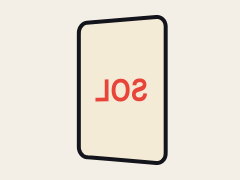 | 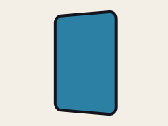 |

**Como resolver:** desenhe o verso numa forma com `hidden`, ligue-o com `back=verso` e ponha `zsort` na camada.

### O chão acaba antes do horizonte

**O que você vê:** a grama termina no meio do caminho, e o céu aparece onde devia haver chão.

**Por quê:** com `floor`, quanto mais para cima **no desenho** (o `y` menor), mais longe. Um chão curto termina antes do horizonte.

<!-- gerar: img/13_chao_curto.png -->
```weasel
canvas 240 150 bg=#bfe3f5
layer chao floor horizon=40
rect grama -200,-300 640,450 c=#7cb342
rect estrada 100,-300 40,450 c=#5d5d5d
```

<!-- gerar: img/13_chao_comprido.png -->
```weasel
canvas 240 150 bg=#bfe3f5
layer chao floor horizon=40
rect grama -20000,-20000 40240,20150 c=#7cb342
rect estrada 100,-20000 40,20150 c=#5d5d5d
```

| Errado: o chão vai só até `y=-300` | Certo: até `y=-20000` |
|---|---|
| 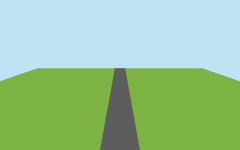 | 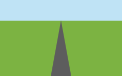 |

**Como resolver:** desenhe o chão bem comprido e bem largo (até `-20000`).

### O `horizon=` não muda nada

**O que você vê:**

```
aviso: horizon= não muda nada com persp= e pitch= juntos: o chão já fica decidido pelos dois (use só dois dos três)
```

**Por quê:** três opções decidem o chão: `pitch=`, `persp=` e `horizon=`. Duas delas bastam, e a terceira sai da conta. Com `persp=` e `pitch=`, o `horizon=` não muda nada.

**Como resolver:** apague um dos três. Para escolher onde o chão some, fique com `horizon=` e um dos outros dois (ou só com `horizon=`).

Numa camada sem `floor`, a mensagem é outra: `horizon= só vale junto com floor`. O horizonte é do chão em perspectiva: ponha `floor` na camada ([capítulo 14](14-profundidade.md#chão-em-perspectiva-floor)).

### No mapa `iso`, o chão cobre as caixas

**O que você vê:** a caixa do fundo fica meio enterrada no gramado.

**Por quê:** com `zsort`, cada forma é pintada na ordem do seu **meio**, de longe para perto. O meio do chão fica "na frente" das caixas do fundo, então ele é pintado por cima delas.

<!-- gerar: img/13_iso_errado.png -->
```weasel
canvas 240 150 bg=#20242e
layer tudo iso=120,20 zsort
rect piso 0,0 100,100 c=#9ccc65 ink=2
rect caixa 8,8 24,24 c=#d7a86e ink=2 thick=24
rect caixa2 64,64 24,24 c=#d7a86e ink=2 thick=24
```

<!-- gerar: img/13_iso_certo.png -->
```weasel
canvas 240 150 bg=#20242e
layer chao iso=120,20
rect piso 0,0 100,100 c=#9ccc65 ink=2
layer coisas iso=120,20 zsort
rect caixa 8,8 24,24 c=#d7a86e ink=2 thick=24
rect caixa2 64,64 24,24 c=#d7a86e ink=2 thick=24
```

| Errado: chão e caixas na mesma camada | Certo: o chão numa camada própria |
|---|---|
| 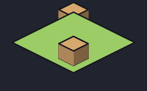 | 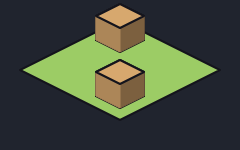 |

**Como resolver:** ponha o chão numa camada `iso` própria, **sem** `zsort`, antes da camada das coisas.

### As orelhas entram na cara quando a cabeça vira

**O que você vê:** com a cabeça virada, uma orelha aparece em cima do rosto.

**Por quê:** com `round=`, as peças do osso ficam na superfície de uma bola. Uma orelha fora do raio não tem onde ficar na bola e escorrega para dentro do rosto.

<!-- gerar: img/13_orelhas_erradas.png -->
```weasel
canvas 200 180 bg=#f4efe6
palette ink=#1c1f2b pele=#f2c9a0
bone rosto pivot=100,170 round=60,100,90 yaw=35
layer cabeca zsort
ellipse cranio 100,90 60 c=pele ink=3
ellipse orelhaE 40,95 10,15 c=pele ink=3 bone=rosto
ellipse orelhaD 160,95 10,15 c=pele ink=3 bone=rosto
ellipse olhoE 80,82 6,9 c=ink bone=rosto
ellipse olhoD 120,82 6,9 c=ink bone=rosto
```

<!-- gerar: img/13_orelhas_certas.png -->
```weasel
canvas 200 180 bg=#f4efe6
palette ink=#1c1f2b pele=#f2c9a0
bone rosto pivot=100,170 round=60,100,90 yaw=35
layer cabeca zsort
ellipse cranio 100,90 60 c=pele ink=3
ellipse orelhaE 40,95 10,15 c=pele ink=3 bone=rosto z=-20
ellipse orelhaD 160,95 10,15 c=pele ink=3 bone=rosto z=-20
ellipse olhoE 80,82 6,9 c=ink bone=rosto
ellipse olhoD 120,82 6,9 c=ink bone=rosto
```

| Errado: orelhas sem `z=` | Certo: orelhas com `z=-20` |
|---|---|
| 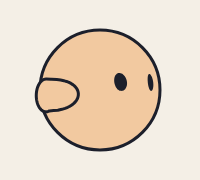 | 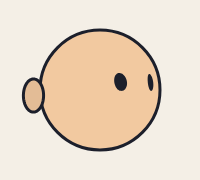 |

**Como resolver:** dê às orelhas um `z=` próprio (atrás do meio da cabeça) e ponha `zsort` na camada. Com `z=`, a peça não segue a bola do `round=`: ela gira como um papel plano, na distância do `z=`.

## Jogo e exportação

### Os pés escorregam no jogo

**O que você vê:** no Godot, o personagem anda mais depressa (ou mais devagar) do que os pés vão para trás no desenho.

**Por quê:** o código do jogo move o personagem numa velocidade, e a animação mexe os pés em outra.

**Como resolver** ([capítulo 15](15-jogo-personagem.md#andar-sem-escorregar-feet)):

1. Marque os pés: um `point` na sola de cada um e `feet=` no `anim`.
2. Leia a velocidade: o `--info` diz quantos pixels por segundo o personagem tem de andar, e no Godot o `velocidade()` dá o mesmo número, já na escala da cena.
3. Se o Weasel avisar que um pé escorrega, veja a trajetória (`--trajectory`, ou **Exibir › Trajetória** no editor): as bolinhas no chão têm de ficar em linha e igualmente espaçadas.
4. Veja a folha de conferência (`--contact`): ela marca em vermelho os quadros em que o pé escorrega ([capítulo 15](15-jogo-personagem.md#a-folha-de-conferência---contact)).

### O GIF ficou grande demais

**O que você vê:** o arquivo `.gif` tem muitos megabytes.

**Por quê:** granulado (`grain=`), degradês e muitos quadros pesam num GIF.

**Como resolver:** diminua o tamanho com `-s 0.5`, use menos quadros e tire o `grain`. Para filmes, prefira MP4.

```bash
node cli/weasel.js bola.weasel -a quica -o quica.gif -s 0.5
```

### As bordas do GIF transparente ficam serrilhadas

**O que você vê:** num fundo transparente, a borda do desenho fica em escadinha.

**Por quê:** o GIF só tem transparência de 1 bit: cada pixel é transparente ou não, sem meio-termo.

**Como resolver:** para a transparência suave, use PNG ou a sprite sheet.

### O `.tres` do Godot não acha a imagem

**O que você vê:** no Godot, o recurso abre sem imagem.

**Por quê:** o `.tres` aponta para o `.png` pelo nome do arquivo.

**Como resolver:** deixe os dois na mesma pasta do projeto do Godot.

### No Godot, o personagem flutua acima do chão

**O que você vê:** no jogo, os pés do personagem ficam uns 8 pixels acima do chão, mesmo com a colisão no lugar.

**Por quê:** a origem do nó (o ponto que fica na posição que o jogo dá ao personagem) é o `root=` do `godot`. Sem `root=`, ela fica no meio da base do **recorte**: o desenho mais 8 pixels de folga. Assim, a origem fica 8 pixels **abaixo** dos pés.

**Como resolver:** escreva o `root=` no ponto em que o personagem pisa, como `godot root=200,388`, e exporte de novo ([capítulo 15](15-jogo-personagem.md#a-origem-e-o-nome-root-e-name)).

### No Godot, a cabeça não vira

**O que você vê:**

```
aviso: o esqueleto do Godot não gira em 3D: yaw, pitch, z e iso ficam parados (use rig=frames)
```

**Por quê:** o esqueleto de verdade (`rig=bones`) usa os ossos do Godot, que não giram em 3D. Nas [três vistas](16-jogo-avancado.md#girar-em-3d-pitch-yaw-tip-e-turns) é diferente: lá o giro em 3D já vem pronto para cada vista, e vira o giro, a escala e o `skew` dos ossos do Godot, sem aviso.

**Como resolver:** exporte com `rig=frames` (o padrão), que leva cada quadro pronto.

### No Godot, a peça de transição não aparece

**O que você vê:** o arquivo tem `anim stop from=run to=idle`, as peças estão na folha, mas no jogo o personagem para seco.

**Por quê:** o `tocar("idle")` não conhece as peças. E, chamado a cada quadro, ele corta a peça que estiver tocando.

**Como resolver:** troque com `trocar("idle", velocity)` ([capítulo 16](16-jogo-avancado.md#no-jogo-trocar)). Ele escolhe a peça, toca o `idle` no fim dela e pode ser chamado a cada quadro.

### No Godot, a virada pela esquerda pula no último quadro

**O que você vê:** a virada de lado para a frente (`turn`) fica boa pela direita. Pela esquerda, no fim dela, o personagem dá um pulo: a espada troca de mão de uma vez.

**Por quê:** o Godot ganha o lado esquerdo espelhando o direito, e isso vale também para as peças. A `vira_0_left` é a `vira_0_right` espelhada: ela termina na vista de frente espelhada. O `idle_down` que vem depois não é espelhado. Com uma frente simétrica, não se nota; com algo de um lado só, o último quadro da virada não bate com o primeiro do `idle_down`.

**Como resolver:** deixe a vista de frente simétrica, ou quase: o que fica de um lado só deve ser pequeno.

### No Godot, o sprite fica preso na animação de antes

**O que você vê:** na cena por quadros, depois de uma troca de animação, o sprite continua mostrando a animação velha (ou mistura quadros das duas).

**Por quê:** um tempo de mistura no AnimationPlayer (`play("idle", 0.3)`, ou o *Blend Times* do editor do Godot) mistura bem os ossos, mas não o quadro do sprite. A troca de sprite acontece de uma vez, e o Godot não a aplica durante a mistura.

**Como resolver:** na cena por quadros, deixe os tempos de mistura em 0 e use as peças de transição (`anim … from= to=` e `trocar()`, no [capítulo 16](16-jogo-avancado.md#sair-de-uma-animação-sem-corte-from-e-to)). A mistura na hora vale para a cena com esqueleto (`rig=bones`), e o `trocar()` já cuida dela.

### No Godot, o desenho pula para o lado quando o personagem vira

**O que você vê:** o personagem anda para a direita direitinho; quando vira para a esquerda, o desenho salta para o lado, longe da colisão.

**Por quê:** o sprite da cena tem um `offset`, que põe o `root=` do desenho em cima da origem do nó. `flip_h = true` espelha a imagem, mas não espelha o `offset`, então o desenho espelhado fica fora do lugar. As caixas e os pontos de encaixe também não viram.

**Como resolver:** não vire o sprite à mão. Deixe o `tocar()` escolher a animação `_left`: o Weasel já gera as animações `_left` com o `offset`, as caixas e os pontos espelhados.

```gdscript
# errado: o desenho pula para o lado
$Sprite.flip_h = velocity.x < 0

# certo: toca walk_left ou walk_right
anim.tocar("walk", velocity)
```

[← Atalhos do teclado](23-atalhos.md) · [Índice](README.md) · [Próximo: Glossário →](25-glossario.md)
